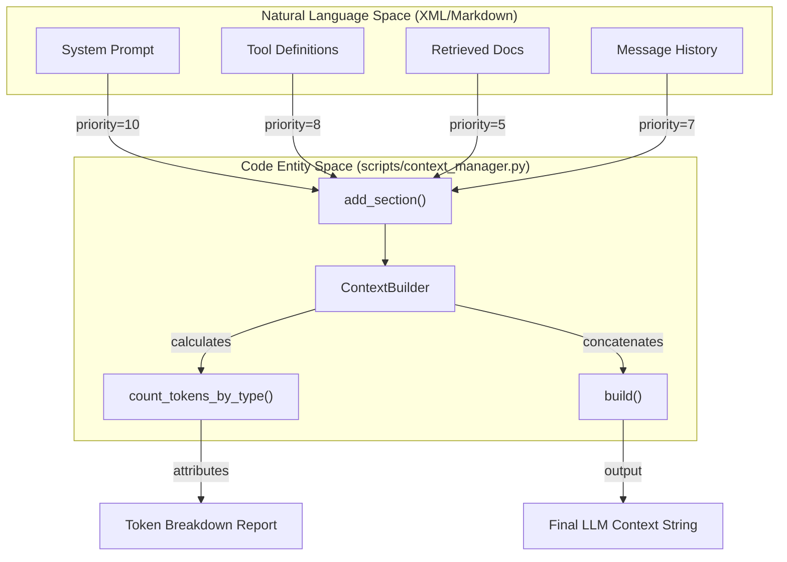
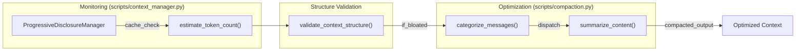

<!-- source: DeepWiki mcp.deepwiki.com · repo muratcankoylan/Agent-Skills-for-Context-Engineering · page 2.1 Context Fundamentals · fetched 2026-10-26 -->

# Context Fundamentals

Relevant source files

The following files were used as context for generating this wiki page:

- [LICENSE](LICENSE)
- [skills/context-degradation/references/patterns.md](skills/context-degradation/references/patterns.md)
- [skills/context-fundamentals/SKILL.md](skills/context-fundamentals/SKILL.md)
- [skills/context-fundamentals/references/context-components.md](skills/context-fundamentals/references/context-components.md)
- [skills/memory-systems/references/implementation.md](skills/memory-systems/references/implementation.md)
- [skills/memory-systems/scripts/memory_store.py](skills/memory-systems/scripts/memory_store.py)
- [skills/multi-agent-patterns/references/frameworks.md](skills/multi-agent-patterns/references/frameworks.md)
- [skills/project-development/SKILL.md](skills/project-development/SKILL.md)
- [skills/tool-design/SKILL.md](skills/tool-design/SKILL.md)

Context is the complete state available to a language model at inference time, comprising system instructions, tool definitions, retrieved documents, message history, and tool outputs [skills/context-fundamentals/SKILL.md:7-8](). This page explores the foundational mechanics of context engineering, focusing on the transition from viewing context as a "storage bin" to treating it as a finite, high-priority **attention budget** [skills/context-fundamentals/SKILL.md:31-32]().

The `context-fundamentals` skill is scoped exclusively to these conceptual foundations and mental models. Operational work—such as debugging attention failures, token-efficiency tactics, or conversation summarization—is routed to specialized skills like `context-degradation`, `context-optimization`, and `context-compression` [skills/context-fundamentals/SKILL.md:10-11]().

Sources: [skills/context-fundamentals/SKILL.md:7-11](), [skills/context-fundamentals/SKILL.md:31-32]()

## The Attention Budget & Performance Gradients

In agent systems, the attention mechanism computes $n^2$ pairwise relationships for $n$ tokens. As context grows, the model's ability to maintain these relationships degrades not as a hard cliff, but as a performance gradient [skills/context-fundamentals/SKILL.md:71-73]().

### The Lost-in-the-Middle Phenomenon
Research indicates a U-shaped attention curve where models demonstrate high recall at the beginning and end of the context window, while the middle section suffers from degraded attention [skills/context-fundamentals/SKILL.md:31-32](). This "U-shaped" curve is a critical constraint for prompt engineering and context layout.

| Metric | Beginning/End | Middle (The "Dip") |
| :--- | :--- | :--- |
| **Attention Region** | Favored (Primacy/Recency) | Degraded |
| **Information Type** | Constraints, Final Instructions | Supporting Data, Old History |
| **Engineering Action** | Place critical constraints here | Evict or summarize content here |

The `degradation_detector.py` script simulates this curve via `_estimate_attention` to help engineers identify when critical information is at risk [skills/context-degradation/scripts/degradation_detector.py:81-97]().

### Effective Capacity vs. Nominal Window
While models advertise large context windows (e.g., 200k+ tokens), the **effective capacity**—the point where complex dependencies remain reliable—is typically materially below the nominal limit [skills/context-fundamentals/SKILL.md:74-75](). Performance degradation begins well before the hard token limit is reached, requiring proactive management of the attention budget.

Sources: [skills/context-fundamentals/SKILL.md:31-32](), [skills/context-fundamentals/SKILL.md:71-75](), [skills/context-degradation/scripts/degradation_detector.py:81-97]()

## Anatomy of Context (XML Partitioning)

To maximize signal-to-noise ratios, context is partitioned into distinct functional blocks. The codebase recommends using XML tags or Markdown headers to enforce this structure, allowing the model to distinguish between instructions and data [skills/context-fundamentals/SKILL.md:44-45]().

### Context Components and Their Roles

| Component | Role | Management Strategy |
| :--- | :--- | :--- |
| **System Prompts** | Background & Constraints | High priority; placed at start/end [skills/context-fundamentals/SKILL.md:45-46](). |
| **Tool Definitions** | Agent Capabilities | Minimal sets; consolidated to avoid ambiguity [skills/context-fundamentals/SKILL.md:54-55](). |
| **Retrieved Docs** | Grounding Knowledge | Just-in-time loading; semantic chunking [skills/context-fundamentals/SKILL.md:56-57](). |
| **Message History** | Scratchpad / Task State | Monitored for compaction; replacement of stale outputs [skills/context-fundamentals/SKILL.md:61-64](). |
| **Tool Outputs** | Observations | Dominant token consumer; requires masking [skills/context-fundamentals/SKILL.md:66-67](). |

### Context Structure Visualization
The following diagram bridges the natural language prompt structure to the `ContextBuilder` code implementation.

**Diagram: Context Assembly and Token Attribution**

Sources: [skills/context-fundamentals/scripts/context_manager.py:94-126](), [skills/context-fundamentals/scripts/context_manager.py:133-152](), [skills/context-fundamentals/SKILL.md:44-46]()

## State Preservation Interfaces

In long-running agent sessions, specific interfaces serve to keep the context window lean by externalizing state:

1.  **CLAUDE.md**: Stores project-specific configuration, build commands, and coding style. It acts as a static project system prompt [skills/context-fundamentals/SKILL.md:44-45]().
2.  **NOTES.md**: Serves as a dynamic scratchpad for offloading complex reasoning or multi-step progress [skills/context-fundamentals/SKILL.md:61-62]().
3.  **Filesystem Context**: Large tool outputs or durable state should be offloaded to files rather than kept in the message history [skills/context-fundamentals/SKILL.md:10-11](). This is managed by the `filesystem-context` skill and the `ObservationStore` [skills/context-optimization/scripts/compaction.py:49-50]().

Sources: [skills/context-fundamentals/SKILL.md:10-11](), [skills/context-fundamentals/SKILL.md:44-45](), [skills/context-fundamentals/SKILL.md:61-62](), [skills/context-optimization/scripts/compaction.py:49-50]()

## Compaction Trigger Lifecycle

Compaction is the process of reducing context volume while preserving essential signal. In the `context-fundamentals` mental model, this is viewed as an iterative curation discipline [skills/context-fundamentals/SKILL.md:38-39]().

### The Compaction Flow
1.  **Estimation**: `estimate_message_tokens` uses a ~4 chars/token heuristic to monitor usage [skills/context-fundamentals/scripts/context_manager.py:79-91]().
2.  **Categorization**: `categorize_messages` separates content into types (system, tool, conversation) to apply different pruning priorities [skills/context-optimization/scripts/compaction.py:104-138]().
3.  **Summarization**: `summarize_content` applies strategy-specific logic, such as extracting metrics from tool outputs or decisions from conversations [skills/context-optimization/scripts/compaction.py:141-157]().

**Diagram: Context Management Logic**

Sources: [skills/context-fundamentals/scripts/context_manager.py:62-76](), [skills/context-fundamentals/scripts/context_manager.py:154-160](), [skills/context-optimization/scripts/compaction.py:104-157]()

## Progressive Disclosure

To prevent context bloat, the system implements **Progressive Disclosure**: loading information only as it becomes necessary for the current task [skills/context-fundamentals/SKILL.md:37-38]().

*   **Just-in-Time Retrieval**: Maintain an index (file paths) and load data only when requested [skills/context-fundamentals/SKILL.md:56-57](). This is implemented via the `ProgressiveDisclosureManager` [skills/context-fundamentals/scripts/context_manager.py:54-55]().
*   **Skill Activation**: Load skill names and summaries at startup; load full content only when a skill activates [skills/context-fundamentals/SKILL.md:37-38]().
*   **Observation Masking**: Replace verbose tool outputs with compact references once the agent has processed the result [skills/context-fundamentals/SKILL.md:67-68]().

Sources: [skills/context-fundamentals/SKILL.md:6-11](), [skills/context-fundamentals/SKILL.md:29-39](), [skills/context-fundamentals/SKILL.md:71-83](), [skills/context-fundamentals/scripts/context_manager.py:94-152](), [skills/context-optimization/scripts/compaction.py:104-157]()

---

