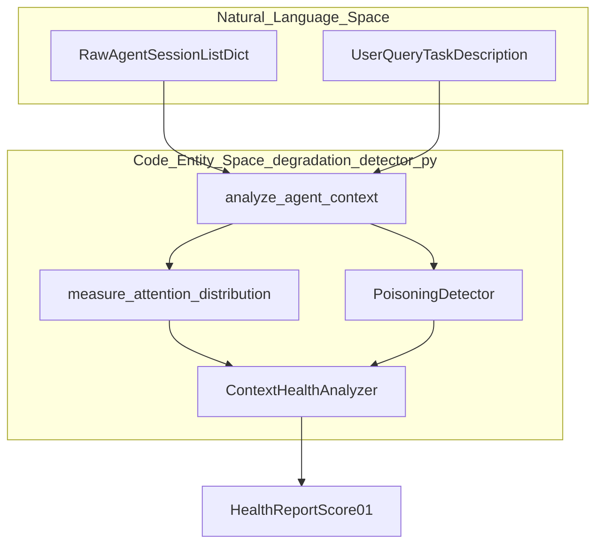
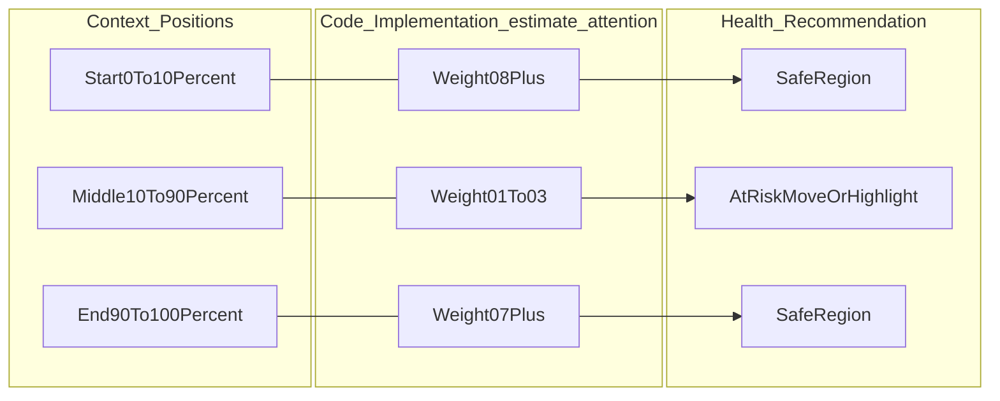

<!-- source: DeepWiki mcp.deepwiki.com · repo muratcankoylan/Agent-Skills-for-Context-Engineering · page 2.2 Context Degradation & Health Monitoring · fetched 2026-10-26 -->

# Context Degradation & Health Monitoring

Relevant source files

The following files were used as context for generating this wiki page:

- [skills/context-degradation/SKILL.md](skills/context-degradation/SKILL.md)
- [skills/context-degradation/scripts/degradation_detector.py](skills/context-degradation/scripts/degradation_detector.py)
- [skills/context-fundamentals/scripts/context_manager.py](skills/context-fundamentals/scripts/context_manager.py)
- [skills/context-optimization/SKILL.md](skills/context-optimization/SKILL.md)
- [skills/context-optimization/scripts/compaction.py](skills/context-optimization/scripts/compaction.py)
- [skills/evaluation/scripts/evaluator.py](skills/evaluation/scripts/evaluator.py)
- [skills/memory-systems/SKILL.md](skills/memory-systems/SKILL.md)
- [skills/multi-agent-patterns/SKILL.md](skills/multi-agent-patterns/SKILL.md)
- [skills/multi-agent-patterns/scripts/coordination.py](skills/multi-agent-patterns/scripts/coordination.py)
- [skills/tool-design/scripts/description_generator.py](skills/tool-design/scripts/description_generator.py)

Context degradation is a non-binary continuum of performance loss that occurs as an agent's context window fills with noise, contradictions, or poorly positioned information. This wiki page details the `context-degradation` skill, outlining mechanical failure modes, the Four-Bucket mitigation strategy, and programmatic health monitoring via `degradation_detector.py`.

---

## Failure Modes & Mitigation

The codebase identifies five predictable failure modes that degrade agent reasoning and output quality. Each pattern exhibits distinct detection signals and requires specific architectural remediation:

| Failure Mode | Description | Mitigation Strategy |
| :--- | :--- | :--- |
| **Lost-in-Middle** | U-shaped attention curve where middle tokens suffer 10-40% reduced recall accuracy [skills/context-degradation/SKILL.md:40-42](). | Place critical info at the beginning (primacy) or end (recency) [skills/context-degradation/SKILL.md:40-42](). |
| **Context Poisoning** | Hallucinations or errors enter the context and compound through self-reference [skills/context-degradation/SKILL.md:30-30](). | Truncate to before the poisoning point; do not layer corrections over errors [skills/context-degradation/SKILL.md:53-55](). |
| **Context Distraction** | Irrelevant documents compete for the limited attention budget [skills/context-degradation/SKILL.md:32-32](). | Aggressive relevance filtering; move "maybe useful" info behind tool calls [skills/context-degradation/SKILL.md:58-61](). |
| **Context Confusion** | Model applies constraints from one task to a different, unrelated task [skills/context-degradation/SKILL.md:34-34](). | Isolate tasks into separate context windows or use explicit reset markers [skills/context-degradation/SKILL.md:64-67](). |
| **Context Clash** | Mutually contradictory but individually correct facts (e.g., version conflicts) [skills/context-degradation/SKILL.md:36-36](). | Establish source priority rules and explicit version filtering [skills/context-degradation/SKILL.md:70-73](). |

Sources: [skills/context-degradation/SKILL.md:28-73]()

---

## The Four-Bucket Mitigation Framework

To maintain context health, information is managed through a tiered strategy that balances visibility with attention budget:

1.  **Write:** Direct placement in the current context window for immediate action. Optimized by `design_stable_prompt` to ensure KV-cache reuse [skills/context-optimization/scripts/compaction.py:11]().
2.  **Select:** Using RAG or tool-based retrieval (e.g., `VectorStore.search`) to bring only relevant chunks into view [skills/memory-systems/SKILL.md:78-85]().
3.  **Compress:** Summarizing historical turns via `summarize_conversation` in `compaction.py` to preserve "intent" while discarding "noise" [skills/context-optimization/scripts/compaction.py:186-192]().
4.  **Isolate:** Moving sub-tasks to fresh context windows (Multi-Agent patterns) via `SupervisorAgent.decompose_task` to prevent cross-contamination [skills/multi-agent-patterns/scripts/coordination.py:134-140]().

Sources: [skills/context-degradation/SKILL.md:58-60](), [skills/context-optimization/scripts/compaction.py:186-192](), [skills/multi-agent-patterns/scripts/coordination.py:134-140](), [skills/memory-systems/SKILL.md:78-85]()

---

## Implementation: Context Health Monitoring

The `degradation_detector.py` script provides the `ContextHealthAnalyzer` class and companion functions to quantify the health of an agent's current state [skills/context-degradation/scripts/degradation_detector.py:13-14]().

### Health Scoring Algorithm
`ContextHealthAnalyzer` calculates a composite score based on three primary vectors:
1.  **Attention Risk:** Measuring if critical tokens (identified via markers or position) are located in the U-curve's trough via `detect_lost_in_middle` [skills/context-degradation/scripts/degradation_detector.py:112-133]().
2.  **Poisoning Probability:** Using `PoisoningDetector` to scan for error accumulation patterns, tool misalignment, or repeated hallucinations [skills/context-degradation/scripts/degradation_detector.py:11-12](), [skills/context-degradation/SKILL.md:52-54]().
3.  **Utilization Density:** Assessing structural degradation risk factors and middle-content ratios via `analyze_context_structure` [skills/context-degradation/scripts/degradation_detector.py:166-177]().

### Data Flow: Health Analysis
The following diagram bridges the natural language concepts of agent sessions and tasks to the concrete Python classes and functions in `degradation_detector.py`.

Title: "Context Health Analysis Pipeline"

Sources: [skills/context-degradation/scripts/degradation_detector.py:13-15](), [skills/context-degradation/scripts/degradation_detector.py:45-160]()

---

## Technical Details: Attention Mapping

The `measure_attention_distribution` function simulates the attention mechanics of Transformer models to identify at-risk information [skills/context-degradation/scripts/degradation_detector.py:45-48]().

### Attention Curve Simulation
The helper `_estimate_attention` implements a mathematical model of the U-shaped curve documented in research:
*   **Primacy/Attention Sink:** Tokens at the start (`position < total * 0.1`) receive high weight via `0.8 + random.random() * 0.2` [skills/context-degradation/scripts/degradation_detector.py:98-99](), [skills/context-degradation/SKILL.md:28-28]().
*   **Recency:** Tokens at the end (`position > total * 0.9`) receive high weight via `0.7 + random.random() * 0.3` [skills/context-degradation/scripts/degradation_detector.py:100-101]().
*   **Degraded Middle:** Tokens in the middle linearize toward a low point of ~0.1–0.3 weight [skills/context-degradation/scripts/degradation_detector.py:103-105]().

### Attention-to-Code Mapping
The diagram below maps the abstract context regions to the scoring implementation in `degradation_detector.py`.

Title: "Attention-to-Code Mapping"

Sources: [skills/context-degradation/scripts/degradation_detector.py:81-106](), [skills/context-degradation/scripts/degradation_detector.py:151-157]()

---

## Usage Example

To analyze a session programmatically, use the `analyze_agent_context` convenience function [skills/context-degradation/scripts/degradation_detector.py:15-15]():
1. It tokenizes the input context via whitespace heuristics [skills/context-degradation/scripts/degradation_detector.py:21-22]().
2. It maps attention weights via `measure_attention_distribution` [skills/context-degradation/scripts/degradation_detector.py:45-48]().
3. It identifies critical positions via `detect_lost_in_middle` [skills/context-degradation/scripts/degradation_detector.py:112-115]().
4. It outputs a composite `degradation_score` ranging from `0.0` (fully healthy) to `1.0` (critical attention loss) [skills/context-degradation/scripts/degradation_detector.py:149-149]().

Sources: [skills/context-degradation/scripts/degradation_detector.py:15-15](), [skills/context-degradation/scripts/degradation_detector.py:112-160]()

---

