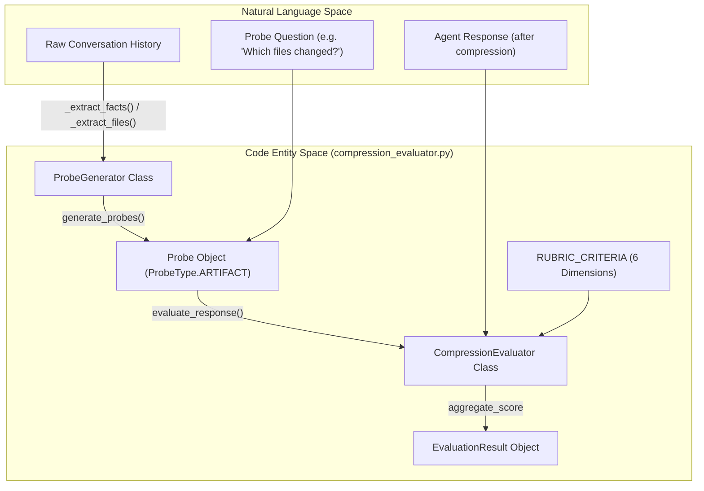
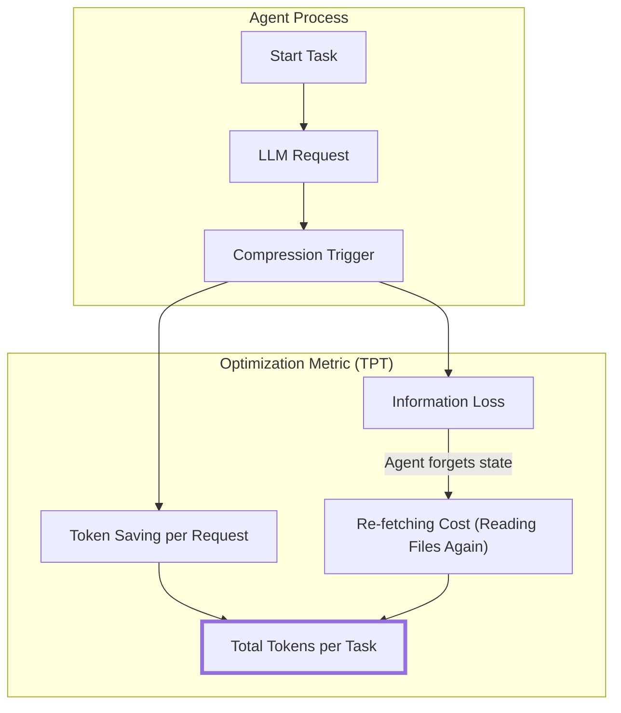

<!-- source: DeepWiki mcp.deepwiki.com · repo muratcankoylan/Agent-Skills-for-Context-Engineering · page 2.3 Context Compression · fetched 2026-10-26 -->

# Context Compression

Relevant source files

The following files were used as context for generating this wiki page:

- [docs/netflix_context.md](docs/netflix_context.md)
- [docs/vercel_tool.md](docs/vercel_tool.md)
- [skills/context-compression/SKILL.md](skills/context-compression/SKILL.md)
- [skills/context-compression/scripts/compression_evaluator.py](skills/context-compression/scripts/compression_evaluator.py)
- [skills/context-compression/tests/test_compression_evaluator.py](skills/context-compression/tests/test_compression_evaluator.py)
- [skills/tool-design/references/architectural_reduction.md](skills/tool-design/references/architectural_reduction.md)

## Purpose and Scope
This page covers the technical implementation, theory, and evaluation metrics of the `context-compression` skill (`skills/context-compression/`). It details how long-running agent sessions manage context window limits through Anchored Iterative Summarization, Opaque Compression, Artifact Trail preservation, StructuredSummarizer components, probe-based evaluation, the six-dimension rubric, and the Tokens-Per-Task (TPT) optimization framework.

---

## Compression Strategies

The system implements three primary approaches to compression based on session characteristics and the need for artifact tracking [skills/context-compression/SKILL.md:28]().

### 1. Anchored Iterative Summarization
This is the recommended strategy for long-running sessions where file tracking matters [skills/context-compression/SKILL.md:30](). It maintains a persistent, structured summary with explicit sections. When a compression trigger occurs, only the newly-truncated conversation span is summarized and then merged into the existing summary [skills/context-compression/SKILL.md:30](). This prevents the "drift" and cumulative detail loss common in wholesale regenerations [skills/context-compression/SKILL.md:30]().

### 2. Opaque Compression
Reserve this for short sessions where re-fetching costs are low and maximum token savings are required [skills/context-compression/SKILL.md:32](). It produces high-density representations (99%+ compression ratios) optimized for reconstruction fidelity rather than human readability [skills/context-compression/SKILL.md:32](). It is unsuitable for debugging or artifact tracking because there is no way to verify what was preserved without running probe-based evaluation [skills/context-compression/SKILL.md:32]().

### 3. Regenerative Full Summary
Generates a fresh detailed summary on each trigger [skills/context-compression/SKILL.md:34](). While readable, it suffers from "cumulative detail loss" where the model deprioritizes details preserved in previous cycles [skills/context-compression/SKILL.md:34]().

### Strategy Comparison
| Strategy | Trigger Point | Trade-off |
| :--- | :--- | :--- |
| **Fixed Threshold** | 70-80% context utilization | Simple but may compress too early [skills/context-compression/SKILL.md:89]() |
| **Sliding Window** | Keep last N turns + summary | Predictable context size; best for coding agents [skills/context-compression/SKILL.md:90-94]() |
| **Importance-based** | Compress low-relevance sections | Complex but preserves signal [skills/context-compression/SKILL.md:91]() |
| **Task-boundary** | Logical task completion | Clean summaries but unpredictable timing [skills/context-compression/SKILL.md:92]() |

Sources: [skills/context-compression/SKILL.md:28-36](), [skills/context-compression/SKILL.md:87-95]()

---

## The StructuredSummarizer Class

The `StructuredSummarizer` class implements the **Anchored Iterative Summarization** pattern [skills/context-compression/scripts/compression_evaluator.py:17-20](). It enforces a mandatory schema to prevent silent information loss, acting as a checklist that the agent must populate [skills/context-compression/SKILL.md:54-56]().

### Mandatory Summary Sections
A valid structured summary must include:
*   **Session Intent**: The high-level goal [skills/context-compression/SKILL.md:59-60]().
*   **Files Modified**: Full paths and specific changes (e.g., function names) [skills/context-compression/SKILL.md:62-65]().
*   **Decisions Made**: Rationale for technical choices [skills/context-compression/SKILL.md:67-70]().
*   **Current State**: Status of tests and pending work [skills/context-compression/SKILL.md:71-74]().
*   **Next Steps**: Actionable items for the next turn [skills/context-compression/SKILL.md:75-79]().

### Implementation Logic
The summarizer ensures that "Artifact Trails"—the record of file modifications and identifiers—are preserved, as this is the dimension most prone to degradation [skills/context-compression/SKILL.md:42-44](). The system explicitly tracks which files were created, modified, or read, including function and variable names [skills/context-compression/SKILL.md:46-52]().

Sources: [skills/context-compression/scripts/compression_evaluator.py:17-20](), [skills/context-compression/SKILL.md:42-56](), [skills/context-compression/SKILL.md:58-82]()

---

## Probe-Based Evaluation

Traditional metrics like ROUGE or embedding similarity fail to capture whether an agent can still perform its task [skills/context-compression/SKILL.md:97-98](). This codebase uses **Probe-based Evaluation**, where the system poses specific questions to the agent after compression to test functional retention [skills/context-compression/SKILL.md:100-101]().

### Probe Types
The `ProbeType` enum defines four categories of assessment [skills/context-compression/scripts/compression_evaluator.py:56-61]():

| Probe Type | What It Tests | Example Question |
| :--- | :--- | :--- |
| `RECALL` | Factual retention | "What was the original error message?" [skills/context-compression/SKILL.md:104]() |
| `ARTIFACT` | File tracking | "Which files have we modified?" [skills/context-compression/SKILL.md:105]() |
| `CONTINUATION` | Task planning | "What should we do next?" [skills/context-compression/SKILL.md:106]() |
| `DECISION` | Reasoning chain | "What did we decide about the Redis issue?" [skills/context-compression/SKILL.md:107]() |

### The Evaluation Pipeline
The `evaluate_compression_quality` function orchestrates the end-to-end evaluation flow, from probe generation to scoring [skills/context-compression/scripts/compression_evaluator.py:23-26]().

#### Data Flow: Natural Language to Code Entities
The following diagram illustrates how the `ProbeGenerator` and `CompressionEvaluator` bridge raw conversation history into structured evaluation results.

Compression Evaluation Data Flow

Sources: [skills/context-compression/scripts/compression_evaluator.py:102-185](), [skills/context-compression/scripts/compression_evaluator.py:188-212](), [skills/context-compression/scripts/compression_evaluator.py:288-310]()

---

## The Six-Dimension Rubric

Compression quality is measured across six specific dimensions using the `RUBRIC_CRITERIA` map [skills/context-compression/scripts/compression_evaluator.py:102]().

1.  **Accuracy**: Correctness of facts, file paths, and technical details [skills/context-compression/scripts/compression_evaluator.py:103-114]().
2.  **Context Awareness**: Reflection of the current conversation state and artifact state [skills/context-compression/scripts/compression_evaluator.py:115-126]().
3.  **Artifact Trail**: Awareness of created/modified files and key identifiers (function names, error messages) [skills/context-compression/scripts/compression_evaluator.py:127-143]().
4.  **Completeness**: Coverage and depth of the response [skills/context-compression/scripts/compression_evaluator.py:144-155]().
5.  **Continuity**: Ability to continue without re-fetching information or losing rationale behind decisions [skills/context-compression/scripts/compression_evaluator.py:156-172]().
6.  **Instruction Following**: Adherence to formats and constraints [skills/context-compression/scripts/compression_evaluator.py:173-184]().

### Heuristic Evaluation
The `CompressionEvaluator` uses heuristic scoring (e.g., `_heuristic_score`) to compare agent responses against ground truth, checking for artifact path mentions and substring matches [skills/context-compression/tests/test_compression_evaluator.py:24-33](), [skills/context-compression/tests/test_compression_evaluator.py:41-45]().

Sources: [skills/context-compression/scripts/compression_evaluator.py:102-185](), [skills/context-compression/tests/test_compression_evaluator.py:19-53]()

---

## Tokens-Per-Task (TPT) Optimization

The primary goal of the compression skill is reducing the total cost of a task. This is visualized by tracking the `Tokens-Per-Task` metric [skills/context-compression/SKILL.md:38]().

TPT Optimization Logic

**Key Principle**: A strategy that saves 0.5% more tokens per request but causes 20% more re-fetching (due to lost file paths or error codes) is objectively inferior [skills/context-compression/SKILL.md:40-41](). High re-fetching frequency is the primary signal that compression is too aggressive [skills/context-compression/SKILL.md:41]().

Sources: [skills/context-compression/SKILL.md:8-9](), [skills/context-compression/SKILL.md:38-41]()

---

