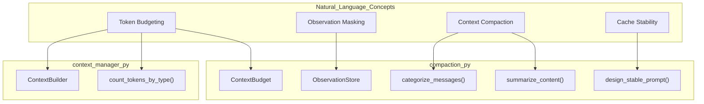
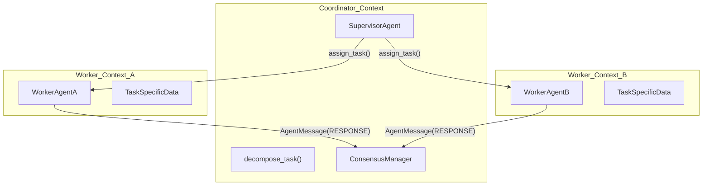

<!-- source: DeepWiki mcp.deepwiki.com · repo muratcankoylan/Agent-Skills-for-Context-Engineering · page 2.4 Context Optimization Techniques · fetched 2026-10-26 -->

# Context Optimization Techniques

Relevant source files

The following files were used as context for generating this wiki page:

- [skills/context-degradation/SKILL.md](skills/context-degradation/SKILL.md)
- [skills/context-degradation/scripts/degradation_detector.py](skills/context-degradation/scripts/degradation_detector.py)
- [skills/context-fundamentals/scripts/context_manager.py](skills/context-fundamentals/scripts/context_manager.py)
- [skills/context-optimization/SKILL.md](skills/context-optimization/SKILL.md)
- [skills/context-optimization/scripts/compaction.py](skills/context-optimization/scripts/compaction.py)
- [skills/evaluation/scripts/evaluator.py](skills/evaluation/scripts/evaluator.py)
- [skills/memory-systems/SKILL.md](skills/memory-systems/SKILL.md)
- [skills/multi-agent-patterns/SKILL.md](skills/multi-agent-patterns/SKILL.md)
- [skills/multi-agent-patterns/scripts/coordination.py](skills/multi-agent-patterns/scripts/coordination.py)
- [skills/tool-design/scripts/description_generator.py](skills/tool-design/scripts/description_generator.py)

Context optimization extends the effective capacity of limited context windows through strategic compression, masking, caching, and partitioning. These techniques allow agents to handle larger documents and longer-running sessions by maximizing the signal-to-noise ratio within the available token budget [skills/context-optimization/SKILL.md:6-8]().

## Core Optimization Strategies

The codebase implements four primary strategies for context management, ordered by impact and risk [skills/context-optimization/SKILL.md:28-38]():

| Strategy | Mechanism | Risk | Impact |
| :--- | :--- | :--- | :--- |
| **KV-cache Optimization** | Reordering prompt structure for tensor reuse. | Zero | Immediate latency/cost reduction. |
| **Observation Masking** | Replacing verbose tool outputs with references. | Low | Up to 80% token savings in trajectories. |
| **Compaction** | Summarizing context when utilization > 70%. | Medium | Distills state while preserving signal. |
| **Context Partitioning** | Splitting tasks across isolated sub-agents. | High | Handles complex problems via delegation. |

### Natural Language Space to Code Entity Space: Optimization Flow

This diagram maps conceptual optimization strategies to the specific Python classes and functions implemented in `compaction.py` and `context_manager.py`.

**Optimization Strategy Mapping**

Sources: [skills/context-optimization/scripts/compaction.py:1-54](), [skills/context-fundamentals/scripts/context_manager.py:1-55]()

---

## Observation Masking (`ObservationStore`)

Observation masking targets the most verbose part of agent trajectories: tool outputs, which typically consume 80%+ of tokens [skills/context-optimization/SKILL.md:32-32](). The `ObservationStore` class manages the lifecycle of these outputs, replacing them with compact references once their purpose has been served [skills/context-optimization/scripts/compaction.py:15-15]().

**Implementation Logic:**
- **Store**: Full tool outputs are saved in an external store with a unique `ref_id` [skills/context-optimization/SKILL.md:62-62]().
- **Mask**: The verbose output is replaced in the context window with a template: `[Obs:{ref_id} elided. Key: {summary}. Full content retrievable.]` [skills/context-optimization/SKILL.md:59-59]().
- **Selective Masking**: Rules dictate that observations critical to the current task or from the most recent turn should never be masked [skills/context-optimization/SKILL.md:58-58](). Masking is typically applied after 3+ turns [skills/context-optimization/SKILL.md:59-59]().

Sources: [skills/context-optimization/SKILL.md:54-63](), [skills/context-optimization/scripts/compaction.py:15-15]()

---

## Compaction and Summarization Strategies

Compaction is triggered when context utilization exceeds a specific threshold (typically 70%) [skills/context-optimization/SKILL.md:44-44](). The process uses `categorize_messages` to apply differentiated summarization logic based on message types [skills/context-optimization/scripts/compaction.py:104-138]().

### Differentiated Compaction Logic
The `summarize_content` function dispatches content to specific summarizers based on the category [skills/context-optimization/scripts/compaction.py:141-156]():

1.  **Tool Outputs (`summarize_tool_output`)**: Extracts metrics (numbers/keys) and key findings using regex while stripping stack traces and boilerplate [skills/context-optimization/scripts/compaction.py:159-183]().
2.  **Conversational Turns (`summarize_conversation`)**: Retains decisions and questions while removing filler [skills/context-optimization/scripts/compaction.py:186-200]().
3.  **Retrieved Documents (`summarize_document`)**: Keeps core claims and data points relevant to the active task [skills/context-optimization/SKILL.md:50-50]().

**Warning**: Never compress the **System Prompt**, as it anchors model behavior and its removal causes unpredictable degradation [skills/context-optimization/SKILL.md:44-44]().

Sources: [skills/context-optimization/scripts/compaction.py:104-200](), [skills/context-optimization/SKILL.md:42-53]()

---

## KV-Cache Optimization

To maximize prefix cache hits, prompts must be structured for stability. The `design_stable_prompt` function helps order content so that static data occupies the prefix and dynamic data appears at the end [skills/context-optimization/scripts/compaction.py:11-11]().

**Optimal Prompt Ordering [skills/context-optimization/SKILL.md:68-73]():**
1.  **System Prompt**: Most stable, never changes within a session.
2.  **Tool Definitions**: Stable across requests.
3.  **Templates/Few-shot Examples**: High reuse.
4.  **Conversation History**: Grows but shares prefix with prior turns.
5.  **Current Query**: Least stable, always last.

**Implementation Note**: Even a single whitespace change in the prefix invalidates the entire cached block downstream [skills/context-optimization/SKILL.md:75-75]().

Sources: [skills/context-optimization/SKILL.md:64-78](), [skills/context-optimization/scripts/compaction.py:11-12]()

---

## Context Partitioning

Partitioning splits a single task into independent sub-tasks assigned to sub-agents with clean, focused contexts [skills/context-optimization/SKILL.md:79-85](). This is recommended when estimated task context exceeds 60% of the window limit [skills/context-optimization/SKILL.md:83-83]().

### Natural Language Space to Code Entity Space: Partitioning Execution

This diagram associates natural language multi-agent partitioning concepts with concrete classes and methods in `coordination.py`.

**Context Partitioning Architecture**

Sources: [skills/context-optimization/SKILL.md:79-85](), [skills/multi-agent-patterns/scripts/coordination.py:110-210]()

---

## Cost/Latency Trade-off Analysis

Optimization decisions are governed by metrics like tokens-per-request and overall system performance [skills/context-optimization/SKILL.md:37-38]().

| Metric | Impact of Optimization | Analysis |
| :--- | :--- | :--- |
| **Latency** | **Reduction** | KV-cache optimization can reduce latency by ~40% on cached tokens [skills/context-optimization/SKILL.md:77-77](). |
| **Cost** | **Reduction** | 70%+ cache hit rates translate to 50%+ cost reduction [skills/context-optimization/SKILL.md:77-77](). |
| **Quality** | **Risk** | Over-aggressive compaction is a common failure mode leading to information loss [skills/context-optimization/SKILL.md:52-52](). |

### Budget Management
The `ContextBudget` class monitors usage and triggers optimizations based on specific signals [skills/context-optimization/scripts/compaction.py:16-16]():
- **Utilization > 70%**: Trigger Compaction [skills/context-optimization/SKILL.md:44-44]().
- **Utilization > 60%**: Plan Partitioning [skills/context-optimization/SKILL.md:83-83]().

Sources: [skills/context-optimization/SKILL.md:87-94](), [skills/context-optimization/scripts/compaction.py:16-16]()

---

