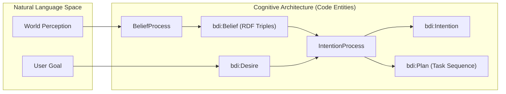
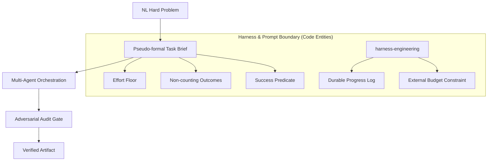

<!-- source: DeepWiki mcp.deepwiki.com · repo muratcankoylan/Agent-Skills-for-Context-Engineering · page 3 Agent Architecture Patterns · fetched 2026-10-26 -->

# Agent Architecture Patterns

<details>
<summary>Relevant source files</summary>

The following files were used as context for generating this wiki page:

- [skills/advanced-evaluation/SKILL.md](skills/advanced-evaluation/SKILL.md)
- [skills/bdi-mental-states/SKILL.md](skills/bdi-mental-states/SKILL.md)
- [skills/context-degradation/SKILL.md](skills/context-degradation/SKILL.md)
- [skills/context-optimization/SKILL.md](skills/context-optimization/SKILL.md)
- [skills/filesystem-context/SKILL.md](skills/filesystem-context/SKILL.md)
- [skills/hosted-agents/SKILL.md](skills/hosted-agents/SKILL.md)
- [skills/memory-systems/SKILL.md](skills/memory-systems/SKILL.md)
- [skills/multi-agent-patterns/SKILL.md](skills/multi-agent-patterns/SKILL.md)

</details>


Architectural skills define the structural patterns and coordination mechanisms that enable effective agent systems. These patterns focus on distributing work across multiple context windows, maintaining state across sessions, and grounding agent execution in stable environments. The core insight across all architectural patterns is that structure should serve to **isolate context** and **maximize attention signal**, rather than merely simulating organizational roles [skills/multi-agent-patterns/SKILL.md:8-9](), [skills/multi-agent-patterns/SKILL.md:28-28]().

Sources: [skills/multi-agent-patterns/SKILL.md:1-29]()

---

## Multi-Agent Patterns

Multi-agent architectures distribute complex tasks across multiple model instances, each with its own isolated context window. This prevents "The Telephone Game" failure mode, where information degrades through repeated summarization, and mitigates the "Lost-in-the-Middle" phenomenon by keeping individual contexts lean [skills/multi-agent-patterns/SKILL.md:28-28](), [skills/multi-agent-patterns/SKILL.md:42-45]().

### Coordination Archetypes
The codebase identifies three dominant patterns for agent coordination [skills/multi-agent-patterns/SKILL.md:30-36]():

| Pattern | Mechanism | Best For |
| :--- | :--- | :--- |
| **Supervisor** | Centralized coordinator delegates to specialists | Clear task decomposition and human oversight [skills/multi-agent-patterns/SKILL.md:68-75]() |
| **Swarm** | Peer-to-peer handoffs via explicit protocols | Flexible exploration and dynamic requirements [skills/multi-agent-patterns/SKILL.md:101-103]() |
| **Hierarchical** | Layered abstraction (Strategy → Planning → Execution) | Large-scale projects with varying levels of detail [skills/multi-agent-patterns/SKILL.md:34-34]() |

**Token Economics:** Designers must budget for a substantial token multiplier compared to single-agent systems due to coordination overhead and parallel reasoning [skills/multi-agent-patterns/SKILL.md:47-56](). Implementation often involves specific tools like `forward_message` to bypass supervisor paraphrasing [skills/multi-agent-patterns/SKILL.md:82-97]().

For details, see [Multi-Agent Patterns](#3.1).

Sources: [skills/multi-agent-patterns/SKILL.md:1-110](), [researcher/fixtures/activation-cases.jsonl:23]()

---

## Memory Systems

Memory provides the persistence layer that allows agents to maintain continuity across sessions. The architecture follows a tiered approach, moving from volatile context to structured long-term storage [skills/memory-systems/SKILL.md:11-13]().

### Tiered Memory Architecture
The system categorizes memory into five functional layers [skills/memory-systems/SKILL.md:69-80]():
1.  **Working Memory:** The immediate context window; optimized via scratchpads and attention-favored positions.
2.  **Short-term Memory:** Session-scoped data, implemented via file-systems or in-memory caches.
3.  **Long-term Memory:** Cross-session knowledge, including user preferences and domain knowledge.
4.  **Entity Memory:** Cross-session registries to maintain identity consistency.
5.  **Temporal KG:** Graphs with validity intervals for facts that change over time, enabling "time-travel" queries.

### Memory Framework Mapping
The repository evaluates several production frameworks based on retrieval patterns:

| Framework | Primary Architecture | Key Strength |
| :--- | :--- | :--- |
| `Mem0` | Vector + Graph | Multi-tenant systems, broad integrations [skills/memory-systems/SKILL.md:39-39]() |
| `Zep/Graphiti` | Temporal Knowledge Graph | Bi-temporal reasoning and relationship modeling [skills/memory-systems/SKILL.md:40-40]() |
| `Letta` | Tiered Storage | Full agent introspection and stateful services [skills/memory-systems/SKILL.md:41-41]() |
| `Cognee` | Multi-layer Semantic Graph | Evolving memory with multi-hop reasoning [skills/memory-systems/SKILL.md:42-42]() |

For details, see [Memory Systems](#3.2).

Sources: [skills/memory-systems/SKILL.md:1-91](), [researcher/mechanisms/registry.jsonl:13-13]()

---

## Filesystem Context & Hosted Agents

This pattern uses the filesystem as a high-bandwidth, low-latency interface for managing state that exceeds the context window. It bridges the gap between local execution and remote, sandboxed infrastructure [skills/filesystem-context/SKILL.md:6-10]().

### Filesystem State Management
Agents utilize specific patterns to manage offloaded context:
*   **Scratch Pad**: Redirects large tool outputs to files, returning a compact summary and a file reference [skills/filesystem-context/SKILL.md:50-66]().
*   **Plan Persistence**: Stores multi-step objectives in structured formats like `scratch/current_plan.yaml` so agents survive context refreshes [skills/filesystem-context/SKILL.md:70-89]().
*   **Workspace Isolation**: Facilitates file-based communication between sub-agents in a shared directory structure [skills/filesystem-context/SKILL.md:93-111]().

### Hosted Infrastructure (Sandboxing)
For background tasks, the system supports patterns like **Observation Masking** and **Sandbox Management** to ensure safe, persistent runtimes [skills/context-optimization/SKILL.md:54-63](). Infrastructure is optimized through **Warm Pool** strategies and **Image Registry** patterns to eliminate spin-up latency [skills/hosted-agents/SKILL.md:39-65]().

Title: Hosted Agent Flow Architecture
```mermaid
graph TD
    User[""Analyze this repo" (NL)"] --> Orchestrator["SupervisorAgent"]
    Orchestrator --> FS["filesystem-context"]
    subgraph "Infrastructure Space (Code Entities)"
        FS --> SP["ScratchPadManager"]
        SP --> File["scratch/tool_output.txt"]
        Orchestrator --> Plan["AgentPlan (YAML)"]
        Orchestrator --> SM["SandboxManager"]
    end
    File --> Mask["ObservationMasking"]
    Mask --> Summary["Compact Reference [Obs:ID]"]
    SM --> Image["ImageBuilder"]
```

For details, see [Filesystem Context & Hosted Agents](#3.3).

Sources: [skills/filesystem-context/SKILL.md:1-137](), [skills/context-optimization/SKILL.md:54-86](), [skills/hosted-agents/SKILL.md:34-65](), [researcher/mechanisms/registry.jsonl:11-11]()

---

## BDI Mental States & Cognitive Architecture

Advanced agents move beyond reactive chat loops to deliberative cognitive architectures using the Belief-Desire-Intention (BDI) ontology. This pattern grounds agent reasoning in formal logic and world states [skills/bdi-mental-states/SKILL.md:6-8]().

### T2B2T (Triples-to-Beliefs-to-Triples)
The cognitive architecture translates external RDF context into internal mental states through a bidirectional pipeline [skills/bdi-mental-states/SKILL.md:97-120]():
*   **Beliefs (`bdi:Belief`)**: Persistent cognitive attributes representing what the agent holds true about the world [skills/bdi-mental-states/SKILL.md:34-35]().
*   **Desires (`bdi:Desire`)**: Motivational states representing what the agent wishes to bring about [skills/bdi-mental-states/SKILL.md:36-36]().
*   **Intentions (`bdi:Intention`)**: Committed plans that specify a sequence of tasks to fulfill a desire [skills/bdi-mental-states/SKILL.md:37-37]().

Title: Cognitive Grounding Architecture


For details, see [BDI Mental States & Cognitive Architecture](#3.4).

Sources: [skills/bdi-mental-states/SKILL.md:1-158](), [researcher/mechanisms/registry.jsonl:6-6]()

---

## Latent Briefing & KV Cache Memory Sharing

Latent Briefing addresses the token explosion problem in hierarchical systems by optimizing the underlying inference engine's memory [skills/latent-briefing/SKILL.md:8-10]().

### Attention Matching
Instead of re-transmitting full summaries to every sub-agent, the system uses **KV-Cache Optimization** to reuse computed tensors across requests. This involves ordering prompts so that stable content occupies the prefix [skills/context-optimization/SKILL.md:68-75]().

For details, see [Latent Briefing & KV Cache Memory Sharing](#3.5).

Sources: [skills/latent-briefing/SKILL.md:1-115](), [skills/context-optimization/SKILL.md:64-78](), [researcher/mechanisms/registry.jsonl:12-12]()

---

## Long-Horizon Prompting

This skill focuses on the design of launch prompts for agents expected to operate autonomously for hours or days [skills/long-horizon-prompting/SKILL.md:8-10](). The central mechanism is the **Pseudo-formal Task Brief**, which applies the rigor of formal verification to linguistic instructions [skills/long-horizon-prompting/SKILL.md:37-43]().

### The Pseudo-formal Brief Anatomy
A robust long-horizon brief consists of ten specific blocks designed to prevent give-up drift and diversity collapse [skills/long-horizon-prompting/SKILL.md:46-57]().

Title: Long-Horizon System Boundary Architecture


For details, see [Long-Horizon Prompting](#3.6).

Sources: [skills/long-horizon-prompting/SKILL.md:1-65](), [researcher/mechanisms/ledgers/accepted.jsonl:9-11](), [researcher/corpus/index.json:85-90]()

---

