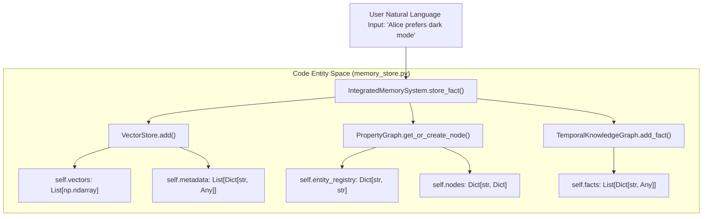
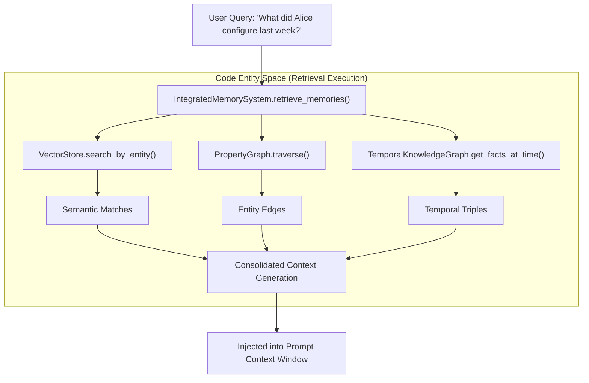

<!-- source: DeepWiki mcp.deepwiki.com · repo muratcankoylan/Agent-Skills-for-Context-Engineering · page 3.2 Memory Systems · fetched 2026-10-26 -->

# Memory Systems

Relevant source files

The following files were used as context for generating this wiki page:

- [LICENSE](LICENSE)
- [skills/context-degradation/SKILL.md](skills/context-degradation/SKILL.md)
- [skills/context-degradation/references/patterns.md](skills/context-degradation/references/patterns.md)
- [skills/context-fundamentals/references/context-components.md](skills/context-fundamentals/references/context-components.md)
- [skills/context-optimization/SKILL.md](skills/context-optimization/SKILL.md)
- [skills/memory-systems/SKILL.md](skills/memory-systems/SKILL.md)
- [skills/memory-systems/references/implementation.md](skills/memory-systems/references/implementation.md)
- [skills/memory-systems/scripts/memory_store.py](skills/memory-systems/scripts/memory_store.py)
- [skills/multi-agent-patterns/SKILL.md](skills/multi-agent-patterns/SKILL.md)
- [skills/multi-agent-patterns/references/frameworks.md](skills/multi-agent-patterns/references/frameworks.md)

Memory systems provide the persistence layer required for agents to maintain continuity across sessions and reason over accumulated knowledge. In advanced context engineering, memory is treated as a tiered architecture that balances immediate attention needs with long-term retrieval stability [skills/memory-systems/SKILL.md:6-8]().

## Tiered Memory Architecture

The system implements a strategy to manage the spectrum from volatile context to persistent storage. Choosing the shallowest possible layer reduces infrastructure overhead and operational complexity [skills/memory-systems/SKILL.md:29-30](), [skills/memory-systems/SKILL.md:66-67]().

| Layer | Persistence | Implementation | Use Case |
| :--- | :--- | :--- | :--- |
| **Working** | Context Window | Scratchpad in system prompt | Always—optimize with attention-favored positions [skills/memory-systems/SKILL.md:70-70]() |
| **Short-term** | Session-scoped | Filesystem / In-memory cache | Intermediate tool results and conversation state [skills/memory-systems/SKILL.md:71-71]() |
| **Long-term** | Cross-session | Key-value store → Graph DB | User preferences, domain knowledge, and entity registries [skills/memory-systems/SKILL.md:72-72]() |
| **Entity** | Cross-session | Entity registry + properties | Maintaining identity ("John Doe" = same person) across conversations [skills/memory-systems/SKILL.md:73-73]() |
| **Temporal KG** | Cross-session + History | Graph with validity intervals | Facts that change over time, time-travel queries, and preventing context clash [skills/memory-systems/SKILL.md:74-74]() |

### Natural Language Space to Code Entity Space: Ingestion Flow

This diagram bridges natural language instructions to the underlying code entities in `memory_store.py` [skills/memory-systems/scripts/memory_store.py:1-37](), illustrating how facts are ingested across the memory stores.

Sources: [skills/memory-systems/scripts/memory_store.py:35-80](), [skills/memory-systems/scripts/memory_store.py:189-230](), [skills/memory-systems/scripts/memory_store.py:270-301]()

---

## Core Implementation Components

### VectorStore
The `VectorStore` class provides semantic similarity search with metadata-based indexing for entity and temporal filtering [skills/memory-systems/scripts/memory_store.py:39-44]().
- **`add(text, metadata)`**: Persists facts with deterministic pseudo-embeddings generated via `_embed` to ensure consistency [skills/memory-systems/scripts/memory_store.py:53-80]().
- **`search(query, limit, filters)`**: Implements cosine similarity retrieval with support for metadata exclusion via `_matches_filters` [skills/memory-systems/scripts/memory_store.py:82-122]().
- **`search_by_entity(entity, query)`**: Narrowed retrieval focusing on a specific subject by accessing the `entity_index` [skills/memory-systems/scripts/memory_store.py:124-157]().

### PropertyGraph
The `PropertyGraph` maintains explicit relationships between entities, enabling multi-hop reasoning and connection traversal [skills/memory-systems/scripts/memory_store.py:189-195]().
- **`entity_registry`**: A `Dict[str, str]` mapping names to `node_id` to maintain identity across sessions [skills/memory-systems/scripts/memory_store.py:200-200]().
- **`get_or_create_node(name, label)`**: Ensures entity consistency by checking the registry before creating new nodes [skills/memory-systems/scripts/memory_store.py:204-215]().
- **`create_relationship(source_id, rel_type, target_id)`**: Links nodes via directed edges with property support and indexing by relationship type [skills/memory-systems/scripts/memory_store.py:228-245]().

### TemporalKnowledgeGraph
Designed for facts that change over time, preventing "context clash" by using validity intervals [skills/memory-systems/SKILL.md:74-74]().
- **`add_fact(subject, predicate, object, valid_from, valid_until)`**: Stores triples with temporal metadata in the `facts` list [skills/memory-systems/scripts/memory_store.py:284-301]().
- **`get_facts_at_time(timestamp)`**: Filters facts based on whether the provided timestamp falls within the `valid_from` and `valid_until` range [skills/memory-systems/scripts/memory_store.py:303-317]().

Sources: [skills/memory-systems/scripts/memory_store.py:39-317]()

---

## Retrieval & Integration Patterns

### Natural Language Space to Code Entity Space: Hybrid Retrieval Flow

This diagram bridges natural language queries to the hybrid retrieval methods executed within `IntegratedMemorySystem` and its underlying components [skills/memory-systems/scripts/memory_store.py:333-370]().

Sources: [skills/memory-systems/scripts/memory_store.py:333-370](), [skills/memory-systems/SKILL.md:78-85]()

### Production Framework Landscape
When scaling beyond the provided scripts, select frameworks based on the dominant retrieval pattern required [skills/memory-systems/SKILL.md:35-37]():

| Framework | Strength | Architecture | Key Performance Signal |
| :--- | :--- | :--- | :--- |
| **Cognee** | Multi-hop reasoning | Multi-layer semantic graph with customizable ECL pipeline | Published high score on HotPotQA [skills/memory-systems/SKILL.md:42-54]() |
| **Zep/Graphiti** | Temporal reasoning | Bi-temporal Knowledge Graph (episode, semantic, community tiers) | Published high score on DMR Accuracy [skills/memory-systems/SKILL.md:40-55]() |
| **Letta** | Stateful services | Self-editing memory with tiered storage (in-context/core/archival) | Published filesystem baseline on LoCoMo [skills/memory-systems/SKILL.md:41-56]() |
| **Mem0** | Multi-tenant systems | Vector store + graph memory, pluggable backends | Published specialized-tool baseline on LoCoMo [skills/memory-systems/SKILL.md:39-57]() |

### Memory Consolidation & Context Integration
Memory systems interact with context engineering skills to manage the attention budget and prevent degradation [skills/memory-systems/SKILL.md:21-25]().

- **MemoryConsolidator**: Summarizes older conversation turns into long-term facts to preserve state without bloating the window [skills/memory-systems/SKILL.md:3-3]().
- **MemoryContextIntegrator**: Injects retrieved memories into attention-favored positions (beginning/end) to mitigate "Lost-in-the-Middle" effects [skills/context-degradation/references/patterns.md:46-79]().
- **Observation Masking**: Works in tandem with memory by replacing verbose tool outputs with compact references while storing the full content in external memory [skills/context-optimization/SKILL.md:54-62]().

Sources: [skills/memory-systems/SKILL.md:1-92](), [skills/memory-systems/scripts/memory_store.py:1-370](), [skills/context-degradation/references/patterns.md:41-79](), [skills/context-optimization/SKILL.md:54-62]()

---

