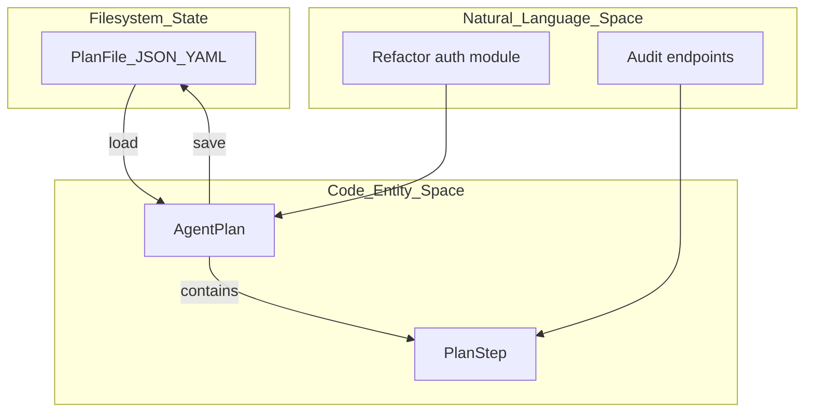
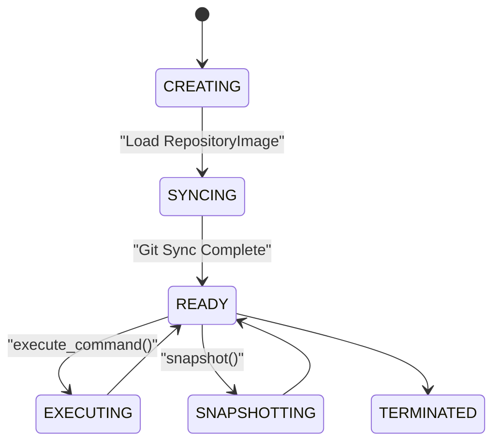
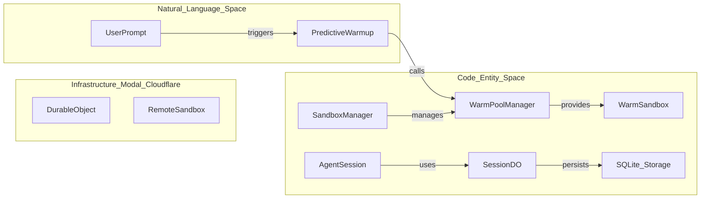

<!-- source: DeepWiki mcp.deepwiki.com · repo muratcankoylan/Agent-Skills-for-Context-Engineering · page 3.3 Filesystem Context & Hosted Agents · fetched 2026-10-26 -->

# Filesystem Context & Hosted Agents

Relevant source files

The following files were used as context for generating this wiki page:

- [skills/advanced-evaluation/SKILL.md](skills/advanced-evaluation/SKILL.md)
- [skills/bdi-mental-states/SKILL.md](skills/bdi-mental-states/SKILL.md)
- [skills/filesystem-context/SKILL.md](skills/filesystem-context/SKILL.md)
- [skills/filesystem-context/references/implementation-patterns.md](skills/filesystem-context/references/implementation-patterns.md)
- [skills/filesystem-context/scripts/filesystem_context.py](skills/filesystem-context/scripts/filesystem_context.py)
- [skills/hosted-agents/SKILL.md](skills/hosted-agents/SKILL.md)
- [skills/hosted-agents/scripts/sandbox_manager.py](skills/hosted-agents/scripts/sandbox_manager.py)

The filesystem serves as the primary overflow layer for agent context, enabling agents to store, retrieve, and update effectively unlimited information through a single interface [skills/filesystem-context/SKILL.md:8-10](). By moving execution to remote sandboxed environments, developers can eliminate local resource contention and provide consistent, reproducible environments for background coding agents [skills/hosted-agents/SKILL.md:22-25]().

## Filesystem-Based Context Engineering

Filesystem context engineering addresses the physical limitations of context windows by treating the disk as a tiered memory system [skills/filesystem-context/SKILL.md:8-10](). This approach prioritizes **Dynamic Context Discovery**—pulling relevant data on demand—over static inclusion in the prompt [skills/filesystem-context/SKILL.md:10-12]().

### Context Failure Modes and Filesystem Remedies
Diagnose context failures against four primary modes, each requiring a specific filesystem remedy [skills/filesystem-context/SKILL.md:30-38]():
1. **Missing context**: Persist tool outputs and intermediate results to files so nothing is lost [skills/filesystem-context/SKILL.md:33-33]().
2. **Under-retrieved context**: Structure files for targeted retrieval using grep-friendly formats and clear section headers [skills/filesystem-context/SKILL.md:34-34]().
3. **Over-retrieved context**: Offload bulk content to files and return compact references to preserve token budgets [skills/filesystem-context/SKILL.md:35-35]().
4. **Buried context**: Combine glob and grep for structural search alongside semantic search [skills/filesystem-context/SKILL.md:36-36]().

### Key Implementation Patterns

| Pattern | Code Entity | Purpose |
| :--- | :--- | :--- |
| **Scratch Pad** | `ScratchPadManager` | Offloads large tool outputs (e.g., >2000 tokens) to disk, returning a compact reference [skills/filesystem-context/scripts/filesystem_context.py:49-61](). |
| **Plan Persistence** | `AgentPlan` / `PlanStep` | Stores task trajectories in JSON/YAML so agents can re-orient after context refreshes [skills/filesystem-context/scripts/filesystem_context.py:138-160](). |
| **Tool Handling** | `ToolOutputHandler` | Automates the decision to inline or offload tool results based on token thresholds [skills/filesystem-context/scripts/filesystem_context.py:255-270](). |
| **Sub-Agent Comms** | `AgentWorkspace` | Enables agents to share findings via shared directories rather than message passing [skills/filesystem-context/references/implementation-patterns.md:167-179](). |

### Observation Masking & Scratch Pads
When a tool returns a verbose output, the `ScratchPadManager` writes the content to a timestamped file and generates a summary [skills/filesystem-context/scripts/filesystem_context.py:77-102](). The agent receives a reference string like `[Output from web_search saved to scratch/file.txt. Summary: ...]`, preserving the active context window for reasoning [skills/filesystem-context/scripts/filesystem_context.py:110-114](). This pattern allows for targeted retrieval using tools like `grep` or `read_file` with line ranges later [skills/filesystem-context/SKILL.md:68-69]().

### Plan Persistence Flow
Long-horizon tasks use the `AgentPlan` class to maintain state. The agent re-reads the plan at the start of each turn to "manipulate attention through recitation" [skills/filesystem-context/SKILL.md:85-86](). This prevents task drift when the context window is refreshed or summarized [skills/filesystem-context/scripts/filesystem_context.py:154-158]().

**Plan Persistence Logic**

Sources: [skills/filesystem-context/scripts/filesystem_context.py:138-205](), [skills/filesystem-context/SKILL.md:64-86]()

---

## Hosted Agent Infrastructure

Hosted agents run in remote sandboxes (e.g., Modal, Fly.io) to provide unlimited concurrency and multiplayer support [skills/hosted-agents/SKILL.md:22-25]().

### Sandbox Lifecycle Management
The `SandboxManager` coordinates the lifecycle from image building to session termination [skills/hosted-agents/scripts/sandbox_manager.py:31-33]().

1.  **Warm Pool Strategy**: Maintains a set of `WarmSandbox` instances ready for immediate use via `WarmPoolManager` to eliminate spin-up latency [skills/hosted-agents/scripts/sandbox_manager.py:250-265]().
2.  **Image Builder**: Pre-builds `RepositoryImage` instances using `ImageBuilder` every 30 minutes, including full dependency installation and cache warming [skills/hosted-agents/scripts/sandbox_manager.py:161-180]().
3.  **Snapshotting**: Uses `Sandbox.snapshot()` to preserve the filesystem state, allowing follow-up prompts to restore the environment instantly [skills/hosted-agents/scripts/sandbox_manager.py:119-129]().

### Sandbox State Transitions

Sources: [skills/hosted-agents/scripts/sandbox_manager.py:36-43](), [skills/hosted-agents/SKILL.md:33-47]()

### Infrastructure Patterns
*   **Modal Integration**: Utilizes `modal.Sandbox` for near-instant startup and native snapshot/restore capabilities [skills/hosted-agents/references/infrastructure-patterns.md:7-30]().
*   **Cloudflare Durable Objects**: Manages session state and multiplayer coordination using `SessionDO`, providing an isolated SQLite database per session [skills/hosted-agents/references/infrastructure-patterns.md:199-215]().
*   **Predictive Warm-Up**: Triggers sandbox preparation as soon as a user starts typing, utilizing the 5-30 second typing interval to complete environment setup [skills/hosted-agents/SKILL.md:80-85]().

### Multiplayer & Identity
To support multiplayer collaboration, the infrastructure explicitly configures `UserIdentity` for git commits. This ensures that even when an agent operates in a shared sandbox, code changes are attributed to the prompting user rather than the application [skills/hosted-agents/scripts/sandbox_manager.py:46-56]().

**Hosted Infrastructure Mapping**

Sources: [skills/hosted-agents/scripts/sandbox_manager.py:240-265](), [skills/hosted-agents/references/infrastructure-patterns.md:199-218](), [skills/hosted-agents/SKILL.md:54-59]()

---

## Operational Guidelines

### Context Offloading Thresholds
*   **Inline**: Tool outputs < 2000 tokens [skills/filesystem-context/scripts/filesystem_context.py:57-61]().
*   **Offload**: Tool outputs > 2000 tokens. `ScratchPadManager.offload()` writes to `scratch/` and returns a summary [skills/filesystem-context/SKILL.md:51-60]().

### Sandbox Performance Targets
*   **Latency**: Infrastructure setup should be completed before the user finishes typing (predictive warming) [skills/hosted-agents/SKILL.md:8-9]().
*   **Freshness**: `RepositoryImage` instances should be refreshed every 30 minutes to keep git synchronization deltas small [skills/hosted-agents/SKILL.md:33-35]().
*   **Safety**: Block file writes until git synchronization is 100% complete to avoid merge conflicts; allow file reads immediately [skills/hosted-agents/SKILL.md:86-91]().

Sources: [skills/filesystem-context/SKILL.md:1-135](), [skills/hosted-agents/SKILL.md:1-128](), [skills/filesystem-context/scripts/filesystem_context.py:1-270](), [skills/hosted-agents/scripts/sandbox_manager.py:1-330](), [skills/hosted-agents/references/infrastructure-patterns.md:1-218](), [skills/filesystem-context/references/implementation-patterns.md:1-213]()

---

