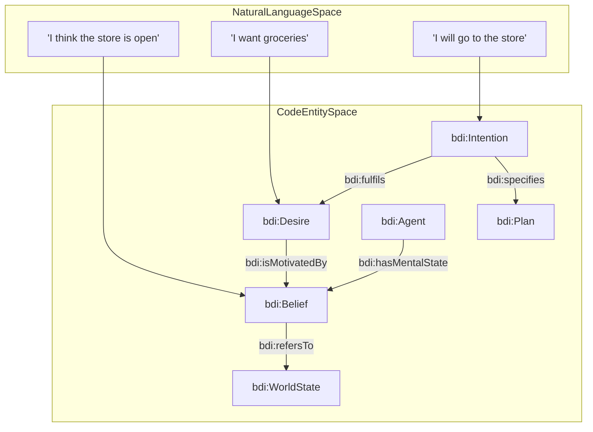
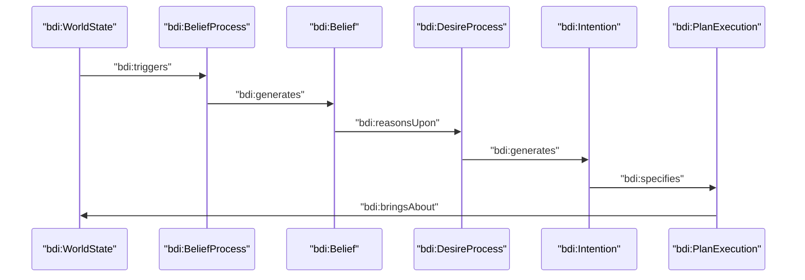
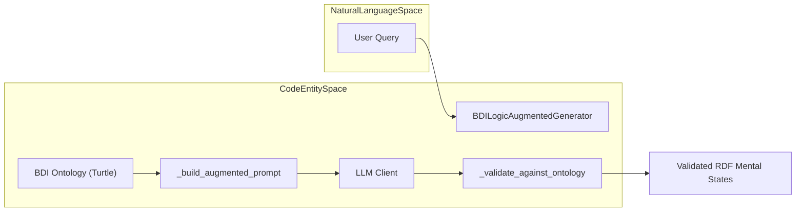

<!-- source: DeepWiki mcp.deepwiki.com · repo muratcankoylan/Agent-Skills-for-Context-Engineering · page 3.4 BDI Mental States & Cognitive Architecture · fetched 2026-10-26 -->

# BDI Mental States & Cognitive Architecture

Relevant source files

The following files were used as context for generating this wiki page:

- [skills/advanced-evaluation/SKILL.md](skills/advanced-evaluation/SKILL.md)
- [skills/bdi-mental-states/SKILL.md](skills/bdi-mental-states/SKILL.md)
- [skills/bdi-mental-states/references/bdi-ontology-core.md](skills/bdi-mental-states/references/bdi-ontology-core.md)
- [skills/bdi-mental-states/references/framework-integration.md](skills/bdi-mental-states/references/framework-integration.md)
- [skills/bdi-mental-states/references/rdf-examples.md](skills/bdi-mental-states/references/rdf-examples.md)
- [skills/bdi-mental-states/references/sparql-competency.md](skills/bdi-mental-states/references/sparql-competency.md)
- [skills/filesystem-context/SKILL.md](skills/filesystem-context/SKILL.md)
- [skills/hosted-agents/SKILL.md](skills/hosted-agents/SKILL.md)

The `bdi-mental-states` skill provides a formal framework for modeling agent cognition using the **Belief-Desire-Intention (BDI)** ontology. It enables agents to transform raw context into structured mental states, supporting deliberative reasoning, explainable decision-making, and neuro-symbolic integration [skills/bdi-mental-states/SKILL.md:6-8]().

## Core Ontology & Mental Reality Architecture

The architecture distinguishes between what an agent knows, what it wants, and what it commits to doing. This is modeled through two primary ontological categories: **Endurants** (persistent states) and **Perdurants** (causal processes) [skills/bdi-mental-states/SKILL.md:32]().

### Mental Entities (Endurants)
These are persistent cognitive attributes that hold over time intervals [skills/bdi-mental-states/SKILL.md:34]():
*   **Belief**: Represent what the agent holds true about the world, grounded in a world state reference [skills/bdi-mental-states/SKILL.md:35]().
*   **Desire**: Motivational states representing what the agent wishes to bring about [skills/bdi-mental-states/SKILL.md:36]().
*   **Intention**: Deliberative commitments to achieve a desire through a specific plan [skills/bdi-mental-states/SKILL.md:37]().
*   **Goal & Plan**: A `Goal` describes the desired end state, while a `Plan` is a structured action sequence consisting of `Tasks` [skills/bdi-mental-states/references/bdi-ontology-core.md:14-15]().

### Mental Processes (Perdurants)
These are events that create or modify mental states, providing a causal chain for explainability [skills/bdi-mental-states/SKILL.md:39]():
*   **BeliefProcess**: Triggers belief formation/update from perception [skills/bdi-mental-states/SKILL.md:40]().
*   **DesireProcess**: Generates desires from existing beliefs [skills/bdi-mental-states/SKILL.md:41]().
*   **IntentionProcess**: Commits to specific desires as actionable intentions [skills/bdi-mental-states/SKILL.md:42]().

### Cognitive Architecture Mapping
The following diagram bridges the conceptual BDI space to the RDF-based implementation entities used in the ontology.

**Diagram: BDI Cognitive Entity Mapping**

Sources: [skills/bdi-mental-states/SKILL.md:44-62](), [skills/bdi-mental-states/references/bdi-ontology-core.md:7-16](), [skills/bdi-mental-states/references/rdf-examples.md:7-80]()

---

## T2B2T: Triples-to-Beliefs-to-Triples

The **T2B2T paradigm** is a bidirectional pipeline that allows agents to consume external RDF data and project their internal reasoning back into the world state [skills/bdi-mental-states/SKILL.md:97-99]().

### Phase 1: Triples-to-Beliefs (Perception)
Incoming RDF triples representing a `WorldState` trigger a `BeliefProcess` via the `bdi:triggers` property [skills/bdi-mental-states/SKILL.md:101-105](). This process `generates` a `Belief` instance, preserving the provenance from data to thought [skills/bdi-mental-states/SKILL.md:107-108]().

### Phase 2: Beliefs-to-Triples (Action)
After deliberation, the agent selects an `Intention` and executes a `Plan`. The execution is tracked via `bdi:PlanExecution` [skills/bdi-mental-states/SKILL.md:111-117](). The result is projected back into the environment via the `bringsAbout` property, creating a new `WorldState` [skills/bdi-mental-states/SKILL.md:118-119]().

**Diagram: T2B2T Data Flow**

Sources: [skills/bdi-mental-states/SKILL.md:97-120](), [skills/bdi-mental-states/references/rdf-examples.md:14-160]()

---

## Logic Augmented Generation (LAG)

Logic Augmented Generation (LAG) integrates LLMs with the formal BDI ontology to ensure reasoning remains grounded and valid [skills/bdi-mental-states/references/framework-integration.md:158-160]().

### LAG Pipeline Implementation
The `BDILogicAugmentedGenerator` class manages this lifecycle [skills/bdi-mental-states/references/framework-integration.md:185-190]().

1.  **Ontology Injection**: The BDI ontology is serialized to Turtle and injected into the LLM prompt to define the "rules of thought" [skills/bdi-mental-states/references/framework-integration.md:195-197]().
2.  **State Generation**: The LLM generates mental states (triples) based on the provided context, following the BDI schema [skills/bdi-mental-states/references/framework-integration.md:199-200]().
3.  **Validation**: Generated triples are validated against ontological constraints (e.g., an `Intention` must `fulfil` exactly one `Desire`) [skills/bdi-mental-states/references/framework-integration.md:202-204]().

**Diagram: LAG System Components**

Sources: [skills/bdi-mental-states/references/framework-integration.md:165-206]()

---

## Explainable Reasoning & World State Grounding

Explainability is achieved through the **Cognitive Chain Pattern**, which wires mental states into directed, traceable chains [skills/bdi-mental-states/SKILL.md:44-46]().

### Justification and Provenance
Every mental entity should be linked to a `bdi:Justification` via `bdi:isJustifiedBy` [skills/bdi-mental-states/SKILL.md:132-134](). This captures the specific evidence (e.g., a "traffic report" or "official email") that led to the formation of a belief or intention [skills/bdi-mental-states/SKILL.md:136-148]().

### Temporal Grounding
Mental states are assigned `bdi:hasValidity` intervals using `TimeInterval` objects [skills/bdi-mental-states/SKILL.md:150-152](). This allows for:
*   **Diachronic Reasoning**: Tracking how beliefs change over time [skills/bdi-mental-states/SKILL.md:152]().
*   **Conflict Resolution**: Using SPARQL filters to find overlapping or contradictory beliefs active at a specific `TimeInstant` [skills/bdi-mental-states/references/sparql-competency.md:199-212]().

### SPARQL Competency Queries
The system supports complex queries to audit agent cognition [skills/bdi-mental-states/references/sparql-competency.md:1-3]():
*   **Trace Cognitive Chain**: `SELECT ?intention ?desire ?belief ?worldState WHERE { ... }` [skills/bdi-mental-states/references/sparql-competency.md:94-106]().
*   **Temporal Audit**: Finding mental states valid at a specific time [skills/bdi-mental-states/references/sparql-competency.md:199-212]().

Sources: [skills/bdi-mental-states/SKILL.md:44-152](), [skills/bdi-mental-states/references/sparql-competency.md:1-212]()

---

## Framework Integration

The BDI ontology can be translated into executable rules for production systems like **SEMAS** using a rule translation layer [skills/bdi-mental-states/references/framework-integration.md:1-7]().

| BDI Construct | SEMAS Element | Example Logic |
| :--- | :--- | :--- |
| **Belief** | HEAD fact | `belief(agent, store_open)` [skills/bdi-mental-states/references/framework-integration.md:13]() |
| **Desire Generation** | TAIL action | `generate_desire(agent, goal)` [skills/bdi-mental-states/references/framework-integration.md:15]() |
| **Intention Commitment** | TAIL action | `commit_intention(agent, goal)` [skills/bdi-mental-states/references/framework-integration.md:16]() |
| **Plan Specification** | TAIL action | `create_plan(agent, plan_id)` [skills/bdi-mental-states/references/framework-integration.md:17]() |

The function `ontology_to_semas_rules` in the Python translation layer automates this conversion by extracting intention-desire-belief chains from an RDF graph [skills/bdi-mental-states/references/framework-integration.md:102-139]().

Sources: [skills/bdi-mental-states/references/framework-integration.md:1-139]()

---

