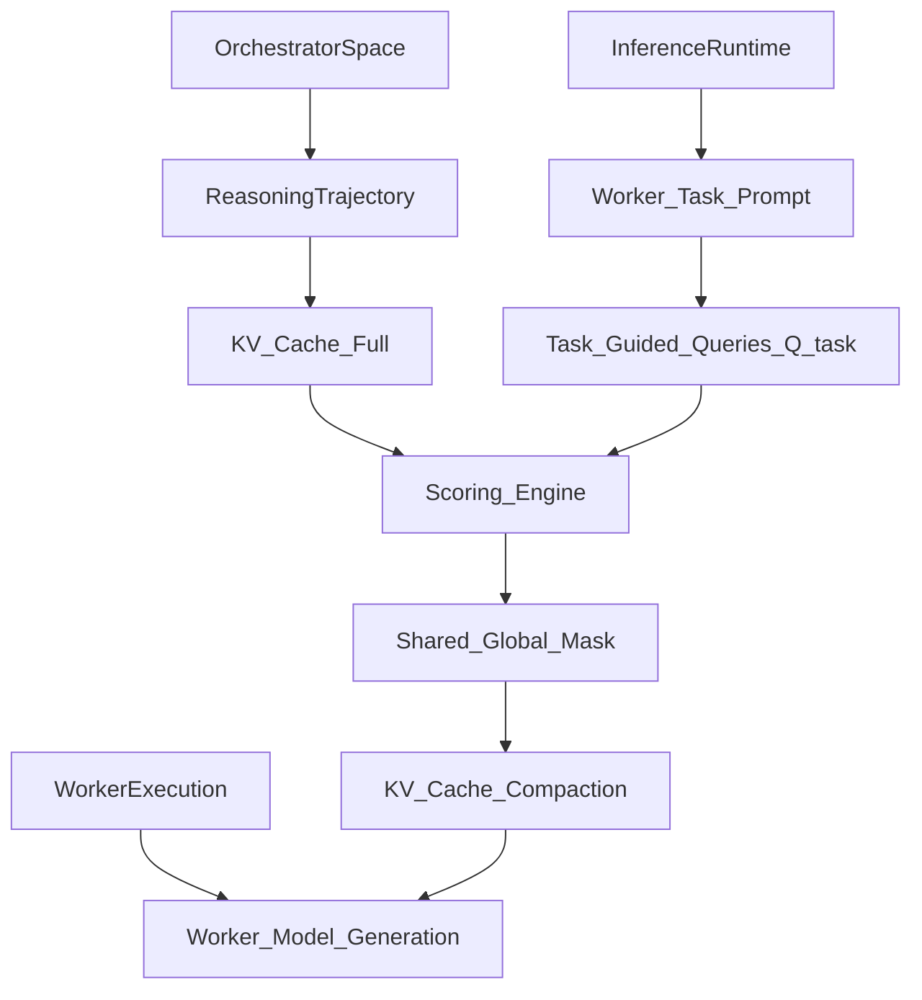
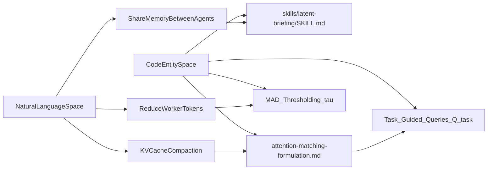

<!-- source: DeepWiki mcp.deepwiki.com · repo muratcankoylan/Agent-Skills-for-Context-Engineering · page 3.5 Latent Briefing & KV Cache Memory Sharing · fetched 2026-10-26 -->

# Latent Briefing & KV Cache Memory Sharing

Relevant source files

The following files were used as context for generating this wiki page:

- [skills/latent-briefing/SKILL.md](skills/latent-briefing/SKILL.md)
- [skills/latent-briefing/references/attention-matching-formulation.md](skills/latent-briefing/references/attention-matching-formulation.md)

Latent Briefing is an advanced context engineering skill designed to solve the **token explosion problem** in hierarchical multi-agent systems. While traditional methods rely on text-based summarization or RAG to transfer state between an orchestrator and its workers, Latent Briefing operates at the **representation level** by sharing and compacting the **KV (Key/Value) cache** directly [skills/latent-briefing/SKILL.md:8-10]().

This technique leverages **Attention Matching (AM)** to selectively retain trajectory positions that are most relevant to a specific worker task, enabling high-fidelity state transfer with significantly lower token costs than re-serializing the entire reasoning history as text [skills/latent-briefing/SKILL.md:10-10](), [skills/latent-briefing/references/attention-matching-formulation.md:27-31]().

Sources: [skills/latent-briefing/SKILL.md:8-10](), [skills/latent-briefing/references/attention-matching-formulation.md:27-31]()

## The Token Explosion Problem

In recursive or hierarchical agent architectures (e.g., Supervisor/Worker), the orchestrator accumulates a trajectory of partial conclusions, tool outputs, and prior worker responses [skills/latent-briefing/SKILL.md:30-30](). 

| Mitigation | Weakness |
| :--- | :--- |
| **LLM Summarization** | High latency, lossy abstraction, and no guarantee the summary preserves what the next subtask needs [skills/latent-briefing/SKILL.md:48-48](). |
| **Retrieval / RAG** | Depends on chunking and embeddings; can miss cross-chunk or cross-step dependencies [skills/latent-briefing/SKILL.md:49-49](). |
| **Pass Full Trajectory** | Cost scales with every worker call and irrelevant context can degrade worker quality [skills/latent-briefing/SKILL.md:50-50](). |

Latent Briefing addresses these by treating the orchestrator's reasoning trajectory as a persistent latent state that can be "briefed" to workers through task-conditioned KV cache compaction [skills/latent-briefing/SKILL.md:32-32]().

Sources: [skills/latent-briefing/SKILL.md:30-50]()

## Implementation: Attention Matching (AM) Formulation

The core engine of Latent Briefing is the Attention Matching objective. It seeks a compacted cache of size `t` (where `t < S`, the original size) such that the attention outputs approximate the full cache [skills/latent-briefing/references/attention-matching-formulation.md:5-7]().

### Mathematical Objective
For each attention head, the system solves for compacted components `(C1, beta, C2)` such that:
`softmax(Q * C1^T + beta) * C2 ~= softmax(Q * K^T) * V` [skills/latent-briefing/references/attention-matching-formulation.md:10-11]().

* **C1**: Compacted keys (subset of high-attention mass vectors) [skills/latent-briefing/references/attention-matching-formulation.md:13-13]().
* **beta**: Bias corrections so the softmax distribution over kept keys approximates the distribution over all keys [skills/latent-briefing/references/attention-matching-formulation.md:14-14]().
* **C2**: Compacted values reconstructed so the attention output matches the original as closely as possible [skills/latent-briefing/references/attention-matching-formulation.md:15-15]().

### Latent Briefing Data Flow
Unlike standard AM, Latent Briefing uses the **current worker task prompt** to derive the query vectors used for scoring [skills/latent-briefing/SKILL.md:62-62]().

Title: Latent Briefing Data Flow

Sources: [skills/latent-briefing/SKILL.md:34-39](), [skills/latent-briefing/references/attention-matching-formulation.md:27-31]()

## Key Technical Modifications

Latent Briefing introduces three specific modifications to standard KV cache management to make it viable for multi-agent systems:

### 1. Task-Guided Query Construction
Instead of sampling queries from the existing context, the system forward-passes the trajectory plus the current task through the worker model [skills/latent-briefing/SKILL.md:62-62](). The attention from task queries (`Q_task`) to trajectory keys (`K`) defines which positions matter for this specific worker call [skills/latent-briefing/references/attention-matching-formulation.md:29-30](), [skills/latent-briefing/references/attention-matching-formulation.md:36-40]().

### 2. Shared Token Masks
Standard AM often solves masks per-head, which prevents efficient batching [skills/latent-briefing/references/attention-matching-formulation.md:23-23](). Latent Briefing aggregates scores across all layers and heads into a **shared global mask** [skills/latent-briefing/SKILL.md:64-64](). This allows for identical sequence layouts across heads, enabling high-speed batched tensor operations and much lower latency [skills/latent-briefing/references/attention-matching-formulation.md:44-46]().

### 3. Robust MAD Thresholding
Rather than a fixed "Top-K" selection, Latent Briefing uses a robust threshold based on the Median Absolute Deviation (MAD) [skills/latent-briefing/SKILL.md:66-66]():
`keep position i if score[i] > median(score) + tau * MAD(score)` [skills/latent-briefing/references/attention-matching-formulation.md:53-53]().
This makes the retention rate adaptive to the specific information density of the current task [skills/latent-briefing/references/attention-matching-formulation.md:50-56]().

Sources: [skills/latent-briefing/SKILL.md:62-66](), [skills/latent-briefing/references/attention-matching-formulation.md:23-56]()

## System Comparison & Selection

Latent Briefing is a specialized optimization for controlled runtimes. Use the following table to determine when to apply it versus other context engineering skills:

| Need | Skill / Pattern | Why |
| :--- | :--- | :--- |
| **Inaccessible KV Tensors** | `context-compression` | Use summarization/compression when internal KV tensors are inaccessible (API-only) [skills/latent-briefing/SKILL.md:23-23](). |
| **External Knowledge** | `memory-systems` | Use for persistent memory, entity tracking, or sparse lookup across large external corpora [skills/latent-briefing/SKILL.md:24-24](), [skills/latent-briefing/SKILL.md:80-80](). |
| **Identical Prefixes** | `context-optimization` | Use Prefix Caching for static prompts or policies that do not transform KV state [skills/latent-briefing/SKILL.md:26-26](), [skills/latent-briefing/SKILL.md:78-78](). |
| **Task-Specific Latent State** | `latent-briefing` | Use when workers need precise slices of orchestrator state and runtime access exists [skills/latent-briefing/SKILL.md:81-81](). |

### Infrastructure Preconditions
* **Runtime Control**: The system must be able to inspect and transform worker KV state [skills/latent-briefing/SKILL.md:69-70]().
* **Architecture Alignment**: Direct sharing assumes orchestrator and worker do not differ materially in tokenizer, architecture, or attention layout [skills/latent-briefing/SKILL.md:70-70]().

Title: Entity Mapping: Logic to Implementation

Sources: [skills/latent-briefing/SKILL.md:3-81](), [skills/latent-briefing/references/attention-matching-formulation.md:1-3]()

## Metrics and Benchmarking
When evaluating Latent Briefing, track the following metrics:
1. **Worker-Token Savings**: Material reduction in tokens consumed by sub-agents [skills/latent-briefing/SKILL.md:40-40]().
2. **Compaction Overhead**: Time (latency) added by the AM solve process, typically low-single-digit seconds [skills/latent-briefing/SKILL.md:40-40]().
3. **Accuracy**: Maintenance of performance on long-document QA or reasoning tasks [skills/latent-briefing/SKILL.md:40-40]().

Public results indicate substantial worker-token reduction on long-document QA workloads [skills/latent-briefing/SKILL.md:40-40]().

Sources: [skills/latent-briefing/SKILL.md:40-40]()

---

