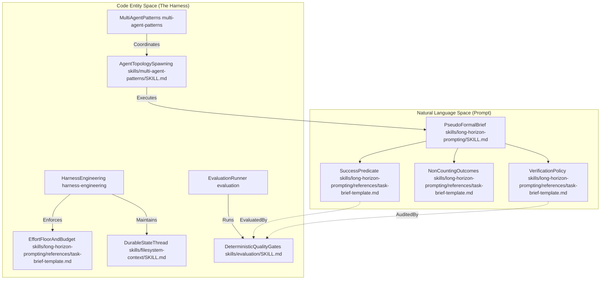
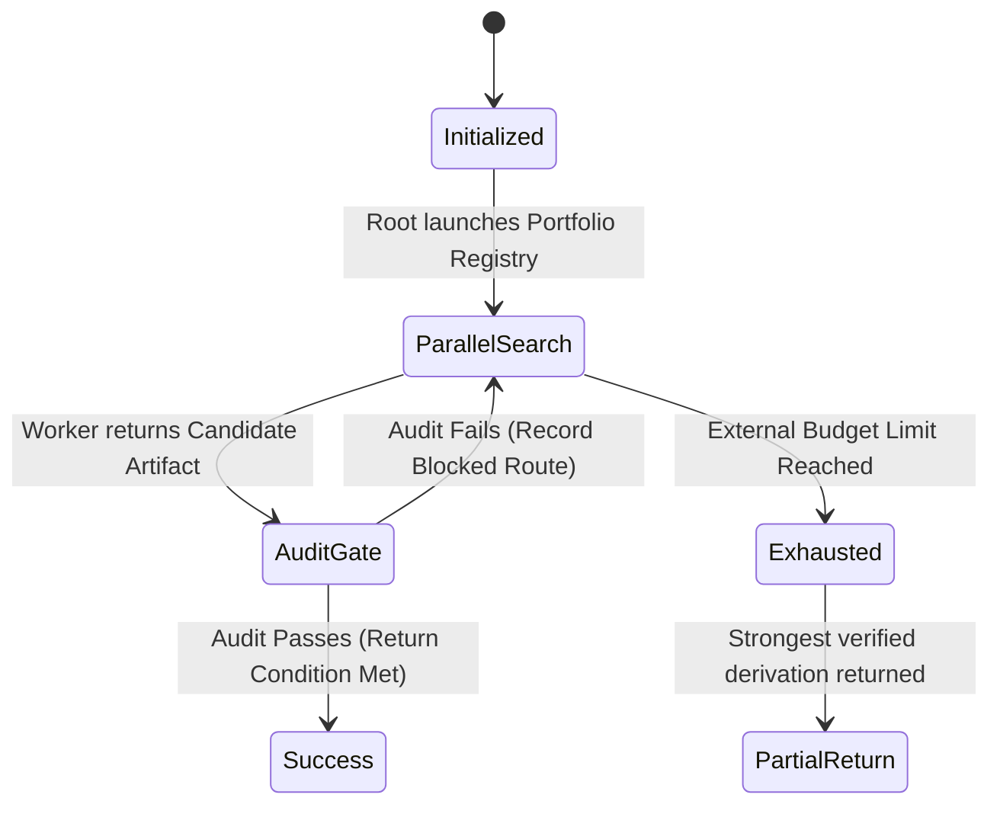

<!-- source: DeepWiki mcp.deepwiki.com · repo muratcankoylan/Agent-Skills-for-Context-Engineering · page 3.6 Long-Horizon Prompting · fetched 2026-10-26 -->

# Long-Horizon Prompting

Relevant source files

The following files were used as context for generating this wiki page:

- [researcher/benchmarks/router/prompts.jsonl](researcher/benchmarks/router/prompts.jsonl)
- [researcher/claims/index.jsonl](researcher/claims/index.jsonl)
- [researcher/corpus/index.json](researcher/corpus/index.json)
- [researcher/fixtures/activation-cases.jsonl](researcher/fixtures/activation-cases.jsonl)
- [researcher/mechanisms/ledgers/accepted.jsonl](researcher/mechanisms/ledgers/accepted.jsonl)
- [researcher/mechanisms/registry.jsonl](researcher/mechanisms/registry.jsonl)
- [skills/long-horizon-prompting/SKILL.md](skills/long-horizon-prompting/SKILL.md)
- [skills/long-horizon-prompting/references/cdc-prompt-annotated.md](skills/long-horizon-prompting/references/cdc-prompt-annotated.md)
- [skills/long-horizon-prompting/references/research-evidence.md](skills/long-horizon-prompting/references/research-evidence.md)
- [skills/long-horizon-prompting/references/task-brief-template.md](skills/long-horizon-prompting/references/task-brief-template.md)
- [skills/long-horizon-prompting/references/vendor-guidance.md](skills/long-horizon-prompting/references/vendor-guidance.md)

## Purpose and Scope

This wiki page documents section **3.6 Long-Horizon Prompting**, covering the `long-horizon-prompting` skill (`[skills/long-horizon-prompting/SKILL.md:1-4]()`). This skill governs the design of launch prompts for autonomous agents and parallel multi-agent orchestrations expected to operate for hours or days on open-ended problems `[skills/long-horizon-prompting/SKILL.md:6-10]()`. The core methodology replaces conversational chat instructions with pseudo-formal task specifications, ensuring persistence, diversity maintenance, and adversarial verification `[skills/long-horizon-prompting/SKILL.md:6-10]()`.

Sources: `[skills/long-horizon-prompting/SKILL.md:1-10]()`

---

## Pseudo-Formal Task Brief Methodology & Ten-Block Anatomy

Hard open problems rarely feature machine-checkable success conditions. The pseudo-formal task brief transfers the rigor of formal verification into natural language `[skills/long-horizon-prompting/SKILL.md:6-10]()`. A complete brief is organized into ten distinct architectural blocks designed to close loopholes, prevent "answer-shaped near misses," and eliminate premature return `[skills/long-horizon-prompting/SKILL.md:35-58]()`.

| Block | Technical Purpose | Failure Mitigated |
| :--- | :--- | :--- |
| **Definitions** | Fixes load-bearing terms and boundary cases (e.g., "empty input") `[skills/long-horizon-prompting/SKILL.md:39]()`. | Loophole solutions based on technicalities `[skills/long-horizon-prompting/SKILL.md:48]()`. |
| **Success Predicate** | States exactly what must be true at return with explicit scope quantifiers `[skills/long-horizon-prompting/SKILL.md:40]()`. | Scope-narrowed or partial answers `[skills/long-horizon-prompting/SKILL.md:49]()`. |
| **Non-counting Outcomes** | Enumerates specific "answer-shaped near misses" that are rejected `[skills/long-horizon-prompting/SKILL.md:41]()`. | Partial progress or unverified reductions `[skills/long-horizon-prompting/SKILL.md:50]()`. |
| **Solvability Framing** | Uses "Assume a solution exists" to counter give-up drift on open problems `[skills/long-horizon-prompting/SKILL.md:25-26]()`. | "I cannot solve this open problem" refusals `[skills/long-horizon-prompting/SKILL.md:51]()`. |
| **Orchestration Policy** | Heuristics for parallel search, approach registries, and blocked routes `[skills/long-horizon-prompting/SKILL.md:52]()`. | Diversity collapse and premature convergence `[skills/long-horizon-prompting/SKILL.md:52]()`. |
| **Verification Policy** | Adversarial audit with a domain-specific failure mode hunt list `[skills/long-horizon-prompting/SKILL.md:43]()`. | Lenient self-judging `[skills/long-horizon-prompting/SKILL.md:53]()`. |
| **Reporting Contract** | Requires concrete artifacts (scripts, proofs) over status reports `[skills/long-horizon-prompting/SKILL.md:84-85]()`. | Vague optimism or fabricated progress `[skills/long-horizon-prompting/SKILL.md:54]()`. |
| **Return Condition** | Gates completion strictly on artifact survival of the adversarial audit `[skills/long-horizon-prompting/SKILL.md:92-93]()`. | Premature return due to "best effort" `[skills/long-horizon-prompting/SKILL.md:55]()`. |
| **Effort Framing** | Sets an "Effort Floor" (e.g., minimum duration/cost) before quitting is considered `[skills/long-horizon-prompting/SKILL.md:103-105]()`. | Early abandonment `[skills/long-horizon-prompting/SKILL.md:56]()`. |
| **Contamination Guards** | Defines strict boundaries for external retrieval and search `[skills/long-horizon-prompting/SKILL.md:109-113]()`. | Laundered lookups or benchmark leakage `[skills/long-horizon-prompting/SKILL.md:57]()`. |

Sources: `[skills/long-horizon-prompting/SKILL.md:35-58]()`, `[skills/long-horizon-prompting/references/task-brief-template.md:7-114]()`

---

## CDC Exemplar & Research Evidence

The primary empirical exemplar of long-horizon prompting is the published prompt behind GPT-5.6 Sol Ultra's candidate proof of the Cycle Double Cover (CDC) Conjecture, coordinated via a 64-subagent orchestration `[skills/long-horizon-prompting/SKILL.md:8-10]()`, `[skills/long-horizon-prompting/references/cdc-prompt-annotated.md:1-6]()`. 

Key insights from academic research backing these design patterns include:
- **Give-Up Drift:** As trajectories lengthen, dominant failure modes shift from confident errors to outright abandonment `[skills/long-horizon-prompting/references/research-evidence.md:7]()`. Solvability framing and effort floors actively counteract this drift `[skills/long-horizon-prompting/SKILL.md:25-26]`, `[skills/long-horizon-prompting/SKILL.md:103-105]()`.
- **The Verification Bottleneck:** Pass@K scales with compute, but self-selection accuracy plateaus without external verification `[skills/long-horizon-prompting/references/research-evidence.md:14-15]()`. Enumerated audit checklists prevent "proof by intimidation" and lenient judging `[skills/long-horizon-prompting/references/research-evidence.md:16]()`.

Sources: `[skills/long-horizon-prompting/SKILL.md:8-10]()`, `[skills/long-horizon-prompting/references/cdc-prompt-annotated.md:1-10]()`, `[skills/long-horizon-prompting/references/research-evidence.md:7-16]()`

---

## Prompt/Harness Split & System Architecture

A fundamental architectural boundary separates natural language specifications (`long-horizon-prompting`) from code-level runtime constraints (`harness-engineering`) `[skills/long-horizon-prompting/SKILL.md:23-32]()`. Hard constraints such as token budgets, hard timeouts, and file permissions must be enforced by the runtime harness rather than advisory text in prompts `[skills/long-horizon-prompting/references/task-brief-template.md:122]()`.

Title: "Long-Horizon System Boundaries"

Sources: `[skills/long-horizon-prompting/SKILL.md:23-32]()`, `[skills/long-horizon-prompting/references/task-brief-template.md:121-123]()`

---

## Mechanisms and Routing Boundaries

The execution of long-horizon runs is governed by specific mechanisms registered in the repository `[researcher/mechanisms/registry.jsonl:1-13]()`:
1. **Pseudo-Formal Task Specification (`pseudo-formal-task-specification`)**: Explicitly defines object classes and success predicates `[researcher/mechanisms/ledgers/accepted.jsonl:9]()`.
2. **Audit-Gated Return Condition (`audit-gated-return-condition`)**: Gates completion on checkable external verification rather than agent self-declaration `[researcher/mechanisms/ledgers/accepted.jsonl:10]()`.
3. **Independent Portfolio Approach Registry (`independent-portfolio-approach-registry`)**: Combats diversity collapse via information hiding and blocked-route tracking `[researcher/mechanisms/ledgers/accepted.jsonl:11]()`.

Title: "Long-Horizon State Transition Logic"

Sources: `[researcher/mechanisms/registry.jsonl:1-13]`, `[researcher/mechanisms/ledgers/accepted.jsonl:9-11]`, `[skills/long-horizon-prompting/references/task-brief-template.md:90-100]()`

---

## 10-Dimension Rubric & Pre-Launch Evaluation

Before committing expensive agent compute, brief specifications are evaluated against a 10-dimension rubric (0 to 2 scale) `[skills/long-horizon-prompting/references/task-brief-template.md:125-140]()`. A passing brief must achieve an adversary-proof score (`2`) across all dimensions `[skills/long-horizon-prompting/references/task-brief-template.md:127]()`.

| # | Dimension | Passing (2) Criteria |
| :--- | :--- | :--- |
| 1 | **Success Predicate** | An adversarial reader can decide unambiguously whether an artifact satisfies it; quantifiers and scope explicit `[skills/long-horizon-prompting/references/task-brief-template.md:131]()`. |
| 2 | **Definitions** | Every load-bearing term defined, degenerate cases settled `[skills/long-horizon-prompting/references/task-brief-template.md:132]()`. |
| 3 | **Non-counting Outcomes** | The plausible near misses for this specific problem are excluded by name `[skills/long-horizon-prompting/references/task-brief-template.md:133]()`. |
| 4 | **Auditor Checklist** | Enumerated, domain-specific failure modes including the circularity analogue `[skills/long-horizon-prompting/references/task-brief-template.md:134]()`. |
| 5 | **Persistence-Pairing** | Every persistence instruction has a matching verification gate `[skills/long-horizon-prompting/SKILL.md:61]()`. |
| 6 | **Return Condition** | A predicate over the artifact; fallback scoped to external budget exhaustion only `[skills/long-horizon-prompting/references/task-brief-template.md:120]()`. |

Sources: `[skills/long-horizon-prompting/references/task-brief-template.md:125-140]()`

---

## Diversity Collapse Mitigation

When orchestrating parallel agents on hard problems, models naturally tend toward identical incomplete reductions or superficial framing (`[skills/long-horizon-prompting/references/research-evidence.md:23-24]()`). The orchestration policy counters this via:
- **Information Hiding:** Withholding favored approaches from early-round worker spawns (`[skills/long-horizon-prompting/references/cdc-prompt-annotated.md:38-39]()`).
- **Approach Registries:** Tracking underlying ideas rather than surface wording to prevent superficial paraphrase from masquerading as diverse exploration (`[skills/long-horizon-prompting/references/cdc-prompt-annotated.md:39-40]()`).
- **Blocked-Route Bookkeeping:** Marking stalled routes as blocked and reopening them only upon introduction of a materially new mechanism (`[skills/long-horizon-prompting/references/cdc-prompt-annotated.md:40-41]()`).

Sources: `[skills/long-horizon-prompting/references/cdc-prompt-annotated.md:33-44]()`, `[skills/long-horizon-prompting/references/research-evidence.md:23-26]()`

---

## Reference Files

- `skills/long-horizon-prompting/SKILL.md`: Core skill definition and activation criteria `[skills/long-horizon-prompting/SKILL.md:1-4]()`.
- `skills/long-horizon-prompting/references/task-brief-template.md`: Reusable ten-block brief blueprint and pre-launch rubric `[skills/long-horizon-prompting/references/task-brief-template.md:1-140]()`.
- `skills/long-horizon-prompting/references/cdc-prompt-annotated.md`: Detailed block-by-block analysis of the Cycle Double Cover exemplar `[skills/long-horizon-prompting/references/cdc-prompt-annotated.md:1-50]()`.
- `skills/long-horizon-prompting/references/vendor-guidance.md`: Primary vendor extracts on agent persistence and execution `[skills/long-horizon-prompting/references/vendor-guidance.md:1-76]()`.
- `skills/long-horizon-prompting/references/research-evidence.md`: Academic literature backing context rot, verification bottlenecks, and diversity collapse `[skills/long-horizon-prompting/references/research-evidence.md:1-38]()`.

Sources: `[skills/long-horizon-prompting/SKILL.md:1-32]()`, `[researcher/corpus/index.json:85-90]()`

---

