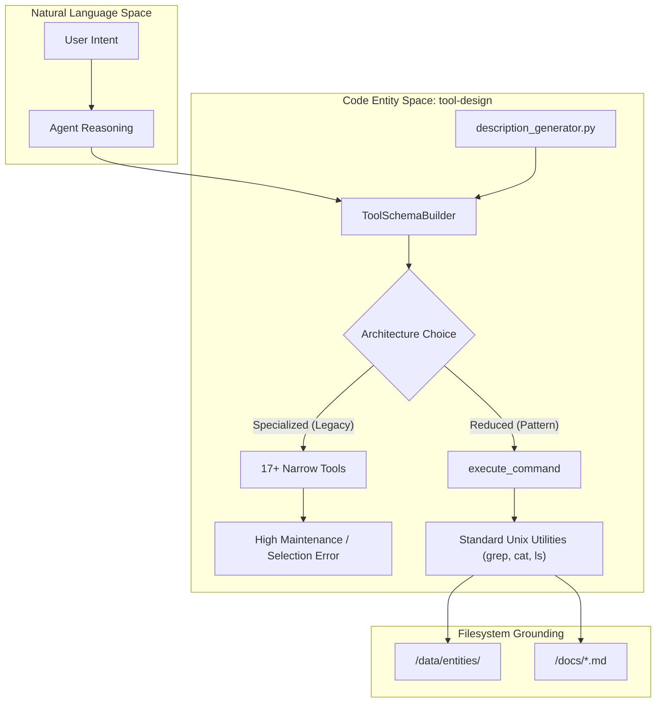
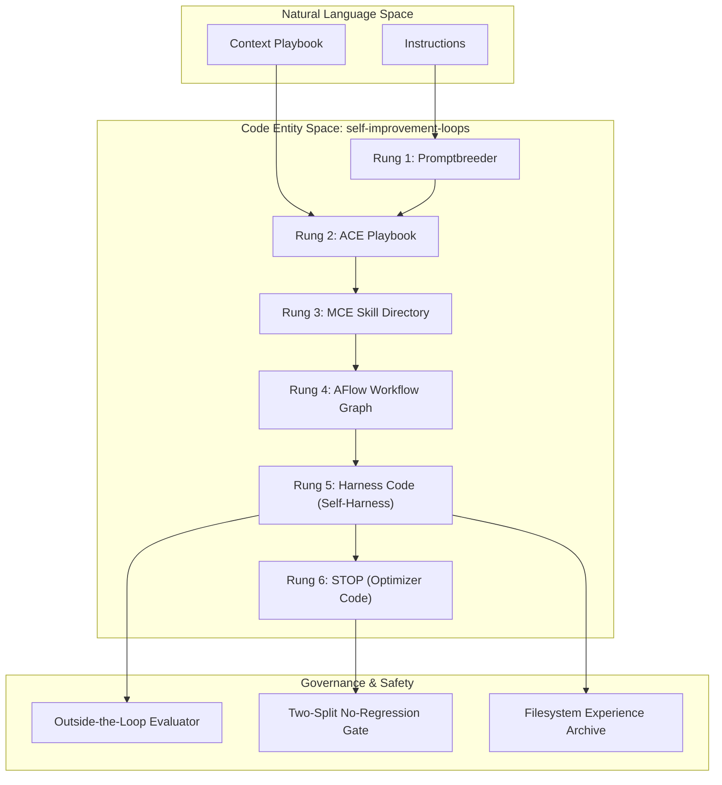

<!-- source: DeepWiki mcp.deepwiki.com · repo muratcankoylan/Agent-Skills-for-Context-Engineering · page 4 Tool Design, Project Development & Harness Skills · fetched 2026-10-26 -->

# Tool Design, Project Development & Harness Skills

Relevant source files

The following files were used as context for generating this wiki page:

- [skills/context-fundamentals/SKILL.md](skills/context-fundamentals/SKILL.md)
- [skills/project-development/SKILL.md](skills/project-development/SKILL.md)
- [skills/self-improvement-loops/SKILL.md](skills/self-improvement-loops/SKILL.md)
- [skills/self-improvement-loops/references/loop-design-evidence.md](skills/self-improvement-loops/references/loop-design-evidence.md)
- [skills/tool-design/SKILL.md](skills/tool-design/SKILL.md)

This section covers the architectural and engineering skills required to build robust, agent-facing tools, structured LLM pipelines, and autonomous governance systems. It focuses on moving from brittle, high-maintenance prompt engineering toward deterministic systems, efficient processing workflows, and self-improving scaffolds.

## Overview

Effective context engineering requires more than just prompt optimization; it requires designing the **interfaces** through which agents interact with the world, the **pipelines** that manage their data, and the **harnesses** that govern their autonomy.

*   **Tool Design** focuses on the "Consolidation Principle," reducing architectural complexity by providing agents with high-utility, general-purpose primitives rather than dozens of narrow, specialized tools [skills/tool-design/SKILL.md:31-35]().
*   **Project Development** provides a methodology for identifying "Task-Model Fit" and structuring LLM work as idempotent, staged pipelines that separate expensive, non-deterministic LLM calls from deterministic data preparation and parsing [skills/project-development/SKILL.md:32-35, 71-77]().
*   **Harness Engineering** provides the operational boundary for autonomous systems, defining "Locked" vs "Editable" surfaces and implementing novelty gates to ensure agents don't overwrite human-authored core logic [skills/self-improvement-loops/SKILL.md:23-25]().
*   **Self-Improvement Loops** targets the optimization of the harness itself, using failure-mining and evolutionary search to evolve the mechanisms that manage context and workflows [skills/self-improvement-loops/SKILL.md:6-10]().

Sources: [skills/tool-design/SKILL.md:31-35](), [skills/project-development/SKILL.md:32-77](), [skills/self-improvement-loops/SKILL.md:6-25]()

### Bridging Natural Language to Code Space

The following diagrams illustrate how abstract design principles manifest as specific code entities and file structures within the repository.

**Diagram 1: Tool Architecture & Reduction**
This diagram shows how the `tool-design` skill moves from complex, specialized toolsets to the "File System Agent" pattern seen in production evidence.

Sources: [skills/tool-design/SKILL.md:31-35](), [skills/tool-design/SKILL.md:48-51](), [skills/tool-design/SKILL.md:59-65]()

**Diagram 2: Autonomous Optimization Ladder**
This diagram maps the hierarchy of self-improvement targets, from simple prompts to the optimizer code itself.

Sources: [skills/self-improvement-loops/SKILL.md:34-46](), [skills/self-improvement-loops/SKILL.md:56-66](), [skills/self-improvement-loops/SKILL.md:71-74]()

---

## [Tool Design Principles](#4.1)

Tool design is treated as a contract between a deterministic system and a non-deterministic agent [skills/tool-design/SKILL.md:8-9](). This skill emphasizes **Architectural Reduction**, a pattern where specialized tools are replaced by a single execution primitive that allows the agent to explore a well-documented codebase or data layer using standard Unix utilities [skills/tool-design/SKILL.md:63-65]().

Key components include:
*   **Consolidation Principle**: Reducing the tool set until each tool has one unambiguous purpose to prevent selection errors [skills/tool-design/SKILL.md:31-35]().
*   **Tool Description Engineering**: Writing descriptions that function as prompt engineering, answering what the tool does, when to use it, and what it returns [skills/tool-design/SKILL.md:33-35]().
*   **MCP Conventions**: Standardizing tool namespaces (e.g., `db_*`, `web_*`) to help agents navigate growing tool collections [skills/tool-design/SKILL.md:45-47]().
*   **Actionable Error Messages**: Designing responses so the agent can self-correct when a tool call fails [skills/tool-design/SKILL.md:19-19]().

For details, see [Tool Design Principles](#4.1).

Sources: [skills/tool-design/SKILL.md:8-65]()

---

## [Project Development & LLM Pipelines](#4.2)

The project development skill provides a framework for scaling LLM tasks from single prompts to production-grade batch processors. It introduces a **Five-Stage Idempotent Pipeline** (`acquire` → `prepare` → `process` → `parse` → `render`) designed to minimize costs by caching the results of expensive LLM calls [skills/project-development/SKILL.md:71-89]().

Key components include:
*   **Task-Model Fit**: A rubric-based approach to determine if a task is suitable for an LLM (synthesis, subjective judgment) or better suited for traditional code (precise computation, real-time requirements) [skills/project-development/SKILL.md:36-57]().
*   **File System as State Machine**: Using directory structures (e.g., `data/{id}/raw.json`) to track pipeline progress, enabling easy debugging and parallelization [skills/project-development/SKILL.md:92-102]().
*   **Manual Prototype Step**: Validating task-model fit with a manual test before investing in automation to prevent wasted effort [skills/project-development/SKILL.md:58-68]().
*   **Three-Phase Workflow**: Implementing structured workflows to ensure context is established before modification [skills/project-development/SKILL.md:120-125]() (see child page for full details).

For details, see [Project Development & LLM Pipelines](#4.2).

Sources: [skills/project-development/SKILL.md:36-125]()

---

## [Harness Engineering](#4.3)

Harness engineering defines the operational environment and safety boundaries for autonomous agents. It focuses on externalizing agent state and protecting the "Locked" surface of a codebase while allowing the agent to operate within "Editable" or "Append-only" regions.

Key components include:
*   **Harness Boundaries**: Classifying surfaces as Locked, Editable, Append-only, or Human-controlled.
*   **Tight Feedback Loops**: Implementing iterative refinement patterns—one editable file, one locked evaluator, and a fixed wall-clock budget.
*   **Durable State**: Externalizing plans and failures to logs to allow future agents to resume without relying on volatile chat history.
*   **Novelty Gates**: Using registries and checks to compare new proposals against existing skills, preventing redundant work.

For details, see [Harness Engineering](#4.3).

Sources: [skills/self-improvement-loops/SKILL.md:23-25]()

---

## [Self-Improvement Loops](#4.4)

This skill addresses systems where the harness, scaffold, or optimizer itself is the optimization target [skills/self-improvement-loops/SKILL.md:2-3](). It distinguishes between governing a loop and evolving it [skills/self-improvement-loops/SKILL.md:8-10]().

Key components include:
*   **Optimization Ladder**: A framework for targeting improvements at the correct level, from prompts to optimizer code [skills/self-improvement-loops/SKILL.md:34-47]().
*   **Outside-the-Loop Invariant**: The requirement that evaluators and budget enforcement live in the runtime, outside the surface the agent can modify, to prevent reward hacking [skills/self-improvement-loops/SKILL.md:56-66]().
*   **Two-Split No-Regression Gate**: An acceptance rule requiring improvement on a held-in set and no regression on a held-out set before a self-edit is merged [skills/self-improvement-loops/SKILL.md:67-70]().
*   **Filesystem Experience Archive**: Storing source code, scores, and raw traces in a searchable directory structure to allow the proposer to learn from historical successes and failures [skills/self-improvement-loops/SKILL.md:71-74]().

For details, see [Self-Improvement Loops](#4.4).

Sources: [skills/self-improvement-loops/SKILL.md:2-74](), [skills/self-improvement-loops/references/loop-design-evidence.md:1-58]()

---

