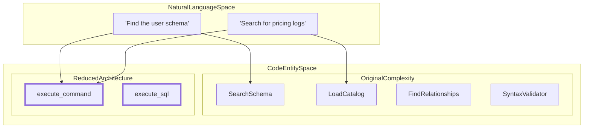
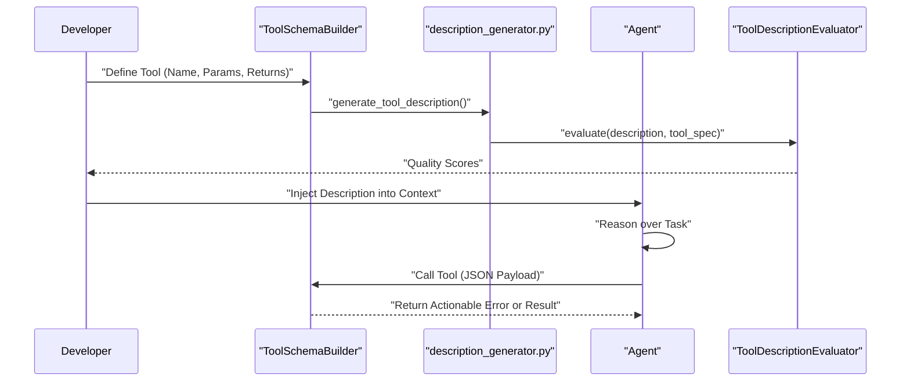

<!-- source: DeepWiki mcp.deepwiki.com · repo muratcankoylan/Agent-Skills-for-Context-Engineering · page 4.1 Tool Design Principles · fetched 2026-10-26 -->

# Tool Design Principles

Relevant source files

The following files were used as context for generating this wiki page:

- [docs/netflix_context.md](docs/netflix_context.md)
- [docs/vercel_tool.md](docs/vercel_tool.md)
- [skills/context-compression/SKILL.md](skills/context-compression/SKILL.md)
- [skills/context-compression/scripts/compression_evaluator.py](skills/context-compression/scripts/compression_evaluator.py)
- [skills/context-compression/tests/test_compression_evaluator.py](skills/context-compression/tests/test_compression_evaluator.py)
- [skills/context-fundamentals/SKILL.md](skills/context-fundamentals/SKILL.md)
- [skills/project-development/SKILL.md](skills/project-development/SKILL.md)
- [skills/tool-design/SKILL.md](skills/tool-design/SKILL.md)
- [skills/tool-design/references/architectural_reduction.md](skills/tool-design/references/architectural_reduction.md)

## Purpose and Scope

This page covers the `tool-design` skill, focusing on the interface layer that connects deterministic code to non-deterministic agents [skills/tool-design/SKILL.md:6-11](). It details the Consolidation Principle, Architectural Reduction via the File System Agent Pattern, tool description engineering, the `ToolSchemaBuilder` and `description_generator.py` utilities, MCP namespacing, verb-noun naming conventions, and actionable error recovery [skills/tool-design/SKILL.md:1-4]().

---

## The Consolidation Principle & Architectural Reduction

The Consolidation Principle mandates that if a human engineer cannot definitively distinguish between two tools, an agent will inevitably fail to do so [skills/tool-design/SKILL.md:31-32](). Reducing tool sets to one unambiguous purpose per tool minimizes selection errors caused by overlapping functionality [skills/tool-design/SKILL.md:18-19](). Bloated tool sets create ambiguous decision points and consume disproportionate context after JSON serialization [skills/context-fundamentals/SKILL.md:54-55]().

Architectural reduction replaces numerous specialized tools with primitive, general-purpose capabilities [skills/tool-design/SKILL.md:59-61](). The **File System Agent Pattern** substitutes custom data exploration tools with standard Unix utilities (`grep`, `cat`, `ls`, `find`) [skills/tool-design/SKILL.md:63-65](). Production data from Text-to-SQL systems demonstrates significant performance gains when compressing tool sets [skills/tool-design/references/architectural_reduction.md:32-37]().

| Metric | Original (17 tools) | Reduced (2 tools) | Improvement |
| :--- | :--- | :--- | :--- |
| **Avg. Execution Time** | 274.8s | 77.4s | 3.5x faster |
| **Success Rate** | 80% | 100% | +20% |
| **Avg. Token Usage** | ~102k | ~61k | 37% reduction |

Sources: [skills/tool-design/references/architectural_reduction.md:60-65](), [skills/tool-design/SKILL.md:59-65](), [skills/context-fundamentals/SKILL.md:54-55](), [skills/tool-design/references/architectural_reduction.md:32-37]()

### Architectural Reduction Diagram

**Natural Language Space to Code Entity Space: Architectural Reduction**

Sources: [skills/tool-design/references/architectural_reduction.md:9-37](), [skills/tool-design/SKILL.md:63-65](), [skills/tool-design/references/architectural_reduction.md:32-37]()

---

## Tool Description Engineering & Namespacing

Tool descriptions serve as active prompt components that directly steer agent behavior [skills/tool-design/SKILL.md:33-35](). Descriptions must answer three core questions: what the tool does, when to use it, and what it returns [skills/tool-design/SKILL.md:33-34]().

### Verb-Noun Convention & MCP Namespaces
* **Verb-Noun Naming**: Tools follow explicit action-object patterns (e.g., `get_customer`, `update_record`) [skills/tool-design/SKILL.md:19-20]().
* **Namespacing**: Collections use prefixes (`db_*`, `web_*`) to improve routing accuracy in large catalogs [skills/tool-design/SKILL.md:45-47]().
* **Model Context Protocol (MCP)**: Implements server-qualified namespaces (`ServerName:tool_name`) [skills/tool-design/SKILL.md:20]().

Sources: [skills/tool-design/SKILL.md:19-20](), [skills/tool-design/SKILL.md:33-35](), [skills/tool-design/SKILL.md:45-47]()

---

## ToolSchemaBuilder & description_generator.py

The `ToolSchemaBuilder` class in `description_generator.py` provides a programmatic interface for assembling valid tool contracts [skills/tool-design/scripts/description_generator.py:18-25]().

### Key Implementation Components
* `ToolSchemaBuilder`: Fluent interface for adding parameters and constraints [skills/tool-design/scripts/description_generator.py:40]().
* `generate_tool_description(tool_spec)`: Renders Markdown descriptions for context injection [skills/tool-design/scripts/description_generator.py:111-125]().
* `ToolDescriptionEvaluator.evaluate()`: Programmatically scores clarity, completeness, and actionability [skills/tool-design/scripts/description_generator.py:204-216]().
* `ErrorMessageGenerator`: Constructs steerable recovery prompts for failed tool calls [skills/tool-design/scripts/description_generator.py:14-15]().

Sources: [skills/tool-design/scripts/description_generator.py:14-40](), [skills/tool-design/scripts/description_generator.py:111-125](), [skills/tool-design/scripts/description_generator.py:204-216]()

---

## Actionable Error Messages

Error responses must provide deterministic recovery pathways rather than opaque failure codes [skills/tool-design/SKILL.md:19](). When a parameter is missing or a file is not found, the error payload must explicitly instruct the agent on the corrective action (e.g., suggesting a directory listing or schema query) [skills/tool-design/SKILL.md:88-91]().

Sources: [skills/tool-design/SKILL.md:19](), [skills/tool-design/SKILL.md:88-91]()

---

## Tool Lifecycle Data Flow

The following sequence details the lifecycle from schema construction to agent execution and automated evaluation.

**Natural Language Space to Code Entity Space: Tool Lifecycle**

Sources: [skills/tool-design/scripts/description_generator.py:10-25](), [skills/tool-design/SKILL.md:30-35](), [skills/tool-design/scripts/description_generator.py:204-216]()

---

## Tool Evaluation & Performance Drivers

Tool optimization must be measured against **Tokens-Per-Task** rather than per-request token counts [skills/context-compression/SKILL.md:8-9](). Poor tool descriptions cause agents to repeatedly query or misunderstand outputs, increasing total task token expenditure [skills/context-compression/SKILL.md:40-41]().

| Design Principle | Code Entity / Script | Role |
| :--- | :--- | :--- |
| **Consolidation** | `SKILL.md` (Core Concepts) | Policy for reducing selection ambiguity and token bloat [skills/tool-design/SKILL.md:31-32]() |
| **Schema Building** | `ToolSchemaBuilder` | Fluent interface for standardized spec construction [skills/tool-design/scripts/description_generator.py:40]() |
| **Quality Audit** | `ToolDescriptionEvaluator` | Automated scoring of tool documentation quality [skills/tool-design/scripts/description_generator.py:204-216]() |
| **Error Handling** | `ErrorMessageGenerator` | Logic for creating agent-steerable recovery messages [skills/tool-design/scripts/description_generator.py:39]() |

Sources: [skills/tool-design/SKILL.md:31-32](), [skills/tool-design/scripts/description_generator.py:40](), [skills/tool-design/scripts/description_generator.py:204-216](), [skills/context-compression/SKILL.md:8-9](), [skills/context-compression/SKILL.md:40-41]()

---

