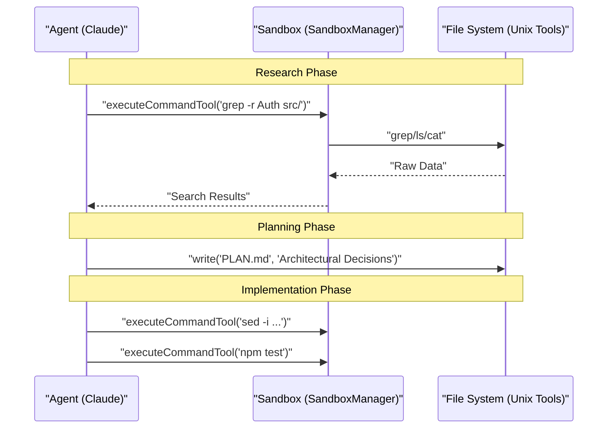

<!-- source: DeepWiki mcp.deepwiki.com · repo muratcankoylan/Agent-Skills-for-Context-Engineering · page 4.2 Project Development & LLM Pipelines · fetched 2026-10-26 -->

# Project Development & LLM Pipelines

<details>
<summary>Relevant source files</summary>

The following files were used as context for generating this wiki page:

- [skills/context-fundamentals/SKILL.md](skills/context-fundamentals/SKILL.md)
- [skills/project-development/SKILL.md](skills/project-development/SKILL.md)
- [skills/project-development/references/case-studies.md](skills/project-development/references/case-studies.md)
- [skills/project-development/references/pipeline-patterns.md](skills/project-development/references/pipeline-patterns.md)
- [skills/project-development/scripts/pipeline_template.py](skills/project-development/scripts/pipeline_template.py)
- [skills/tool-design/SKILL.md](skills/tool-design/SKILL.md)

</details>


The Project Development & LLM Pipelines skill provides a structured methodology for identifying, architecting, and executing LLM-based projects. It emphasizes a transition from fragile, over-engineered agent scaffolding to robust, idempotent pipelines and simplified "File System as Agent" patterns. This page details the five-stage pipeline architecture, cost projection mechanics, and the three-phase workflow for large-scale codebase interactions.

## 1. The Five-Stage Idempotent Pipeline

To ensure reliability and maintainability, LLM projects are structured as staged pipelines. This separation allows for independent debugging of deterministic code and non-deterministic LLM calls [skills/project-development/SKILL.md:69-77]().

### Pipeline Stages
The canonical pipeline follows a linear progression of data transformation [skills/project-development/SKILL.md:78-82]():

| Stage | Name | Description | Deterministic |
| :--- | :--- | :--- | :--- |
| 1 | **Acquire** | Fetch raw data from APIs, databases, or local files [skills/project-development/SKILL.md:84-84](). | Yes |
| 2 | **Prepare** | Transform raw data into structured Markdown prompts [skills/project-development/SKILL.md:85-85](). | Yes |
| 3 | **Process** | Execute LLM calls (the non-deterministic, expensive step) [skills/project-development/SKILL.md:86-86](). | No |
| 4 | **Parse** | Extract structured data (JSON/YAML) from LLM responses [skills/project-development/SKILL.md:87-87](). | Yes |
| 5 | **Render** | Generate final artifacts (reports, HTML, visualizations) [skills/project-development/SKILL.md:88-88](). | Yes |

### Conceptual-to-Code Mapping
The following diagram bridges the natural language pipeline stage concepts to their concrete Python implementations inside `skills/project-development/scripts/pipeline_template.py` [skills/project-development/scripts/pipeline_template.py:40-54]().

```mermaid
graph TD
    subgraph "NaturalLanguageSpace"
        Acquire[""AcquireStage""]
        Prepare[""PrepareStage""]
        Process[""ProcessStage""]
        Parse[""ParseStage""]
        Render[""RenderStage""]
    end

    subgraph "CodeEntitySpace"
        FnAcquire[""stage_acquire(batch_id, limit)""]
        FnPrepare[""stage_prepare(batch_id)""]
        FnProcess[""stage_process(batch_id, model, max_workers)""]
        FnParse[""stage_parse(batch_id)""]
        FnRender[""stage_render(batch_id)""]
    end

    Acquire --> FnAcquire
    Prepare --> FnPrepare
    Process --> FnProcess
    Parse --> FnParse
    Render --> FnRender
```

Sources: [skills/project-development/SKILL.md:69-91](), [skills/project-development/scripts/pipeline_template.py:40-54](), [skills/project-development/references/pipeline-patterns.md:5-22]()

---

## 2. File System as State Machine

Rather than relying on external databases for state, the methodology uses the local file system to track pipeline progress. This pattern provides natural idempotency: if a stage's output file exists, the stage is skipped [skills/project-development/SKILL.md:92-104]().

### Directory Structure & Code Entity Mapping
The filesystem layout maps directly to data classes and path resolution functions defined in `skills/project-development/scripts/pipeline_template.py` [skills/project-development/scripts/pipeline_template.py:98-154]().

```mermaid
graph TD
    subgraph "FilesystemSpace"
        BatchDir[""DATA_DIR / batch_id""]
        ItemDir[""get_item_dir(batch_id, item_id)""]
        RawFile[""raw.json""]
        PromptFile[""prompt.md""]
        RespFile[""response.md""]
        ParsedFile[""parsed.json""]
    end

    subgraph "CodeEntitySpace"
        ItemCls[""Item dataclass""]
        PromptTpl[""PROMPT_TEMPLATE""]
        ParserFn[""parse_response(text)""]
        ParsedCls[""ParsedResult dataclass""]
    end

    BatchDir --> ItemDir
    ItemDir --> RawFile
    ItemDir --> PromptFile
    ItemDir --> RespFile
    ItemDir --> ParsedFile

    RawFile -.-> ItemCls
    PromptFile -.-> PromptTpl
    RespFile -.-> ParserFn
    ParsedFile -.-> ParsedCls
```

### Idempotency and Cleanup
The `stage_clean` function allows for surgical re-runs by deleting specific stage outputs and all downstream files, forcing the pipeline to re-execute from that point [skills/project-development/scripts/pipeline_template.py:20-20](). The `needs_processing` pattern checks for file existence to avoid redundant API calls [skills/project-development/references/pipeline-patterns.md:47-60]().

Sources: [skills/project-development/SKILL.md:92-104](), [skills/project-development/scripts/pipeline_template.py:132-154](), [skills/project-development/references/pipeline-patterns.md:23-42]()

---

## 3. Execution & Cost Projection

### Parallelism with ThreadPoolExecutor
To handle high-volume batch processing, the `stage_process` function implements a `ThreadPoolExecutor` with a configurable `max_workers` parameter [skills/project-development/scripts/pipeline_template.py:34-34](). This allows multiple LLM calls to run concurrently, effectively managing latency during the most expensive stage of the pipeline [skills/project-development/references/pipeline-patterns.md:85-106]().

### Cost Estimation (`stage_estimate`)
Before execution, the `stage_estimate` function projects total costs based on the number of items and expected token usage [skills/project-development/scripts/pipeline_template.py:21-21](). This is critical for deciding whether to proceed with a project after the manual prototype phase [skills/project-development/SKILL.md:18-18]().

**Formula Logic:**
The script iterates through items, checking for the existence of `prompt.md` to count the total batch size, then multiplies by estimated token costs per model [skills/project-development/scripts/pipeline_template.py:216-255]().

Sources: [skills/project-development/scripts/pipeline_template.py:30-38](), [skills/project-development/references/pipeline-patterns.md:85-113]()

---

## 4. Three-Phase Workflow for Large Codebases

When dealing with complex codebases, a Three-Phase Workflow is utilized to prevent "easy but complex" traps where agents generate code they don't understand [skills/project-development/SKILL.md:20-20]().

### Workflow Phases
1.  **Research**: Use tools like `grep`, `ls`, and `cat` to build a mental model of the system [skills/project-development/references/case-studies.md:181-182]().
2.  **Planning**: Define architectural changes in a `NOTES.md` or `PLAN.md` before writing code.
3.  **Implementation**: Execute the plan in small, testable increments.

### Architectural Reduction
This workflow is supported by the "File System Agent" pattern, where specialized tools are removed in favor of direct shell access. As demonstrated in the Vercel case study, reducing 17 specialized tools to 2 general tools (`ExecuteCommand` for bash and `ExecuteSQL`) improved success rates from 80% to 100% [skills/project-development/references/case-studies.md:173-200]().



Sources: [skills/project-development/references/case-studies.md:140-204](), [skills/project-development/SKILL.md:10-21]()

---

## 5. Structured Output & Parsing

To ensure the `Parse` stage succeeds, prompts must include explicit formatting instructions and rationale disclosure [skills/project-development/SKILL.md:107-114]().

### Parsing Logic
The parsing functions in the pipeline template use regular expressions to extract content between Markdown headers [skills/project-development/scripts/pipeline_template.py:30-38]().

- **Section Extraction**: Matches headers and captures trailing text using `re.DOTALL` [skills/project-development/references/pipeline-patterns.md:181-187]().
- **List Extraction**: Parses bullet points into Python lists [skills/project-development/references/pipeline-patterns.md:203-212]().
- **Score Validation**: Extracts integers and clamps them to a defined range [skills/project-development/references/pipeline-patterns.md:217-230]().

Sources: [skills/project-development/scripts/pipeline_template.py:64-91](), [skills/project-development/references/pipeline-patterns.md:138-172](), [skills/project-development/references/case-studies.md:86-125]()

---

