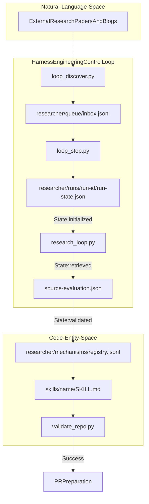
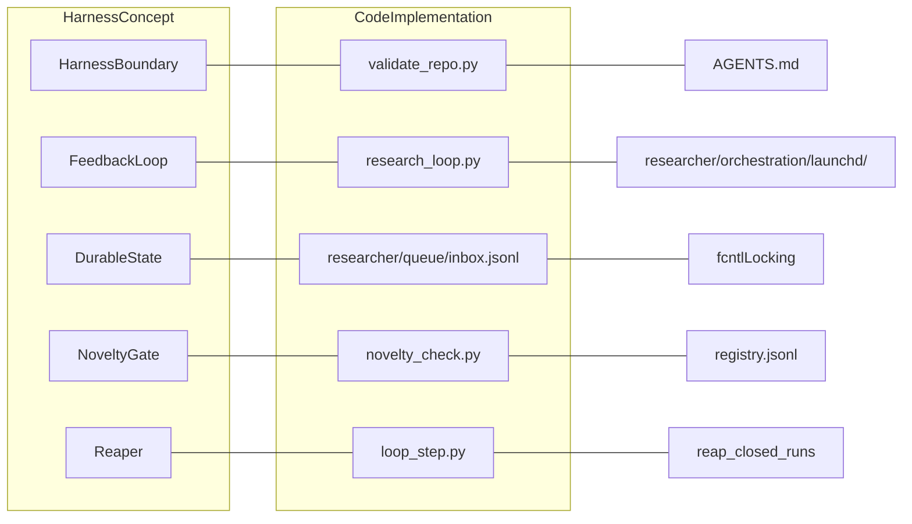

<!-- source: DeepWiki mcp.deepwiki.com · repo muratcankoylan/Agent-Skills-for-Context-Engineering · page 4.3 Harness Engineering · fetched 2026-10-26 -->

# Harness Engineering

Relevant source files

The following files were used as context for generating this wiki page:

- [.claude-plugin/marketplace.json](.claude-plugin/marketplace.json)
- [.plugin/plugin.json](.plugin/plugin.json)
- [README.md](README.md)
- [SKILL.md](SKILL.md)
- [skills/advanced-evaluation/SKILL.md](skills/advanced-evaluation/SKILL.md)
- [skills/bdi-mental-states/SKILL.md](skills/bdi-mental-states/SKILL.md)
- [skills/filesystem-context/SKILL.md](skills/filesystem-context/SKILL.md)
- [skills/hosted-agents/SKILL.md](skills/hosted-agents/SKILL.md)

This page covers the `harness-engineering` skill, which focuses on designing the control systems, operating loops, and safety boundaries that surround an autonomous agent [skills/harness-engineering/SKILL.md:8-9](). While **Evaluation** ([skills/advanced-evaluation/SKILL.md:25-25]()) measures agent output quality and **Hosted Agents** ([skills/hosted-agents/SKILL.md:6-8]()) manages sandboxed infrastructure, Harness Engineering establishes the surface classifications, state persistence mechanisms, novelty checks, and human approval gates required for stable, production-grade autonomous operations [skills/harness-engineering/SKILL.md:8-9]().

Sources: [skills/harness-engineering/SKILL.md:8-9](), [skills/advanced-evaluation/SKILL.md:25-25](), [hosted-agents/SKILL.md:6-8]()

## The Harness Boundary

The core architectural principle of harness engineering is the strict separation of the agent from its environment via surface classification. Every file, directory, or interface in an agent's workspace is categorized into one of four surface classes to prevent benchmark gaming, metric corruption, or unauthorized state modifications [skills/harness-engineering/SKILL.md:31-33]().

### Surface Classes

| Surface Class | Rule & Access Level | Examples in Codebase |
| :--- | :--- | :--- |
| **Locked** | Read-only to the agent; prevents tampering with evaluation criteria and safety gates. | `researcher/scripts/validate_repo.py`, core validation scripts, evaluation rubrics [researcher/insights/auto-research-experiment.md:34-34](). |
| **Editable** | Fully mutatable by the agent during active execution loops. | Skill drafts in `skills/`, proposal directories under `researcher/runs/` [skills/harness-engineering/SKILL.md:38-38](). |
| **Append-only** | Durable history; agent may append new records but cannot rewrite or delete existing ones. | File-based queues like `researcher/queue/*.jsonl`, operation logs, state histories [AGENTS.md:1-3](), [researcher/insights/auto-research-experiment.md:46-46](). |
| **Human-controlled** | Requires explicit out-of-band human intervention and authorization. | `git push`, PR merging, production deployments, destructive file removals [skills/harness-engineering/SKILL.md:40-40](), [AGENTS.md:9-9](). |

Sources: [skills/harness-engineering/SKILL.md:33-40](), [researcher/insights/auto-research-experiment.md:19-25](), [researcher/insights/auto-research-experiment.md:31-51](), [AGENTS.md:9-9]()

## Tight Feedback Loops & Control State Machine

Effective agent autonomy requires feedback loops that are fast, deterministic, and resistant to optimization gaming [skills/harness-engineering/SKILL.md:44-46](). The harness implements the **Karpathy Autoresearch Pattern**, binding the agent to a minimal control structure: fixed iteration budgets, locked evaluation functions, and strictly bounded editable surfaces [skills/harness-engineering/SKILL.md:44-46](). If an agent is permitted to modify its own evaluation criteria, it will inevitably optimize the metric rather than the underlying objective [skills/harness-engineering/SKILL.md:113-121]().

In the Researcher OS, this control loop is managed by a deterministic state machine that transitions research runs through validation gates (`initialized -> retrieved -> evaluated -> proposed -> novelty_checked -> validated -> pr_ready -> closed`) prior to human review [AGENTS.md:18-18](), [researcher/insights/auto-research-experiment.md:47-49]().

### Research-to-Skill Data Flow Diagram
This diagram bridges the external "Natural Language Space" to the internal "Code Entity Space" through the harness control loop.

Sources: [skills/harness-engineering/SKILL.md:103-107](), [AGENTS.md:17-20](), [researcher/insights/auto-research-experiment.md:48-51]()

## Durable State, Atomic Writes & Externalization

To survive session compaction, context window overflows, and unexpected process termination, autonomous agents must externalize all operating state directly into the filesystem [skills/harness-engineering/SKILL.md:50-51]().

1. **Machine-Readable Run State**: Per-run execution state is recorded in `run-state.json` files containing explicit state transitions and append-only `state_history` arrays, avoiding ambiguous prose logs [AGENTS.md:18-18](), [researcher/insights/auto-research-experiment.md:48-51]().
2. **Externalized Queues & Artifacts**: Active tasks, source queues, and parked attempts are maintained in structured jsonl files (e.g., `researcher/queue/parked.jsonl`), allowing subsequent agent sessions to resume seamlessly [skills/harness-engineering/SKILL.md:50-52]().
3. **Atomic File Operations**: To prevent corruption during concurrent execution across background processes or `launchd` daemons, the harness enforces atomic write patterns (writing to a temporary file via `tempfile` followed by `os.replace`) coupled with `fcntl` exclusive file locking [AGENTS.md:37-37](), [researcher/insights/auto-research-experiment.md:63-65]().

Sources: [skills/harness-engineering/SKILL.md:50-59](), [AGENTS.md:18-37](), [researcher/insights/auto-research-experiment.md:63-68]()

## Novelty Gates & Mechanism Registry

A recurring failure mode in autonomous research loops is the redundant rediscovery of existing capabilities. The harness prevents this by enforcing strict **Novelty Gates** backed by a machine-readable **Mechanism Registry** [skills/harness-engineering/SKILL.md:71-73]().

- **Mechanism Registry (`registry.jsonl`)**: Serves as the authoritative catalog of accepted behavioral patterns and architectural innovations, tracked independently of human-readable documentation [AGENTS.md:20-20](), [researcher/insights/auto-research-experiment.md:21-25]().
- **Novelty Check (`novelty_check.py`)**: Before any newly generated skill or mechanism proposal is accepted into the repository, the harness validates the proposed design against the registry to guarantee genuine novelty [researcher/insights/auto-research-experiment.md:23-25]().
- **Deterministic Pre-Checks**: Structural integrity checks (`validate_repo.py --strict`, compatibility validators) execute before any resource-intensive LLM-as-a-judge evaluations [AGENTS.md:19-19](), [researcher/insights/auto-research-experiment.md:41-43]().

Sources: [skills/harness-engineering/SKILL.md:71-74](), [AGENTS.md:19-22](), [researcher/insights/auto-research-experiment.md:21-43]()

## Operational Infrastructure: The Researcher OS

The Researcher OS provides the concrete runtime implementation of harness engineering principles, utilizing file-based queues and orchestrator scripts to manage autonomous research-to-skill pipelines [AGENTS.md:16-17]().

### System Component Mapping
This diagram maps abstract harness concepts directly to their concrete code entities within the repository.

Sources: [researcher/insights/auto-research-experiment.md:57-65](), [skills/harness-engineering/SKILL.md:149-155](), [AGENTS.md:23-37]()

### Implementation Details: The Reaper
Queue-based automation systems are susceptible to unmanaged growth in terminal states. Without explicit pruning, completed or parked runs accumulate indefinitely in queue files. The harness implements a dedicated `reap_closed_runs()` cleanup routine within the orchestration loop to purge finalized entries once they transition to `closed` [researcher/insights/auto-research-experiment.md:55-59]().

Sources: [researcher/insights/auto-research-experiment.md:55-59]()

## Human Approval Boundaries & PR Preparation

To maintain absolute safety over repository state, the harness enforces rigid separation between automated preparation and human-authorized execution:
- **Autonomous Preparation**: Agents are fully authorized to research, draft, test, commit, and open pull requests for proposed skill enhancements [skills/harness-engineering/SKILL.md:75-76]().
- **Human Approval Required**: Agents are strictly prohibited from executing `git push`, merging PRs, or publishing artifacts without explicit human intervention [skills/harness-engineering/SKILL.md:77-78](), [AGENTS.md:9-9]().
- **Subagent Code Reviews**: Prior to human presentation, proposals undergo automated scrutiny by `code-reviewer` subagents to identify structural defects, dead configuration flags, or race conditions [researcher/insights/auto-research-experiment.md:85-89]().

Sources: [skills/harness-engineering/SKILL.md:75-78](), [AGENTS.md:9-12](), [researcher/insights/auto-research-experiment.md:85-89]()

## Boundaries vs Adjacent Skills

To prevent architectural overlap, maintain clear distinctions between Harness Engineering and adjacent operational skills:
- **Evaluation** (`evaluation` / `advanced-evaluation`): Focuses on rubric design, scoring methodology, and measuring quality; harness-engineering governs the control loops, state persistence, and boundaries around those evaluations [skills/advanced-evaluation/SKILL.md:25-26]().
- **Hosted Agents** (`hosted-agents`): Focuses on remote sandbox execution, warm pools, and VM infrastructure; harness-engineering defines the permission surfaces and durable state machines running inside those environments [hosted-agents/SKILL.md:20-21]().
- **Self-Improvement Loops** (`self-improvement-loops`): Focuses on recursive self-improvement (RSI) where the harness itself becomes the optimization target; harness-engineering provides the stable control foundation (Locked/Editable boundaries) required for RSI systems to operate safely [CHANGELOG.md:27-31]().

Sources: [skills/advanced-evaluation/SKILL.md:25-26](), [hosted-agents/SKILL.md:20-21](), [CHANGELOG.md:27-31]()

---

