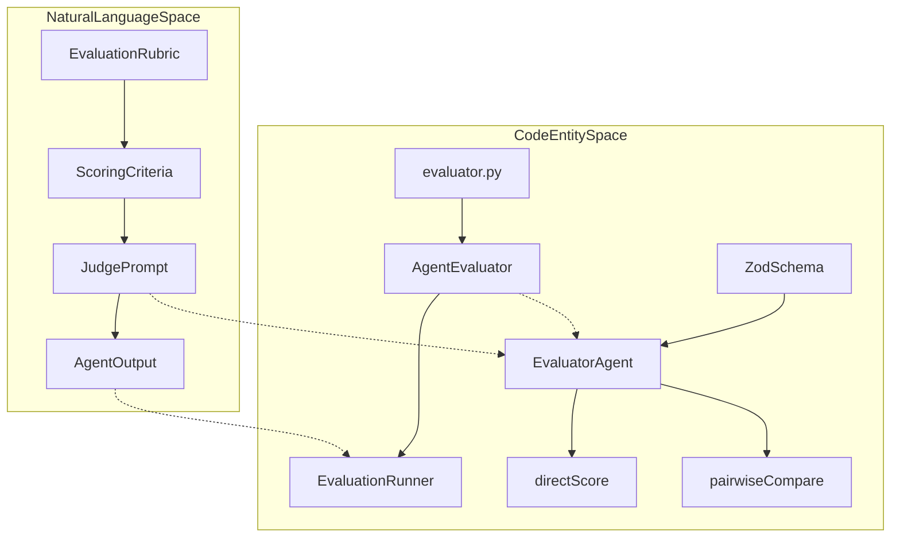
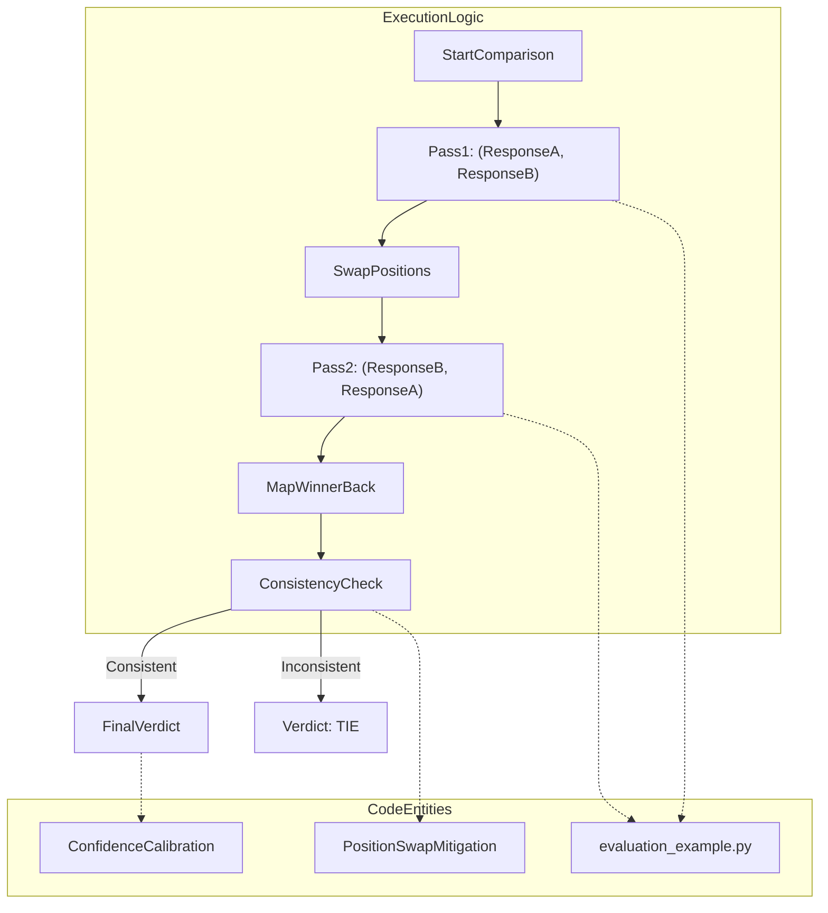

<!-- source: DeepWiki mcp.deepwiki.com · repo muratcankoylan/Agent-Skills-for-Context-Engineering · page 5 Evaluation Frameworks · fetched 2026-10-26 -->

# Evaluation Frameworks

Relevant source files

The following files were used as context for generating this wiki page:

- [skills/advanced-evaluation/SKILL.md](skills/advanced-evaluation/SKILL.md)
- [skills/bdi-mental-states/SKILL.md](skills/bdi-mental-states/SKILL.md)
- [skills/evaluation/SKILL.md](skills/evaluation/SKILL.md)
- [skills/filesystem-context/SKILL.md](skills/filesystem-context/SKILL.md)
- [skills/hosted-agents/SKILL.md](skills/hosted-agents/SKILL.md)

Evaluation in agentic systems differs fundamentally from traditional software testing. Because agents make dynamic decisions, are non-deterministic between runs, and often achieve goals through multiple valid paths, evaluation frameworks must focus on **outcomes** rather than specific execution sequences [skills/evaluation/SKILL.md:7-8](). 

This page provides a high-level overview of the evaluation and advanced-evaluation skills within the repository. For deep technical details, see the child pages:
- [Core Evaluation Skill](#5.1)
- [Advanced Evaluation & Bias Mitigation](#5.2)

Sources: [skills/evaluation/SKILL.md:6-8](), [skills/advanced-evaluation/SKILL.md:6-10]()

---

## Core Evaluation Concepts

The evaluation framework transitions from simple pass/fail checks to a multi-dimensional approach that treats context engineering choices as variables to be validated [skills/evaluation/SKILL.md:10-19]().

### The 95% Variance Finding
Research indicates that three factors explain nearly all variance in browsing agent performance. Evaluation budgets should be designed with these weights in mind:
*   **Token Usage (Primary driver)**: Higher budgets generally correlate with better performance until cost or context quality collapses [skills/evaluation/SKILL.md:40-42]().
*   **Tool Call Volume (Secondary driver)**: More tool use helps only when calls retrieve useful evidence [skills/evaluation/SKILL.md:43]().
*   **Model Choice (Secondary but multiplicative)**: Better models act as efficiency multipliers by using tokens and tools more effectively [skills/evaluation/SKILL.md:44]().

### Multi-Dimensional Rubrics
Instead of a single aggregate score, the framework utilizes rubrics across five core dimensions to identify specific failure modes:
1.  **Factual Accuracy**: Claims vs. Ground Truth (weight for knowledge tasks).
2.  **Completeness**: Coverage of requested aspects (weight for research tasks).
3.  **Citation Accuracy**: Alignment between claims and sources (weight for trust-sensitive contexts).
4.  **Source Quality**: Authority of retrieved data (weight for authoritative outputs).
5.  **Tool Efficiency**: Reasonableness of tool call volume (weight for cost-sensitive systems) [skills/evaluation/SKILL.md:73-77]().

### LLM-as-a-Judge Architecture
To scale evaluation, the system employs LLMs as evaluators. This "Natural Language Space" reasoning is bridged to "Code Entity Space" through specific classes like `AgentEvaluator` and `EvaluationRunner` [skills/evaluation/SKILL.md:27-28]().

Title: "LLM-as-a-Judge System Bridge"

Sources: [skills/evaluation/SKILL.md:85-88](), [skills/advanced-evaluation/SKILL.md:107-109](), [skills/evaluation/SKILL.md:32-34]()

---

## 5.1 Core Evaluation Skill

The **Core Evaluation** skill provides the foundational tools for measuring agent performance. It focuses on setting realistic token budgets, validating multi-agent architectures against single-agent baselines, and implementing end-state evaluation for stateful agents [skills/evaluation/SKILL.md:47-49, 93-95]().

Key components include:
*   **Stratified Test Sets**: Categorizing cases by complexity (Simple to Very Complex) to surface patterns where agents fail as interaction length or context accumulates [skills/evaluation/SKILL.md:59-62]().
*   **Process vs. Outcome**: Distinguishing between *how* an agent worked (informational) and *what* it achieved (evaluative) to tolerate valid path variations [skills/evaluation/SKILL.md:55-57]().
*   **Evaluator Scripts**: Using `evaluator.py` to automate the scoring of trajectories against defined benchmarks.

For full technical details, see [Core Evaluation Skill](#5.1).

Sources: [skills/evaluation/SKILL.md:47-49](), [skills/evaluation/SKILL.md:55-62](), [skills/evaluation/SKILL.md:93-95]()

---

## 5.2 Advanced Evaluation & Bias Mitigation

The **Advanced Evaluation** skill addresses production-grade challenges, specifically the systematic biases that emerge when LLMs judge other LLMs [skills/advanced-evaluation/SKILL.md:7-10]().

### Primary Evaluation Patterns
| Pattern | Use Case | Implementation |
| :--- | :--- | :--- |
| **Direct Scoring** | Objective criteria (Factual accuracy, toxicity) | Single LLM rates one response on a calibrated scale (1-5) [skills/advanced-evaluation/SKILL.md:35, 81](). |
| **Pairwise Comparison** | Subjective preferences (Tone, style) | LLM compares two responses; more reliable for preference tasks [skills/advanced-evaluation/SKILL.md:37](). |
| **Rubric Generation** | Reducing variance | Automated generation of level descriptions and scoring guidelines [skills/advanced-evaluation/SKILL.md:158-163](). |

### Bias Mitigation Logic
The framework implements specific code patterns to counteract "Position Bias" (preferring the first response) and "Self-Enhancement Bias" (preferring one's own output) [skills/advanced-evaluation/SKILL.md:43-47]().

Title: "Pairwise Comparison with Position Swap"

Sources: [skills/advanced-evaluation/SKILL.md:115-121](), [skills/advanced-evaluation/SKILL.md:154-157]()

For full technical details, see [Advanced Evaluation & Bias Mitigation](#5.2).

---

