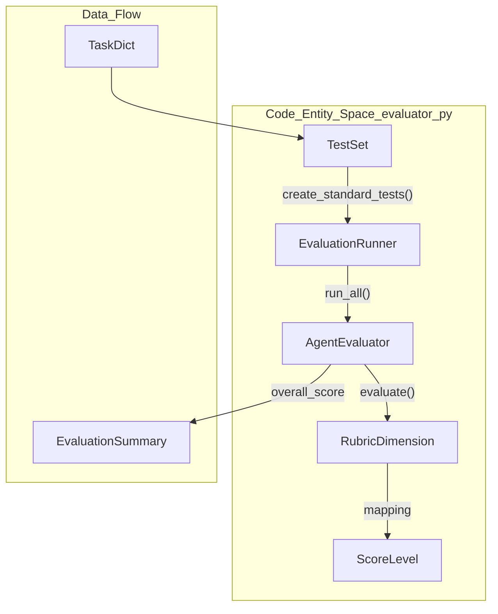
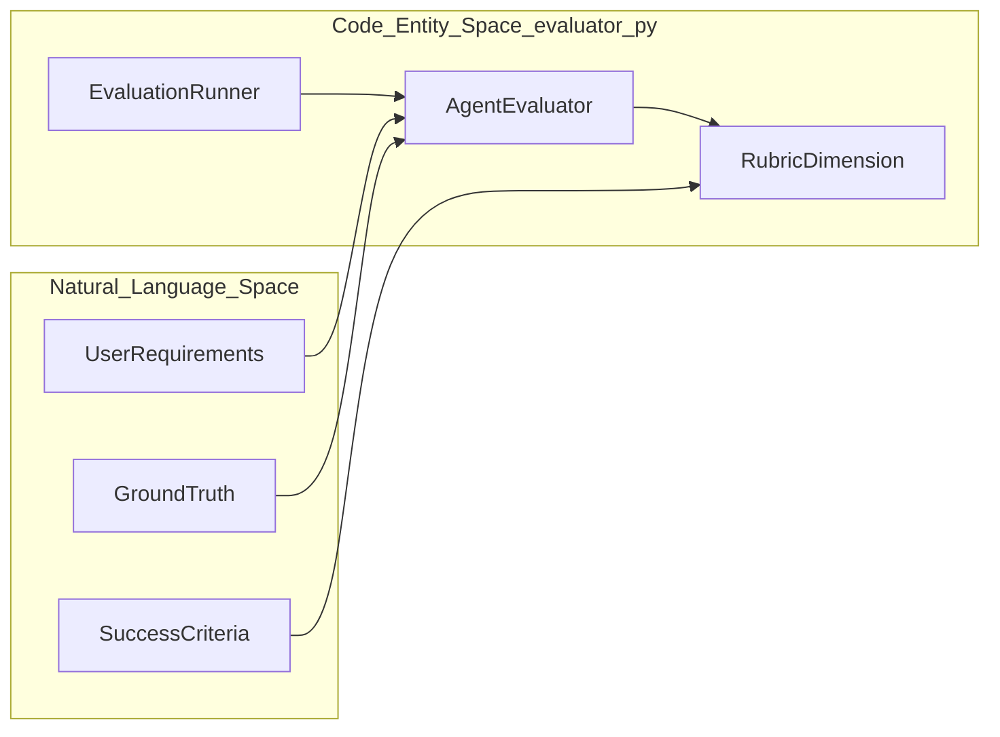

<!-- source: DeepWiki mcp.deepwiki.com · repo muratcankoylan/Agent-Skills-for-Context-Engineering · page 5.1 Core Evaluation Skill · fetched 2026-10-26 -->

# Core Evaluation Skill

Relevant source files

The following files were used as context for generating this wiki page:

- [skills/context-degradation/scripts/degradation_detector.py](skills/context-degradation/scripts/degradation_detector.py)
- [skills/context-fundamentals/scripts/context_manager.py](skills/context-fundamentals/scripts/context_manager.py)
- [skills/context-optimization/scripts/compaction.py](skills/context-optimization/scripts/compaction.py)
- [skills/evaluation/SKILL.md](skills/evaluation/SKILL.md)
- [skills/evaluation/scripts/evaluator.py](skills/evaluation/scripts/evaluator.py)
- [skills/multi-agent-patterns/scripts/coordination.py](skills/multi-agent-patterns/scripts/coordination.py)
- [skills/tool-design/scripts/description_generator.py](skills/tool-design/scripts/description_generator.py)

The Core Evaluation skill provides the framework for measuring agent performance in context-engineered systems. Unlike traditional software testing, agent evaluation must account for non-determinism, multiple valid execution paths, and the impact of context density on reasoning quality [skills/evaluation/SKILL.md:6-9](). This skill implements multi-dimensional rubrics, end-state verification, and the LLM-as-judge pattern to provide actionable feedback on agent behavior [skills/evaluation/SKILL.md:26-34]().

Sources: [skills/evaluation/SKILL.md:6-34]()

## Multi-Dimensional Rubric

A single numeric score often obscures critical failures in specific areas. The framework utilizes a multi-dimensional rubric to capture a granular view of performance [skills/evaluation/SKILL.md:30-31]().

| Dimension | Weight | Description | Implementation Detail |
| :--- | :--- | :--- | :--- |
| **Factual Accuracy** | 30% | Claims in output match ground truth. | `factual_accuracy` [skills/evaluation/scripts/evaluator.py:57-68]() |
| **Completeness** | 25% | Output covers all requested aspects. | `completeness` [skills/evaluation/scripts/evaluator.py:69-80]() |
| **Tool Efficiency** | 20% | Uses right tools a reasonable number of times. | `tool_efficiency` [skills/evaluation/scripts/evaluator.py:105-116]() |
| **Citation Accuracy** | 15% | Citations match claimed sources. | `citation_accuracy` [skills/evaluation/scripts/evaluator.py:81-92]() |
| **Source Quality** | 10% | Uses appropriate primary/authoritative sources. | `source_quality` [skills/evaluation/scripts/evaluator.py:93-104]() |

### Score Levels
Qualitative judgments are mapped to numeric values via the `ScoreLevel` enum [skills/evaluation/scripts/evaluator.py:33-41]():
*   **EXCELLENT (1.0)**: All claims verified, no errors [skills/evaluation/scripts/evaluator.py:36, 62]().
*   **GOOD (0.8)**: Minor errors not affecting main conclusions [skills/evaluation/scripts/evaluator.py:37, 63]().
*   **ACCEPTABLE (0.6)**: Key aspects covered, some gaps [skills/evaluation/scripts/evaluator.py:38, 76]().
*   **POOR (0.3)**: Significant factual errors or missing aspects [skills/evaluation/scripts/evaluator.py:39, 65]().
*   **FAILED (0.0)**: Fundamental failure in the dimension [skills/evaluation/scripts/evaluator.py:40, 66]().

Sources: [skills/evaluation/SKILL.md:67-82](), [skills/evaluation/scripts/evaluator.py:33-117]()

## Core Implementation: AgentEvaluator & EvaluationRunner

The evaluation engine is implemented in `evaluator.py` through classes that manage the scoring logic, test data, and execution flow [skills/evaluation/scripts/evaluator.py:125-290]().

### System Architecture: Evaluation Flow
This diagram illustrates the relationship between the evaluation classes and the data flow from task to final summary within the codebase.

Title: "Evaluation System Architecture"

Sources: [skills/evaluation/scripts/evaluator.py:15-30](), [skills/evaluation/scripts/evaluator.py:125-180]()

### Key Classes

*   **`AgentEvaluator`**: The core engine. It takes a task and agent output, then iterates through the `RubricDimension` definitions to produce a weighted `overall_score` [skills/evaluation/scripts/evaluator.py:125-177](). It maintains an `evaluation_history` for trend analysis [skills/evaluation/scripts/evaluator.py:134]().
*   **`EvaluationRunner`**: Orchestrates the execution of multiple tests. It couples an `AgentEvaluator` with a `TestSet` to automate the benchmarking process [skills/evaluation/scripts/evaluator.py:270-288]().
*   **`TestSet`**: Manages the collection of test cases, categorizing them by complexity (Simple, Medium, Complex, Very Complex) to ensure a representative sample [skills/evaluation/scripts/evaluator.py:218-245](), [skills/evaluation/SKILL.md:59-62]().

Sources: [skills/evaluation/scripts/evaluator.py:125-290](), [skills/evaluation/SKILL.md:93-101]()

## Process vs. Outcome Quality & End-State Evaluation

The framework distinguishes between **Outcome Evaluation** (did the agent solve the problem?) and **Process Evaluation** (did the agent solve it via a reasonable process?) [skills/evaluation/SKILL.md:28]().

*   **Outcome Evaluation**: Focused on the final state. For stateful agents, this involves **End-State Evaluation**, where the system verifies if the final state matches expected assertions after a task execution [skills/evaluation/SKILL.md:93-96]().
*   **Process Evaluation**: Focused on the trajectory. The `tool_efficiency` dimension specifically penalizes redundant tool calls or looping behavior, even if the correct outcome is eventually reached [skills/evaluation/scripts/evaluator.py:105-116]().

### BrowseComp Findings
Evaluation design is informed by BrowseComp research, which identifies primary factors explaining browsing agent performance variance [skills/evaluation/SKILL.md:38-45]():

| Factor | Variance Explained | Evaluation Implication |
| :--- | :--- | :--- |
| **Token Usage** | Primary driver | Evaluate with production-realistic token limits [skills/evaluation/SKILL.md:42, 47](). |
| **Tool Calls** | Secondary driver | More tool use helps only when calls retrieve useful evidence [skills/evaluation/SKILL.md:43](). |
| **Model Choice** | Secondary but multiplicative | Better models often use tokens and tools more efficiently [skills/evaluation/SKILL.md:44, 48](). |

Sources: [skills/evaluation/SKILL.md:28-50](), [skills/evaluation/scripts/evaluator.py:105-116]()

## LLM-as-Judge Pattern

For scalable evaluation, the framework employs the **LLM-as-judge** pattern. This involves using a separate, often more capable, LLM to score the target agent's output against the rubric [skills/evaluation/SKILL.md:85-88]().

### Implementation Logic
The `AgentEvaluator._evaluate_dimension` method provides the architectural hook for this pattern [skills/evaluation/scripts/evaluator.py:182-194]().

1.  **Prompt Construction**: The judge receives the task description, agent output, ground truth, and the specific `RubricDimension` description [skills/evaluation/SKILL.md:85-88]().
2.  **Bias Mitigation**: To avoid self-enhancement bias, a different model family should be used for the judge than for the agent being evaluated [skills/evaluation/SKILL.md:87-88]().
3.  **Reasoning Requirement**: The judge is required to provide structured reasoning alongside the score to ensure transparency [skills/evaluation/SKILL.md:85-88]().

Sources: [skills/evaluation/SKILL.md:85-88](), [skills/evaluation/scripts/evaluator.py:182-194]()

## Evaluation Data Flow (Natural Language to Code Entity Mapping)

The following diagram bridges the Natural Language Space to the Code Entity Space, illustrating how user-defined requirements and success criteria feed directly into `AgentEvaluator` and `RubricDimension`.

Title: "Natural Language to Code Entity Mapping"

Sources: [skills/evaluation/scripts/evaluator.py:43-55](), [skills/evaluation/scripts/evaluator.py:136-142]()

---

