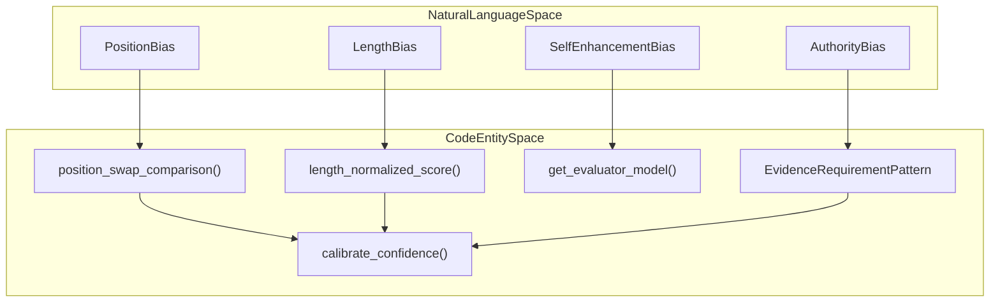
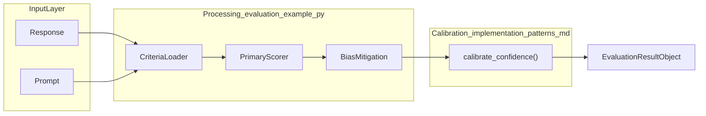

<!-- source: DeepWiki mcp.deepwiki.com · repo muratcankoylan/Agent-Skills-for-Context-Engineering · page 5.2 Advanced Evaluation & Bias Mitigation · fetched 2026-10-26 -->

# Advanced Evaluation & Bias Mitigation

Relevant source files

The following files were used as context for generating this wiki page:

- [examples/llm-as-judge-skills/README.md](examples/llm-as-judge-skills/README.md)
- [skills/advanced-evaluation/SKILL.md](skills/advanced-evaluation/SKILL.md)
- [skills/advanced-evaluation/references/bias-mitigation.md](skills/advanced-evaluation/references/bias-mitigation.md)
- [skills/advanced-evaluation/references/evaluation-pipeline.md](skills/advanced-evaluation/references/evaluation-pipeline.md)
- [skills/advanced-evaluation/references/implementation-patterns.md](skills/advanced-evaluation/references/implementation-patterns.md)
- [skills/advanced-evaluation/references/metrics-guide.md](skills/advanced-evaluation/references/metrics-guide.md)
- [skills/advanced-evaluation/scripts/evaluation_example.py](skills/advanced-evaluation/scripts/evaluation_example.py)
- [skills/bdi-mental-states/SKILL.md](skills/bdi-mental-states/SKILL.md)
- [skills/filesystem-context/SKILL.md](skills/filesystem-context/SKILL.md)
- [skills/hosted-agents/SKILL.md](skills/hosted-agents/SKILL.md)

The `advanced-evaluation` skill provides production-grade techniques for assessing LLM outputs using LLMs as judges. It moves beyond basic scoring to address systematic biases, implement complex comparison patterns, and calibrate judge confidence [skills/advanced-evaluation/SKILL.md:6-10](). This skill is essential for building reliable A/B testing pipelines and automated quality assurance systems.

## The Evaluation Taxonomy

Reliable evaluation requires selecting the correct methodology based on the nature of the task and the availability of ground truth [skills/advanced-evaluation/SKILL.md:33-34]().

| Approach | Use Case | Key Characteristic |
| :--- | :--- | :--- |
| **Direct Scoring** | Objective criteria (facts, toxicity, grammar) | Rates a single response on a defined scale (1-5 or 1-10) [skills/advanced-evaluation/SKILL.md:35](). |
| **Pairwise Comparison** | Subjective preferences (tone, style, persuasion) | Compares two responses to select a winner; higher human agreement [skills/advanced-evaluation/SKILL.md:37-38](). |

### Direct Scoring Implementation
Direct scoring relies on three pillars: clear criteria, a calibrated scale, and structured output [skills/advanced-evaluation/SKILL.md:70](). A critical implementation detail is requiring **evidence before the score** in the prompt structure, which forces the judge to anchor decisions in observable features before emitting a number [skills/advanced-evaluation/SKILL.md:111-112]().

### Pairwise Comparison Implementation
Pairwise evaluation is superior for preference tasks but highly susceptible to position bias [skills/advanced-evaluation/SKILL.md:37-38](). Implementation must include a consistency check where responses are evaluated twice with swapped positions [skills/advanced-evaluation/SKILL.md:115-120](). If the two passes disagree, the system should return a `TIE` with reduced confidence [skills/advanced-evaluation/SKILL.md:120-121]().

Sources: [skills/advanced-evaluation/SKILL.md:33-38](), [skills/advanced-evaluation/SKILL.md:70-121](), [examples/llm-as-judge-skills/README.md:37-44]()

## Bias Landscape & Mitigation

Automated judges are subject to systematic biases that must be mitigated through specific architectural patterns [skills/advanced-evaluation/SKILL.md:39-41]().

### Primary Biases
*   **Position Bias**: First-position responses get preferential treatment [skills/advanced-evaluation/SKILL.md:43]().
*   **Length Bias**: Longer responses score higher regardless of quality [skills/advanced-evaluation/SKILL.md:45]().
*   **Self-Enhancement Bias**: Models rate their own outputs higher [skills/advanced-evaluation/SKILL.md:47]().
*   **Verbosity Bias**: Excessive detail scores higher even when unnecessary [skills/advanced-evaluation/SKILL.md:49]().
*   **Authority Bias**: Confident tone scores higher regardless of accuracy [skills/advanced-evaluation/SKILL.md:51]().

### Mitigation Strategies
The following diagram bridges the conceptual "Natural Language Space" to the "Code Entity Space" using entities found in the codebase.

Title: Bias Mitigation Architecture Mapping

Sources: [skills/advanced-evaluation/SKILL.md:41-52](), [skills/advanced-evaluation/references/bias-mitigation.md:17-45](), [skills/advanced-evaluation/references/bias-mitigation.md:98-112](), [skills/advanced-evaluation/references/implementation-patterns.md:179-194](), [skills/advanced-evaluation/references/bias-mitigation.md:216-228]()

## Advanced Patterns: PoLL and Rubrics

### Panel of LLMs (PoLL)
For high-stakes evaluations, the `poll_evaluation` pattern aggregates judgments from multiple different model families [skills/advanced-evaluation/references/implementation-patterns.md:143-148](). This uses median aggregation via `aggregate_scores` to remain robust against outliers and calculates an agreement rate to signal reliability [skills/advanced-evaluation/references/implementation-patterns.md:151-171]().

### Rubric Generation
Static rubrics often fail to capture domain-specific nuances. The `rubric_generation_example` demonstrates how to use an LLM to generate multi-level descriptions and observable characteristics before evaluation begins [skills/advanced-evaluation/scripts/evaluation_example.py:19](). Generating rubrics reduces evaluation variance compared to open-ended scoring [skills/advanced-evaluation/SKILL.md:160]().

Title: Evaluation Pipeline Architecture

Sources: [skills/advanced-evaluation/references/evaluation-pipeline.md:5-35](), [skills/advanced-evaluation/scripts/evaluation_example.py:28-135](), [skills/advanced-evaluation/references/implementation-patterns.md:201-229](), [skills/advanced-evaluation/references/implementation-patterns.md:42-51]()

## Metrics and Calibration

Choosing the right metric depends on the task structure [skills/advanced-evaluation/SKILL.md:53-55]().

| Task Type | Primary Metric | Secondary Metric |
| :--- | :--- | :--- |
| **Binary (Pass/Fail)** | Recall, Precision, F1 [skills/advanced-evaluation/SKILL.md:59]() | Cohen's kappa [skills/advanced-evaluation/references/metrics-guide.md:68]() |
| **Ordinal (1-5)** | Spearman's rho [skills/advanced-evaluation/SKILL.md:60]() | Weighted Kappa [skills/advanced-evaluation/references/metrics-guide.md:86]() |
| **Pairwise** | Agreement Rate [skills/advanced-evaluation/references/metrics-guide.md:147]() | Position Consistency [skills/advanced-evaluation/references/metrics-guide.md:161]() |

### Confidence Calibration
Confidence should not be a raw model output. The `calibrate_confidence` function in `implementation-patterns.md` penalizes scores if `position_consistent` is false (reducing by 40%) or if the judge fails to provide sufficient evidence [skills/advanced-evaluation/references/implementation-patterns.md:179-194]().

Sources: [skills/advanced-evaluation/SKILL.md:57-62](), [skills/advanced-evaluation/references/metrics-guide.md:7-172](), [skills/advanced-evaluation/references/implementation-patterns.md:179-194]()

## Practical Implementation: evaluation_example.py

The `evaluation_example.py` script provides a reference for the three core patterns [skills/advanced-evaluation/scripts/evaluation_example.py:1-10]():

1.  **`direct_scoring_example()`**: Demonstrates evaluating scientific accuracy with weighted criteria (Accuracy, Clarity, Engagement) and calculating a `weighted_score` [skills/advanced-evaluation/scripts/evaluation_example.py:28-135]().
2.  **`pairwise_comparison_example()`**: Implements position-swapped comparisons and calculates consistency between two passes to mitigate position bias [skills/advanced-evaluation/scripts/evaluation_example.py:143-193]().
3.  **`rubric_generation_example()`**: Shows how to dynamically build a rubric with specific characteristics for each level to reduce variance [skills/advanced-evaluation/scripts/evaluation_example.py:19]().

Sources: [skills/advanced-evaluation/scripts/evaluation_example.py:1-193]()

---

