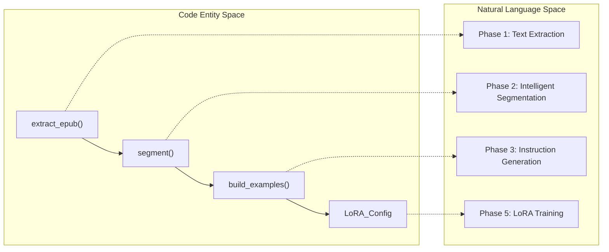
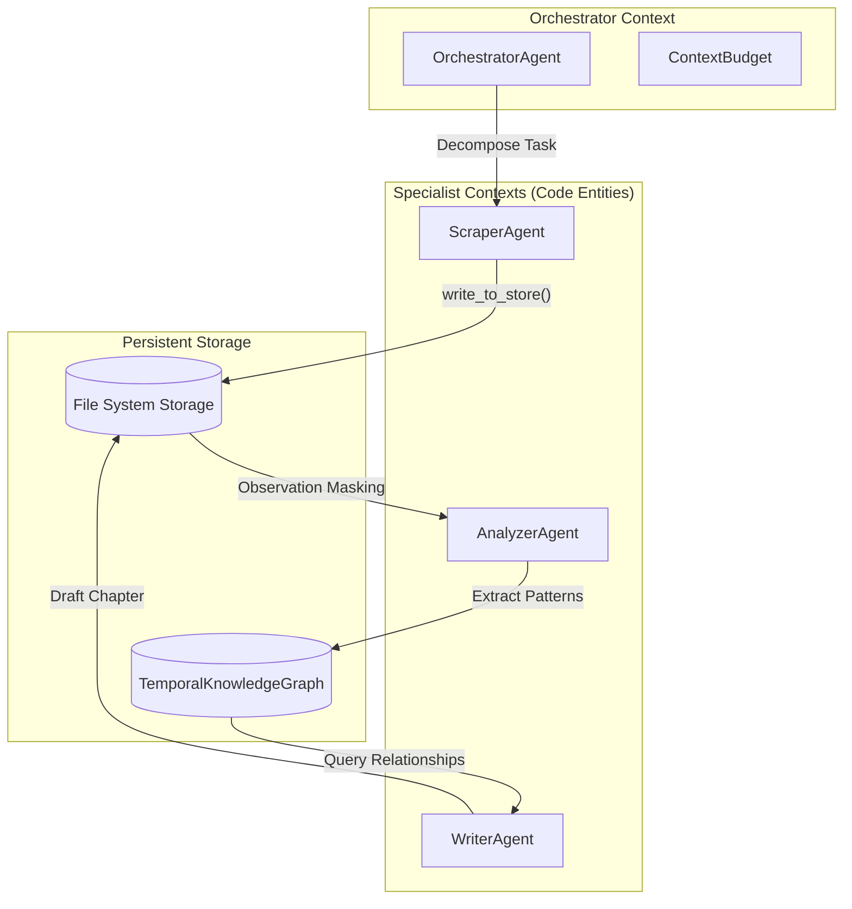
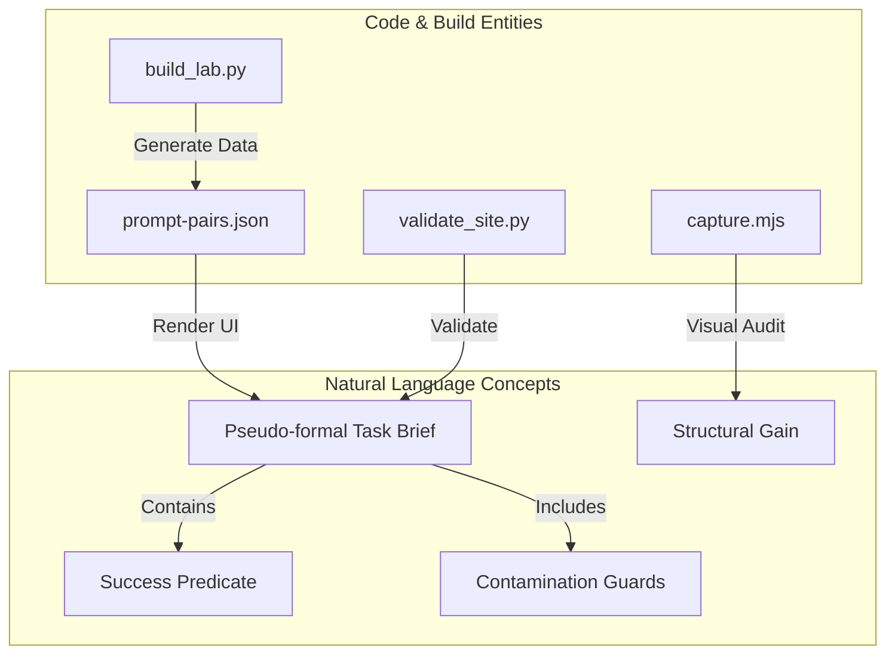

<!-- source: DeepWiki mcp.deepwiki.com · repo muratcankoylan/Agent-Skills-for-Context-Engineering · page 6 Example Projects · fetched 2026-10-26 -->

# Example Projects

Relevant source files

The following files were used as context for generating this wiki page:

- [examples/digital-brain-skill/.gitignore](examples/digital-brain-skill/.gitignore)
- [examples/digital-brain-skill/AGENT.md](examples/digital-brain-skill/AGENT.md)
- [examples/digital-brain-skill/HOW-SKILLS-BUILT-THIS.md](examples/digital-brain-skill/HOW-SKILLS-BUILT-THIS.md)
- [examples/digital-brain-skill/README.md](examples/digital-brain-skill/README.md)
- [examples/digital-brain-skill/SKILLS-MAPPING.md](examples/digital-brain-skill/SKILLS-MAPPING.md)
- [examples/digital-brain-skill/agents/AGENTS.md](examples/digital-brain-skill/agents/AGENTS.md)
- [examples/digital-brain-skill/agents/scripts/content_ideas.py](examples/digital-brain-skill/agents/scripts/content_ideas.py)
- [examples/digital-brain-skill/agents/scripts/idea_to_draft.py](examples/digital-brain-skill/agents/scripts/idea_to_draft.py)
- [examples/digital-brain-skill/agents/scripts/stale_contacts.py](examples/digital-brain-skill/agents/scripts/stale_contacts.py)
- [examples/long-horizon-prompt-lab/README.md](examples/long-horizon-prompt-lab/README.md)
- [examples/long-horizon-prompt-lab/ui/404.html](examples/long-horizon-prompt-lab/ui/404.html)

The `examples/` directory contains six complete demonstration projects that bridge the gap between theoretical context engineering skills and production-grade implementations [examples/digital-brain-skill/README.md:1-5](), [examples/long-horizon-prompt-lab/README.md:1-10](). These projects serve as architectural blueprints for common AI agent use cases, ranging from personal knowledge management systems to long-horizon autonomous task specifications.

For details on each implementation, explore the child pages linked below.

Sources: [examples/digital-brain-skill/README.md:1-5](), [examples/long-horizon-prompt-lab/README.md:1-10]()

---

## 6.1 Digital Brain Skill
The **Digital Brain** is a personal operating system designed for founders, creators, and builders [examples/digital-brain-skill/README.md:1-3](). It demonstrates how to build a persistent agent memory using a structured folder-based architecture rather than a monolithic database, leveraging modules such as `identity/`, `content/`, `knowledge/`, `network/`, and `operations/` [examples/digital-brain-skill/README.md:7-15]().

It relies heavily on append-only `.jsonl` files for logs and automation scripts like `agents/scripts/weekly_review.py` and `agents/scripts/content_ideas.py` to maintain context without overloading attention budgets [examples/digital-brain-skill/README.md:34-70](). 

For details, see [Digital Brain Skill](#6.1).
Sources: [examples/digital-brain-skill/README.md:1-192](), [examples/digital-brain-skill/agents/scripts/content_ideas.py:1-46]()

---

## 6.2 LLM-as-Judge Skills (TypeScript)
This project provides a robust, type-safe reference implementation of the `advanced-evaluation` skill using TypeScript and the Vercel AI SDK. It focuses on making evaluation objective, reproducible, and resistant to common LLM biases through systematic scoring tools and Zod schema validations.

It features the `EvaluatorAgent` abstraction alongside tools like `directScore` and `pairwiseCompare` with position bias mitigation, backed by a comprehensive Vitest test suite.

For details, see [LLM-as-Judge Skills (TypeScript)](#6.2).
Sources: [examples/long-horizon-prompt-lab/README.md:126-130]()

---

## 6.3 Book SFT Pipeline
The **Book SFT Pipeline** demonstrates project development workflows by orchestrating a multi-stage process to convert raw literature into high-quality Supervised Fine-Tuning (SFT) datasets. It bridges raw file ingestion with intelligent segmentation and instruction generation.

### Pipeline Logic Flow
The architecture maps natural language processing phases to concrete code entities in the pipeline.

Sources: [examples/book-sft-pipeline/README.md:1-79]()

For details, see [Book SFT Pipeline](#6.3).
Sources: [examples/book-sft-pipeline/README.md:1-79]()

---

## 6.4 Interleaved Thinking / Reasoning Trace Optimizer
This project implements a diagnostic and optimization utility for reasoning models. It captures execution traces, analyzes failures using systematic patterns, and optimizes prompts using bounded search loops to mitigate context degradation.

It integrates components like `TraceCapture`, `TraceAnalyzer`, and `PromptOptimizer` to iteratively refine agent reasoning paths.

For details, see [Interleaved Thinking / Reasoning Trace Optimizer](#6.4).
Sources: [examples/interleaved-thinking/README.md:1-206]()

---

## 6.5 X-to-Book Multi-Agent System
The **X-to-Book System** is a blueprint for high-volume content synthesis using supervisor multi-agent topologies and isolated context budgets.

### Context Isolation Architecture
The architecture separates orchestrator control from data-heavy specialist tasks using file-system persistence and observation masking.

Sources: [examples/long-horizon-prompt-lab/README.md:126-130]()

For details, see [X-to-Book Multi-Agent System](#6.5).
Sources: [examples/long-horizon-prompt-lab/README.md:126-130]()

---

## 6.6 Long-Horizon Prompt Lab
The **Long-Horizon Prompt Lab** is an educational before/after website and laboratory for the `long-horizon-prompting` skill [examples/long-horizon-prompt-lab/README.md:1-6](). It showcases how pseudo-formal task briefs eliminate near-miss failures across four complex agentic use cases [examples/long-horizon-prompt-lab/README.md:62-78]().

For details on the UI build pipeline and validation workflows, see [Prompt Lab UI & Build Pipeline](#6.6.1) and [Prompt Lab Validation & Deployment](#6.6.2).

### Prompt Lab Architecture
The lab connects automated generation scripts with rigorous rubric scoring and static validation gates.

Sources: [examples/long-horizon-prompt-lab/README.md:43-60]()

For details, see [Long-Horizon Prompt Lab](#6.6).
Sources: [examples/long-horizon-prompt-lab/README.md:1-130]()

---
Sources: [examples/digital-brain-skill/README.md:1-192](), [examples/long-horizon-prompt-lab/README.md:1-130]()

---

