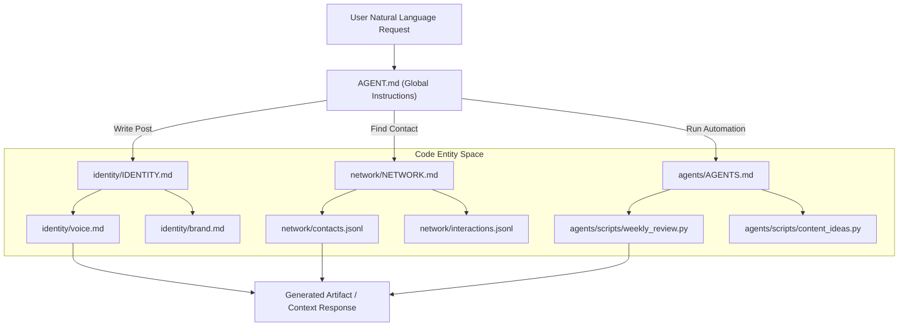
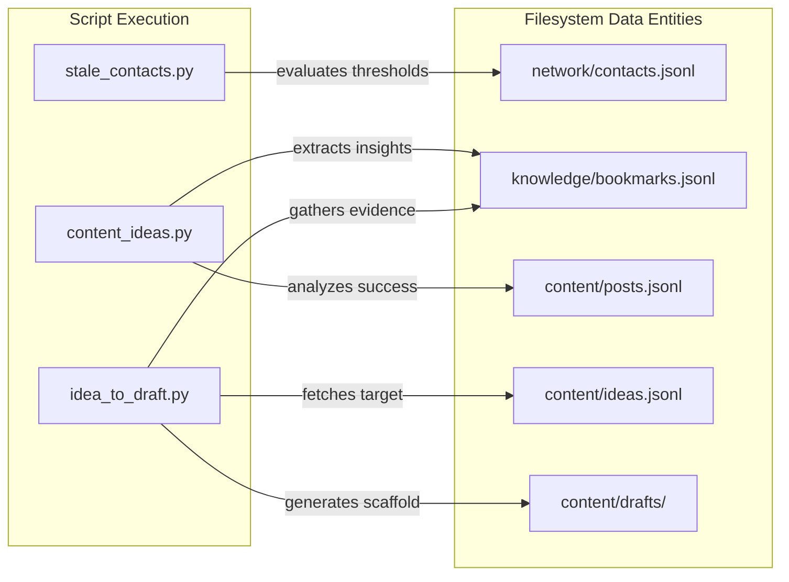

<!-- source: DeepWiki mcp.deepwiki.com · repo muratcankoylan/Agent-Skills-for-Context-Engineering · page 6.1 Digital Brain Skill · fetched 2026-10-26 -->

# Digital Brain Skill

<details>
<summary>Relevant source files</summary>

The following files were used as context for generating this wiki page:

- [examples/digital-brain-skill/.gitignore](examples/digital-brain-skill/.gitignore)
- [examples/digital-brain-skill/AGENT.md](examples/digital-brain-skill/AGENT.md)
- [examples/digital-brain-skill/HOW-SKILLS-BUILT-THIS.md](examples/digital-brain-skill/HOW-SKILLS-BUILT-THIS.md)
- [examples/digital-brain-skill/README.md](examples/digital-brain-skill/README.md)
- [examples/digital-brain-skill/SKILLS-MAPPING.md](examples/digital-brain-skill/SKILLS-MAPPING.md)
- [examples/digital-brain-skill/agents/AGENTS.md](examples/digital-brain-skill/agents/AGENTS.md)
- [examples/digital-brain-skill/agents/scripts/content_ideas.py](examples/digital-brain-skill/agents/scripts/content_ideas.py)
- [examples/digital-brain-skill/agents/scripts/idea_to_draft.py](examples/digital-brain-skill/agents/scripts/idea_to_draft.py)
- [examples/digital-brain-skill/agents/scripts/stale_contacts.py](examples/digital-brain-skill/agents/scripts/stale_contacts.py)

</details>


## Purpose and Scope
The **Digital Brain Skill** is a reference implementation of a folder-based personal operating system for founders, creators, and builders within the `Agent Skills for Context Engineering` collection [examples/digital-brain-skill/README.md:1-7](). It demonstrates how structural isolation, progressive disclosure, append-only JSONL ledgers, and token-efficient automation scripts can be combined to build a production-grade personal knowledge management and productivity system optimized for AI agents [examples/digital-brain-skill/README.md:15-17](). This document details its architecture, file conventions, automation scripts, and underlying context engineering mappings.

Sources: [examples/digital-brain-skill/README.md:1-15]()

---

## Folder-Based Personal OS Architecture

The system partitions personal data into six isolated domains to prevent context pollution and maximize the LLM's attention budget [examples/digital-brain-skill/README.md:183-190](). Each module operates as an independent subsystem with its own instructional markdown file acting as an L2 context boundary [examples/digital-brain-skill/HOW-SKILLS-BUILT-THIS.md:31-44]().

```
digital-brain/
├── SKILL.md                 # Main skill definition (Claude Code compatible)
├── AGENT.md                 # Global runtime instructions for agents
├── SKILLS-MAPPING.md        # Context engineering theory mapping
├── identity/                # Personal brand, voice, values
├── content/                 # Content creation hub & JSONL logs
├── knowledge/               # Bookmarks, research, learning goals
├── network/                 # Contacts, interactions, relationship tiers
├── operations/              # Todos, OKRs, meetings, metrics
└── agents/                  # AGENTS.md & Python automation scripts
```

The following diagram bridges natural language interaction intents to specific code entities and files within the Digital Brain repository.

**Digital Brain Entity Resolution & Processing**

Sources: [examples/digital-brain-skill/README.md:20-78](), [examples/digital-brain-skill/AGENT.md:1-35](), [examples/digital-brain-skill/agents/AGENTS.md:1-48]()

---

## JSONL Append-Only Conventions & Data Management

To preserve temporal validity and prevent silent information loss, the Digital Brain avoids destructive updates in favor of append-only logs [examples/digital-brain-skill/HOW-SKILLS-BUILT-THIS.md:136-154](). 

*   **JSONL Ledgers (`.jsonl`):** Used for records such as `content/posts.jsonl`, `content/ideas.jsonl`, `knowledge/bookmarks.jsonl`, and `network/contacts.jsonl` [examples/digital-brain-skill/README.md:34-61](). Each file begins with a schema documentation record (e.g., `{"_schema": "contact", "_version": "1.0"}`) to ground the agent in data structure without full-file parses [examples/digital-brain-skill/HOW-SKILLS-BUILT-THIS.md:89-95]().
*   **Structured YAML (`.yaml`):** Applied for hierarchical configurations like `identity/values.yaml`, `knowledge/learning.yaml`, `network/circles.yaml`, and `operations/goals.yaml` [examples/digital-brain-skill/README.md:28-60]().
*   **Markdown (`.md`):** Used for narrative guides, templates, and workspace drafts [examples/digital-brain-skill/README.md:128]().

Python automation scripts parse these JSONL files using robust line-skipping logic to filter out schema declarations:

```python
def load_jsonl(filepath):
    """Load JSONL file, skipping schema lines."""
    items = []
    if not filepath.exists():
        return items
    with open(filepath, 'r') as f:
        for line in f:
            line = line.strip()
            if not line:
                continue
            try:
                data = json.loads(line)
                if '_schema' not in data:
                    items.append(data)
            except json.JSONDecodeError:
                continue
    return items
```
Sources: [examples/digital-brain-skill/agents/scripts/content_ideas.py:14-30](), [examples/digital-brain-skill/HOW-SKILLS-BUILT-THIS.md:89-95]()

---

## Agent Instructions & Module Guidance (`AGENT.md` / `AGENTS.md`)

LLM execution is governed by explicit instruction files at both the repository root and module subdirectories:

*   **`AGENT.md` (Root Instructions):** Establishes non-negotiable runtime constraints for Claude Code or other assistants, mandating that `identity/voice.md` is read prior to writing, JSONL files are strictly appended to, and timestamps are updated on modification [examples/digital-brain-skill/AGENT.md:1-11]().
*   **`agents/AGENTS.md` (Automation Module Specs):** Documents script execution semantics, frequencies, argument signatures, and workflow sequences (such as Sunday Weekly Reviews and Content Ideation Sessions) [examples/digital-brain-skill/agents/AGENTS.md:10-74]().

Sources: [examples/digital-brain-skill/AGENT.md:1-35](), [examples/digital-brain-skill/agents/AGENTS.md:1-48]()

---

## Automation Scripts

The `agents/scripts/` directory houses standalone Python utilities that execute deterministic data crunching, minimizing the token consumption of raw agent reasoning [examples/digital-brain-skill/README.md:166-174]().

| Script | Core Function | Data Sources | Output Target |
| :--- | :--- | :--- | :--- |
| `weekly_review.py` | Compiles weekly operational summaries | `operations/metrics.jsonl` | Standard Output / Review Doc [examples/digital-brain-skill/README.md:160-164]() |
| `content_ideas.py` | Generates content suggestions | `content/posts.jsonl`, `knowledge/bookmarks.jsonl` | Markdown Ideas Report [examples/digital-brain-skill/agents/scripts/content_ideas.py:32-66]() |
| `stale_contacts.py` | Finds neglected relationships by tier | `network/contacts.jsonl` | Stale Contacts Report [examples/digital-brain-skill/agents/scripts/stale_contacts.py:51-80]() |
| `idea_to_draft.py` | Scaffolds a Markdown draft from an ID | `content/ideas.jsonl`, `knowledge/bookmarks.jsonl` | `content/drafts/` scaffold [examples/digital-brain-skill/agents/scripts/idea_to_draft.py:32-70]() |

The following diagram maps script execution paths to underlying filesystem entities.

**Automation Script Data Flow**

Sources: [examples/digital-brain-skill/agents/scripts/stale_contacts.py:51](), [examples/digital-brain-skill/agents/scripts/content_ideas.py:32-66](), [examples/digital-brain-skill/agents/scripts/idea_to_draft.py:32-70]()

---

## Context Engineering Integration (`HOW-SKILLS-BUILT-THIS.md` & `SKILLS-MAPPING.md`)

The structural design of the Digital Brain is systematically mapped to core theory across two dedicated specification documents: `HOW-SKILLS-BUILT-THIS.md` and `SKILLS-MAPPING.md` [examples/digital-brain-skill/HOW-SKILLS-BUILT-THIS.md:1-15](), [examples/digital-brain-skill/SKILLS-MAPPING.md:1-15]().

1.  **Context Fundamentals & Attention Budget:** Implements a three-tier loading model (L1 global metadata in `SKILL.md`, L2 module instructions, L3 data files) keeping token consumption around ~400–650 tokens per task instead of ~5000+ tokens [examples/digital-brain-skill/HOW-SKILLS-BUILT-THIS.md:31-44](), [examples/digital-brain-skill/SKILLS-MAPPING.md:13-15]().
2.  **Context Optimization & Partitioning:** Enforces strict module separation so that content workflows load identity and content modules while bypassing unrelated network and operations domains [examples/digital-brain-skill/SKILLS-MAPPING.md:57-62]().
3.  **Memory Systems Architecture:** Treats the local filesystem as a zero-dependency vectorless memory store, utilizing append-only JSONL files for episodic interaction logs and persistent entities [examples/digital-brain-skill/SKILLS-MAPPING.md:27-36]().
4.  **Tool Design Principles:** Provides self-contained, single-purpose Python helper scripts with unambiguous input/output interfaces, reducing token overhead during maintenance tasks [examples/digital-brain-skill/SKILLS-MAPPING.md:43-46]().

Sources: [examples/digital-brain-skill/HOW-SKILLS-BUILT-THIS.md:1-199](), [examples/digital-brain-skill/SKILLS-MAPPING.md:1-164]()

---

