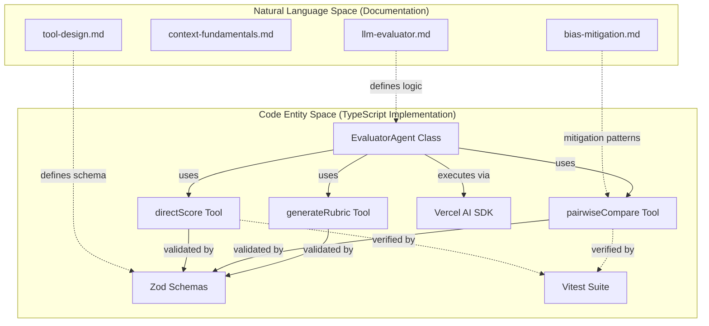
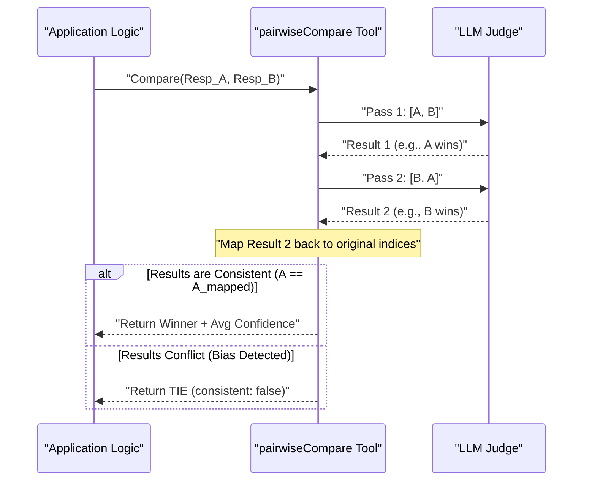
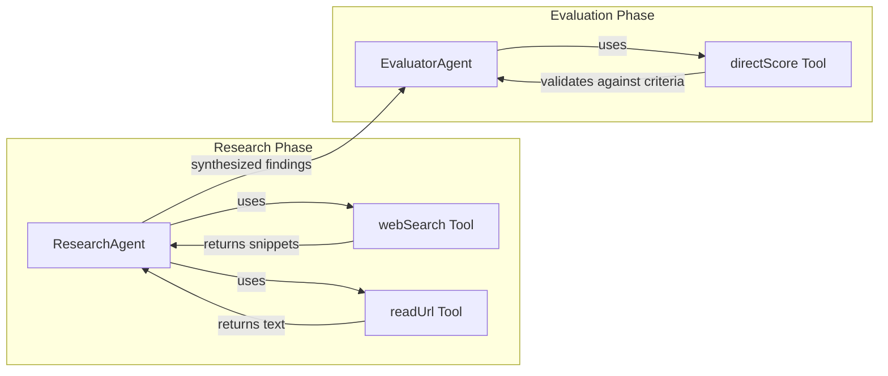

<!-- source: DeepWiki mcp.deepwiki.com · repo muratcankoylan/Agent-Skills-for-Context-Engineering · page 6.2 LLM-as-Judge Skills (TypeScript) · fetched 2026-10-26 -->

# LLM-as-Judge Skills (TypeScript)

Relevant source files

The following files were used as context for generating this wiki page:

- [examples/llm-as-judge-skills/README.md](examples/llm-as-judge-skills/README.md)
- [examples/llm-as-judge-skills/prompts/agent-system/orchestrator-prompt.md](examples/llm-as-judge-skills/prompts/agent-system/orchestrator-prompt.md)
- [skills/advanced-evaluation/references/bias-mitigation.md](skills/advanced-evaluation/references/bias-mitigation.md)
- [skills/advanced-evaluation/references/evaluation-pipeline.md](skills/advanced-evaluation/references/evaluation-pipeline.md)
- [skills/advanced-evaluation/references/implementation-patterns.md](skills/advanced-evaluation/references/implementation-patterns.md)
- [skills/advanced-evaluation/references/metrics-guide.md](skills/advanced-evaluation/references/metrics-guide.md)
- [skills/advanced-evaluation/scripts/evaluation_example.py](skills/advanced-evaluation/scripts/evaluation_example.py)

The **LLM-as-Judge Skills** project is a production-ready TypeScript implementation of automated evaluation patterns [examples/llm-as-judge-skills/README.md:1-17](). Built using the **Vercel AI SDK 6**, it translates research insights from Eugene Yan’s LLM-Evaluators study into executable agent tools [examples/llm-as-judge-skills/README.md:3-12](). The project focuses on mitigating common evaluation pitfalls such as position bias, length bias, and lack of justification through structured workflows and type-safe tool schemas [examples/llm-as-judge-skills/README.md:31-43]().

## Architecture & Data Flow

The system is organized into a hierarchical structure where high-level **Agents** utilize specific **Tools** to execute evaluation logic against LLM providers.

### Component Relationship Diagram
This diagram bridges the natural language "Skills" defined in documentation to the "Code Entities" implemented in TypeScript.

**Sources:** [examples/llm-as-judge-skills/README.md:58-85](), [examples/llm-as-judge-skills/README.md:127-142](), [skills/advanced-evaluation/references/bias-mitigation.md:1-5]()

### EvaluatorAgent Class
The `EvaluatorAgent` is the central orchestrator for quality assessment [examples/llm-as-judge-skills/src/agents/evaluator.ts:1-112](). It is defined as a reusable class with multiple capabilities, utilizing structured output and type-safe tool definitions [examples/llm-as-judge-skills/README.md:49-51](). It provides numerical scores, specific evidence, and actionable feedback [examples/llm-as-judge-skills/agents/evaluator-agent/evaluator-agent.md:14-35]().

**Key Capabilities:**
*   **Direct Scoring:** Evaluates a single response against a multi-dimensional rubric (1-5 scale) using the `directScore` tool [examples/llm-as-judge-skills/src/tools/evaluation/direct-score.ts:1-164](), [examples/llm-as-judge-skills/agents/evaluator-agent/evaluator-agent.md:48-62]().
*   **Pairwise Comparison:** Compares two responses to select a winner with a confidence score via `pairwiseCompare` [examples/llm-as-judge-skills/src/tools/evaluation/pairwise-compare.ts:1-255](), [examples/llm-as-judge-skills/agents/evaluator-agent/evaluator-agent.md:63-77]().
*   **Rubric Generation:** Programmatically creates scoring levels and examples for specific criteria using `generateRubric` [examples/llm-as-judge-skills/src/tools/evaluation/generate-rubric.ts:1-161](), [examples/llm-as-judge-skills/agents/evaluator-agent/evaluator-agent.md:91-103]().
*   **Criteria Extraction:** Automatically identifies relevant evaluation criteria from task descriptions [examples/llm-as-judge-skills/agents/evaluator-agent/evaluator-agent.md:78-90]().

**Sources:** [examples/llm-as-judge-skills/README.md:60-85](), [examples/llm-as-judge-skills/src/agents/evaluator.ts:1-112](), [examples/llm-as-judge-skills/agents/evaluator-agent/evaluator-agent.md:1-103]()

---

## Evaluation Tools & Bias Mitigation

The core logic resides in three primary tools located in `src/tools/evaluation/`. These tools implement specific mitigation strategies for known LLM biases.

### Tool Implementation Details
| Tool | File Path | Mitigation Strategy |
| :--- | :--- | :--- |
| `directScore` | `examples/llm-as-judge-skills/src/tools/evaluation/direct-score.ts` | Uses explicit rubrics and evidence-based justification to reduce variance [examples/llm-as-judge-skills/README.md:37-43](). |
| `pairwiseCompare` | `examples/llm-as-judge-skills/src/tools/evaluation/pairwise-compare.ts` | Implements **Position Swapping**: running two passes (A vs B, then B vs A) to detect and nullify position bias [skills/advanced-evaluation/references/bias-mitigation.md:14-45](). |
| `generateRubric` | `examples/llm-as-judge-skills/src/tools/evaluation/generate-rubric.ts` | Standardizes "what good looks like" across different evaluation sessions [examples/llm-as-judge-skills/README.md:43](). |

### Position Swapping Logic
To combat the tendency of LLMs to prefer the first-presented option, the system uses a structured pipeline that maps results back to original indices to check for consistency [skills/advanced-evaluation/references/bias-mitigation.md:24-30](). If the winner is inconsistent between the two passes, the system returns a `TIE` with `position_consistent: false` [skills/advanced-evaluation/references/bias-mitigation.md:37-44]().

**Sources:** [skills/advanced-evaluation/references/bias-mitigation.md:16-45](), [skills/advanced-evaluation/references/implementation-patterns.md:74-100]()

---

## Multi-Agent Orchestration

The project demonstrates how evaluation fits into a larger system via the `OrchestratorAgent` and the `orchestrator-prompt.md` template.

### Workflow Orchestration
The `OrchestratorAgent` manages the lifecycle of complex tasks by decomposing them into subtasks assigned to specialized agents [examples/llm-as-judge-skills/prompts/agent-system/orchestrator-prompt.md:10-20]().

*   **Task Decomposition:** Breaking a request into research, analysis, writing, and evaluation phases [examples/llm-as-judge-skills/prompts/agent-system/orchestrator-prompt.md:55-62]().
*   **Dependency Management:** Ensuring the `Evaluator Agent` only runs after the `Writer Agent` has produced an output [examples/llm-as-judge-skills/prompts/agent-system/orchestrator-prompt.md:49](), [examples/llm-as-judge-skills/prompts/agent-system/orchestrator-prompt.md:185-188]().
*   **Parallel Execution:** Running independent research queries concurrently via the `Researcher Agent` to optimize performance [examples/llm-as-judge-skills/prompts/agent-system/orchestrator-prompt.md:50](), [examples/llm-as-judge-skills/prompts/agent-system/orchestrator-prompt.md:172-174]().

### Research-to-Evaluation Flow
The `Research Agent` provides grounded facts which can then be verified or synthesized [examples/llm-as-judge-skills/agents/research-agent/research-agent.md:17-37]().

**Sources:** [examples/llm-as-judge-skills/agents/research-agent/research-agent.md:14-46](), [examples/llm-as-judge-skills/agents/evaluator-agent/evaluator-agent.md:37-43](), [examples/llm-as-judge-skills/prompts/agent-system/orchestrator-prompt.md:170-188]()

---

## Testing & Validation

The project includes a robust Vitest suite to ensure reliability of both the logic and the underlying prompts [examples/llm-as-judge-skills/README.md:8]().

*   **Tool Tests:** Verifying Zod schema validation, scoring accuracy, and position-swap consistency [examples/llm-as-judge-skills/README.md:139]().
*   **Skill Tests:** Ensuring the prompts correctly implement the research-backed evaluation patterns [examples/llm-as-judge-skills/README.md:140]().

### Running the Project
1.  **Environment Setup:** Copy `.env.example` to `.env` and provide an API key [examples/llm-as-judge-skills/README.md:150]().
2.  **Installation:** Run `npm install` [examples/llm-as-judge-skills/README.md:143-145]().
3.  **Execution:** Use scripts in `src/` to execute evaluation tasks [examples/llm-as-judge-skills/README.md:127-137]().
4.  **Testing:** Run `npm test` to execute the Vitest suite [examples/llm-as-judge-skills/README.md:8]().

**Sources:** [examples/llm-as-judge-skills/README.md:8](), [examples/llm-as-judge-skills/README.md:127-155]()

---

