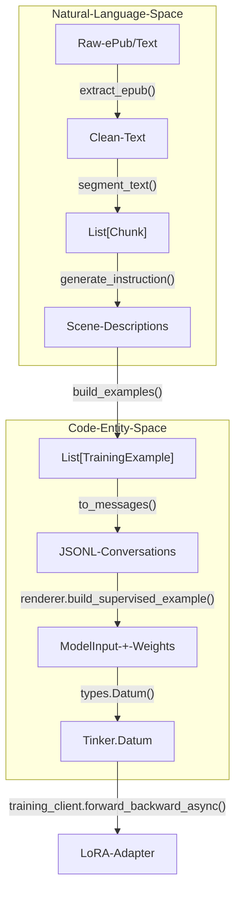
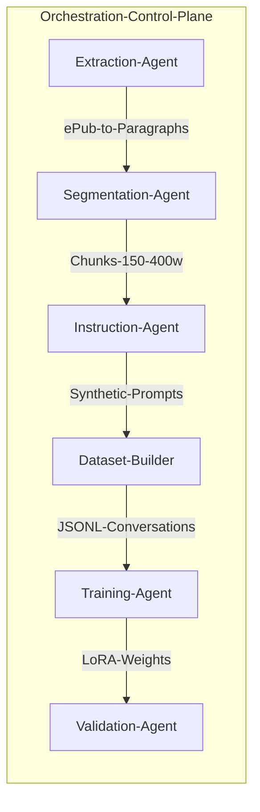
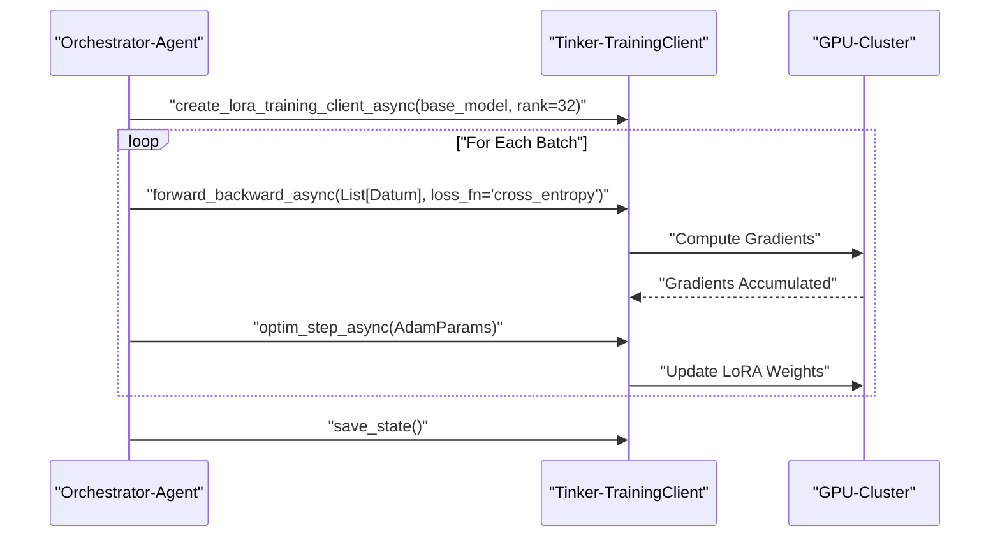

<!-- source: DeepWiki mcp.deepwiki.com · repo muratcankoylan/Agent-Skills-for-Context-Engineering · page 6.3 Book SFT Pipeline · fetched 2026-10-26 -->

# Book SFT Pipeline

<details>
<summary>Relevant source files</summary>

The following files were used as context for generating this wiki page:

- [examples/book-sft-pipeline/README.md](examples/book-sft-pipeline/README.md)
- [examples/book-sft-pipeline/SKILL.md](examples/book-sft-pipeline/SKILL.md)
- [examples/book-sft-pipeline/examples/gertrude-stein/README.md](examples/book-sft-pipeline/examples/gertrude-stein/README.md)
- [examples/book-sft-pipeline/examples/gertrude-stein/dataset_sample.jsonl](examples/book-sft-pipeline/examples/gertrude-stein/dataset_sample.jsonl)
- [examples/book-sft-pipeline/examples/gertrude-stein/sample_outputs.md](examples/book-sft-pipeline/examples/gertrude-stein/sample_outputs.md)
- [examples/book-sft-pipeline/examples/gertrude-stein/training_config.json](examples/book-sft-pipeline/examples/gertrude-stein/training_config.json)
- [examples/book-sft-pipeline/references/segmentation-strategies.md](examples/book-sft-pipeline/references/segmentation-strategies.md)
- [examples/book-sft-pipeline/references/tinker.txt](examples/book-sft-pipeline/references/tinker.txt)

</details>


The **Book SFT Pipeline** is a specialized context engineering system and standalone example (`examples/book-sft-pipeline/`) designed for Supervised Fine-Tuning (SFT) of Large Language Models on literary works [examples/book-sft-pipeline/README.md:3](). Its primary objective is **style transfer**: training an 8B-scale model to replicate an author's unique voice, rhythm, and vocabulary while maintaining the ability to generate original content in modern scenarios [examples/book-sft-pipeline/SKILL.md:7-18](), [examples/book-sft-pipeline/examples/gertrude-stein/README.md:80-91]().

The system transforms raw literary text (such as ePub files) into high-quality instruction-tuning datasets through intelligent segmentation and diverse instruction generation, managing the distributed training lifecycle via the **Tinker LoRA** training client [examples/book-sft-pipeline/SKILL.md:33-58](), [examples/book-sft-pipeline/references/tinker.txt:36-46]().

Sources: [examples/book-sft-pipeline/SKILL.md:7-18](), [examples/book-sft-pipeline/README.md:3](), [examples/book-sft-pipeline/examples/gertrude-stein/README.md:80-91]()

---

## Pipeline Architecture & Six-Phase Orchestrator

The pipeline follows a modular six-phase orchestration pattern where each phase is managed by a specialized agent or processing script [examples/book-sft-pipeline/SKILL.md:33-58](). This architecture isolates extraction, segmentation, instruction generation, dataset building, training, and validation to prevent upstream errors from degrading the training corpus [examples/book-sft-pipeline/SKILL.md:37-58]().

### Logical Data Flow

The following diagram bridges "Natural Language Space" (raw ePub/text and literary chunks) to "Code Entity Space" (Python data structures, Tinker `Datum` objects, and LoRA adapters).

**Title: Book-to-Tinker Data Transformation**

Sources: [examples/book-sft-pipeline/SKILL.md:33-58](), [examples/book-sft-pipeline/references/tinker.txt:71-94]()

### Orchestration Agent Workflow

**Title: Orchestrator Agent Phase State Machine**

Sources: [examples/book-sft-pipeline/SKILL.md:37-58]()

---

## Text Extraction & Advanced Segmentation Strategies

Books present unique preprocessing challenges, including variable paragraph lengths, dialogue-heavy exchanges, and natural scene boundaries [examples/book-sft-pipeline/references/segmentation-strategies.md:5-13](). Poor segmentation forces models to learn incomplete thoughts and abrupt endings [examples/book-sft-pipeline/references/segmentation-strategies.md:14-19]().

### Extraction Rules
1. **Source Selection**: Always source ePub over PDF to prevent OCR errors from becoming learned token patterns [examples/book-sft-pipeline/SKILL.md:63-65]().
2. **Paragraph-Level Extraction**: Extract text directly from `<p>` tags using tools like `BeautifulSoup` to preserve structural breaks [examples/book-sft-pipeline/SKILL.md:70-80]().
3. **Front/Back Matter Removal**: Strip copyright notices and tables of contents to avoid domain pollution [examples/book-sft-pipeline/SKILL.md:65]().

### Segmentation Tiers
* **Tier 1 (Paragraph Accumulation)**: Accumulates paragraphs to target **150-400 words** per chunk, carrying over the final paragraph as an overlap to maintain narrative continuity [examples/book-sft-pipeline/SKILL.md:90-108]().
* **Tier 2 (LLM-Assisted Segmentation)**: Handled by `Tier2Segmenter` for oversized paragraphs, ensuring zero word-count deletion while breaking at grammatically natural points [examples/book-sft-pipeline/references/segmentation-strategies.md:75-131]().
* **Scene & Dialogue Awareness**: `SceneAwareSegmenter` detects scene dividers (e.g., `* * *`, `---`, chapter headings) and `DialogueAwareSegmenter` groups conversation exchanges to protect dialogue block coherence [examples/book-sft-pipeline/references/segmentation-strategies.md:133-205]().

Sources: [examples/book-sft-pipeline/SKILL.md:63-108](), [examples/book-sft-pipeline/references/segmentation-strategies.md:5-205]()

---

## Diverse Instruction Generation & Dataset Construction

Using a single prompt template causes catastrophic memorization. The pipeline enforces prompt diversity by combining multiple system prompts and varied user prompt templates [examples/book-sft-pipeline/SKILL.md:27-28]().

### Instruction Generation & Templates
A fast, lightweight model (e.g., Gemini Flash) generates synthetic instructions from each chunk without quoting the source text [examples/book-sft-pipeline/SKILL.md:148-159]().
* **System Prompts**: Rotates through 5+ modernist and creative writing personas (e.g., `"You are an expert creative writer capable of emulating specific literary styles."`) [examples/book-sft-pipeline/SKILL.md:124-130]().
* **Prompt Templates**: Utilizes 10+ distinct variations (e.g., `"Write a passage in the style of {author}: {desc}"`, `"Channel {author}'s voice to write about: {desc}"`) [examples/book-sft-pipeline/SKILL.md:132-143]().

### Dataset Message Format
The resulting examples are formatted into JSONL records containing strict conversational message structures [examples/book-sft-pipeline/SKILL.md:164-173]().

```json
{
    "messages": [
        {"role": "system", "content": "You are an expert creative writer..."},
        {"role": "user", "content": "Write in the style of Author: Scene description..."},
        {"role": "assistant", "content": "The actual book text from chunk..."}
    ]
}
```
Sources: [examples/book-sft-pipeline/SKILL.md:27-28](), [examples/book-sft-pipeline/SKILL.md:124-173]()

---

## Tinker LoRA Training Client Integration

The pipeline interfaces with the **Tinker API** (`tinker`) for distributed training [examples/book-sft-pipeline/references/tinker.txt:15-21](). Tinker decouples CPU-bound environment scripts from GPU-accelerated gradient updates while providing full control over training loops and loss functions [examples/book-sft-pipeline/references/tinker.txt:21-29]().

### Training Client Lifecycle

**Title: Tinker Training Loop Execution Sequence**

Sources: [examples/book-sft-pipeline/references/tinker.txt:41-46](), [examples/book-sft-pipeline/SKILL.md:33-58]()

### Loss Objectives & Token Weighting
Tinker supports built-in loss objectives via string identifiers passed to `forward_backward` [examples/book-sft-pipeline/references/tinker.txt:61-64](). For supervised fine-tuning, `cross_entropy` computes negative log-likelihood [examples/book-sft-pipeline/references/tinker.txt:102-108](). The renderer assigns token-level loss weights (`weights: 0` for prompts and system instructions, `weights: 1` for assistant completions) to focus optimization exclusively on stylistic output generation [examples/book-sft-pipeline/references/tinker.txt:109-119]().

Sources: [examples/book-sft-pipeline/references/tinker.txt:15-119]()

---

## Gertrude Stein Case Study & Validation

The pipeline was validated by training `Qwen/Qwen3-8B-Base` on Gertrude Stein's 1909 novel *Three Lives* [examples/book-sft-pipeline/examples/gertrude-stein/training_config.json:2-6]().

### Quantitative Metrics & Configuration
| Metric / Parameter | Value |
| :--- | :--- |
| **Source Work** | *Three Lives* (~86,000 words) [examples/book-sft-pipeline/examples/gertrude-stein/training_config.json:4-6]() |
| **Training Examples** | 592 examples from 296 chunks [examples/book-sft-pipeline/examples/gertrude-stein/training_config.json:15-16]() |
| **Model & LoRA Rank** | `Qwen/Qwen3-8B-Base`, LoRA Rank 32 [examples/book-sft-pipeline/examples/gertrude-stein/training_config.json:44-45]() |
| **Training Duration & Cost** | 15 minutes, ~$2.00 total cost [examples/book-sft-pipeline/examples/gertrude-stein/README.md:16-17]() |
| **Loss Reduction** | 97% reduction (Test loss from 7,584.85 to 213.36) [examples/book-sft-pipeline/examples/gertrude-stein/training_config.json:58-60]() |

### Modern Scenario Testing & Originality Verification
To confirm the model learned **style** rather than memorizing plot content, validators tested it against scenarios impossible in 1909 (e.g., real-time text messaging between lovers, real estate office clerks coming home tired) [examples/book-sft-pipeline/examples/gertrude-stein/README.md:82-91](). 
* **Style Markers Learned**: Anaphora (e.g., `"Want me to bring you some ice cream, Lena..."`), comma-separated adjectives, and character epithets ("The good Anna") [examples/book-sft-pipeline/examples/gertrude-stein/README.md:35-45]().
* **AI Detector Verification**: Evaluated with Pangram AI detector, achieving **100% Human Written** classifications across multiple output samples [examples/book-sft-pipeline/examples/gertrude-stein/README.md:74-78]().

Sources: [examples/book-sft-pipeline/examples/gertrude-stein/training_config.json:1-79](), [examples/book-sft-pipeline/examples/gertrude-stein/README.md:1-163](), [examples/book-sft-pipeline/examples/gertrude-stein/sample_outputs.md:1-62]()

---

