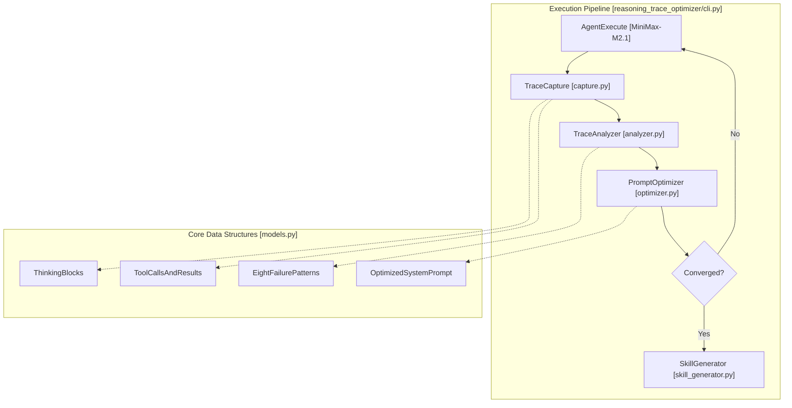
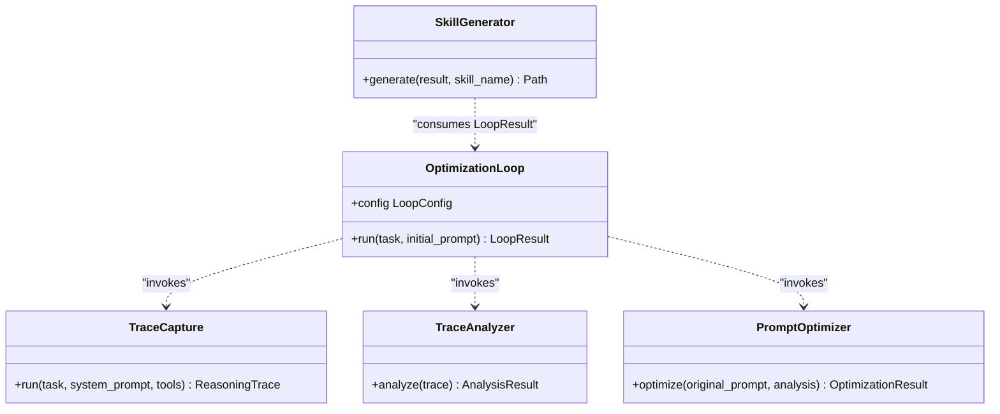

<!-- source: DeepWiki mcp.deepwiki.com · repo muratcankoylan/Agent-Skills-for-Context-Engineering · page 6.4 Interleaved Thinking / Reasoning Trace Optimizer · fetched 2026-10-26 -->

# Interleaved Thinking / Reasoning Trace Optimizer

<details>
<summary>Relevant source files</summary>

The following files were used as context for generating this wiki page:

- [examples/interleaved-thinking/README.md](examples/interleaved-thinking/README.md)
- [examples/interleaved-thinking/docs/agentthinking.md](examples/interleaved-thinking/docs/agentthinking.md)
- [examples/interleaved-thinking/docs/interleavedthinking.md](examples/interleaved-thinking/docs/interleavedthinking.md)
- [examples/interleaved-thinking/docs/m2-1.md](examples/interleaved-thinking/docs/m2-1.md)
- [examples/interleaved-thinking/examples/01_basic_capture.py](examples/interleaved-thinking/examples/01_basic_capture.py)
- [examples/interleaved-thinking/examples/02_tool_usage.py](examples/interleaved-thinking/examples/02_tool_usage.py)
- [examples/interleaved-thinking/examples/03_full_optimization.py](examples/interleaved-thinking/examples/03_full_optimization.py)
- [examples/interleaved-thinking/generated_skills/comprehensive-research-agent/references/optimization_summary.json](examples/interleaved-thinking/generated_skills/comprehensive-research-agent/references/optimization_summary.json)
- [examples/interleaved-thinking/generated_skills/comprehensive-research-agent/references/optimized_prompt.txt](examples/interleaved-thinking/generated_skills/comprehensive-research-agent/references/optimized_prompt.txt)
- [examples/interleaved-thinking/pyproject.toml](examples/interleaved-thinking/pyproject.toml)

</details>


The **Interleaved Thinking / Reasoning Trace Optimizer** is a Python-based diagnostic and optimization toolset designed to debug and refine autonomous AI agents. It leverages the native **interleaved thinking** capabilities of the **MiniMax M2.1** model, capturing internal reasoning blocks between tool calls to uncover silent failure modes and iteratively improve agent performance [examples/interleaved-thinking/README.md:28-47](), [examples/interleaved-thinking/pyproject.toml:6-8]().

Sources: [examples/interleaved-thinking/README.md:28-47](), [examples/interleaved-thinking/pyproject.toml:6-8]()

## System Architecture & Data Flow

The optimizer operates as a closed-loop system that moves from agent execution to trace capture, failure analysis, prompt optimization, and final skill generation. Because M2.1 uses its context window as its working memory, preserving the complete session history—including all intermediate thinking blocks—is critical for continuity [examples/interleaved-thinking/docs/agentthinking.md:29-31](). The architecture supports both the Anthropic SDK (`thinking` blocks) and OpenAI SDK (`reasoning_details`) [examples/interleaved-thinking/README.md:54-55]().

### Optimization Flow: Natural Language Space to Code Entities


Sources: [examples/interleaved-thinking/README.md:144-160](), [examples/interleaved-thinking/README.md:58-66](), [examples/interleaved-thinking/pyproject.toml:49]()

## Core Components & Failure Patterns

### 1. TraceCapture
The `TraceCapture` component wraps the MiniMax M2.1 API to record the full execution trajectory [examples/interleaved-thinking/README.md:62](). It captures internal reasoning monologues (`thinking` blocks) generated prior to actions, structured tool inputs and raw tool results, token usage metrics, turn counts, and final execution statuses [examples/interleaved-thinking/README.md:166-170]().

### 2. TraceAnalyzer & Failure Patterns
The `TraceAnalyzer` inspects captured thinking blocks to assess the agent's current task model, tool interpretation validity, and alternative paths considered [examples/interleaved-thinking/README.md:63](), [examples/interleaved-thinking/README.md:174-180](). It categorizes anomalies into eight distinct failure patterns:

| Pattern | Description | Severity |
|:---|:---|:---|
| `context_degradation` | Loss of information over long-horizon contexts | High |
| `tool_confusion` | Misunderstanding tool capabilities or schemas | High |
| `instruction_drift` | Gradual deviation from the system prompt | Medium |
| `hallucination` | Generating information unsupported by tool results | Critical |
| `goal_abandonment` | Ceasing pursuit of the original user objective | High |
| `circular_reasoning` | Repeating actions without achieving progress | Medium |
| `premature_conclusion` | Ending the task before completion criteria are met | Medium |
| `missing_validation` | Failing to verify tool outputs or file writes | High |

Sources: [examples/interleaved-thinking/README.md:62-82](), [examples/interleaved-thinking/README.md:166-180]()

### 3. PromptOptimizer & Safeguards
The `PromptOptimizer` consumes analysis findings to synthesize targeted system prompt revisions [examples/interleaved-thinking/README.md:64](). The underlying `OptimizationLoop` enforces rigorous safeguards to prevent regression:
* **Best-Score Tracking**: Continuously monitors the `overall_score` across iterations and retains the highest-performing prompt configuration [examples/interleaved-thinking/README.md:134](), [examples/interleaved-thinking/generated_skills/comprehensive-research-agent/references/optimization_summary.json:4-5]().
* **Prompt Growth Limiting**: Filters out low-confidence suggestions to prevent prompt bloat and context degradation [examples/interleaved-thinking/README.md:87-88]().
* **Convergence Monitoring**: Tracks improvement deltas between iterations to halt execution when gains fall below a defined threshold [examples/interleaved-thinking/README.md:158](), [examples/interleaved-thinking/generated_skills/comprehensive-research-agent/references/optimization_summary.json:6-7]().

Sources: [examples/interleaved-thinking/README.md:64](), [examples/interleaved-thinking/README.md:87-88](), [examples/interleaved-thinking/README.md:134](), [examples/interleaved-thinking/README.md:158](), [examples/interleaved-thinking/generated_skills/comprehensive-research-agent/references/optimization_summary.json:4-7]()

## Code Entity Architecture

The following class diagram details the object model and relationships within the `reasoning_trace_optimizer` codebase, connecting logical system roles to explicit python modules.


Sources: [examples/interleaved-thinking/README.md:58-66](), [examples/interleaved-thinking/pyproject.toml:58]()

## Optimization Artifacts & Skill Generation

Upon completing an optimization cycle, the `SkillGenerator` compiles empirical findings into a structured, reusable **Agent Skill** directory [examples/interleaved-thinking/README.md:66]().

### Artifact Structure
Generated skill bundles (e.g., `generated_skills/comprehensive-research-agent/`) export standardized artifacts:
* `references/optimized_prompt.txt`: The final hardened system prompt resulting from convergence [examples/interleaved-thinking/generated_skills/comprehensive-research-agent/references/optimized_prompt.txt:1]().
* `references/optimization_summary.json`: Session metadata capturing initial vs. final evaluation scores, iteration metrics, and convergence flags [examples/interleaved-thinking/generated_skills/comprehensive-research-agent/references/optimization_summary.json:1-9]().

### Empirical Performance
In benchmark research agent tests, the optimizer raised task compliance scores from an initial baseline of 67.6 to 70.0 over 10 iterations by enforcing strict validation and goal awareness [examples/interleaved-thinking/generated_skills/comprehensive-research-agent/references/optimization_summary.json:3-6]().

Sources: [examples/interleaved-thinking/README.md:66](), [examples/interleaved-thinking/generated_skills/comprehensive-research-agent/references/optimized_prompt.txt:1](), [examples/interleaved-thinking/generated_skills/comprehensive-research-agent/references/optimization_summary.json:1-9]()

## Command-Line Interface

The package exposes a console script entry point `rto` as defined in package configurations [examples/interleaved-thinking/pyproject.toml:49](). Common operations include:

```bash
# Capture a raw reasoning trace
rto capture "Explain quantum computing" -s "You are a science educator."

# Execute the iterative optimization loop
rto optimize "Research context engineering" --iterations 10 --generate-skill

# Inspect optimization summary metrics
cat generated_skills/comprehensive-research-agent/references/optimization_summary.json
```
Sources: [examples/interleaved-thinking/pyproject.toml:49](), [examples/interleaved-thinking/README.md:121-138](), [examples/interleaved-thinking/generated_skills/comprehensive-research-agent/references/optimization_summary.json:1-9]()

---

