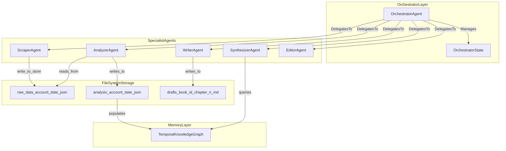
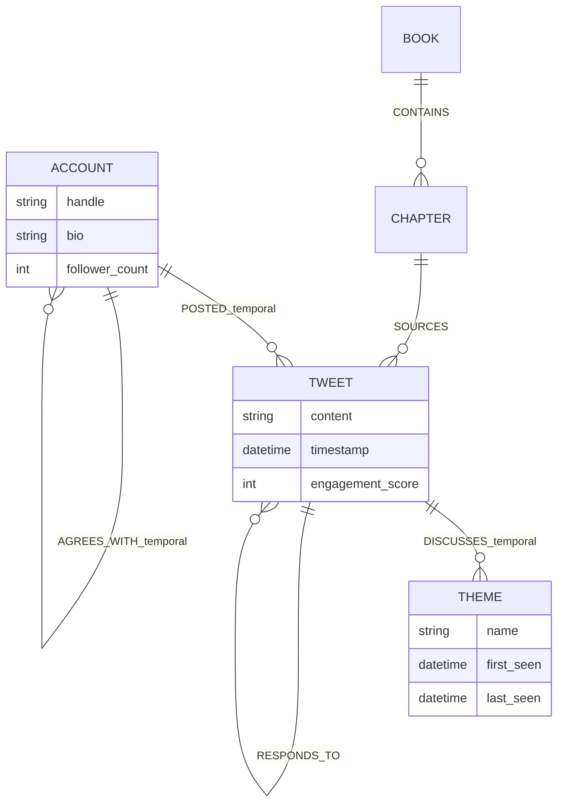

<!-- source: DeepWiki mcp.deepwiki.com · repo muratcankoylan/Agent-Skills-for-Context-Engineering · page 6.5 X-to-Book Multi-Agent System · fetched 2026-10-26 -->

# X-to-Book Multi-Agent System

Relevant source files

The following files were used as context for generating this wiki page:

- [examples/x-to-book-system/PRD.md](examples/x-to-book-system/PRD.md)
- [examples/x-to-book-system/README.md](examples/x-to-book-system/README.md)
- [examples/x-to-book-system/SKILLS-MAPPING.md](examples/x-to-book-system/SKILLS-MAPPING.md)

The **X-to-Book Multi-Agent System** is a technical blueprint and demonstration project located in `examples/x-to-book-system/`. It implements a production-grade multi-agent pipeline that monitors target X (Twitter) accounts daily, extracts evolving narratives, and synthesizes them into structured, multi-chapter books [examples/x-to-book-system/PRD.md:1-14](), [examples/x-to-book-system/README.md:1-4](). This page details the supervisor architecture, per-agent context budgets, temporal knowledge graph, observation masking, tool consolidation, and evaluation rubric that make high-volume social data processing viable without context degradation [examples/x-to-book-system/README.md:5-17]().

## Architecture: Supervisor/Orchestrator Pattern

The system adopts a **Supervisor/Orchestrator** topology [examples/x-to-book-system/PRD.md:17-27](). Book production involves strict sequential phases (scraping, analysis, synthesis, writing, and editing) that require central coordination, checkpointing, and quality gates [examples/x-to-book-system/README.md:20-28](). To mitigate the "Telephone Game" failure mode—where a supervisor paraphrases worker outputs inaccurately—the orchestrator delegates execution and consumes only distilled summaries via the file system rather than handling raw observation streams [examples/x-to-book-system/SKILLS-MAPPING.md:11-15]().

### System Component Diagram
This diagram maps the natural language requirements from the PRD and README to concrete data structures and file paths in the codebase.

**X-to-Book System Architecture**

Sources: [examples/x-to-book-system/PRD.md:25-50](), [examples/x-to-book-system/README.md:120-142](), [examples/x-to-book-system/SKILLS-MAPPING.md:11-15]()

## Context Budgeting & Optimization

To prevent attention saturation and combat the "Lost-in-the-Middle" phenomenon, each agent operates under strict token budgets and leverages progressive disclosure [examples/x-to-book-system/README.md:36-50](). 

### Per-Agent Context Limits

| Agent Class | Token Budget | Core Responsibility |
| :--- | :--- | :--- |
| `OrchestratorAgent` | 50,000 | Task decomposition, routing, and quality gates [examples/x-to-book-system/PRD.md:34](). |
| `Scraper Agent` | 20,000 | Single-account ingestion and normalization [examples/x-to-book-system/PRD.md:55](). |
| `Analyzer Agent` | 80,000 | Pattern extraction per account [examples/x-to-book-system/SKILLS-MAPPING.md:52](). |
| `Synthesizer Agent` | 100,000 | Cross-account theme consolidation and outline generation [examples/x-to-book-system/SKILLS-MAPPING.md:53](). |
| `Writer Agent` | 80,000 | Progressive chapter drafting [examples/x-to-book-system/README.md:44-49](). |
| `Editor Agent` | 60,000 | Fact-checking and source verification [examples/x-to-book-system/SKILLS-MAPPING.md:55](). |

Observation masking is heavily utilized: raw tweet streams (which can easily exceed 100k+ tokens daily) are written directly to the file system by the `Scraper Agent`, ensuring that the `OrchestratorAgent` and subsequent agents only ingest highly condensed summaries [examples/x-to-book-system/README.md:71-81](). Furthermore, a compaction trigger is set at 70% context utilization to compress phase outputs dynamically [examples/x-to-book-system/SKILLS-MAPPING.md:99-102]().

Sources: [examples/x-to-book-system/PRD.md:31-124](), [examples/x-to-book-system/SKILLS-MAPPING.md:48-56](), [examples/x-to-book-system/README.md:36-50]()

## Memory System: Temporal Knowledge Graph

Vector stores alone struggle with relationship traversal and temporal validity (distinguishing current facts from outdated ones) [examples/x-to-book-system/README.md:53-56](). The X-to-Book system implements a **Temporal Knowledge Graph** to track how account positions evolve over time [examples/x-to-book-system/PRD.md:130-137]().

### Data Schema and Relationships

**Temporal Knowledge Graph Schema**

Sources: [examples/x-to-book-system/PRD.md:140-200](), [examples/x-to-book-system/README.md:145-150](), [examples/x-to-book-system/SKILLS-MAPPING.md:66-70]()

## Tool Design: Consolidation Principle

Following the **Consolidation Principle** from the tool-design skill, the system collapses over 15 narrow tools into a concise set of multi-purpose, action-parameterized tools to avoid agent confusion and tool selection ambiguity [examples/x-to-book-system/SKILLS-MAPPING.md:120-128]().

1. `x_data_tool`: Consolidates timeline fetching, thread expansion, and engagement metrics retrieval via an `action` parameter [examples/x-to-book-system/README.md:94-95]().
2. `knowledge_graph_tool`: Handles temporal graph mutations and time-travel queries [examples/x-to-book-system/SKILLS-MAPPING.md:72-79]().
3. `storage_tool`: Manages isolated file system operations for raw data, analysis artifacts, and chapter drafts [examples/x-to-book-system/PRD.md:61-63]().

Sources: [examples/x-to-book-system/PRD.md:57-61](), [examples/x-to-book-system/SKILLS-MAPPING.md:120-128](), [examples/x-to-book-system/README.md:89-100]()

## Evaluation Rubric

To maintain high content fidelity, generated books are evaluated across five weighted dimensions [examples/x-to-book-system/README.md:101-118](). Outputs scoring below 0.7 overall or failing source verification thresholds are automatically flagged for human review [examples/x-to-book-system/README.md:115-118]().

| Dimension | Weight | Evaluation Criteria |
| :--- | :--- | :--- |
| **Source Accuracy** | 30% | Quote verification against original tweet payloads [examples/x-to-book-system/README.md:109](). |
| **Thematic Coherence** | 25% | Logical narrative progression across chapters [examples/x-to-book-system/README.md:110](). |
| **Completeness** | 20% | Coverage breadth of identified social themes [examples/x-to-book-system/README.md:111](). |
| **Insight Quality** | 15% | Depth of cross-account synthesis beyond superficial summarization [examples/x-to-book-system/README.md:112](). |
| **Readability** | 10% | Prose quality and stylistic consistency [examples/x-to-book-system/README.md:113](). |

Sources: [examples/x-to-book-system/README.md:108-114](), [examples/x-to-book-system/PRD.md:245-265]()

---

