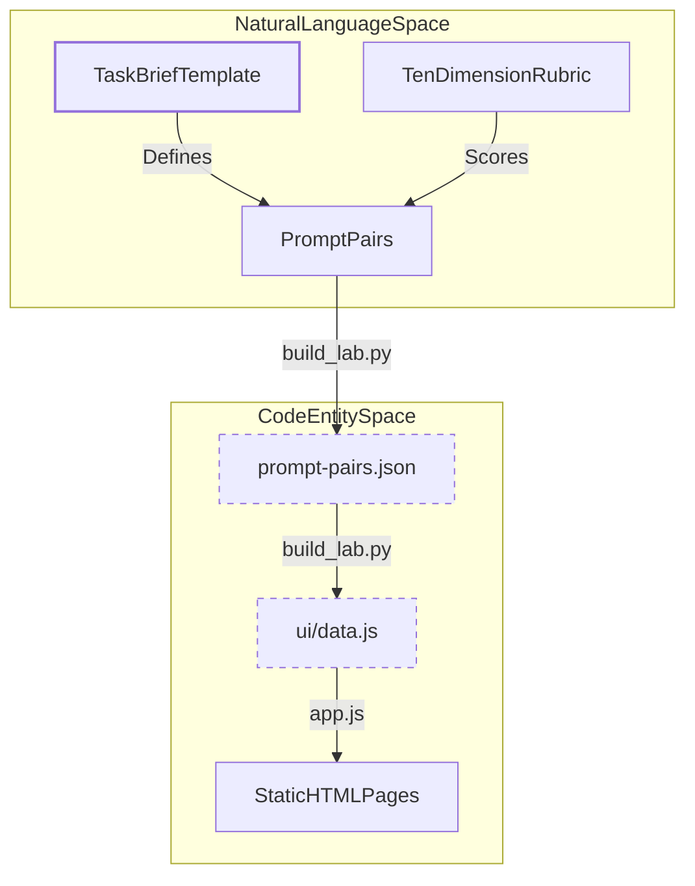
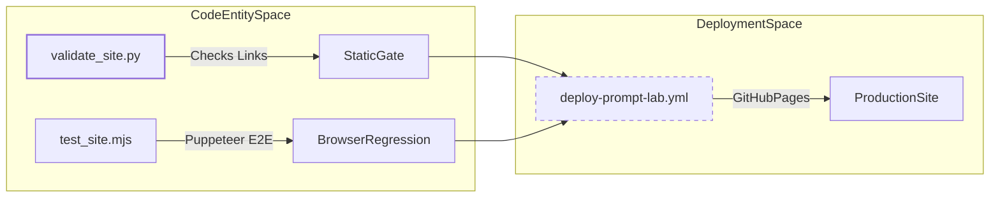

<!-- source: DeepWiki mcp.deepwiki.com · repo muratcankoylan/Agent-Skills-for-Context-Engineering · page 6.6 Long-Horizon Prompt Lab · fetched 2026-10-26 -->

# Long-Horizon Prompt Lab

Relevant source files

The following files were used as context for generating this wiki page:

- [examples/long-horizon-prompt-lab/.gitignore](examples/long-horizon-prompt-lab/.gitignore)
- [examples/long-horizon-prompt-lab/README.md](examples/long-horizon-prompt-lab/README.md)
- [examples/long-horizon-prompt-lab/package-lock.json](examples/long-horizon-prompt-lab/package-lock.json)
- [examples/long-horizon-prompt-lab/package.json](examples/long-horizon-prompt-lab/package.json)
- [examples/long-horizon-prompt-lab/report/PROVENANCE.md](examples/long-horizon-prompt-lab/report/PROVENANCE.md)
- [examples/long-horizon-prompt-lab/report/cdc_prompt.pdf](examples/long-horizon-prompt-lab/report/cdc_prompt.pdf)
- [examples/long-horizon-prompt-lab/report/cdc_prompt.txt](examples/long-horizon-prompt-lab/report/cdc_prompt.txt)
- [examples/long-horizon-prompt-lab/report/cdc_proof.pdf](examples/long-horizon-prompt-lab/report/cdc_proof.pdf)
- [examples/long-horizon-prompt-lab/report/cdc_proof.txt](examples/long-horizon-prompt-lab/report/cdc_proof.txt)
- [examples/long-horizon-prompt-lab/scripts/fetch_report.sh](examples/long-horizon-prompt-lab/scripts/fetch_report.sh)
- [examples/long-horizon-prompt-lab/scripts/verify_report.py](examples/long-horizon-prompt-lab/scripts/verify_report.py)
- [examples/long-horizon-prompt-lab/ui/404.html](examples/long-horizon-prompt-lab/ui/404.html)

## Purpose & Scope

The **Long-Horizon Prompt Lab** is a dependency-free educational laboratory and static website designed to demonstrate the `long-horizon-prompting` skill [examples/long-horizon-prompt-lab/README.md:1-6](). It provides a "before and after" environment for specification engineering, showcasing how to transform conventional prompts into pseudo-formal task briefs for autonomous agents running for hours or days [examples/long-horizon-prompt-lab/ui/index.html:38-44](). 

This is a parent page providing a high-level overview of the prompt lab topologies, rubric scoring, and case studies. For detailed implementation of the UI, build scripts, and data generation, see [Prompt Lab UI & Build Pipeline](#6.6.1). For details on the static analysis gates, E2E testing, deployment workflows, and provenance validation, see [Prompt Lab Validation & Deployment](#6.6.2).

Sources: [examples/long-horizon-prompt-lab/README.md:1-10](), [examples/long-horizon-prompt-lab/ui/index.html:38-44]()

## System Topology & Use Cases

The lab documents four distinct use-case topologies, each representing a different failure mode that the `long-horizon-prompting` method pre-blocks [examples/long-horizon-prompt-lab/README.md:69-74]().

| Use Case | Domain | Topology | Failure Pre-blocked |
| :--- | :--- | :--- | :--- |
| **ML Optimization** | ML Training | Single Agent | "Beat the number" invites reward hacking and noise wins [examples/long-horizon-prompt-lab/README.md:71](). |
| **Approx Proof Search** | Algorithms | 64-worker Orchestration | Diversity collapse from frequent-sync consensus [examples/long-horizon-prompt-lab/README.md:72](). |
| **Systems RCA** | Concurrency | Multi-session Single Agent | Vague "find root cause" lacks checkable success predicates [examples/long-horizon-prompt-lab/README.md:73](). |
| **Security Audit** | AppSec | Parallel Workers | Persistence inflating unconfirmed findings [examples/long-horizon-prompt-lab/README.md:74](). |

Sources: [examples/long-horizon-prompt-lab/README.md:69-74](), [examples/long-horizon-prompt-lab/scripts/build_lab.py:69-76]()

## Build Pipeline and Data Flow

The laboratory follows a "Single Source of Truth" pattern where all prompt data and rubric scores are defined in Python and compiled down into static JSON assets for the browser. 

### Natural Language Space to Code Entity Space
This diagram bridges the natural language prompts and rubric definitions to the generated code assets.

For detailed information on static pages (`index.html`, `guide.html`, `lab.html`, `references.html`, `404.html`), styles (`styles.css`), rendering engines (`app.js`, `site.js`), and screenshot capture automation (`capture.mjs`), see [Prompt Lab UI & Build Pipeline](#6.6.1).

Sources: [examples/long-horizon-prompt-lab/scripts/build_lab.py:1-18](), [examples/long-horizon-prompt-lab/ui/app.js:1-10]()

## Pre-Launch Rubric & Metrics

The lab evaluates prompts using a 10-dimension rubric derived from the `task-brief-template.md` [examples/long-horizon-prompt-lab/scripts/build_lab.py:28-31](). Each dimension is scored as absent (`0`), present but gameable (`1`), adversary-proof (`2`), or not applicable (`na`) [examples/long-horizon-prompt-lab/README.md:107-110]().

*   **Success Predicate**: Unambiguous artifact satisfaction [examples/long-horizon-prompt-lab/scripts/build_lab.py:32-33]().
*   **Definitions**: Load-bearing terms and boundary cases [examples/long-horizon-prompt-lab/scripts/build_lab.py:34-35]().
*   **Non-counting Outcomes**: Named exclusion of near misses [examples/long-horizon-prompt-lab/scripts/build_lab.py:36-37]().
*   **Auditor Checklist**: Domain-specific failure modes [examples/long-horizon-prompt-lab/scripts/build_lab.py:38-39]().
*   **Persistence-Verification Pairing**: Gates for every "continue" instruction [examples/long-horizon-prompt-lab/scripts/build_lab.py:40-41]().
*   **Return Condition**: Predicate over artifact vs. confidence [examples/long-horizon-prompt-lab/scripts/build_lab.py:42-43]().
*   **Diversity Policy**: Rules for parallel worker independence [examples/long-horizon-prompt-lab/scripts/build_lab.py:44-45]().
*   **Reporting Contract**: Evidence-backed artifact requirements [examples/long-horizon-prompt-lab/scripts/build_lab.py:46-47]().
*   **Contamination Guards**: Retrieval scope limitations [examples/long-horizon-prompt-lab/scripts/build_lab.py:48-49]().
*   **Harness Separation**: Moving hard constraints out of prompt text [examples/long-horizon-prompt-lab/scripts/build_lab.py:50-52]().

**Structural Gain Metric**: Calculated as the percentage point increase in rubric score between the "Before" (conventional) and "After" (optimized) prompts [examples/long-horizon-prompt-lab/ui/lab.html:57-61](). For build mechanics and scoring schemas, see [Prompt Lab UI & Build Pipeline](#6.6.1).

Sources: [examples/long-horizon-prompt-lab/scripts/build_lab.py:28-52](), [examples/long-horizon-prompt-lab/ui/lab.html:57-61]()

## Case Study: Cycle Double Cover (CDC)

The lab includes the **Cycle Double Cover (CDC)** case study, an exemplar of long-horizon prompting released by OpenAI for GPT-5.6 Sol Ultra [examples/long-horizon-prompt-lab/README.md:44-49](). It contains raw text extractions (`cdc_prompt.txt`), provenance records (`PROVENANCE.md`), and automated verification routines (`verify_report.py`) ensuring the skill's annotated references match published sources without drift. For implementation details on report verification and provenance scripts, see [Prompt Lab Validation & Deployment](#6.6.2).

Sources: [examples/long-horizon-prompt-lab/README.md:44-52](), [examples/long-horizon-prompt-lab/scripts/verify_report.py:1-10]()

## Testing, Validation & Deployment Pipeline

The project maintains rigorous validation gates to protect against regressions, broken links, metadata omissions, and UI layout issues. 

For full details on the static analysis gate (`validate_site.py`), Puppeteer E2E test suite (`test_site.mjs`), GitHub Actions deployment workflow (`deploy-prompt-lab.yml`), installation scripts (`install_skill.sh`), and provenance verification checks, see [Prompt Lab Validation & Deployment](#6.6.2).

Sources: [examples/long-horizon-prompt-lab/scripts/validate_site.py:2-3](), [examples/long-horizon-prompt-lab/scripts/test_site.mjs:1-7](), [.github/workflows/deploy-prompt-lab.yml:1-30]()

## The Prompt/Harness Split

A core concept documented across the lab is the **System Boundary** [examples/long-horizon-prompt-lab/ui/index.html:127-130](). The laboratory emphasizes that the prompt is not an isolated document but part of a wider architecture:

*   **Prompt (The Brief)**: Owns definitions, success predicates, non-solutions, and the orchestration policy [examples/long-horizon-prompt-lab/ui/guide.html:120]().
*   **Harness (The Runtime)**: Owns budgets (token/time), permissions (network/filesystem), and the "Effort Floor" (enforcing that an agent cannot quit early) [examples/long-horizon-prompt-lab/ui/guide.html:121]().

Sources: [examples/long-horizon-prompt-lab/ui/guide.html:117-124](), [examples/long-horizon-prompt-lab/README.md:117-120]()

---

