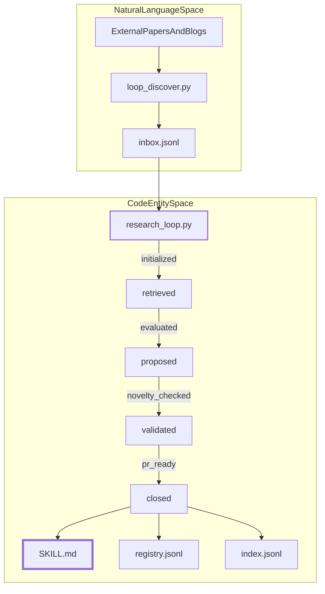
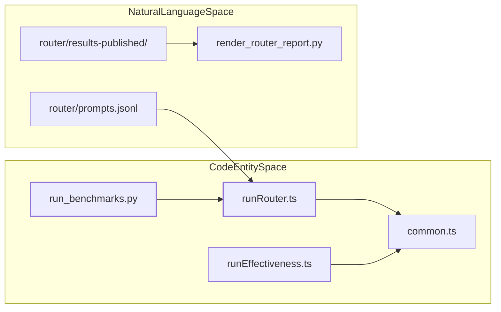

<!-- source: DeepWiki mcp.deepwiki.com · repo muratcankoylan/Agent-Skills-for-Context-Engineering · page 7 Researcher Operating System · fetched 2026-10-26 -->

# Researcher Operating System

Relevant source files

The following files were used as context for generating this wiki page:

- [.github/workflows/validate.yml](.github/workflows/validate.yml)
- [AGENTS.md](AGENTS.md)
- [CLAUDE.md](CLAUDE.md)
- [researcher/README.md](researcher/README.md)
- [researcher/corpus/inventory.json](researcher/corpus/inventory.json)
- [researcher/generated/corpus-summary.md](researcher/generated/corpus-summary.md)
- [researcher/scripts/build_inventory.py](researcher/scripts/build_inventory.py)
- [researcher/scripts/tests/test_build_inventory.py](researcher/scripts/tests/test_build_inventory.py)
- [researcher/scripts/validate_repo.py](researcher/scripts/validate_repo.py)

The Researcher Operating System (OS) is an autonomous research-to-skill pipeline housed in the `researcher/` directory [researcher/README.md:1-3](). It is designed to keep the Agent Skills corpus alive and evolving without manual editorial bottlenecks. The system curates external AI research, validates it against engineering rubrics, and distills findings into machine-readable skills and durable records.

Updated for **v2.5.0**, the system manages **17 total skills**, **22 mechanisms**, **26 claims**, and **23 activation cases** [researcher/generated/corpus-summary.md:12-17](). It incorporates strict file-based state machines, deterministic validation scripts, schema registries, and machine-testable governance policies [AGENTS.md:17-30]().

## Overview of the Autonomous Pipeline

The Researcher OS operates as a file-based state machine, allowing agents to resume, audit, and validate research runs without a centralized scheduler [AGENTS.md:17-18](). It bridges the gap between raw external research (Natural Language Space) and structured repository artifacts (Code Entity Space).

### High-Level Orchestration and State Transitions
The system uses a continuous loop managed by scripts like `research_loop.py` and `loop_step.py` [CLAUDE.md:45-51](). It is orchestrated via `launchd` on macOS, utilizing atomic writes (`tempfile` + `os.replace`) and `fcntl` locks to ensure data integrity during concurrent operations [AGENTS.md:23-39](). 

Diagram: Research Pipeline State Flow

Sources: [AGENTS.md:16-24](), [researcher/README.md:25-39](), [researcher/corpus/index.json:1-125]()

---

## 7.1. [Research Curation & Researcher OS Pipeline](#7.1)

This child page covers the core logic of how research is evaluated. It utilizes the Principal Research Curator prompt (`llm-as-a-judge.md`) and the Source Registry to classify information into Tier 1, 2, and 3 sources [researcher/README.md:42-42]().

### Key Components:
*   **Run State Machine Lifecycle**: Detailed breakdown of transitions from `initialized` to `closed` stored in `run-state.json` [AGENTS.md:18-18]().
*   **Evaluation Protocol**: Gatekeeper checks and dimensional scoring shaped by `templates/source-evaluation.json` [researcher/README.md:33-35]().
*   **Mechanism Registry & Claim Index**: The encyclopedia backbone (`mechanisms/registry.jsonl`) and volatility-sensitive claim provenance (`claims/index.jsonl`) [AGENTS.md:20-21]().

For details, see [Research Curation & Researcher OS Pipeline](#7.1).

---

## 7.2. [Benchmarking Pipeline & Router Results](#7.2)

The benchmarking pipeline measures whether skills actually improve agent performance. It spans multi-stage evaluation from deterministic harness checks to router accuracy and effectiveness tasks [researcher/README.md:47]().

### Benchmark Stages:
*   **Stage 0**: Deterministic harness checks [AGENTS.md:27-27]().
*   **Stage 1**: Per-skill health scoring via `skill_health.py` [AGENTS.md:27-27]().
*   **Stage 2**: Router Accuracy managed by the TypeScript SDK runner (`runRouter.ts`, `common.ts`) [AGENTS.md:31-32]().
*   **Stage 3**: Effectiveness scaffold evaluation (`runEffectiveness.ts`) [AGENTS.md:27-27]().

Diagram: Benchmark SDK Runner Architecture

Sources: [AGENTS.md:27-32](), [researcher/benchmarks/sdk-runner/src/runRouter.ts:1-50](), [.github/workflows/validate.yml:98-105]()

For details, see [Benchmarking Pipeline & Router Results](#7.2).

---

## 7.3. [Researcher OS: Scripts, Queues & Orchestration](#7.3)

Operational infrastructure for the autonomous loop. It relies on deterministic validation checks, file-based queues, and atomic writes [AGENTS.md:23-39]().

### Operational Highlights:
*   **Loop Scripts**: `research_loop.py`, `loop_discover.py`, `loop_step.py`, and `loop_daily.py` [CLAUDE.md:45-51]().
*   **Strict Validators**: `validate_repo.py --strict`, `validate_run.py`, and `skill_health.py` [CLAUDE.md:33-34]().
*   **Orchestration**: macOS `launchd` service definitions paired with `fcntl` advisory locks [AGENTS.md:23-39]().

For details, see [Researcher OS: Scripts, Queues & Orchestration](#7.3).

---

## 7.4. Reference Documentation & Case Studies

The `docs/` directory houses foundational reading materials, architectural case studies, compression guides, and the Agent Skills open standard specification [CLAUDE.md:15]().

### Core References:
*   **Reading Lists & Case Studies**: `blogs.md`, Netflix and Vercel architectural analyses [AGENTS.md:16]().
*   **Specification & ADRs**: Architecture Decision Records (ADRs) and SPEC documents index [researcher/README.md:7]().

For details, see [Reference Documentation & Case Studies](#7.4).

---

## 7.5. Governance: Machine-Testable Constitution

The `governance/` directory implements the machine-testable authority model, constitutional invariants, separation-of-duty rules, and export classification policies [AGENTS.md:29]().

### Governance Elements:
*   **Constitution**: `constitution.yaml` and `authority.schema.json` [AGENTS.md:20]().
*   **Executable Semantics**: `governance_policy.py` and `validate_governance.py` [CLAUDE.md:30]().
*   **Export Policy**: `export-policy.yaml` and `validate_export.py` governing public projections [AGENTS.md:29]().

For details, see [Governance: Machine-Testable Constitution](#7.5).

---

## 7.6. Schema Registry & Artifact Contracts

The v1 schema registry located in `researcher/schemas/` defines durable-record types (`ArtifactRef`, `ArtifactEnvelope`, `StorageBinding`, `CapabilityGrantSpec`) and cross-language conformance guarantees [AGENTS.md:30]().

### Contract Elements:
*   **Registry Definition**: `registry.json` and `registry.schema.json` [AGENTS.md:30]().
*   **Canonicalization**: Integer-only `jcs-rfc8785-integer-v1` profile [AGENTS.md:30]().
*   **TypeScript Conformance**: Libraries under `researcher/schemas/typescript/` (`canonicalize.ts`, `conformance.ts`) [AGENTS.md:30]().

For details, see [Schema Registry & Artifact Contracts](#7.6).

---

### Sources:
* [AGENTS.md:16-40]()
* [CLAUDE.md:15-51]()
* [researcher/README.md:1-50]()
* [researcher/generated/corpus-summary.md:1-30]()
* [.github/workflows/validate.yml:98-120]()

---

