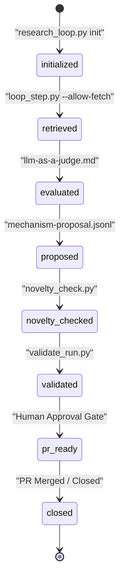
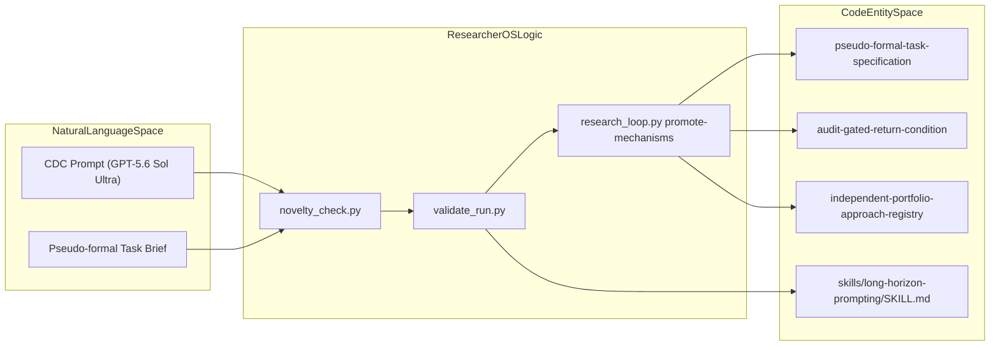

<!-- source: DeepWiki mcp.deepwiki.com · repo muratcankoylan/Agent-Skills-for-Context-Engineering · page 7.1 Research Curation & Researcher OS Pipeline · fetched 2026-10-26 -->

# Research Curation & Researcher OS Pipeline

<details>
<summary>Relevant source files</summary>

The following files were used as context for generating this wiki page:

- [CHANGELOG.md](CHANGELOG.md)
- [researcher/benchmarks/router/prompts.jsonl](researcher/benchmarks/router/prompts.jsonl)
- [researcher/claims/index.jsonl](researcher/claims/index.jsonl)
- [researcher/corpus/index.json](researcher/corpus/index.json)
- [researcher/example_output.md](researcher/example_output.md)
- [researcher/fixtures/activation-cases.jsonl](researcher/fixtures/activation-cases.jsonl)
- [researcher/insights/auto-research-experiment.md](researcher/insights/auto-research-experiment.md)
- [researcher/insights/how-we-built-this.md](researcher/insights/how-we-built-this.md)
- [researcher/llm-as-a-judge.md](researcher/llm-as-a-judge.md)
- [researcher/mechanisms/ledgers/accepted.jsonl](researcher/mechanisms/ledgers/accepted.jsonl)
- [researcher/mechanisms/registry.jsonl](researcher/mechanisms/registry.jsonl)

</details>


This section documents the `researcher/` directory, which serves as the repo-native, autonomous research-to-skill operating system. It implements the **Principal Research Curator** (`researcher/llm-as-a-judge.md`), tiered source registration, deterministic evaluation protocols, state machine lifecycles, and relational data indices designed to distill external AI research into machine-readable agent skills [researcher/llm-as-a-judge.md:1-7]().

Sources: [researcher/llm-as-a-judge.md:1-7]()

## Overview of the Researcher OS & State Machine Lifecycle

The Researcher OS is structured to maintain corpus vitality without manual editorial bottlenecks. Per-run states are stored under `researcher/runs/<run-id>/run-state.json`, allowing concurrent agent sessions to inspect, resume, audit, and validate execution states [AGENTS.md:17-18]().

### Run State Machine Lifecycle

The run lifecycle progresses through explicit state transitions managed via `research_loop.py` script invocations:


Sources: [AGENTS.md:17-18](), [CHANGELOG.md:39-40]()

Sources: [AGENTS.md:17-18](), [CHANGELOG.md:39-40]()

---

## Source Registry & Domain Scope

Sources are classified against the **Context Engineering Survey taxonomy (arXiv:2507.13334)** to ensure alignment with foundational retrieval, processing, and management structures [researcher/llm-as-a-judge.md:9-11]().

| Taxonomy Category | Codebase Application & Scope |
| :--- | :--- |
| **Context Retrieval & Generation** | Prompt engineering, Chain-of-Thought, few-shot structures, external knowledge acquisition [researcher/llm-as-a-judge.md:14]() |
| **Context Processing** | Long-context handling, self-refinement loops, structured information integration [researcher/llm-as-a-judge.md:15]() |
| **Context Management** | Memory hierarchies, compaction algorithms, token budgeting within finite windows [researcher/llm-as-a-judge.md:16]() |
| **System Implementations** | Multi-agent coordination, memory graphs, tool-integrated reasoning, RAG pipelines [researcher/llm-as-a-judge.md:18-22]() |

Sources: [researcher/llm-as-a-judge.md:9-22]()

---

## The Evaluation Protocol (LLM-as-a-Judge)

The Principal Research Curator prompt (`researcher/llm-as-a-judge.md`) executes a strict evaluation protocol consisting of gatekeeper triage followed by dimensional scoring [researcher/llm-as-a-judge.md:24-32]().

### 1. Gatekeeper Triage
Four binary hard gates must be satisfied; failure on any gate results in immediate rejection (`REJECT`), and failing more than two triggers automatic disqualification [researcher/llm-as-a-judge.md:28-28](), [researcher/llm-as-a-judge.md:61-71]().
*   **G1 Mechanism Specificity**: Must define an explicit context engineering pattern or mechanism [researcher/llm-as-a-judge.md:67]()
*   **G2 Implementable Artifacts**: Must contain actionable artifacts such as schemas, code snippets, or prompt templates [researcher/llm-as-a-judge.md:68]()
*   **G3 Beyond Basics**: Must advance past introductory prompting or basic RAG concepts [researcher/llm-as-a-judge.md:69]()
*   **G4 Source Verifiability**: Source must exhibit verifiable technical credibility [researcher/llm-as-a-judge.md:70]()

### 2. Dimensional Scoring
For items passing triage, four weighted dimensions are scored on a 0-2 scale to compute a final score [researcher/llm-as-a-judge.md:81-88]().
*   **D1 Technical Depth & Actionability (Weight: 35%)** [researcher/llm-as-a-judge.md:92]()
*   **D2 Context Engineering Relevance (Weight: 30%)** [researcher/llm-as-a-judge.md:110]()
*   **D3 Evidence Rigor (Weight: 20%)** [researcher/llm-as-a-judge.md:124]()
*   **D4 Novelty / Insight (Weight: 15%)** [researcher/llm-as-a-judge.md:143]()

Sources: [researcher/llm-as-a-judge.md:24-150]()

---

## Implementation: Researcher Templates & Data Flow

The Researcher OS bridges unstructured natural language research with structured repository code entities through validation and transformation scripts.

### Data Flow: Natural Language to Code Entity Space

```mermaid
graph TD
    subgraph "NaturalLanguageSpace"
        Inbox["inbox.jsonl"] --> Fetcher["loop_step.py (Fetch)"]
        Fetcher --> Judge["llm-as-a-judge.md"]
        Thread["THREAD.md / research-thread.md"]
    end

    subgraph "CodeEntitySpace"
        Judge --> EvalJson["source-evaluation.json"]
        EvalJson --> MechProp["mechanism-proposal.jsonl"]
        EvalJson --> SkillProp["skill-proposal.md"]
        
        MechProp --> Registry["researcher/mechanisms/registry.jsonl"]
        SkillProp --> Corpus["researcher/corpus/index.json"]
        EvalJson --> Claims["researcher/claims/index.jsonl"]
    end

    Thread -.-> "Context Logs" .-> EvalJson
```
Sources: [AGENTS.md:18-22](), [researcher/mechanisms/registry.jsonl:1-13]()

### Worked Example: Long-Horizon Prompting Integration


Sources: [CHANGELOG.md:11-21](), [researcher/mechanisms/registry.jsonl:1-13]()

Sources: [AGENTS.md:18-22](), [CHANGELOG.md:11-21](), [researcher/mechanisms/registry.jsonl:1-13]()

---

## Core Infrastructure Files & Mechanism Registry

The operational backbone of the Researcher OS relies on three central machine-readable indexes located under `researcher/`:

*   **`researcher/mechanisms/registry.jsonl`**: The central mechanism registry storing endorsed behavior changes,owning skills, activation scenarios, and known failure modes [researcher/mechanisms/registry.jsonl:1-13](). Promotion is gated by accepted ledgers (`researcher/mechanisms/ledgers/accepted.jsonl`) [researcher/mechanisms/ledgers/accepted.jsonl:1-18]().
*   **`researcher/claims/index.jsonl`**: Provenance tracking index for numeric and empirical claims, maintaining evidence strength, volatility ratings, and source references [researcher/claims/index.jsonl:1-15]().
*   **`researcher/corpus/index.json`**: Canonical machine-readable map binding every published skill to its corresponding activation scenarios, mechanism IDs, and claim references [researcher/corpus/index.json:1-41]().

Sources: [researcher/mechanisms/registry.jsonl:1-13](), [researcher/mechanisms/ledgers/accepted.jsonl:1-18](), [researcher/claims/index.jsonl:1-15](), [researcher/corpus/index.json:1-41]()

---

