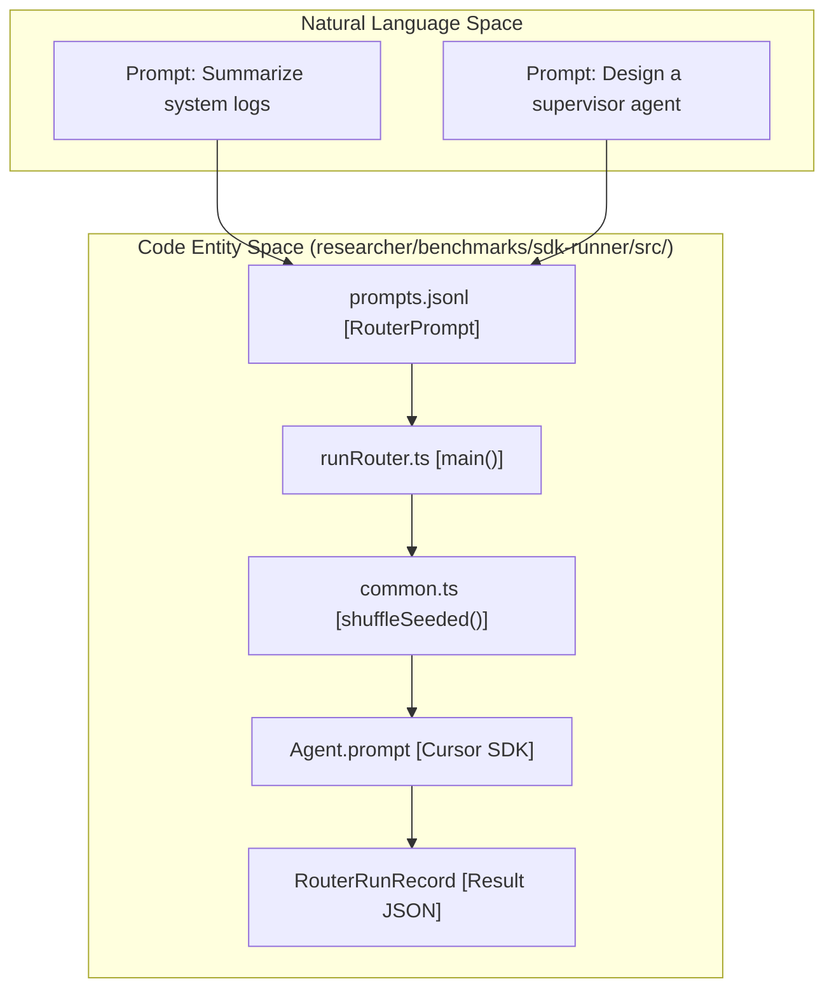
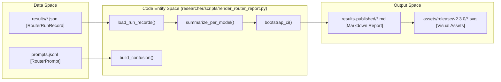

<!-- source: DeepWiki mcp.deepwiki.com · repo muratcankoylan/Agent-Skills-for-Context-Engineering · page 7.2 Benchmarking Pipeline & Router Results · fetched 2026-10-26 -->

# Benchmarking Pipeline & Router Results

Relevant source files

The following files were used as context for generating this wiki page:

- [assets/release/v2.3.0/corpus-hardening-metrics-v2-3.svg](assets/release/v2.3.0/corpus-hardening-metrics-v2-3.svg)
- [assets/release/v2.3.0/researcher-os-pipeline-v2-3.svg](assets/release/v2.3.0/researcher-os-pipeline-v2-3.svg)
- [assets/release/v2.3.0/router-leaderboard-2026-05-19.svg](assets/release/v2.3.0/router-leaderboard-2026-05-19.svg)
- [assets/release/v2.3.0/skill-routing-gains-v2-3.svg](assets/release/v2.3.0/skill-routing-gains-v2-3.svg)
- [docs/decisions/0002-derived-corpus-inventory.md](docs/decisions/0002-derived-corpus-inventory.md)
- [docs/specs/SPEC-001-repository-reconciliation.md](docs/specs/SPEC-001-repository-reconciliation.md)
- [researcher/benchmarks/PLAN.md](researcher/benchmarks/PLAN.md)
- [researcher/benchmarks/effectiveness/README.md](researcher/benchmarks/effectiveness/README.md)
- [researcher/benchmarks/router/results-published/2026-05-15-v2.md](researcher/benchmarks/router/results-published/2026-05-15-v2.md)
- [researcher/benchmarks/router/results-published/2026-05-15.md](researcher/benchmarks/router/results-published/2026-05-15.md)
- [researcher/benchmarks/router/results-published/README.md](researcher/benchmarks/router/results-published/README.md)
- [researcher/benchmarks/sdk-runner/README.md](researcher/benchmarks/sdk-runner/README.md)
- [researcher/benchmarks/sdk-runner/src/common.ts](researcher/benchmarks/sdk-runner/src/common.ts)
- [researcher/benchmarks/sdk-runner/src/runRouter.ts](researcher/benchmarks/sdk-runner/src/runRouter.ts)
- [researcher/corpus/inventory.schema.json](researcher/corpus/inventory.schema.json)
- [researcher/scripts/render_router_report.py](researcher/scripts/render_router_report.py)

The benchmarking pipeline provides a multi-stage, quantitative framework for measuring the performance of context engineering skills. It transitions the repository from subjective quality assessments to empirical data-driven development, focusing on how well models can route to the correct skill and how effective those skills are in execution [researcher/benchmarks/PLAN.md:3-5]().

---

## Multi-Stage Benchmarking Strategy

The pipeline is organized into five distinct stages of increasing complexity, defined in the master benchmark plan [researcher/benchmarks/PLAN.md:9-16]():

| Stage | Name | Objective | Implementation |
| :--- | :--- | :--- | :--- |
| **Stage 0** | Deterministic | Validates YAML frontmatter, file paths, and manifest integrity. | `validate_repo.py --strict` [docs/specs/SPEC-001-repository-reconciliation.md:31-38]() |
| **Stage 1** | Skill Health | Scores skills on mechanism coverage, claim provenance, and format. | `skill_health.py` [researcher/benchmarks/PLAN.md:81-102]() |
| **Stage 2** | Router | Measures Top-1 and Top-3 accuracy of skill selection from prompts. | `runRouter.ts` [researcher/benchmarks/sdk-runner/src/runRouter.ts:1-18]() |
| **Stage 3** | Effectiveness | Measures task success when a specific skill is loaded into the agent. | `runEffectiveness.ts` [researcher/benchmarks/effectiveness/README.md:1-5]() |
| **Stage 4** | Composition | Measures performance of cross-skill interaction and multi-skill tasks. | Planned [researcher/benchmarks/PLAN.md:15-16]() |

Sources: [researcher/benchmarks/PLAN.md:9-16](), [researcher/benchmarks/sdk-runner/README.md:1-29](), [researcher/benchmarks/sdk-runner/src/runRouter.ts:1-18]()

---

## SDK Runner Infrastructure (`runRouter.ts`, `common.ts`)

The Router Benchmark tests the hypothesis that skill frontmatter activation-scenario descriptions provide enough signal for a frontier model to select the correct skill at high top-1 accuracy [researcher/benchmarks/sdk-runner/src/runRouter.ts:4-6]().

### Execution Procedure & Key Logic
1. **Fixture Loading**: Loads 50+ ground-truth prompts from `router/prompts.jsonl` [researcher/benchmarks/sdk-runner/src/runRouter.ts:7-15]().
2. **Deterministic Shuffling**: For each replication, skill descriptions are shuffled using a seeded Fisher-Yates shuffle (`shuffleSeeded`) to eliminate position bias [researcher/benchmarks/sdk-runner/src/common.ts:220-226]().
3. **Context Isolation**: Calls are executed via `Agent.prompt()` with `settingSources: []` so that no skills are pre-loaded; only descriptions present in the prompt text act as the signal [researcher/benchmarks/sdk-runner/src/runRouter.ts:9-13]().
4. **Cost and Safety Controls**: The runner requires explicit cost limits via `--max-runs` or `--max-budget-usd` (or `--unsafe-no-cost-cap`) and supports `--dry-run` to output forecasts [researcher/benchmarks/sdk-runner/src/common.ts:100-122]().
5. **Format Failure Handling**: Enforces up to `MAX_FORMAT_ATTEMPTS` (default 2) to retry runs returning invalid JSON rankings [researcher/benchmarks/sdk-runner/src/runRouter.ts:79-80]().

### Data Flow: Natural Language to Code Entity Space

"Natural Language Space to Code Entity Space: Router Execution"

Sources: [researcher/benchmarks/sdk-runner/src/runRouter.ts:46-69](), [researcher/benchmarks/sdk-runner/src/runRouter.ts:176-192](), [researcher/benchmarks/sdk-runner/src/common.ts:220-226]()

---

## Analysis & Reporting Pipeline (`render_router_report.py`)

The `render_router_report.py` script aggregates per-run JSON files into published Markdown reports and visualizations [researcher/scripts/render_router_report.py:1-19]().

### Statistical Methods
* **Top-1 / Top-3 Accuracy**: Computed across finished runs per model [researcher/scripts/render_router_report.py:77-79]().
* **Bootstrap Confidence Intervals**: Implements `bootstrap_ci()` with 2,000 resamples to evaluate 95% CIs for accuracy scores [researcher/scripts/render_router_report.py:54-67]().
* **Confusion Matrix**: Maps expected primary skills against predicted primary skills (`build_confusion`) to expose category overlaps [researcher/scripts/render_router_report.py:102-112]().

### Reporting Pipeline Flow

"Natural Language Space to Code Entity Space: Report Rendering"

Sources: [researcher/scripts/render_router_report.py:41-51](), [researcher/scripts/render_router_report.py:70-99](), [researcher/scripts/render_router_report.py:145-170]()

---

## Published Router Results & Leaderboards

The v2.3.0 benchmark sweep evaluated 600 runs across four frontier models [researcher/benchmarks/PLAN.md:17-22]().

### Per-Model Leaderboard
| Model | Top-1 Accuracy | 95% CI | Top-3 Accuracy | Median Latency |
| :--- | :--- | :--- | :--- | :--- |
| **Gemini 3.1 Pro** | 0.920 | [0.873, 0.960] | 0.933 | 8,631 ms [assets/release/v2.3.0/router-leaderboard-2026-05-19.svg:27]() |
| **Composer 2** | 0.913 | [0.867, 0.953] | 0.947 | 3,004 ms [assets/release/v2.3.0/router-leaderboard-2026-05-19.svg:33]() |
| **GPT-5.5** | 0.913 | [0.867, 0.953] | 0.973 | 4,050 ms [assets/release/v2.3.0/router-leaderboard-2026-05-19.svg:39]() |
| **Claude Opus 4.7** | 0.840 | [0.780, 0.893] | 0.933 | 3,178 ms [assets/release/v2.3.0/router-leaderboard-2026-05-19.svg:45]() |

### Key Findings
* **Hardening Impact**: Corpus hardening elevated strict health scores to 0.9117 corpus-wide, removing all flagged skills [assets/release/v2.3.0/corpus-hardening-metrics-v2-3.svg:32-39]().
* **Targeted Gains**: Description rewrites moved `context-fundamentals` top-1 accuracy from 0.255 to 0.489 (+23.4pp) [researcher/benchmarks/PLAN.md:24-25]().

Sources: [researcher/benchmarks/PLAN.md:17-25](), [assets/release/v2.3.0/router-leaderboard-2026-05-19.svg:1-51](), [assets/release/v2.3.0/corpus-hardening-metrics-v2-3.svg:1-41]()

---

## Stage 3: Effectiveness Benchmark Scaffold

Stage 3 measures real agent execution performance using task suites defined under `researcher/benchmarks/effectiveness/tasks/` [researcher/benchmarks/effectiveness/README.md:1-5]().

### Task Layout
Each task directory contains [researcher/benchmarks/effectiveness/README.md:9-16]():
* `task.md`: Exact prompt provided to the agent.
* `metadata.json`: Machine-readable metadata (`target_skill`, `irrelevant_skill`, `category`, `difficulty`) [researcher/benchmarks/effectiveness/README.md:18-30]().
* `starting/`: Seed workspace copied before execution.
* `verify.sh`: Deterministic check script yielding exit code 0 on success.

### Evaluation Conditions
The runner evaluates six conditions per model and task [researcher/benchmarks/effectiveness/README.md:32-44]():
* `control`: `settingSources: []`, no skills loaded.
* `target`: Only `target_skill` loaded.
* `negative`: Only `irrelevant_skill` loaded (negative control).
* `full`: All published skills loaded.
* `target_plus_one` / `target_plus_unrelated`: Interaction controls.

Sources: [researcher/benchmarks/effectiveness/README.md:1-67](), [researcher/benchmarks/PLAN.md:14-15]()

---

