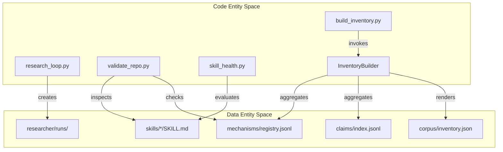
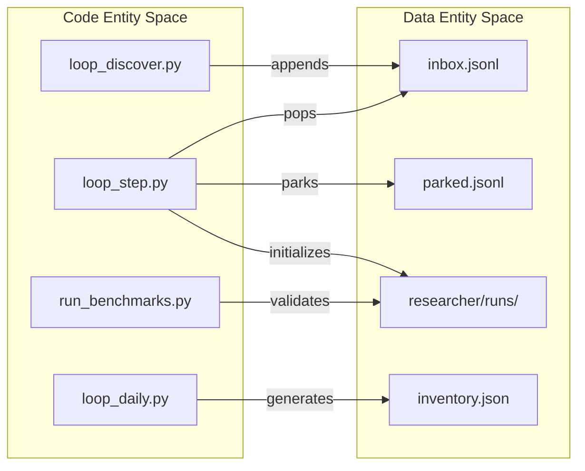

<!-- source: DeepWiki mcp.deepwiki.com · repo muratcankoylan/Agent-Skills-for-Context-Engineering · page 7.3 Researcher OS: Scripts, Queues & Orchestration · fetched 2026-10-26 -->

# Researcher OS: Scripts, Queues & Orchestration

Relevant source files

The following files were used as context for generating this wiki page:

- [.github/workflows/validate.yml](.github/workflows/validate.yml)
- [.gitignore](.gitignore)
- [docs/decisions/0004-runtime-neutral-artifact-contracts.md](docs/decisions/0004-runtime-neutral-artifact-contracts.md)
- [docs/specs/SPEC-003-schema-registry.md](docs/specs/SPEC-003-schema-registry.md)
- [requirements-dev.txt](requirements-dev.txt)
- [researcher/README.md](researcher/README.md)
- [researcher/artifacts/README.md](researcher/artifacts/README.md)
- [researcher/corpus/inventory.json](researcher/corpus/inventory.json)
- [researcher/corpus/reconciliation-report.md](researcher/corpus/reconciliation-report.md)
- [researcher/exports/schemas/export-records.schema.json](researcher/exports/schemas/export-records.schema.json)
- [researcher/generated/corpus-summary.md](researcher/generated/corpus-summary.md)
- [researcher/scripts/build_inventory.py](researcher/scripts/build_inventory.py)
- [researcher/scripts/skill_frontmatter.py](researcher/scripts/skill_frontmatter.py)
- [researcher/scripts/skill_health.py](researcher/scripts/skill_health.py)
- [researcher/scripts/tests/test_build_inventory.py](researcher/scripts/tests/test_build_inventory.py)
- [researcher/scripts/tests/test_skill_frontmatter.py](researcher/scripts/tests/test_skill_frontmatter.py)
- [researcher/scripts/validate_platform_compat.py](researcher/scripts/validate_platform_compat.py)
- [researcher/scripts/validate_repo.py](researcher/scripts/validate_repo.py)

The Researcher Operating System (Researcher OS) provides the operational infrastructure for the autonomous research-to-skill pipeline. It is a file-based, repo-native system designed to allow agents to resume, audit, and validate work without requiring a hosted scheduler [researcher/README.md:9-10](). The system relies on deterministic gates, a file-based queue, and atomic state transitions to ensure that each research run leaves the repository corpus in a verified, high-quality state [researcher/README.md:23-27]().

## Operational Infrastructure & Scripts

The `researcher/scripts/` directory contains the core logic for managing the lifecycle of research runs and maintaining corpus health [researcher/README.md:60-66](). These scripts are intentionally deterministic to ensure reliability, auditability, and offline execution [researcher/scripts/validate_repo.py:4-6]().

### Research Loop Management
The primary interface for advancing a research run is `researcher/scripts/research_loop.py`. It manages the state machine for each run, enforcing explicit transitions across the lifecycle: `discover -> triage -> evaluate -> extract -> map -> draft -> validate -> prepare-pr -> human-merge` [researcher/README.md:25-27]().

*   **`research_loop.py`**: Initializes durable run directories and validation reports via its CLI interface [researcher/README.md:62-62](). It handles run instantiation using the `init` subcommand paired with source metadata [researcher/README.md:82-82]().
*   **`novelty_check.py`**: Compares candidate skill proposals against existing skills and prior runs using `researcher/scripts/novelty_check.py` to prevent redundant extractions [researcher/README.md:63-63]().
*   **`compare_skill_revisions.py`**: Executes deterministic comparisons across multiple competing skill drafts in `researcher/scripts/compare_skill_revisions.py` [researcher/README.md:64-64]().

### Validation and Corpus Health
*   **`validate_repo.py --strict`**: Executed via `researcher/scripts/validate_repo.py`, this validator enforces structural correctness across skills, manifests, rubrics, mechanisms, and activation cases [researcher/scripts/validate_repo.py:95-107](). It invokes `skill_frontmatter.py` for YAML frontmatter parsing [researcher/scripts/validate_repo.py:18-18]().
*   **`validate_run.py`**: Validates whether a specific research run under `researcher/runs/` satisfies all publish-readiness criteria [researcher/README.md:61-61]().
*   **`skill_health.py`**: Implemented in `researcher/scripts/skill_health.py`, it computes quality metrics for skill bodies [researcher/scripts/build_inventory.py:66-69](). It is integrated directly into CI verification with the `--strict` flag [.github/workflows/validate.yml:125-126]().
*   **`check_activation_cases.py`**: Runs boundary regression suites against the activation cases defined in `researcher/fixtures/activation-cases.jsonl` [researcher/scripts/build_inventory.py:71-74]().
*   **`build_inventory.py`**: Reconciles the repository inventory [researcher/scripts/build_inventory.py:2-8](). It binds to exact canonical input bytes via `source_tree_digest` to avoid self-referential commit hashes [researcher/scripts/build_inventory.py:2-8]().

**Script and Entity Interaction**
Title: "Script Execution and Corpus Inventory Bridge"

Sources: [researcher/README.md:60-66](), [researcher/scripts/build_inventory.py:34-80](), [researcher/scripts/validate_repo.py:95-107]().

---

## File-Based Queue System

The Researcher OS utilizes a file-based queue architecture stored under `researcher/queue/` to manage research workloads across asynchronous executions without relying on an external message broker [.gitignore:66-70](). These queues are excluded from version control to prevent runtime state pollution [.gitignore:66-70]().

| Queue File | Purpose & Lifecycle State |
| :--- | :--- |
| `inbox.jsonl` | Candidate sources discovered but not yet initialized [.gitignore:67]() |
| `parked.jsonl` | Run IDs waiting for human review or novelty resolution [.gitignore:68]() |
| `done.jsonl` | History of closed runs (accepted, rejected, or abandoned) [.gitignore:69]() |
| `quarantine.jsonl` | Sources removed due to retrieval failure or registry rejection [.gitignore:70]() |

### Atomic Operations and Concurrency Control
To prevent race conditions during concurrent modifications by background processes, the operational scripts enforce strict write guarantees:

*   **`atomic_write_text`**: Implemented in `researcher/scripts/build_inventory.py`, this routine utilizes `tempfile.mkstemp` and `os.replace` to write output buffers to temporary files in the target directory before executing an atomic rename [researcher/scripts/build_inventory.py:152-165](). It subsequently invokes `os.fsync` on parent directory file descriptors to guarantee durable persistence on disk [researcher/scripts/build_inventory.py:166-171]().
*   **File Locking**: Shared queue files employ `fcntl` advisory locks during read-modify-write cycles to prevent conflicting worker writes.

Sources: [researcher/scripts/build_inventory.py:152-178](), [.gitignore:66-70]().

---

## Orchestration and Continuous Operation

Continuous execution of the Researcher OS is orchestrated via the `loop_*.py` script family located in `researcher/scripts/` [.github/workflows/validate.yml:64-68](). These scripts operate directly on the file-based queues and durable run directories.

*   **`loop_discover.py`**: Polls active source registries and appends validated ingestion candidates to `inbox.jsonl` [researcher/scripts/build_inventory.py:65]().
*   **`loop_step.py`**: Pops pending items from `inbox.jsonl`, initializes run directories under `researcher/runs/`, and advances active runs through sequential stage transitions [researcher/scripts/build_inventory.py:66]().
*   **`loop_daily.py`**: Executes maintenance routines, prunes stale runtime state, and generates dated snapshot reports [researcher/scripts/build_inventory.py:67]().
*   **`loop_status.py`**: Rebuilds operational status summaries and updates the parked review surfaces [researcher/scripts/build_inventory.py:68]().
*   **`run_benchmarks.py`**: Executes deterministic benchmark composition and adversarial scenario validation [researcher/scripts/build_inventory.py:76-79]().

**Orchestration Data Flow**
Title: "Continuous Loop Orchestration and State Transitions"

Sources: [.github/workflows/validate.yml:56-68](), [researcher/scripts/build_inventory.py:41-79](), [researcher/README.md:25-39]().

---

## Rubrics, Runbooks & CI Integration

Operational governance is enforced through structured markdown runbooks, rubrics, and automated CI pipelines.

### Rubrics (`researcher/rubrics/`)
*   **`content-curation.md`**: Evaluation criteria for admitting external research sources [researcher/README.md:50-50]().
*   **`skill-change.md`**: Gating standards required to modify existing skills or introduce new ones [researcher/README.md:51-51]().
*   **`harness-change.md`**: Validation rules governing alterations to evaluation harnesses [researcher/README.md:52-52]().
*   **`pairwise-skill-revision.md`**: Comparative rubric used when evaluating competing skill drafts [researcher/README.md:53-53]().

### Continuous Integration (`.github/workflows/validate.yml`)
The GitHub Actions workflow `validate.yml` enforces all repository gates on pull requests and pushes to `main` [.github/workflows/validate.yml:1-10](). It compiles all python modules in `researcher/scripts/`, runs unit tests under `researcher/scripts/tests/`, executes governance checks via `validate_governance.py`, reconciles inventory state via `build_inventory.py --check`, and executes strict structural validation via `validate_repo.py --strict` and `skill_health.py --strict` [.github/workflows/validate.yml:36-126]().

Sources: [.github/workflows/validate.yml:1-132](), [researcher/README.md:50-59]().

---

