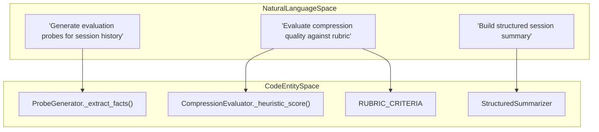
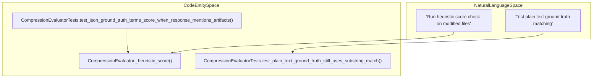

<!-- source: DeepWiki mcp.deepwiki.com · repo muratcankoylan/Agent-Skills-for-Context-Engineering · page 7.4 Reference Documentation & Case Studies · fetched 2026-10-26 -->

# Reference Documentation & Case Studies

Relevant source files

The following files were used as context for generating this wiki page:

- [docs/blogs.md](docs/blogs.md)
- [docs/claude_research.md](docs/claude_research.md)
- [docs/gemini_research.md](docs/gemini_research.md)
- [docs/netflix_context.md](docs/netflix_context.md)
- [docs/skills-improvement-analysis.md](docs/skills-improvement-analysis.md)
- [docs/vercel_tool.md](docs/vercel_tool.md)
- [skills/context-compression/SKILL.md](skills/context-compression/SKILL.md)
- [skills/context-compression/scripts/compression_evaluator.py](skills/context-compression/scripts/compression_evaluator.py)
- [skills/context-compression/tests/test_compression_evaluator.py](skills/context-compression/tests/test_compression_evaluator.py)
- [skills/tool-design/references/architectural_reduction.md](skills/tool-design/references/architectural_reduction.md)

## Purpose and Scope

This page serves as the comprehensive reference index for the `docs/` directory and associated operational case studies within the Agent Skills repository. It bridges theoretical context engineering principles—such as the four-bucket strategy (Write, Select, Compress, Isolate) [docs/blogs.md:66-68]()—with empirical production evidence from industry leaders like Netflix [docs/netflix_context.md:1-10]() and Vercel [docs/vercel_tool.md:1-136](). It also documents core reference implementations like context compression evaluators [skills/context-compression/scripts/compression_evaluator.py:1-53](), architectural reduction patterns [skills/tool-design/references/architectural_reduction.md:1-68](), and strategic evolutionary analyses [docs/skills-improvement-analysis.md:1-143]().

---

## 1. Curated Research & Reading List

The repository maintains a curated reading list defining the "Context Engineering" discipline [docs/blogs.md:1-68](). Context engineering is defined as the delicate art and science of filling the context window with just the right information for the next step of an agent's trajectory [docs/blogs.md:26-28]().

### The Four-Bucket Strategy
| Bucket | Description | Key Implementation / Reference |
| :--- | :--- | :--- |
| **Write** | Saving context outside the window to assist the agent. | Scratchpads, Long-term Memories [docs/blogs.md:70-82]() |
| **Select** | Pulling specific information into the window on-demand. | Dynamic Discovery, Knowledge Graphs [docs/blogs.md:90-106]() |
| **Compress** | Reducing token footprint while preserving semantic signal. | Anchored Summarization, Opaque Compression [docs/blogs.md:120-130]() |
| **Isolate** | Partitioning context to prevent interference. | Multi-agent handoffs, Sub-agent workspaces [docs/blogs.md:140-150]() |

Sources: [docs/blogs.md:1-150]()

---

## 2. Case Studies: Netflix & Vercel

### Netflix: Complexity Management
The Netflix case study analyzes the distinction between **Essential** and **Accidental Complexity** in AI-generated codebases [docs/netflix_context.md:1-10](). It highlights the "Easy Button" trap where agents prioritize proximity over structure [docs/netflix_context.md:1-10](). To mitigate complexity, agents must follow a strict three-phase workflow:
1. **Research**: Analyzing the codebase and existing patterns [docs/netflix_context.md:1-10]().
2. **Planning**: Designing the solution before generating code [docs/netflix_context.md:1-10]().
3. **Implementation**: Executing the plan under strict architectural constraints to prevent "Context Clash" [docs/netflix_context.md:1-10]().

### Vercel: Architectural Reduction
Vercel's case study on their `d0` data agent demonstrates the power of **Architectural Reduction** [docs/vercel_tool.md:8-25](). By removing 80% of specialized tools (schema lookups, query validators) and replacing them with a single file system execution capability via `Sandbox` and Unix commands (`grep`, `cat`, `find`, `ls`), performance and accuracy improved dramatically [docs/vercel_tool.md:22-82](), [skills/tool-design/references/architectural_reduction.md:32-56]().

| Metric | Specialized Tools (v1) | File System Agent (v2) | Change |
| :--- | :--- | :--- | :--- |
| **Tool Count** | 17+ specialized tools [skills/tool-design/references/architectural_reduction.md:9-28]() | 1 core tool (Bash) [skills/tool-design/references/architectural_reduction.md:32-37]() | -88% tools |
| **Success Rate** | 80% (4/5) [skills/tool-design/references/architectural_reduction.md:60-63]() | 100% (5/5) [skills/tool-design/references/architectural_reduction.md:60-63]() | +20% success |
| **Tokens Used** | ~102k tokens [skills/tool-design/references/architectural_reduction.md:60-64]() | ~61k tokens [skills/tool-design/references/architectural_reduction.md:60-64]() | 37% fewer |
| **Execution Time** | 274.8s [skills/tool-design/references/architectural_reduction.md:60-62]() | 77.4s [skills/tool-design/references/architectural_reduction.md:60-62]() | 3.5x faster |

Sources: [docs/netflix_context.md:1-10](), [docs/vercel_tool.md:1-140](), [skills/tool-design/references/architectural_reduction.md:1-176]()

---

## 3. Context Compression Reference

Context compression trades token savings against information loss. The system prioritizes **Tokens-Per-Task (TPT)** over Tokens-Per-Request to factor in re-fetching costs incurred when aggressive compression discards critical file paths or error messages [skills/context-compression/SKILL.md:8-40]().

### Core Classes & Implementation
* **`StructuredSummarizer`**: Implements anchored iterative summarization with persistent sections (session intent, file tracking, decisions, next steps) [skills/context-compression/scripts/compression_evaluator.py:17-20]().
* **`ProbeGenerator`**: Automatically extracts factual claims and file operations from raw conversation history to generate typed `Probe` objects [skills/context-compression/scripts/compression_evaluator.py:7-10]().
* **`CompressionEvaluator`**: Scores probe responses against `RUBRIC_CRITERIA` using multi-dimensional aggregation (accuracy, context awareness, artifact trail, completeness, continuity, instruction following) [skills/context-compression/scripts/compression_evaluator.py:12-15]().

Diagram: Natural Language Space to Code Entity Space: Compression Pipeline

Sources: [skills/context-compression/SKILL.md:1-110](), [skills/context-compression/scripts/compression_evaluator.py:1-205]()

---

## 4. Strategic Roadmap & Skill Improvement Analysis

An analysis of the repository against Anthropic's "Building Claude Code" insights highlights the evolutionary path from a "knowledge-first" textbook corpus to an "action-first" tool ecosystem [docs/skills-improvement-analysis.md:1-143]().

### Key Gaps & Mitigations
* **Actionable Tooling**: Shifting from illustrative reference code in `scripts/` to composable helper libraries that agents can import and execute at runtime [docs/skills-improvement-analysis.md:24-28]().
* **Gotchas Sections**: Enforcing standardized failure-mode documentation across all skill definitions [docs/skills-improvement-analysis.md:32-36]().
* **On-Demand Hooks & State**: Integrating lifecycle hooks and persistent storage (`${CLAUDE_PLUGIN_DATA}`) to allow skills to learn across sessions [docs/skills-improvement-analysis.md:38-57]().

Diagram: Natural Language Space to Code Entity Space: Evaluation & Testing

Sources: [docs/skills-improvement-analysis.md:1-160](), [skills/context-compression/tests/test_compression_evaluator.py:1-56]()

---

## 5. ADRs & SPEC Documents Index

Durable architectural decisions and technical contracts are cataloged via ADRs and SPEC files:
* **ADR 0001**: Machine-testable constitution for program governance.
* **SPEC-000**: Program Constitution standard and actor class hierarchy.
* **SPEC-002**: Public-private boundary rules for research data handling.
* **SPEC-003**: Schema Registry and JCS-RFC8785 canonicalization contracts for artifact interchange.

Sources: [docs/blogs.md:1-1230](), [docs/vercel_tool.md:1-140]()

---

