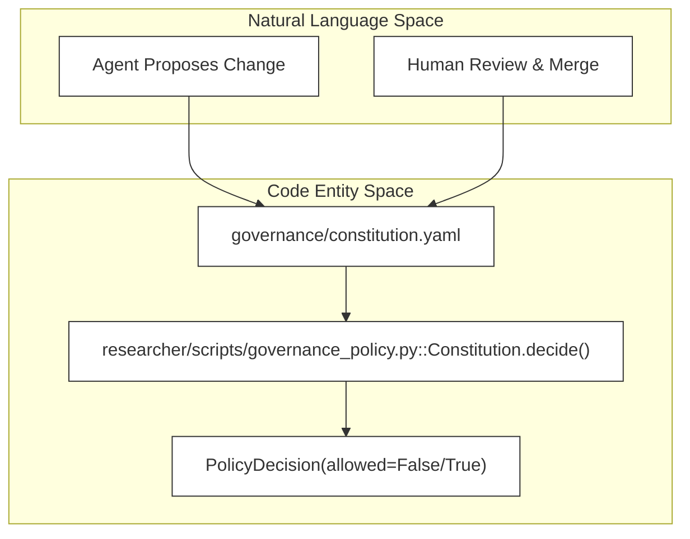
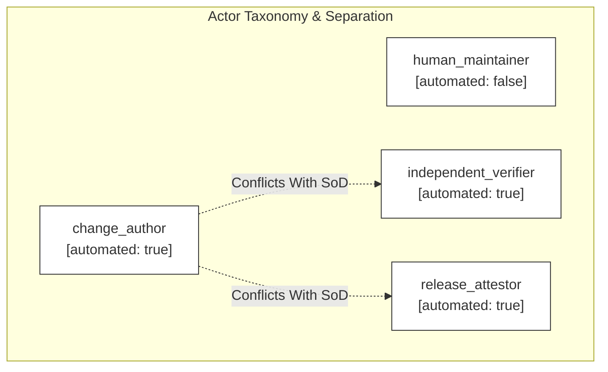
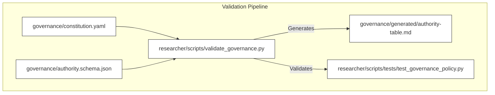

<!-- source: DeepWiki mcp.deepwiki.com · repo muratcankoylan/Agent-Skills-for-Context-Engineering · page 7.5 Governance: Machine-Testable Constitution · fetched 2026-10-26 -->

# Governance: Machine-Testable Constitution

Relevant source files

The following files were used as context for generating this wiki page:

- [.github/PULL_REQUEST_TEMPLATE/constitution-amendment.md](.github/PULL_REQUEST_TEMPLATE/constitution-amendment.md)
- [docs/decisions/0001-machine-testable-constitution.md](docs/decisions/0001-machine-testable-constitution.md)
- [docs/decisions/0003-allowlisted-public-projections.md](docs/decisions/0003-allowlisted-public-projections.md)
- [docs/decisions/README.md](docs/decisions/README.md)
- [docs/specs/SPEC-000-program-constitution.md](docs/specs/SPEC-000-program-constitution.md)
- [docs/specs/SPEC-002-public-private-boundary.md](docs/specs/SPEC-002-public-private-boundary.md)
- [governance/README.md](governance/README.md)
- [governance/authority.schema.json](governance/authority.schema.json)
- [governance/constitution.yaml](governance/constitution.yaml)
- [governance/export-policy.schema.json](governance/export-policy.schema.json)
- [governance/export-policy.yaml](governance/export-policy.yaml)
- [governance/fixtures/authority-decisions.jsonl](governance/fixtures/authority-decisions.jsonl)
- [governance/generated/authority-table.md](governance/generated/authority-table.md)
- [researcher/exports/README.md](researcher/exports/README.md)
- [researcher/runbooks/governance-amendment.md](researcher/runbooks/governance-amendment.md)
- [researcher/scripts/governance_policy.py](researcher/scripts/governance_policy.py)
- [researcher/scripts/tests/test_governance_policy.py](researcher/scripts/tests/test_governance_policy.py)
- [researcher/scripts/validate_governance.py](researcher/scripts/validate_governance.py)

This wiki page covers section 7.5 of the repository documentation, focusing on the `governance/` directory. It defines the machine-testable program constitution, deterministic policy evaluation, actor classes, protected repository surfaces, separation of duty rules, schemas, validation scripts, export boundaries, ADRs, specifications, and the constitutional amendment workflow.

Sources: `governance/README.md` [governance/README.md:1-20](), `docs/specs/SPEC-000-program-constitution.md` [docs/specs/SPEC-000-program-constitution.md:1-41]()

---

## 1. Constitutional Authority Model & `constitution.yaml`

The program operates under a versioned, machine-testable constitution stored at `governance/constitution.yaml` [governance/constitution.yaml:1-552](). Unlike traditional repositories where authority is expressed via scattered prose files or chat instructions, the constitution provides an explicit, machine-enforced governance model.

### Key Architectural Properties
- **Fail-Closed Default**: The default effect is strictly deny (`default_effect: deny`) [governance/constitution.yaml:5](). Any unlisted operation, missing actor, unknown action, or un-evaluated resource fails closed [researcher/scripts/governance_policy.py:4-7]().
- **Promotion Event**: Production promotion and merge events require a human-merged commit (`promotion_event: human_merged_commit`) [governance/constitution.yaml:6](). No automated agent class possesses merge authority.
- **Commit Pinning**: The effective commit uses the token `effective_commit: "$SELF"` [governance/constitution.yaml:4]() to reference the enclosing Git commit without requiring self-referential cryptographic hashes within the YAML file itself.

Sources: `governance/constitution.yaml` [governance/constitution.yaml:1-12](), `docs/decisions/0001-machine-testable-constitution.md` [docs/decisions/0001-machine-testable-constitution.md:1-35]()

---

## 2. Actor Classes & Separation of Duty

The constitution defines distinct actor classes with explicit automation flags and mutual conflict boundaries [governance/constitution.yaml:13-46](). 

### Actor Class Taxonomy
- `human_maintainer`: Non-automated (`automated: false`) [governance/constitution.yaml:14-16](). Sole actor permitted to merge pull requests, alter constitutional rules, or approve sensitive operations.
- `research_proposer` & `change_author`: Automated agent roles (`automated: true`) [governance/constitution.yaml:17-28]() configured to research, draft, propose changes, and push proposal branches. These roles explicitly conflict with `human_maintainer`, `independent_verifier`, and `release_attestor`.
- `independent_verifier`: Automated evaluation role [governance/constitution.yaml:29-33]() that checks candidate artifacts independently of their author.
- `release_attestor`: Automated attestation role [governance/constitution.yaml:34-38]() verifying candidate digests prior to release packaging.
- `runtime_operator`: Executes bounded work under valid capability grants [governance/constitution.yaml:39-42]().
- `community_contributor`: External human contributor role [governance/constitution.yaml:43-45]().

### Separation of Duty Rules
To prevent self-certification and conflation of duties, the constitution enforces strict separation of duty (SoD) constraints [governance/constitution.yaml:95-102]():
- A `change_author` cannot act as an `independent_verifier` or `release_attestor` [governance/constitution.yaml:96-99]().
- A `research_proposer` cannot act as an `independent_verifier` [governance/constitution.yaml:100-102]().

Sources: `governance/constitution.yaml` [governance/constitution.yaml:13-102]()

---

## 3. Protected Surfaces

Certain critical paths within the codebase are classified as protected surfaces [governance/constitution.yaml:86-94]() and are denied to ordinary automated agent proposals without explicit human review and constitutional amendment.

### Enumerate Protected Paths
- `governance/**`: The core constitution, schemas, and export definitions [governance/constitution.yaml:87]()
- `.github/workflows/**`: CI/CD automation pipelines [governance/constitution.yaml:88]()
- `.github/CODEOWNERS`: Repository ownership assignments [governance/constitution.yaml:89]()
- `researcher/rubrics/**`: Evaluation rubrics [governance/constitution.yaml:90]()
- `researcher/benchmarks/**/hidden/**`: Hidden evaluation datasets [governance/constitution.yaml:91]()
- `researcher/scripts/validate_*.py`: Policy and compliance validators [governance/constitution.yaml:92]()
- `researcher/scripts/run_benchmarks.py`: Benchmark runner script [governance/constitution.yaml:93]()

Sources: `governance/constitution.yaml` [governance/constitution.yaml:86-94](), `docs/specs/SPEC-000-program-constitution.md` [docs/specs/SPEC-000-program-constitution.md:1-41]()

---

## 4. Schemas & Generated Artifacts

The governance infrastructure relies on strict JSON schema definitions and auto-generated projection tables to ensure public auditability.

### Schema Interchange (`authority.schema.json`)
The schema at `governance/authority.schema.json` [governance/authority.schema.json:1-81]() enforces structural validity for constitutional YAML documents. It validates schema versioning (`schema_version`), constitution versions, actor class descriptors, strict rule objects with exact condition operators (`equals`, `not_equals`, `in`, `not_in`, `present`), and reason code formats (`^[A-Z][A-Z0-9_]+$`) [governance/authority.schema.json:23-74]().

### Generated Authority Table (`authority-table.md`)
The markdown table at `governance/generated/authority-table.md` [governance/generated/authority-table.md:1-53]() is automatically generated by the governance validation script and reflects all active rules, protected surfaces, and constitutional invariants.

Sources: `governance/authority.schema.json` [governance/authority.schema.json:1-81](), `governance/generated/authority-table.md` [governance/generated/authority-table.md:1-53]()

---

## 5. Executable Semantics & Validation (`governance_policy.py`)

Deterministic authorization logic is encapsulated in `researcher/scripts/governance_policy.py` [researcher/scripts/governance_policy.py:1-327]() and tested extensively via `researcher/scripts/tests/test_governance_policy.py` [researcher/scripts/tests/test_governance_policy.py:1-197]().

### Core Classes and Functions
- `Constitution`: Loads, parses, and validates YAML constitutions [researcher/scripts/governance_policy.py:70-100](). Enforces schema major version compatibility (`SUPPORTED_SCHEMA_MAJOR = 1`) [researcher/scripts/governance_policy.py:27]().
- `PolicyDecision`: Dataclass containing authorization outcomes (`allowed: bool`), matched rules, reason codes, and SHA-256 constitution digests [researcher/scripts/governance_policy.py:35-48]().
- `Constitution.decide(actor, action, resource, context)`: Evaluates matching allow/deny rules against supplied context conditions. Explicit deny rules take precedence over allow rules [governance/scripts/governance_policy.py:4-7]().

Sources: `researcher/scripts/governance_policy.py` [researcher/scripts/governance_policy.py:1-327](), `researcher/scripts/tests/test_governance_policy.py` [researcher/scripts/tests/test_governance_policy.py:1-197]()

---

## 6. Export Policy & Architectural Decisions (ADRs & SPECs)

Governance extends to data export controls and formal architectural records.

### Export Policy (`export-policy.yaml`)
`governance/export-policy.yaml` defines public projection boundaries, ensuring private metadata, credentials, and internal research artifacts are not inadvertently leaked during artifact exports.

### Associated ADRs and Specifications
- **ADR-0001**: Machine-testable, deny-by-default authority (`docs/decisions/0001-machine-testable-constitution.md`) [docs/decisions/0001-machine-testable-constitution.md:1-35](). Establishes the shift from prose-based rules to versioned YAML policies.
- **SPEC-000**: Program constitution and authority model (`docs/specs/SPEC-000-program-constitution.md`) [docs/specs/SPEC-000-program-constitution.md:1-41](). Outlines core invariants, lifecycle states (`draft -> reviewed -> merged -> effective -> superseded`), and decision interfaces.

Sources: `governance/export-policy.yaml` [governance/export-policy.yaml:1](), `docs/decisions/0001-machine-testable-constitution.md` [docs/decisions/0001-machine-testable-constitution.md:1-35](), `docs/specs/SPEC-000-program-constitution.md` [docs/specs/SPEC-000-program-constitution.md:1-41]()

---

## 7. Amendment Workflow & Runbook

Modifying constitutional authority requires strict adherence to the amendment protocol.

### Constitutional Amendment Runbook
1. **Branching**: Create a proposal branch from the default branch [.github/PULL_REQUEST_TEMPLATE/constitution-amendment.md:1-5](), [researcher/runbooks/governance-amendment.md:1-5]().
2. **Amendment**: Modify `governance/constitution.yaml`, increment `constitution_version`, and update corresponding ADRs/SPECs [.github/PULL_REQUEST_TEMPLATE/constitution-amendment.md:1-8](), [researcher/runbooks/governance-amendment.md:1-6]().
3. **Validation**: Execute `python researcher/scripts/validate_governance.py --write` to regenerate projections and run the full test suite [researcher/runbooks/governance-amendment.md:1-7]().
4. **Pull Request**: Open a PR using the `.github/PULL_REQUEST_TEMPLATE/constitution-amendment.md` template [researcher/runbooks/governance-amendment.md:1-8]().
5. **Human Review**: A human maintainer reviews the commit and merges only after checks pass [researcher/runbooks/governance-amendment.md:1-9](). Chat text is never a promotion event [researcher/runbooks/governance-amendment.md:1-9]().
6. **Emergency Disable**: In emergencies, operators use the `emergency_disable` action to stop dispatch without mutating historical authority [researcher/runbooks/governance-amendment.md:14-18]().

Sources: `.github/PULL_REQUEST_TEMPLATE/constitution-amendment.md` [.github/PULL_REQUEST_TEMPLATE/constitution-amendment.md:1-23](), `researcher/runbooks/governance-amendment.md` [researcher/runbooks/governance-amendment.md:1-18]()

---

