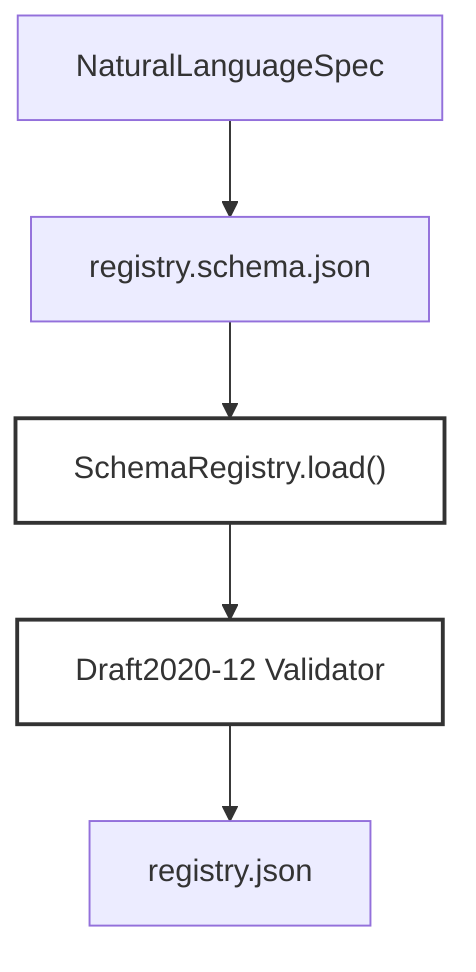
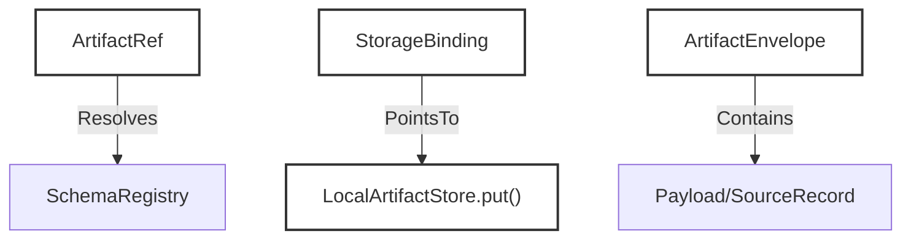

<!-- source: DeepWiki mcp.deepwiki.com · repo muratcankoylan/Agent-Skills-for-Context-Engineering · page 7.6 Schema Registry & Artifact Contracts · fetched 2026-10-26 -->

# Schema Registry & Artifact Contracts

Relevant source files

The following files were used as context for generating this wiki page:

- [.gitignore](.gitignore)
- [docs/decisions/0004-runtime-neutral-artifact-contracts.md](docs/decisions/0004-runtime-neutral-artifact-contracts.md)
- [docs/specs/SPEC-003-schema-registry.md](docs/specs/SPEC-003-schema-registry.md)
- [requirements-dev.txt](requirements-dev.txt)
- [researcher/artifacts/README.md](researcher/artifacts/README.md)
- [researcher/exports/schemas/export-records.schema.json](researcher/exports/schemas/export-records.schema.json)
- [researcher/runbooks/schema-migration.md](researcher/runbooks/schema-migration.md)
- [researcher/schemas/README.md](researcher/schemas/README.md)
- [researcher/schemas/fixtures/canonicalization-v1.json](researcher/schemas/fixtures/canonicalization-v1.json)
- [researcher/schemas/fixtures/records/artifact-envelope.json](researcher/schemas/fixtures/records/artifact-envelope.json)
- [researcher/schemas/fixtures/records/artifact-ref.json](researcher/schemas/fixtures/records/artifact-ref.json)
- [researcher/schemas/fixtures/records/storage-binding.json](researcher/schemas/fixtures/records/storage-binding.json)
- [researcher/schemas/generated/compatibility-matrix.md](researcher/schemas/generated/compatibility-matrix.md)
- [researcher/schemas/registry.json](researcher/schemas/registry.json)
- [researcher/schemas/registry.schema.json](researcher/schemas/registry.schema.json)
- [researcher/schemas/typescript/src/canonicalize.ts](researcher/schemas/typescript/src/canonicalize.ts)
- [researcher/schemas/typescript/src/conformance.ts](researcher/schemas/typescript/src/conformance.ts)
- [researcher/schemas/typescript/src/registry.ts](researcher/schemas/typescript/src/registry.ts)
- [researcher/schemas/typescript/src/semantics.ts](researcher/schemas/typescript/src/semantics.ts)
- [researcher/schemas/typescript/test/conformance.test.ts](researcher/schemas/typescript/test/conformance.test.ts)

## Purpose and Scope

Section 7.6 defines the v1 schema registry (`registry.json`, `registry.schema.json`) and runtime-neutral artifact contracts governing state exchange across agents, scripts, runtimes, and the private control plane [docs/specs/SPEC-003-schema-registry.md:1-11]. It details how durable records are validated, canonicalized using `jcs-rfc8785-integer-v1`, managed via `ArtifactRef`, `ArtifactEnvelope`, `StorageBinding`, and `CapabilityGrantSpec`, and tested through the TypeScript conformance library and schema migration runbook [docs/decisions/0004-runtime-neutral-artifact-contracts.md:1-24, researcher/schemas/README.md:1-16].

Sources: `docs/decisions/0004-runtime-neutral-artifact-contracts.md:1-24`, `docs/specs/SPEC-003-schema-registry.md:1-11`, `researcher/schemas/README.md:1-16`

---

## 1. Schema Registry Architecture & Lifecycle

The schema registry is anchored by `researcher/schemas/registry.json` and its structural meta-schema `researcher/schemas/registry.schema.json` [researcher/schemas/README.md:7-8]. Each registry entry pins its schema file digest, owner specification, lifecycle state, compatibility rules, classifications, and canonicalization profile [docs/specs/SPEC-003-schema-registry.md:17-18].

### Lifecycle States and Validation Rules
Schema versions progress through five discrete lifecycle states:
1. `draft`: Under authoring review; not permitted for production reads or writes.
2. `registered`: Cataloged in the registry with validated schema file digests but inactive execution bindings.
3. `active`: Authoritative for current writers and readers. Only a single writer version may be active per kind.
4. `deprecated`: Retained for backward-compatible reads; new writers are prohibited from emitting deprecated schemas [researcher/schemas/README.md:33-33].
5. `retired`: Completely deactivated; reads and writes fail closed.

The `SchemaRegistry.load()` routine meta-validates all registered schemas, verifies exact file digests, and constructs offline Draft 2020-12 validator instances [docs/specs/SPEC-003-schema-registry.md:41-41].

*Figure 1: Natural Language Specification to Code Entity Space for Schema Loading.*

Sources: `docs/specs/SPEC-003-schema-registry.md:17-41`, `researcher/schemas/README.md:7-36`, `researcher/schemas/registry.schema.json`

---

## 2. Core Artifact Contracts & Records

Durable state is encapsulated through explicit record contracts defined under `researcher/schemas/v1/` and export schemas under `researcher/exports/schemas/export-records.schema.json` [researcher/exports/schemas/export-records.schema.json:1-154, researcher/schemas/README.md:9-15].

### Key Record Types
- **`ArtifactEnvelope`**: Wraps native or legacy records. Native envelopes carry a complete target record in `payload`, whereas legacy envelopes carry a digest-bound source record validated via a registered legacy adapter [docs/specs/SPEC-003-schema-registry.md:18-18, researcher/schemas/fixtures/records/artifact-envelope.json:1-36].
- **`ArtifactRef`**: A portable reference containing no storage locators. It binds the target kind, version, typed-ID prefix, and native or legacy origin [docs/decisions/0004-runtime-neutral-artifact-contracts.md:23-23, researcher/schemas/fixtures/records/artifact-ref.json:1-18].
- **`StorageBinding`**: Private metadata mapping an `ArtifactRef` to its local content-addressed storage (CAS) locator [researcher/artifacts/README.md:1-5, researcher/schemas/fixtures/records/storage-binding.json:1-11].
- **`CapabilityGrantSpec` & `CredentialRef`**: Manage scope, audience, operation, and resource classification without exposing secret values or capability tokens [docs/specs/SPEC-003-schema-registry.md:24-24].
- **Export Records**: `ExportRequest`, `ExportPlan`, `ExportManifest`, `ExportValidation`, `ExportApproval`, `ExportReceipt`, `ExportRenderReceipt`, and `ExportCorrection` govern data egress boundaries [researcher/exports/schemas/export-records.schema.json:11-153].

*Figure 2: Artifact Reference, Storage Binding, and Envelope Relationships in Code Entity Space.*

Sources: `docs/decisions/0004-runtime-neutral-artifact-contracts.md:21-25`, `docs/specs/SPEC-003-schema-registry.md:28-38`, `researcher/artifacts/README.md:1-11`, `researcher/exports/schemas/export-records.schema.json:1-153`

---

## 3. JCS-RFC8785 Canonicalization & Security Profile

To ensure identical cryptographic hashes across runtimes (Python and TypeScript), the system implements `jcs-rfc8785-integer-v1`, an executable subset of RFC 8785 [docs/decisions/0004-runtime-neutral-artifact-contracts.md:17-17, researcher/schemas/README.md:19-27].

### Canonicalization Rules & Invariants
- **Strings**: Encoded in UTF-8 without Unicode normalization; lone surrogates and invalid sequences are rejected [researcher/schemas/README.md:21-21, researcher/schemas/fixtures/canonicalization-v1.json:51-51].
- **Object Keys**: Sorted lexicographically by UTF-16 code units [researcher/schemas/README.md:22-22, researcher/schemas/fixtures/canonicalization-v1.json:12-16].
- **Arrays**: Preserve their input order [researcher/schemas/README.md:23-23].
- **Numbers**: Restricted strictly to integers within the safe ECMAScript integer range (`-9007199254740991` to `9007199254740991`). Floats, negative zeros (`-0`), NaN, Infinity, and unsafe integers cause immediate failure with `UNSAFE_NUMBER` [docs/decisions/0004-runtime-neutral-artifact-contracts.md:17-17, researcher/schemas/README.md:24-25].
- **Duplicate Keys**: Denied with `DUPLICATE_KEY` [researcher/schemas/fixtures/canonicalization-v1.json:46-46].

Sources: `docs/decisions/0004-runtime-neutral-artifact-contracts.md:17-35`, `researcher/schemas/README.md:17-28`, `researcher/schemas/fixtures/canonicalization-v1.json:1-53`

---

## 4. TypeScript Conformance Library Implementation

The TypeScript conformance library under `researcher/schemas/typescript/` provides an independent, consumer-ready validation and canonicalization engine mirroring the Python reference implementation [researcher/schemas/README.md:13-13].

### Key Modules
- `canonicalize.ts`: Implements strict JCS-RFC8785 integer-profile serialization and cryptographic hashing.
- `registry.ts`: Loads and caches `registry.json` schemas, exposing `LoadedRuntimeRegistry` for compile-time validation.
- `semantics.ts`: Enforces post-schema validation rules, such as classification high-water marks and typed-ID prefix checks.
- `conformance.ts` & `conformance.test.ts`: Executes shared golden test fixtures (`canonicalization-v1.json`) to verify cross-language parity [researcher/schemas/README.md:34-36].

Sources: `researcher/schemas/README.md:13-36`, `researcher/schemas/fixtures/canonicalization-v1.json:1-53`

---

## 5. SPEC-003 & Schema Migration Runbook

Legacy claims, mechanisms, run states, and queue records migrate to versioned envelopes without in-place source mutations [docs/specs/SPEC-003-schema-registry.md:48-52, researcher/runbooks/schema-migration.md:1-12].

### Migration, Quarantine, and Rollback Operations
- **Dry Run**: Executed via migration tools (`migrate_legacy.py --dry-run --json`) to evaluate source records against public manifests (`public-legacy-sources.json`) without altering files [researcher/runbooks/schema-migration.md:3-8].
- **Quarantine**: Malformed records, unknown kinds, or unsupported major versions are isolated into typed quarantine entries (`MIGRATION_ID_COLLISION`, `SCHEMA_VIOLATION`) without generating private payload leaks [researcher/runbooks/schema-migration.md:18-20].
- **Rollback**: `rollback_envelope()` validates embedded source digests and restores prior writer/reader routing configurations [researcher/runbooks/schema-migration.md:22-25].

Sources: `docs/specs/SPEC-003-schema-registry.md:41-53`, `researcher/runbooks/schema-migration.md:1-27`, `researcher/schemas/README.md:39-51`

---

