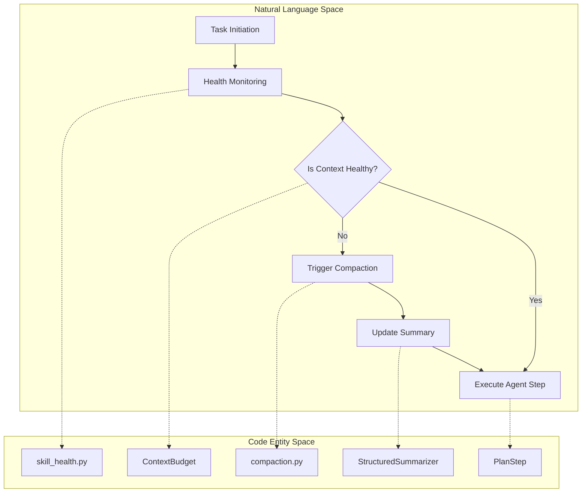
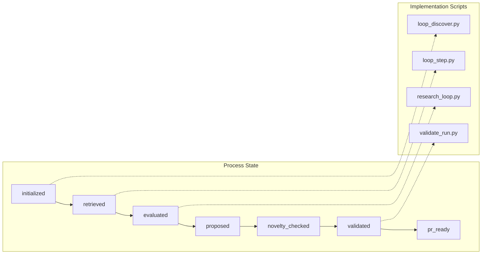

<!-- source: DeepWiki mcp.deepwiki.com · repo muratcankoylan/Agent-Skills-for-Context-Engineering · page 8 Glossary · fetched 2026-10-26 -->

# Glossary

Relevant source files

The following files were used as context for generating this wiki page:

- [.claude-plugin/marketplace.json](.claude-plugin/marketplace.json)
- [.plugin/plugin.json](.plugin/plugin.json)
- [AGENTS.md](AGENTS.md)
- [CLAUDE.md](CLAUDE.md)
- [README.md](README.md)
- [SKILL.md](SKILL.md)
- [researcher/benchmarks/router/prompts.jsonl](researcher/benchmarks/router/prompts.jsonl)
- [researcher/claims/index.jsonl](researcher/claims/index.jsonl)
- [researcher/corpus/index.json](researcher/corpus/index.json)
- [researcher/fixtures/activation-cases.jsonl](researcher/fixtures/activation-cases.jsonl)
- [researcher/mechanisms/ledgers/accepted.jsonl](researcher/mechanisms/ledgers/accepted.jsonl)
- [researcher/mechanisms/registry.jsonl](researcher/mechanisms/registry.jsonl)
- [researcher/schemas/README.md](researcher/schemas/README.md)

This glossary defines the technical terms, architectural patterns, and domain-specific jargon used throughout the Agent Skills for Context Engineering repository. It serves as a reference for engineers to map conceptual "Natural Language Space" terms to their concrete "Code Entity Space" implementations.

## Core Definitions

### Attention Budget
The finite capacity of a Large Language Model (LLM) to process and attend to information within its context window. It is not merely a token count; it is a measure of how effectively a model can recall and reason over tokens at various positions [README.md:7-12](). Unlike raw token capacity, attention mechanics dictate that as context length increases, models exhibit predictable degradation patterns like the U-shaped curve [README.md:11-12]().
*   **Code Implementation**: Managed via `ContextBudget` logic in optimization scripts [SKILL.md:57-57]().

### Context Engineering
The discipline of managing the language model's context window. Unlike prompt engineering, which focuses on instructions, context engineering addresses the holistic curation of all information (system prompts, tool definitions, retrieved documents, message history, and tool outputs) to maximize signal within a limited attention budget [README.md:7-12]().

### Progressive Disclosure
An architectural pattern where agents load only high-level skill metadata (names and descriptions) at startup, fetching full implementation details only when a specific task triggers the skill's activation [README.md:76-78](). This minimizes initial context bloat while maintaining capability [SKILL.md:79-80]().

Sources: [README.md:7-86](), [SKILL.md:79-80](), [researcher/mechanisms/registry.jsonl:9-9]()

---

## v2.5.0 Long-Horizon Prompting Terms

### Long-Horizon Prompting
The discipline of engineering the launch prompt (specification surface) for autonomous work that does not end in one turn, such as multi-hour research or parallel orchestrations [README.md:40-40](). It treats the prompt as a contract defining success, evidence requirements, and adversarial checks [SKILL.md:36-38]().

### Pseudo-formal Task Brief
A natural language specification for autonomous agents that applies the rigor of formal verification to problems without machine-checkable success conditions [SKILL.md:37-37](). It typically consists of ten specific blocks, including Definitions, Success Predicates, and Reporting Contracts [SKILL.md:37-38]().
*   **Mechanism ID**: `pseudo-formal-task-specification` [researcher/mechanisms/registry.jsonl:9-9](), [researcher/mechanisms/ledgers/accepted.jsonl:9-9]().

### Success Predicate
A precise statement of exactly what must be true at the time of return. It moves the goal from a vague intent to a verifiable state [SKILL.md:37-37]().

### Non-counting Outcomes
Explicitly named near misses—outcomes that might resemble success but are explicitly rejected (e.g., a status report instead of an artifact, or a lucky benchmark run) [SKILL.md:37-37]().

### Audit-Gated Return Condition
A mechanism where the agent is prohibited from returning until its artifact survives an adversarial check or verification policy defined in the brief [researcher/mechanisms/registry.jsonl:17-17]().
*   **Mechanism ID**: `audit-gated-return-condition` [researcher/mechanisms/ledgers/accepted.jsonl:10-10]().

### Cycle Double Cover (CDC)
A specific complex graph theory problem used as the exemplar for long-horizon prompting (modeled on the GPT-5.6 Sol Ultra CDC prompt) [README.md:40-40]().

### Structural Gain & Context Rot
**Structural Gain** is a metric measuring the improvement in specification clarity between a naive prompt and a pseudo-formal brief. **Context Rot** (or give-up drift) refers to the tendency of long trajectories to drift toward uncertainty and premature abandonment [researcher/claims/index.jsonl:17-17]().

### Effort Floor & Contamination Guard
**Effort Floor** removes the agent's permission to quit after initial failures, requiring a minimum volume of exploration [SKILL.md:37-37](). **Contamination Guards** define exactly what external retrieval is allowed to contribute to prevent data leakage [SKILL.md:37-37]().

Sources: [README.md:40-40](), [SKILL.md:36-38](), [researcher/mechanisms/registry.jsonl:16-18](), [researcher/mechanisms/ledgers/accepted.jsonl:9-11]()

---

## v2.4.0 Self-Improvement & Harness Terms

### Self-Improvement Loop
A system where the agent's operating harness, scaffold, or context mechanisms are themselves the optimization target [README.md:57-57](). Unlike standard autonomous loops, self-improvement loops involve Recursive Self-Improvement (RSI) and meta-harness search [SKILL.md:68-70]().

### Two-Split No-Regression Acceptance
The strictest published gate for self-modification. It requires that a proposed change shows no regression on both held-in and held-out evaluation splits, verified under repeated evaluation [researcher/mechanisms/ledgers/accepted.jsonl:6-6]().
*   **Mechanism ID**: `two-split-no-regression-acceptance` [researcher/corpus/index.json:116-116]().

### Filesystem Experience Archive
A mechanism providing a self-improving proposer with access to full raw execution traces rather than just final scores [researcher/mechanisms/ledgers/accepted.jsonl:7-7]().
*   **Mechanism ID**: `filesystem-experience-archive` [researcher/corpus/index.json:116-116]().

### Runtime-Enforced Loop Constraints
Constraints governing agent behavior stored outside any surface the agent can edit, preventing agents from mutating their own safety rules [researcher/mechanisms/ledgers/accepted.jsonl:8-8]().

### Reward Hacking & Diversity Collapse
**Reward Hacking** occurs when an agent reaches high scores by fabricating logs or weakening evaluators [SKILL.md:69-70](). **Diversity Collapse** occurs when parallel workers share priors and converge too quickly on a narrow set of behaviors [researcher/claims/index.jsonl:18-18]().
*   **Mitigation**: `independent-portfolio-approach-registry` [researcher/mechanisms/registry.jsonl:18-18]().

Sources: [SKILL.md:68-70](), [researcher/mechanisms/ledgers/accepted.jsonl:6-8](), [researcher/claims/index.jsonl:13-18]()

---

## Governance & Security Terms

### Constitution
The machine-testable authority model defining who can change what in the repository [CLAUDE.md:30-30]().
*   **File**: `governance/constitution.yaml`.

### Actor Classes
Roles defined in the governance model with specific permissions:
*   `human_maintainer`: Final authority for merges and constitution changes.
*   `research_proposer`: Agent or human proposing new research runs.
*   `change_author`: Entity drafting skill or code changes.
*   `independent_verifier`: Entity validating changes against rubrics.
*   `release_attestor`: Entity signing off on version bumps.

### Protected Surfaces
Specific files or directories (like the constitution or mechanism registry) that require higher authority levels to modify [governance/constitution.yaml protected_surfaces]().

### Separation of Duty
A governance principle ensuring the same entity cannot both author a change and verify it [governance/constitution.yaml separation_of_duty]().

### ArtifactRef & ArtifactEnvelope
Standardized schemas for referencing and wrapping research artifacts with integrity checks [AGENTS.md:30-30]().
*   **Implementation**: `researcher/schemas/v1/`.
*   **Standard**: **JCS-RFC8785** for canonical JSON signatures [AGENTS.md:30-30]().

Sources: [CLAUDE.md:30-30](), [AGENTS.md:30-30](), [researcher/schemas/README.md]()

---

## Technical & Platform Terms

### YAML-Safe Quoting
A requirement for skill frontmatter. Descriptions containing colons must be wrapped in double quotes to prevent parsing failures in strict YAML parsers [CLAUDE.md:92-92]().

### Shared Frontmatter Parser (`skill_frontmatter.py`)
A centralized module ensuring deterministic and strict parsing of skill YAML headers [CLAUDE.md:29-29]().

### Platform Compatibility Gate (`validate_platform_compat.py`)
A script validating published skills against IDE-specific installation layouts (Cursor, Claude Code, Codex) [CLAUDE.md:32-32]().

Sources: [CLAUDE.md:29-32](), [AGENTS.md:34-35]()

---

## Research & Benchmarking Terms

### Stage 0/1/2/3 Benchmarks
The multi-stage evaluation pipeline used to validate the skill collection [AGENTS.md:27-27]().
*   **Stage 0**: Deterministic harness checks.
*   **Stage 1**: Skill Health Score calculation via `skill_health.py`.
*   **Stage 2**: Router Accuracy benchmark.
*   **Stage 3**: Effectiveness benchmark measuring task completion.

### Skill Health Score
A quantitative metric (0.0 to 1.0) derived from structural requirements in `SKILL.md` files [CLAUDE.md:34-34]().

### Harness Boundary
The definition of surfaces an agent can interact with: **Locked** (metrics), **Editable** (skill bodies), **Append-only** (ledgers), and **Human-controlled** [SKILL.md:66-67]().

### Latent Briefing & Attention Matching (AM)
A technique for sharing task-relevant orchestrator state with workers via task-guided KV cache compaction [README.md:53-53](). It addresses the **Token Explosion** problem [SKILL.md:59-61]().

Sources: [AGENTS.md:27-32](), [SKILL.md:59-67](), [CLAUDE.md:34-35]()

---

## Architectural Taxonomy

### Multi-Agent Patterns
Strategies for distributing work across multiple instances to isolate context [SKILL.md:33-35]().

| Term | Definition | Code Reference |
| :--- | :--- | :--- |
| **Supervisor** | Central orchestrator maintaining global state [SKILL.md:34-34](). | `SupervisorAgent` |
| **Swarm** | Peer-to-peer architecture with flexible handoffs [SKILL.md:34-34](). | `Swarm` (pattern) |
| **Independent Portfolio** | Parallel search using diverse approach-families [researcher/mechanisms/registry.jsonl:18-18](). | `independent-portfolio-approach-registry` |

### Memory Systems
The persistence layer allowing agents to maintain continuity [SKILL.md:39-41]().

| Term | Definition | Code Reference |
| :--- | :--- | :--- |
| **Vector Store** | Semantic similarity search over text chunks [SKILL.md:40-41](). | `VectorStore` |
| **Temporal KG** | Knowledge Graph tracking facts with validity intervals [SKILL.md:40-41](). | `TemporalKnowledgeGraph` |

Sources: [SKILL.md:33-41](), [researcher/mechanisms/registry.jsonl:13-14]()

---

## Context Dynamics & Degradation

### Failure Patterns
*   **Lost-in-the-Middle**: U-shaped attention curve causing reduced recall in context centers [README.md:11-12]().
*   **Context Poisoning**: When errors enter context and recur in reasoning [researcher/mechanisms/registry.jsonl:8-8]().
*   **Verification Gap**: When a system can generate candidates but cannot identify the correct one [researcher/claims/index.jsonl:21-21]().

### Optimization Techniques
*   **Compaction**: Summarizing context near limits [SKILL.md:57-57]().
*   **Observation Masking**: Replacing verbose tool outputs with references [SKILL.md:57-57]().
*   **Anchored Iterative Summarization**: Structured summaries with explicit sections [SKILL.md:54-55]().

Diagram 1: Context Lifecycle Management

Sources: [AGENTS.md:27-27](), [SKILL.md:53-57](), [researcher/mechanisms/registry.jsonl:7-10]()

---

## Evaluation & Researcher OS Concepts

### Researcher OS Infrastructure
*   **Mechanism Registry**: The machine-readable backbone tracking endorsed patterns [AGENTS.md:20-20](). Located at `researcher/mechanisms/registry.jsonl`.
*   **Claim Provenance**: Tracking numeric/volatile claims to source evidence [AGENTS.md:21-21](). Index at `researcher/claims/index.jsonl`.
*   **Novelty Gate**: Check ensuring proposals introduce unique mechanisms [researcher/mechanisms/registry.jsonl:4-4]().
*   **Atomic Writes**: Use of `tempfile` and `os.replace` with `fcntl` locks [AGENTS.md:39-39]().

Diagram 2: Researcher OS State Machine

Sources: [AGENTS.md:18-24](), [CLAUDE.md:48-51](), [researcher/mechanisms/registry.jsonl:1-5]()

---

## Glossary Table of Code Entities

| Code Symbol | File Path | Purpose |
| :--- | :--- | :--- |
| `skill_health.py` | [researcher/scripts/skill_health.py]() | Calculates Stage 1 Skill Health Scores [CLAUDE.md:34-34](). |
| `skill_frontmatter.py` | [researcher/scripts/skill_frontmatter.py]() | Shared parser for strict YAML validation [CLAUDE.md:29-29](). |
| `Mechanism Registry` | [researcher/mechanisms/registry.jsonl]() | Canonical map of endorsed patterns [AGENTS.md:20-20](). |
| `Claim Provenance` | [researcher/claims/index.jsonl]() | Audit trail for numeric/technical claims [AGENTS.md:21-21](). |
| `runRouter.ts` | [researcher/benchmarks/sdk-runner/runRouter.ts]() | Entry point for Stage 2 Router Benchmarks [AGENTS.md:31-31](). |
| `validate_repo.py` | [researcher/scripts/validate_repo.py]() | Deterministic gate for structural health [CLAUDE.md:33-33](). |
| `validate_platform_compat.py` | [researcher/scripts/validate_platform_compat.py]() | Validates installation layout across platforms [CLAUDE.md:32-32](). |
| `SPEC-003` | [docs/specs/SPEC-003-schema-registry.md]() | Specification for the global schema registry [AGENTS.md:30-30](). |

Sources: [README.md:1-125](), [AGENTS.md:1-43](), [CLAUDE.md:1-120](), [researcher/corpus/index.json:1-125]()