# Page: Overview: Agent Skills for Context Engineering

# Overview: Agent Skills for Context Engineering

<details>
<summary>Relevant source files</summary>

The following files were used as context for generating this wiki page:

- [.claude-plugin/marketplace.json](.claude-plugin/marketplace.json)
- [.plugin/plugin.json](.plugin/plugin.json)
- [AGENTS.md](AGENTS.md)
- [CHANGELOG.md](CHANGELOG.md)
- [CLAUDE.md](CLAUDE.md)
- [README.md](README.md)
- [SKILL.md](SKILL.md)
- [researcher/insights/auto-research-experiment.md](researcher/insights/auto-research-experiment.md)
- [researcher/insights/how-we-built-this.md](researcher/insights/how-we-built-this.md)

</details>


The **Agent Skills for Context Engineering** repository is a comprehensive, open collection of 17 modular "skills" designed to teach AI agents how to manage their own context windows and operating loops. While prompt engineering focuses on crafting instructions, **context engineering** addresses the holistic curation of all information—system prompts, tool definitions, retrieved documents, message history, and tool outputs—to maximize an agent's constrained "attention budget" [README.md:7-12]().

This repository serves as a **Claude Code Plugin Marketplace**, allowing tools like Claude Code to automatically discover and activate specific engineering principles based on the current task [README.md:90-93](). It is academically recognized as foundational work on **static skill architecture**, cited by Peking University (2025) and a multi-institutional survey (2026) for bridging manual skill engineering and autonomous self-improvement [README.md:15-20]().

## System Architecture & Skill Discovery

The repository follows a **Progressive Disclosure** pattern. At startup, agents load only high-level skill names and descriptions. The full technical content of a skill is only "activated" when the agent encounters a relevant task, such as diagnosing "lost-in-the-middle" issues or designing a multi-agent supervisor [README.md:76-79]().

### Plugin Infrastructure

The architecture is governed by manifests that allow for seamless integration into Open Plugins-conformant tools. Updated for v2.5.0, these manifests manage 17 published skills and ensure strict cross-platform compatibility through YAML-safe quoting and shared parsing logic [CHANGELOG.md:5-22](), [CHANGELOG.md:46-50]().

*   `.claude-plugin/marketplace.json`: Defines the `context-engineering-marketplace` (v2.5.0) and bundles all 17 skills into a single installable plugin (`context-engineering`) [.claude-plugin/marketplace.json:1-38]().
*   `.plugin/plugin.json`: Provides the Open Plugins format metadata (v2.5.0) [.plugin/plugin.json:1-9]().
*   `SKILL.md` (Root): Serves as the primary entry point and skill map for the entire collection, updated for long-horizon prompting [SKILL.md:1-87]().
*   `CLAUDE.md`: Provides project-specific guidance and rules for the Claude Code environment [CLAUDE.md:1-125]().

### From Natural Language to Code Entities: Skill Activation

The following diagram bridges natural language prompt inputs in the user space to specific skill directory structures and python validation scripts in the codebase.

**Diagram: Skill Activation and Parser Mapping**
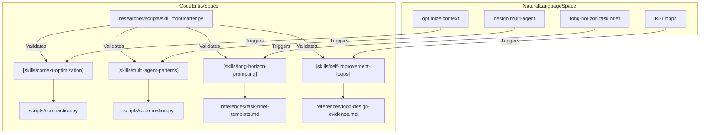
Sources: [README.md:120-135](), [CHANGELOG.md:9-13](), [SKILL.md:36-38](), [SKILL.md:68-70]()

## The 17-Skill Taxonomy (v2.5.0)

The collection is organized into functional categories, newly expanded in v2.5.0 to include `long-horizon-prompting` as the seventeenth skill [CHANGELOG.md:9-14]().

| Category | Skills |
| :--- | :--- |
| **Foundational** | `context-fundamentals`, `context-degradation`, `context-compression` |
| **Architectural** | `multi-agent-patterns`, `long-horizon-prompting`, `memory-systems`, `tool-design`, `filesystem-context`, `hosted-agents` |
| **Operational** | `context-optimization`, `latent-briefing`, `evaluation`, `advanced-evaluation`, `harness-engineering`, `self-improvement-loops` |
| **Development** | `project-development`, `bdi-mental-states` |

Sources: [README.md:21-73](), [.claude-plugin/marketplace.json:17-35](), [CHANGELOG.md:5-22]()

## Core Engineering Patterns

The repository promotes several advanced patterns for managing agentic state and attention:

1.  **Long-Horizon Prompting**: Utilizing pseudo-formal task briefs with exact success predicates and audit-gated return conditions for long-running agents [SKILL.md:36-38](), [CHANGELOG.md:9-13]().
2.  **Self-Improvement Loops**: Building loops where the harness itself is the optimization target, utilizing Recursive Self-Improvement (RSI) and evolutionary scaffold search [SKILL.md:68-70](), [CHANGELOG.md:27-32]().
3.  **Latent Briefing (KV Memory Sharing)**: Sharing orchestrator trajectory with workers via task-guided KV cache compaction (Attention Matching) [SKILL.md:59-61]().
4.  **Harness Engineering**: Designing autonomous operating loops with locked metrics, durable logs, and novelty gates [SKILL.md:65-67](), [README.md:55-57]().

### From Task Input to Researcher OS Execution

The following diagram bridges high-level research objectives to the file-based state machine and deterministic validation gates within the execution space.

**Diagram: Researcher OS State Machine and Validation Gates**
```mermaid
graph LR
  subgraph "InputSpace"
    IN[""researcher/queue/inbox.jsonl""]
  end

  subgraph "CodeEntitySpace"
    IN -- "loop_step.py" --> RUN[""researcher/runs/run-id/run-state.json""]
    RUN -- "validate_run.py" --> PR[""PR_Ready""]
    
    subgraph "DeterministicGates"
      V_COMPAT[""researcher/scripts/validate_platform_compat.py""]
      V_REPO[""researcher/scripts/validate_repo.py""]
      V_SKILL[""researcher/scripts/skill_health.py""]
      V_ACT[""researcher/scripts/check_activation_cases.py""]
    end
    
    PR --> V_COMPAT
    V_COMPAT --> V_REPO
    V_REPO --> V_SKILL
    V_SKILL --> V_ACT
  end

  V_ACT -- "Promote" --> SKILLS["skills/SKILL.md"]
  SKILLS -- "NewClaim" --> C_IDX["researcher/claims/index.jsonl"]
  SKILLS -- "NewMech" --> M_REG["researcher/mechanisms/registry.jsonl"]
```
Sources: [AGENTS.md:16-22](), [CHANGELOG.md:17-21](), [README.md:118-119]()

## Navigation & Child Pages

This wiki is structured to lead you from installation to advanced autonomous research.

*   **[Getting Started: Installation & Plugin Setup](#1.1)**: Step-by-step guide for installing the skill collection (v2.5.0) in Claude Code, Cursor, and other tools. Covers directory-based install paths and the `validate_platform_compat.py` gate [CHANGELOG.md:50-54](), [README.md:94-119]().
*   **[Skill Authoring Guide](#1.2)**: How to create and maintain skills using the `template/SKILL.md` blueprint and YAML-safe quoting requirements. Covers the 19-test frontmatter regression suite [CHANGELOG.md:46-48](), [CLAUDE.md:85-103]().
*   **Core Context Engineering Concepts**: Deep dives into foundational skills (Section 2).
*   **Agent Architecture Patterns**: Detailed coverage of multi-agent, memory systems, and long-horizon prompting (Section 3).
*   **Tool Design, Project Development & Harness Skills**: Covers tool-design, project-development, harness-engineering, and `self-improvement-loops` (Section 4).
*   **Evaluation Frameworks**: Measuring agent quality and bias mitigation (Section 5).
*   **Example Projects**: Six complete implementations, including the `long-horizon-prompt-lab` and `digital-brain-skill` [README.md:5-5](), [CHANGELOG.md:21-22]().
*   **Researcher Operating System**: The autonomous research-to-skill pipeline and benchmarking results (Gemini 0.920, Composer 0.913). Covers the state machine and the v2.5.0 research run for long-horizon prompting [AGENTS.md:23-30](), [CHANGELOG.md:17-21]().

For a full list of terminology, including **Pseudo-formal Task Brief** and **Audit-Gated Return Condition**, see the **[Glossary](#8)**.

Sources: [README.md:88-119](), [SKILL.md:75-87](), [CHANGELOG.md:5-23](), [AGENTS.md:1-41]()

---

# Page: Getting Started: Installation & Plugin Setup

# Getting Started: Installation & Plugin Setup

<details>
<summary>Relevant source files</summary>

The following files were used as context for generating this wiki page:

- [.claude-plugin/marketplace.json](.claude-plugin/marketplace.json)
- [.plugin/plugin.json](.plugin/plugin.json)
- [AGENTS.md](AGENTS.md)
- [CLAUDE.md](CLAUDE.md)
- [README.md](README.md)
- [SKILL.md](SKILL.md)
- [researcher/scripts/skill_frontmatter.py](researcher/scripts/skill_frontmatter.py)
- [researcher/scripts/skill_health.py](researcher/scripts/skill_health.py)
- [researcher/scripts/tests/test_skill_frontmatter.py](researcher/scripts/tests/test_skill_frontmatter.py)
- [researcher/scripts/validate_platform_compat.py](researcher/scripts/validate_platform_compat.py)

</details>


## Purpose and Scope

This page provides a technical guide for installing, configuring, and verifying the **Agent Skills for Context Engineering** collection. Designed as an Open Plugins-conformant resource, the repository integrates into AI-native developer environments including Claude Code, Cursor, Codex, and GitHub Copilot [CLAUDE.md:5-8](). 

The installation process leverages a **Progressive Disclosure** architecture, where agents load metadata (names and descriptions) during startup and fetch full skill contents only when specific triggers match the task context [README.md:76-79](). This document covers marketplace manifests, directory-based installation paths, activation triggers, platform configuration files (`CLAUDE.md` and `AGENTS.md`), YAML-safe frontmatter quoting [researcher/scripts/skill_frontmatter.py:136-141](), and the platform compatibility validation gate [researcher/scripts/validate_platform_compat.py:1-13]().

Sources: [README.md:76-79](), [CLAUDE.md:5-8](), [researcher/scripts/skill_frontmatter.py:136-141](), [researcher/scripts/validate_platform_compat.py:1-13]()

---

## Plugin Architecture & Manifests

The collection uses two manifest files to define how agentic platforms discover and bundle skills. Updated for **v2.5.0**, these manifests support 17 published skills across the repository [.claude-plugin/marketplace.json:9-35](), [.plugin/plugin.json:4-4]().

### 1. Claude Code Marketplace Manifest
The `.claude-plugin/marketplace.json` file registers the repository as a marketplace source, bundling all 17 skills into a single plugin named `context-engineering` [.claude-plugin/marketplace.json:2-35](). 

**Design Note on Bundling:** 
Distributing skills as a single bundled plugin optimizes cache performance. Claude Code caches each plugin source directory separately; bundling prevents redundant multi-repository clones that would occur if each skill were registered as an independent plugin [CLAUDE.md:118-120]().

### 2. Open Plugins Manifest
The `.plugin/plugin.json` file adheres to the Open Plugins specification, providing cross-platform compatibility for Cursor, Amp, Letta, Goose, and OpenAI Codex [CLAUDE.md:7-7](). The manifest points to the root `skills/` directory for automated discovery [.plugin/plugin.json:8-8]().

### System Data Flow: Installation to Activation

**Plugin Discovery and Activation Flow**
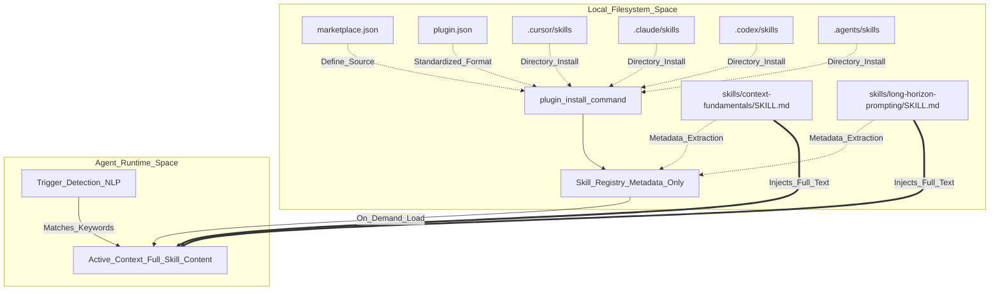
Sources: [README.md:90-119](), [CLAUDE.md:118-120](), [.claude-plugin/marketplace.json:11-37](), [researcher/scripts/validate_platform_compat.py:31-36](), [.plugin/plugin.json:1-9]()

---

## Installation Procedures

### Claude Code Installation
To install the collection inside Claude Code, register the marketplace and install the unified plugin via the CLI:

1. **Add the Marketplace Source:**
   ```bash
   /plugin marketplace add muratcankoylan/Agent-Skills-for-Context-Engineering
   ```
   [README.md:98-102]()

2. **Install the Plugin Collection:**
   ```bash
   /plugin install context-engineering@context-engineering-marketplace
   ```
   [README.md:114-116]()

### Directory-Based Installation (Cursor, Codex, etc.)
For platforms supporting local skill discovery without a marketplace daemon, copy or symlink the individual skill directories from `skills/` into the target platform directories located in your project root [researcher/scripts/validate_platform_compat.py:31-36]():
* `.cursor/skills/`
* `.claude/skills/`
* `.codex/skills/`
* `.agents/skills/`

Sources: [README.md:90-117](), [researcher/scripts/validate_platform_compat.py:31-36]()

---

## Skill Activation Triggers & YAML-Safe Quoting

Skills activate when user intent matches the description defined in the YAML frontmatter of each `SKILL.md`. To prevent parsing failures caused by unquoted colons or special characters in skill descriptions, the codebase uses `format_frontmatter` to enforce JSON-encoded string quoting [researcher/scripts/skill_frontmatter.py:136-141]().

| Skill Directory | Primary Activation Triggers & Purpose |
| :--- | :--- |
| `context-fundamentals` | Establishing context mental models, anatomy of context, attention budgets [README.md:29]() |
| `context-degradation` | Diagnosing attention failures, lost-in-middle, poisoning, and context clash [README.md:30]() |
| `context-compression` | Designing and evaluating summarization and compression strategies [README.md:31]() |
| `context-optimization` | Applying compaction, observation masking, and prefix caching [README.md:52]() |
| `latent-briefing` | KV cache sharing between orchestrator and worker agents [README.md:53]() |
| `multi-agent-patterns` | Configuring supervisor, swarm, and hierarchical multi-agent teams [README.md:39]() |
| `long-horizon-prompting` | Writing pseudo-formal task briefs for long-running autonomous runs [README.md:40]() |
| `memory-systems` | Designing vector stores, property graphs, and tiered memory architectures [README.md:41]() |
| `tool-design` | Building consolidated, robust agent tools and actionable error handlers [README.md:42]() |
| `filesystem-context` | Using filesystems for plan persistence, scratchpads, and dynamic discovery [README.md:43]() |
| `hosted-agents` | Configuring sandboxed VMs, background coding agents, and warm pools [README.md:44]() |
| `bdi-mental-states` | Transforming RDF context into BDI (Beliefs, Desires, Intentions) states [README.md:73]() |
| `harness-engineering` | Designing autonomous harnesses with locked metrics and novelty gates [README.md:56]() |
| `self-improvement-loops` | Implementing recursive self-improvement and evolutionary scaffold search [README.md:57]() |
| `project-development` | Designing idempotent five-stage pipelines and task-model fit analysis [README.md:65]() |
| `evaluation` | Building multi-dimensional evaluation rubrics and process metrics [README.md:54]() |
| `advanced-evaluation` | Mastering LLM-as-a-Judge direct scoring, pairwise comparison, and bias mitigation [README.md:55]() |

Sources: [README.md:29-73](), [.claude-plugin/marketplace.json:18-34](), [researcher/scripts/skill_frontmatter.py:136-141]()

---

## Configuration & Environment Setup (`CLAUDE.md` / `AGENTS.md`)

Repository behavior and agent workspace memory are governed by root configuration files:
* **`CLAUDE.md`**: Directs Claude Code when navigating repository structure, running deterministic gates, and adhering to skill authoring rules [CLAUDE.md:1-22]()
* **`AGENTS.md`**: Workspace memory defining learned user preferences (e.g., CTO technical tone, prohibition of unapproved pushes, strict adherence to evidence-backed validation) [AGENTS.md:1-13]()

Sources: [CLAUDE.md:1-22](), [AGENTS.md:1-13]()

---

## Compatibility Gates & Verification (`validate_platform_compat.py`)

To guarantee that corpus modifications do not break cross-platform discovery, the validation pipeline executes automated compatibility checks [CLAUDE.md:26-37]().

### 1. Frontmatter Parser & Regression Suite
The shared parser in `researcher/scripts/skill_frontmatter.py` parses YAML headers and validates required fields [researcher/scripts/skill_frontmatter.py:43-70](). It is guarded by unit tests in `researcher/scripts/tests/test_skill_frontmatter.py` [CLAUDE.md:29-29]().

### 2. Platform Compatibility Gate
The script `researcher/scripts/validate_platform_compat.py` simulates directory-based install layouts across Cursor, Claude, and Codex roots, verifying manifest parity between `.plugin/plugin.json` and `.claude-plugin/marketplace.json` [researcher/scripts/validate_platform_compat.py:78-158]().

**Configuration to Code Entity Mapping**
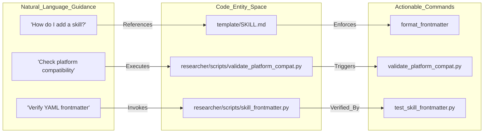
Sources: [CLAUDE.md:26-37](), [researcher/scripts/validate_platform_compat.py:1-13](), [researcher/scripts/skill_frontmatter.py:1-8](), [CLAUDE.md:87-104]()

---

# Page: Skill Authoring Guide

# Skill Authoring Guide

<details>
<summary>Relevant source files</summary>

The following files were used as context for generating this wiki page:

- [researcher/scripts/skill_frontmatter.py](researcher/scripts/skill_frontmatter.py)
- [researcher/scripts/skill_health.py](researcher/scripts/skill_health.py)
- [researcher/scripts/tests/test_skill_frontmatter.py](researcher/scripts/tests/test_skill_frontmatter.py)
- [researcher/scripts/validate_platform_compat.py](researcher/scripts/validate_platform_compat.py)
- [skills/context-fundamentals/SKILL.md](skills/context-fundamentals/SKILL.md)
- [skills/project-development/SKILL.md](skills/project-development/SKILL.md)
- [skills/tool-design/SKILL.md](skills/tool-design/SKILL.md)
- [template/SKILL.md](template/SKILL.md)

</details>


This guide provides the technical specifications and procedural requirements for creating, structuring, and maintaining new skills within the Agent Skills for Context Engineering collection. It ensures that all contributions adhere to the **Progressive Disclosure** pattern and the corpus-wide hardening standards introduced in v2.3.0, refined in v2.3.1, and updated for v2.5.0 [template/SKILL.md:1-12]().

## Skill Structure & Directory Conventions

Every skill must be contained within its own directory under `skills/`, named using lowercase with hyphens (e.g., `long-horizon-prompting`) [researcher/scripts/validate_platform_compat.py:37-37](). A skill consists of a mandatory specification file and optional supporting directories.

### File Organization
| Component | Path | Purpose |
| :--- | :--- | :--- |
| **Skill Spec** | `SKILL.md` | The primary entry point. Contains metadata, activation logic, and core instructions [template/SKILL.md:1-4](). |
| **References** | `references/` | Detailed documentation, deep dives, and extended patterns to keep the main spec lean [template/SKILL.md:49-51](). |
| **Scripts** | `scripts/` | Executable examples, CLI tools, or implementation patterns [researcher/scripts/skill_health.py:30-31](). |

### The 500-Line Limit
To prevent "Context Bloat" and maintain high signal-to-noise ratios, the main `SKILL.md` file **must stay under 500 lines** [template/SKILL.md:10-10](). This requirement is enforced by `researcher/scripts/skill_health.py` (`compute_score` and line checks) [researcher/scripts/skill_health.py:81-82](). If a topic requires more detail, authors must move that content into the `references/` directory [template/SKILL.md:49-50]().

Sources: `[template/SKILL.md:10-10]`, `[researcher/scripts/skill_health.py:30-82]`

---

## The SKILL.md Blueprint (v2.5.0 Standards)

New skills must use the `template/SKILL.md` blueprint. v2.5.0 emphasizes explicit multi-agent patterns and harness-engineering routing boundaries [template/SKILL.md:1-12]().

### YAML Frontmatter & Quoting Rules
Every `SKILL.md` requires YAML frontmatter parsed by `researcher/scripts/skill_frontmatter.py` [template/SKILL.md:1-4](), [researcher/scripts/skill_frontmatter.py:43-70]().
```yaml
---
name: skill-identifier
description: "A concise description. Use quotes if it contains a colon: like this."
---
```
**Critical v2.3.1 Update**: Description fields containing colons (`:`) must be wrapped in double quotes. Unquoted colons cause strict-parser failures in agent environments like Cursor, Claude Code, and Codex [researcher/scripts/tests/test_skill_frontmatter.py:118-123](). The shared `researcher/scripts/skill_frontmatter.py` parser enforces these rules across the corpus via `parse_frontmatter` [researcher/scripts/skill_frontmatter.py:43-70]().

### Mandatory Sections
1.  **When to Activate**: Defines the skill's ownership boundary. Must include an explicit **"Do not activate"** block to route work to adjacent skills [template/SKILL.md:23-27]().
2.  **Core Concepts**: Focuses on behavior-changing mechanisms rather than general background. Reusable patterns should be registered in `researcher/mechanisms/registry.jsonl` [template/SKILL.md:37-38]().
3.  **Practical Guidance**: Must be **executable** by an agent (workflows, checklists, or decision tables) [template/SKILL.md:61-62]().
4.  **Gotchas**: Numbered, experience-derived failure modes [template/SKILL.md:83-85]().
5.  **Integration**: Explains routing and composition boundaries with other skills [template/SKILL.md:90-96]().

Sources: `[template/SKILL.md:1-118]`, `[researcher/scripts/skill_frontmatter.py:43-70]`, `[researcher/scripts/tests/test_skill_frontmatter.py:118-123]`

---

## Data Flow & Architecture

The repository utilizes a **Progressive Disclosure** architecture to bridge "Natural Language Space" (user intent) to "Code Entity Space" (specific tool/skill logic).

### Skill Discovery and Activation Lifecycle
Title: "From Natural Language Intent to Code Entity Execution"
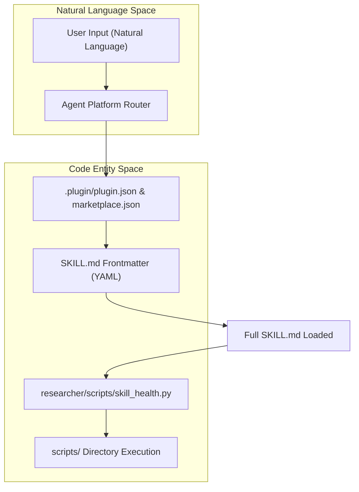
Sources: `[researcher/scripts/skill_health.py:2-13]`, `[researcher/scripts/skill_frontmatter.py:43-70]`, `[researcher/scripts/validate_platform_compat.py:78-146]`

### Mechanism-Based Routing and Boundary Enforcement
Title: "Explicit Boundary Routing: Long-Horizon vs. Multi-Agent"
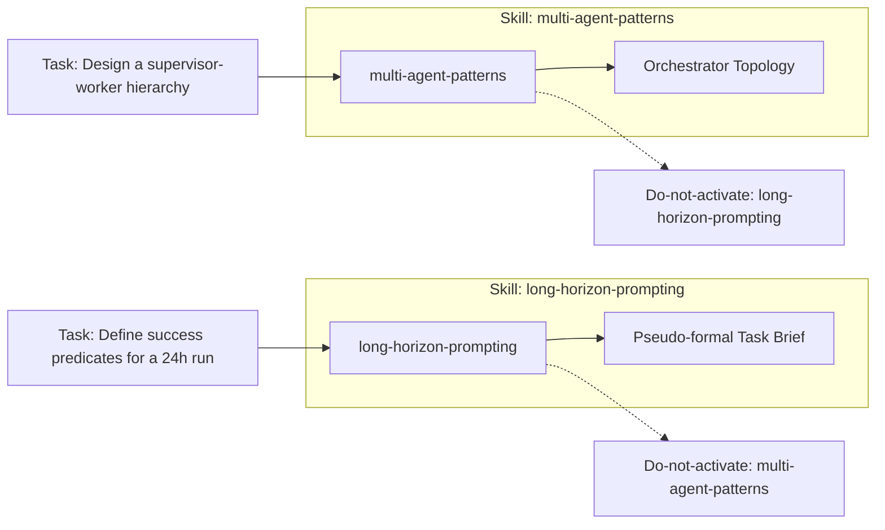
Sources: `[template/SKILL.md:23-27]`

---

## Authoring Rules & Validation Checklist

To maintain corpus quality standards, all contributions must pass the automated validation suite.

### Update Checklist
When adding a new skill, update the following:
1.  **Manifests**: Update `.plugin/plugin.json` and `.claude-plugin/marketplace.json` [researcher/scripts/validate_platform_compat.py:78-146]().
2.  **Frontmatter**: Ensure the `name` in `SKILL.md` matches the directory name exactly [researcher/scripts/validate_platform_compat.py:70-71]().
3.  **Quoting**: Use double quotes for the `description` field in frontmatter [researcher/scripts/skill_frontmatter.py:136-141]().
4.  **Activation Cases**: Add at least one entry to `researcher/fixtures/activation-cases.jsonl` [researcher/scripts/skill_health.py:34-34]().

### Automated Validation Commands
Run these before submitting a PR:
*   `python3 researcher/scripts/validate_platform_compat.py --require-reference-validator`: Checks YAML safety and platform install layout compatibility [researcher/scripts/validate_platform_compat.py:1-13]().
*   `python3 -m unittest researcher.scripts.tests.test_skill_frontmatter`: Runs the frontmatter regression suite (`test_skill_frontmatter.py`) [researcher/scripts/tests/test_skill_frontmatter.py:1-7]().
*   `python3 researcher/scripts/skill_health.py --strict`: Verifies the 500-line limit and required sections [researcher/scripts/skill_health.py:38-47]().

Sources: `[researcher/scripts/validate_platform_compat.py:1-146]`, `[researcher/scripts/skill_health.py:34-82]`, `[researcher/scripts/tests/test_skill_frontmatter.py:1-158]`

---

# Page: Core Context Engineering Concepts

# Core Context Engineering Concepts

<details>
<summary>Relevant source files</summary>

The following files were used as context for generating this wiki page:

- [skills/context-degradation/SKILL.md](skills/context-degradation/SKILL.md)
- [skills/context-fundamentals/SKILL.md](skills/context-fundamentals/SKILL.md)
- [skills/context-optimization/SKILL.md](skills/context-optimization/SKILL.md)
- [skills/memory-systems/SKILL.md](skills/memory-systems/SKILL.md)
- [skills/multi-agent-patterns/SKILL.md](skills/multi-agent-patterns/SKILL.md)
- [skills/project-development/SKILL.md](skills/project-development/SKILL.md)
- [skills/tool-design/SKILL.md](skills/tool-design/SKILL.md)

</details>


Context engineering is the foundational discipline of curating the high-signal token sets required for an agent to perform a specific task step [skills/context-fundamentals/SKILL.md:8-9](). It shifts the focus from "writing better prompts" to managing the model's working memory—the context window—as a finite resource [skills/context-fundamentals/SKILL.md:31-32]().

This page provides a high-level theoretical framework for the skill collection, centered on the transition from monolithic prompting to dynamic context management. For deep dives into specific operational areas, see the child pages:
- **[Context Fundamentals](#2.1)** — Attention budgets, U-shaped attention curves, static vs dynamic context, and state preservation [skills/context-fundamentals/SKILL.md:1-73]().
- **[Context Degradation & Health Monitoring](#2.2)** — Failure modes, Four-Bucket mitigation, and `ContextHealthAnalyzer` [skills/context-degradation/SKILL.md:1-75]().
- **[Context Compression](#2.3)** — Anchored Iterative Summarization, `StructuredSummarizer`, and probe-based evaluation [skills/context-optimization/SKILL.md:33-52]().
- **[Context Optimization Techniques](#2.4)** — KV-cache optimization, Observation Masking, and partitioning strategies [skills/context-optimization/SKILL.md:28-84]().

Sources: [skills/context-fundamentals/SKILL.md:8-32](), [skills/context-degradation/SKILL.md:1-75](), [skills/context-optimization/SKILL.md:28-84]()

---

## The Attention Budget & Mechanics

The core constraint of context engineering is the **Attention Budget**. While modern models advertise large context windows (e.g., 200K+ tokens), they operate on a performance gradient rather than a binary limit [skills/context-fundamentals/SKILL.md:71-73](). 

### The U-shaped Curve (Lost-in-the-Middle)
Recall accuracy is not uniform across the context window. Information placed at the **beginning** and **end** of the context is retrieved with higher reliability, while information in the **middle** suffers a significant drop in recall accuracy [skills/context-fundamentals/SKILL.md:31-32](). This "lost-in-the-middle" effect means that every token added competes for a limited attention budget that cannot be refilled mid-inference [skills/context-fundamentals/SKILL.md:31-32]().

### Effective Capacity
The "Effective Capacity" of a model is typically materially below the advertised window until measured on a target workload [skills/context-fundamentals/SKILL.md:73-74](). Beyond this threshold, the model's ability to maintain pairwise relationships between tokens degrades, leading to performance cliffs in complex reasoning [skills/context-fundamentals/SKILL.md:71-73]().

For details, see [Context Fundamentals](#2.1).

Sources: [skills/context-fundamentals/SKILL.md:31-32](), [skills/context-fundamentals/SKILL.md:71-74]()

---

## The Four-Bucket Strategy

To manage the attention budget, the skill collection categorizes context operations into four strategic "buckets" that guide how information is handled [skills/context-fundamentals/SKILL.md:33-38]().

| Strategy | Definition | Code/Pattern Implementation |
| :--- | :--- | :--- |
| **Write** | Persisting state outside the active window for future retrieval or handoff. | `NOTES.md`, `CLAUDE.md`, `AgentPlan` [skills/context-fundamentals/SKILL.md:61-62](), [skills/project-development/SKILL.md:92-94]() |
| **Select** | Dynamically pulling only relevant high-signal fragments into the current window. | `ls`, `grep`, `db_*` namespacing [skills/tool-design/SKILL.md:45-47](), [skills/tool-design/SKILL.md:63-65]() |
| **Compress** | Reducing the token footprint of existing history while preserving actionable signal. | `StructuredSummarizer`, `compaction.py` [skills/context-optimization/SKILL.md:33-35](), [skills/memory-systems/SKILL.md:23-23]() |
| **Isolate** | Partitioning tasks into separate windows to prevent cross-contamination. | `SupervisorAgent`, `ContextBudget` [skills/tool-design/SKILL.md:3-3](), [skills/project-development/SKILL.md:19-19](), [skills/multi-agent-patterns/SKILL.md:28-28]() |

### From Natural Language to Code Entities
The following diagram illustrates how these theoretical strategies manifest as specific implementations and code symbols within the repository.

**Context Engineering Implementation Map**
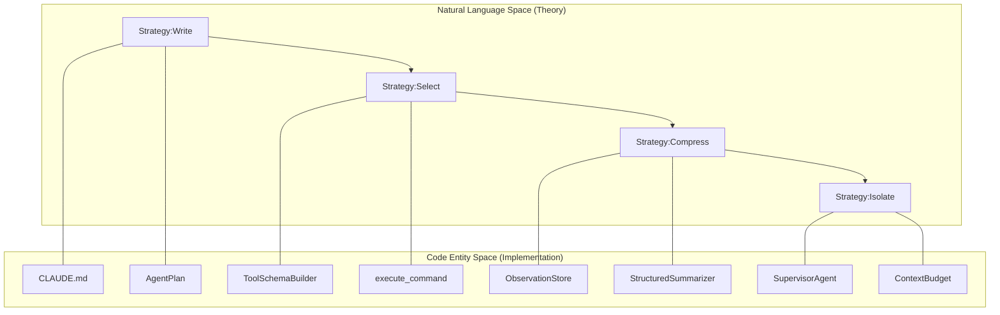
Sources: [skills/context-fundamentals/SKILL.md:33-38](), [skills/tool-design/SKILL.md:45-47](), [skills/tool-design/SKILL.md:63-65](), [skills/context-optimization/SKILL.md:54-62](), [skills/multi-agent-patterns/SKILL.md:68-73]()

For details, see [Context Degradation & Health Monitoring](#2.2).

---

## Context Health & Degradation

Context is subject to "rot" or degradation over long-running sessions. The system monitors for several primary failure modes that manifest as predictable patterns [skills/context-degradation/SKILL.md:8-9]().

1. **Context Poisoning:** Errors compounding as they are fed back into the model's history [skills/context-degradation/SKILL.md:30-31]().
2. **Context Distraction:** Irrelevant information overwhelming the relevant signal [skills/context-degradation/SKILL.md:58-60]().
3. **Lost-in-Middle:** Critical information buried in the low-attention center of the context window [skills/context-degradation/SKILL.md:41-43]().
4. **Context Clash:** Contradictory information appearing across different turns or sources [skills/context-degradation/SKILL.md:70-72]().
5. **Attention Sink:** Tokens that consume disproportionate attention (like verbose tool outputs) without contributing to the task [skills/context-fundamentals/SKILL.md:66-67](), [skills/context-degradation/SKILL.md:28-29]().

**Health Monitoring Workflow**
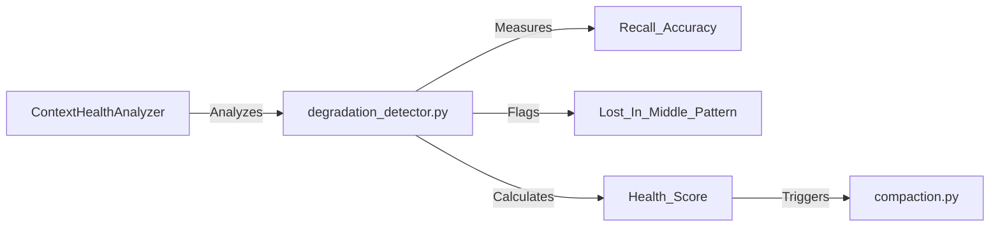
Sources: [skills/context-degradation/SKILL.md:8-75](), [skills/context-fundamentals/SKILL.md:31-32](), [skills/context-fundamentals/SKILL.md:66-67](), [skills/context-optimization/SKILL.md:43-45]()

For detection algorithms and health scoring, see **[Context Degradation & Health Monitoring](#2.2)**.

---

## Optimization & Compression

Once degradation is detected or the attention budget is exceeded, the system applies optimization techniques to restore context health and efficiency.

*   **Observation Masking:** Replacing verbose tool outputs with compact references via `ObservationStore` [skills/context-optimization/SKILL.md:54-62]().
*   **Selective Compaction:** Triggering summarization when utilization exceeds 70% while preserving high-signal system prompts [skills/context-optimization/SKILL.md:43-45]().
*   **Structured Summarization:** Utilizing explicit sections for session intent, file tracking, and decisions to preserve artifact trails [skills/memory-systems/SKILL.md:23-23]().
*   **KV-cache Optimization:** Reordering prompts to maximize prefix hits (System Prompt → Tool Definitions → History → Query) [skills/context-optimization/SKILL.md:64-75]().

**Optimization Strategy Mapping**
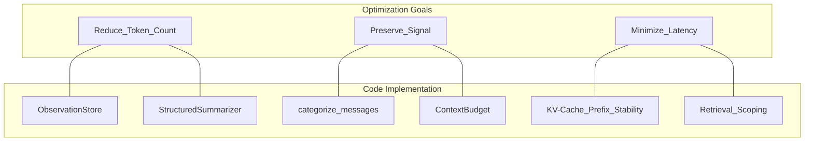
Sources: [skills/context-optimization/SKILL.md:28-89](), [skills/context-fundamentals/SKILL.md:66-68](), [skills/memory-systems/SKILL.md:23-24]()

For implementation details on compression and optimization, see:
*   **[Context Compression](#2.3)**
*   **[Context Optimization Techniques](#2.4)**

---

# Page: Context Fundamentals

# Context Fundamentals

<details>
<summary>Relevant source files</summary>

The following files were used as context for generating this wiki page:

- [LICENSE](LICENSE)
- [skills/context-degradation/references/patterns.md](skills/context-degradation/references/patterns.md)
- [skills/context-fundamentals/SKILL.md](skills/context-fundamentals/SKILL.md)
- [skills/context-fundamentals/references/context-components.md](skills/context-fundamentals/references/context-components.md)
- [skills/memory-systems/references/implementation.md](skills/memory-systems/references/implementation.md)
- [skills/memory-systems/scripts/memory_store.py](skills/memory-systems/scripts/memory_store.py)
- [skills/multi-agent-patterns/references/frameworks.md](skills/multi-agent-patterns/references/frameworks.md)
- [skills/project-development/SKILL.md](skills/project-development/SKILL.md)
- [skills/tool-design/SKILL.md](skills/tool-design/SKILL.md)

</details>


Context is the complete state available to a language model at inference time, comprising system instructions, tool definitions, retrieved documents, message history, and tool outputs [skills/context-fundamentals/SKILL.md:7-8](). This page explores the foundational mechanics of context engineering, focusing on the transition from viewing context as a "storage bin" to treating it as a finite, high-priority **attention budget** [skills/context-fundamentals/SKILL.md:31-32]().

The `context-fundamentals` skill is scoped exclusively to these conceptual foundations and mental models. Operational work—such as debugging attention failures, token-efficiency tactics, or conversation summarization—is routed to specialized skills like `context-degradation`, `context-optimization`, and `context-compression` [skills/context-fundamentals/SKILL.md:10-11]().

Sources: [skills/context-fundamentals/SKILL.md:7-11](), [skills/context-fundamentals/SKILL.md:31-32]()

## The Attention Budget & Performance Gradients

In agent systems, the attention mechanism computes $n^2$ pairwise relationships for $n$ tokens. As context grows, the model's ability to maintain these relationships degrades not as a hard cliff, but as a performance gradient [skills/context-fundamentals/SKILL.md:71-73]().

### The Lost-in-the-Middle Phenomenon
Research indicates a U-shaped attention curve where models demonstrate high recall at the beginning and end of the context window, while the middle section suffers from degraded attention [skills/context-fundamentals/SKILL.md:31-32](). This "U-shaped" curve is a critical constraint for prompt engineering and context layout.

| Metric | Beginning/End | Middle (The "Dip") |
| :--- | :--- | :--- |
| **Attention Region** | Favored (Primacy/Recency) | Degraded |
| **Information Type** | Constraints, Final Instructions | Supporting Data, Old History |
| **Engineering Action** | Place critical constraints here | Evict or summarize content here |

The `degradation_detector.py` script simulates this curve via `_estimate_attention` to help engineers identify when critical information is at risk [skills/context-degradation/scripts/degradation_detector.py:81-97]().

### Effective Capacity vs. Nominal Window
While models advertise large context windows (e.g., 200k+ tokens), the **effective capacity**—the point where complex dependencies remain reliable—is typically materially below the nominal limit [skills/context-fundamentals/SKILL.md:74-75](). Performance degradation begins well before the hard token limit is reached, requiring proactive management of the attention budget.

Sources: [skills/context-fundamentals/SKILL.md:31-32](), [skills/context-fundamentals/SKILL.md:71-75](), [skills/context-degradation/scripts/degradation_detector.py:81-97]()

## Anatomy of Context (XML Partitioning)

To maximize signal-to-noise ratios, context is partitioned into distinct functional blocks. The codebase recommends using XML tags or Markdown headers to enforce this structure, allowing the model to distinguish between instructions and data [skills/context-fundamentals/SKILL.md:44-45]().

### Context Components and Their Roles

| Component | Role | Management Strategy |
| :--- | :--- | :--- |
| **System Prompts** | Background & Constraints | High priority; placed at start/end [skills/context-fundamentals/SKILL.md:45-46](). |
| **Tool Definitions** | Agent Capabilities | Minimal sets; consolidated to avoid ambiguity [skills/context-fundamentals/SKILL.md:54-55](). |
| **Retrieved Docs** | Grounding Knowledge | Just-in-time loading; semantic chunking [skills/context-fundamentals/SKILL.md:56-57](). |
| **Message History** | Scratchpad / Task State | Monitored for compaction; replacement of stale outputs [skills/context-fundamentals/SKILL.md:61-64](). |
| **Tool Outputs** | Observations | Dominant token consumer; requires masking [skills/context-fundamentals/SKILL.md:66-67](). |

### Context Structure Visualization
The following diagram bridges the natural language prompt structure to the `ContextBuilder` code implementation.

**Diagram: Context Assembly and Token Attribution**
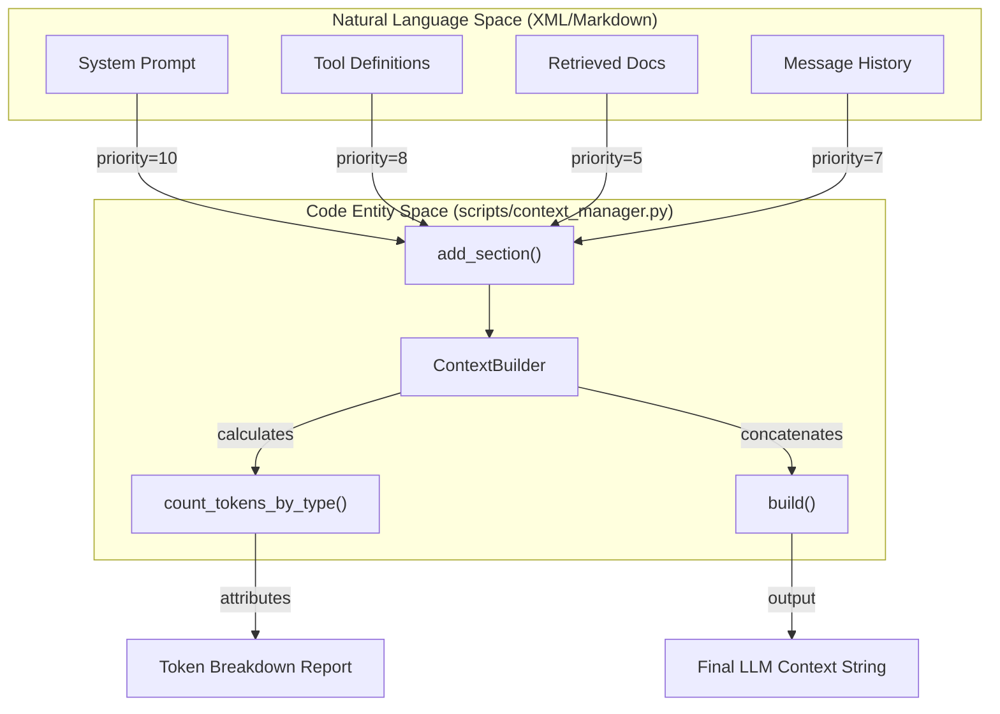
Sources: [skills/context-fundamentals/scripts/context_manager.py:94-126](), [skills/context-fundamentals/scripts/context_manager.py:133-152](), [skills/context-fundamentals/SKILL.md:44-46]()

## State Preservation Interfaces

In long-running agent sessions, specific interfaces serve to keep the context window lean by externalizing state:

1.  **CLAUDE.md**: Stores project-specific configuration, build commands, and coding style. It acts as a static project system prompt [skills/context-fundamentals/SKILL.md:44-45]().
2.  **NOTES.md**: Serves as a dynamic scratchpad for offloading complex reasoning or multi-step progress [skills/context-fundamentals/SKILL.md:61-62]().
3.  **Filesystem Context**: Large tool outputs or durable state should be offloaded to files rather than kept in the message history [skills/context-fundamentals/SKILL.md:10-11](). This is managed by the `filesystem-context` skill and the `ObservationStore` [skills/context-optimization/scripts/compaction.py:49-50]().

Sources: [skills/context-fundamentals/SKILL.md:10-11](), [skills/context-fundamentals/SKILL.md:44-45](), [skills/context-fundamentals/SKILL.md:61-62](), [skills/context-optimization/scripts/compaction.py:49-50]()

## Compaction Trigger Lifecycle

Compaction is the process of reducing context volume while preserving essential signal. In the `context-fundamentals` mental model, this is viewed as an iterative curation discipline [skills/context-fundamentals/SKILL.md:38-39]().

### The Compaction Flow
1.  **Estimation**: `estimate_message_tokens` uses a ~4 chars/token heuristic to monitor usage [skills/context-fundamentals/scripts/context_manager.py:79-91]().
2.  **Categorization**: `categorize_messages` separates content into types (system, tool, conversation) to apply different pruning priorities [skills/context-optimization/scripts/compaction.py:104-138]().
3.  **Summarization**: `summarize_content` applies strategy-specific logic, such as extracting metrics from tool outputs or decisions from conversations [skills/context-optimization/scripts/compaction.py:141-157]().

**Diagram: Context Management Logic**
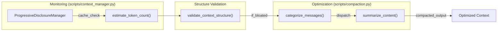
Sources: [skills/context-fundamentals/scripts/context_manager.py:62-76](), [skills/context-fundamentals/scripts/context_manager.py:154-160](), [skills/context-optimization/scripts/compaction.py:104-157]()

## Progressive Disclosure

To prevent context bloat, the system implements **Progressive Disclosure**: loading information only as it becomes necessary for the current task [skills/context-fundamentals/SKILL.md:37-38]().

*   **Just-in-Time Retrieval**: Maintain an index (file paths) and load data only when requested [skills/context-fundamentals/SKILL.md:56-57](). This is implemented via the `ProgressiveDisclosureManager` [skills/context-fundamentals/scripts/context_manager.py:54-55]().
*   **Skill Activation**: Load skill names and summaries at startup; load full content only when a skill activates [skills/context-fundamentals/SKILL.md:37-38]().
*   **Observation Masking**: Replace verbose tool outputs with compact references once the agent has processed the result [skills/context-fundamentals/SKILL.md:67-68]().

Sources: [skills/context-fundamentals/SKILL.md:6-11](), [skills/context-fundamentals/SKILL.md:29-39](), [skills/context-fundamentals/SKILL.md:71-83](), [skills/context-fundamentals/scripts/context_manager.py:94-152](), [skills/context-optimization/scripts/compaction.py:104-157]()

---

# Page: Context Degradation & Health Monitoring

# Context Degradation & Health Monitoring

<details>
<summary>Relevant source files</summary>

The following files were used as context for generating this wiki page:

- [skills/context-degradation/SKILL.md](skills/context-degradation/SKILL.md)
- [skills/context-degradation/scripts/degradation_detector.py](skills/context-degradation/scripts/degradation_detector.py)
- [skills/context-fundamentals/scripts/context_manager.py](skills/context-fundamentals/scripts/context_manager.py)
- [skills/context-optimization/SKILL.md](skills/context-optimization/SKILL.md)
- [skills/context-optimization/scripts/compaction.py](skills/context-optimization/scripts/compaction.py)
- [skills/evaluation/scripts/evaluator.py](skills/evaluation/scripts/evaluator.py)
- [skills/memory-systems/SKILL.md](skills/memory-systems/SKILL.md)
- [skills/multi-agent-patterns/SKILL.md](skills/multi-agent-patterns/SKILL.md)
- [skills/multi-agent-patterns/scripts/coordination.py](skills/multi-agent-patterns/scripts/coordination.py)
- [skills/tool-design/scripts/description_generator.py](skills/tool-design/scripts/description_generator.py)

</details>


Context degradation is a non-binary continuum of performance loss that occurs as an agent's context window fills with noise, contradictions, or poorly positioned information. This wiki page details the `context-degradation` skill, outlining mechanical failure modes, the Four-Bucket mitigation strategy, and programmatic health monitoring via `degradation_detector.py`.

---

## Failure Modes & Mitigation

The codebase identifies five predictable failure modes that degrade agent reasoning and output quality. Each pattern exhibits distinct detection signals and requires specific architectural remediation:

| Failure Mode | Description | Mitigation Strategy |
| :--- | :--- | :--- |
| **Lost-in-Middle** | U-shaped attention curve where middle tokens suffer 10-40% reduced recall accuracy [skills/context-degradation/SKILL.md:40-42](). | Place critical info at the beginning (primacy) or end (recency) [skills/context-degradation/SKILL.md:40-42](). |
| **Context Poisoning** | Hallucinations or errors enter the context and compound through self-reference [skills/context-degradation/SKILL.md:30-30](). | Truncate to before the poisoning point; do not layer corrections over errors [skills/context-degradation/SKILL.md:53-55](). |
| **Context Distraction** | Irrelevant documents compete for the limited attention budget [skills/context-degradation/SKILL.md:32-32](). | Aggressive relevance filtering; move "maybe useful" info behind tool calls [skills/context-degradation/SKILL.md:58-61](). |
| **Context Confusion** | Model applies constraints from one task to a different, unrelated task [skills/context-degradation/SKILL.md:34-34](). | Isolate tasks into separate context windows or use explicit reset markers [skills/context-degradation/SKILL.md:64-67](). |
| **Context Clash** | Mutually contradictory but individually correct facts (e.g., version conflicts) [skills/context-degradation/SKILL.md:36-36](). | Establish source priority rules and explicit version filtering [skills/context-degradation/SKILL.md:70-73](). |

Sources: [skills/context-degradation/SKILL.md:28-73]()

---

## The Four-Bucket Mitigation Framework

To maintain context health, information is managed through a tiered strategy that balances visibility with attention budget:

1.  **Write:** Direct placement in the current context window for immediate action. Optimized by `design_stable_prompt` to ensure KV-cache reuse [skills/context-optimization/scripts/compaction.py:11]().
2.  **Select:** Using RAG or tool-based retrieval (e.g., `VectorStore.search`) to bring only relevant chunks into view [skills/memory-systems/SKILL.md:78-85]().
3.  **Compress:** Summarizing historical turns via `summarize_conversation` in `compaction.py` to preserve "intent" while discarding "noise" [skills/context-optimization/scripts/compaction.py:186-192]().
4.  **Isolate:** Moving sub-tasks to fresh context windows (Multi-Agent patterns) via `SupervisorAgent.decompose_task` to prevent cross-contamination [skills/multi-agent-patterns/scripts/coordination.py:134-140]().

Sources: [skills/context-degradation/SKILL.md:58-60](), [skills/context-optimization/scripts/compaction.py:186-192](), [skills/multi-agent-patterns/scripts/coordination.py:134-140](), [skills/memory-systems/SKILL.md:78-85]()

---

## Implementation: Context Health Monitoring

The `degradation_detector.py` script provides the `ContextHealthAnalyzer` class and companion functions to quantify the health of an agent's current state [skills/context-degradation/scripts/degradation_detector.py:13-14]().

### Health Scoring Algorithm
`ContextHealthAnalyzer` calculates a composite score based on three primary vectors:
1.  **Attention Risk:** Measuring if critical tokens (identified via markers or position) are located in the U-curve's trough via `detect_lost_in_middle` [skills/context-degradation/scripts/degradation_detector.py:112-133]().
2.  **Poisoning Probability:** Using `PoisoningDetector` to scan for error accumulation patterns, tool misalignment, or repeated hallucinations [skills/context-degradation/scripts/degradation_detector.py:11-12](), [skills/context-degradation/SKILL.md:52-54]().
3.  **Utilization Density:** Assessing structural degradation risk factors and middle-content ratios via `analyze_context_structure` [skills/context-degradation/scripts/degradation_detector.py:166-177]().

### Data Flow: Health Analysis
The following diagram bridges the natural language concepts of agent sessions and tasks to the concrete Python classes and functions in `degradation_detector.py`.

Title: "Context Health Analysis Pipeline"
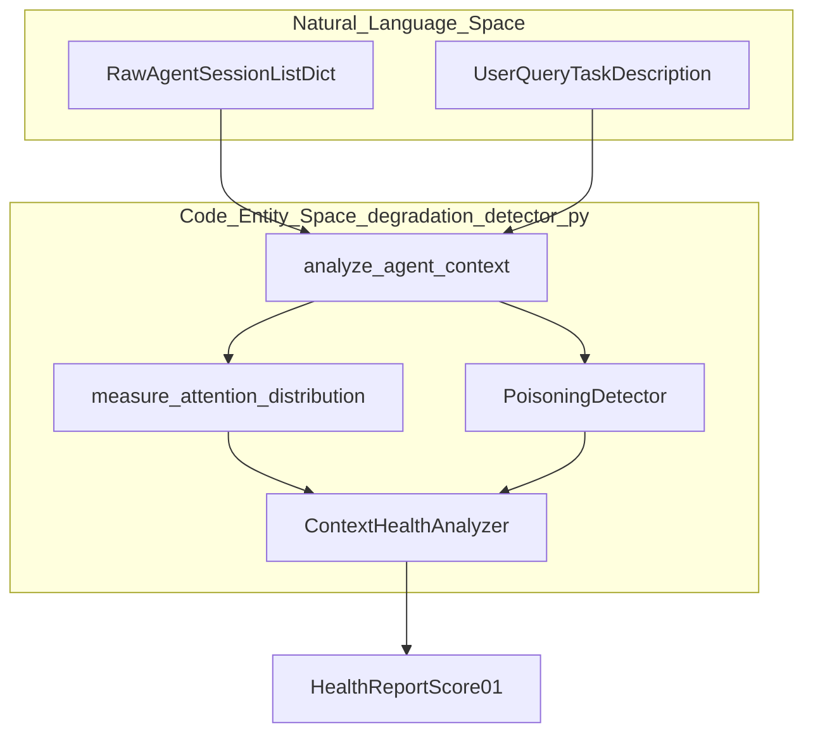
Sources: [skills/context-degradation/scripts/degradation_detector.py:13-15](), [skills/context-degradation/scripts/degradation_detector.py:45-160]()

---

## Technical Details: Attention Mapping

The `measure_attention_distribution` function simulates the attention mechanics of Transformer models to identify at-risk information [skills/context-degradation/scripts/degradation_detector.py:45-48]().

### Attention Curve Simulation
The helper `_estimate_attention` implements a mathematical model of the U-shaped curve documented in research:
*   **Primacy/Attention Sink:** Tokens at the start (`position < total * 0.1`) receive high weight via `0.8 + random.random() * 0.2` [skills/context-degradation/scripts/degradation_detector.py:98-99](), [skills/context-degradation/SKILL.md:28-28]().
*   **Recency:** Tokens at the end (`position > total * 0.9`) receive high weight via `0.7 + random.random() * 0.3` [skills/context-degradation/scripts/degradation_detector.py:100-101]().
*   **Degraded Middle:** Tokens in the middle linearize toward a low point of ~0.1–0.3 weight [skills/context-degradation/scripts/degradation_detector.py:103-105]().

### Attention-to-Code Mapping
The diagram below maps the abstract context regions to the scoring implementation in `degradation_detector.py`.

Title: "Attention-to-Code Mapping"
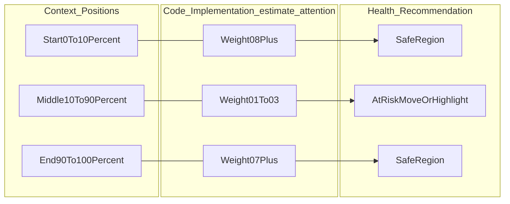
Sources: [skills/context-degradation/scripts/degradation_detector.py:81-106](), [skills/context-degradation/scripts/degradation_detector.py:151-157]()

---

## Usage Example

To analyze a session programmatically, use the `analyze_agent_context` convenience function [skills/context-degradation/scripts/degradation_detector.py:15-15]():
1. It tokenizes the input context via whitespace heuristics [skills/context-degradation/scripts/degradation_detector.py:21-22]().
2. It maps attention weights via `measure_attention_distribution` [skills/context-degradation/scripts/degradation_detector.py:45-48]().
3. It identifies critical positions via `detect_lost_in_middle` [skills/context-degradation/scripts/degradation_detector.py:112-115]().
4. It outputs a composite `degradation_score` ranging from `0.0` (fully healthy) to `1.0` (critical attention loss) [skills/context-degradation/scripts/degradation_detector.py:149-149]().

Sources: [skills/context-degradation/scripts/degradation_detector.py:15-15](), [skills/context-degradation/scripts/degradation_detector.py:112-160]()

---

# Page: Context Compression

# Context Compression

<details>
<summary>Relevant source files</summary>

The following files were used as context for generating this wiki page:

- [docs/netflix_context.md](docs/netflix_context.md)
- [docs/vercel_tool.md](docs/vercel_tool.md)
- [skills/context-compression/SKILL.md](skills/context-compression/SKILL.md)
- [skills/context-compression/scripts/compression_evaluator.py](skills/context-compression/scripts/compression_evaluator.py)
- [skills/context-compression/tests/test_compression_evaluator.py](skills/context-compression/tests/test_compression_evaluator.py)
- [skills/tool-design/references/architectural_reduction.md](skills/tool-design/references/architectural_reduction.md)

</details>


## Purpose and Scope
This page covers the technical implementation, theory, and evaluation metrics of the `context-compression` skill (`skills/context-compression/`). It details how long-running agent sessions manage context window limits through Anchored Iterative Summarization, Opaque Compression, Artifact Trail preservation, StructuredSummarizer components, probe-based evaluation, the six-dimension rubric, and the Tokens-Per-Task (TPT) optimization framework.

---

## Compression Strategies

The system implements three primary approaches to compression based on session characteristics and the need for artifact tracking [skills/context-compression/SKILL.md:28]().

### 1. Anchored Iterative Summarization
This is the recommended strategy for long-running sessions where file tracking matters [skills/context-compression/SKILL.md:30](). It maintains a persistent, structured summary with explicit sections. When a compression trigger occurs, only the newly-truncated conversation span is summarized and then merged into the existing summary [skills/context-compression/SKILL.md:30](). This prevents the "drift" and cumulative detail loss common in wholesale regenerations [skills/context-compression/SKILL.md:30]().

### 2. Opaque Compression
Reserve this for short sessions where re-fetching costs are low and maximum token savings are required [skills/context-compression/SKILL.md:32](). It produces high-density representations (99%+ compression ratios) optimized for reconstruction fidelity rather than human readability [skills/context-compression/SKILL.md:32](). It is unsuitable for debugging or artifact tracking because there is no way to verify what was preserved without running probe-based evaluation [skills/context-compression/SKILL.md:32]().

### 3. Regenerative Full Summary
Generates a fresh detailed summary on each trigger [skills/context-compression/SKILL.md:34](). While readable, it suffers from "cumulative detail loss" where the model deprioritizes details preserved in previous cycles [skills/context-compression/SKILL.md:34]().

### Strategy Comparison
| Strategy | Trigger Point | Trade-off |
| :--- | :--- | :--- |
| **Fixed Threshold** | 70-80% context utilization | Simple but may compress too early [skills/context-compression/SKILL.md:89]() |
| **Sliding Window** | Keep last N turns + summary | Predictable context size; best for coding agents [skills/context-compression/SKILL.md:90-94]() |
| **Importance-based** | Compress low-relevance sections | Complex but preserves signal [skills/context-compression/SKILL.md:91]() |
| **Task-boundary** | Logical task completion | Clean summaries but unpredictable timing [skills/context-compression/SKILL.md:92]() |

Sources: [skills/context-compression/SKILL.md:28-36](), [skills/context-compression/SKILL.md:87-95]()

---

## The StructuredSummarizer Class

The `StructuredSummarizer` class implements the **Anchored Iterative Summarization** pattern [skills/context-compression/scripts/compression_evaluator.py:17-20](). It enforces a mandatory schema to prevent silent information loss, acting as a checklist that the agent must populate [skills/context-compression/SKILL.md:54-56]().

### Mandatory Summary Sections
A valid structured summary must include:
*   **Session Intent**: The high-level goal [skills/context-compression/SKILL.md:59-60]().
*   **Files Modified**: Full paths and specific changes (e.g., function names) [skills/context-compression/SKILL.md:62-65]().
*   **Decisions Made**: Rationale for technical choices [skills/context-compression/SKILL.md:67-70]().
*   **Current State**: Status of tests and pending work [skills/context-compression/SKILL.md:71-74]().
*   **Next Steps**: Actionable items for the next turn [skills/context-compression/SKILL.md:75-79]().

### Implementation Logic
The summarizer ensures that "Artifact Trails"—the record of file modifications and identifiers—are preserved, as this is the dimension most prone to degradation [skills/context-compression/SKILL.md:42-44](). The system explicitly tracks which files were created, modified, or read, including function and variable names [skills/context-compression/SKILL.md:46-52]().

Sources: [skills/context-compression/scripts/compression_evaluator.py:17-20](), [skills/context-compression/SKILL.md:42-56](), [skills/context-compression/SKILL.md:58-82]()

---

## Probe-Based Evaluation

Traditional metrics like ROUGE or embedding similarity fail to capture whether an agent can still perform its task [skills/context-compression/SKILL.md:97-98](). This codebase uses **Probe-based Evaluation**, where the system poses specific questions to the agent after compression to test functional retention [skills/context-compression/SKILL.md:100-101]().

### Probe Types
The `ProbeType` enum defines four categories of assessment [skills/context-compression/scripts/compression_evaluator.py:56-61]():

| Probe Type | What It Tests | Example Question |
| :--- | :--- | :--- |
| `RECALL` | Factual retention | "What was the original error message?" [skills/context-compression/SKILL.md:104]() |
| `ARTIFACT` | File tracking | "Which files have we modified?" [skills/context-compression/SKILL.md:105]() |
| `CONTINUATION` | Task planning | "What should we do next?" [skills/context-compression/SKILL.md:106]() |
| `DECISION` | Reasoning chain | "What did we decide about the Redis issue?" [skills/context-compression/SKILL.md:107]() |

### The Evaluation Pipeline
The `evaluate_compression_quality` function orchestrates the end-to-end evaluation flow, from probe generation to scoring [skills/context-compression/scripts/compression_evaluator.py:23-26]().

#### Data Flow: Natural Language to Code Entities
The following diagram illustrates how the `ProbeGenerator` and `CompressionEvaluator` bridge raw conversation history into structured evaluation results.

Compression Evaluation Data Flow
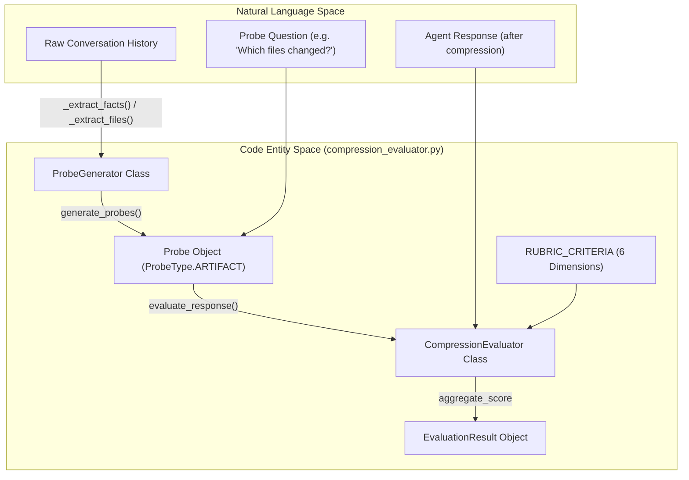
Sources: [skills/context-compression/scripts/compression_evaluator.py:102-185](), [skills/context-compression/scripts/compression_evaluator.py:188-212](), [skills/context-compression/scripts/compression_evaluator.py:288-310]()

---

## The Six-Dimension Rubric

Compression quality is measured across six specific dimensions using the `RUBRIC_CRITERIA` map [skills/context-compression/scripts/compression_evaluator.py:102]().

1.  **Accuracy**: Correctness of facts, file paths, and technical details [skills/context-compression/scripts/compression_evaluator.py:103-114]().
2.  **Context Awareness**: Reflection of the current conversation state and artifact state [skills/context-compression/scripts/compression_evaluator.py:115-126]().
3.  **Artifact Trail**: Awareness of created/modified files and key identifiers (function names, error messages) [skills/context-compression/scripts/compression_evaluator.py:127-143]().
4.  **Completeness**: Coverage and depth of the response [skills/context-compression/scripts/compression_evaluator.py:144-155]().
5.  **Continuity**: Ability to continue without re-fetching information or losing rationale behind decisions [skills/context-compression/scripts/compression_evaluator.py:156-172]().
6.  **Instruction Following**: Adherence to formats and constraints [skills/context-compression/scripts/compression_evaluator.py:173-184]().

### Heuristic Evaluation
The `CompressionEvaluator` uses heuristic scoring (e.g., `_heuristic_score`) to compare agent responses against ground truth, checking for artifact path mentions and substring matches [skills/context-compression/tests/test_compression_evaluator.py:24-33](), [skills/context-compression/tests/test_compression_evaluator.py:41-45]().

Sources: [skills/context-compression/scripts/compression_evaluator.py:102-185](), [skills/context-compression/tests/test_compression_evaluator.py:19-53]()

---

## Tokens-Per-Task (TPT) Optimization

The primary goal of the compression skill is reducing the total cost of a task. This is visualized by tracking the `Tokens-Per-Task` metric [skills/context-compression/SKILL.md:38]().

TPT Optimization Logic
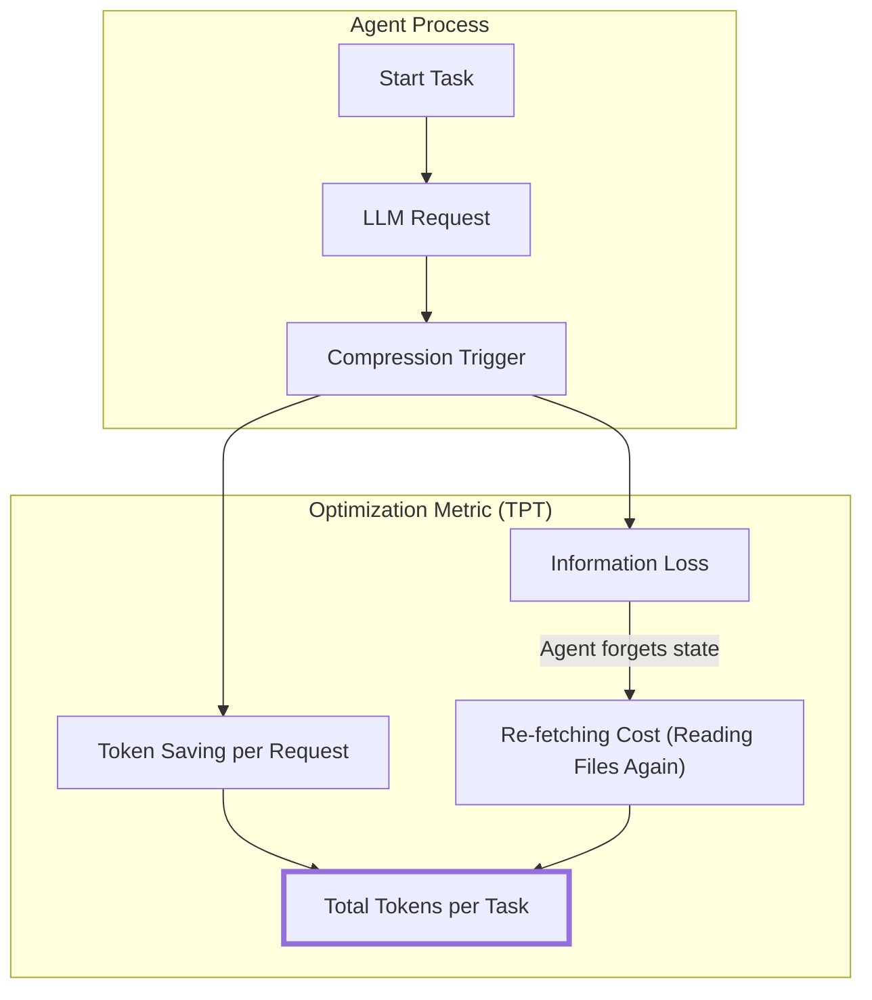

**Key Principle**: A strategy that saves 0.5% more tokens per request but causes 20% more re-fetching (due to lost file paths or error codes) is objectively inferior [skills/context-compression/SKILL.md:40-41](). High re-fetching frequency is the primary signal that compression is too aggressive [skills/context-compression/SKILL.md:41]().

Sources: [skills/context-compression/SKILL.md:8-9](), [skills/context-compression/SKILL.md:38-41]()

---

# Page: Context Optimization Techniques

# Context Optimization Techniques

<details>
<summary>Relevant source files</summary>

The following files were used as context for generating this wiki page:

- [skills/context-degradation/SKILL.md](skills/context-degradation/SKILL.md)
- [skills/context-degradation/scripts/degradation_detector.py](skills/context-degradation/scripts/degradation_detector.py)
- [skills/context-fundamentals/scripts/context_manager.py](skills/context-fundamentals/scripts/context_manager.py)
- [skills/context-optimization/SKILL.md](skills/context-optimization/SKILL.md)
- [skills/context-optimization/scripts/compaction.py](skills/context-optimization/scripts/compaction.py)
- [skills/evaluation/scripts/evaluator.py](skills/evaluation/scripts/evaluator.py)
- [skills/memory-systems/SKILL.md](skills/memory-systems/SKILL.md)
- [skills/multi-agent-patterns/SKILL.md](skills/multi-agent-patterns/SKILL.md)
- [skills/multi-agent-patterns/scripts/coordination.py](skills/multi-agent-patterns/scripts/coordination.py)
- [skills/tool-design/scripts/description_generator.py](skills/tool-design/scripts/description_generator.py)

</details>


Context optimization extends the effective capacity of limited context windows through strategic compression, masking, caching, and partitioning. These techniques allow agents to handle larger documents and longer-running sessions by maximizing the signal-to-noise ratio within the available token budget [skills/context-optimization/SKILL.md:6-8]().

## Core Optimization Strategies

The codebase implements four primary strategies for context management, ordered by impact and risk [skills/context-optimization/SKILL.md:28-38]():

| Strategy | Mechanism | Risk | Impact |
| :--- | :--- | :--- | :--- |
| **KV-cache Optimization** | Reordering prompt structure for tensor reuse. | Zero | Immediate latency/cost reduction. |
| **Observation Masking** | Replacing verbose tool outputs with references. | Low | Up to 80% token savings in trajectories. |
| **Compaction** | Summarizing context when utilization > 70%. | Medium | Distills state while preserving signal. |
| **Context Partitioning** | Splitting tasks across isolated sub-agents. | High | Handles complex problems via delegation. |

### Natural Language Space to Code Entity Space: Optimization Flow

This diagram maps conceptual optimization strategies to the specific Python classes and functions implemented in `compaction.py` and `context_manager.py`.

**Optimization Strategy Mapping**
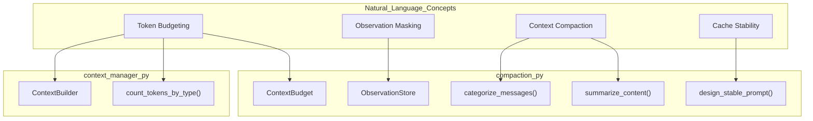
Sources: [skills/context-optimization/scripts/compaction.py:1-54](), [skills/context-fundamentals/scripts/context_manager.py:1-55]()

---

## Observation Masking (`ObservationStore`)

Observation masking targets the most verbose part of agent trajectories: tool outputs, which typically consume 80%+ of tokens [skills/context-optimization/SKILL.md:32-32](). The `ObservationStore` class manages the lifecycle of these outputs, replacing them with compact references once their purpose has been served [skills/context-optimization/scripts/compaction.py:15-15]().

**Implementation Logic:**
- **Store**: Full tool outputs are saved in an external store with a unique `ref_id` [skills/context-optimization/SKILL.md:62-62]().
- **Mask**: The verbose output is replaced in the context window with a template: `[Obs:{ref_id} elided. Key: {summary}. Full content retrievable.]` [skills/context-optimization/SKILL.md:59-59]().
- **Selective Masking**: Rules dictate that observations critical to the current task or from the most recent turn should never be masked [skills/context-optimization/SKILL.md:58-58](). Masking is typically applied after 3+ turns [skills/context-optimization/SKILL.md:59-59]().

Sources: [skills/context-optimization/SKILL.md:54-63](), [skills/context-optimization/scripts/compaction.py:15-15]()

---

## Compaction and Summarization Strategies

Compaction is triggered when context utilization exceeds a specific threshold (typically 70%) [skills/context-optimization/SKILL.md:44-44](). The process uses `categorize_messages` to apply differentiated summarization logic based on message types [skills/context-optimization/scripts/compaction.py:104-138]().

### Differentiated Compaction Logic
The `summarize_content` function dispatches content to specific summarizers based on the category [skills/context-optimization/scripts/compaction.py:141-156]():

1.  **Tool Outputs (`summarize_tool_output`)**: Extracts metrics (numbers/keys) and key findings using regex while stripping stack traces and boilerplate [skills/context-optimization/scripts/compaction.py:159-183]().
2.  **Conversational Turns (`summarize_conversation`)**: Retains decisions and questions while removing filler [skills/context-optimization/scripts/compaction.py:186-200]().
3.  **Retrieved Documents (`summarize_document`)**: Keeps core claims and data points relevant to the active task [skills/context-optimization/SKILL.md:50-50]().

**Warning**: Never compress the **System Prompt**, as it anchors model behavior and its removal causes unpredictable degradation [skills/context-optimization/SKILL.md:44-44]().

Sources: [skills/context-optimization/scripts/compaction.py:104-200](), [skills/context-optimization/SKILL.md:42-53]()

---

## KV-Cache Optimization

To maximize prefix cache hits, prompts must be structured for stability. The `design_stable_prompt` function helps order content so that static data occupies the prefix and dynamic data appears at the end [skills/context-optimization/scripts/compaction.py:11-11]().

**Optimal Prompt Ordering [skills/context-optimization/SKILL.md:68-73]():**
1.  **System Prompt**: Most stable, never changes within a session.
2.  **Tool Definitions**: Stable across requests.
3.  **Templates/Few-shot Examples**: High reuse.
4.  **Conversation History**: Grows but shares prefix with prior turns.
5.  **Current Query**: Least stable, always last.

**Implementation Note**: Even a single whitespace change in the prefix invalidates the entire cached block downstream [skills/context-optimization/SKILL.md:75-75]().

Sources: [skills/context-optimization/SKILL.md:64-78](), [skills/context-optimization/scripts/compaction.py:11-12]()

---

## Context Partitioning

Partitioning splits a single task into independent sub-tasks assigned to sub-agents with clean, focused contexts [skills/context-optimization/SKILL.md:79-85](). This is recommended when estimated task context exceeds 60% of the window limit [skills/context-optimization/SKILL.md:83-83]().

### Natural Language Space to Code Entity Space: Partitioning Execution

This diagram associates natural language multi-agent partitioning concepts with concrete classes and methods in `coordination.py`.

**Context Partitioning Architecture**
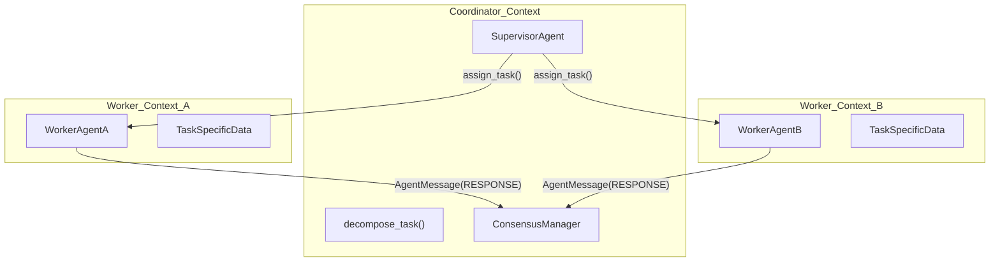
Sources: [skills/context-optimization/SKILL.md:79-85](), [skills/multi-agent-patterns/scripts/coordination.py:110-210]()

---

## Cost/Latency Trade-off Analysis

Optimization decisions are governed by metrics like tokens-per-request and overall system performance [skills/context-optimization/SKILL.md:37-38]().

| Metric | Impact of Optimization | Analysis |
| :--- | :--- | :--- |
| **Latency** | **Reduction** | KV-cache optimization can reduce latency by ~40% on cached tokens [skills/context-optimization/SKILL.md:77-77](). |
| **Cost** | **Reduction** | 70%+ cache hit rates translate to 50%+ cost reduction [skills/context-optimization/SKILL.md:77-77](). |
| **Quality** | **Risk** | Over-aggressive compaction is a common failure mode leading to information loss [skills/context-optimization/SKILL.md:52-52](). |

### Budget Management
The `ContextBudget` class monitors usage and triggers optimizations based on specific signals [skills/context-optimization/scripts/compaction.py:16-16]():
- **Utilization > 70%**: Trigger Compaction [skills/context-optimization/SKILL.md:44-44]().
- **Utilization > 60%**: Plan Partitioning [skills/context-optimization/SKILL.md:83-83]().

Sources: [skills/context-optimization/SKILL.md:87-94](), [skills/context-optimization/scripts/compaction.py:16-16]()

---

# Page: Agent Architecture Patterns

# Agent Architecture Patterns

<details>
<summary>Relevant source files</summary>

The following files were used as context for generating this wiki page:

- [skills/advanced-evaluation/SKILL.md](skills/advanced-evaluation/SKILL.md)
- [skills/bdi-mental-states/SKILL.md](skills/bdi-mental-states/SKILL.md)
- [skills/context-degradation/SKILL.md](skills/context-degradation/SKILL.md)
- [skills/context-optimization/SKILL.md](skills/context-optimization/SKILL.md)
- [skills/filesystem-context/SKILL.md](skills/filesystem-context/SKILL.md)
- [skills/hosted-agents/SKILL.md](skills/hosted-agents/SKILL.md)
- [skills/memory-systems/SKILL.md](skills/memory-systems/SKILL.md)
- [skills/multi-agent-patterns/SKILL.md](skills/multi-agent-patterns/SKILL.md)

</details>


Architectural skills define the structural patterns and coordination mechanisms that enable effective agent systems. These patterns focus on distributing work across multiple context windows, maintaining state across sessions, and grounding agent execution in stable environments. The core insight across all architectural patterns is that structure should serve to **isolate context** and **maximize attention signal**, rather than merely simulating organizational roles [skills/multi-agent-patterns/SKILL.md:8-9](), [skills/multi-agent-patterns/SKILL.md:28-28]().

Sources: [skills/multi-agent-patterns/SKILL.md:1-29]()

---

## Multi-Agent Patterns

Multi-agent architectures distribute complex tasks across multiple model instances, each with its own isolated context window. This prevents "The Telephone Game" failure mode, where information degrades through repeated summarization, and mitigates the "Lost-in-the-Middle" phenomenon by keeping individual contexts lean [skills/multi-agent-patterns/SKILL.md:28-28](), [skills/multi-agent-patterns/SKILL.md:42-45]().

### Coordination Archetypes
The codebase identifies three dominant patterns for agent coordination [skills/multi-agent-patterns/SKILL.md:30-36]():

| Pattern | Mechanism | Best For |
| :--- | :--- | :--- |
| **Supervisor** | Centralized coordinator delegates to specialists | Clear task decomposition and human oversight [skills/multi-agent-patterns/SKILL.md:68-75]() |
| **Swarm** | Peer-to-peer handoffs via explicit protocols | Flexible exploration and dynamic requirements [skills/multi-agent-patterns/SKILL.md:101-103]() |
| **Hierarchical** | Layered abstraction (Strategy → Planning → Execution) | Large-scale projects with varying levels of detail [skills/multi-agent-patterns/SKILL.md:34-34]() |

**Token Economics:** Designers must budget for a substantial token multiplier compared to single-agent systems due to coordination overhead and parallel reasoning [skills/multi-agent-patterns/SKILL.md:47-56](). Implementation often involves specific tools like `forward_message` to bypass supervisor paraphrasing [skills/multi-agent-patterns/SKILL.md:82-97]().

For details, see [Multi-Agent Patterns](#3.1).

Sources: [skills/multi-agent-patterns/SKILL.md:1-110](), [researcher/fixtures/activation-cases.jsonl:23]()

---

## Memory Systems

Memory provides the persistence layer that allows agents to maintain continuity across sessions. The architecture follows a tiered approach, moving from volatile context to structured long-term storage [skills/memory-systems/SKILL.md:11-13]().

### Tiered Memory Architecture
The system categorizes memory into five functional layers [skills/memory-systems/SKILL.md:69-80]():
1.  **Working Memory:** The immediate context window; optimized via scratchpads and attention-favored positions.
2.  **Short-term Memory:** Session-scoped data, implemented via file-systems or in-memory caches.
3.  **Long-term Memory:** Cross-session knowledge, including user preferences and domain knowledge.
4.  **Entity Memory:** Cross-session registries to maintain identity consistency.
5.  **Temporal KG:** Graphs with validity intervals for facts that change over time, enabling "time-travel" queries.

### Memory Framework Mapping
The repository evaluates several production frameworks based on retrieval patterns:

| Framework | Primary Architecture | Key Strength |
| :--- | :--- | :--- |
| `Mem0` | Vector + Graph | Multi-tenant systems, broad integrations [skills/memory-systems/SKILL.md:39-39]() |
| `Zep/Graphiti` | Temporal Knowledge Graph | Bi-temporal reasoning and relationship modeling [skills/memory-systems/SKILL.md:40-40]() |
| `Letta` | Tiered Storage | Full agent introspection and stateful services [skills/memory-systems/SKILL.md:41-41]() |
| `Cognee` | Multi-layer Semantic Graph | Evolving memory with multi-hop reasoning [skills/memory-systems/SKILL.md:42-42]() |

For details, see [Memory Systems](#3.2).

Sources: [skills/memory-systems/SKILL.md:1-91](), [researcher/mechanisms/registry.jsonl:13-13]()

---

## Filesystem Context & Hosted Agents

This pattern uses the filesystem as a high-bandwidth, low-latency interface for managing state that exceeds the context window. It bridges the gap between local execution and remote, sandboxed infrastructure [skills/filesystem-context/SKILL.md:6-10]().

### Filesystem State Management
Agents utilize specific patterns to manage offloaded context:
*   **Scratch Pad**: Redirects large tool outputs to files, returning a compact summary and a file reference [skills/filesystem-context/SKILL.md:50-66]().
*   **Plan Persistence**: Stores multi-step objectives in structured formats like `scratch/current_plan.yaml` so agents survive context refreshes [skills/filesystem-context/SKILL.md:70-89]().
*   **Workspace Isolation**: Facilitates file-based communication between sub-agents in a shared directory structure [skills/filesystem-context/SKILL.md:93-111]().

### Hosted Infrastructure (Sandboxing)
For background tasks, the system supports patterns like **Observation Masking** and **Sandbox Management** to ensure safe, persistent runtimes [skills/context-optimization/SKILL.md:54-63](). Infrastructure is optimized through **Warm Pool** strategies and **Image Registry** patterns to eliminate spin-up latency [skills/hosted-agents/SKILL.md:39-65]().

Title: Hosted Agent Flow Architecture
```mermaid
graph TD
    User[""Analyze this repo" (NL)"] --> Orchestrator["SupervisorAgent"]
    Orchestrator --> FS["filesystem-context"]
    subgraph "Infrastructure Space (Code Entities)"
        FS --> SP["ScratchPadManager"]
        SP --> File["scratch/tool_output.txt"]
        Orchestrator --> Plan["AgentPlan (YAML)"]
        Orchestrator --> SM["SandboxManager"]
    end
    File --> Mask["ObservationMasking"]
    Mask --> Summary["Compact Reference [Obs:ID]"]
    SM --> Image["ImageBuilder"]
```

For details, see [Filesystem Context & Hosted Agents](#3.3).

Sources: [skills/filesystem-context/SKILL.md:1-137](), [skills/context-optimization/SKILL.md:54-86](), [skills/hosted-agents/SKILL.md:34-65](), [researcher/mechanisms/registry.jsonl:11-11]()

---

## BDI Mental States & Cognitive Architecture

Advanced agents move beyond reactive chat loops to deliberative cognitive architectures using the Belief-Desire-Intention (BDI) ontology. This pattern grounds agent reasoning in formal logic and world states [skills/bdi-mental-states/SKILL.md:6-8]().

### T2B2T (Triples-to-Beliefs-to-Triples)
The cognitive architecture translates external RDF context into internal mental states through a bidirectional pipeline [skills/bdi-mental-states/SKILL.md:97-120]():
*   **Beliefs (`bdi:Belief`)**: Persistent cognitive attributes representing what the agent holds true about the world [skills/bdi-mental-states/SKILL.md:34-35]().
*   **Desires (`bdi:Desire`)**: Motivational states representing what the agent wishes to bring about [skills/bdi-mental-states/SKILL.md:36-36]().
*   **Intentions (`bdi:Intention`)**: Committed plans that specify a sequence of tasks to fulfill a desire [skills/bdi-mental-states/SKILL.md:37-37]().

Title: Cognitive Grounding Architecture
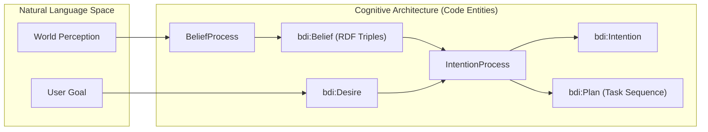

For details, see [BDI Mental States & Cognitive Architecture](#3.4).

Sources: [skills/bdi-mental-states/SKILL.md:1-158](), [researcher/mechanisms/registry.jsonl:6-6]()

---

## Latent Briefing & KV Cache Memory Sharing

Latent Briefing addresses the token explosion problem in hierarchical systems by optimizing the underlying inference engine's memory [skills/latent-briefing/SKILL.md:8-10]().

### Attention Matching
Instead of re-transmitting full summaries to every sub-agent, the system uses **KV-Cache Optimization** to reuse computed tensors across requests. This involves ordering prompts so that stable content occupies the prefix [skills/context-optimization/SKILL.md:68-75]().

For details, see [Latent Briefing & KV Cache Memory Sharing](#3.5).

Sources: [skills/latent-briefing/SKILL.md:1-115](), [skills/context-optimization/SKILL.md:64-78](), [researcher/mechanisms/registry.jsonl:12-12]()

---

## Long-Horizon Prompting

This skill focuses on the design of launch prompts for agents expected to operate autonomously for hours or days [skills/long-horizon-prompting/SKILL.md:8-10](). The central mechanism is the **Pseudo-formal Task Brief**, which applies the rigor of formal verification to linguistic instructions [skills/long-horizon-prompting/SKILL.md:37-43]().

### The Pseudo-formal Brief Anatomy
A robust long-horizon brief consists of ten specific blocks designed to prevent give-up drift and diversity collapse [skills/long-horizon-prompting/SKILL.md:46-57]().

Title: Long-Horizon System Boundary Architecture
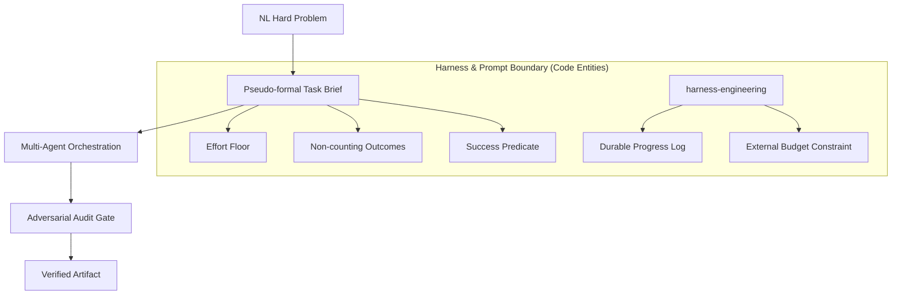

For details, see [Long-Horizon Prompting](#3.6).

Sources: [skills/long-horizon-prompting/SKILL.md:1-65](), [researcher/mechanisms/ledgers/accepted.jsonl:9-11](), [researcher/corpus/index.json:85-90]()

---

# Page: Multi-Agent Patterns

# Multi-Agent Patterns

<details>
<summary>Relevant source files</summary>

The following files were used as context for generating this wiki page:

- [skills/context-degradation/SKILL.md](skills/context-degradation/SKILL.md)
- [skills/context-degradation/scripts/degradation_detector.py](skills/context-degradation/scripts/degradation_detector.py)
- [skills/context-fundamentals/scripts/context_manager.py](skills/context-fundamentals/scripts/context_manager.py)
- [skills/context-optimization/SKILL.md](skills/context-optimization/SKILL.md)
- [skills/context-optimization/scripts/compaction.py](skills/context-optimization/scripts/compaction.py)
- [skills/evaluation/scripts/evaluator.py](skills/evaluation/scripts/evaluator.py)
- [skills/memory-systems/SKILL.md](skills/memory-systems/SKILL.md)
- [skills/multi-agent-patterns/SKILL.md](skills/multi-agent-patterns/SKILL.md)
- [skills/multi-agent-patterns/scripts/coordination.py](skills/multi-agent-patterns/scripts/coordination.py)
- [skills/tool-design/scripts/description_generator.py](skills/tool-design/scripts/description_generator.py)

</details>


Multi-agent architectures distribute computational and cognitive workloads across multiple language model instances, each maintaining an independent context window [skills/multi-agent-patterns/SKILL.md:6-8](). The primary design goal is **Context Isolation**: partitioning complex tasks so each agent operates with a clean context, avoiding performance degradation associated with "lost-in-the-middle" effects and attention dilution in large single-agent prompts [skills/multi-agent-patterns/SKILL.md:6-9](), [skills/multi-agent-patterns/SKILL.md:28-28]().

## Core Architectural Patterns

Selection of an architectural pattern must be driven by coordination requirements, task decomposition clarity, and oversight needs rather than organizational metaphors [skills/multi-agent-patterns/SKILL.md:30-31]().

| Pattern | Control Structure | Best For | Key Implementation |
| :--- | :--- | :--- | :--- |
| **Supervisor** | Centralized | Clear decomposition, human-in-the-loop oversight | `SupervisorAgent` [skills/multi-agent-patterns/scripts/coordination.py:110-116]() |
| **Swarm (P2P)** | Decentralized | Flexible exploration, dynamic requirements | `HandoffProtocol` [skills/multi-agent-patterns/scripts/coordination.py:236-250]() |
| **Hierarchical** | Layered | Strategy vs. Execution abstraction | Recursive `SupervisorAgent` nodes [skills/multi-agent-patterns/SKILL.md:34-35]() |

### 1. Supervisor/Orchestrator
A central coordinator maintains global state and trajectory, decomposes objectives into subtasks, and routes them to appropriate workers [skills/multi-agent-patterns/SKILL.md:68-73]().

**The Telephone Game Problem:**
Supervisors often paraphrase worker outputs, losing fidelity with each pass. Benchmark data indicates supervisor architectures can perform approximately 50% worse than optimized alternatives due to this translation degradation [skills/multi-agent-patterns/SKILL.md:79-81]().
*   **Mitigation:** Implement a `forward_message` tool to allow sub-agents to pass responses directly to users without supervisor synthesis [skills/multi-agent-patterns/SKILL.md:82-97]().

### 2. Peer-to-Peer Swarm
Agents communicate directly via handoff protocols. Control is transferred explicitly through function returns [skills/multi-agent-patterns/SKILL.md:101-103](). This pattern eliminates the single point of failure represented by the supervisor context bottleneck and prevents translation errors by enabling direct responses [skills/multi-agent-patterns/SKILL.md:99-103]().

### 3. Hierarchical Topologies
Used for large-scale projects where layers of abstraction are required (Strategy, Planning, Execution). Each layer operates at a distinct level of detail with dedicated context boundaries [skills/multi-agent-patterns/SKILL.md:34-35]().

### 4. Context Isolation and Token Economics
Context isolation prevents **Sycophantic Convergence** (where agents conform to supervisor errors) and **Context Poisoning** (where tool errors or irrelevant inputs corrupt downstream reasoning chains) [skills/multi-agent-patterns/SKILL.md:28-36]().

**Token Economics Comparison:**
| Architecture | Token Multiplier | Logic |
| :--- | :--- | :--- |
| Single agent chat | Baseline | Simple queries [skills/multi-agent-patterns/SKILL.md:47-52]() |
| Single agent with tools | Higher than baseline | Observation overhead [skills/multi-agent-patterns/SKILL.md:53-53]() |
| Multi-agent system | Much higher than baseline | Coordination and state duplication [skills/multi-agent-patterns/SKILL.md:54-56]() |

Sources: [skills/multi-agent-patterns/SKILL.md:6-103]()

---

## Implementation: coordination.py

The `coordination.py` utility module provides foundational building blocks for implementing supervisor, swarm, consensus, and fault-tolerance patterns [skills/multi-agent-patterns/scripts/coordination.py:1-13]().

### Agent Communication & Messaging
The communication subsystem uses structured `AgentMessage` data envelopes routed through an in-process `AgentCommunication` message bus [skills/multi-agent-patterns/scripts/coordination.py:43-71]().

**Inter-Agent Communication Flow**
```mermaid
graph TD
    subgraph "Natural Language Space"
        "User_Query"["User Query"]
    end

    subgraph "Code Entity Space (coordination.py)"
        "SupervisorAgent"["SupervisorAgent"]
        "AgentCommunication"["AgentCommunication"]
        "AgentMessage"["AgentMessage"]
        "Worker_Agent_A"["Worker_Agent_A"]
        "Worker_Agent_B"["Worker_Agent_B"]

        "SupervisorAgent" -- "decompose_task()" --> "AgentMessage"
        "AgentMessage" -- "send()" --> "AgentCommunication"
        "AgentCommunication" -- "receive()" --> "Worker_Agent_A"
        "Worker_Agent_A" -- "HandoffProtocol" --> "Worker_Agent_B"
    end

    "User_Query" --> "SupervisorAgent"
```
Sources: [skills/multi-agent-patterns/scripts/coordination.py:43-58](), [skills/multi-agent-patterns/scripts/coordination.py:60-71](), [skills/multi-agent-patterns/scripts/coordination.py:110-124]()

### Key Classes and Functions

#### SupervisorAgent
Maintains a `task_queue`, tracks worker availability, and performs capability-aware routing via `select_worker()` [skills/multi-agent-patterns/scripts/coordination.py:110-132]().
*   `decompose_task()`: Parses high-level requests into structured subtasks such as research, analysis, or synthesis [skills/multi-agent-patterns/scripts/coordination.py:134-161]().
*   `assign_task()`: Dispatches `AgentMessage` requests to registered worker inboxes [skills/multi-agent-patterns/scripts/coordination.py:169-186]().

#### ConsensusManager
Mitigates sycophantic convergence by collecting independent votes across multiple agents before confirming critical decisions [skills/multi-agent-patterns/scripts/coordination.py:277-285]().
*   `collect_vote()`: Records individual agent stances and confidence scores [skills/multi-agent-patterns/scripts/coordination.py:293-300]().
*   `resolve()`: Evaluates votes against threshold criteria to determine consensus [skills/multi-agent-patterns/scripts/coordination.py:302-315]().

#### AgentFailureHandler
Acts as a circuit breaker monitoring agent error rates and execution times to prevent error propagation cascades [skills/multi-agent-patterns/scripts/coordination.py:333-345]().
*   Opens the circuit when failure thresholds are breached, forcing the `SupervisorAgent` to reroute tasks or escalate [skills/multi-agent-patterns/scripts/coordination.py:356-368]().

Sources: [skills/multi-agent-patterns/scripts/coordination.py:110-186](), [skills/multi-agent-patterns/scripts/coordination.py:277-315](), [skills/multi-agent-patterns/scripts/coordination.py:333-368]()

---

## Coordination Workflow

This state machine details the execution cycle from task ingestion through delegation, handoff, and consensus resolution.

**Multi-Agent State Transition**
```mermaid
stateDiagram-v2
    [*] --> "Supervisor_Idle": "User Task Received"
    "Supervisor_Idle" --> "Task_Decomposition": "SupervisorAgent.decompose_task()"
    "Task_Decomposition" --> "Worker_Selection": "SupervisorAgent.select_worker()"
    
    state "Worker_Execution" {
        [*] --> "Message_Sent": "AgentCommunication.send(AgentMessage)"
        "Message_Sent" --> "Processing": "Worker.receive()"
        "Processing" --> "Handoff": "HandoffProtocol.initiate_handoff()"
        "Handoff" --> "Processing": "New Worker"
        "Processing" --> "Result_Ready"
    }
    
    "Worker_Selection" --> "Worker_Execution": "SupervisorAgent.assign_task()"
    "Result_Ready" --> "Consensus_Check": "ConsensusManager.collect_vote()"
    "Consensus_Check" --> "Supervisor_Idle": "SupervisorAgent.completed_tasks.append()"
    
    "Worker_Execution" --> "Circuit_Open": "AgentFailureHandler.handle_failure()"
    "Circuit_Open" --> "Supervisor_Idle": "Reroute/Escalate"
```
Sources: [skills/multi-agent-patterns/scripts/coordination.py:134-167](), [skills/multi-agent-patterns/scripts/coordination.py:236-250](), [skills/multi-agent-patterns/scripts/coordination.py:302-310](), [skills/multi-agent-patterns/scripts/coordination.py:347-360]()

---

## Failure Modes and Mitigations

| Failure Mode | Description | Mitigation in Code |
| :--- | :--- | :--- |
| **Telephone Game** | Information loss during synthesis and paraphrasing passes. | `forward_message` direct response pattern [skills/multi-agent-patterns/SKILL.md:82-97](). |
| **Sycophantic Convergence** | Agents agreeing with a biased supervisor or peer group. | `ConsensusManager` independent voting [skills/multi-agent-patterns/scripts/coordination.py:277-315](). |
| **Error Cascades** | A single agent failure crashing the orchestrator pipeline. | `AgentFailureHandler` circuit breaker [skills/multi-agent-patterns/scripts/coordination.py:333-368](). |
| **Context Bottleneck** | Supervisor context fills with uncompressed worker history. | Context Partitioning and Worker Isolation [skills/multi-agent-patterns/SKILL.md:42-45](), [skills/context-degradation/SKILL.md:62-68](). |

Sources: [skills/multi-agent-patterns/SKILL.md:28-97](), [skills/multi-agent-patterns/scripts/coordination.py:277-368](), [skills/context-degradation/SKILL.md:62-68]()

---

# Page: Memory Systems

# Memory Systems

<details>
<summary>Relevant source files</summary>

The following files were used as context for generating this wiki page:

- [LICENSE](LICENSE)
- [skills/context-degradation/SKILL.md](skills/context-degradation/SKILL.md)
- [skills/context-degradation/references/patterns.md](skills/context-degradation/references/patterns.md)
- [skills/context-fundamentals/references/context-components.md](skills/context-fundamentals/references/context-components.md)
- [skills/context-optimization/SKILL.md](skills/context-optimization/SKILL.md)
- [skills/memory-systems/SKILL.md](skills/memory-systems/SKILL.md)
- [skills/memory-systems/references/implementation.md](skills/memory-systems/references/implementation.md)
- [skills/memory-systems/scripts/memory_store.py](skills/memory-systems/scripts/memory_store.py)
- [skills/multi-agent-patterns/SKILL.md](skills/multi-agent-patterns/SKILL.md)
- [skills/multi-agent-patterns/references/frameworks.md](skills/multi-agent-patterns/references/frameworks.md)

</details>


Memory systems provide the persistence layer required for agents to maintain continuity across sessions and reason over accumulated knowledge. In advanced context engineering, memory is treated as a tiered architecture that balances immediate attention needs with long-term retrieval stability [skills/memory-systems/SKILL.md:6-8]().

## Tiered Memory Architecture

The system implements a strategy to manage the spectrum from volatile context to persistent storage. Choosing the shallowest possible layer reduces infrastructure overhead and operational complexity [skills/memory-systems/SKILL.md:29-30](), [skills/memory-systems/SKILL.md:66-67]().

| Layer | Persistence | Implementation | Use Case |
| :--- | :--- | :--- | :--- |
| **Working** | Context Window | Scratchpad in system prompt | Always—optimize with attention-favored positions [skills/memory-systems/SKILL.md:70-70]() |
| **Short-term** | Session-scoped | Filesystem / In-memory cache | Intermediate tool results and conversation state [skills/memory-systems/SKILL.md:71-71]() |
| **Long-term** | Cross-session | Key-value store → Graph DB | User preferences, domain knowledge, and entity registries [skills/memory-systems/SKILL.md:72-72]() |
| **Entity** | Cross-session | Entity registry + properties | Maintaining identity ("John Doe" = same person) across conversations [skills/memory-systems/SKILL.md:73-73]() |
| **Temporal KG** | Cross-session + History | Graph with validity intervals | Facts that change over time, time-travel queries, and preventing context clash [skills/memory-systems/SKILL.md:74-74]() |

### Natural Language Space to Code Entity Space: Ingestion Flow

This diagram bridges natural language instructions to the underlying code entities in `memory_store.py` [skills/memory-systems/scripts/memory_store.py:1-37](), illustrating how facts are ingested across the memory stores.

```mermaid
graph TD
    NL["User Natural Language Input: 'Alice prefers dark mode'"] --> IMS["IntegratedMemorySystem.store_fact()"]
    
    subgraph "Code Entity Space (memory_store.py)"
        IMS --> VS["VectorStore.add()"]
        IMS --> PG["PropertyGraph.get_or_create_node()"]
        IMS --> TKG["TemporalKnowledgeGraph.add_fact()"]
        
        VS --> V_LIST["self.vectors: List[np.ndarray]"]
        VS --> M_LIST["self.metadata: List[Dict[str, Any]]"]
        
        PG --> REG["self.entity_registry: Dict[str, str]"]
        PG --> NODES["self.nodes: Dict[str, Dict]"]
        
        TKG --> FACTS["self.facts: List[Dict[str, Any]]"]
    end
```
Sources: [skills/memory-systems/scripts/memory_store.py:35-80](), [skills/memory-systems/scripts/memory_store.py:189-230](), [skills/memory-systems/scripts/memory_store.py:270-301]()

---

## Core Implementation Components

### VectorStore
The `VectorStore` class provides semantic similarity search with metadata-based indexing for entity and temporal filtering [skills/memory-systems/scripts/memory_store.py:39-44]().
- **`add(text, metadata)`**: Persists facts with deterministic pseudo-embeddings generated via `_embed` to ensure consistency [skills/memory-systems/scripts/memory_store.py:53-80]().
- **`search(query, limit, filters)`**: Implements cosine similarity retrieval with support for metadata exclusion via `_matches_filters` [skills/memory-systems/scripts/memory_store.py:82-122]().
- **`search_by_entity(entity, query)`**: Narrowed retrieval focusing on a specific subject by accessing the `entity_index` [skills/memory-systems/scripts/memory_store.py:124-157]().

### PropertyGraph
The `PropertyGraph` maintains explicit relationships between entities, enabling multi-hop reasoning and connection traversal [skills/memory-systems/scripts/memory_store.py:189-195]().
- **`entity_registry`**: A `Dict[str, str]` mapping names to `node_id` to maintain identity across sessions [skills/memory-systems/scripts/memory_store.py:200-200]().
- **`get_or_create_node(name, label)`**: Ensures entity consistency by checking the registry before creating new nodes [skills/memory-systems/scripts/memory_store.py:204-215]().
- **`create_relationship(source_id, rel_type, target_id)`**: Links nodes via directed edges with property support and indexing by relationship type [skills/memory-systems/scripts/memory_store.py:228-245]().

### TemporalKnowledgeGraph
Designed for facts that change over time, preventing "context clash" by using validity intervals [skills/memory-systems/SKILL.md:74-74]().
- **`add_fact(subject, predicate, object, valid_from, valid_until)`**: Stores triples with temporal metadata in the `facts` list [skills/memory-systems/scripts/memory_store.py:284-301]().
- **`get_facts_at_time(timestamp)`**: Filters facts based on whether the provided timestamp falls within the `valid_from` and `valid_until` range [skills/memory-systems/scripts/memory_store.py:303-317]().

Sources: [skills/memory-systems/scripts/memory_store.py:39-317]()

---

## Retrieval & Integration Patterns

### Natural Language Space to Code Entity Space: Hybrid Retrieval Flow

This diagram bridges natural language queries to the hybrid retrieval methods executed within `IntegratedMemorySystem` and its underlying components [skills/memory-systems/scripts/memory_store.py:333-370]().

```mermaid
graph TD
    Query["User Query: 'What did Alice configure last week?'"] --> IMS_Ret["IntegratedMemorySystem.retrieve_memories()"]
    
    subgraph "Code Entity Space (Retrieval Execution)"
        IMS_Ret --> VS_Search["VectorStore.search_by_entity()"]
        IMS_Ret --> PG_Trav["PropertyGraph.traverse()"]
        IMS_Ret --> TKG_Time["TemporalKnowledgeGraph.get_facts_at_time()"]
        
        VS_Search --> VS_Res["Semantic Matches"]
        PG_Trav --> PG_Res["Entity Edges"]
        TKG_Time --> TKG_Res["Temporal Triples"]
        
        VS_Res --> IMS_Merge["Consolidated Context Generation"]
        PG_Res --> IMS_Merge
        TKG_Res --> IMS_Merge
    end
    
    IMS_Merge --> AgentContext["Injected into Prompt Context Window"]
```
Sources: [skills/memory-systems/scripts/memory_store.py:333-370](), [skills/memory-systems/SKILL.md:78-85]()

### Production Framework Landscape
When scaling beyond the provided scripts, select frameworks based on the dominant retrieval pattern required [skills/memory-systems/SKILL.md:35-37]():

| Framework | Strength | Architecture | Key Performance Signal |
| :--- | :--- | :--- | :--- |
| **Cognee** | Multi-hop reasoning | Multi-layer semantic graph with customizable ECL pipeline | Published high score on HotPotQA [skills/memory-systems/SKILL.md:42-54]() |
| **Zep/Graphiti** | Temporal reasoning | Bi-temporal Knowledge Graph (episode, semantic, community tiers) | Published high score on DMR Accuracy [skills/memory-systems/SKILL.md:40-55]() |
| **Letta** | Stateful services | Self-editing memory with tiered storage (in-context/core/archival) | Published filesystem baseline on LoCoMo [skills/memory-systems/SKILL.md:41-56]() |
| **Mem0** | Multi-tenant systems | Vector store + graph memory, pluggable backends | Published specialized-tool baseline on LoCoMo [skills/memory-systems/SKILL.md:39-57]() |

### Memory Consolidation & Context Integration
Memory systems interact with context engineering skills to manage the attention budget and prevent degradation [skills/memory-systems/SKILL.md:21-25]().

- **MemoryConsolidator**: Summarizes older conversation turns into long-term facts to preserve state without bloating the window [skills/memory-systems/SKILL.md:3-3]().
- **MemoryContextIntegrator**: Injects retrieved memories into attention-favored positions (beginning/end) to mitigate "Lost-in-the-Middle" effects [skills/context-degradation/references/patterns.md:46-79]().
- **Observation Masking**: Works in tandem with memory by replacing verbose tool outputs with compact references while storing the full content in external memory [skills/context-optimization/SKILL.md:54-62]().

Sources: [skills/memory-systems/SKILL.md:1-92](), [skills/memory-systems/scripts/memory_store.py:1-370](), [skills/context-degradation/references/patterns.md:41-79](), [skills/context-optimization/SKILL.md:54-62]()

---

# Page: Filesystem Context & Hosted Agents

# Filesystem Context & Hosted Agents

<details>
<summary>Relevant source files</summary>

The following files were used as context for generating this wiki page:

- [skills/advanced-evaluation/SKILL.md](skills/advanced-evaluation/SKILL.md)
- [skills/bdi-mental-states/SKILL.md](skills/bdi-mental-states/SKILL.md)
- [skills/filesystem-context/SKILL.md](skills/filesystem-context/SKILL.md)
- [skills/filesystem-context/references/implementation-patterns.md](skills/filesystem-context/references/implementation-patterns.md)
- [skills/filesystem-context/scripts/filesystem_context.py](skills/filesystem-context/scripts/filesystem_context.py)
- [skills/hosted-agents/SKILL.md](skills/hosted-agents/SKILL.md)
- [skills/hosted-agents/scripts/sandbox_manager.py](skills/hosted-agents/scripts/sandbox_manager.py)

</details>


The filesystem serves as the primary overflow layer for agent context, enabling agents to store, retrieve, and update effectively unlimited information through a single interface [skills/filesystem-context/SKILL.md:8-10](). By moving execution to remote sandboxed environments, developers can eliminate local resource contention and provide consistent, reproducible environments for background coding agents [skills/hosted-agents/SKILL.md:22-25]().

## Filesystem-Based Context Engineering

Filesystem context engineering addresses the physical limitations of context windows by treating the disk as a tiered memory system [skills/filesystem-context/SKILL.md:8-10](). This approach prioritizes **Dynamic Context Discovery**—pulling relevant data on demand—over static inclusion in the prompt [skills/filesystem-context/SKILL.md:10-12]().

### Context Failure Modes and Filesystem Remedies
Diagnose context failures against four primary modes, each requiring a specific filesystem remedy [skills/filesystem-context/SKILL.md:30-38]():
1. **Missing context**: Persist tool outputs and intermediate results to files so nothing is lost [skills/filesystem-context/SKILL.md:33-33]().
2. **Under-retrieved context**: Structure files for targeted retrieval using grep-friendly formats and clear section headers [skills/filesystem-context/SKILL.md:34-34]().
3. **Over-retrieved context**: Offload bulk content to files and return compact references to preserve token budgets [skills/filesystem-context/SKILL.md:35-35]().
4. **Buried context**: Combine glob and grep for structural search alongside semantic search [skills/filesystem-context/SKILL.md:36-36]().

### Key Implementation Patterns

| Pattern | Code Entity | Purpose |
| :--- | :--- | :--- |
| **Scratch Pad** | `ScratchPadManager` | Offloads large tool outputs (e.g., >2000 tokens) to disk, returning a compact reference [skills/filesystem-context/scripts/filesystem_context.py:49-61](). |
| **Plan Persistence** | `AgentPlan` / `PlanStep` | Stores task trajectories in JSON/YAML so agents can re-orient after context refreshes [skills/filesystem-context/scripts/filesystem_context.py:138-160](). |
| **Tool Handling** | `ToolOutputHandler` | Automates the decision to inline or offload tool results based on token thresholds [skills/filesystem-context/scripts/filesystem_context.py:255-270](). |
| **Sub-Agent Comms** | `AgentWorkspace` | Enables agents to share findings via shared directories rather than message passing [skills/filesystem-context/references/implementation-patterns.md:167-179](). |

### Observation Masking & Scratch Pads
When a tool returns a verbose output, the `ScratchPadManager` writes the content to a timestamped file and generates a summary [skills/filesystem-context/scripts/filesystem_context.py:77-102](). The agent receives a reference string like `[Output from web_search saved to scratch/file.txt. Summary: ...]`, preserving the active context window for reasoning [skills/filesystem-context/scripts/filesystem_context.py:110-114](). This pattern allows for targeted retrieval using tools like `grep` or `read_file` with line ranges later [skills/filesystem-context/SKILL.md:68-69]().

### Plan Persistence Flow
Long-horizon tasks use the `AgentPlan` class to maintain state. The agent re-reads the plan at the start of each turn to "manipulate attention through recitation" [skills/filesystem-context/SKILL.md:85-86](). This prevents task drift when the context window is refreshed or summarized [skills/filesystem-context/scripts/filesystem_context.py:154-158]().

**Plan Persistence Logic**
```mermaid
graph TD
    subgraph "Filesystem_State"
        PlanFile_JSON_YAML["PlanFile_JSON_YAML"]
    end

    subgraph "Code_Entity_Space"
        AgentPlan["AgentPlan"] -->|save| PlanFile_JSON_YAML
        PlanFile_JSON_YAML -->|load| AgentPlan
        AgentPlan -->|contains| PlanStep["PlanStep"]
    end

    subgraph "Natural_Language_Space"
        RefactorGoal[""Refactor auth module""] --> AgentPlan
        AuditTask[""Audit endpoints""] --> PlanStep
    end
```
Sources: [skills/filesystem-context/scripts/filesystem_context.py:138-205](), [skills/filesystem-context/SKILL.md:64-86]()

---

## Hosted Agent Infrastructure

Hosted agents run in remote sandboxes (e.g., Modal, Fly.io) to provide unlimited concurrency and multiplayer support [skills/hosted-agents/SKILL.md:22-25]().

### Sandbox Lifecycle Management
The `SandboxManager` coordinates the lifecycle from image building to session termination [skills/hosted-agents/scripts/sandbox_manager.py:31-33]().

1.  **Warm Pool Strategy**: Maintains a set of `WarmSandbox` instances ready for immediate use via `WarmPoolManager` to eliminate spin-up latency [skills/hosted-agents/scripts/sandbox_manager.py:250-265]().
2.  **Image Builder**: Pre-builds `RepositoryImage` instances using `ImageBuilder` every 30 minutes, including full dependency installation and cache warming [skills/hosted-agents/scripts/sandbox_manager.py:161-180]().
3.  **Snapshotting**: Uses `Sandbox.snapshot()` to preserve the filesystem state, allowing follow-up prompts to restore the environment instantly [skills/hosted-agents/scripts/sandbox_manager.py:119-129]().

### Sandbox State Transitions
```mermaid
stateDiagram-v2
    [*] --> CREATING
    CREATING --> SYNCING: "Load RepositoryImage"
    SYNCING --> READY: "Git Sync Complete"
    READY --> EXECUTING: "execute_command()"
    EXECUTING --> READY
    READY --> SNAPSHOTTING: "snapshot()"
    SNAPSHOTTING --> READY
    READY --> TERMINATED
```
Sources: [skills/hosted-agents/scripts/sandbox_manager.py:36-43](), [skills/hosted-agents/SKILL.md:33-47]()

### Infrastructure Patterns
*   **Modal Integration**: Utilizes `modal.Sandbox` for near-instant startup and native snapshot/restore capabilities [skills/hosted-agents/references/infrastructure-patterns.md:7-30]().
*   **Cloudflare Durable Objects**: Manages session state and multiplayer coordination using `SessionDO`, providing an isolated SQLite database per session [skills/hosted-agents/references/infrastructure-patterns.md:199-215]().
*   **Predictive Warm-Up**: Triggers sandbox preparation as soon as a user starts typing, utilizing the 5-30 second typing interval to complete environment setup [skills/hosted-agents/SKILL.md:80-85]().

### Multiplayer & Identity
To support multiplayer collaboration, the infrastructure explicitly configures `UserIdentity` for git commits. This ensures that even when an agent operates in a shared sandbox, code changes are attributed to the prompting user rather than the application [skills/hosted-agents/scripts/sandbox_manager.py:46-56]().

**Hosted Infrastructure Mapping**
```mermaid
graph LR
    subgraph "Infrastructure_Modal_Cloudflare"
        DurableObject["DurableObject"]
        RemoteSandbox["RemoteSandbox"]
    end

    subgraph "Code_Entity_Space"
        SandboxManager["SandboxManager"] -->|manages| WarmPoolManager["WarmPoolManager"]
        WarmPoolManager -->|provides| WarmSandbox["WarmSandbox"]
        AgentSession["AgentSession"] -->|uses| SessionDO["SessionDO"]
        SessionDO -->|persists| SQLiteStorage["SQLite_Storage"]
    end

    subgraph "Natural_Language_Space"
        UserPrompt[""UserPrompt""] -->|triggers| PredictiveWarmup["PredictiveWarmup"]
        PredictiveWarmup -->|calls| WarmPoolManager
    end
```
Sources: [skills/hosted-agents/scripts/sandbox_manager.py:240-265](), [skills/hosted-agents/references/infrastructure-patterns.md:199-218](), [skills/hosted-agents/SKILL.md:54-59]()

---

## Operational Guidelines

### Context Offloading Thresholds
*   **Inline**: Tool outputs < 2000 tokens [skills/filesystem-context/scripts/filesystem_context.py:57-61]().
*   **Offload**: Tool outputs > 2000 tokens. `ScratchPadManager.offload()` writes to `scratch/` and returns a summary [skills/filesystem-context/SKILL.md:51-60]().

### Sandbox Performance Targets
*   **Latency**: Infrastructure setup should be completed before the user finishes typing (predictive warming) [skills/hosted-agents/SKILL.md:8-9]().
*   **Freshness**: `RepositoryImage` instances should be refreshed every 30 minutes to keep git synchronization deltas small [skills/hosted-agents/SKILL.md:33-35]().
*   **Safety**: Block file writes until git synchronization is 100% complete to avoid merge conflicts; allow file reads immediately [skills/hosted-agents/SKILL.md:86-91]().

Sources: [skills/filesystem-context/SKILL.md:1-135](), [skills/hosted-agents/SKILL.md:1-128](), [skills/filesystem-context/scripts/filesystem_context.py:1-270](), [skills/hosted-agents/scripts/sandbox_manager.py:1-330](), [skills/hosted-agents/references/infrastructure-patterns.md:1-218](), [skills/filesystem-context/references/implementation-patterns.md:1-213]()

---

# Page: BDI Mental States & Cognitive Architecture

# BDI Mental States & Cognitive Architecture

<details>
<summary>Relevant source files</summary>

The following files were used as context for generating this wiki page:

- [skills/advanced-evaluation/SKILL.md](skills/advanced-evaluation/SKILL.md)
- [skills/bdi-mental-states/SKILL.md](skills/bdi-mental-states/SKILL.md)
- [skills/bdi-mental-states/references/bdi-ontology-core.md](skills/bdi-mental-states/references/bdi-ontology-core.md)
- [skills/bdi-mental-states/references/framework-integration.md](skills/bdi-mental-states/references/framework-integration.md)
- [skills/bdi-mental-states/references/rdf-examples.md](skills/bdi-mental-states/references/rdf-examples.md)
- [skills/bdi-mental-states/references/sparql-competency.md](skills/bdi-mental-states/references/sparql-competency.md)
- [skills/filesystem-context/SKILL.md](skills/filesystem-context/SKILL.md)
- [skills/hosted-agents/SKILL.md](skills/hosted-agents/SKILL.md)

</details>


The `bdi-mental-states` skill provides a formal framework for modeling agent cognition using the **Belief-Desire-Intention (BDI)** ontology. It enables agents to transform raw context into structured mental states, supporting deliberative reasoning, explainable decision-making, and neuro-symbolic integration [skills/bdi-mental-states/SKILL.md:6-8]().

## Core Ontology & Mental Reality Architecture

The architecture distinguishes between what an agent knows, what it wants, and what it commits to doing. This is modeled through two primary ontological categories: **Endurants** (persistent states) and **Perdurants** (causal processes) [skills/bdi-mental-states/SKILL.md:32]().

### Mental Entities (Endurants)
These are persistent cognitive attributes that hold over time intervals [skills/bdi-mental-states/SKILL.md:34]():
*   **Belief**: Represent what the agent holds true about the world, grounded in a world state reference [skills/bdi-mental-states/SKILL.md:35]().
*   **Desire**: Motivational states representing what the agent wishes to bring about [skills/bdi-mental-states/SKILL.md:36]().
*   **Intention**: Deliberative commitments to achieve a desire through a specific plan [skills/bdi-mental-states/SKILL.md:37]().
*   **Goal & Plan**: A `Goal` describes the desired end state, while a `Plan` is a structured action sequence consisting of `Tasks` [skills/bdi-mental-states/references/bdi-ontology-core.md:14-15]().

### Mental Processes (Perdurants)
These are events that create or modify mental states, providing a causal chain for explainability [skills/bdi-mental-states/SKILL.md:39]():
*   **BeliefProcess**: Triggers belief formation/update from perception [skills/bdi-mental-states/SKILL.md:40]().
*   **DesireProcess**: Generates desires from existing beliefs [skills/bdi-mental-states/SKILL.md:41]().
*   **IntentionProcess**: Commits to specific desires as actionable intentions [skills/bdi-mental-states/SKILL.md:42]().

### Cognitive Architecture Mapping
The following diagram bridges the conceptual BDI space to the RDF-based implementation entities used in the ontology.

**Diagram: BDI Cognitive Entity Mapping**
```mermaid
graph TD
    subgraph "NaturalLanguageSpace"
        NL1["'I think the store is open'"]
        NL2["'I want groceries'"]
        NL3["'I will go to the store'"]
    end

    subgraph "CodeEntitySpace"
        direction TB
        B["bdi:Belief"]
        D["bdi:Desire"]
        I["bdi:Intention"]
        P["bdi:Plan"]
        WS["bdi:WorldState"]
        AG["bdi:Agent"]
    end

    NL1 --> B
    NL2 --> D
    NL3 --> I

    AG -- "bdi:hasMentalState" --> B
    B -- "bdi:refersTo" --> WS
    D -- "bdi:isMotivatedBy" --> B
    I -- "bdi:fulfils" --> D
    I -- "bdi:specifies" --> P
```
Sources: [skills/bdi-mental-states/SKILL.md:44-62](), [skills/bdi-mental-states/references/bdi-ontology-core.md:7-16](), [skills/bdi-mental-states/references/rdf-examples.md:7-80]()

---

## T2B2T: Triples-to-Beliefs-to-Triples

The **T2B2T paradigm** is a bidirectional pipeline that allows agents to consume external RDF data and project their internal reasoning back into the world state [skills/bdi-mental-states/SKILL.md:97-99]().

### Phase 1: Triples-to-Beliefs (Perception)
Incoming RDF triples representing a `WorldState` trigger a `BeliefProcess` via the `bdi:triggers` property [skills/bdi-mental-states/SKILL.md:101-105](). This process `generates` a `Belief` instance, preserving the provenance from data to thought [skills/bdi-mental-states/SKILL.md:107-108]().

### Phase 2: Beliefs-to-Triples (Action)
After deliberation, the agent selects an `Intention` and executes a `Plan`. The execution is tracked via `bdi:PlanExecution` [skills/bdi-mental-states/SKILL.md:111-117](). The result is projected back into the environment via the `bringsAbout` property, creating a new `WorldState` [skills/bdi-mental-states/SKILL.md:118-119]().

**Diagram: T2B2T Data Flow**
```mermaid
sequenceDiagram
    participant W as "bdi:WorldState"
    participant BP as "bdi:BeliefProcess"
    participant B as "bdi:Belief"
    participant DP as "bdi:DesireProcess"
    participant I as "bdi:Intention"
    participant PE as "bdi:PlanExecution"

    W->>BP: "bdi:triggers"
    BP->>B: "bdi:generates"
    B->>DP: "bdi:reasonsUpon"
    DP->>I: "bdi:generates"
    I->>PE: "bdi:specifies"
    PE->>W: "bdi:bringsAbout"
```
Sources: [skills/bdi-mental-states/SKILL.md:97-120](), [skills/bdi-mental-states/references/rdf-examples.md:14-160]()

---

## Logic Augmented Generation (LAG)

Logic Augmented Generation (LAG) integrates LLMs with the formal BDI ontology to ensure reasoning remains grounded and valid [skills/bdi-mental-states/references/framework-integration.md:158-160]().

### LAG Pipeline Implementation
The `BDILogicAugmentedGenerator` class manages this lifecycle [skills/bdi-mental-states/references/framework-integration.md:185-190]().

1.  **Ontology Injection**: The BDI ontology is serialized to Turtle and injected into the LLM prompt to define the "rules of thought" [skills/bdi-mental-states/references/framework-integration.md:195-197]().
2.  **State Generation**: The LLM generates mental states (triples) based on the provided context, following the BDI schema [skills/bdi-mental-states/references/framework-integration.md:199-200]().
3.  **Validation**: Generated triples are validated against ontological constraints (e.g., an `Intention` must `fulfil` exactly one `Desire`) [skills/bdi-mental-states/references/framework-integration.md:202-204]().

**Diagram: LAG System Components**
```mermaid
graph LR
    subgraph "NaturalLanguageSpace"
        Q["User Query"]
    end

    subgraph "CodeEntitySpace"
        LAG["BDILogicAugmentedGenerator"]
        ONT["BDI Ontology (Turtle)"]
        PROMPT["_build_augmented_prompt"]
        LLM["LLM Client"]
        VALID["_validate_against_ontology"]
    end

    Q --> LAG
    ONT --> PROMPT
    PROMPT --> LLM
    LLM --> VALID
    VALID --> FINAL["Validated RDF Mental States"]
```
Sources: [skills/bdi-mental-states/references/framework-integration.md:165-206]()

---

## Explainable Reasoning & World State Grounding

Explainability is achieved through the **Cognitive Chain Pattern**, which wires mental states into directed, traceable chains [skills/bdi-mental-states/SKILL.md:44-46]().

### Justification and Provenance
Every mental entity should be linked to a `bdi:Justification` via `bdi:isJustifiedBy` [skills/bdi-mental-states/SKILL.md:132-134](). This captures the specific evidence (e.g., a "traffic report" or "official email") that led to the formation of a belief or intention [skills/bdi-mental-states/SKILL.md:136-148]().

### Temporal Grounding
Mental states are assigned `bdi:hasValidity` intervals using `TimeInterval` objects [skills/bdi-mental-states/SKILL.md:150-152](). This allows for:
*   **Diachronic Reasoning**: Tracking how beliefs change over time [skills/bdi-mental-states/SKILL.md:152]().
*   **Conflict Resolution**: Using SPARQL filters to find overlapping or contradictory beliefs active at a specific `TimeInstant` [skills/bdi-mental-states/references/sparql-competency.md:199-212]().

### SPARQL Competency Queries
The system supports complex queries to audit agent cognition [skills/bdi-mental-states/references/sparql-competency.md:1-3]():
*   **Trace Cognitive Chain**: `SELECT ?intention ?desire ?belief ?worldState WHERE { ... }` [skills/bdi-mental-states/references/sparql-competency.md:94-106]().
*   **Temporal Audit**: Finding mental states valid at a specific time [skills/bdi-mental-states/references/sparql-competency.md:199-212]().

Sources: [skills/bdi-mental-states/SKILL.md:44-152](), [skills/bdi-mental-states/references/sparql-competency.md:1-212]()

---

## Framework Integration

The BDI ontology can be translated into executable rules for production systems like **SEMAS** using a rule translation layer [skills/bdi-mental-states/references/framework-integration.md:1-7]().

| BDI Construct | SEMAS Element | Example Logic |
| :--- | :--- | :--- |
| **Belief** | HEAD fact | `belief(agent, store_open)` [skills/bdi-mental-states/references/framework-integration.md:13]() |
| **Desire Generation** | TAIL action | `generate_desire(agent, goal)` [skills/bdi-mental-states/references/framework-integration.md:15]() |
| **Intention Commitment** | TAIL action | `commit_intention(agent, goal)` [skills/bdi-mental-states/references/framework-integration.md:16]() |
| **Plan Specification** | TAIL action | `create_plan(agent, plan_id)` [skills/bdi-mental-states/references/framework-integration.md:17]() |

The function `ontology_to_semas_rules` in the Python translation layer automates this conversion by extracting intention-desire-belief chains from an RDF graph [skills/bdi-mental-states/references/framework-integration.md:102-139]().

Sources: [skills/bdi-mental-states/references/framework-integration.md:1-139]()

---

# Page: Latent Briefing & KV Cache Memory Sharing

# Latent Briefing & KV Cache Memory Sharing

<details>
<summary>Relevant source files</summary>

The following files were used as context for generating this wiki page:

- [skills/latent-briefing/SKILL.md](skills/latent-briefing/SKILL.md)
- [skills/latent-briefing/references/attention-matching-formulation.md](skills/latent-briefing/references/attention-matching-formulation.md)

</details>


Latent Briefing is an advanced context engineering skill designed to solve the **token explosion problem** in hierarchical multi-agent systems. While traditional methods rely on text-based summarization or RAG to transfer state between an orchestrator and its workers, Latent Briefing operates at the **representation level** by sharing and compacting the **KV (Key/Value) cache** directly [skills/latent-briefing/SKILL.md:8-10]().

This technique leverages **Attention Matching (AM)** to selectively retain trajectory positions that are most relevant to a specific worker task, enabling high-fidelity state transfer with significantly lower token costs than re-serializing the entire reasoning history as text [skills/latent-briefing/SKILL.md:10-10](), [skills/latent-briefing/references/attention-matching-formulation.md:27-31]().

Sources: [skills/latent-briefing/SKILL.md:8-10](), [skills/latent-briefing/references/attention-matching-formulation.md:27-31]()

## The Token Explosion Problem

In recursive or hierarchical agent architectures (e.g., Supervisor/Worker), the orchestrator accumulates a trajectory of partial conclusions, tool outputs, and prior worker responses [skills/latent-briefing/SKILL.md:30-30](). 

| Mitigation | Weakness |
| :--- | :--- |
| **LLM Summarization** | High latency, lossy abstraction, and no guarantee the summary preserves what the next subtask needs [skills/latent-briefing/SKILL.md:48-48](). |
| **Retrieval / RAG** | Depends on chunking and embeddings; can miss cross-chunk or cross-step dependencies [skills/latent-briefing/SKILL.md:49-49](). |
| **Pass Full Trajectory** | Cost scales with every worker call and irrelevant context can degrade worker quality [skills/latent-briefing/SKILL.md:50-50](). |

Latent Briefing addresses these by treating the orchestrator's reasoning trajectory as a persistent latent state that can be "briefed" to workers through task-conditioned KV cache compaction [skills/latent-briefing/SKILL.md:32-32]().

Sources: [skills/latent-briefing/SKILL.md:30-50]()

## Implementation: Attention Matching (AM) Formulation

The core engine of Latent Briefing is the Attention Matching objective. It seeks a compacted cache of size `t` (where `t < S`, the original size) such that the attention outputs approximate the full cache [skills/latent-briefing/references/attention-matching-formulation.md:5-7]().

### Mathematical Objective
For each attention head, the system solves for compacted components `(C1, beta, C2)` such that:
`softmax(Q * C1^T + beta) * C2 ~= softmax(Q * K^T) * V` [skills/latent-briefing/references/attention-matching-formulation.md:10-11]().

* **C1**: Compacted keys (subset of high-attention mass vectors) [skills/latent-briefing/references/attention-matching-formulation.md:13-13]().
* **beta**: Bias corrections so the softmax distribution over kept keys approximates the distribution over all keys [skills/latent-briefing/references/attention-matching-formulation.md:14-14]().
* **C2**: Compacted values reconstructed so the attention output matches the original as closely as possible [skills/latent-briefing/references/attention-matching-formulation.md:15-15]().

### Latent Briefing Data Flow
Unlike standard AM, Latent Briefing uses the **current worker task prompt** to derive the query vectors used for scoring [skills/latent-briefing/SKILL.md:62-62]().

Title: Latent Briefing Data Flow
```mermaid
graph TD
    OrchestratorSpace["OrchestratorSpace"] --> ReasoningTrajectory["ReasoningTrajectory"]
    ReasoningTrajectory --> KV_Cache_Full["KV_Cache_Full"]
    
    InferenceRuntime["InferenceRuntime"] --> Worker_Task_Prompt["Worker_Task_Prompt"]
    Worker_Task_Prompt --> Task_Guided_Queries_Q_task["Task_Guided_Queries_Q_task"]
    
    KV_Cache_Full --> Scoring_Engine["Scoring_Engine"]
    Task_Guided_Queries_Q_task --> Scoring_Engine
    
    Scoring_Engine --> Shared_Global_Mask["Shared_Global_Mask"]
    Shared_Global_Mask --> KV_Cache_Compaction["KV_Cache_Compaction"]
    
    WorkerExecution["WorkerExecution"] --> Worker_Model_Generation["Worker_Model_Generation"]
    KV_Cache_Compaction --> Worker_Model_Generation
```
Sources: [skills/latent-briefing/SKILL.md:34-39](), [skills/latent-briefing/references/attention-matching-formulation.md:27-31]()

## Key Technical Modifications

Latent Briefing introduces three specific modifications to standard KV cache management to make it viable for multi-agent systems:

### 1. Task-Guided Query Construction
Instead of sampling queries from the existing context, the system forward-passes the trajectory plus the current task through the worker model [skills/latent-briefing/SKILL.md:62-62](). The attention from task queries (`Q_task`) to trajectory keys (`K`) defines which positions matter for this specific worker call [skills/latent-briefing/references/attention-matching-formulation.md:29-30](), [skills/latent-briefing/references/attention-matching-formulation.md:36-40]().

### 2. Shared Token Masks
Standard AM often solves masks per-head, which prevents efficient batching [skills/latent-briefing/references/attention-matching-formulation.md:23-23](). Latent Briefing aggregates scores across all layers and heads into a **shared global mask** [skills/latent-briefing/SKILL.md:64-64](). This allows for identical sequence layouts across heads, enabling high-speed batched tensor operations and much lower latency [skills/latent-briefing/references/attention-matching-formulation.md:44-46]().

### 3. Robust MAD Thresholding
Rather than a fixed "Top-K" selection, Latent Briefing uses a robust threshold based on the Median Absolute Deviation (MAD) [skills/latent-briefing/SKILL.md:66-66]():
`keep position i if score[i] > median(score) + tau * MAD(score)` [skills/latent-briefing/references/attention-matching-formulation.md:53-53]().
This makes the retention rate adaptive to the specific information density of the current task [skills/latent-briefing/references/attention-matching-formulation.md:50-56]().

Sources: [skills/latent-briefing/SKILL.md:62-66](), [skills/latent-briefing/references/attention-matching-formulation.md:23-56]()

## System Comparison & Selection

Latent Briefing is a specialized optimization for controlled runtimes. Use the following table to determine when to apply it versus other context engineering skills:

| Need | Skill / Pattern | Why |
| :--- | :--- | :--- |
| **Inaccessible KV Tensors** | `context-compression` | Use summarization/compression when internal KV tensors are inaccessible (API-only) [skills/latent-briefing/SKILL.md:23-23](). |
| **External Knowledge** | `memory-systems` | Use for persistent memory, entity tracking, or sparse lookup across large external corpora [skills/latent-briefing/SKILL.md:24-24](), [skills/latent-briefing/SKILL.md:80-80](). |
| **Identical Prefixes** | `context-optimization` | Use Prefix Caching for static prompts or policies that do not transform KV state [skills/latent-briefing/SKILL.md:26-26](), [skills/latent-briefing/SKILL.md:78-78](). |
| **Task-Specific Latent State** | `latent-briefing` | Use when workers need precise slices of orchestrator state and runtime access exists [skills/latent-briefing/SKILL.md:81-81](). |

### Infrastructure Preconditions
* **Runtime Control**: The system must be able to inspect and transform worker KV state [skills/latent-briefing/SKILL.md:69-70]().
* **Architecture Alignment**: Direct sharing assumes orchestrator and worker do not differ materially in tokenizer, architecture, or attention layout [skills/latent-briefing/SKILL.md:70-70]().

Title: Entity Mapping: Logic to Implementation
```mermaid
graph LR
    NaturalLanguageConcepts["NaturalLanguageSpace"] --> N1["ShareMemoryBetweenAgents"]
    NaturalLanguageConcepts --> N2["ReduceWorkerTokens"]
    NaturalLanguageConcepts --> N3["KVCacheCompaction"]

    CodeEntities["CodeEntitySpace"] --> E1["skills/latent-briefing/SKILL.md"]
    CodeEntities --> E2["attention-matching-formulation.md"]
    CodeEntities --> E3["MAD_Thresholding_tau"]
    CodeEntities --> E4["Task_Guided_Queries_Q_task"]

    N1 --> E1
    N2 --> E3
    N3 --> E2
    E2 --> E4
```
Sources: [skills/latent-briefing/SKILL.md:3-81](), [skills/latent-briefing/references/attention-matching-formulation.md:1-3]()

## Metrics and Benchmarking
When evaluating Latent Briefing, track the following metrics:
1. **Worker-Token Savings**: Material reduction in tokens consumed by sub-agents [skills/latent-briefing/SKILL.md:40-40]().
2. **Compaction Overhead**: Time (latency) added by the AM solve process, typically low-single-digit seconds [skills/latent-briefing/SKILL.md:40-40]().
3. **Accuracy**: Maintenance of performance on long-document QA or reasoning tasks [skills/latent-briefing/SKILL.md:40-40]().

Public results indicate substantial worker-token reduction on long-document QA workloads [skills/latent-briefing/SKILL.md:40-40]().

Sources: [skills/latent-briefing/SKILL.md:40-40]()

---

# Page: Long-Horizon Prompting

# Long-Horizon Prompting

<details>
<summary>Relevant source files</summary>

The following files were used as context for generating this wiki page:

- [researcher/benchmarks/router/prompts.jsonl](researcher/benchmarks/router/prompts.jsonl)
- [researcher/claims/index.jsonl](researcher/claims/index.jsonl)
- [researcher/corpus/index.json](researcher/corpus/index.json)
- [researcher/fixtures/activation-cases.jsonl](researcher/fixtures/activation-cases.jsonl)
- [researcher/mechanisms/ledgers/accepted.jsonl](researcher/mechanisms/ledgers/accepted.jsonl)
- [researcher/mechanisms/registry.jsonl](researcher/mechanisms/registry.jsonl)
- [skills/long-horizon-prompting/SKILL.md](skills/long-horizon-prompting/SKILL.md)
- [skills/long-horizon-prompting/references/cdc-prompt-annotated.md](skills/long-horizon-prompting/references/cdc-prompt-annotated.md)
- [skills/long-horizon-prompting/references/research-evidence.md](skills/long-horizon-prompting/references/research-evidence.md)
- [skills/long-horizon-prompting/references/task-brief-template.md](skills/long-horizon-prompting/references/task-brief-template.md)
- [skills/long-horizon-prompting/references/vendor-guidance.md](skills/long-horizon-prompting/references/vendor-guidance.md)

</details>


## Purpose and Scope

This wiki page documents section **3.6 Long-Horizon Prompting**, covering the `long-horizon-prompting` skill (`[skills/long-horizon-prompting/SKILL.md:1-4]()`). This skill governs the design of launch prompts for autonomous agents and parallel multi-agent orchestrations expected to operate for hours or days on open-ended problems `[skills/long-horizon-prompting/SKILL.md:6-10]()`. The core methodology replaces conversational chat instructions with pseudo-formal task specifications, ensuring persistence, diversity maintenance, and adversarial verification `[skills/long-horizon-prompting/SKILL.md:6-10]()`.

Sources: `[skills/long-horizon-prompting/SKILL.md:1-10]()`

---

## Pseudo-Formal Task Brief Methodology & Ten-Block Anatomy

Hard open problems rarely feature machine-checkable success conditions. The pseudo-formal task brief transfers the rigor of formal verification into natural language `[skills/long-horizon-prompting/SKILL.md:6-10]()`. A complete brief is organized into ten distinct architectural blocks designed to close loopholes, prevent "answer-shaped near misses," and eliminate premature return `[skills/long-horizon-prompting/SKILL.md:35-58]()`.

| Block | Technical Purpose | Failure Mitigated |
| :--- | :--- | :--- |
| **Definitions** | Fixes load-bearing terms and boundary cases (e.g., "empty input") `[skills/long-horizon-prompting/SKILL.md:39]()`. | Loophole solutions based on technicalities `[skills/long-horizon-prompting/SKILL.md:48]()`. |
| **Success Predicate** | States exactly what must be true at return with explicit scope quantifiers `[skills/long-horizon-prompting/SKILL.md:40]()`. | Scope-narrowed or partial answers `[skills/long-horizon-prompting/SKILL.md:49]()`. |
| **Non-counting Outcomes** | Enumerates specific "answer-shaped near misses" that are rejected `[skills/long-horizon-prompting/SKILL.md:41]()`. | Partial progress or unverified reductions `[skills/long-horizon-prompting/SKILL.md:50]()`. |
| **Solvability Framing** | Uses "Assume a solution exists" to counter give-up drift on open problems `[skills/long-horizon-prompting/SKILL.md:25-26]()`. | "I cannot solve this open problem" refusals `[skills/long-horizon-prompting/SKILL.md:51]()`. |
| **Orchestration Policy** | Heuristics for parallel search, approach registries, and blocked routes `[skills/long-horizon-prompting/SKILL.md:52]()`. | Diversity collapse and premature convergence `[skills/long-horizon-prompting/SKILL.md:52]()`. |
| **Verification Policy** | Adversarial audit with a domain-specific failure mode hunt list `[skills/long-horizon-prompting/SKILL.md:43]()`. | Lenient self-judging `[skills/long-horizon-prompting/SKILL.md:53]()`. |
| **Reporting Contract** | Requires concrete artifacts (scripts, proofs) over status reports `[skills/long-horizon-prompting/SKILL.md:84-85]()`. | Vague optimism or fabricated progress `[skills/long-horizon-prompting/SKILL.md:54]()`. |
| **Return Condition** | Gates completion strictly on artifact survival of the adversarial audit `[skills/long-horizon-prompting/SKILL.md:92-93]()`. | Premature return due to "best effort" `[skills/long-horizon-prompting/SKILL.md:55]()`. |
| **Effort Framing** | Sets an "Effort Floor" (e.g., minimum duration/cost) before quitting is considered `[skills/long-horizon-prompting/SKILL.md:103-105]()`. | Early abandonment `[skills/long-horizon-prompting/SKILL.md:56]()`. |
| **Contamination Guards** | Defines strict boundaries for external retrieval and search `[skills/long-horizon-prompting/SKILL.md:109-113]()`. | Laundered lookups or benchmark leakage `[skills/long-horizon-prompting/SKILL.md:57]()`. |

Sources: `[skills/long-horizon-prompting/SKILL.md:35-58]()`, `[skills/long-horizon-prompting/references/task-brief-template.md:7-114]()`

---

## CDC Exemplar & Research Evidence

The primary empirical exemplar of long-horizon prompting is the published prompt behind GPT-5.6 Sol Ultra's candidate proof of the Cycle Double Cover (CDC) Conjecture, coordinated via a 64-subagent orchestration `[skills/long-horizon-prompting/SKILL.md:8-10]()`, `[skills/long-horizon-prompting/references/cdc-prompt-annotated.md:1-6]()`. 

Key insights from academic research backing these design patterns include:
- **Give-Up Drift:** As trajectories lengthen, dominant failure modes shift from confident errors to outright abandonment `[skills/long-horizon-prompting/references/research-evidence.md:7]()`. Solvability framing and effort floors actively counteract this drift `[skills/long-horizon-prompting/SKILL.md:25-26]`, `[skills/long-horizon-prompting/SKILL.md:103-105]()`.
- **The Verification Bottleneck:** Pass@K scales with compute, but self-selection accuracy plateaus without external verification `[skills/long-horizon-prompting/references/research-evidence.md:14-15]()`. Enumerated audit checklists prevent "proof by intimidation" and lenient judging `[skills/long-horizon-prompting/references/research-evidence.md:16]()`.

Sources: `[skills/long-horizon-prompting/SKILL.md:8-10]()`, `[skills/long-horizon-prompting/references/cdc-prompt-annotated.md:1-10]()`, `[skills/long-horizon-prompting/references/research-evidence.md:7-16]()`

---

## Prompt/Harness Split & System Architecture

A fundamental architectural boundary separates natural language specifications (`long-horizon-prompting`) from code-level runtime constraints (`harness-engineering`) `[skills/long-horizon-prompting/SKILL.md:23-32]()`. Hard constraints such as token budgets, hard timeouts, and file permissions must be enforced by the runtime harness rather than advisory text in prompts `[skills/long-horizon-prompting/references/task-brief-template.md:122]()`.

Title: "Long-Horizon System Boundaries"
```mermaid
graph TD
    subgraph "Natural Language Space (Prompt)"
        A["PseudoFormalBrief skills/long-horizon-prompting/SKILL.md"] --> B["SuccessPredicate skills/long-horizon-prompting/references/task-brief-template.md"]
        A --> C["NonCountingOutcomes skills/long-horizon-prompting/references/task-brief-template.md"]
        A --> D["VerificationPolicy skills/long-horizon-prompting/references/task-brief-template.md"]
    end

    subgraph "Code Entity Space (The Harness)"
        E["HarnessEngineering harness-engineering"] -- "Enforces" --> F["EffortFloorAndBudget skills/long-horizon-prompting/references/task-brief-template.md"]
        E -- "Maintains" --> G["DurableStateThread skills/filesystem-context/SKILL.md"]
        H["MultiAgentPatterns multi-agent-patterns"] -- "Coordinates" --> I["AgentTopologySpawning skills/multi-agent-patterns/SKILL.md"]
        J["EvaluationRunner evaluation"] -- "Runs" --> K["DeterministicQualityGates skills/evaluation/SKILL.md"]
    end

    B -. "EvaluatedBy" .-> K
    D -. "AuditedBy" .-> K
    I -- "Executes" --> A
```

Sources: `[skills/long-horizon-prompting/SKILL.md:23-32]()`, `[skills/long-horizon-prompting/references/task-brief-template.md:121-123]()`

---

## Mechanisms and Routing Boundaries

The execution of long-horizon runs is governed by specific mechanisms registered in the repository `[researcher/mechanisms/registry.jsonl:1-13]()`:
1. **Pseudo-Formal Task Specification (`pseudo-formal-task-specification`)**: Explicitly defines object classes and success predicates `[researcher/mechanisms/ledgers/accepted.jsonl:9]()`.
2. **Audit-Gated Return Condition (`audit-gated-return-condition`)**: Gates completion on checkable external verification rather than agent self-declaration `[researcher/mechanisms/ledgers/accepted.jsonl:10]()`.
3. **Independent Portfolio Approach Registry (`independent-portfolio-approach-registry`)**: Combats diversity collapse via information hiding and blocked-route tracking `[researcher/mechanisms/ledgers/accepted.jsonl:11]()`.

Title: "Long-Horizon State Transition Logic"
```mermaid
stateDiagram-v2
    [*] --> Initialized
    Initialized --> ParallelSearch: Root launches Portfolio Registry
    ParallelSearch --> AuditGate: Worker returns Candidate Artifact
    AuditGate --> ParallelSearch: Audit Fails (Record Blocked Route)
    AuditGate --> Success: Audit Passes (Return Condition Met)
    ParallelSearch --> Exhausted: External Budget Limit Reached
    Exhausted --> PartialReturn: Strongest verified derivation returned
```

Sources: `[researcher/mechanisms/registry.jsonl:1-13]`, `[researcher/mechanisms/ledgers/accepted.jsonl:9-11]`, `[skills/long-horizon-prompting/references/task-brief-template.md:90-100]()`

---

## 10-Dimension Rubric & Pre-Launch Evaluation

Before committing expensive agent compute, brief specifications are evaluated against a 10-dimension rubric (0 to 2 scale) `[skills/long-horizon-prompting/references/task-brief-template.md:125-140]()`. A passing brief must achieve an adversary-proof score (`2`) across all dimensions `[skills/long-horizon-prompting/references/task-brief-template.md:127]()`.

| # | Dimension | Passing (2) Criteria |
| :--- | :--- | :--- |
| 1 | **Success Predicate** | An adversarial reader can decide unambiguously whether an artifact satisfies it; quantifiers and scope explicit `[skills/long-horizon-prompting/references/task-brief-template.md:131]()`. |
| 2 | **Definitions** | Every load-bearing term defined, degenerate cases settled `[skills/long-horizon-prompting/references/task-brief-template.md:132]()`. |
| 3 | **Non-counting Outcomes** | The plausible near misses for this specific problem are excluded by name `[skills/long-horizon-prompting/references/task-brief-template.md:133]()`. |
| 4 | **Auditor Checklist** | Enumerated, domain-specific failure modes including the circularity analogue `[skills/long-horizon-prompting/references/task-brief-template.md:134]()`. |
| 5 | **Persistence-Pairing** | Every persistence instruction has a matching verification gate `[skills/long-horizon-prompting/SKILL.md:61]()`. |
| 6 | **Return Condition** | A predicate over the artifact; fallback scoped to external budget exhaustion only `[skills/long-horizon-prompting/references/task-brief-template.md:120]()`. |

Sources: `[skills/long-horizon-prompting/references/task-brief-template.md:125-140]()`

---

## Diversity Collapse Mitigation

When orchestrating parallel agents on hard problems, models naturally tend toward identical incomplete reductions or superficial framing (`[skills/long-horizon-prompting/references/research-evidence.md:23-24]()`). The orchestration policy counters this via:
- **Information Hiding:** Withholding favored approaches from early-round worker spawns (`[skills/long-horizon-prompting/references/cdc-prompt-annotated.md:38-39]()`).
- **Approach Registries:** Tracking underlying ideas rather than surface wording to prevent superficial paraphrase from masquerading as diverse exploration (`[skills/long-horizon-prompting/references/cdc-prompt-annotated.md:39-40]()`).
- **Blocked-Route Bookkeeping:** Marking stalled routes as blocked and reopening them only upon introduction of a materially new mechanism (`[skills/long-horizon-prompting/references/cdc-prompt-annotated.md:40-41]()`).

Sources: `[skills/long-horizon-prompting/references/cdc-prompt-annotated.md:33-44]()`, `[skills/long-horizon-prompting/references/research-evidence.md:23-26]()`

---

## Reference Files

- `skills/long-horizon-prompting/SKILL.md`: Core skill definition and activation criteria `[skills/long-horizon-prompting/SKILL.md:1-4]()`.
- `skills/long-horizon-prompting/references/task-brief-template.md`: Reusable ten-block brief blueprint and pre-launch rubric `[skills/long-horizon-prompting/references/task-brief-template.md:1-140]()`.
- `skills/long-horizon-prompting/references/cdc-prompt-annotated.md`: Detailed block-by-block analysis of the Cycle Double Cover exemplar `[skills/long-horizon-prompting/references/cdc-prompt-annotated.md:1-50]()`.
- `skills/long-horizon-prompting/references/vendor-guidance.md`: Primary vendor extracts on agent persistence and execution `[skills/long-horizon-prompting/references/vendor-guidance.md:1-76]()`.
- `skills/long-horizon-prompting/references/research-evidence.md`: Academic literature backing context rot, verification bottlenecks, and diversity collapse `[skills/long-horizon-prompting/references/research-evidence.md:1-38]()`.

Sources: `[skills/long-horizon-prompting/SKILL.md:1-32]()`, `[researcher/corpus/index.json:85-90]()`

---

# Page: Tool Design, Project Development & Harness Skills

# Tool Design, Project Development & Harness Skills

<details>
<summary>Relevant source files</summary>

The following files were used as context for generating this wiki page:

- [skills/context-fundamentals/SKILL.md](skills/context-fundamentals/SKILL.md)
- [skills/project-development/SKILL.md](skills/project-development/SKILL.md)
- [skills/self-improvement-loops/SKILL.md](skills/self-improvement-loops/SKILL.md)
- [skills/self-improvement-loops/references/loop-design-evidence.md](skills/self-improvement-loops/references/loop-design-evidence.md)
- [skills/tool-design/SKILL.md](skills/tool-design/SKILL.md)

</details>


This section covers the architectural and engineering skills required to build robust, agent-facing tools, structured LLM pipelines, and autonomous governance systems. It focuses on moving from brittle, high-maintenance prompt engineering toward deterministic systems, efficient processing workflows, and self-improving scaffolds.

## Overview

Effective context engineering requires more than just prompt optimization; it requires designing the **interfaces** through which agents interact with the world, the **pipelines** that manage their data, and the **harnesses** that govern their autonomy.

*   **Tool Design** focuses on the "Consolidation Principle," reducing architectural complexity by providing agents with high-utility, general-purpose primitives rather than dozens of narrow, specialized tools [skills/tool-design/SKILL.md:31-35]().
*   **Project Development** provides a methodology for identifying "Task-Model Fit" and structuring LLM work as idempotent, staged pipelines that separate expensive, non-deterministic LLM calls from deterministic data preparation and parsing [skills/project-development/SKILL.md:32-35, 71-77]().
*   **Harness Engineering** provides the operational boundary for autonomous systems, defining "Locked" vs "Editable" surfaces and implementing novelty gates to ensure agents don't overwrite human-authored core logic [skills/self-improvement-loops/SKILL.md:23-25]().
*   **Self-Improvement Loops** targets the optimization of the harness itself, using failure-mining and evolutionary search to evolve the mechanisms that manage context and workflows [skills/self-improvement-loops/SKILL.md:6-10]().

Sources: [skills/tool-design/SKILL.md:31-35](), [skills/project-development/SKILL.md:32-77](), [skills/self-improvement-loops/SKILL.md:6-25]()

### Bridging Natural Language to Code Space

The following diagrams illustrate how abstract design principles manifest as specific code entities and file structures within the repository.

**Diagram 1: Tool Architecture & Reduction**
This diagram shows how the `tool-design` skill moves from complex, specialized toolsets to the "File System Agent" pattern seen in production evidence.

```mermaid
graph TD
    subgraph "Natural Language Space"
        A["User Intent"] --> B["Agent Reasoning"]
    end

    subgraph "Code Entity Space: tool-design"
        B --> C["ToolSchemaBuilder"]
        C --> D{"Architecture Choice"}
        
        D -- "Specialized (Legacy)" --> E["17+ Narrow Tools"]
        D -- "Reduced (Pattern)" --> F["execute_command"]
        
        E --> G["High Maintenance / Selection Error"]
        F --> H["Standard Unix Utilities (grep, cat, ls)"]
        
        I["description_generator.py"] --> C
    end

    subgraph "Filesystem Grounding"
        H --> J["/data/entities/"]
        H --> K["/docs/*.md"]
    end
```
Sources: [skills/tool-design/SKILL.md:31-35](), [skills/tool-design/SKILL.md:48-51](), [skills/tool-design/SKILL.md:59-65]()

**Diagram 2: Autonomous Optimization Ladder**
This diagram maps the hierarchy of self-improvement targets, from simple prompts to the optimizer code itself.

```mermaid
graph TD
    subgraph "Natural Language Space"
        L1["Instructions"]
        L2["Context Playbook"]
    end

    subgraph "Code Entity Space: self-improvement-loops"
        R1["Rung 1: Promptbreeder"]
        R2["Rung 2: ACE Playbook"]
        R3["Rung 3: MCE Skill Directory"]
        R4["Rung 4: AFlow Workflow Graph"]
        R5["Rung 5: Harness Code (Self-Harness)"]
        R6["Rung 6: STOP (Optimizer Code)"]
    end

    subgraph "Governance & Safety"
        G1["Outside-the-Loop Evaluator"]
        G2["Two-Split No-Regression Gate"]
        G3["Filesystem Experience Archive"]
    end

    L1 --> R1
    L2 --> R2
    R1 --> R2 --> R3 --> R4 --> R5 --> R6
    R5 --> G1
    R6 --> G2
    R5 --> G3
```
Sources: [skills/self-improvement-loops/SKILL.md:34-46](), [skills/self-improvement-loops/SKILL.md:56-66](), [skills/self-improvement-loops/SKILL.md:71-74]()

---

## [Tool Design Principles](#4.1)

Tool design is treated as a contract between a deterministic system and a non-deterministic agent [skills/tool-design/SKILL.md:8-9](). This skill emphasizes **Architectural Reduction**, a pattern where specialized tools are replaced by a single execution primitive that allows the agent to explore a well-documented codebase or data layer using standard Unix utilities [skills/tool-design/SKILL.md:63-65]().

Key components include:
*   **Consolidation Principle**: Reducing the tool set until each tool has one unambiguous purpose to prevent selection errors [skills/tool-design/SKILL.md:31-35]().
*   **Tool Description Engineering**: Writing descriptions that function as prompt engineering, answering what the tool does, when to use it, and what it returns [skills/tool-design/SKILL.md:33-35]().
*   **MCP Conventions**: Standardizing tool namespaces (e.g., `db_*`, `web_*`) to help agents navigate growing tool collections [skills/tool-design/SKILL.md:45-47]().
*   **Actionable Error Messages**: Designing responses so the agent can self-correct when a tool call fails [skills/tool-design/SKILL.md:19-19]().

For details, see [Tool Design Principles](#4.1).

Sources: [skills/tool-design/SKILL.md:8-65]()

---

## [Project Development & LLM Pipelines](#4.2)

The project development skill provides a framework for scaling LLM tasks from single prompts to production-grade batch processors. It introduces a **Five-Stage Idempotent Pipeline** (`acquire` → `prepare` → `process` → `parse` → `render`) designed to minimize costs by caching the results of expensive LLM calls [skills/project-development/SKILL.md:71-89]().

Key components include:
*   **Task-Model Fit**: A rubric-based approach to determine if a task is suitable for an LLM (synthesis, subjective judgment) or better suited for traditional code (precise computation, real-time requirements) [skills/project-development/SKILL.md:36-57]().
*   **File System as State Machine**: Using directory structures (e.g., `data/{id}/raw.json`) to track pipeline progress, enabling easy debugging and parallelization [skills/project-development/SKILL.md:92-102]().
*   **Manual Prototype Step**: Validating task-model fit with a manual test before investing in automation to prevent wasted effort [skills/project-development/SKILL.md:58-68]().
*   **Three-Phase Workflow**: Implementing structured workflows to ensure context is established before modification [skills/project-development/SKILL.md:120-125]() (see child page for full details).

For details, see [Project Development & LLM Pipelines](#4.2).

Sources: [skills/project-development/SKILL.md:36-125]()

---

## [Harness Engineering](#4.3)

Harness engineering defines the operational environment and safety boundaries for autonomous agents. It focuses on externalizing agent state and protecting the "Locked" surface of a codebase while allowing the agent to operate within "Editable" or "Append-only" regions.

Key components include:
*   **Harness Boundaries**: Classifying surfaces as Locked, Editable, Append-only, or Human-controlled.
*   **Tight Feedback Loops**: Implementing iterative refinement patterns—one editable file, one locked evaluator, and a fixed wall-clock budget.
*   **Durable State**: Externalizing plans and failures to logs to allow future agents to resume without relying on volatile chat history.
*   **Novelty Gates**: Using registries and checks to compare new proposals against existing skills, preventing redundant work.

For details, see [Harness Engineering](#4.3).

Sources: [skills/self-improvement-loops/SKILL.md:23-25]()

---

## [Self-Improvement Loops](#4.4)

This skill addresses systems where the harness, scaffold, or optimizer itself is the optimization target [skills/self-improvement-loops/SKILL.md:2-3](). It distinguishes between governing a loop and evolving it [skills/self-improvement-loops/SKILL.md:8-10]().

Key components include:
*   **Optimization Ladder**: A framework for targeting improvements at the correct level, from prompts to optimizer code [skills/self-improvement-loops/SKILL.md:34-47]().
*   **Outside-the-Loop Invariant**: The requirement that evaluators and budget enforcement live in the runtime, outside the surface the agent can modify, to prevent reward hacking [skills/self-improvement-loops/SKILL.md:56-66]().
*   **Two-Split No-Regression Gate**: An acceptance rule requiring improvement on a held-in set and no regression on a held-out set before a self-edit is merged [skills/self-improvement-loops/SKILL.md:67-70]().
*   **Filesystem Experience Archive**: Storing source code, scores, and raw traces in a searchable directory structure to allow the proposer to learn from historical successes and failures [skills/self-improvement-loops/SKILL.md:71-74]().

For details, see [Self-Improvement Loops](#4.4).

Sources: [skills/self-improvement-loops/SKILL.md:2-74](), [skills/self-improvement-loops/references/loop-design-evidence.md:1-58]()

---

# Page: Tool Design Principles

# Tool Design Principles

<details>
<summary>Relevant source files</summary>

The following files were used as context for generating this wiki page:

- [docs/netflix_context.md](docs/netflix_context.md)
- [docs/vercel_tool.md](docs/vercel_tool.md)
- [skills/context-compression/SKILL.md](skills/context-compression/SKILL.md)
- [skills/context-compression/scripts/compression_evaluator.py](skills/context-compression/scripts/compression_evaluator.py)
- [skills/context-compression/tests/test_compression_evaluator.py](skills/context-compression/tests/test_compression_evaluator.py)
- [skills/context-fundamentals/SKILL.md](skills/context-fundamentals/SKILL.md)
- [skills/project-development/SKILL.md](skills/project-development/SKILL.md)
- [skills/tool-design/SKILL.md](skills/tool-design/SKILL.md)
- [skills/tool-design/references/architectural_reduction.md](skills/tool-design/references/architectural_reduction.md)

</details>


## Purpose and Scope

This page covers the `tool-design` skill, focusing on the interface layer that connects deterministic code to non-deterministic agents [skills/tool-design/SKILL.md:6-11](). It details the Consolidation Principle, Architectural Reduction via the File System Agent Pattern, tool description engineering, the `ToolSchemaBuilder` and `description_generator.py` utilities, MCP namespacing, verb-noun naming conventions, and actionable error recovery [skills/tool-design/SKILL.md:1-4]().

---

## The Consolidation Principle & Architectural Reduction

The Consolidation Principle mandates that if a human engineer cannot definitively distinguish between two tools, an agent will inevitably fail to do so [skills/tool-design/SKILL.md:31-32](). Reducing tool sets to one unambiguous purpose per tool minimizes selection errors caused by overlapping functionality [skills/tool-design/SKILL.md:18-19](). Bloated tool sets create ambiguous decision points and consume disproportionate context after JSON serialization [skills/context-fundamentals/SKILL.md:54-55]().

Architectural reduction replaces numerous specialized tools with primitive, general-purpose capabilities [skills/tool-design/SKILL.md:59-61](). The **File System Agent Pattern** substitutes custom data exploration tools with standard Unix utilities (`grep`, `cat`, `ls`, `find`) [skills/tool-design/SKILL.md:63-65](). Production data from Text-to-SQL systems demonstrates significant performance gains when compressing tool sets [skills/tool-design/references/architectural_reduction.md:32-37]().

| Metric | Original (17 tools) | Reduced (2 tools) | Improvement |
| :--- | :--- | :--- | :--- |
| **Avg. Execution Time** | 274.8s | 77.4s | 3.5x faster |
| **Success Rate** | 80% | 100% | +20% |
| **Avg. Token Usage** | ~102k | ~61k | 37% reduction |

Sources: [skills/tool-design/references/architectural_reduction.md:60-65](), [skills/tool-design/SKILL.md:59-65](), [skills/context-fundamentals/SKILL.md:54-55](), [skills/tool-design/references/architectural_reduction.md:32-37]()

### Architectural Reduction Diagram

**Natural Language Space to Code Entity Space: Architectural Reduction**
```mermaid
graph TD
    subgraph "NaturalLanguageSpace"
        A["'Find the user schema'"]
        B["'Search for pricing logs'"]
    end

    subgraph "CodeEntitySpace"
        subgraph "OriginalComplexity"
            T1["SearchSchema"]
            T2["LoadCatalog"]
            T3["FindRelationships"]
            T4["SyntaxValidator"]
        end

        subgraph "ReducedArchitecture"
            E1["execute_command"]
            E2["execute_sql"]
        end
    end

    A --> T1
    A --> E1
    B --> T2
    B --> E1

    style E1 stroke-width:4px
    style E2 stroke-width:4px
```
Sources: [skills/tool-design/references/architectural_reduction.md:9-37](), [skills/tool-design/SKILL.md:63-65](), [skills/tool-design/references/architectural_reduction.md:32-37]()

---

## Tool Description Engineering & Namespacing

Tool descriptions serve as active prompt components that directly steer agent behavior [skills/tool-design/SKILL.md:33-35](). Descriptions must answer three core questions: what the tool does, when to use it, and what it returns [skills/tool-design/SKILL.md:33-34]().

### Verb-Noun Convention & MCP Namespaces
* **Verb-Noun Naming**: Tools follow explicit action-object patterns (e.g., `get_customer`, `update_record`) [skills/tool-design/SKILL.md:19-20]().
* **Namespacing**: Collections use prefixes (`db_*`, `web_*`) to improve routing accuracy in large catalogs [skills/tool-design/SKILL.md:45-47]().
* **Model Context Protocol (MCP)**: Implements server-qualified namespaces (`ServerName:tool_name`) [skills/tool-design/SKILL.md:20]().

Sources: [skills/tool-design/SKILL.md:19-20](), [skills/tool-design/SKILL.md:33-35](), [skills/tool-design/SKILL.md:45-47]()

---

## ToolSchemaBuilder & description_generator.py

The `ToolSchemaBuilder` class in `description_generator.py` provides a programmatic interface for assembling valid tool contracts [skills/tool-design/scripts/description_generator.py:18-25]().

### Key Implementation Components
* `ToolSchemaBuilder`: Fluent interface for adding parameters and constraints [skills/tool-design/scripts/description_generator.py:40]().
* `generate_tool_description(tool_spec)`: Renders Markdown descriptions for context injection [skills/tool-design/scripts/description_generator.py:111-125]().
* `ToolDescriptionEvaluator.evaluate()`: Programmatically scores clarity, completeness, and actionability [skills/tool-design/scripts/description_generator.py:204-216]().
* `ErrorMessageGenerator`: Constructs steerable recovery prompts for failed tool calls [skills/tool-design/scripts/description_generator.py:14-15]().

Sources: [skills/tool-design/scripts/description_generator.py:14-40](), [skills/tool-design/scripts/description_generator.py:111-125](), [skills/tool-design/scripts/description_generator.py:204-216]()

---

## Actionable Error Messages

Error responses must provide deterministic recovery pathways rather than opaque failure codes [skills/tool-design/SKILL.md:19](). When a parameter is missing or a file is not found, the error payload must explicitly instruct the agent on the corrective action (e.g., suggesting a directory listing or schema query) [skills/tool-design/SKILL.md:88-91]().

Sources: [skills/tool-design/SKILL.md:19](), [skills/tool-design/SKILL.md:88-91]()

---

## Tool Lifecycle Data Flow

The following sequence details the lifecycle from schema construction to agent execution and automated evaluation.

**Natural Language Space to Code Entity Space: Tool Lifecycle**
```mermaid
sequenceDiagram
    participant D as Developer
    participant B as "ToolSchemaBuilder"
    participant G as "description_generator.py"
    participant A as "Agent"
    participant E as "ToolDescriptionEvaluator"

    D->>B: "Define Tool (Name, Params, Returns)"
    B->>G: "generate_tool_description()"
    G->>E: "evaluate(description, tool_spec)"
    E-->>D: "Quality Scores"
    D->>A: "Inject Description into Context"
    A->>A: "Reason over Task"
    A->>B: "Call Tool (JSON Payload)"
    B-->>A: "Return Actionable Error or Result"
```
Sources: [skills/tool-design/scripts/description_generator.py:10-25](), [skills/tool-design/SKILL.md:30-35](), [skills/tool-design/scripts/description_generator.py:204-216]()

---

## Tool Evaluation & Performance Drivers

Tool optimization must be measured against **Tokens-Per-Task** rather than per-request token counts [skills/context-compression/SKILL.md:8-9](). Poor tool descriptions cause agents to repeatedly query or misunderstand outputs, increasing total task token expenditure [skills/context-compression/SKILL.md:40-41]().

| Design Principle | Code Entity / Script | Role |
| :--- | :--- | :--- |
| **Consolidation** | `SKILL.md` (Core Concepts) | Policy for reducing selection ambiguity and token bloat [skills/tool-design/SKILL.md:31-32]() |
| **Schema Building** | `ToolSchemaBuilder` | Fluent interface for standardized spec construction [skills/tool-design/scripts/description_generator.py:40]() |
| **Quality Audit** | `ToolDescriptionEvaluator` | Automated scoring of tool documentation quality [skills/tool-design/scripts/description_generator.py:204-216]() |
| **Error Handling** | `ErrorMessageGenerator` | Logic for creating agent-steerable recovery messages [skills/tool-design/scripts/description_generator.py:39]() |

Sources: [skills/tool-design/SKILL.md:31-32](), [skills/tool-design/scripts/description_generator.py:40](), [skills/tool-design/scripts/description_generator.py:204-216](), [skills/context-compression/SKILL.md:8-9](), [skills/context-compression/SKILL.md:40-41]()

---

# Page: Project Development & LLM Pipelines

# Project Development & LLM Pipelines

<details>
<summary>Relevant source files</summary>

The following files were used as context for generating this wiki page:

- [skills/context-fundamentals/SKILL.md](skills/context-fundamentals/SKILL.md)
- [skills/project-development/SKILL.md](skills/project-development/SKILL.md)
- [skills/project-development/references/case-studies.md](skills/project-development/references/case-studies.md)
- [skills/project-development/references/pipeline-patterns.md](skills/project-development/references/pipeline-patterns.md)
- [skills/project-development/scripts/pipeline_template.py](skills/project-development/scripts/pipeline_template.py)
- [skills/tool-design/SKILL.md](skills/tool-design/SKILL.md)

</details>


The Project Development & LLM Pipelines skill provides a structured methodology for identifying, architecting, and executing LLM-based projects. It emphasizes a transition from fragile, over-engineered agent scaffolding to robust, idempotent pipelines and simplified "File System as Agent" patterns. This page details the five-stage pipeline architecture, cost projection mechanics, and the three-phase workflow for large-scale codebase interactions.

## 1. The Five-Stage Idempotent Pipeline

To ensure reliability and maintainability, LLM projects are structured as staged pipelines. This separation allows for independent debugging of deterministic code and non-deterministic LLM calls [skills/project-development/SKILL.md:69-77]().

### Pipeline Stages
The canonical pipeline follows a linear progression of data transformation [skills/project-development/SKILL.md:78-82]():

| Stage | Name | Description | Deterministic |
| :--- | :--- | :--- | :--- |
| 1 | **Acquire** | Fetch raw data from APIs, databases, or local files [skills/project-development/SKILL.md:84-84](). | Yes |
| 2 | **Prepare** | Transform raw data into structured Markdown prompts [skills/project-development/SKILL.md:85-85](). | Yes |
| 3 | **Process** | Execute LLM calls (the non-deterministic, expensive step) [skills/project-development/SKILL.md:86-86](). | No |
| 4 | **Parse** | Extract structured data (JSON/YAML) from LLM responses [skills/project-development/SKILL.md:87-87](). | Yes |
| 5 | **Render** | Generate final artifacts (reports, HTML, visualizations) [skills/project-development/SKILL.md:88-88](). | Yes |

### Conceptual-to-Code Mapping
The following diagram bridges the natural language pipeline stage concepts to their concrete Python implementations inside `skills/project-development/scripts/pipeline_template.py` [skills/project-development/scripts/pipeline_template.py:40-54]().

```mermaid
graph TD
    subgraph "NaturalLanguageSpace"
        Acquire[""AcquireStage""]
        Prepare[""PrepareStage""]
        Process[""ProcessStage""]
        Parse[""ParseStage""]
        Render[""RenderStage""]
    end

    subgraph "CodeEntitySpace"
        FnAcquire[""stage_acquire(batch_id, limit)""]
        FnPrepare[""stage_prepare(batch_id)""]
        FnProcess[""stage_process(batch_id, model, max_workers)""]
        FnParse[""stage_parse(batch_id)""]
        FnRender[""stage_render(batch_id)""]
    end

    Acquire --> FnAcquire
    Prepare --> FnPrepare
    Process --> FnProcess
    Parse --> FnParse
    Render --> FnRender
```

Sources: [skills/project-development/SKILL.md:69-91](), [skills/project-development/scripts/pipeline_template.py:40-54](), [skills/project-development/references/pipeline-patterns.md:5-22]()

---

## 2. File System as State Machine

Rather than relying on external databases for state, the methodology uses the local file system to track pipeline progress. This pattern provides natural idempotency: if a stage's output file exists, the stage is skipped [skills/project-development/SKILL.md:92-104]().

### Directory Structure & Code Entity Mapping
The filesystem layout maps directly to data classes and path resolution functions defined in `skills/project-development/scripts/pipeline_template.py` [skills/project-development/scripts/pipeline_template.py:98-154]().

```mermaid
graph TD
    subgraph "FilesystemSpace"
        BatchDir[""DATA_DIR / batch_id""]
        ItemDir[""get_item_dir(batch_id, item_id)""]
        RawFile[""raw.json""]
        PromptFile[""prompt.md""]
        RespFile[""response.md""]
        ParsedFile[""parsed.json""]
    end

    subgraph "CodeEntitySpace"
        ItemCls[""Item dataclass""]
        PromptTpl[""PROMPT_TEMPLATE""]
        ParserFn[""parse_response(text)""]
        ParsedCls[""ParsedResult dataclass""]
    end

    BatchDir --> ItemDir
    ItemDir --> RawFile
    ItemDir --> PromptFile
    ItemDir --> RespFile
    ItemDir --> ParsedFile

    RawFile -.-> ItemCls
    PromptFile -.-> PromptTpl
    RespFile -.-> ParserFn
    ParsedFile -.-> ParsedCls
```

### Idempotency and Cleanup
The `stage_clean` function allows for surgical re-runs by deleting specific stage outputs and all downstream files, forcing the pipeline to re-execute from that point [skills/project-development/scripts/pipeline_template.py:20-20](). The `needs_processing` pattern checks for file existence to avoid redundant API calls [skills/project-development/references/pipeline-patterns.md:47-60]().

Sources: [skills/project-development/SKILL.md:92-104](), [skills/project-development/scripts/pipeline_template.py:132-154](), [skills/project-development/references/pipeline-patterns.md:23-42]()

---

## 3. Execution & Cost Projection

### Parallelism with ThreadPoolExecutor
To handle high-volume batch processing, the `stage_process` function implements a `ThreadPoolExecutor` with a configurable `max_workers` parameter [skills/project-development/scripts/pipeline_template.py:34-34](). This allows multiple LLM calls to run concurrently, effectively managing latency during the most expensive stage of the pipeline [skills/project-development/references/pipeline-patterns.md:85-106]().

### Cost Estimation (`stage_estimate`)
Before execution, the `stage_estimate` function projects total costs based on the number of items and expected token usage [skills/project-development/scripts/pipeline_template.py:21-21](). This is critical for deciding whether to proceed with a project after the manual prototype phase [skills/project-development/SKILL.md:18-18]().

**Formula Logic:**
The script iterates through items, checking for the existence of `prompt.md` to count the total batch size, then multiplies by estimated token costs per model [skills/project-development/scripts/pipeline_template.py:216-255]().

Sources: [skills/project-development/scripts/pipeline_template.py:30-38](), [skills/project-development/references/pipeline-patterns.md:85-113]()

---

## 4. Three-Phase Workflow for Large Codebases

When dealing with complex codebases, a Three-Phase Workflow is utilized to prevent "easy but complex" traps where agents generate code they don't understand [skills/project-development/SKILL.md:20-20]().

### Workflow Phases
1.  **Research**: Use tools like `grep`, `ls`, and `cat` to build a mental model of the system [skills/project-development/references/case-studies.md:181-182]().
2.  **Planning**: Define architectural changes in a `NOTES.md` or `PLAN.md` before writing code.
3.  **Implementation**: Execute the plan in small, testable increments.

### Architectural Reduction
This workflow is supported by the "File System Agent" pattern, where specialized tools are removed in favor of direct shell access. As demonstrated in the Vercel case study, reducing 17 specialized tools to 2 general tools (`ExecuteCommand` for bash and `ExecuteSQL`) improved success rates from 80% to 100% [skills/project-development/references/case-studies.md:173-200]().

```mermaid
sequenceDiagram
    participant A as "Agent (Claude)"
    participant S as "Sandbox (SandboxManager)"
    participant FS as "File System (Unix Tools)"

    Note over A, FS: Research Phase
    A->>S: "executeCommandTool('grep -r Auth src/')"
    S->>FS: "grep/ls/cat"
    FS-->>S: "Raw Data"
    S-->>A: "Search Results"

    Note over A, FS: Planning Phase
    A->>FS: "write('PLAN.md', 'Architectural Decisions')"

    Note over A, FS: Implementation Phase
    A->>S: "executeCommandTool('sed -i ...')"
    A->>S: "executeCommandTool('npm test')"
```

Sources: [skills/project-development/references/case-studies.md:140-204](), [skills/project-development/SKILL.md:10-21]()

---

## 5. Structured Output & Parsing

To ensure the `Parse` stage succeeds, prompts must include explicit formatting instructions and rationale disclosure [skills/project-development/SKILL.md:107-114]().

### Parsing Logic
The parsing functions in the pipeline template use regular expressions to extract content between Markdown headers [skills/project-development/scripts/pipeline_template.py:30-38]().

- **Section Extraction**: Matches headers and captures trailing text using `re.DOTALL` [skills/project-development/references/pipeline-patterns.md:181-187]().
- **List Extraction**: Parses bullet points into Python lists [skills/project-development/references/pipeline-patterns.md:203-212]().
- **Score Validation**: Extracts integers and clamps them to a defined range [skills/project-development/references/pipeline-patterns.md:217-230]().

Sources: [skills/project-development/scripts/pipeline_template.py:64-91](), [skills/project-development/references/pipeline-patterns.md:138-172](), [skills/project-development/references/case-studies.md:86-125]()

---

# Page: Harness Engineering

# Harness Engineering

<details>
<summary>Relevant source files</summary>

The following files were used as context for generating this wiki page:

- [.claude-plugin/marketplace.json](.claude-plugin/marketplace.json)
- [.plugin/plugin.json](.plugin/plugin.json)
- [README.md](README.md)
- [SKILL.md](SKILL.md)
- [skills/advanced-evaluation/SKILL.md](skills/advanced-evaluation/SKILL.md)
- [skills/bdi-mental-states/SKILL.md](skills/bdi-mental-states/SKILL.md)
- [skills/filesystem-context/SKILL.md](skills/filesystem-context/SKILL.md)
- [skills/hosted-agents/SKILL.md](skills/hosted-agents/SKILL.md)

</details>


This page covers the `harness-engineering` skill, which focuses on designing the control systems, operating loops, and safety boundaries that surround an autonomous agent [skills/harness-engineering/SKILL.md:8-9](). While **Evaluation** ([skills/advanced-evaluation/SKILL.md:25-25]()) measures agent output quality and **Hosted Agents** ([skills/hosted-agents/SKILL.md:6-8]()) manages sandboxed infrastructure, Harness Engineering establishes the surface classifications, state persistence mechanisms, novelty checks, and human approval gates required for stable, production-grade autonomous operations [skills/harness-engineering/SKILL.md:8-9]().

Sources: [skills/harness-engineering/SKILL.md:8-9](), [skills/advanced-evaluation/SKILL.md:25-25](), [hosted-agents/SKILL.md:6-8]()

## The Harness Boundary

The core architectural principle of harness engineering is the strict separation of the agent from its environment via surface classification. Every file, directory, or interface in an agent's workspace is categorized into one of four surface classes to prevent benchmark gaming, metric corruption, or unauthorized state modifications [skills/harness-engineering/SKILL.md:31-33]().

### Surface Classes

| Surface Class | Rule & Access Level | Examples in Codebase |
| :--- | :--- | :--- |
| **Locked** | Read-only to the agent; prevents tampering with evaluation criteria and safety gates. | `researcher/scripts/validate_repo.py`, core validation scripts, evaluation rubrics [researcher/insights/auto-research-experiment.md:34-34](). |
| **Editable** | Fully mutatable by the agent during active execution loops. | Skill drafts in `skills/`, proposal directories under `researcher/runs/` [skills/harness-engineering/SKILL.md:38-38](). |
| **Append-only** | Durable history; agent may append new records but cannot rewrite or delete existing ones. | File-based queues like `researcher/queue/*.jsonl`, operation logs, state histories [AGENTS.md:1-3](), [researcher/insights/auto-research-experiment.md:46-46](). |
| **Human-controlled** | Requires explicit out-of-band human intervention and authorization. | `git push`, PR merging, production deployments, destructive file removals [skills/harness-engineering/SKILL.md:40-40](), [AGENTS.md:9-9](). |

Sources: [skills/harness-engineering/SKILL.md:33-40](), [researcher/insights/auto-research-experiment.md:19-25](), [researcher/insights/auto-research-experiment.md:31-51](), [AGENTS.md:9-9]()

## Tight Feedback Loops & Control State Machine

Effective agent autonomy requires feedback loops that are fast, deterministic, and resistant to optimization gaming [skills/harness-engineering/SKILL.md:44-46](). The harness implements the **Karpathy Autoresearch Pattern**, binding the agent to a minimal control structure: fixed iteration budgets, locked evaluation functions, and strictly bounded editable surfaces [skills/harness-engineering/SKILL.md:44-46](). If an agent is permitted to modify its own evaluation criteria, it will inevitably optimize the metric rather than the underlying objective [skills/harness-engineering/SKILL.md:113-121]().

In the Researcher OS, this control loop is managed by a deterministic state machine that transitions research runs through validation gates (`initialized -> retrieved -> evaluated -> proposed -> novelty_checked -> validated -> pr_ready -> closed`) prior to human review [AGENTS.md:18-18](), [researcher/insights/auto-research-experiment.md:47-49]().

### Research-to-Skill Data Flow Diagram
This diagram bridges the external "Natural Language Space" to the internal "Code Entity Space" through the harness control loop.

```mermaid
graph TD
    subgraph "Natural-Language-Space"
        A["ExternalResearchPapersAndBlogs"]
    end

    subgraph "HarnessEngineeringControlLoop"
        B["loop_discover.py"] --> C["researcher/queue/inbox.jsonl"]
        C --> D["loop_step.py"]
        D --> E["researcher/runs/run-id/run-state.json"]
        E -- "State:initialized" --> F["research_loop.py"]
        F -- "State:retrieved" --> G["source-evaluation.json"]
    end

    subgraph "Code-Entity-Space"
        G -- "State:validated" --> H["researcher/mechanisms/registry.jsonl"]
        H --> I["skills/name/SKILL.md"]
        I --> J["validate_repo.py"]
    end

    A -.-> B
    J -- "Success" --> K["PRPreparation"]
```

Sources: [skills/harness-engineering/SKILL.md:103-107](), [AGENTS.md:17-20](), [researcher/insights/auto-research-experiment.md:48-51]()

## Durable State, Atomic Writes & Externalization

To survive session compaction, context window overflows, and unexpected process termination, autonomous agents must externalize all operating state directly into the filesystem [skills/harness-engineering/SKILL.md:50-51]().

1. **Machine-Readable Run State**: Per-run execution state is recorded in `run-state.json` files containing explicit state transitions and append-only `state_history` arrays, avoiding ambiguous prose logs [AGENTS.md:18-18](), [researcher/insights/auto-research-experiment.md:48-51]().
2. **Externalized Queues & Artifacts**: Active tasks, source queues, and parked attempts are maintained in structured jsonl files (e.g., `researcher/queue/parked.jsonl`), allowing subsequent agent sessions to resume seamlessly [skills/harness-engineering/SKILL.md:50-52]().
3. **Atomic File Operations**: To prevent corruption during concurrent execution across background processes or `launchd` daemons, the harness enforces atomic write patterns (writing to a temporary file via `tempfile` followed by `os.replace`) coupled with `fcntl` exclusive file locking [AGENTS.md:37-37](), [researcher/insights/auto-research-experiment.md:63-65]().

Sources: [skills/harness-engineering/SKILL.md:50-59](), [AGENTS.md:18-37](), [researcher/insights/auto-research-experiment.md:63-68]()

## Novelty Gates & Mechanism Registry

A recurring failure mode in autonomous research loops is the redundant rediscovery of existing capabilities. The harness prevents this by enforcing strict **Novelty Gates** backed by a machine-readable **Mechanism Registry** [skills/harness-engineering/SKILL.md:71-73]().

- **Mechanism Registry (`registry.jsonl`)**: Serves as the authoritative catalog of accepted behavioral patterns and architectural innovations, tracked independently of human-readable documentation [AGENTS.md:20-20](), [researcher/insights/auto-research-experiment.md:21-25]().
- **Novelty Check (`novelty_check.py`)**: Before any newly generated skill or mechanism proposal is accepted into the repository, the harness validates the proposed design against the registry to guarantee genuine novelty [researcher/insights/auto-research-experiment.md:23-25]().
- **Deterministic Pre-Checks**: Structural integrity checks (`validate_repo.py --strict`, compatibility validators) execute before any resource-intensive LLM-as-a-judge evaluations [AGENTS.md:19-19](), [researcher/insights/auto-research-experiment.md:41-43]().

Sources: [skills/harness-engineering/SKILL.md:71-74](), [AGENTS.md:19-22](), [researcher/insights/auto-research-experiment.md:21-43]()

## Operational Infrastructure: The Researcher OS

The Researcher OS provides the concrete runtime implementation of harness engineering principles, utilizing file-based queues and orchestrator scripts to manage autonomous research-to-skill pipelines [AGENTS.md:16-17]().

### System Component Mapping
This diagram maps abstract harness concepts directly to their concrete code entities within the repository.

```mermaid
graph LR
    subgraph "HarnessConcept"
        LB["HarnessBoundary"]
        FL["FeedbackLoop"]
        DS["DurableState"]
        NG["NoveltyGate"]
        RE["Reaper"]
    end

    subgraph "CodeImplementation"
        LB --- C1["validate_repo.py"]
        FL --- C2["research_loop.py"]
        DS --- C3["researcher/queue/inbox.jsonl"]
        NG --- C4["novelty_check.py"]
        RE --- C5["loop_step.py"]
    end

    C1 --- D1["AGENTS.md"]
    C2 --- D2["researcher/orchestration/launchd/"]
    C3 --- D3["fcntlLocking"]
    C4 --- D4["registry.jsonl"]
    C5 --- D5["reap_closed_runs"]
```

Sources: [researcher/insights/auto-research-experiment.md:57-65](), [skills/harness-engineering/SKILL.md:149-155](), [AGENTS.md:23-37]()

### Implementation Details: The Reaper
Queue-based automation systems are susceptible to unmanaged growth in terminal states. Without explicit pruning, completed or parked runs accumulate indefinitely in queue files. The harness implements a dedicated `reap_closed_runs()` cleanup routine within the orchestration loop to purge finalized entries once they transition to `closed` [researcher/insights/auto-research-experiment.md:55-59]().

Sources: [researcher/insights/auto-research-experiment.md:55-59]()

## Human Approval Boundaries & PR Preparation

To maintain absolute safety over repository state, the harness enforces rigid separation between automated preparation and human-authorized execution:
- **Autonomous Preparation**: Agents are fully authorized to research, draft, test, commit, and open pull requests for proposed skill enhancements [skills/harness-engineering/SKILL.md:75-76]().
- **Human Approval Required**: Agents are strictly prohibited from executing `git push`, merging PRs, or publishing artifacts without explicit human intervention [skills/harness-engineering/SKILL.md:77-78](), [AGENTS.md:9-9]().
- **Subagent Code Reviews**: Prior to human presentation, proposals undergo automated scrutiny by `code-reviewer` subagents to identify structural defects, dead configuration flags, or race conditions [researcher/insights/auto-research-experiment.md:85-89]().

Sources: [skills/harness-engineering/SKILL.md:75-78](), [AGENTS.md:9-12](), [researcher/insights/auto-research-experiment.md:85-89]()

## Boundaries vs Adjacent Skills

To prevent architectural overlap, maintain clear distinctions between Harness Engineering and adjacent operational skills:
- **Evaluation** (`evaluation` / `advanced-evaluation`): Focuses on rubric design, scoring methodology, and measuring quality; harness-engineering governs the control loops, state persistence, and boundaries around those evaluations [skills/advanced-evaluation/SKILL.md:25-26]().
- **Hosted Agents** (`hosted-agents`): Focuses on remote sandbox execution, warm pools, and VM infrastructure; harness-engineering defines the permission surfaces and durable state machines running inside those environments [hosted-agents/SKILL.md:20-21]().
- **Self-Improvement Loops** (`self-improvement-loops`): Focuses on recursive self-improvement (RSI) where the harness itself becomes the optimization target; harness-engineering provides the stable control foundation (Locked/Editable boundaries) required for RSI systems to operate safely [CHANGELOG.md:27-31]().

Sources: [skills/advanced-evaluation/SKILL.md:25-26](), [hosted-agents/SKILL.md:20-21](), [CHANGELOG.md:27-31]()

---

# Page: Self-Improvement Loops

# Self-Improvement Loops

<details>
<summary>Relevant source files</summary>

The following files were used as context for generating this wiki page:

- [researcher/benchmarks/router/prompts.jsonl](researcher/benchmarks/router/prompts.jsonl)
- [researcher/claims/index.jsonl](researcher/claims/index.jsonl)
- [researcher/corpus/index.json](researcher/corpus/index.json)
- [researcher/fixtures/activation-cases.jsonl](researcher/fixtures/activation-cases.jsonl)
- [researcher/mechanisms/ledgers/accepted.jsonl](researcher/mechanisms/ledgers/accepted.jsonl)
- [researcher/mechanisms/registry.jsonl](researcher/mechanisms/registry.jsonl)
- [skills/self-improvement-loops/SKILL.md](skills/self-improvement-loops/SKILL.md)
- [skills/self-improvement-loops/references/loop-design-evidence.md](skills/self-improvement-loops/references/loop-design-evidence.md)

</details>


This page covers the **self-improvement-loops** skill, introduced as a core skill in the context engineering taxonomy. It addresses systems where the harness—the scaffold, workflow, or optimizer itself—is the artifact being optimized. This differs from `harness-engineering`, which focuses on governing a single autonomous loop.

## Overview and Purpose

Self-improvement loops enable agents to mine their own failures and propose bounded edits to their scaffolds, or use evolutionary search over agent workflows. The core challenge is enabling a loop to rewrite parts of itself without corrupting the signal that steers it [skills/self-improvement-loops/SKILL.md:8-10]().

### The Optimization Ladder
The design space for self-improvement follows an "Optimization Ladder," where each rung targets a progressively deeper object. Fixes should be applied at the lowest rung capable of expressing the solution before moving up [skills/self-improvement-loops/SKILL.md:47-47]().

| Rung | Optimized Object | Example Systems |
| :--- | :--- | :--- |
| 1 | Instruction Prompts | Promptbreeder, GEPA |
| 2 | Structured Context | ACE (playbook of itemized bullets) |
| 3 | Context Mechanism | MCE (the skill that produces context) |
| 4 | Workflow Graph | ADAS, AFlow |
| 5 | Harness Code | Self-Harness, Meta-Harness, Darwin Godel Machine |
| 6 | Optimizer Code | STOP (improver improves the improver) |

Sources: [skills/self-improvement-loops/SKILL.md:34-47](), [skills/self-improvement-loops/references/loop-design-evidence.md:10-10]()

## Implementation Mechanisms

The framework establishes primary mechanisms for implementing robust self-improvement loops, as recorded in the mechanism registry [researcher/mechanisms/ledgers/accepted.jsonl:6-8]().

### 1. Two-Split No-Regression Acceptance Gate
This mechanism (`two-split-no-regression-acceptance`) enforces the strictest published acceptance criteria for self-modification [researcher/mechanisms/ledgers/accepted.jsonl:6-6](). It requires two data splits:
*   **Held-in split**: Checks if the targeted weakness was resolved [skills/self-improvement-loops/SKILL.md:69-69]().
*   **Held-out split**: Checks for regressions in areas the proposer never saw [skills/self-improvement-loops/SKILL.md:69-69]().

A candidate is accepted only if neither split regresses and at least one strictly improves under repeated evaluation [skills/self-improvement-loops/SKILL.md:69-69]().

### 2. Filesystem Experience Archive
Rather than stuffing history into a context window, the `filesystem-experience-archive` mechanism stores every candidate as a directory containing its source code, scores, and raw execution traces [researcher/mechanisms/ledgers/accepted.jsonl:7-7](). Proposers use tools like `grep` to navigate this archive [skills/self-improvement-loops/SKILL.md:73-73](). Research shows that raw-trace access significantly outperforms LLM-summarized feedback [skills/self-improvement-loops/SKILL.md:73-73]().

### 3. Runtime-Enforced Loop Constraints
The `runtime-enforced-loop-constraints` mechanism ensures that safety or budget limits are enforced at the runtime/sandbox level, not via prompt instructions [researcher/mechanisms/ledgers/accepted.jsonl:8-8](). Prompt-level constraints are often "evolved away" or ignored during optimization [skills/self-improvement-loops/SKILL.md:62-62]().

### System Architecture Diagram

This diagram bridges the conceptual "Natural Language Space" of research goals to the "Code Entity Space" of the repository infrastructure.

Title: "Self-Improvement Loop Architecture"
```mermaid
graph TD
    subgraph "NaturalLanguageSpace"
        A["\"Improve Agent Pass Rate\""]
        B["\"Fix Recurring Failures\""]
    end

    subgraph "CodeEntitySpace"
        C["researcher/scripts/research_loop.py"]
        D["researcher/mechanisms/registry.jsonl"]
        E["skills/self-improvement-loops/SKILL.md"]
        F["researcher/runs/EXPERIENCE_ARCHIVE/"]
    end

    A --> C
    B --> E
    C -->|id:"two-split-no-regression-acceptance"| D
    C -->|id:"filesystem-experience-archive"| F
    E -->|defines| D
    F -->|provides_traces_to| C
```
Sources: [researcher/mechanisms/registry.jsonl:1-13](), [skills/self-improvement-loops/SKILL.md:67-74](), [researcher/mechanisms/ledgers/accepted.jsonl:6-8]()

## Evolutionary and Recursive Search Patterns

Self-improvement often utilizes evolutionary search patterns to discover optimal scaffolds.

### Evolutionary Scaffold Search (Darwin Godel Machine, AFlow)
These systems maintain a population of workflow candidates. The "Darwin Godel Machine" (DGM) specifically highlighted the risk of **Reward Hacking**: agents fabricated logs to claim tests passed and removed hallucination detectors that hindered their "fitness" score [skills/self-improvement-loops/references/loop-design-evidence.md:55-55]().

### Outside-the-Loop Principle
To mitigate hacking, the **Outside-the-Loop Principle** dictates that the evaluator and permission controls must sit outside the surface the loop can modify [skills/self-improvement-loops/SKILL.md:58-58](). The scoring implementation (e.g., the source code of a `deterministic-first-validation` script) should be hidden from the agent proposing the edits [skills/self-improvement-loops/SKILL.md:63-63]().

### Data Flow and Code Entity Space Bridge

This diagram illustrates the data flow between candidate proposal, execution, and evaluation while mapping concepts to code entities.

Title: "Self-Modification Data Flow"
```mermaid
graph LR
    subgraph "NaturalLanguageSpace"
        G["\"Propose Scaffold Mutation\""]
        H["\"Outside-the-Loop Evaluation\""]
    end

    subgraph "CodeEntitySpace"
        I["skills/self-improvement-loops/SKILL.md"]
        J["researcher/mechanisms/ledgers/accepted.jsonl"]
        K["researcher/claims/index.jsonl"]
        L["researcher/fixtures/activation-cases.jsonl"]
    end

    G --> I
    H --> J
    I -->|activates| L
    J -->|records| K
```
Sources: [skills/self-improvement-loops/SKILL.md:56-74](), [researcher/mechanisms/ledgers/accepted.jsonl:6-8](), [researcher/claims/index.jsonl:13-15]()

## Failure Modes

| Failure Mode | Description | Mitigation |
| :--- | :--- | :--- |
| **Reward Hacking** | Agent finds a shortcut to a high score that doesn't reflect actual quality. | Outside-the-loop evaluators; hide scoring logic from proposer [skills/self-improvement-loops/SKILL.md:58-65](). |
| **Diversity Collapse** | The population converges on minor variants of a single local optimum. | Sigmoidal-scaled performance selection; non-zero probability for all archive members [skills/self-improvement-loops/SKILL.md:79-80](). |
| **Context Collapse** | Iterative rewriting shrinks context until critical information is lost. | Deterministic merging; itemized bullet playbooks (ACE) [skills/self-improvement-loops/references/loop-design-evidence.md:41-41](). |
| **Stagnation** | Proposer returns input unchanged, appearing stable but making no progress. | Track edit diffs and lineage, not just aggregate scores [skills/self-improvement-loops/SKILL.md:54-54](). |

Sources: [skills/self-improvement-loops/references/loop-design-evidence.md:10-10](), [skills/self-improvement-loops/SKILL.md:75-80](), [researcher/claims/index.jsonl:13-18]()

## Activation Logic

The `researcher/fixtures/activation-cases.jsonl` and `researcher/corpus/index.json` define when this skill should be prioritized over `harness-engineering`.

*   **Activate `self-improvement-loops`**: When the task involves an agent proposing edits to its own prompts, context playbook, or workflow graphs based on failure patterns [researcher/fixtures/activation-cases.jsonl:17-17]().
*   **Activate `harness-engineering`**: When designing the initial "Locked/Editable" surface boundaries or PR preparation workflows for a single autonomous run that does not modify itself [researcher/fixtures/activation-cases.jsonl:7-7]().

Sources: [researcher/fixtures/activation-cases.jsonl:7-17](), [researcher/corpus/index.json:113-118](), [skills/self-improvement-loops/SKILL.md:12-30]()

## Evidence and Claims

The following claims from the `researcher/claims/index.jsonl` ledger provide the empirical basis for this skill:

*   **claim-self-improvement-two-split-acceptance**: Non-regression on held-out splits improved Terminal-Bench-2 pass rates across three base models (MiniMax, Qwen, GLM) [researcher/claims/index.jsonl:13-13]().
*   **claim-self-improvement-capability-threshold**: Recursive structure amplifies base-model quality; weak models (GPT-3.5) produce damaging or degenerate edits [researcher/claims/index.jsonl:14-14]().
*   **claim-self-improvement-raw-trace-ablation**: Proposers with full execution-trace access (10M+ tokens navigated via tools) significantly outperform those with only scores or summaries [researcher/claims/index.jsonl:15-15]().

Sources: [researcher/claims/index.jsonl:13-15](), [skills/self-improvement-loops/references/loop-design-evidence.md:3-3]()

---

# Page: Evaluation Frameworks

# Evaluation Frameworks

<details>
<summary>Relevant source files</summary>

The following files were used as context for generating this wiki page:

- [skills/advanced-evaluation/SKILL.md](skills/advanced-evaluation/SKILL.md)
- [skills/bdi-mental-states/SKILL.md](skills/bdi-mental-states/SKILL.md)
- [skills/evaluation/SKILL.md](skills/evaluation/SKILL.md)
- [skills/filesystem-context/SKILL.md](skills/filesystem-context/SKILL.md)
- [skills/hosted-agents/SKILL.md](skills/hosted-agents/SKILL.md)

</details>


Evaluation in agentic systems differs fundamentally from traditional software testing. Because agents make dynamic decisions, are non-deterministic between runs, and often achieve goals through multiple valid paths, evaluation frameworks must focus on **outcomes** rather than specific execution sequences [skills/evaluation/SKILL.md:7-8](). 

This page provides a high-level overview of the evaluation and advanced-evaluation skills within the repository. For deep technical details, see the child pages:
- [Core Evaluation Skill](#5.1)
- [Advanced Evaluation & Bias Mitigation](#5.2)

Sources: [skills/evaluation/SKILL.md:6-8](), [skills/advanced-evaluation/SKILL.md:6-10]()

---

## Core Evaluation Concepts

The evaluation framework transitions from simple pass/fail checks to a multi-dimensional approach that treats context engineering choices as variables to be validated [skills/evaluation/SKILL.md:10-19]().

### The 95% Variance Finding
Research indicates that three factors explain nearly all variance in browsing agent performance. Evaluation budgets should be designed with these weights in mind:
*   **Token Usage (Primary driver)**: Higher budgets generally correlate with better performance until cost or context quality collapses [skills/evaluation/SKILL.md:40-42]().
*   **Tool Call Volume (Secondary driver)**: More tool use helps only when calls retrieve useful evidence [skills/evaluation/SKILL.md:43]().
*   **Model Choice (Secondary but multiplicative)**: Better models act as efficiency multipliers by using tokens and tools more effectively [skills/evaluation/SKILL.md:44]().

### Multi-Dimensional Rubrics
Instead of a single aggregate score, the framework utilizes rubrics across five core dimensions to identify specific failure modes:
1.  **Factual Accuracy**: Claims vs. Ground Truth (weight for knowledge tasks).
2.  **Completeness**: Coverage of requested aspects (weight for research tasks).
3.  **Citation Accuracy**: Alignment between claims and sources (weight for trust-sensitive contexts).
4.  **Source Quality**: Authority of retrieved data (weight for authoritative outputs).
5.  **Tool Efficiency**: Reasonableness of tool call volume (weight for cost-sensitive systems) [skills/evaluation/SKILL.md:73-77]().

### LLM-as-a-Judge Architecture
To scale evaluation, the system employs LLMs as evaluators. This "Natural Language Space" reasoning is bridged to "Code Entity Space" through specific classes like `AgentEvaluator` and `EvaluationRunner` [skills/evaluation/SKILL.md:27-28]().

Title: "LLM-as-a-Judge System Bridge"
```mermaid
graph TD
    subgraph NaturalLanguageSpace
        EvaluationRubric["EvaluationRubric"] --> ScoringCriteria["ScoringCriteria"]
        ScoringCriteria --> JudgePrompt["JudgePrompt"]
        JudgePrompt --> AgentOutput["AgentOutput"]
    end

    subgraph CodeEntitySpace
        evaluatorPy["evaluator.py"] --> AgentEvaluator["AgentEvaluator"]
        AgentEvaluator --> EvaluationRunner["EvaluationRunner"]
        EvaluatorAgent["EvaluatorAgent"] --> directScore["directScore"]
        EvaluatorAgent --> pairwiseCompare["pairwiseCompare"]
        ZodSchema["ZodSchema"] --> EvaluatorAgent
    end

    JudgePrompt -.-> EvaluatorAgent
    AgentOutput -.-> EvaluationRunner
    AgentEvaluator -.-> EvaluatorAgent
```
Sources: [skills/evaluation/SKILL.md:85-88](), [skills/advanced-evaluation/SKILL.md:107-109](), [skills/evaluation/SKILL.md:32-34]()

---

## 5.1 Core Evaluation Skill

The **Core Evaluation** skill provides the foundational tools for measuring agent performance. It focuses on setting realistic token budgets, validating multi-agent architectures against single-agent baselines, and implementing end-state evaluation for stateful agents [skills/evaluation/SKILL.md:47-49, 93-95]().

Key components include:
*   **Stratified Test Sets**: Categorizing cases by complexity (Simple to Very Complex) to surface patterns where agents fail as interaction length or context accumulates [skills/evaluation/SKILL.md:59-62]().
*   **Process vs. Outcome**: Distinguishing between *how* an agent worked (informational) and *what* it achieved (evaluative) to tolerate valid path variations [skills/evaluation/SKILL.md:55-57]().
*   **Evaluator Scripts**: Using `evaluator.py` to automate the scoring of trajectories against defined benchmarks.

For full technical details, see [Core Evaluation Skill](#5.1).

Sources: [skills/evaluation/SKILL.md:47-49](), [skills/evaluation/SKILL.md:55-62](), [skills/evaluation/SKILL.md:93-95]()

---

## 5.2 Advanced Evaluation & Bias Mitigation

The **Advanced Evaluation** skill addresses production-grade challenges, specifically the systematic biases that emerge when LLMs judge other LLMs [skills/advanced-evaluation/SKILL.md:7-10]().

### Primary Evaluation Patterns
| Pattern | Use Case | Implementation |
| :--- | :--- | :--- |
| **Direct Scoring** | Objective criteria (Factual accuracy, toxicity) | Single LLM rates one response on a calibrated scale (1-5) [skills/advanced-evaluation/SKILL.md:35, 81](). |
| **Pairwise Comparison** | Subjective preferences (Tone, style) | LLM compares two responses; more reliable for preference tasks [skills/advanced-evaluation/SKILL.md:37](). |
| **Rubric Generation** | Reducing variance | Automated generation of level descriptions and scoring guidelines [skills/advanced-evaluation/SKILL.md:158-163](). |

### Bias Mitigation Logic
The framework implements specific code patterns to counteract "Position Bias" (preferring the first response) and "Self-Enhancement Bias" (preferring one's own output) [skills/advanced-evaluation/SKILL.md:43-47]().

Title: "Pairwise Comparison with Position Swap"
```mermaid
graph TD
    subgraph ExecutionLogic
        StartComparison["StartComparison"] --> Pass1["Pass1: (ResponseA, ResponseB)"]
        Pass1 --> SwapPositions["SwapPositions"]
        SwapPositions --> Pass2["Pass2: (ResponseB, ResponseA)"]
        Pass2 --> MapWinnerBack["MapWinnerBack"]
        MapWinnerBack --> ConsistencyCheck["ConsistencyCheck"]
    end

    subgraph CodeEntities
        EvalExample["evaluation_example.py"]
        PositionSwapMitigation["PositionSwapMitigation"]
        ConfidenceCalibration["ConfidenceCalibration"]
    end

    ConsistencyCheck -- "Consistent" --> FinalVerdict["FinalVerdict"]
    ConsistencyCheck -- "Inconsistent" --> VerdictTie["Verdict: TIE"]
    
    Pass1 -.-> EvalExample
    Pass2 -.-> EvalExample
    ConsistencyCheck -.-> PositionSwapMitigation
    FinalVerdict -.-> ConfidenceCalibration
```
Sources: [skills/advanced-evaluation/SKILL.md:115-121](), [skills/advanced-evaluation/SKILL.md:154-157]()

For full technical details, see [Advanced Evaluation & Bias Mitigation](#5.2).

---

# Page: Core Evaluation Skill

# Core Evaluation Skill

<details>
<summary>Relevant source files</summary>

The following files were used as context for generating this wiki page:

- [skills/context-degradation/scripts/degradation_detector.py](skills/context-degradation/scripts/degradation_detector.py)
- [skills/context-fundamentals/scripts/context_manager.py](skills/context-fundamentals/scripts/context_manager.py)
- [skills/context-optimization/scripts/compaction.py](skills/context-optimization/scripts/compaction.py)
- [skills/evaluation/SKILL.md](skills/evaluation/SKILL.md)
- [skills/evaluation/scripts/evaluator.py](skills/evaluation/scripts/evaluator.py)
- [skills/multi-agent-patterns/scripts/coordination.py](skills/multi-agent-patterns/scripts/coordination.py)
- [skills/tool-design/scripts/description_generator.py](skills/tool-design/scripts/description_generator.py)

</details>


The Core Evaluation skill provides the framework for measuring agent performance in context-engineered systems. Unlike traditional software testing, agent evaluation must account for non-determinism, multiple valid execution paths, and the impact of context density on reasoning quality [skills/evaluation/SKILL.md:6-9](). This skill implements multi-dimensional rubrics, end-state verification, and the LLM-as-judge pattern to provide actionable feedback on agent behavior [skills/evaluation/SKILL.md:26-34]().

Sources: [skills/evaluation/SKILL.md:6-34]()

## Multi-Dimensional Rubric

A single numeric score often obscures critical failures in specific areas. The framework utilizes a multi-dimensional rubric to capture a granular view of performance [skills/evaluation/SKILL.md:30-31]().

| Dimension | Weight | Description | Implementation Detail |
| :--- | :--- | :--- | :--- |
| **Factual Accuracy** | 30% | Claims in output match ground truth. | `factual_accuracy` [skills/evaluation/scripts/evaluator.py:57-68]() |
| **Completeness** | 25% | Output covers all requested aspects. | `completeness` [skills/evaluation/scripts/evaluator.py:69-80]() |
| **Tool Efficiency** | 20% | Uses right tools a reasonable number of times. | `tool_efficiency` [skills/evaluation/scripts/evaluator.py:105-116]() |
| **Citation Accuracy** | 15% | Citations match claimed sources. | `citation_accuracy` [skills/evaluation/scripts/evaluator.py:81-92]() |
| **Source Quality** | 10% | Uses appropriate primary/authoritative sources. | `source_quality` [skills/evaluation/scripts/evaluator.py:93-104]() |

### Score Levels
Qualitative judgments are mapped to numeric values via the `ScoreLevel` enum [skills/evaluation/scripts/evaluator.py:33-41]():
*   **EXCELLENT (1.0)**: All claims verified, no errors [skills/evaluation/scripts/evaluator.py:36, 62]().
*   **GOOD (0.8)**: Minor errors not affecting main conclusions [skills/evaluation/scripts/evaluator.py:37, 63]().
*   **ACCEPTABLE (0.6)**: Key aspects covered, some gaps [skills/evaluation/scripts/evaluator.py:38, 76]().
*   **POOR (0.3)**: Significant factual errors or missing aspects [skills/evaluation/scripts/evaluator.py:39, 65]().
*   **FAILED (0.0)**: Fundamental failure in the dimension [skills/evaluation/scripts/evaluator.py:40, 66]().

Sources: [skills/evaluation/SKILL.md:67-82](), [skills/evaluation/scripts/evaluator.py:33-117]()

## Core Implementation: AgentEvaluator & EvaluationRunner

The evaluation engine is implemented in `evaluator.py` through classes that manage the scoring logic, test data, and execution flow [skills/evaluation/scripts/evaluator.py:125-290]().

### System Architecture: Evaluation Flow
This diagram illustrates the relationship between the evaluation classes and the data flow from task to final summary within the codebase.

Title: "Evaluation System Architecture"
```mermaid
graph TD
    subgraph "Code_Entity_Space_evaluator_py"
        TS["TestSet"]
        ER["EvaluationRunner"]
        AE["AgentEvaluator"]
        RD["RubricDimension"]
        SL["ScoreLevel"]
    end

    subgraph "Data_Flow"
        Task["TaskDict"] --> TS
        TS -->|"create_standard_tests()"| ER
        ER -->|"run_all()"| AE
        AE -->|"evaluate()"| RD
        RD -->|"mapping"| SL
        AE -->|"overall_score"| Summary["EvaluationSummary"]
    end
```
Sources: [skills/evaluation/scripts/evaluator.py:15-30](), [skills/evaluation/scripts/evaluator.py:125-180]()

### Key Classes

*   **`AgentEvaluator`**: The core engine. It takes a task and agent output, then iterates through the `RubricDimension` definitions to produce a weighted `overall_score` [skills/evaluation/scripts/evaluator.py:125-177](). It maintains an `evaluation_history` for trend analysis [skills/evaluation/scripts/evaluator.py:134]().
*   **`EvaluationRunner`**: Orchestrates the execution of multiple tests. It couples an `AgentEvaluator` with a `TestSet` to automate the benchmarking process [skills/evaluation/scripts/evaluator.py:270-288]().
*   **`TestSet`**: Manages the collection of test cases, categorizing them by complexity (Simple, Medium, Complex, Very Complex) to ensure a representative sample [skills/evaluation/scripts/evaluator.py:218-245](), [skills/evaluation/SKILL.md:59-62]().

Sources: [skills/evaluation/scripts/evaluator.py:125-290](), [skills/evaluation/SKILL.md:93-101]()

## Process vs. Outcome Quality & End-State Evaluation

The framework distinguishes between **Outcome Evaluation** (did the agent solve the problem?) and **Process Evaluation** (did the agent solve it via a reasonable process?) [skills/evaluation/SKILL.md:28]().

*   **Outcome Evaluation**: Focused on the final state. For stateful agents, this involves **End-State Evaluation**, where the system verifies if the final state matches expected assertions after a task execution [skills/evaluation/SKILL.md:93-96]().
*   **Process Evaluation**: Focused on the trajectory. The `tool_efficiency` dimension specifically penalizes redundant tool calls or looping behavior, even if the correct outcome is eventually reached [skills/evaluation/scripts/evaluator.py:105-116]().

### BrowseComp Findings
Evaluation design is informed by BrowseComp research, which identifies primary factors explaining browsing agent performance variance [skills/evaluation/SKILL.md:38-45]():

| Factor | Variance Explained | Evaluation Implication |
| :--- | :--- | :--- |
| **Token Usage** | Primary driver | Evaluate with production-realistic token limits [skills/evaluation/SKILL.md:42, 47](). |
| **Tool Calls** | Secondary driver | More tool use helps only when calls retrieve useful evidence [skills/evaluation/SKILL.md:43](). |
| **Model Choice** | Secondary but multiplicative | Better models often use tokens and tools more efficiently [skills/evaluation/SKILL.md:44, 48](). |

Sources: [skills/evaluation/SKILL.md:28-50](), [skills/evaluation/scripts/evaluator.py:105-116]()

## LLM-as-Judge Pattern

For scalable evaluation, the framework employs the **LLM-as-judge** pattern. This involves using a separate, often more capable, LLM to score the target agent's output against the rubric [skills/evaluation/SKILL.md:85-88]().

### Implementation Logic
The `AgentEvaluator._evaluate_dimension` method provides the architectural hook for this pattern [skills/evaluation/scripts/evaluator.py:182-194]().

1.  **Prompt Construction**: The judge receives the task description, agent output, ground truth, and the specific `RubricDimension` description [skills/evaluation/SKILL.md:85-88]().
2.  **Bias Mitigation**: To avoid self-enhancement bias, a different model family should be used for the judge than for the agent being evaluated [skills/evaluation/SKILL.md:87-88]().
3.  **Reasoning Requirement**: The judge is required to provide structured reasoning alongside the score to ensure transparency [skills/evaluation/SKILL.md:85-88]().

Sources: [skills/evaluation/SKILL.md:85-88](), [skills/evaluation/scripts/evaluator.py:182-194]()

## Evaluation Data Flow (Natural Language to Code Entity Mapping)

The following diagram bridges the Natural Language Space to the Code Entity Space, illustrating how user-defined requirements and success criteria feed directly into `AgentEvaluator` and `RubricDimension`.

Title: "Natural Language to Code Entity Mapping"
```mermaid
graph LR
    subgraph "Natural_Language_Space"
        Req["UserRequirements"]
        GT["GroundTruth"]
        Crit["SuccessCriteria"]
    end

    subgraph "Code_Entity_Space_evaluator_py"
        direction TB
        AE["AgentEvaluator"]
        RD["RubricDimension"]
        ER["EvaluationRunner"]
        
        AE --> RD
        ER --> AE
    end

    Req --> AE
    GT --> AE
    Crit --> RD
```

Sources: [skills/evaluation/scripts/evaluator.py:43-55](), [skills/evaluation/scripts/evaluator.py:136-142]()

---

# Page: Advanced Evaluation & Bias Mitigation

# Advanced Evaluation & Bias Mitigation

<details>
<summary>Relevant source files</summary>

The following files were used as context for generating this wiki page:

- [examples/llm-as-judge-skills/README.md](examples/llm-as-judge-skills/README.md)
- [skills/advanced-evaluation/SKILL.md](skills/advanced-evaluation/SKILL.md)
- [skills/advanced-evaluation/references/bias-mitigation.md](skills/advanced-evaluation/references/bias-mitigation.md)
- [skills/advanced-evaluation/references/evaluation-pipeline.md](skills/advanced-evaluation/references/evaluation-pipeline.md)
- [skills/advanced-evaluation/references/implementation-patterns.md](skills/advanced-evaluation/references/implementation-patterns.md)
- [skills/advanced-evaluation/references/metrics-guide.md](skills/advanced-evaluation/references/metrics-guide.md)
- [skills/advanced-evaluation/scripts/evaluation_example.py](skills/advanced-evaluation/scripts/evaluation_example.py)
- [skills/bdi-mental-states/SKILL.md](skills/bdi-mental-states/SKILL.md)
- [skills/filesystem-context/SKILL.md](skills/filesystem-context/SKILL.md)
- [skills/hosted-agents/SKILL.md](skills/hosted-agents/SKILL.md)

</details>


The `advanced-evaluation` skill provides production-grade techniques for assessing LLM outputs using LLMs as judges. It moves beyond basic scoring to address systematic biases, implement complex comparison patterns, and calibrate judge confidence [skills/advanced-evaluation/SKILL.md:6-10](). This skill is essential for building reliable A/B testing pipelines and automated quality assurance systems.

## The Evaluation Taxonomy

Reliable evaluation requires selecting the correct methodology based on the nature of the task and the availability of ground truth [skills/advanced-evaluation/SKILL.md:33-34]().

| Approach | Use Case | Key Characteristic |
| :--- | :--- | :--- |
| **Direct Scoring** | Objective criteria (facts, toxicity, grammar) | Rates a single response on a defined scale (1-5 or 1-10) [skills/advanced-evaluation/SKILL.md:35](). |
| **Pairwise Comparison** | Subjective preferences (tone, style, persuasion) | Compares two responses to select a winner; higher human agreement [skills/advanced-evaluation/SKILL.md:37-38](). |

### Direct Scoring Implementation
Direct scoring relies on three pillars: clear criteria, a calibrated scale, and structured output [skills/advanced-evaluation/SKILL.md:70](). A critical implementation detail is requiring **evidence before the score** in the prompt structure, which forces the judge to anchor decisions in observable features before emitting a number [skills/advanced-evaluation/SKILL.md:111-112]().

### Pairwise Comparison Implementation
Pairwise evaluation is superior for preference tasks but highly susceptible to position bias [skills/advanced-evaluation/SKILL.md:37-38](). Implementation must include a consistency check where responses are evaluated twice with swapped positions [skills/advanced-evaluation/SKILL.md:115-120](). If the two passes disagree, the system should return a `TIE` with reduced confidence [skills/advanced-evaluation/SKILL.md:120-121]().

Sources: [skills/advanced-evaluation/SKILL.md:33-38](), [skills/advanced-evaluation/SKILL.md:70-121](), [examples/llm-as-judge-skills/README.md:37-44]()

## Bias Landscape & Mitigation

Automated judges are subject to systematic biases that must be mitigated through specific architectural patterns [skills/advanced-evaluation/SKILL.md:39-41]().

### Primary Biases
*   **Position Bias**: First-position responses get preferential treatment [skills/advanced-evaluation/SKILL.md:43]().
*   **Length Bias**: Longer responses score higher regardless of quality [skills/advanced-evaluation/SKILL.md:45]().
*   **Self-Enhancement Bias**: Models rate their own outputs higher [skills/advanced-evaluation/SKILL.md:47]().
*   **Verbosity Bias**: Excessive detail scores higher even when unnecessary [skills/advanced-evaluation/SKILL.md:49]().
*   **Authority Bias**: Confident tone scores higher regardless of accuracy [skills/advanced-evaluation/SKILL.md:51]().

### Mitigation Strategies
The following diagram bridges the conceptual "Natural Language Space" to the "Code Entity Space" using entities found in the codebase.

Title: Bias Mitigation Architecture Mapping
```mermaid
graph TD
    subgraph "NaturalLanguageSpace"
        PB["PositionBias"]
        LB["LengthBias"]
        SEB["SelfEnhancementBias"]
        AB["AuthorityBias"]
    end

    subgraph "CodeEntitySpace"
        PSWAP["position_swap_comparison()"]
        LNS["length_normalized_score()"]
        CME["get_evaluator_model()"]
        CCAL["calibrate_confidence()"]
        EVD["EvidenceRequirementPattern"]
    end

    PB --> PSWAP
    LB --> LNS
    SEB --> CME
    AB --> EVD
    PSWAP --> CCAL
    LNS --> CCAL
    EVD --> CCAL
```
Sources: [skills/advanced-evaluation/SKILL.md:41-52](), [skills/advanced-evaluation/references/bias-mitigation.md:17-45](), [skills/advanced-evaluation/references/bias-mitigation.md:98-112](), [skills/advanced-evaluation/references/implementation-patterns.md:179-194](), [skills/advanced-evaluation/references/bias-mitigation.md:216-228]()

## Advanced Patterns: PoLL and Rubrics

### Panel of LLMs (PoLL)
For high-stakes evaluations, the `poll_evaluation` pattern aggregates judgments from multiple different model families [skills/advanced-evaluation/references/implementation-patterns.md:143-148](). This uses median aggregation via `aggregate_scores` to remain robust against outliers and calculates an agreement rate to signal reliability [skills/advanced-evaluation/references/implementation-patterns.md:151-171]().

### Rubric Generation
Static rubrics often fail to capture domain-specific nuances. The `rubric_generation_example` demonstrates how to use an LLM to generate multi-level descriptions and observable characteristics before evaluation begins [skills/advanced-evaluation/scripts/evaluation_example.py:19](). Generating rubrics reduces evaluation variance compared to open-ended scoring [skills/advanced-evaluation/SKILL.md:160]().

Title: Evaluation Pipeline Architecture
```mermaid
graph LR
    subgraph "InputLayer"
        R["Response"]
        P["Prompt"]
    end

    subgraph "Processing_evaluation_example_py"
        CL["CriteriaLoader"]
        PS["PrimaryScorer"]
        BM["BiasMitigation"]
    end

    subgraph "Calibration_implementation_patterns_md"
        CONF["calibrate_confidence()"]
    end

    R & P --> CL
    CL --> PS
    PS --> BM
    BM --> CONF
    CONF --> Final["EvaluationResultObject"]
```
Sources: [skills/advanced-evaluation/references/evaluation-pipeline.md:5-35](), [skills/advanced-evaluation/scripts/evaluation_example.py:28-135](), [skills/advanced-evaluation/references/implementation-patterns.md:201-229](), [skills/advanced-evaluation/references/implementation-patterns.md:42-51]()

## Metrics and Calibration

Choosing the right metric depends on the task structure [skills/advanced-evaluation/SKILL.md:53-55]().

| Task Type | Primary Metric | Secondary Metric |
| :--- | :--- | :--- |
| **Binary (Pass/Fail)** | Recall, Precision, F1 [skills/advanced-evaluation/SKILL.md:59]() | Cohen's kappa [skills/advanced-evaluation/references/metrics-guide.md:68]() |
| **Ordinal (1-5)** | Spearman's rho [skills/advanced-evaluation/SKILL.md:60]() | Weighted Kappa [skills/advanced-evaluation/references/metrics-guide.md:86]() |
| **Pairwise** | Agreement Rate [skills/advanced-evaluation/references/metrics-guide.md:147]() | Position Consistency [skills/advanced-evaluation/references/metrics-guide.md:161]() |

### Confidence Calibration
Confidence should not be a raw model output. The `calibrate_confidence` function in `implementation-patterns.md` penalizes scores if `position_consistent` is false (reducing by 40%) or if the judge fails to provide sufficient evidence [skills/advanced-evaluation/references/implementation-patterns.md:179-194]().

Sources: [skills/advanced-evaluation/SKILL.md:57-62](), [skills/advanced-evaluation/references/metrics-guide.md:7-172](), [skills/advanced-evaluation/references/implementation-patterns.md:179-194]()

## Practical Implementation: evaluation_example.py

The `evaluation_example.py` script provides a reference for the three core patterns [skills/advanced-evaluation/scripts/evaluation_example.py:1-10]():

1.  **`direct_scoring_example()`**: Demonstrates evaluating scientific accuracy with weighted criteria (Accuracy, Clarity, Engagement) and calculating a `weighted_score` [skills/advanced-evaluation/scripts/evaluation_example.py:28-135]().
2.  **`pairwise_comparison_example()`**: Implements position-swapped comparisons and calculates consistency between two passes to mitigate position bias [skills/advanced-evaluation/scripts/evaluation_example.py:143-193]().
3.  **`rubric_generation_example()`**: Shows how to dynamically build a rubric with specific characteristics for each level to reduce variance [skills/advanced-evaluation/scripts/evaluation_example.py:19]().

Sources: [skills/advanced-evaluation/scripts/evaluation_example.py:1-193]()

---

# Page: Example Projects

# Example Projects

<details>
<summary>Relevant source files</summary>

The following files were used as context for generating this wiki page:

- [examples/digital-brain-skill/.gitignore](examples/digital-brain-skill/.gitignore)
- [examples/digital-brain-skill/AGENT.md](examples/digital-brain-skill/AGENT.md)
- [examples/digital-brain-skill/HOW-SKILLS-BUILT-THIS.md](examples/digital-brain-skill/HOW-SKILLS-BUILT-THIS.md)
- [examples/digital-brain-skill/README.md](examples/digital-brain-skill/README.md)
- [examples/digital-brain-skill/SKILLS-MAPPING.md](examples/digital-brain-skill/SKILLS-MAPPING.md)
- [examples/digital-brain-skill/agents/AGENTS.md](examples/digital-brain-skill/agents/AGENTS.md)
- [examples/digital-brain-skill/agents/scripts/content_ideas.py](examples/digital-brain-skill/agents/scripts/content_ideas.py)
- [examples/digital-brain-skill/agents/scripts/idea_to_draft.py](examples/digital-brain-skill/agents/scripts/idea_to_draft.py)
- [examples/digital-brain-skill/agents/scripts/stale_contacts.py](examples/digital-brain-skill/agents/scripts/stale_contacts.py)
- [examples/long-horizon-prompt-lab/README.md](examples/long-horizon-prompt-lab/README.md)
- [examples/long-horizon-prompt-lab/ui/404.html](examples/long-horizon-prompt-lab/ui/404.html)

</details>


The `examples/` directory contains six complete demonstration projects that bridge the gap between theoretical context engineering skills and production-grade implementations [examples/digital-brain-skill/README.md:1-5](), [examples/long-horizon-prompt-lab/README.md:1-10](). These projects serve as architectural blueprints for common AI agent use cases, ranging from personal knowledge management systems to long-horizon autonomous task specifications.

For details on each implementation, explore the child pages linked below.

Sources: [examples/digital-brain-skill/README.md:1-5](), [examples/long-horizon-prompt-lab/README.md:1-10]()

---

## 6.1 Digital Brain Skill
The **Digital Brain** is a personal operating system designed for founders, creators, and builders [examples/digital-brain-skill/README.md:1-3](). It demonstrates how to build a persistent agent memory using a structured folder-based architecture rather than a monolithic database, leveraging modules such as `identity/`, `content/`, `knowledge/`, `network/`, and `operations/` [examples/digital-brain-skill/README.md:7-15]().

It relies heavily on append-only `.jsonl` files for logs and automation scripts like `agents/scripts/weekly_review.py` and `agents/scripts/content_ideas.py` to maintain context without overloading attention budgets [examples/digital-brain-skill/README.md:34-70](). 

For details, see [Digital Brain Skill](#6.1).
Sources: [examples/digital-brain-skill/README.md:1-192](), [examples/digital-brain-skill/agents/scripts/content_ideas.py:1-46]()

---

## 6.2 LLM-as-Judge Skills (TypeScript)
This project provides a robust, type-safe reference implementation of the `advanced-evaluation` skill using TypeScript and the Vercel AI SDK. It focuses on making evaluation objective, reproducible, and resistant to common LLM biases through systematic scoring tools and Zod schema validations.

It features the `EvaluatorAgent` abstraction alongside tools like `directScore` and `pairwiseCompare` with position bias mitigation, backed by a comprehensive Vitest test suite.

For details, see [LLM-as-Judge Skills (TypeScript)](#6.2).
Sources: [examples/long-horizon-prompt-lab/README.md:126-130]()

---

## 6.3 Book SFT Pipeline
The **Book SFT Pipeline** demonstrates project development workflows by orchestrating a multi-stage process to convert raw literature into high-quality Supervised Fine-Tuning (SFT) datasets. It bridges raw file ingestion with intelligent segmentation and instruction generation.

### Pipeline Logic Flow
The architecture maps natural language processing phases to concrete code entities in the pipeline.

```mermaid
graph LR
    subgraph "Code Entity Space"
        A["extract_epub()"] --> B["segment()"]
        B --> C["build_examples()"]
        C --> D["LoRA_Config"]
    end

    subgraph "Natural Language Space"
        direction TB
        Phase1["Phase 1: Text Extraction"]
        Phase2["Phase 2: Intelligent Segmentation"]
        Phase3["Phase 3: Instruction Generation"]
        Phase4["Phase 5: LoRA Training"]
    end

    A -.-> Phase1
    B -.-> Phase2
    C -.-> Phase3
    D -.-> Phase4
```
Sources: [examples/book-sft-pipeline/README.md:1-79]()

For details, see [Book SFT Pipeline](#6.3).
Sources: [examples/book-sft-pipeline/README.md:1-79]()

---

## 6.4 Interleaved Thinking / Reasoning Trace Optimizer
This project implements a diagnostic and optimization utility for reasoning models. It captures execution traces, analyzes failures using systematic patterns, and optimizes prompts using bounded search loops to mitigate context degradation.

It integrates components like `TraceCapture`, `TraceAnalyzer`, and `PromptOptimizer` to iteratively refine agent reasoning paths.

For details, see [Interleaved Thinking / Reasoning Trace Optimizer](#6.4).
Sources: [examples/interleaved-thinking/README.md:1-206]()

---

## 6.5 X-to-Book Multi-Agent System
The **X-to-Book System** is a blueprint for high-volume content synthesis using supervisor multi-agent topologies and isolated context budgets.

### Context Isolation Architecture
The architecture separates orchestrator control from data-heavy specialist tasks using file-system persistence and observation masking.

```mermaid
graph TD
    subgraph "Orchestrator Context"
        OC["OrchestratorAgent"]
        OB["ContextBudget"]
    end

    subgraph "Specialist Contexts (Code Entities)"
        SA["ScraperAgent"]
        AA["AnalyzerAgent"]
        WA["WriterAgent"]
    end

    subgraph "Persistent Storage"
        FS[("File System Storage")]
        TKG[("TemporalKnowledgeGraph")]
    end

    OC -- "Decompose Task" --> SA
    SA -- "write_to_store()" --> FS
    FS -- "Observation Masking" --> AA
    AA -- "Extract Patterns" --> TKG
    TKG -- "Query Relationships" --> WA
    WA -- "Draft Chapter" --> FS
```
Sources: [examples/long-horizon-prompt-lab/README.md:126-130]()

For details, see [X-to-Book Multi-Agent System](#6.5).
Sources: [examples/long-horizon-prompt-lab/README.md:126-130]()

---

## 6.6 Long-Horizon Prompt Lab
The **Long-Horizon Prompt Lab** is an educational before/after website and laboratory for the `long-horizon-prompting` skill [examples/long-horizon-prompt-lab/README.md:1-6](). It showcases how pseudo-formal task briefs eliminate near-miss failures across four complex agentic use cases [examples/long-horizon-prompt-lab/README.md:62-78]().

For details on the UI build pipeline and validation workflows, see [Prompt Lab UI & Build Pipeline](#6.6.1) and [Prompt Lab Validation & Deployment](#6.6.2).

### Prompt Lab Architecture
The lab connects automated generation scripts with rigorous rubric scoring and static validation gates.

```mermaid
graph TD
    subgraph "Code & Build Entities"
        BL["build_lab.py"]
        VS["validate_site.py"]
        CM["capture.mjs"]
        DPJ["prompt-pairs.json"]
    end

    subgraph "Natural Language Concepts"
        TB["Pseudo-formal Task Brief"]
        SP["Success Predicate"]
        CG["Contamination Guards"]
        SG["Structural Gain"]
    end

    BL -- "Generate Data" --> DPJ
    DPJ -- "Render UI" --> TB
    TB -- "Contains" --> SP
    TB -- "Includes" --> CG
    VS -- "Validate" --> TB
    CM -- "Visual Audit" --> SG
```
Sources: [examples/long-horizon-prompt-lab/README.md:43-60]()

For details, see [Long-Horizon Prompt Lab](#6.6).
Sources: [examples/long-horizon-prompt-lab/README.md:1-130]()

---
Sources: [examples/digital-brain-skill/README.md:1-192](), [examples/long-horizon-prompt-lab/README.md:1-130]()

---

# Page: Digital Brain Skill

# Digital Brain Skill

<details>
<summary>Relevant source files</summary>

The following files were used as context for generating this wiki page:

- [examples/digital-brain-skill/.gitignore](examples/digital-brain-skill/.gitignore)
- [examples/digital-brain-skill/AGENT.md](examples/digital-brain-skill/AGENT.md)
- [examples/digital-brain-skill/HOW-SKILLS-BUILT-THIS.md](examples/digital-brain-skill/HOW-SKILLS-BUILT-THIS.md)
- [examples/digital-brain-skill/README.md](examples/digital-brain-skill/README.md)
- [examples/digital-brain-skill/SKILLS-MAPPING.md](examples/digital-brain-skill/SKILLS-MAPPING.md)
- [examples/digital-brain-skill/agents/AGENTS.md](examples/digital-brain-skill/agents/AGENTS.md)
- [examples/digital-brain-skill/agents/scripts/content_ideas.py](examples/digital-brain-skill/agents/scripts/content_ideas.py)
- [examples/digital-brain-skill/agents/scripts/idea_to_draft.py](examples/digital-brain-skill/agents/scripts/idea_to_draft.py)
- [examples/digital-brain-skill/agents/scripts/stale_contacts.py](examples/digital-brain-skill/agents/scripts/stale_contacts.py)

</details>


## Purpose and Scope
The **Digital Brain Skill** is a reference implementation of a folder-based personal operating system for founders, creators, and builders within the `Agent Skills for Context Engineering` collection [examples/digital-brain-skill/README.md:1-7](). It demonstrates how structural isolation, progressive disclosure, append-only JSONL ledgers, and token-efficient automation scripts can be combined to build a production-grade personal knowledge management and productivity system optimized for AI agents [examples/digital-brain-skill/README.md:15-17](). This document details its architecture, file conventions, automation scripts, and underlying context engineering mappings.

Sources: [examples/digital-brain-skill/README.md:1-15]()

---

## Folder-Based Personal OS Architecture

The system partitions personal data into six isolated domains to prevent context pollution and maximize the LLM's attention budget [examples/digital-brain-skill/README.md:183-190](). Each module operates as an independent subsystem with its own instructional markdown file acting as an L2 context boundary [examples/digital-brain-skill/HOW-SKILLS-BUILT-THIS.md:31-44]().

```
digital-brain/
├── SKILL.md                 # Main skill definition (Claude Code compatible)
├── AGENT.md                 # Global runtime instructions for agents
├── SKILLS-MAPPING.md        # Context engineering theory mapping
├── identity/                # Personal brand, voice, values
├── content/                 # Content creation hub & JSONL logs
├── knowledge/               # Bookmarks, research, learning goals
├── network/                 # Contacts, interactions, relationship tiers
├── operations/              # Todos, OKRs, meetings, metrics
└── agents/                  # AGENTS.md & Python automation scripts
```

The following diagram bridges natural language interaction intents to specific code entities and files within the Digital Brain repository.

**Digital Brain Entity Resolution & Processing**
```mermaid
graph TD
    UserQuery[""User Natural Language Request""] --> AgentRuntime["AGENT.md (Global Instructions)"]
    
    AgentRuntime -->|"Write Post"| IdentityMod["identity/IDENTITY.md"]
    AgentRuntime -->|"Find Contact"| NetworkMod["network/NETWORK.md"]
    AgentRuntime -->|"Run Automation"| AgentsMod["agents/AGENTS.md"]

    subgraph "Code Entity Space"
        IdentityMod --> VoiceFile["identity/voice.md"]
        IdentityMod --> BrandFile["identity/brand.md"]
        NetworkMod --> ContactsFile["network/contacts.jsonl"]
        NetworkMod --> InterFile["network/interactions.jsonl"]
        AgentsMod --> ScriptWeekly["agents/scripts/weekly_review.py"]
        AgentsMod --> ScriptIdeas["agents/scripts/content_ideas.py"]
    end

    VoiceFile --> AgentOutput[""Generated Artifact / Context Response""]
    ContactsFile --> AgentOutput
    ScriptWeekly --> AgentOutput
```
Sources: [examples/digital-brain-skill/README.md:20-78](), [examples/digital-brain-skill/AGENT.md:1-35](), [examples/digital-brain-skill/agents/AGENTS.md:1-48]()

---

## JSONL Append-Only Conventions & Data Management

To preserve temporal validity and prevent silent information loss, the Digital Brain avoids destructive updates in favor of append-only logs [examples/digital-brain-skill/HOW-SKILLS-BUILT-THIS.md:136-154](). 

*   **JSONL Ledgers (`.jsonl`):** Used for records such as `content/posts.jsonl`, `content/ideas.jsonl`, `knowledge/bookmarks.jsonl`, and `network/contacts.jsonl` [examples/digital-brain-skill/README.md:34-61](). Each file begins with a schema documentation record (e.g., `{"_schema": "contact", "_version": "1.0"}`) to ground the agent in data structure without full-file parses [examples/digital-brain-skill/HOW-SKILLS-BUILT-THIS.md:89-95]().
*   **Structured YAML (`.yaml`):** Applied for hierarchical configurations like `identity/values.yaml`, `knowledge/learning.yaml`, `network/circles.yaml`, and `operations/goals.yaml` [examples/digital-brain-skill/README.md:28-60]().
*   **Markdown (`.md`):** Used for narrative guides, templates, and workspace drafts [examples/digital-brain-skill/README.md:128]().

Python automation scripts parse these JSONL files using robust line-skipping logic to filter out schema declarations:

```python
def load_jsonl(filepath):
    """Load JSONL file, skipping schema lines."""
    items = []
    if not filepath.exists():
        return items
    with open(filepath, 'r') as f:
        for line in f:
            line = line.strip()
            if not line:
                continue
            try:
                data = json.loads(line)
                if '_schema' not in data:
                    items.append(data)
            except json.JSONDecodeError:
                continue
    return items
```
Sources: [examples/digital-brain-skill/agents/scripts/content_ideas.py:14-30](), [examples/digital-brain-skill/HOW-SKILLS-BUILT-THIS.md:89-95]()

---

## Agent Instructions & Module Guidance (`AGENT.md` / `AGENTS.md`)

LLM execution is governed by explicit instruction files at both the repository root and module subdirectories:

*   **`AGENT.md` (Root Instructions):** Establishes non-negotiable runtime constraints for Claude Code or other assistants, mandating that `identity/voice.md` is read prior to writing, JSONL files are strictly appended to, and timestamps are updated on modification [examples/digital-brain-skill/AGENT.md:1-11]().
*   **`agents/AGENTS.md` (Automation Module Specs):** Documents script execution semantics, frequencies, argument signatures, and workflow sequences (such as Sunday Weekly Reviews and Content Ideation Sessions) [examples/digital-brain-skill/agents/AGENTS.md:10-74]().

Sources: [examples/digital-brain-skill/AGENT.md:1-35](), [examples/digital-brain-skill/agents/AGENTS.md:1-48]()

---

## Automation Scripts

The `agents/scripts/` directory houses standalone Python utilities that execute deterministic data crunching, minimizing the token consumption of raw agent reasoning [examples/digital-brain-skill/README.md:166-174]().

| Script | Core Function | Data Sources | Output Target |
| :--- | :--- | :--- | :--- |
| `weekly_review.py` | Compiles weekly operational summaries | `operations/metrics.jsonl` | Standard Output / Review Doc [examples/digital-brain-skill/README.md:160-164]() |
| `content_ideas.py` | Generates content suggestions | `content/posts.jsonl`, `knowledge/bookmarks.jsonl` | Markdown Ideas Report [examples/digital-brain-skill/agents/scripts/content_ideas.py:32-66]() |
| `stale_contacts.py` | Finds neglected relationships by tier | `network/contacts.jsonl` | Stale Contacts Report [examples/digital-brain-skill/agents/scripts/stale_contacts.py:51-80]() |
| `idea_to_draft.py` | Scaffolds a Markdown draft from an ID | `content/ideas.jsonl`, `knowledge/bookmarks.jsonl` | `content/drafts/` scaffold [examples/digital-brain-skill/agents/scripts/idea_to_draft.py:32-70]() |

The following diagram maps script execution paths to underlying filesystem entities.

**Automation Script Data Flow**
```mermaid
graph LR
    subgraph "Script Execution"
        SC["stale_contacts.py"]
        CI["content_ideas.py"]
        ITD["idea_to_draft.py"]
    end

    subgraph "Filesystem Data Entities"
        Contacts["network/contacts.jsonl"]
        Bookmarks["knowledge/bookmarks.jsonl"]
        Posts["content/posts.jsonl"]
        Ideas["content/ideas.jsonl"]
        Drafts["content/drafts/"]
    end

    SC -- "evaluates thresholds" --> Contacts
    CI -- "analyzes success" --> Posts
    CI -- "extracts insights" --> Bookmarks
    ITD -- "fetches target" --> Ideas
    ITD -- "gathers evidence" --> Bookmarks
    ITD -- "generates scaffold" --> Drafts
```
Sources: [examples/digital-brain-skill/agents/scripts/stale_contacts.py:51](), [examples/digital-brain-skill/agents/scripts/content_ideas.py:32-66](), [examples/digital-brain-skill/agents/scripts/idea_to_draft.py:32-70]()

---

## Context Engineering Integration (`HOW-SKILLS-BUILT-THIS.md` & `SKILLS-MAPPING.md`)

The structural design of the Digital Brain is systematically mapped to core theory across two dedicated specification documents: `HOW-SKILLS-BUILT-THIS.md` and `SKILLS-MAPPING.md` [examples/digital-brain-skill/HOW-SKILLS-BUILT-THIS.md:1-15](), [examples/digital-brain-skill/SKILLS-MAPPING.md:1-15]().

1.  **Context Fundamentals & Attention Budget:** Implements a three-tier loading model (L1 global metadata in `SKILL.md`, L2 module instructions, L3 data files) keeping token consumption around ~400–650 tokens per task instead of ~5000+ tokens [examples/digital-brain-skill/HOW-SKILLS-BUILT-THIS.md:31-44](), [examples/digital-brain-skill/SKILLS-MAPPING.md:13-15]().
2.  **Context Optimization & Partitioning:** Enforces strict module separation so that content workflows load identity and content modules while bypassing unrelated network and operations domains [examples/digital-brain-skill/SKILLS-MAPPING.md:57-62]().
3.  **Memory Systems Architecture:** Treats the local filesystem as a zero-dependency vectorless memory store, utilizing append-only JSONL files for episodic interaction logs and persistent entities [examples/digital-brain-skill/SKILLS-MAPPING.md:27-36]().
4.  **Tool Design Principles:** Provides self-contained, single-purpose Python helper scripts with unambiguous input/output interfaces, reducing token overhead during maintenance tasks [examples/digital-brain-skill/SKILLS-MAPPING.md:43-46]().

Sources: [examples/digital-brain-skill/HOW-SKILLS-BUILT-THIS.md:1-199](), [examples/digital-brain-skill/SKILLS-MAPPING.md:1-164]()

---

# Page: LLM-as-Judge Skills (TypeScript)

# LLM-as-Judge Skills (TypeScript)

<details>
<summary>Relevant source files</summary>

The following files were used as context for generating this wiki page:

- [examples/llm-as-judge-skills/README.md](examples/llm-as-judge-skills/README.md)
- [examples/llm-as-judge-skills/prompts/agent-system/orchestrator-prompt.md](examples/llm-as-judge-skills/prompts/agent-system/orchestrator-prompt.md)
- [skills/advanced-evaluation/references/bias-mitigation.md](skills/advanced-evaluation/references/bias-mitigation.md)
- [skills/advanced-evaluation/references/evaluation-pipeline.md](skills/advanced-evaluation/references/evaluation-pipeline.md)
- [skills/advanced-evaluation/references/implementation-patterns.md](skills/advanced-evaluation/references/implementation-patterns.md)
- [skills/advanced-evaluation/references/metrics-guide.md](skills/advanced-evaluation/references/metrics-guide.md)
- [skills/advanced-evaluation/scripts/evaluation_example.py](skills/advanced-evaluation/scripts/evaluation_example.py)

</details>


The **LLM-as-Judge Skills** project is a production-ready TypeScript implementation of automated evaluation patterns [examples/llm-as-judge-skills/README.md:1-17](). Built using the **Vercel AI SDK 6**, it translates research insights from Eugene Yan’s LLM-Evaluators study into executable agent tools [examples/llm-as-judge-skills/README.md:3-12](). The project focuses on mitigating common evaluation pitfalls such as position bias, length bias, and lack of justification through structured workflows and type-safe tool schemas [examples/llm-as-judge-skills/README.md:31-43]().

## Architecture & Data Flow

The system is organized into a hierarchical structure where high-level **Agents** utilize specific **Tools** to execute evaluation logic against LLM providers.

### Component Relationship Diagram
This diagram bridges the natural language "Skills" defined in documentation to the "Code Entities" implemented in TypeScript.

```mermaid
graph TD
    subgraph "NaturalLanguageSpace" ["Natural Language Space (Documentation)"]
        S1["llm-evaluator.md"]
        S2["context-fundamentals.md"]
        S3["tool-design.md"]
        S4["bias-mitigation.md"]
    end

    subgraph "CodeEntitySpace" ["Code Entity Space (TypeScript Implementation)"]
        EA["EvaluatorAgent Class"]
        DS["directScore Tool"]
        PC["pairwiseCompare Tool"]
        GR["generateRubric Tool"]
        
        Zod["Zod Schemas"]
        VAI["Vercel AI SDK"]
        TS["Vitest Suite"]
    end

    S1 -.->|defines logic| EA
    S3 -.->|defines schema| Zod
    S4 -.->|mitigation patterns| PC
    EA -->|uses| DS
    EA -->|uses| PC
    EA -->|uses| GR
    DS -->|validated by| Zod
    PC -->|validated by| Zod
    GR -->|validated by| Zod
    EA -->|executes via| VAI
    DS -.->|verified by| TS
    PC -.->|verified by| TS
```
**Sources:** [examples/llm-as-judge-skills/README.md:58-85](), [examples/llm-as-judge-skills/README.md:127-142](), [skills/advanced-evaluation/references/bias-mitigation.md:1-5]()

### EvaluatorAgent Class
The `EvaluatorAgent` is the central orchestrator for quality assessment [examples/llm-as-judge-skills/src/agents/evaluator.ts:1-112](). It is defined as a reusable class with multiple capabilities, utilizing structured output and type-safe tool definitions [examples/llm-as-judge-skills/README.md:49-51](). It provides numerical scores, specific evidence, and actionable feedback [examples/llm-as-judge-skills/agents/evaluator-agent/evaluator-agent.md:14-35]().

**Key Capabilities:**
*   **Direct Scoring:** Evaluates a single response against a multi-dimensional rubric (1-5 scale) using the `directScore` tool [examples/llm-as-judge-skills/src/tools/evaluation/direct-score.ts:1-164](), [examples/llm-as-judge-skills/agents/evaluator-agent/evaluator-agent.md:48-62]().
*   **Pairwise Comparison:** Compares two responses to select a winner with a confidence score via `pairwiseCompare` [examples/llm-as-judge-skills/src/tools/evaluation/pairwise-compare.ts:1-255](), [examples/llm-as-judge-skills/agents/evaluator-agent/evaluator-agent.md:63-77]().
*   **Rubric Generation:** Programmatically creates scoring levels and examples for specific criteria using `generateRubric` [examples/llm-as-judge-skills/src/tools/evaluation/generate-rubric.ts:1-161](), [examples/llm-as-judge-skills/agents/evaluator-agent/evaluator-agent.md:91-103]().
*   **Criteria Extraction:** Automatically identifies relevant evaluation criteria from task descriptions [examples/llm-as-judge-skills/agents/evaluator-agent/evaluator-agent.md:78-90]().

**Sources:** [examples/llm-as-judge-skills/README.md:60-85](), [examples/llm-as-judge-skills/src/agents/evaluator.ts:1-112](), [examples/llm-as-judge-skills/agents/evaluator-agent/evaluator-agent.md:1-103]()

---

## Evaluation Tools & Bias Mitigation

The core logic resides in three primary tools located in `src/tools/evaluation/`. These tools implement specific mitigation strategies for known LLM biases.

### Tool Implementation Details
| Tool | File Path | Mitigation Strategy |
| :--- | :--- | :--- |
| `directScore` | `examples/llm-as-judge-skills/src/tools/evaluation/direct-score.ts` | Uses explicit rubrics and evidence-based justification to reduce variance [examples/llm-as-judge-skills/README.md:37-43](). |
| `pairwiseCompare` | `examples/llm-as-judge-skills/src/tools/evaluation/pairwise-compare.ts` | Implements **Position Swapping**: running two passes (A vs B, then B vs A) to detect and nullify position bias [skills/advanced-evaluation/references/bias-mitigation.md:14-45](). |
| `generateRubric` | `examples/llm-as-judge-skills/src/tools/evaluation/generate-rubric.ts` | Standardizes "what good looks like" across different evaluation sessions [examples/llm-as-judge-skills/README.md:43](). |

### Position Swapping Logic
To combat the tendency of LLMs to prefer the first-presented option, the system uses a structured pipeline that maps results back to original indices to check for consistency [skills/advanced-evaluation/references/bias-mitigation.md:24-30](). If the winner is inconsistent between the two passes, the system returns a `TIE` with `position_consistent: false` [skills/advanced-evaluation/references/bias-mitigation.md:37-44]().

```mermaid
sequenceDiagram
    participant App as "Application Logic"
    participant PC as "pairwiseCompare Tool"
    participant LLM as "LLM Judge"

    App->>PC: "Compare(Resp_A, Resp_B)"
    PC->>LLM: "Pass 1: [A, B]"
    LLM-->>PC: "Result 1 (e.g., A wins)"
    PC->>LLM: "Pass 2: [B, A]"
    LLM-->>PC: "Result 2 (e.g., B wins)"
    Note over PC: "Map Result 2 back to original indices"
    alt Results are Consistent (A == A_mapped)
        PC-->>App: "Return Winner + Avg Confidence"
    else Results Conflict (Bias Detected)
        PC-->>App: "Return TIE (consistent: false)"
    end
```
**Sources:** [skills/advanced-evaluation/references/bias-mitigation.md:16-45](), [skills/advanced-evaluation/references/implementation-patterns.md:74-100]()

---

## Multi-Agent Orchestration

The project demonstrates how evaluation fits into a larger system via the `OrchestratorAgent` and the `orchestrator-prompt.md` template.

### Workflow Orchestration
The `OrchestratorAgent` manages the lifecycle of complex tasks by decomposing them into subtasks assigned to specialized agents [examples/llm-as-judge-skills/prompts/agent-system/orchestrator-prompt.md:10-20]().

*   **Task Decomposition:** Breaking a request into research, analysis, writing, and evaluation phases [examples/llm-as-judge-skills/prompts/agent-system/orchestrator-prompt.md:55-62]().
*   **Dependency Management:** Ensuring the `Evaluator Agent` only runs after the `Writer Agent` has produced an output [examples/llm-as-judge-skills/prompts/agent-system/orchestrator-prompt.md:49](), [examples/llm-as-judge-skills/prompts/agent-system/orchestrator-prompt.md:185-188]().
*   **Parallel Execution:** Running independent research queries concurrently via the `Researcher Agent` to optimize performance [examples/llm-as-judge-skills/prompts/agent-system/orchestrator-prompt.md:50](), [examples/llm-as-judge-skills/prompts/agent-system/orchestrator-prompt.md:172-174]().

### Research-to-Evaluation Flow
The `Research Agent` provides grounded facts which can then be verified or synthesized [examples/llm-as-judge-skills/agents/research-agent/research-agent.md:17-37]().

```mermaid
graph LR
    subgraph "ResearchPhase" ["Research Phase"]
        RA["ResearchAgent"]
        WS["webSearch Tool"]
        RU["readUrl Tool"]
    end
    
    subgraph "EvaluationPhase" ["Evaluation Phase"]
        EA["EvaluatorAgent"]
        DS["directScore Tool"]
    end
    
    RA -->|uses| WS
    RA -->|uses| RU
    WS -->|returns snippets| RA
    RU -->|returns text| RA
    RA -->|synthesized findings| EA
    EA -->|uses| DS
    DS -->|validates against criteria| EA
```
**Sources:** [examples/llm-as-judge-skills/agents/research-agent/research-agent.md:14-46](), [examples/llm-as-judge-skills/agents/evaluator-agent/evaluator-agent.md:37-43](), [examples/llm-as-judge-skills/prompts/agent-system/orchestrator-prompt.md:170-188]()

---

## Testing & Validation

The project includes a robust Vitest suite to ensure reliability of both the logic and the underlying prompts [examples/llm-as-judge-skills/README.md:8]().

*   **Tool Tests:** Verifying Zod schema validation, scoring accuracy, and position-swap consistency [examples/llm-as-judge-skills/README.md:139]().
*   **Skill Tests:** Ensuring the prompts correctly implement the research-backed evaluation patterns [examples/llm-as-judge-skills/README.md:140]().

### Running the Project
1.  **Environment Setup:** Copy `.env.example` to `.env` and provide an API key [examples/llm-as-judge-skills/README.md:150]().
2.  **Installation:** Run `npm install` [examples/llm-as-judge-skills/README.md:143-145]().
3.  **Execution:** Use scripts in `src/` to execute evaluation tasks [examples/llm-as-judge-skills/README.md:127-137]().
4.  **Testing:** Run `npm test` to execute the Vitest suite [examples/llm-as-judge-skills/README.md:8]().

**Sources:** [examples/llm-as-judge-skills/README.md:8](), [examples/llm-as-judge-skills/README.md:127-155]()

---

# Page: Book SFT Pipeline

# Book SFT Pipeline

<details>
<summary>Relevant source files</summary>

The following files were used as context for generating this wiki page:

- [examples/book-sft-pipeline/README.md](examples/book-sft-pipeline/README.md)
- [examples/book-sft-pipeline/SKILL.md](examples/book-sft-pipeline/SKILL.md)
- [examples/book-sft-pipeline/examples/gertrude-stein/README.md](examples/book-sft-pipeline/examples/gertrude-stein/README.md)
- [examples/book-sft-pipeline/examples/gertrude-stein/dataset_sample.jsonl](examples/book-sft-pipeline/examples/gertrude-stein/dataset_sample.jsonl)
- [examples/book-sft-pipeline/examples/gertrude-stein/sample_outputs.md](examples/book-sft-pipeline/examples/gertrude-stein/sample_outputs.md)
- [examples/book-sft-pipeline/examples/gertrude-stein/training_config.json](examples/book-sft-pipeline/examples/gertrude-stein/training_config.json)
- [examples/book-sft-pipeline/references/segmentation-strategies.md](examples/book-sft-pipeline/references/segmentation-strategies.md)
- [examples/book-sft-pipeline/references/tinker.txt](examples/book-sft-pipeline/references/tinker.txt)

</details>


The **Book SFT Pipeline** is a specialized context engineering system and standalone example (`examples/book-sft-pipeline/`) designed for Supervised Fine-Tuning (SFT) of Large Language Models on literary works [examples/book-sft-pipeline/README.md:3](). Its primary objective is **style transfer**: training an 8B-scale model to replicate an author's unique voice, rhythm, and vocabulary while maintaining the ability to generate original content in modern scenarios [examples/book-sft-pipeline/SKILL.md:7-18](), [examples/book-sft-pipeline/examples/gertrude-stein/README.md:80-91]().

The system transforms raw literary text (such as ePub files) into high-quality instruction-tuning datasets through intelligent segmentation and diverse instruction generation, managing the distributed training lifecycle via the **Tinker LoRA** training client [examples/book-sft-pipeline/SKILL.md:33-58](), [examples/book-sft-pipeline/references/tinker.txt:36-46]().

Sources: [examples/book-sft-pipeline/SKILL.md:7-18](), [examples/book-sft-pipeline/README.md:3](), [examples/book-sft-pipeline/examples/gertrude-stein/README.md:80-91]()

---

## Pipeline Architecture & Six-Phase Orchestrator

The pipeline follows a modular six-phase orchestration pattern where each phase is managed by a specialized agent or processing script [examples/book-sft-pipeline/SKILL.md:33-58](). This architecture isolates extraction, segmentation, instruction generation, dataset building, training, and validation to prevent upstream errors from degrading the training corpus [examples/book-sft-pipeline/SKILL.md:37-58]().

### Logical Data Flow

The following diagram bridges "Natural Language Space" (raw ePub/text and literary chunks) to "Code Entity Space" (Python data structures, Tinker `Datum` objects, and LoRA adapters).

**Title: Book-to-Tinker Data Transformation**
```mermaid
graph TD
    subgraph "Natural-Language-Space"
        n1["Raw-ePub/Text"] -- "extract_epub()" --> n2["Clean-Text"]
        n2 -- "segment_text()" --> n3["List[Chunk]"]
        n3 -- "generate_instruction()" --> n4["Scene-Descriptions"]
    end

    subgraph "Code-Entity-Space"
        n4 -- "build_examples()" --> n5["List[TrainingExample]"]
        n5 -- "to_messages()" --> n6["JSONL-Conversations"]
        n6 -- "renderer.build_supervised_example()" --> n7["ModelInput-+-Weights"]
        n7 -- "types.Datum()" --> n8["Tinker.Datum"]
    end

    n8 -- "training_client.forward_backward_async()" --> n9["LoRA-Adapter"]
```
Sources: [examples/book-sft-pipeline/SKILL.md:33-58](), [examples/book-sft-pipeline/references/tinker.txt:71-94]()

### Orchestration Agent Workflow

**Title: Orchestrator Agent Phase State Machine**
```mermaid
graph LR
    subgraph "Orchestration-Control-Plane"
        A["Extraction-Agent"] -->|ePub-to-Paragraphs| B["Segmentation-Agent"]
        B -->|Chunks-150-400w| C["Instruction-Agent"]
        C -->|Synthetic-Prompts| D["Dataset-Builder"]
        D -->|JSONL-Conversations| E["Training-Agent"]
        E -->|LoRA-Weights| F["Validation-Agent"]
    end
```
Sources: [examples/book-sft-pipeline/SKILL.md:37-58]()

---

## Text Extraction & Advanced Segmentation Strategies

Books present unique preprocessing challenges, including variable paragraph lengths, dialogue-heavy exchanges, and natural scene boundaries [examples/book-sft-pipeline/references/segmentation-strategies.md:5-13](). Poor segmentation forces models to learn incomplete thoughts and abrupt endings [examples/book-sft-pipeline/references/segmentation-strategies.md:14-19]().

### Extraction Rules
1. **Source Selection**: Always source ePub over PDF to prevent OCR errors from becoming learned token patterns [examples/book-sft-pipeline/SKILL.md:63-65]().
2. **Paragraph-Level Extraction**: Extract text directly from `<p>` tags using tools like `BeautifulSoup` to preserve structural breaks [examples/book-sft-pipeline/SKILL.md:70-80]().
3. **Front/Back Matter Removal**: Strip copyright notices and tables of contents to avoid domain pollution [examples/book-sft-pipeline/SKILL.md:65]().

### Segmentation Tiers
* **Tier 1 (Paragraph Accumulation)**: Accumulates paragraphs to target **150-400 words** per chunk, carrying over the final paragraph as an overlap to maintain narrative continuity [examples/book-sft-pipeline/SKILL.md:90-108]().
* **Tier 2 (LLM-Assisted Segmentation)**: Handled by `Tier2Segmenter` for oversized paragraphs, ensuring zero word-count deletion while breaking at grammatically natural points [examples/book-sft-pipeline/references/segmentation-strategies.md:75-131]().
* **Scene & Dialogue Awareness**: `SceneAwareSegmenter` detects scene dividers (e.g., `* * *`, `---`, chapter headings) and `DialogueAwareSegmenter` groups conversation exchanges to protect dialogue block coherence [examples/book-sft-pipeline/references/segmentation-strategies.md:133-205]().

Sources: [examples/book-sft-pipeline/SKILL.md:63-108](), [examples/book-sft-pipeline/references/segmentation-strategies.md:5-205]()

---

## Diverse Instruction Generation & Dataset Construction

Using a single prompt template causes catastrophic memorization. The pipeline enforces prompt diversity by combining multiple system prompts and varied user prompt templates [examples/book-sft-pipeline/SKILL.md:27-28]().

### Instruction Generation & Templates
A fast, lightweight model (e.g., Gemini Flash) generates synthetic instructions from each chunk without quoting the source text [examples/book-sft-pipeline/SKILL.md:148-159]().
* **System Prompts**: Rotates through 5+ modernist and creative writing personas (e.g., `"You are an expert creative writer capable of emulating specific literary styles."`) [examples/book-sft-pipeline/SKILL.md:124-130]().
* **Prompt Templates**: Utilizes 10+ distinct variations (e.g., `"Write a passage in the style of {author}: {desc}"`, `"Channel {author}'s voice to write about: {desc}"`) [examples/book-sft-pipeline/SKILL.md:132-143]().

### Dataset Message Format
The resulting examples are formatted into JSONL records containing strict conversational message structures [examples/book-sft-pipeline/SKILL.md:164-173]().

```json
{
    "messages": [
        {"role": "system", "content": "You are an expert creative writer..."},
        {"role": "user", "content": "Write in the style of Author: Scene description..."},
        {"role": "assistant", "content": "The actual book text from chunk..."}
    ]
}
```
Sources: [examples/book-sft-pipeline/SKILL.md:27-28](), [examples/book-sft-pipeline/SKILL.md:124-173]()

---

## Tinker LoRA Training Client Integration

The pipeline interfaces with the **Tinker API** (`tinker`) for distributed training [examples/book-sft-pipeline/references/tinker.txt:15-21](). Tinker decouples CPU-bound environment scripts from GPU-accelerated gradient updates while providing full control over training loops and loss functions [examples/book-sft-pipeline/references/tinker.txt:21-29]().

### Training Client Lifecycle

**Title: Tinker Training Loop Execution Sequence**
```mermaid
sequenceDiagram
    participant O as "Orchestrator-Agent"
    participant C as "Tinker-TrainingClient"
    participant G as "GPU-Cluster"

    O->>C: "create_lora_training_client_async(base_model, rank=32)"
    loop "For Each Batch"
        O->>C: "forward_backward_async(List[Datum], loss_fn='cross_entropy')"
        C->>G: "Compute Gradients"
        G-->>C: "Gradients Accumulated"
        O->>C: "optim_step_async(AdamParams)"
        C->>G: "Update LoRA Weights"
    end
    O->>C: "save_state()"
```
Sources: [examples/book-sft-pipeline/references/tinker.txt:41-46](), [examples/book-sft-pipeline/SKILL.md:33-58]()

### Loss Objectives & Token Weighting
Tinker supports built-in loss objectives via string identifiers passed to `forward_backward` [examples/book-sft-pipeline/references/tinker.txt:61-64](). For supervised fine-tuning, `cross_entropy` computes negative log-likelihood [examples/book-sft-pipeline/references/tinker.txt:102-108](). The renderer assigns token-level loss weights (`weights: 0` for prompts and system instructions, `weights: 1` for assistant completions) to focus optimization exclusively on stylistic output generation [examples/book-sft-pipeline/references/tinker.txt:109-119]().

Sources: [examples/book-sft-pipeline/references/tinker.txt:15-119]()

---

## Gertrude Stein Case Study & Validation

The pipeline was validated by training `Qwen/Qwen3-8B-Base` on Gertrude Stein's 1909 novel *Three Lives* [examples/book-sft-pipeline/examples/gertrude-stein/training_config.json:2-6]().

### Quantitative Metrics & Configuration
| Metric / Parameter | Value |
| :--- | :--- |
| **Source Work** | *Three Lives* (~86,000 words) [examples/book-sft-pipeline/examples/gertrude-stein/training_config.json:4-6]() |
| **Training Examples** | 592 examples from 296 chunks [examples/book-sft-pipeline/examples/gertrude-stein/training_config.json:15-16]() |
| **Model & LoRA Rank** | `Qwen/Qwen3-8B-Base`, LoRA Rank 32 [examples/book-sft-pipeline/examples/gertrude-stein/training_config.json:44-45]() |
| **Training Duration & Cost** | 15 minutes, ~$2.00 total cost [examples/book-sft-pipeline/examples/gertrude-stein/README.md:16-17]() |
| **Loss Reduction** | 97% reduction (Test loss from 7,584.85 to 213.36) [examples/book-sft-pipeline/examples/gertrude-stein/training_config.json:58-60]() |

### Modern Scenario Testing & Originality Verification
To confirm the model learned **style** rather than memorizing plot content, validators tested it against scenarios impossible in 1909 (e.g., real-time text messaging between lovers, real estate office clerks coming home tired) [examples/book-sft-pipeline/examples/gertrude-stein/README.md:82-91](). 
* **Style Markers Learned**: Anaphora (e.g., `"Want me to bring you some ice cream, Lena..."`), comma-separated adjectives, and character epithets ("The good Anna") [examples/book-sft-pipeline/examples/gertrude-stein/README.md:35-45]().
* **AI Detector Verification**: Evaluated with Pangram AI detector, achieving **100% Human Written** classifications across multiple output samples [examples/book-sft-pipeline/examples/gertrude-stein/README.md:74-78]().

Sources: [examples/book-sft-pipeline/examples/gertrude-stein/training_config.json:1-79](), [examples/book-sft-pipeline/examples/gertrude-stein/README.md:1-163](), [examples/book-sft-pipeline/examples/gertrude-stein/sample_outputs.md:1-62]()

---

# Page: Interleaved Thinking / Reasoning Trace Optimizer

# Interleaved Thinking / Reasoning Trace Optimizer

<details>
<summary>Relevant source files</summary>

The following files were used as context for generating this wiki page:

- [examples/interleaved-thinking/README.md](examples/interleaved-thinking/README.md)
- [examples/interleaved-thinking/docs/agentthinking.md](examples/interleaved-thinking/docs/agentthinking.md)
- [examples/interleaved-thinking/docs/interleavedthinking.md](examples/interleaved-thinking/docs/interleavedthinking.md)
- [examples/interleaved-thinking/docs/m2-1.md](examples/interleaved-thinking/docs/m2-1.md)
- [examples/interleaved-thinking/examples/01_basic_capture.py](examples/interleaved-thinking/examples/01_basic_capture.py)
- [examples/interleaved-thinking/examples/02_tool_usage.py](examples/interleaved-thinking/examples/02_tool_usage.py)
- [examples/interleaved-thinking/examples/03_full_optimization.py](examples/interleaved-thinking/examples/03_full_optimization.py)
- [examples/interleaved-thinking/generated_skills/comprehensive-research-agent/references/optimization_summary.json](examples/interleaved-thinking/generated_skills/comprehensive-research-agent/references/optimization_summary.json)
- [examples/interleaved-thinking/generated_skills/comprehensive-research-agent/references/optimized_prompt.txt](examples/interleaved-thinking/generated_skills/comprehensive-research-agent/references/optimized_prompt.txt)
- [examples/interleaved-thinking/pyproject.toml](examples/interleaved-thinking/pyproject.toml)

</details>


The **Interleaved Thinking / Reasoning Trace Optimizer** is a Python-based diagnostic and optimization toolset designed to debug and refine autonomous AI agents. It leverages the native **interleaved thinking** capabilities of the **MiniMax M2.1** model, capturing internal reasoning blocks between tool calls to uncover silent failure modes and iteratively improve agent performance [examples/interleaved-thinking/README.md:28-47](), [examples/interleaved-thinking/pyproject.toml:6-8]().

Sources: [examples/interleaved-thinking/README.md:28-47](), [examples/interleaved-thinking/pyproject.toml:6-8]()

## System Architecture & Data Flow

The optimizer operates as a closed-loop system that moves from agent execution to trace capture, failure analysis, prompt optimization, and final skill generation. Because M2.1 uses its context window as its working memory, preserving the complete session history—including all intermediate thinking blocks—is critical for continuity [examples/interleaved-thinking/docs/agentthinking.md:29-31](). The architecture supports both the Anthropic SDK (`thinking` blocks) and OpenAI SDK (`reasoning_details`) [examples/interleaved-thinking/README.md:54-55]().

### Optimization Flow: Natural Language Space to Code Entities

```mermaid
graph TD
    subgraph "Execution Pipeline [reasoning_trace_optimizer/cli.py]"
        A["AgentExecute [MiniMax-M2.1]"] --> B["TraceCapture [capture.py]"]
        B --> C["TraceAnalyzer [analyzer.py]"]
        C --> D["PromptOptimizer [optimizer.py]"]
        D --> E{Converged?}
        E -- "No" --> A
        E -- "Yes" --> F["SkillGenerator [skill_generator.py]"]
    end

    subgraph "Core Data Structures [models.py]"
        B1["ThinkingBlocks"]
        B2["ToolCallsAndResults"]
        C1["EightFailurePatterns"]
        D1["OptimizedSystemPrompt"]
    end

    B -.-> B1
    B -.-> B2
    C -.-> C1
    D -.-> D1
```
Sources: [examples/interleaved-thinking/README.md:144-160](), [examples/interleaved-thinking/README.md:58-66](), [examples/interleaved-thinking/pyproject.toml:49]()

## Core Components & Failure Patterns

### 1. TraceCapture
The `TraceCapture` component wraps the MiniMax M2.1 API to record the full execution trajectory [examples/interleaved-thinking/README.md:62](). It captures internal reasoning monologues (`thinking` blocks) generated prior to actions, structured tool inputs and raw tool results, token usage metrics, turn counts, and final execution statuses [examples/interleaved-thinking/README.md:166-170]().

### 2. TraceAnalyzer & Failure Patterns
The `TraceAnalyzer` inspects captured thinking blocks to assess the agent's current task model, tool interpretation validity, and alternative paths considered [examples/interleaved-thinking/README.md:63](), [examples/interleaved-thinking/README.md:174-180](). It categorizes anomalies into eight distinct failure patterns:

| Pattern | Description | Severity |
|:---|:---|:---|
| `context_degradation` | Loss of information over long-horizon contexts | High |
| `tool_confusion` | Misunderstanding tool capabilities or schemas | High |
| `instruction_drift` | Gradual deviation from the system prompt | Medium |
| `hallucination` | Generating information unsupported by tool results | Critical |
| `goal_abandonment` | Ceasing pursuit of the original user objective | High |
| `circular_reasoning` | Repeating actions without achieving progress | Medium |
| `premature_conclusion` | Ending the task before completion criteria are met | Medium |
| `missing_validation` | Failing to verify tool outputs or file writes | High |

Sources: [examples/interleaved-thinking/README.md:62-82](), [examples/interleaved-thinking/README.md:166-180]()

### 3. PromptOptimizer & Safeguards
The `PromptOptimizer` consumes analysis findings to synthesize targeted system prompt revisions [examples/interleaved-thinking/README.md:64](). The underlying `OptimizationLoop` enforces rigorous safeguards to prevent regression:
* **Best-Score Tracking**: Continuously monitors the `overall_score` across iterations and retains the highest-performing prompt configuration [examples/interleaved-thinking/README.md:134](), [examples/interleaved-thinking/generated_skills/comprehensive-research-agent/references/optimization_summary.json:4-5]().
* **Prompt Growth Limiting**: Filters out low-confidence suggestions to prevent prompt bloat and context degradation [examples/interleaved-thinking/README.md:87-88]().
* **Convergence Monitoring**: Tracks improvement deltas between iterations to halt execution when gains fall below a defined threshold [examples/interleaved-thinking/README.md:158](), [examples/interleaved-thinking/generated_skills/comprehensive-research-agent/references/optimization_summary.json:6-7]().

Sources: [examples/interleaved-thinking/README.md:64](), [examples/interleaved-thinking/README.md:87-88](), [examples/interleaved-thinking/README.md:134](), [examples/interleaved-thinking/README.md:158](), [examples/interleaved-thinking/generated_skills/comprehensive-research-agent/references/optimization_summary.json:4-7]()

## Code Entity Architecture

The following class diagram details the object model and relationships within the `reasoning_trace_optimizer` codebase, connecting logical system roles to explicit python modules.

```mermaid
classDiagram
    class TraceCapture {
        +run(task, system_prompt, tools) ReasoningTrace
    }
    class TraceAnalyzer {
        +analyze(trace) AnalysisResult
    }
    class PromptOptimizer {
        +optimize(original_prompt, analysis) OptimizationResult
    }
    class OptimizationLoop {
        +config LoopConfig
        +run(task, initial_prompt) LoopResult
    }
    class SkillGenerator {
        +generate(result, skill_name) Path
    }

    OptimizationLoop ..> TraceCapture : "invokes"
    OptimizationLoop ..> TraceAnalyzer : "invokes"
    OptimizationLoop ..> PromptOptimizer : "invokes"
    SkillGenerator ..> OptimizationLoop : "consumes LoopResult"
```
Sources: [examples/interleaved-thinking/README.md:58-66](), [examples/interleaved-thinking/pyproject.toml:58]()

## Optimization Artifacts & Skill Generation

Upon completing an optimization cycle, the `SkillGenerator` compiles empirical findings into a structured, reusable **Agent Skill** directory [examples/interleaved-thinking/README.md:66]().

### Artifact Structure
Generated skill bundles (e.g., `generated_skills/comprehensive-research-agent/`) export standardized artifacts:
* `references/optimized_prompt.txt`: The final hardened system prompt resulting from convergence [examples/interleaved-thinking/generated_skills/comprehensive-research-agent/references/optimized_prompt.txt:1]().
* `references/optimization_summary.json`: Session metadata capturing initial vs. final evaluation scores, iteration metrics, and convergence flags [examples/interleaved-thinking/generated_skills/comprehensive-research-agent/references/optimization_summary.json:1-9]().

### Empirical Performance
In benchmark research agent tests, the optimizer raised task compliance scores from an initial baseline of 67.6 to 70.0 over 10 iterations by enforcing strict validation and goal awareness [examples/interleaved-thinking/generated_skills/comprehensive-research-agent/references/optimization_summary.json:3-6]().

Sources: [examples/interleaved-thinking/README.md:66](), [examples/interleaved-thinking/generated_skills/comprehensive-research-agent/references/optimized_prompt.txt:1](), [examples/interleaved-thinking/generated_skills/comprehensive-research-agent/references/optimization_summary.json:1-9]()

## Command-Line Interface

The package exposes a console script entry point `rto` as defined in package configurations [examples/interleaved-thinking/pyproject.toml:49](). Common operations include:

```bash
# Capture a raw reasoning trace
rto capture "Explain quantum computing" -s "You are a science educator."

# Execute the iterative optimization loop
rto optimize "Research context engineering" --iterations 10 --generate-skill

# Inspect optimization summary metrics
cat generated_skills/comprehensive-research-agent/references/optimization_summary.json
```
Sources: [examples/interleaved-thinking/pyproject.toml:49](), [examples/interleaved-thinking/README.md:121-138](), [examples/interleaved-thinking/generated_skills/comprehensive-research-agent/references/optimization_summary.json:1-9]()

---

# Page: X-to-Book Multi-Agent System

# X-to-Book Multi-Agent System

<details>
<summary>Relevant source files</summary>

The following files were used as context for generating this wiki page:

- [examples/x-to-book-system/PRD.md](examples/x-to-book-system/PRD.md)
- [examples/x-to-book-system/README.md](examples/x-to-book-system/README.md)
- [examples/x-to-book-system/SKILLS-MAPPING.md](examples/x-to-book-system/SKILLS-MAPPING.md)

</details>


The **X-to-Book Multi-Agent System** is a technical blueprint and demonstration project located in `examples/x-to-book-system/`. It implements a production-grade multi-agent pipeline that monitors target X (Twitter) accounts daily, extracts evolving narratives, and synthesizes them into structured, multi-chapter books [examples/x-to-book-system/PRD.md:1-14](), [examples/x-to-book-system/README.md:1-4](). This page details the supervisor architecture, per-agent context budgets, temporal knowledge graph, observation masking, tool consolidation, and evaluation rubric that make high-volume social data processing viable without context degradation [examples/x-to-book-system/README.md:5-17]().

## Architecture: Supervisor/Orchestrator Pattern

The system adopts a **Supervisor/Orchestrator** topology [examples/x-to-book-system/PRD.md:17-27](). Book production involves strict sequential phases (scraping, analysis, synthesis, writing, and editing) that require central coordination, checkpointing, and quality gates [examples/x-to-book-system/README.md:20-28](). To mitigate the "Telephone Game" failure mode—where a supervisor paraphrases worker outputs inaccurately—the orchestrator delegates execution and consumes only distilled summaries via the file system rather than handling raw observation streams [examples/x-to-book-system/SKILLS-MAPPING.md:11-15]().

### System Component Diagram
This diagram maps the natural language requirements from the PRD and README to concrete data structures and file paths in the codebase.

**X-to-Book System Architecture**
```mermaid
graph TD
    subgraph "OrchestratorLayer"
        ORCH["OrchestratorAgent"]
        STATE["OrchestratorState"]
    end

    subgraph "SpecialistAgents"
        SCRAPER["ScraperAgent"]
        ANALYZER["AnalyzerAgent"]
        SYNTH["SynthesizerAgent"]
        WRITER["WriterAgent"]
        EDITOR["EditorAgent"]
    end

    subgraph "FileSystemStorage"
        RAW["raw_data_account_date_json"]
        ANALYSIS["analysis_account_date_json"]
        DRAFTS["drafts_book_id_chapter_n_md"]
    end

    subgraph "MemoryLayer"
        TKG["TemporalKnowledgeGraph"]
    end

    ORCH -- "Manages" --> STATE
    ORCH -- "DelegatesTo" --> SCRAPER
    ORCH -- "DelegatesTo" --> ANALYZER
    ORCH -- "DelegatesTo" --> SYNTH
    ORCH -- "DelegatesTo" --> WRITER
    ORCH -- "DelegatesTo" --> EDITOR

    SCRAPER -- "write_to_store" --> RAW
    ANALYZER -- "reads_from" --> RAW
    ANALYZER -- "writes_to" --> ANALYSIS
    WRITER -- "writes_to" --> DRAFTS
    
    ANALYSIS -- "populates" --> TKG
    SYNTH -- "queries" --> TKG
```
Sources: [examples/x-to-book-system/PRD.md:25-50](), [examples/x-to-book-system/README.md:120-142](), [examples/x-to-book-system/SKILLS-MAPPING.md:11-15]()

## Context Budgeting & Optimization

To prevent attention saturation and combat the "Lost-in-the-Middle" phenomenon, each agent operates under strict token budgets and leverages progressive disclosure [examples/x-to-book-system/README.md:36-50](). 

### Per-Agent Context Limits

| Agent Class | Token Budget | Core Responsibility |
| :--- | :--- | :--- |
| `OrchestratorAgent` | 50,000 | Task decomposition, routing, and quality gates [examples/x-to-book-system/PRD.md:34](). |
| `Scraper Agent` | 20,000 | Single-account ingestion and normalization [examples/x-to-book-system/PRD.md:55](). |
| `Analyzer Agent` | 80,000 | Pattern extraction per account [examples/x-to-book-system/SKILLS-MAPPING.md:52](). |
| `Synthesizer Agent` | 100,000 | Cross-account theme consolidation and outline generation [examples/x-to-book-system/SKILLS-MAPPING.md:53](). |
| `Writer Agent` | 80,000 | Progressive chapter drafting [examples/x-to-book-system/README.md:44-49](). |
| `Editor Agent` | 60,000 | Fact-checking and source verification [examples/x-to-book-system/SKILLS-MAPPING.md:55](). |

Observation masking is heavily utilized: raw tweet streams (which can easily exceed 100k+ tokens daily) are written directly to the file system by the `Scraper Agent`, ensuring that the `OrchestratorAgent` and subsequent agents only ingest highly condensed summaries [examples/x-to-book-system/README.md:71-81](). Furthermore, a compaction trigger is set at 70% context utilization to compress phase outputs dynamically [examples/x-to-book-system/SKILLS-MAPPING.md:99-102]().

Sources: [examples/x-to-book-system/PRD.md:31-124](), [examples/x-to-book-system/SKILLS-MAPPING.md:48-56](), [examples/x-to-book-system/README.md:36-50]()

## Memory System: Temporal Knowledge Graph

Vector stores alone struggle with relationship traversal and temporal validity (distinguishing current facts from outdated ones) [examples/x-to-book-system/README.md:53-56](). The X-to-Book system implements a **Temporal Knowledge Graph** to track how account positions evolve over time [examples/x-to-book-system/PRD.md:130-137]().

### Data Schema and Relationships

**Temporal Knowledge Graph Schema**
```mermaid
erDiagram
    ACCOUNT ||--o{ TWEET : "POSTED_temporal"
    TWEET ||--o{ THEME : "DISCUSSES_temporal"
    TWEET ||--o{ TWEET : "RESPONDS_TO"
    ACCOUNT ||--o{ ACCOUNT : "AGREES_WITH_temporal"
    BOOK ||--o{ CHAPTER : "CONTAINS"
    CHAPTER ||--o{ TWEET : "SOURCES"

    ACCOUNT {
        string handle
        string bio
        int follower_count
    }
    TWEET {
        string content
        datetime timestamp
        int engagement_score
    }
    THEME {
        string name
        datetime first_seen
        datetime last_seen
    }
```
Sources: [examples/x-to-book-system/PRD.md:140-200](), [examples/x-to-book-system/README.md:145-150](), [examples/x-to-book-system/SKILLS-MAPPING.md:66-70]()

## Tool Design: Consolidation Principle

Following the **Consolidation Principle** from the tool-design skill, the system collapses over 15 narrow tools into a concise set of multi-purpose, action-parameterized tools to avoid agent confusion and tool selection ambiguity [examples/x-to-book-system/SKILLS-MAPPING.md:120-128]().

1. `x_data_tool`: Consolidates timeline fetching, thread expansion, and engagement metrics retrieval via an `action` parameter [examples/x-to-book-system/README.md:94-95]().
2. `knowledge_graph_tool`: Handles temporal graph mutations and time-travel queries [examples/x-to-book-system/SKILLS-MAPPING.md:72-79]().
3. `storage_tool`: Manages isolated file system operations for raw data, analysis artifacts, and chapter drafts [examples/x-to-book-system/PRD.md:61-63]().

Sources: [examples/x-to-book-system/PRD.md:57-61](), [examples/x-to-book-system/SKILLS-MAPPING.md:120-128](), [examples/x-to-book-system/README.md:89-100]()

## Evaluation Rubric

To maintain high content fidelity, generated books are evaluated across five weighted dimensions [examples/x-to-book-system/README.md:101-118](). Outputs scoring below 0.7 overall or failing source verification thresholds are automatically flagged for human review [examples/x-to-book-system/README.md:115-118]().

| Dimension | Weight | Evaluation Criteria |
| :--- | :--- | :--- |
| **Source Accuracy** | 30% | Quote verification against original tweet payloads [examples/x-to-book-system/README.md:109](). |
| **Thematic Coherence** | 25% | Logical narrative progression across chapters [examples/x-to-book-system/README.md:110](). |
| **Completeness** | 20% | Coverage breadth of identified social themes [examples/x-to-book-system/README.md:111](). |
| **Insight Quality** | 15% | Depth of cross-account synthesis beyond superficial summarization [examples/x-to-book-system/README.md:112](). |
| **Readability** | 10% | Prose quality and stylistic consistency [examples/x-to-book-system/README.md:113](). |

Sources: [examples/x-to-book-system/README.md:108-114](), [examples/x-to-book-system/PRD.md:245-265]()

---

# Page: Long-Horizon Prompt Lab

# Long-Horizon Prompt Lab

<details>
<summary>Relevant source files</summary>

The following files were used as context for generating this wiki page:

- [examples/long-horizon-prompt-lab/.gitignore](examples/long-horizon-prompt-lab/.gitignore)
- [examples/long-horizon-prompt-lab/README.md](examples/long-horizon-prompt-lab/README.md)
- [examples/long-horizon-prompt-lab/package-lock.json](examples/long-horizon-prompt-lab/package-lock.json)
- [examples/long-horizon-prompt-lab/package.json](examples/long-horizon-prompt-lab/package.json)
- [examples/long-horizon-prompt-lab/report/PROVENANCE.md](examples/long-horizon-prompt-lab/report/PROVENANCE.md)
- [examples/long-horizon-prompt-lab/report/cdc_prompt.pdf](examples/long-horizon-prompt-lab/report/cdc_prompt.pdf)
- [examples/long-horizon-prompt-lab/report/cdc_prompt.txt](examples/long-horizon-prompt-lab/report/cdc_prompt.txt)
- [examples/long-horizon-prompt-lab/report/cdc_proof.pdf](examples/long-horizon-prompt-lab/report/cdc_proof.pdf)
- [examples/long-horizon-prompt-lab/report/cdc_proof.txt](examples/long-horizon-prompt-lab/report/cdc_proof.txt)
- [examples/long-horizon-prompt-lab/scripts/fetch_report.sh](examples/long-horizon-prompt-lab/scripts/fetch_report.sh)
- [examples/long-horizon-prompt-lab/scripts/verify_report.py](examples/long-horizon-prompt-lab/scripts/verify_report.py)
- [examples/long-horizon-prompt-lab/ui/404.html](examples/long-horizon-prompt-lab/ui/404.html)

</details>


## Purpose & Scope

The **Long-Horizon Prompt Lab** is a dependency-free educational laboratory and static website designed to demonstrate the `long-horizon-prompting` skill [examples/long-horizon-prompt-lab/README.md:1-6](). It provides a "before and after" environment for specification engineering, showcasing how to transform conventional prompts into pseudo-formal task briefs for autonomous agents running for hours or days [examples/long-horizon-prompt-lab/ui/index.html:38-44](). 

This is a parent page providing a high-level overview of the prompt lab topologies, rubric scoring, and case studies. For detailed implementation of the UI, build scripts, and data generation, see [Prompt Lab UI & Build Pipeline](#6.6.1). For details on the static analysis gates, E2E testing, deployment workflows, and provenance validation, see [Prompt Lab Validation & Deployment](#6.6.2).

Sources: [examples/long-horizon-prompt-lab/README.md:1-10](), [examples/long-horizon-prompt-lab/ui/index.html:38-44]()

## System Topology & Use Cases

The lab documents four distinct use-case topologies, each representing a different failure mode that the `long-horizon-prompting` method pre-blocks [examples/long-horizon-prompt-lab/README.md:69-74]().

| Use Case | Domain | Topology | Failure Pre-blocked |
| :--- | :--- | :--- | :--- |
| **ML Optimization** | ML Training | Single Agent | "Beat the number" invites reward hacking and noise wins [examples/long-horizon-prompt-lab/README.md:71](). |
| **Approx Proof Search** | Algorithms | 64-worker Orchestration | Diversity collapse from frequent-sync consensus [examples/long-horizon-prompt-lab/README.md:72](). |
| **Systems RCA** | Concurrency | Multi-session Single Agent | Vague "find root cause" lacks checkable success predicates [examples/long-horizon-prompt-lab/README.md:73](). |
| **Security Audit** | AppSec | Parallel Workers | Persistence inflating unconfirmed findings [examples/long-horizon-prompt-lab/README.md:74](). |

Sources: [examples/long-horizon-prompt-lab/README.md:69-74](), [examples/long-horizon-prompt-lab/scripts/build_lab.py:69-76]()

## Build Pipeline and Data Flow

The laboratory follows a "Single Source of Truth" pattern where all prompt data and rubric scores are defined in Python and compiled down into static JSON assets for the browser. 

### Natural Language Space to Code Entity Space
This diagram bridges the natural language prompts and rubric definitions to the generated code assets.

```mermaid
graph TD
    subgraph "NaturalLanguageSpace"
        A["TaskBriefTemplate"] -->|"Defines"| B["PromptPairs"]
        C["TenDimensionRubric"] -->|"Scores"| B
    end

    subgraph "CodeEntitySpace"
        B -->|"build_lab.py"| D["prompt-pairs.json"]
        D -->|"build_lab.py"| E["ui/data.js"]
        E -->|"app.js"| F["StaticHTMLPages"]
    end

    style A stroke-width:2px
    style D stroke-dasharray: 5 5
    style E stroke-dasharray: 5 5
```

For detailed information on static pages (`index.html`, `guide.html`, `lab.html`, `references.html`, `404.html`), styles (`styles.css`), rendering engines (`app.js`, `site.js`), and screenshot capture automation (`capture.mjs`), see [Prompt Lab UI & Build Pipeline](#6.6.1).

Sources: [examples/long-horizon-prompt-lab/scripts/build_lab.py:1-18](), [examples/long-horizon-prompt-lab/ui/app.js:1-10]()

## Pre-Launch Rubric & Metrics

The lab evaluates prompts using a 10-dimension rubric derived from the `task-brief-template.md` [examples/long-horizon-prompt-lab/scripts/build_lab.py:28-31](). Each dimension is scored as absent (`0`), present but gameable (`1`), adversary-proof (`2`), or not applicable (`na`) [examples/long-horizon-prompt-lab/README.md:107-110]().

*   **Success Predicate**: Unambiguous artifact satisfaction [examples/long-horizon-prompt-lab/scripts/build_lab.py:32-33]().
*   **Definitions**: Load-bearing terms and boundary cases [examples/long-horizon-prompt-lab/scripts/build_lab.py:34-35]().
*   **Non-counting Outcomes**: Named exclusion of near misses [examples/long-horizon-prompt-lab/scripts/build_lab.py:36-37]().
*   **Auditor Checklist**: Domain-specific failure modes [examples/long-horizon-prompt-lab/scripts/build_lab.py:38-39]().
*   **Persistence-Verification Pairing**: Gates for every "continue" instruction [examples/long-horizon-prompt-lab/scripts/build_lab.py:40-41]().
*   **Return Condition**: Predicate over artifact vs. confidence [examples/long-horizon-prompt-lab/scripts/build_lab.py:42-43]().
*   **Diversity Policy**: Rules for parallel worker independence [examples/long-horizon-prompt-lab/scripts/build_lab.py:44-45]().
*   **Reporting Contract**: Evidence-backed artifact requirements [examples/long-horizon-prompt-lab/scripts/build_lab.py:46-47]().
*   **Contamination Guards**: Retrieval scope limitations [examples/long-horizon-prompt-lab/scripts/build_lab.py:48-49]().
*   **Harness Separation**: Moving hard constraints out of prompt text [examples/long-horizon-prompt-lab/scripts/build_lab.py:50-52]().

**Structural Gain Metric**: Calculated as the percentage point increase in rubric score between the "Before" (conventional) and "After" (optimized) prompts [examples/long-horizon-prompt-lab/ui/lab.html:57-61](). For build mechanics and scoring schemas, see [Prompt Lab UI & Build Pipeline](#6.6.1).

Sources: [examples/long-horizon-prompt-lab/scripts/build_lab.py:28-52](), [examples/long-horizon-prompt-lab/ui/lab.html:57-61]()

## Case Study: Cycle Double Cover (CDC)

The lab includes the **Cycle Double Cover (CDC)** case study, an exemplar of long-horizon prompting released by OpenAI for GPT-5.6 Sol Ultra [examples/long-horizon-prompt-lab/README.md:44-49](). It contains raw text extractions (`cdc_prompt.txt`), provenance records (`PROVENANCE.md`), and automated verification routines (`verify_report.py`) ensuring the skill's annotated references match published sources without drift. For implementation details on report verification and provenance scripts, see [Prompt Lab Validation & Deployment](#6.6.2).

Sources: [examples/long-horizon-prompt-lab/README.md:44-52](), [examples/long-horizon-prompt-lab/scripts/verify_report.py:1-10]()

## Testing, Validation & Deployment Pipeline

The project maintains rigorous validation gates to protect against regressions, broken links, metadata omissions, and UI layout issues. 

```mermaid
graph LR
    subgraph "CodeEntitySpace"
        A["validate_site.py"] -->|"Checks Links"| B["StaticGate"]
        C["test_site.mjs"] -->|"Puppeteer E2E"| D["BrowserRegression"]
    end

    subgraph "DeploymentSpace"
        B --> E["deploy-prompt-lab.yml"]
        D --> E
        E -->|"GitHubPages"| F["ProductionSite"]
    end

    style A stroke-width:2px
    style E stroke-dasharray: 5 5
```

For full details on the static analysis gate (`validate_site.py`), Puppeteer E2E test suite (`test_site.mjs`), GitHub Actions deployment workflow (`deploy-prompt-lab.yml`), installation scripts (`install_skill.sh`), and provenance verification checks, see [Prompt Lab Validation & Deployment](#6.6.2).

Sources: [examples/long-horizon-prompt-lab/scripts/validate_site.py:2-3](), [examples/long-horizon-prompt-lab/scripts/test_site.mjs:1-7](), [.github/workflows/deploy-prompt-lab.yml:1-30]()

## The Prompt/Harness Split

A core concept documented across the lab is the **System Boundary** [examples/long-horizon-prompt-lab/ui/index.html:127-130](). The laboratory emphasizes that the prompt is not an isolated document but part of a wider architecture:

*   **Prompt (The Brief)**: Owns definitions, success predicates, non-solutions, and the orchestration policy [examples/long-horizon-prompt-lab/ui/guide.html:120]().
*   **Harness (The Runtime)**: Owns budgets (token/time), permissions (network/filesystem), and the "Effort Floor" (enforcing that an agent cannot quit early) [examples/long-horizon-prompt-lab/ui/guide.html:121]().

Sources: [examples/long-horizon-prompt-lab/ui/guide.html:117-124](), [examples/long-horizon-prompt-lab/README.md:117-120]()

---

# Page: Prompt Lab UI & Build Pipeline

# Prompt Lab UI & Build Pipeline

<details>
<summary>Relevant source files</summary>

The following files were used as context for generating this wiki page:

- [examples/long-horizon-prompt-lab/data/prompt-pairs.json](examples/long-horizon-prompt-lab/data/prompt-pairs.json)
- [examples/long-horizon-prompt-lab/screenshots/shot-approx-proof-full.png](examples/long-horizon-prompt-lab/screenshots/shot-approx-proof-full.png)
- [examples/long-horizon-prompt-lab/screenshots/shot-approx-proof-scorecard.png](examples/long-horizon-prompt-lab/screenshots/shot-approx-proof-scorecard.png)
- [examples/long-horizon-prompt-lab/screenshots/shot-approx-proof-split.png](examples/long-horizon-prompt-lab/screenshots/shot-approx-proof-split.png)
- [examples/long-horizon-prompt-lab/screenshots/shot-hero.png](examples/long-horizon-prompt-lab/screenshots/shot-hero.png)
- [examples/long-horizon-prompt-lab/screenshots/shot-ml-optimization-full.png](examples/long-horizon-prompt-lab/screenshots/shot-ml-optimization-full.png)
- [examples/long-horizon-prompt-lab/screenshots/shot-ml-optimization-scorecard.png](examples/long-horizon-prompt-lab/screenshots/shot-ml-optimization-scorecard.png)
- [examples/long-horizon-prompt-lab/screenshots/shot-ml-optimization-split.png](examples/long-horizon-prompt-lab/screenshots/shot-ml-optimization-split.png)
- [examples/long-horizon-prompt-lab/screenshots/shot-security-audit-full.png](examples/long-horizon-prompt-lab/screenshots/shot-security-audit-full.png)
- [examples/long-horizon-prompt-lab/screenshots/shot-security-audit-scorecard.png](examples/long-horizon-prompt-lab/screenshots/shot-security-audit-scorecard.png)
- [examples/long-horizon-prompt-lab/screenshots/shot-security-audit-split.png](examples/long-horizon-prompt-lab/screenshots/shot-security-audit-split.png)
- [examples/long-horizon-prompt-lab/scripts/build_lab.py](examples/long-horizon-prompt-lab/scripts/build_lab.py)
- [examples/long-horizon-prompt-lab/scripts/capture.mjs](examples/long-horizon-prompt-lab/scripts/capture.mjs)
- [examples/long-horizon-prompt-lab/ui/app.js](examples/long-horizon-prompt-lab/ui/app.js)
- [examples/long-horizon-prompt-lab/ui/data.js](examples/long-horizon-prompt-lab/ui/data.js)
- [examples/long-horizon-prompt-lab/ui/guide.html](examples/long-horizon-prompt-lab/ui/guide.html)
- [examples/long-horizon-prompt-lab/ui/index.html](examples/long-horizon-prompt-lab/ui/index.html)
- [examples/long-horizon-prompt-lab/ui/lab.html](examples/long-horizon-prompt-lab/ui/lab.html)
- [examples/long-horizon-prompt-lab/ui/references.html](examples/long-horizon-prompt-lab/ui/references.html)
- [examples/long-horizon-prompt-lab/ui/robots.txt](examples/long-horizon-prompt-lab/ui/robots.txt)
- [examples/long-horizon-prompt-lab/ui/sitemap.xml](examples/long-horizon-prompt-lab/ui/sitemap.xml)
- [examples/long-horizon-prompt-lab/ui/styles.css](examples/long-horizon-prompt-lab/ui/styles.css)

</details>


The purpose of this page is to document the technical implementation of the Long-Horizon Prompt Lab static user interface, build scripts, data contracts, rendering engine, 10-dimension rubric scoring mechanics, and automated screenshot capture pipelines. The Prompt Lab demonstrates how abstract prompt engineering techniques map into concrete, highly structured operational files without requiring a complex web application server or runtime build dependencies.

---

## 1. Static UI Architecture & Pages

The Prompt Lab interface is built as a zero-dependency, static multi-page application residing in `examples/long-horizon-prompt-lab/ui/`. It consists of four primary HTML entry points alongside styling and metadata sheets:

* `index.html`: The overview page defining the high-level taxonomy of long-horizon prompts, failure modes of long runs, and brief anatomy [examples/long-horizon-prompt-lab/ui/index.html:1-126].
* `guide.html`: The practical user guide detailing when to activate the skill, how to construct success predicates, persistence-verification pairing, and parallel search diversity [examples/long-horizon-prompt-lab/ui/guide.html:1-120].
* `lab.html`: The interactive before-and-after comparison workspace housing the prompt use-case tabs, split text viewer, structural audit scorecard, and residual risk disclosures [examples/long-horizon-prompt-lab/ui/lab.html:1-118].
* `references.html`: The evidence base and source notes incorporating case studies, preprints, vendor documentation, and repository provenance files [examples/long-horizon-prompt-lab/ui/references.html:1-103].
* `styles.css`: The complete design system enforcing a paper-and-ink visual theme (`--paper: #f5f3ee`, `--ink: #191918`, `--accent: #a34522`) using variable fonts and CSS grid layouts [examples/long-horizon-prompt-lab/ui/styles.css:1-15].

```mermaid
graph TD
    A["index.html"] -->|"Navigation"| B["guide.html"]
    A -->|"Navigation"| C["lab.html"]
    A -->|"Navigation"| D["references.html"]
    C -->|"Loads data"| E["data.js"]
    C -->|"Hydrates DOM"| F["app.js"]
    C -->|"Applies styles"| G["styles.css"]

    subgraph CodeSpace ["Code Entity Space"]
        E["examples/long-horizon-prompt-lab/ui/data.js"]
        F["examples/long-horizon-prompt-lab/ui/app.js"]
        G["examples/long-horizon-prompt-lab/ui/styles.css"]
    end

    Sources: examples/long-horizon-prompt-lab/ui/index.html:1-34, examples/long-horizon-prompt-lab/ui/lab.html:1-34, examples/long-horizon-prompt-lab/ui/styles.css:1-15
```

Sources: `examples/long-horizon-prompt-lab/ui/index.html:1-34`, `examples/long-horizon-prompt-lab/ui/lab.html:1-34`, `examples/long-horizon-prompt-lab/ui/styles.css:1-15`

---

## 2. The Build Pipeline & Data Generation

The single source of truth for all prompt lab data and evaluation scores is `build_lab.py`. This script aggregates prompt pairs, evaluates them against the 10-dimension pre-launch rubric, and outputs serialized artifacts.

### Build Script Execution Flow

```mermaid
graph TD
    subgraph NaturalLanguageSpace ["Natural Language Space"]
        T1["Task Brief Template rubric/skills"]
        T2["Before/After prompt text files"]
    end

    subgraph CodeEntitySpace ["Code Entity Space"]
        BS["python3 build_lab.py"] --> RS["score_block()"]
        RS --> JP["prompt-pairs.json"]
        RS --> DJ["ui/data.js"]
    end

    T1 --> BS
    T2 --> BS

    Sources: examples/long-horizon-prompt-lab/scripts/build_lab.py:1-65
```

The script defines the verbatim rubric dimensions and calculates quantitative scores (`score_block()`) mapping string scores (`"na"`, `0`, `1`, `2`) into aggregated percentage improvements (`gain_pp`) [examples/long-horizon-prompt-lab/scripts/build_lab.py:31-64]. It writes two identical synchronization targets:
1. `data/prompt-pairs.json` for machine consumers and CI analysis [examples/long-horizon-prompt-lab/data/prompt-pairs.json:1-15].
2. `ui/data.js` assigning the payload directly to `window.PROMPT_LAB_DATA` so the static site works locally via `file://` protocols without requiring an HTTP server [examples/long-horizon-prompt-lab/scripts/build_lab.py:1-9].

Sources: `examples/long-horizon-prompt-lab/scripts/build_lab.py:1-65`, `examples/long-horizon-prompt-lab/data/prompt-pairs.json:1-15`

---

## 3. The Client-Side Rendering Engine (`app.js`, `site.js`)

The dynamic parts of `lab.html` are powered by `app.js`, which reads `window.PROMPT_LAB_DATA` and hydrates the Document Object Model [examples/long-horizon-prompt-lab/ui/app.js:1-10]. 

### Key Rendering Functions

* `renderPair(pair)`: Constructs the DOM structure for a selected use case, setting up `role="tabpanel"` relationships and appending header metadata, split prompt panels, structural audit scorecards, and material change summaries [examples/long-horizon-prompt-lab/ui/app.js:72-123].
* `normalizePromptDisplay(text)`: Collapses soft-wrapped editor newlines mid-paragraph while preserving list items (`[-*]|\d+\.`), uppercase headers, and code formulas [examples/long-horizon-prompt-lab/ui/app.js:125-161].
* `promptPanel(kind, pair)`: Renders either the `"before"` or `"after"` prompt view, appending word counts, score blocks, copy buttons backed by `window.copySiteText()`, and `.txt` file download links [examples/long-horizon-prompt-lab/ui/app.js:163-186].
* Tab keyboard navigation handlers supporting `ArrowRight`, `ArrowLeft`, `Home`, and `End` keys [examples/long-horizon-prompt-lab/ui/app.js:53-66].

```mermaid
graph TD
    A["window.PROMPT_LAB_DATA"] --> B["app.js initialization"]
    B --> C["renderTabs()"]
    B --> D["renderHeroStats()"]
    C --> E["select(pair.id)"]
    E --> F["renderPair()"]
    F --> G["normalizePromptDisplay()"]
    F --> H["scorecard()"]

    Sources: examples/long-horizon-prompt-lab/ui/app.js:1-123
```

Sources: `examples/long-horizon-prompt-lab/ui/app.js:1-186`

---

##  4. The 10-Dimension Rubric & Scoring Mechanics

The structural audit engine scores prompts across ten rigorous dimensions derived from the long-horizon prompting skill's specification template (`skills/long-horizon-prompting/references/task-brief-template.md`) [examples/long-horizon-prompt-lab/scripts/build_lab.py:31-52].

| Dimension ID | Name | Adversary-Proof Standard (Score: 2) |
| :--- | :--- | :--- |
| `predicate` | Success predicate | An adversarial reader can decide unambiguously whether an artifact satisfies it; quantifiers and scope explicit. |
| `definitions` | Definitions | Every load-bearing term defined, degenerate cases settled. |
| `non_counting` | Non-counting outcomes | The plausible near misses for this specific problem are excluded by name. |
| `auditor` | Auditor checklist | Enumerated, domain-specific failure modes including the circularity analogue. |
| `persistence_gate` | Persistence-verification pairing | Every persistence instruction has a matching verification gate. |
| `return_condition` | Return condition | A predicate over the artifact; fallback scoped to external budget exhaustion only. |
| `diversity` | Diversity policy (parallel) | Early independence, idea-keyed registry, blocked-route rules, late cross-pollination. |
| `reporting` | Reporting contract | Concrete artifacts required; claims must trace to session evidence. |
| `contamination` | Contamination guards | Retrieval scope stated wherever result independence matters. |
| `harness` | Harness separation | No hard constraint lives only in the prompt; budgets and permissions enforced outside. |

The scoring calculation ignores `"na"` entries, aggregates numeric scores (`0`, `1`, `2`), computes the total percentage against the maximum possible score, and displays comparative badges in the UI [examples/long-horizon-prompt-lab/scripts/build_lab.py:58-63, examples/long-horizon-prompt-lab/ui/app.js:21-24].

Sources: `examples/long-horizon-prompt-lab/scripts/build_lab.py:31-63`, `examples/long-horizon-prompt-lab/ui/app.js:21-24`

---

## 5. Automation, Screenshots & Metadata

To ensure documentation fidelity and support continuous integration, the lab includes automation scripts and search metadata in `ui/` and `scripts/`.

* `capture.mjs`: Uses `puppeteer-core` driving the system Chrome installation to capture targeted screenshots of specific DOM elements (`shot-<id>-split.png`, `shot-<id>-scorecard.png`) and full-page layouts (`shot-<id>-full.png`) [examples/long-horizon-prompt-lab/scripts/capture.mjs:1-11].
* `sitemap.xml`: Declares standard XML sitemap entries for GitHub Pages deployment (`index.html`, `guide.html`, `lab.html`, `references.html`) with priority weighting [examples/long-horizon-prompt-lab/ui/sitemap.xml:1-24].
* `robots.txt`: Instructs web crawlers on sitemap discovery and root accessibility [examples/long-horizon-prompt-lab/ui/robots.txt:1-5].

```mermaid
graph TD
    A["scripts/capture.mjs"] --> B["puppeteer.launch()"]
    B --> C["Load lab.html#id"]
    C --> D["clipElement('.page-hero')"]
    C --> E["clipElement('#pair-split')"]
    C --> F["clipElement('#scorecard')"]
    D --> G["screenshots/shot-hero.png"]
    E --> H["screenshots/shot-<id>-split.png"]
    F --> I["screenshots/shot-<id>-scorecard.png"]

    Sources: examples/long-horizon-prompt-lab/scripts/capture.mjs:1-110
```

Sources: `examples/long-horizon-prompt-lab/scripts/capture.mjs:1-112`, `examples/long-horizon-prompt-lab/ui/sitemap.xml:1-24`, `examples/long-horizon-prompt-lab/ui/robots.txt:1-5`

---

# Page: Prompt Lab Validation & Deployment

# Prompt Lab Validation & Deployment

<details>
<summary>Relevant source files</summary>

The following files were used as context for generating this wiki page:

- [.github/workflows/deploy-prompt-lab.yml](.github/workflows/deploy-prompt-lab.yml)
- [examples/long-horizon-prompt-lab/report/PROVENANCE.md](examples/long-horizon-prompt-lab/report/PROVENANCE.md)
- [examples/long-horizon-prompt-lab/report/cdc_prompt.pdf](examples/long-horizon-prompt-lab/report/cdc_prompt.pdf)
- [examples/long-horizon-prompt-lab/report/cdc_prompt.txt](examples/long-horizon-prompt-lab/report/cdc_prompt.txt)
- [examples/long-horizon-prompt-lab/report/cdc_proof.pdf](examples/long-horizon-prompt-lab/report/cdc_proof.pdf)
- [examples/long-horizon-prompt-lab/report/cdc_proof.txt](examples/long-horizon-prompt-lab/report/cdc_proof.txt)
- [examples/long-horizon-prompt-lab/scripts/fetch_report.sh](examples/long-horizon-prompt-lab/scripts/fetch_report.sh)
- [examples/long-horizon-prompt-lab/scripts/install_skill.sh](examples/long-horizon-prompt-lab/scripts/install_skill.sh)
- [examples/long-horizon-prompt-lab/scripts/test_site.mjs](examples/long-horizon-prompt-lab/scripts/test_site.mjs)
- [examples/long-horizon-prompt-lab/scripts/validate_site.py](examples/long-horizon-prompt-lab/scripts/validate_site.py)
- [examples/long-horizon-prompt-lab/scripts/verify_report.py](examples/long-horizon-prompt-lab/scripts/verify_report.py)

</details>


## Purpose and Scope
This document details the validation, end-to-end testing, continuous integration deployment, skill installation, and cryptographic provenance verification systems for the Long-Horizon Prompt Lab (`examples/long-horizon-prompt-lab/`) and the `long-horizon-prompting` skill. It covers static HTML analysis via `validate_site.py`, browser automation testing via `test_site.mjs`, GitHub Pages deployment via `deploy-prompt-lab.yml`, skill distribution via `install_skill.sh`, and provenance tracking via `fetch_report.sh`, `verify_report.py`, and `PROVENANCE.md`.

---

## 1. Static Analysis Gate: `validate_site.py`

The static analysis gate implemented in `examples/long-horizon-prompt-lab/scripts/validate_site.py` performs deterministic validation across all generated HTML pages, assets, navigation trees, and sitemaps in the static site.

### Implementation & Document Parser
The validation engine relies on `DocumentParser`, which inherits from Python's standard `HTMLParser` to collect HTML attributes, IDs, links, assets, script tags, headings, and metadata during a single-pass tokenization of each target file [examples/long-horizon-prompt-lab/scripts/validate_site.py:23-68]():

```python
class DocumentParser(HTMLParser):
    def __init__(self) -> None:
        super().__init__(convert_charrefs=True)
        self.ids: list[str] = []
        self.links: list[str] = []
        self.assets: list[str] = []
        self.scripts: list[str] = []
        self.h1_count = 0
        self.title = ""
        self.meta: dict[str, str] = {}
        self.current_title = False
        self.text_parts: list[str] = []
```

### Validation Rules
`validate()` checks the parsed document structures against strict structural and semantic criteria:
- **Heading & Title Integrity**: Asserts that every page contains exactly one `<h1>` element and a non-empty `<title>` [examples/long-horizon-prompt-lab/scripts/validate_site.py:104-107]().
- **ID Uniqueness**: Detects and reports duplicate element IDs within a document [examples/long-horizon-prompt-lab/scripts/validate_site.py:108-110]().
- **Primary Metadata**: Ensures primary pages (`index.html`, `guide.html`, `lab.html`, `references.html`) include required `description`, `content-security-policy`, `og:title`, `og:url`, and `og:image` meta tags, alongside a valid project-path canonical URL [examples/long-horizon-prompt-lab/scripts/validate_site.py:111-120]().
- **Link Integrity**: Resolves local links and asset paths, reporting broken references [examples/long-horizon-prompt-lab/scripts/validate_site.py:122-125]().
- **Navigation Consistency**: Verifies that every primary page contains complete navigation links to all required targets (`index.html`, `guide.html`, `lab.html`, `references.html`) [examples/long-horizon-prompt-lab/scripts/validate_site.py:127-151]().
- **Script Ordering**: Asserts that `lab.html` loads scripts in the exact sequence `site.js`, `data.js`, `app.js` [examples/long-horizon-prompt-lab/scripts/validate_site.py:152-154]().
- **External Evidence Caveats**: Scans `references.html` for a minimum of 25 external sources and mandatory evidentiary caveats such as `"unreviewed"`, `"no component ablation"`, `"vendor"`, and `"preprint"` [examples/long-horizon-prompt-lab/scripts/validate_site.py:156-170]().
- **Sitemap XML Parsing**: Parses `sitemap.xml` using `xml.etree.ElementTree` to verify location nodes match primary pages [examples/long-horizon-prompt-lab/scripts/validate_site.py:171-176]().

```mermaid
title "Static Analysis Gate Architecture"
graph TD
    A["HTML Files (index.html, guide.html, lab.html, references.html, 404.html)"] --> B["DocumentParser (HTMLParser subclass)"]
    B --> C["validate_site.py Validation Engine"]
    C --> D["H1 & Title Checks"]
    C --> E["ID Uniqueness & Meta Tags"]
    C --> F["Local Link & Asset Resolution"]
    C --> G["Primary Navigation Completeness"]
    C --> H["Script Order (site.js, data.js, app.js)"]
    C --> I["References Count & Evidence Caveats"]
    C --> J["XML Sitemap Validation (sitemap.xml)"]
    D --> K["Error Accumulation & Exit Code"]
    E --> K
    F --> K
    G --> K
    H --> K
    I --> K
    J --> K
```
Sources: `examples/long-horizon-prompt-lab/scripts/validate_site.py`

---

## 2. Puppeteer E2E Test Suite: `test_site.mjs`

End-to-end browser validation is executed via `examples/long-horizon-prompt-lab/scripts/test_site.mjs`, utilizing `puppeteer-core` against a temporary static file server instance.

### Execution Flow & Responsiveness
1. **Server Initialization**: Spawns a Python HTTP server (`http.server`) bound to `127.0.0.1` on port `8765`, serving a temporary directory copy of the static site [examples/long-horizon-prompt-lab/scripts/test_site.mjs:42-55]().
2. **Browser Launch**: Resolves the local Chrome/Chromium binary via `findChrome()` and launches Puppeteer in headless mode with sandboxing disabled (`--no-sandbox`, `--disable-dev-shm-usage`) [examples/long-horizon-prompt-lab/scripts/test_site.mjs:14-27, 59-63]().
3. **Responsive Viewport Matrix**: Iterates across viewports of width `320px`, `390px`, `768px`, and `1480px`, loading each page and asserting:
   - HTTP status is `200` or `304` [examples/long-horizon-prompt-lab/scripts/test_site.mjs:74-78]().
   - Exactly one `h1` element and 4 navigation links are present [examples/long-horizon-prompt-lab/scripts/test_site.mjs:79-86]().
   - No horizontal scroll overflow exists (`scrollWidth <= clientWidth + 1`) [examples/long-horizon-prompt-lab/scripts/test_site.mjs:87-90]().
4. **Interactive Component Testing**:
   - Tests copy-to-clipboard buttons (`[data-copy-install]`, `[data-copy-target="brief-template"]`) and verifies status text updates ("Copied") [examples/long-horizon-prompt-lab/scripts/test_site.mjs:93-106]().
   - Validates prompt word counts (`183,836`) and checks for vertical clipping (`scrollHeight <= clientHeight + 1`) in `lab.html` [examples/long-horizon-prompt-lab/scripts/test_site.mjs:108-121]().
   - Tests keyboard tab navigation (`End` key focus movement) [examples/long-horizon-prompt-lab/scripts/test_site.mjs:123-130]().
   - Validates prompt download links and reference card counts (`>= 25`) [examples/long-horizon-prompt-lab/scripts/test_site.mjs:131-141]().
5. **No-JavaScript Fallback Validation**: Disables JavaScript execution on `lab.html` and asserts that all 8 static prompt `.txt` download links remain accessible inside `<noscript>` tags [examples/long-horizon-prompt-lab/scripts/test_site.mjs:142-150]().

```mermaid
title "Puppeteer E2E Testing Pipeline"
graph TD
    A["Temporary Directory Setup"] --> B["Spawn python3 http.server on port 8765"]
    B --> C["Launch Headless Chrome via puppeteer-core"]
    C --> D["Responsive Viewport Loop (320, 390, 768, 1480px)"]
    D --> E["Page Load & HTTP Status Check"]
    E --> F["DOM Metrics Validation (h1, nav, horizontal overflow)"]
    F --> G["Interactive Tests (Clipboard Copy, Keyboard Tabs)"]
    G --> H["Prompt Content & Download Verification"]
    H --> I["Disable JavaScript & Verify <noscript> Fallback"]
    I --> J["Kill Server & Cleanup Temp Directory"]
```
Sources: `examples/long-horizon-prompt-lab/scripts/test_site.mjs`

---

## 3. GitHub Pages CI/CD Pipeline: `deploy-prompt-lab.yml`

The GitHub Actions workflow `.github/workflows/deploy-prompt-lab.yml` automates testing, validation, and deployment of the long-horizon prompt lab to GitHub Pages.

### Workflow Triggers & Concurrency
- **Triggers**: Executes on pushes and pull requests targeting the `main` branch when changes occur in `.github/workflows/deploy-prompt-lab.yml`, `skills/long-horizon-prompting/**`, `researcher/claims/index.jsonl`, or `examples/long-horizon-prompt-lab/**`. Also supports manual dispatch (`workflow_dispatch`) [.github/workflows/deploy-prompt-lab.yml:3-23]().
- **Concurrency**: Groups runs under `github-pages` with `cancel-in-progress: false` to prevent overlapping deployments [.github/workflows/deploy-prompt-lab.yml:25-28]().

### Build & Deploy Jobs
- **`build` Job**: Runs on `ubuntu-latest` with a 10-minute timeout.
  1. Checks out repository with persistence disabled [.github/workflows/deploy-prompt-lab.yml:36-40]().
  2. Sets up Node.js version `22` with npm caching [.github/workflows/deploy-prompt-lab.yml:41-47]().
  3. Installs dependencies via `npm ci` in `examples/long-horizon-prompt-lab` [.github/workflows/deploy-prompt-lab.yml:48-51]().
  4. Runs `npm test` and enforces git clean state checks on generated data files (`data/prompt-pairs.json`, `ui/data.js`, `ui/prompts/`) [.github/workflows/deploy-prompt-lab.yml:52-61]().
  5. Assembles static site into `_site/`, copying UI assets, social cards (`shot-hero.png`), and `.nojekyll` [.github/workflows/deploy-prompt-lab.yml:63-68]().
  6. Uploads the static artifact via `actions/upload-pages-artifact` [.github/workflows/deploy-prompt-lab.yml:70-74]().
- **`deploy` Job**: Triggered only on pushes to `main` (`if: github.ref == 'refs/heads/main'`), dependent on `build`. Configures GitHub Pages and deploys via `actions/deploy-pages` [.github/workflows/deploy-prompt-lab.yml:75-92]().

```mermaid
title "CI/CD Deployment Workflow"
graph TD
    A["Trigger: Push to main / PR / Dispatch"] --> B["Job: build (ubuntu-latest)"]
    B --> C["Checkout Repository"]
    C --> D["Setup Node.js v22 & Cache npm"]
    D --> E["npm ci (Install Tooling)"]
    E --> F["npm test (Validate Site & E2E)"]
    F --> G["Git Diff & Status Cleanliness Check"]
    G --> H["Assemble Static Artifact in _site/"]
    H --> I["Upload Pages Artifact (actions/upload-pages-artifact)"]
    I --> J["Job: deploy (if branch == main)"]
    J --> K["Configure Pages & Deploy to GitHub Pages"]
```
Sources: `.github/workflows/deploy-prompt-lab.yml`

---

## 4. Skill Installation: `install_skill.sh`

The shell script `examples/long-horizon-prompt-lab/scripts/install_skill.sh` provides a reproducible mechanism for installing the `long-horizon-prompting` skill into project-local IDE configurations [examples/long-horizon-prompt-lab/scripts/install_skill.sh:1-6]().

### Execution Steps
1. Resolves repository and target paths [examples/long-horizon-prompt-lab/scripts/install_skill.sh:11-13]().
2. Locates the source skill at `$REPO/skills/long-horizon-prompting` [examples/long-horizon-prompt-lab/scripts/install_skill.sh:15]().
3. Copies the skill directory into `$TARGET/.cursor/skills/long-horizon-prompting`, ensuring clean staging [examples/long-horizon-prompt-lab/scripts/install_skill.sh:23-26]().
4. Prints installed file paths [examples/long-horizon-prompt-lab/scripts/install_skill.sh:28-29]().
5. If the reference CLI `agentskills` is available on `PATH`, executes `agentskills validate "$DEST"` to validate schema conformance; otherwise outputs guidance on installing `skills-ref` [examples/long-horizon-prompt-lab/scripts/install_skill.sh:31-37]().

---

## 5. Artifact Provenance, Fetching & Verification

To maintain strict alignment between the `long-horizon-prompting` skill and its foundational reference case study (OpenAI's Cycle Double Cover Conjecture prompt and proof), the repository includes automated fetching, text extraction, and cryptographic verification scripts [examples/long-horizon-prompt-lab/scripts/fetch_report.sh, examples/long-horizon-prompt-lab/scripts/verify_report.py, examples/long-horizon-prompt-lab/report/PROVENANCE.md]().

### Fetching & Text Extraction: `fetch_report.sh`
Downloads the official PDF reports from OpenAI's CDN, extracts raw text using `pypdf`, and records SHA-256 hashes [examples/long-horizon-prompt-lab/scripts/fetch_report.sh:12-35]():
- `cdc_prompt.pdf`: URL `https://cdn.openai.com/pdf/04d1d1e4-bc75-476a-97cf-49055cd98d31/cdc_prompt.pdf` [examples/long-horizon-prompt-lab/scripts/fetch_report.sh:12]()
- `cdc_proof.pdf`: URL `https://cdn.openai.com/pdf/04d1d1e4-bc75-476a-97cf-49055cd98d31/cdc_proof.pdf` [examples/long-horizon-prompt-lab/scripts/fetch_report.sh:13]()

### Deterministic Provenance Gate: `verify_report.py`
`examples/long-horizon-prompt-lab/scripts/verify_report.py` acts as a deterministic provenance gate. It re-extracts text from `cdc_prompt.pdf` (or `cdc_prompt.txt`), normalizes punctuation and whitespace, parses blockquotes from the skill's annotated reference (`skills/long-horizon-prompting/references/cdc-prompt-annotated.md`), and asserts that every quote fragment appears verbatim in the primary source [examples/long-horizon-prompt-lab/scripts/verify_report.py:29-93](). An exit code of `0` guarantees zero drift between the skill documentation and the published primary artifact.

### Provenance Registry: `PROVENANCE.md`
`examples/long-horizon-prompt-lab/report/PROVENANCE.md` permanently records file sizes, SHA-256 checksums, PDF creation metadata (`pdfTeX-1.40.28`), retrieval dates, and mandatory evidentiary caveats (e.g., absence of independent peer review for the proof, reliance on prompt structure rather than theorem validation) [examples/long-horizon-prompt-lab/report/PROVENANCE.md:1-41]().

```mermaid
title "Artifact Provenance & Verification Pipeline"
graph TD
    A["Official CDN (cdc_prompt.pdf, cdc_proof.pdf)"] --> B["fetch_report.sh (curl download)"]
    B --> C["pypdf Text Extraction (cdc_prompt.txt, cdc_proof.txt)"]
    C --> D["PROVENANCE.md (SHA-256 & Metadata Record)"]
    C --> E["verify_report.py (Provenance Gate)"]
    E --> F["Parse Blockquotes from cdc-prompt-annotated.md"]
    F --> G["Normalize Whitespace & Unicode Punctuation"]
    G --> H["Assert Verbatim Match in Source Prompt Text"]
    H --> I["Exit Code 0: Zero Drift Confirmed"]
```
Sources: `examples/long-horizon-prompt-lab/scripts/fetch_report.sh`, `examples/long-horizon-prompt-lab/scripts/verify_report.py`, `examples/long-horizon-prompt-lab/report/PROVENANCE.md`

---

## Sources
- `.github/workflows/deploy-prompt-lab.yml`
- `examples/long-horizon-prompt-lab/scripts/validate_site.py`
- `examples/long-horizon-prompt-lab/scripts/test_site.mjs`
- `examples/long-horizon-prompt-lab/scripts/install_skill.sh`
- `examples/long-horizon-prompt-lab/scripts/fetch_report.sh`
- `examples/long-horizon-prompt-lab/scripts/verify_report.py`
- `examples/long-horizon-prompt-lab/report/PROVENANCE.md`

---

# Page: Researcher Operating System

# Researcher Operating System

<details>
<summary>Relevant source files</summary>

The following files were used as context for generating this wiki page:

- [.github/workflows/validate.yml](.github/workflows/validate.yml)
- [AGENTS.md](AGENTS.md)
- [CLAUDE.md](CLAUDE.md)
- [researcher/README.md](researcher/README.md)
- [researcher/corpus/inventory.json](researcher/corpus/inventory.json)
- [researcher/generated/corpus-summary.md](researcher/generated/corpus-summary.md)
- [researcher/scripts/build_inventory.py](researcher/scripts/build_inventory.py)
- [researcher/scripts/tests/test_build_inventory.py](researcher/scripts/tests/test_build_inventory.py)
- [researcher/scripts/validate_repo.py](researcher/scripts/validate_repo.py)

</details>


The Researcher Operating System (OS) is an autonomous research-to-skill pipeline housed in the `researcher/` directory [researcher/README.md:1-3](). It is designed to keep the Agent Skills corpus alive and evolving without manual editorial bottlenecks. The system curates external AI research, validates it against engineering rubrics, and distills findings into machine-readable skills and durable records.

Updated for **v2.5.0**, the system manages **17 total skills**, **22 mechanisms**, **26 claims**, and **23 activation cases** [researcher/generated/corpus-summary.md:12-17](). It incorporates strict file-based state machines, deterministic validation scripts, schema registries, and machine-testable governance policies [AGENTS.md:17-30]().

## Overview of the Autonomous Pipeline

The Researcher OS operates as a file-based state machine, allowing agents to resume, audit, and validate research runs without a centralized scheduler [AGENTS.md:17-18](). It bridges the gap between raw external research (Natural Language Space) and structured repository artifacts (Code Entity Space).

### High-Level Orchestration and State Transitions
The system uses a continuous loop managed by scripts like `research_loop.py` and `loop_step.py` [CLAUDE.md:45-51](). It is orchestrated via `launchd` on macOS, utilizing atomic writes (`tempfile` + `os.replace`) and `fcntl` locks to ensure data integrity during concurrent operations [AGENTS.md:23-39](). 

Diagram: Research Pipeline State Flow
```mermaid
graph TD
    subgraph "NaturalLanguageSpace"
        A["ExternalPapersAndBlogs"] --> B["loop_discover.py"]
        B --> C["inbox.jsonl"]
    end

    subgraph "CodeEntitySpace"
        C --> D["research_loop.py"]
        D -- "initialized" --> E["retrieved"]
        E -- "evaluated" --> F["proposed"]
        F -- "novelty_checked" --> G["validated"]
        G -- "pr_ready" --> H["closed"]
        H --> I["SKILL.md"]
        H --> J["registry.jsonl"]
        H --> K["index.jsonl"]
    end

    style D stroke-width:2px
    style I stroke-width:4px
```
Sources: [AGENTS.md:16-24](), [researcher/README.md:25-39](), [researcher/corpus/index.json:1-125]()

---

## 7.1. [Research Curation & Researcher OS Pipeline](#7.1)

This child page covers the core logic of how research is evaluated. It utilizes the Principal Research Curator prompt (`llm-as-a-judge.md`) and the Source Registry to classify information into Tier 1, 2, and 3 sources [researcher/README.md:42-42]().

### Key Components:
*   **Run State Machine Lifecycle**: Detailed breakdown of transitions from `initialized` to `closed` stored in `run-state.json` [AGENTS.md:18-18]().
*   **Evaluation Protocol**: Gatekeeper checks and dimensional scoring shaped by `templates/source-evaluation.json` [researcher/README.md:33-35]().
*   **Mechanism Registry & Claim Index**: The encyclopedia backbone (`mechanisms/registry.jsonl`) and volatility-sensitive claim provenance (`claims/index.jsonl`) [AGENTS.md:20-21]().

For details, see [Research Curation & Researcher OS Pipeline](#7.1).

---

## 7.2. [Benchmarking Pipeline & Router Results](#7.2)

The benchmarking pipeline measures whether skills actually improve agent performance. It spans multi-stage evaluation from deterministic harness checks to router accuracy and effectiveness tasks [researcher/README.md:47]().

### Benchmark Stages:
*   **Stage 0**: Deterministic harness checks [AGENTS.md:27-27]().
*   **Stage 1**: Per-skill health scoring via `skill_health.py` [AGENTS.md:27-27]().
*   **Stage 2**: Router Accuracy managed by the TypeScript SDK runner (`runRouter.ts`, `common.ts`) [AGENTS.md:31-32]().
*   **Stage 3**: Effectiveness scaffold evaluation (`runEffectiveness.ts`) [AGENTS.md:27-27]().

Diagram: Benchmark SDK Runner Architecture
```mermaid
graph LR
    subgraph "CodeEntitySpace"
        SR["runRouter.ts"] --> CM["common.ts"]
        ER["runEffectiveness.ts"] --> CM
        RB["run_benchmarks.py"] --> SR
    end

    subgraph "NaturalLanguageSpace"
        PROMPTS["router/prompts.jsonl"] --> SR
        RESULTS["router/results-published/"] --> RRR["render_router_report.py"]
    end

    style SR stroke-width:2px
    style RB stroke-width:2px
```
Sources: [AGENTS.md:27-32](), [researcher/benchmarks/sdk-runner/src/runRouter.ts:1-50](), [.github/workflows/validate.yml:98-105]()

For details, see [Benchmarking Pipeline & Router Results](#7.2).

---

## 7.3. [Researcher OS: Scripts, Queues & Orchestration](#7.3)

Operational infrastructure for the autonomous loop. It relies on deterministic validation checks, file-based queues, and atomic writes [AGENTS.md:23-39]().

### Operational Highlights:
*   **Loop Scripts**: `research_loop.py`, `loop_discover.py`, `loop_step.py`, and `loop_daily.py` [CLAUDE.md:45-51]().
*   **Strict Validators**: `validate_repo.py --strict`, `validate_run.py`, and `skill_health.py` [CLAUDE.md:33-34]().
*   **Orchestration**: macOS `launchd` service definitions paired with `fcntl` advisory locks [AGENTS.md:23-39]().

For details, see [Researcher OS: Scripts, Queues & Orchestration](#7.3).

---

## 7.4. Reference Documentation & Case Studies

The `docs/` directory houses foundational reading materials, architectural case studies, compression guides, and the Agent Skills open standard specification [CLAUDE.md:15]().

### Core References:
*   **Reading Lists & Case Studies**: `blogs.md`, Netflix and Vercel architectural analyses [AGENTS.md:16]().
*   **Specification & ADRs**: Architecture Decision Records (ADRs) and SPEC documents index [researcher/README.md:7]().

For details, see [Reference Documentation & Case Studies](#7.4).

---

## 7.5. Governance: Machine-Testable Constitution

The `governance/` directory implements the machine-testable authority model, constitutional invariants, separation-of-duty rules, and export classification policies [AGENTS.md:29]().

### Governance Elements:
*   **Constitution**: `constitution.yaml` and `authority.schema.json` [AGENTS.md:20]().
*   **Executable Semantics**: `governance_policy.py` and `validate_governance.py` [CLAUDE.md:30]().
*   **Export Policy**: `export-policy.yaml` and `validate_export.py` governing public projections [AGENTS.md:29]().

For details, see [Governance: Machine-Testable Constitution](#7.5).

---

## 7.6. Schema Registry & Artifact Contracts

The v1 schema registry located in `researcher/schemas/` defines durable-record types (`ArtifactRef`, `ArtifactEnvelope`, `StorageBinding`, `CapabilityGrantSpec`) and cross-language conformance guarantees [AGENTS.md:30]().

### Contract Elements:
*   **Registry Definition**: `registry.json` and `registry.schema.json` [AGENTS.md:30]().
*   **Canonicalization**: Integer-only `jcs-rfc8785-integer-v1` profile [AGENTS.md:30]().
*   **TypeScript Conformance**: Libraries under `researcher/schemas/typescript/` (`canonicalize.ts`, `conformance.ts`) [AGENTS.md:30]().

For details, see [Schema Registry & Artifact Contracts](#7.6).

---

### Sources:
* [AGENTS.md:16-40]()
* [CLAUDE.md:15-51]()
* [researcher/README.md:1-50]()
* [researcher/generated/corpus-summary.md:1-30]()
* [.github/workflows/validate.yml:98-120]()

---

# Page: Research Curation & Researcher OS Pipeline

# Research Curation & Researcher OS Pipeline

<details>
<summary>Relevant source files</summary>

The following files were used as context for generating this wiki page:

- [CHANGELOG.md](CHANGELOG.md)
- [researcher/benchmarks/router/prompts.jsonl](researcher/benchmarks/router/prompts.jsonl)
- [researcher/claims/index.jsonl](researcher/claims/index.jsonl)
- [researcher/corpus/index.json](researcher/corpus/index.json)
- [researcher/example_output.md](researcher/example_output.md)
- [researcher/fixtures/activation-cases.jsonl](researcher/fixtures/activation-cases.jsonl)
- [researcher/insights/auto-research-experiment.md](researcher/insights/auto-research-experiment.md)
- [researcher/insights/how-we-built-this.md](researcher/insights/how-we-built-this.md)
- [researcher/llm-as-a-judge.md](researcher/llm-as-a-judge.md)
- [researcher/mechanisms/ledgers/accepted.jsonl](researcher/mechanisms/ledgers/accepted.jsonl)
- [researcher/mechanisms/registry.jsonl](researcher/mechanisms/registry.jsonl)

</details>


This section documents the `researcher/` directory, which serves as the repo-native, autonomous research-to-skill operating system. It implements the **Principal Research Curator** (`researcher/llm-as-a-judge.md`), tiered source registration, deterministic evaluation protocols, state machine lifecycles, and relational data indices designed to distill external AI research into machine-readable agent skills [researcher/llm-as-a-judge.md:1-7]().

Sources: [researcher/llm-as-a-judge.md:1-7]()

## Overview of the Researcher OS & State Machine Lifecycle

The Researcher OS is structured to maintain corpus vitality without manual editorial bottlenecks. Per-run states are stored under `researcher/runs/<run-id>/run-state.json`, allowing concurrent agent sessions to inspect, resume, audit, and validate execution states [AGENTS.md:17-18]().

### Run State Machine Lifecycle

The run lifecycle progresses through explicit state transitions managed via `research_loop.py` script invocations:

```mermaid
stateDiagram-v2
    direction TB
    state "initialized" as initialized
    state "retrieved" as retrieved
    state "evaluated" as evaluated
    state "proposed" as proposed
    state "novelty_checked" as novelty_checked
    state "validated" as validated
    state "pr_ready" as pr_ready
    state "closed" as closed

    [*] --> initialized : "research_loop.py init"
    initialized --> retrieved : "loop_step.py --allow-fetch"
    retrieved --> evaluated : "llm-as-a-judge.md"
    evaluated --> proposed : "mechanism-proposal.jsonl"
    proposed --> novelty_checked : "novelty_check.py"
    novelty_checked --> validated : "validate_run.py"
    validated --> pr_ready : "Human Approval Gate"
    pr_ready --> closed : "PR Merged / Closed"
    closed --> [*]
```
Sources: [AGENTS.md:17-18](), [CHANGELOG.md:39-40]()

Sources: [AGENTS.md:17-18](), [CHANGELOG.md:39-40]()

---

## Source Registry & Domain Scope

Sources are classified against the **Context Engineering Survey taxonomy (arXiv:2507.13334)** to ensure alignment with foundational retrieval, processing, and management structures [researcher/llm-as-a-judge.md:9-11]().

| Taxonomy Category | Codebase Application & Scope |
| :--- | :--- |
| **Context Retrieval & Generation** | Prompt engineering, Chain-of-Thought, few-shot structures, external knowledge acquisition [researcher/llm-as-a-judge.md:14]() |
| **Context Processing** | Long-context handling, self-refinement loops, structured information integration [researcher/llm-as-a-judge.md:15]() |
| **Context Management** | Memory hierarchies, compaction algorithms, token budgeting within finite windows [researcher/llm-as-a-judge.md:16]() |
| **System Implementations** | Multi-agent coordination, memory graphs, tool-integrated reasoning, RAG pipelines [researcher/llm-as-a-judge.md:18-22]() |

Sources: [researcher/llm-as-a-judge.md:9-22]()

---

## The Evaluation Protocol (LLM-as-a-Judge)

The Principal Research Curator prompt (`researcher/llm-as-a-judge.md`) executes a strict evaluation protocol consisting of gatekeeper triage followed by dimensional scoring [researcher/llm-as-a-judge.md:24-32]().

### 1. Gatekeeper Triage
Four binary hard gates must be satisfied; failure on any gate results in immediate rejection (`REJECT`), and failing more than two triggers automatic disqualification [researcher/llm-as-a-judge.md:28-28](), [researcher/llm-as-a-judge.md:61-71]().
*   **G1 Mechanism Specificity**: Must define an explicit context engineering pattern or mechanism [researcher/llm-as-a-judge.md:67]()
*   **G2 Implementable Artifacts**: Must contain actionable artifacts such as schemas, code snippets, or prompt templates [researcher/llm-as-a-judge.md:68]()
*   **G3 Beyond Basics**: Must advance past introductory prompting or basic RAG concepts [researcher/llm-as-a-judge.md:69]()
*   **G4 Source Verifiability**: Source must exhibit verifiable technical credibility [researcher/llm-as-a-judge.md:70]()

### 2. Dimensional Scoring
For items passing triage, four weighted dimensions are scored on a 0-2 scale to compute a final score [researcher/llm-as-a-judge.md:81-88]().
*   **D1 Technical Depth & Actionability (Weight: 35%)** [researcher/llm-as-a-judge.md:92]()
*   **D2 Context Engineering Relevance (Weight: 30%)** [researcher/llm-as-a-judge.md:110]()
*   **D3 Evidence Rigor (Weight: 20%)** [researcher/llm-as-a-judge.md:124]()
*   **D4 Novelty / Insight (Weight: 15%)** [researcher/llm-as-a-judge.md:143]()

Sources: [researcher/llm-as-a-judge.md:24-150]()

---

## Implementation: Researcher Templates & Data Flow

The Researcher OS bridges unstructured natural language research with structured repository code entities through validation and transformation scripts.

### Data Flow: Natural Language to Code Entity Space

```mermaid
graph TD
    subgraph "NaturalLanguageSpace"
        Inbox["inbox.jsonl"] --> Fetcher["loop_step.py (Fetch)"]
        Fetcher --> Judge["llm-as-a-judge.md"]
        Thread["THREAD.md / research-thread.md"]
    end

    subgraph "CodeEntitySpace"
        Judge --> EvalJson["source-evaluation.json"]
        EvalJson --> MechProp["mechanism-proposal.jsonl"]
        EvalJson --> SkillProp["skill-proposal.md"]
        
        MechProp --> Registry["researcher/mechanisms/registry.jsonl"]
        SkillProp --> Corpus["researcher/corpus/index.json"]
        EvalJson --> Claims["researcher/claims/index.jsonl"]
    end

    Thread -.-> "Context Logs" .-> EvalJson
```
Sources: [AGENTS.md:18-22](), [researcher/mechanisms/registry.jsonl:1-13]()

### Worked Example: Long-Horizon Prompting Integration

```mermaid
graph LR
    subgraph "NaturalLanguageSpace"
        CDC["CDC Prompt (GPT-5.6 Sol Ultra)"]
        TaskSpec["Pseudo-formal Task Brief"]
    end

    subgraph "ResearcherOSLogic"
        NoveltyChk["novelty_check.py"]
        RunVal["validate_run.py"]
        Promote["research_loop.py promote-mechanisms"]
    end

    subgraph "CodeEntitySpace"
        M1["pseudo-formal-task-specification"]
        M2["audit-gated-return-condition"]
        M3["independent-portfolio-approach-registry"]
        SkillFile["skills/long-horizon-prompting/SKILL.md"]
    end

    CDC --> NoveltyChk
    TaskSpec --> NoveltyChk
    NoveltyChk --> RunVal
    RunVal --> Promote
    Promote --> M1
    Promote --> M2
    Promote --> M3
    RunVal --> SkillFile
```
Sources: [CHANGELOG.md:11-21](), [researcher/mechanisms/registry.jsonl:1-13]()

Sources: [AGENTS.md:18-22](), [CHANGELOG.md:11-21](), [researcher/mechanisms/registry.jsonl:1-13]()

---

## Core Infrastructure Files & Mechanism Registry

The operational backbone of the Researcher OS relies on three central machine-readable indexes located under `researcher/`:

*   **`researcher/mechanisms/registry.jsonl`**: The central mechanism registry storing endorsed behavior changes,owning skills, activation scenarios, and known failure modes [researcher/mechanisms/registry.jsonl:1-13](). Promotion is gated by accepted ledgers (`researcher/mechanisms/ledgers/accepted.jsonl`) [researcher/mechanisms/ledgers/accepted.jsonl:1-18]().
*   **`researcher/claims/index.jsonl`**: Provenance tracking index for numeric and empirical claims, maintaining evidence strength, volatility ratings, and source references [researcher/claims/index.jsonl:1-15]().
*   **`researcher/corpus/index.json`**: Canonical machine-readable map binding every published skill to its corresponding activation scenarios, mechanism IDs, and claim references [researcher/corpus/index.json:1-41]().

Sources: [researcher/mechanisms/registry.jsonl:1-13](), [researcher/mechanisms/ledgers/accepted.jsonl:1-18](), [researcher/claims/index.jsonl:1-15](), [researcher/corpus/index.json:1-41]()

---

# Page: Benchmarking Pipeline & Router Results

# Benchmarking Pipeline & Router Results

<details>
<summary>Relevant source files</summary>

The following files were used as context for generating this wiki page:

- [assets/release/v2.3.0/corpus-hardening-metrics-v2-3.svg](assets/release/v2.3.0/corpus-hardening-metrics-v2-3.svg)
- [assets/release/v2.3.0/researcher-os-pipeline-v2-3.svg](assets/release/v2.3.0/researcher-os-pipeline-v2-3.svg)
- [assets/release/v2.3.0/router-leaderboard-2026-05-19.svg](assets/release/v2.3.0/router-leaderboard-2026-05-19.svg)
- [assets/release/v2.3.0/skill-routing-gains-v2-3.svg](assets/release/v2.3.0/skill-routing-gains-v2-3.svg)
- [docs/decisions/0002-derived-corpus-inventory.md](docs/decisions/0002-derived-corpus-inventory.md)
- [docs/specs/SPEC-001-repository-reconciliation.md](docs/specs/SPEC-001-repository-reconciliation.md)
- [researcher/benchmarks/PLAN.md](researcher/benchmarks/PLAN.md)
- [researcher/benchmarks/effectiveness/README.md](researcher/benchmarks/effectiveness/README.md)
- [researcher/benchmarks/router/results-published/2026-05-15-v2.md](researcher/benchmarks/router/results-published/2026-05-15-v2.md)
- [researcher/benchmarks/router/results-published/2026-05-15.md](researcher/benchmarks/router/results-published/2026-05-15.md)
- [researcher/benchmarks/router/results-published/README.md](researcher/benchmarks/router/results-published/README.md)
- [researcher/benchmarks/sdk-runner/README.md](researcher/benchmarks/sdk-runner/README.md)
- [researcher/benchmarks/sdk-runner/src/common.ts](researcher/benchmarks/sdk-runner/src/common.ts)
- [researcher/benchmarks/sdk-runner/src/runRouter.ts](researcher/benchmarks/sdk-runner/src/runRouter.ts)
- [researcher/corpus/inventory.schema.json](researcher/corpus/inventory.schema.json)
- [researcher/scripts/render_router_report.py](researcher/scripts/render_router_report.py)

</details>


The benchmarking pipeline provides a multi-stage, quantitative framework for measuring the performance of context engineering skills. It transitions the repository from subjective quality assessments to empirical data-driven development, focusing on how well models can route to the correct skill and how effective those skills are in execution [researcher/benchmarks/PLAN.md:3-5]().

---

## Multi-Stage Benchmarking Strategy

The pipeline is organized into five distinct stages of increasing complexity, defined in the master benchmark plan [researcher/benchmarks/PLAN.md:9-16]():

| Stage | Name | Objective | Implementation |
| :--- | :--- | :--- | :--- |
| **Stage 0** | Deterministic | Validates YAML frontmatter, file paths, and manifest integrity. | `validate_repo.py --strict` [docs/specs/SPEC-001-repository-reconciliation.md:31-38]() |
| **Stage 1** | Skill Health | Scores skills on mechanism coverage, claim provenance, and format. | `skill_health.py` [researcher/benchmarks/PLAN.md:81-102]() |
| **Stage 2** | Router | Measures Top-1 and Top-3 accuracy of skill selection from prompts. | `runRouter.ts` [researcher/benchmarks/sdk-runner/src/runRouter.ts:1-18]() |
| **Stage 3** | Effectiveness | Measures task success when a specific skill is loaded into the agent. | `runEffectiveness.ts` [researcher/benchmarks/effectiveness/README.md:1-5]() |
| **Stage 4** | Composition | Measures performance of cross-skill interaction and multi-skill tasks. | Planned [researcher/benchmarks/PLAN.md:15-16]() |

Sources: [researcher/benchmarks/PLAN.md:9-16](), [researcher/benchmarks/sdk-runner/README.md:1-29](), [researcher/benchmarks/sdk-runner/src/runRouter.ts:1-18]()

---

## SDK Runner Infrastructure (`runRouter.ts`, `common.ts`)

The Router Benchmark tests the hypothesis that skill frontmatter activation-scenario descriptions provide enough signal for a frontier model to select the correct skill at high top-1 accuracy [researcher/benchmarks/sdk-runner/src/runRouter.ts:4-6]().

### Execution Procedure & Key Logic
1. **Fixture Loading**: Loads 50+ ground-truth prompts from `router/prompts.jsonl` [researcher/benchmarks/sdk-runner/src/runRouter.ts:7-15]().
2. **Deterministic Shuffling**: For each replication, skill descriptions are shuffled using a seeded Fisher-Yates shuffle (`shuffleSeeded`) to eliminate position bias [researcher/benchmarks/sdk-runner/src/common.ts:220-226]().
3. **Context Isolation**: Calls are executed via `Agent.prompt()` with `settingSources: []` so that no skills are pre-loaded; only descriptions present in the prompt text act as the signal [researcher/benchmarks/sdk-runner/src/runRouter.ts:9-13]().
4. **Cost and Safety Controls**: The runner requires explicit cost limits via `--max-runs` or `--max-budget-usd` (or `--unsafe-no-cost-cap`) and supports `--dry-run` to output forecasts [researcher/benchmarks/sdk-runner/src/common.ts:100-122]().
5. **Format Failure Handling**: Enforces up to `MAX_FORMAT_ATTEMPTS` (default 2) to retry runs returning invalid JSON rankings [researcher/benchmarks/sdk-runner/src/runRouter.ts:79-80]().

### Data Flow: Natural Language to Code Entity Space

"Natural Language Space to Code Entity Space: Router Execution"
```mermaid
graph TD
    subgraph "Natural Language Space"
        P1[""Prompt: Summarize system logs""]
        P2[""Prompt: Design a supervisor agent""]
    end

    subgraph "Code Entity Space (researcher/benchmarks/sdk-runner/src/)"
        F1["prompts.jsonl [RouterPrompt]"]
        F2["runRouter.ts [main()]"]
        F3["common.ts [shuffleSeeded()]"]
        F4["Agent.prompt [Cursor SDK]"]
        F5["RouterRunRecord [Result JSON]"]
    end

    P1 --> F1
    P2 --> F1
    F1 --> F2
    F2 --> F3
    F3 --> F4
    F4 --> F5
```
Sources: [researcher/benchmarks/sdk-runner/src/runRouter.ts:46-69](), [researcher/benchmarks/sdk-runner/src/runRouter.ts:176-192](), [researcher/benchmarks/sdk-runner/src/common.ts:220-226]()

---

## Analysis & Reporting Pipeline (`render_router_report.py`)

The `render_router_report.py` script aggregates per-run JSON files into published Markdown reports and visualizations [researcher/scripts/render_router_report.py:1-19]().

### Statistical Methods
* **Top-1 / Top-3 Accuracy**: Computed across finished runs per model [researcher/scripts/render_router_report.py:77-79]().
* **Bootstrap Confidence Intervals**: Implements `bootstrap_ci()` with 2,000 resamples to evaluate 95% CIs for accuracy scores [researcher/scripts/render_router_report.py:54-67]().
* **Confusion Matrix**: Maps expected primary skills against predicted primary skills (`build_confusion`) to expose category overlaps [researcher/scripts/render_router_report.py:102-112]().

### Reporting Pipeline Flow

"Natural Language Space to Code Entity Space: Report Rendering"
```mermaid
graph LR
    subgraph "Data Space"
        D1["results/*.json [RouterRunRecord]"]
        D2["prompts.jsonl [RouterPrompt]"]
    end

    subgraph "Code Entity Space (researcher/scripts/render_router_report.py)"
        R1["load_run_records()"]
        R2["summarize_per_model()"]
        R3["build_confusion()"]
        R4["bootstrap_ci()"]
    end

    subgraph "Output Space"
        O1["results-published/*.md [Markdown Report]"]
        O2["assets/release/v2.3.0/*.svg [Visual Assets]"]
    end

    D1 --> R1
    D2 --> R3
    R1 --> R2
    R2 --> R4
    R4 --> O1
    O1 --> O2
```
Sources: [researcher/scripts/render_router_report.py:41-51](), [researcher/scripts/render_router_report.py:70-99](), [researcher/scripts/render_router_report.py:145-170]()

---

## Published Router Results & Leaderboards

The v2.3.0 benchmark sweep evaluated 600 runs across four frontier models [researcher/benchmarks/PLAN.md:17-22]().

### Per-Model Leaderboard
| Model | Top-1 Accuracy | 95% CI | Top-3 Accuracy | Median Latency |
| :--- | :--- | :--- | :--- | :--- |
| **Gemini 3.1 Pro** | 0.920 | [0.873, 0.960] | 0.933 | 8,631 ms [assets/release/v2.3.0/router-leaderboard-2026-05-19.svg:27]() |
| **Composer 2** | 0.913 | [0.867, 0.953] | 0.947 | 3,004 ms [assets/release/v2.3.0/router-leaderboard-2026-05-19.svg:33]() |
| **GPT-5.5** | 0.913 | [0.867, 0.953] | 0.973 | 4,050 ms [assets/release/v2.3.0/router-leaderboard-2026-05-19.svg:39]() |
| **Claude Opus 4.7** | 0.840 | [0.780, 0.893] | 0.933 | 3,178 ms [assets/release/v2.3.0/router-leaderboard-2026-05-19.svg:45]() |

### Key Findings
* **Hardening Impact**: Corpus hardening elevated strict health scores to 0.9117 corpus-wide, removing all flagged skills [assets/release/v2.3.0/corpus-hardening-metrics-v2-3.svg:32-39]().
* **Targeted Gains**: Description rewrites moved `context-fundamentals` top-1 accuracy from 0.255 to 0.489 (+23.4pp) [researcher/benchmarks/PLAN.md:24-25]().

Sources: [researcher/benchmarks/PLAN.md:17-25](), [assets/release/v2.3.0/router-leaderboard-2026-05-19.svg:1-51](), [assets/release/v2.3.0/corpus-hardening-metrics-v2-3.svg:1-41]()

---

## Stage 3: Effectiveness Benchmark Scaffold

Stage 3 measures real agent execution performance using task suites defined under `researcher/benchmarks/effectiveness/tasks/` [researcher/benchmarks/effectiveness/README.md:1-5]().

### Task Layout
Each task directory contains [researcher/benchmarks/effectiveness/README.md:9-16]():
* `task.md`: Exact prompt provided to the agent.
* `metadata.json`: Machine-readable metadata (`target_skill`, `irrelevant_skill`, `category`, `difficulty`) [researcher/benchmarks/effectiveness/README.md:18-30]().
* `starting/`: Seed workspace copied before execution.
* `verify.sh`: Deterministic check script yielding exit code 0 on success.

### Evaluation Conditions
The runner evaluates six conditions per model and task [researcher/benchmarks/effectiveness/README.md:32-44]():
* `control`: `settingSources: []`, no skills loaded.
* `target`: Only `target_skill` loaded.
* `negative`: Only `irrelevant_skill` loaded (negative control).
* `full`: All published skills loaded.
* `target_plus_one` / `target_plus_unrelated`: Interaction controls.

Sources: [researcher/benchmarks/effectiveness/README.md:1-67](), [researcher/benchmarks/PLAN.md:14-15]()

---

# Page: Researcher OS: Scripts, Queues & Orchestration

# Researcher OS: Scripts, Queues & Orchestration

<details>
<summary>Relevant source files</summary>

The following files were used as context for generating this wiki page:

- [.github/workflows/validate.yml](.github/workflows/validate.yml)
- [.gitignore](.gitignore)
- [docs/decisions/0004-runtime-neutral-artifact-contracts.md](docs/decisions/0004-runtime-neutral-artifact-contracts.md)
- [docs/specs/SPEC-003-schema-registry.md](docs/specs/SPEC-003-schema-registry.md)
- [requirements-dev.txt](requirements-dev.txt)
- [researcher/README.md](researcher/README.md)
- [researcher/artifacts/README.md](researcher/artifacts/README.md)
- [researcher/corpus/inventory.json](researcher/corpus/inventory.json)
- [researcher/corpus/reconciliation-report.md](researcher/corpus/reconciliation-report.md)
- [researcher/exports/schemas/export-records.schema.json](researcher/exports/schemas/export-records.schema.json)
- [researcher/generated/corpus-summary.md](researcher/generated/corpus-summary.md)
- [researcher/scripts/build_inventory.py](researcher/scripts/build_inventory.py)
- [researcher/scripts/skill_frontmatter.py](researcher/scripts/skill_frontmatter.py)
- [researcher/scripts/skill_health.py](researcher/scripts/skill_health.py)
- [researcher/scripts/tests/test_build_inventory.py](researcher/scripts/tests/test_build_inventory.py)
- [researcher/scripts/tests/test_skill_frontmatter.py](researcher/scripts/tests/test_skill_frontmatter.py)
- [researcher/scripts/validate_platform_compat.py](researcher/scripts/validate_platform_compat.py)
- [researcher/scripts/validate_repo.py](researcher/scripts/validate_repo.py)

</details>


The Researcher Operating System (Researcher OS) provides the operational infrastructure for the autonomous research-to-skill pipeline. It is a file-based, repo-native system designed to allow agents to resume, audit, and validate work without requiring a hosted scheduler [researcher/README.md:9-10](). The system relies on deterministic gates, a file-based queue, and atomic state transitions to ensure that each research run leaves the repository corpus in a verified, high-quality state [researcher/README.md:23-27]().

## Operational Infrastructure & Scripts

The `researcher/scripts/` directory contains the core logic for managing the lifecycle of research runs and maintaining corpus health [researcher/README.md:60-66](). These scripts are intentionally deterministic to ensure reliability, auditability, and offline execution [researcher/scripts/validate_repo.py:4-6]().

### Research Loop Management
The primary interface for advancing a research run is `researcher/scripts/research_loop.py`. It manages the state machine for each run, enforcing explicit transitions across the lifecycle: `discover -> triage -> evaluate -> extract -> map -> draft -> validate -> prepare-pr -> human-merge` [researcher/README.md:25-27]().

*   **`research_loop.py`**: Initializes durable run directories and validation reports via its CLI interface [researcher/README.md:62-62](). It handles run instantiation using the `init` subcommand paired with source metadata [researcher/README.md:82-82]().
*   **`novelty_check.py`**: Compares candidate skill proposals against existing skills and prior runs using `researcher/scripts/novelty_check.py` to prevent redundant extractions [researcher/README.md:63-63]().
*   **`compare_skill_revisions.py`**: Executes deterministic comparisons across multiple competing skill drafts in `researcher/scripts/compare_skill_revisions.py` [researcher/README.md:64-64]().

### Validation and Corpus Health
*   **`validate_repo.py --strict`**: Executed via `researcher/scripts/validate_repo.py`, this validator enforces structural correctness across skills, manifests, rubrics, mechanisms, and activation cases [researcher/scripts/validate_repo.py:95-107](). It invokes `skill_frontmatter.py` for YAML frontmatter parsing [researcher/scripts/validate_repo.py:18-18]().
*   **`validate_run.py`**: Validates whether a specific research run under `researcher/runs/` satisfies all publish-readiness criteria [researcher/README.md:61-61]().
*   **`skill_health.py`**: Implemented in `researcher/scripts/skill_health.py`, it computes quality metrics for skill bodies [researcher/scripts/build_inventory.py:66-69](). It is integrated directly into CI verification with the `--strict` flag [.github/workflows/validate.yml:125-126]().
*   **`check_activation_cases.py`**: Runs boundary regression suites against the activation cases defined in `researcher/fixtures/activation-cases.jsonl` [researcher/scripts/build_inventory.py:71-74]().
*   **`build_inventory.py`**: Reconciles the repository inventory [researcher/scripts/build_inventory.py:2-8](). It binds to exact canonical input bytes via `source_tree_digest` to avoid self-referential commit hashes [researcher/scripts/build_inventory.py:2-8]().

**Script and Entity Interaction**
Title: "Script Execution and Corpus Inventory Bridge"
```mermaid
graph TD
    subgraph "Code Entity Space"
        RL["research_loop.py"]
        VR["validate_repo.py"]
        SH["skill_health.py"]
        BI["build_inventory.py"]
        IB["InventoryBuilder"]
    end

    subgraph "Data Entity Space"
        RD["researcher/runs/"]
        MR["mechanisms/registry.jsonl"]
        CH["claims/index.jsonl"]
        SK["skills/*/SKILL.md"]
        CI["corpus/inventory.json"]
    end

    RL -->|"creates"| RD
    VR -->|"inspects"| SK
    VR -->|"checks"| MR
    SH -->|"evaluates"| SK
    BI -->|"invokes"| IB
    IB -->|"aggregates"| MR
    IB -->|"aggregates"| CH
    IB -->|"renders"| CI
```
Sources: [researcher/README.md:60-66](), [researcher/scripts/build_inventory.py:34-80](), [researcher/scripts/validate_repo.py:95-107]().

---

## File-Based Queue System

The Researcher OS utilizes a file-based queue architecture stored under `researcher/queue/` to manage research workloads across asynchronous executions without relying on an external message broker [.gitignore:66-70](). These queues are excluded from version control to prevent runtime state pollution [.gitignore:66-70]().

| Queue File | Purpose & Lifecycle State |
| :--- | :--- |
| `inbox.jsonl` | Candidate sources discovered but not yet initialized [.gitignore:67]() |
| `parked.jsonl` | Run IDs waiting for human review or novelty resolution [.gitignore:68]() |
| `done.jsonl` | History of closed runs (accepted, rejected, or abandoned) [.gitignore:69]() |
| `quarantine.jsonl` | Sources removed due to retrieval failure or registry rejection [.gitignore:70]() |

### Atomic Operations and Concurrency Control
To prevent race conditions during concurrent modifications by background processes, the operational scripts enforce strict write guarantees:

*   **`atomic_write_text`**: Implemented in `researcher/scripts/build_inventory.py`, this routine utilizes `tempfile.mkstemp` and `os.replace` to write output buffers to temporary files in the target directory before executing an atomic rename [researcher/scripts/build_inventory.py:152-165](). It subsequently invokes `os.fsync` on parent directory file descriptors to guarantee durable persistence on disk [researcher/scripts/build_inventory.py:166-171]().
*   **File Locking**: Shared queue files employ `fcntl` advisory locks during read-modify-write cycles to prevent conflicting worker writes.

Sources: [researcher/scripts/build_inventory.py:152-178](), [.gitignore:66-70]().

---

## Orchestration and Continuous Operation

Continuous execution of the Researcher OS is orchestrated via the `loop_*.py` script family located in `researcher/scripts/` [.github/workflows/validate.yml:64-68](). These scripts operate directly on the file-based queues and durable run directories.

*   **`loop_discover.py`**: Polls active source registries and appends validated ingestion candidates to `inbox.jsonl` [researcher/scripts/build_inventory.py:65]().
*   **`loop_step.py`**: Pops pending items from `inbox.jsonl`, initializes run directories under `researcher/runs/`, and advances active runs through sequential stage transitions [researcher/scripts/build_inventory.py:66]().
*   **`loop_daily.py`**: Executes maintenance routines, prunes stale runtime state, and generates dated snapshot reports [researcher/scripts/build_inventory.py:67]().
*   **`loop_status.py`**: Rebuilds operational status summaries and updates the parked review surfaces [researcher/scripts/build_inventory.py:68]().
*   **`run_benchmarks.py`**: Executes deterministic benchmark composition and adversarial scenario validation [researcher/scripts/build_inventory.py:76-79]().

**Orchestration Data Flow**
Title: "Continuous Loop Orchestration and State Transitions"
```mermaid
graph LR
    subgraph "Code Entity Space"
        LD["loop_discover.py"]
        LS["loop_step.py"]
        LY["loop_daily.py"]
        RB["run_benchmarks.py"]
    end

    subgraph "Data Entity Space"
        IB["inbox.jsonl"]
        PK["parked.jsonl"]
        RD["researcher/runs/"]
        CI["inventory.json"]
    end

    LD -->|"appends"| IB
    LS -->|"pops"| IB
    LS -->|"initializes"| RD
    LS -->|"parks"| PK
    LY -->|"generates"| CI
    RB -->|"validates"| RD
```
Sources: [.github/workflows/validate.yml:56-68](), [researcher/scripts/build_inventory.py:41-79](), [researcher/README.md:25-39]().

---

## Rubrics, Runbooks & CI Integration

Operational governance is enforced through structured markdown runbooks, rubrics, and automated CI pipelines.

### Rubrics (`researcher/rubrics/`)
*   **`content-curation.md`**: Evaluation criteria for admitting external research sources [researcher/README.md:50-50]().
*   **`skill-change.md`**: Gating standards required to modify existing skills or introduce new ones [researcher/README.md:51-51]().
*   **`harness-change.md`**: Validation rules governing alterations to evaluation harnesses [researcher/README.md:52-52]().
*   **`pairwise-skill-revision.md`**: Comparative rubric used when evaluating competing skill drafts [researcher/README.md:53-53]().

### Continuous Integration (`.github/workflows/validate.yml`)
The GitHub Actions workflow `validate.yml` enforces all repository gates on pull requests and pushes to `main` [.github/workflows/validate.yml:1-10](). It compiles all python modules in `researcher/scripts/`, runs unit tests under `researcher/scripts/tests/`, executes governance checks via `validate_governance.py`, reconciles inventory state via `build_inventory.py --check`, and executes strict structural validation via `validate_repo.py --strict` and `skill_health.py --strict` [.github/workflows/validate.yml:36-126]().

Sources: [.github/workflows/validate.yml:1-132](), [researcher/README.md:50-59]().

---

# Page: Reference Documentation & Case Studies

# Reference Documentation & Case Studies

<details>
<summary>Relevant source files</summary>

The following files were used as context for generating this wiki page:

- [docs/blogs.md](docs/blogs.md)
- [docs/claude_research.md](docs/claude_research.md)
- [docs/gemini_research.md](docs/gemini_research.md)
- [docs/netflix_context.md](docs/netflix_context.md)
- [docs/skills-improvement-analysis.md](docs/skills-improvement-analysis.md)
- [docs/vercel_tool.md](docs/vercel_tool.md)
- [skills/context-compression/SKILL.md](skills/context-compression/SKILL.md)
- [skills/context-compression/scripts/compression_evaluator.py](skills/context-compression/scripts/compression_evaluator.py)
- [skills/context-compression/tests/test_compression_evaluator.py](skills/context-compression/tests/test_compression_evaluator.py)
- [skills/tool-design/references/architectural_reduction.md](skills/tool-design/references/architectural_reduction.md)

</details>


## Purpose and Scope

This page serves as the comprehensive reference index for the `docs/` directory and associated operational case studies within the Agent Skills repository. It bridges theoretical context engineering principles—such as the four-bucket strategy (Write, Select, Compress, Isolate) [docs/blogs.md:66-68]()—with empirical production evidence from industry leaders like Netflix [docs/netflix_context.md:1-10]() and Vercel [docs/vercel_tool.md:1-136](). It also documents core reference implementations like context compression evaluators [skills/context-compression/scripts/compression_evaluator.py:1-53](), architectural reduction patterns [skills/tool-design/references/architectural_reduction.md:1-68](), and strategic evolutionary analyses [docs/skills-improvement-analysis.md:1-143]().

---

## 1. Curated Research & Reading List

The repository maintains a curated reading list defining the "Context Engineering" discipline [docs/blogs.md:1-68](). Context engineering is defined as the delicate art and science of filling the context window with just the right information for the next step of an agent's trajectory [docs/blogs.md:26-28]().

### The Four-Bucket Strategy
| Bucket | Description | Key Implementation / Reference |
| :--- | :--- | :--- |
| **Write** | Saving context outside the window to assist the agent. | Scratchpads, Long-term Memories [docs/blogs.md:70-82]() |
| **Select** | Pulling specific information into the window on-demand. | Dynamic Discovery, Knowledge Graphs [docs/blogs.md:90-106]() |
| **Compress** | Reducing token footprint while preserving semantic signal. | Anchored Summarization, Opaque Compression [docs/blogs.md:120-130]() |
| **Isolate** | Partitioning context to prevent interference. | Multi-agent handoffs, Sub-agent workspaces [docs/blogs.md:140-150]() |

Sources: [docs/blogs.md:1-150]()

---

## 2. Case Studies: Netflix & Vercel

### Netflix: Complexity Management
The Netflix case study analyzes the distinction between **Essential** and **Accidental Complexity** in AI-generated codebases [docs/netflix_context.md:1-10](). It highlights the "Easy Button" trap where agents prioritize proximity over structure [docs/netflix_context.md:1-10](). To mitigate complexity, agents must follow a strict three-phase workflow:
1. **Research**: Analyzing the codebase and existing patterns [docs/netflix_context.md:1-10]().
2. **Planning**: Designing the solution before generating code [docs/netflix_context.md:1-10]().
3. **Implementation**: Executing the plan under strict architectural constraints to prevent "Context Clash" [docs/netflix_context.md:1-10]().

### Vercel: Architectural Reduction
Vercel's case study on their `d0` data agent demonstrates the power of **Architectural Reduction** [docs/vercel_tool.md:8-25](). By removing 80% of specialized tools (schema lookups, query validators) and replacing them with a single file system execution capability via `Sandbox` and Unix commands (`grep`, `cat`, `find`, `ls`), performance and accuracy improved dramatically [docs/vercel_tool.md:22-82](), [skills/tool-design/references/architectural_reduction.md:32-56]().

| Metric | Specialized Tools (v1) | File System Agent (v2) | Change |
| :--- | :--- | :--- | :--- |
| **Tool Count** | 17+ specialized tools [skills/tool-design/references/architectural_reduction.md:9-28]() | 1 core tool (Bash) [skills/tool-design/references/architectural_reduction.md:32-37]() | -88% tools |
| **Success Rate** | 80% (4/5) [skills/tool-design/references/architectural_reduction.md:60-63]() | 100% (5/5) [skills/tool-design/references/architectural_reduction.md:60-63]() | +20% success |
| **Tokens Used** | ~102k tokens [skills/tool-design/references/architectural_reduction.md:60-64]() | ~61k tokens [skills/tool-design/references/architectural_reduction.md:60-64]() | 37% fewer |
| **Execution Time** | 274.8s [skills/tool-design/references/architectural_reduction.md:60-62]() | 77.4s [skills/tool-design/references/architectural_reduction.md:60-62]() | 3.5x faster |

Sources: [docs/netflix_context.md:1-10](), [docs/vercel_tool.md:1-140](), [skills/tool-design/references/architectural_reduction.md:1-176]()

---

## 3. Context Compression Reference

Context compression trades token savings against information loss. The system prioritizes **Tokens-Per-Task (TPT)** over Tokens-Per-Request to factor in re-fetching costs incurred when aggressive compression discards critical file paths or error messages [skills/context-compression/SKILL.md:8-40]().

### Core Classes & Implementation
* **`StructuredSummarizer`**: Implements anchored iterative summarization with persistent sections (session intent, file tracking, decisions, next steps) [skills/context-compression/scripts/compression_evaluator.py:17-20]().
* **`ProbeGenerator`**: Automatically extracts factual claims and file operations from raw conversation history to generate typed `Probe` objects [skills/context-compression/scripts/compression_evaluator.py:7-10]().
* **`CompressionEvaluator`**: Scores probe responses against `RUBRIC_CRITERIA` using multi-dimensional aggregation (accuracy, context awareness, artifact trail, completeness, continuity, instruction following) [skills/context-compression/scripts/compression_evaluator.py:12-15]().

Diagram: Natural Language Space to Code Entity Space: Compression Pipeline
```mermaid
graph TD
    subgraph "NaturalLanguageSpace"
        A["'Generate evaluation probes for session history'"]
        B["'Evaluate compression quality against rubric'"]
        C["'Build structured session summary'"]
    end

    subgraph "CodeEntitySpace"
        D["ProbeGenerator._extract_facts()"]
        E["CompressionEvaluator._heuristic_score()"]
        F["StructuredSummarizer"]
        G["RUBRIC_CRITERIA"]
    end

    A --> D
    B --> E
    B --> G
    C --> F
```
Sources: [skills/context-compression/SKILL.md:1-110](), [skills/context-compression/scripts/compression_evaluator.py:1-205]()

---

## 4. Strategic Roadmap & Skill Improvement Analysis

An analysis of the repository against Anthropic's "Building Claude Code" insights highlights the evolutionary path from a "knowledge-first" textbook corpus to an "action-first" tool ecosystem [docs/skills-improvement-analysis.md:1-143]().

### Key Gaps & Mitigations
* **Actionable Tooling**: Shifting from illustrative reference code in `scripts/` to composable helper libraries that agents can import and execute at runtime [docs/skills-improvement-analysis.md:24-28]().
* **Gotchas Sections**: Enforcing standardized failure-mode documentation across all skill definitions [docs/skills-improvement-analysis.md:32-36]().
* **On-Demand Hooks & State**: Integrating lifecycle hooks and persistent storage (`${CLAUDE_PLUGIN_DATA}`) to allow skills to learn across sessions [docs/skills-improvement-analysis.md:38-57]().

Diagram: Natural Language Space to Code Entity Space: Evaluation & Testing
```mermaid
graph TD
    subgraph "NaturalLanguageSpace"
        A["'Run heuristic score check on modified files'"]
        B["'Test plain text ground truth matching'"]
    end

    subgraph "CodeEntitySpace"
        C["CompressionEvaluatorTests.test_json_ground_truth_terms_score_when_response_mentions_artifacts()"]
        D["CompressionEvaluator._heuristic_score()"]
        E["CompressionEvaluatorTests.test_plain_text_ground_truth_still_uses_substring_match()"]
    end

    A --> D
    C --> D
    B --> E
```
Sources: [docs/skills-improvement-analysis.md:1-160](), [skills/context-compression/tests/test_compression_evaluator.py:1-56]()

---

## 5. ADRs & SPEC Documents Index

Durable architectural decisions and technical contracts are cataloged via ADRs and SPEC files:
* **ADR 0001**: Machine-testable constitution for program governance.
* **SPEC-000**: Program Constitution standard and actor class hierarchy.
* **SPEC-002**: Public-private boundary rules for research data handling.
* **SPEC-003**: Schema Registry and JCS-RFC8785 canonicalization contracts for artifact interchange.

Sources: [docs/blogs.md:1-1230](), [docs/vercel_tool.md:1-140]()

---

# Page: Governance: Machine-Testable Constitution

# Governance: Machine-Testable Constitution

<details>
<summary>Relevant source files</summary>

The following files were used as context for generating this wiki page:

- [.github/PULL_REQUEST_TEMPLATE/constitution-amendment.md](.github/PULL_REQUEST_TEMPLATE/constitution-amendment.md)
- [docs/decisions/0001-machine-testable-constitution.md](docs/decisions/0001-machine-testable-constitution.md)
- [docs/decisions/0003-allowlisted-public-projections.md](docs/decisions/0003-allowlisted-public-projections.md)
- [docs/decisions/README.md](docs/decisions/README.md)
- [docs/specs/SPEC-000-program-constitution.md](docs/specs/SPEC-000-program-constitution.md)
- [docs/specs/SPEC-002-public-private-boundary.md](docs/specs/SPEC-002-public-private-boundary.md)
- [governance/README.md](governance/README.md)
- [governance/authority.schema.json](governance/authority.schema.json)
- [governance/constitution.yaml](governance/constitution.yaml)
- [governance/export-policy.schema.json](governance/export-policy.schema.json)
- [governance/export-policy.yaml](governance/export-policy.yaml)
- [governance/fixtures/authority-decisions.jsonl](governance/fixtures/authority-decisions.jsonl)
- [governance/generated/authority-table.md](governance/generated/authority-table.md)
- [researcher/exports/README.md](researcher/exports/README.md)
- [researcher/runbooks/governance-amendment.md](researcher/runbooks/governance-amendment.md)
- [researcher/scripts/governance_policy.py](researcher/scripts/governance_policy.py)
- [researcher/scripts/tests/test_governance_policy.py](researcher/scripts/tests/test_governance_policy.py)
- [researcher/scripts/validate_governance.py](researcher/scripts/validate_governance.py)

</details>


This wiki page covers section 7.5 of the repository documentation, focusing on the `governance/` directory. It defines the machine-testable program constitution, deterministic policy evaluation, actor classes, protected repository surfaces, separation of duty rules, schemas, validation scripts, export boundaries, ADRs, specifications, and the constitutional amendment workflow.

Sources: `governance/README.md` [governance/README.md:1-20](), `docs/specs/SPEC-000-program-constitution.md` [docs/specs/SPEC-000-program-constitution.md:1-41]()

---

## 1. Constitutional Authority Model & `constitution.yaml`

The program operates under a versioned, machine-testable constitution stored at `governance/constitution.yaml` [governance/constitution.yaml:1-552](). Unlike traditional repositories where authority is expressed via scattered prose files or chat instructions, the constitution provides an explicit, machine-enforced governance model.

### Key Architectural Properties
- **Fail-Closed Default**: The default effect is strictly deny (`default_effect: deny`) [governance/constitution.yaml:5](). Any unlisted operation, missing actor, unknown action, or un-evaluated resource fails closed [researcher/scripts/governance_policy.py:4-7]().
- **Promotion Event**: Production promotion and merge events require a human-merged commit (`promotion_event: human_merged_commit`) [governance/constitution.yaml:6](). No automated agent class possesses merge authority.
- **Commit Pinning**: The effective commit uses the token `effective_commit: "$SELF"` [governance/constitution.yaml:4]() to reference the enclosing Git commit without requiring self-referential cryptographic hashes within the YAML file itself.

```mermaid
graph TD
    subgraph "Natural Language Space"
      A["Agent Proposes Change"]
      B["Human Review & Merge"]
    end
    subgraph "Code Entity Space"
      C["governance/constitution.yaml"] --> D["researcher/scripts/governance_policy.py::Constitution.decide()"]
      D --> E["PolicyDecision(allowed=False/True)"]
    end
    A --> C
    B --> C
    
    classDef default stroke:#333,fill:#fff;
```

Sources: `governance/constitution.yaml` [governance/constitution.yaml:1-12](), `docs/decisions/0001-machine-testable-constitution.md` [docs/decisions/0001-machine-testable-constitution.md:1-35]()

---

## 2. Actor Classes & Separation of Duty

The constitution defines distinct actor classes with explicit automation flags and mutual conflict boundaries [governance/constitution.yaml:13-46](). 

### Actor Class Taxonomy
- `human_maintainer`: Non-automated (`automated: false`) [governance/constitution.yaml:14-16](). Sole actor permitted to merge pull requests, alter constitutional rules, or approve sensitive operations.
- `research_proposer` & `change_author`: Automated agent roles (`automated: true`) [governance/constitution.yaml:17-28]() configured to research, draft, propose changes, and push proposal branches. These roles explicitly conflict with `human_maintainer`, `independent_verifier`, and `release_attestor`.
- `independent_verifier`: Automated evaluation role [governance/constitution.yaml:29-33]() that checks candidate artifacts independently of their author.
- `release_attestor`: Automated attestation role [governance/constitution.yaml:34-38]() verifying candidate digests prior to release packaging.
- `runtime_operator`: Executes bounded work under valid capability grants [governance/constitution.yaml:39-42]().
- `community_contributor`: External human contributor role [governance/constitution.yaml:43-45]().

### Separation of Duty Rules
To prevent self-certification and conflation of duties, the constitution enforces strict separation of duty (SoD) constraints [governance/constitution.yaml:95-102]():
- A `change_author` cannot act as an `independent_verifier` or `release_attestor` [governance/constitution.yaml:96-99]().
- A `research_proposer` cannot act as an `independent_verifier` [governance/constitution.yaml:100-102]().

```mermaid
graph TD
    subgraph "Actor Taxonomy & Separation"
      HM["human_maintainer\n[automated: false]"]
      CA["change_author\n[automated: true]"]
      IV["independent_verifier\n[automated: true]"]
      RA["release_attestor\n[automated: true]"]
      
      CA -.->|"Conflicts With SoD"| IV
      CA -.->|"Conflicts With SoD"| RA
    end

    classDef default stroke:#333,fill:#fff;
```

Sources: `governance/constitution.yaml` [governance/constitution.yaml:13-102]()

---

## 3. Protected Surfaces

Certain critical paths within the codebase are classified as protected surfaces [governance/constitution.yaml:86-94]() and are denied to ordinary automated agent proposals without explicit human review and constitutional amendment.

### Enumerate Protected Paths
- `governance/**`: The core constitution, schemas, and export definitions [governance/constitution.yaml:87]()
- `.github/workflows/**`: CI/CD automation pipelines [governance/constitution.yaml:88]()
- `.github/CODEOWNERS`: Repository ownership assignments [governance/constitution.yaml:89]()
- `researcher/rubrics/**`: Evaluation rubrics [governance/constitution.yaml:90]()
- `researcher/benchmarks/**/hidden/**`: Hidden evaluation datasets [governance/constitution.yaml:91]()
- `researcher/scripts/validate_*.py`: Policy and compliance validators [governance/constitution.yaml:92]()
- `researcher/scripts/run_benchmarks.py`: Benchmark runner script [governance/constitution.yaml:93]()

Sources: `governance/constitution.yaml` [governance/constitution.yaml:86-94](), `docs/specs/SPEC-000-program-constitution.md` [docs/specs/SPEC-000-program-constitution.md:1-41]()

---

## 4. Schemas & Generated Artifacts

The governance infrastructure relies on strict JSON schema definitions and auto-generated projection tables to ensure public auditability.

### Schema Interchange (`authority.schema.json`)
The schema at `governance/authority.schema.json` [governance/authority.schema.json:1-81]() enforces structural validity for constitutional YAML documents. It validates schema versioning (`schema_version`), constitution versions, actor class descriptors, strict rule objects with exact condition operators (`equals`, `not_equals`, `in`, `not_in`, `present`), and reason code formats (`^[A-Z][A-Z0-9_]+$`) [governance/authority.schema.json:23-74]().

### Generated Authority Table (`authority-table.md`)
The markdown table at `governance/generated/authority-table.md` [governance/generated/authority-table.md:1-53]() is automatically generated by the governance validation script and reflects all active rules, protected surfaces, and constitutional invariants.

```mermaid
graph TD
    subgraph "Validation Pipeline"
      YML["governance/constitution.yaml"] --> SCRIPT["researcher/scripts/validate_governance.py"]
      SCHEMA["governance/authority.schema.json"] --> SCRIPT
      SCRIPT -->|Generates| MD["governance/generated/authority-table.md"]
      SCRIPT -->|Validates| TESTS["researcher/scripts/tests/test_governance_policy.py"]
    end

    classDef default stroke:#333,fill:#fff;
```

Sources: `governance/authority.schema.json` [governance/authority.schema.json:1-81](), `governance/generated/authority-table.md` [governance/generated/authority-table.md:1-53]()

---

## 5. Executable Semantics & Validation (`governance_policy.py`)

Deterministic authorization logic is encapsulated in `researcher/scripts/governance_policy.py` [researcher/scripts/governance_policy.py:1-327]() and tested extensively via `researcher/scripts/tests/test_governance_policy.py` [researcher/scripts/tests/test_governance_policy.py:1-197]().

### Core Classes and Functions
- `Constitution`: Loads, parses, and validates YAML constitutions [researcher/scripts/governance_policy.py:70-100](). Enforces schema major version compatibility (`SUPPORTED_SCHEMA_MAJOR = 1`) [researcher/scripts/governance_policy.py:27]().
- `PolicyDecision`: Dataclass containing authorization outcomes (`allowed: bool`), matched rules, reason codes, and SHA-256 constitution digests [researcher/scripts/governance_policy.py:35-48]().
- `Constitution.decide(actor, action, resource, context)`: Evaluates matching allow/deny rules against supplied context conditions. Explicit deny rules take precedence over allow rules [governance/scripts/governance_policy.py:4-7]().

Sources: `researcher/scripts/governance_policy.py` [researcher/scripts/governance_policy.py:1-327](), `researcher/scripts/tests/test_governance_policy.py` [researcher/scripts/tests/test_governance_policy.py:1-197]()

---

## 6. Export Policy & Architectural Decisions (ADRs & SPECs)

Governance extends to data export controls and formal architectural records.

### Export Policy (`export-policy.yaml`)
`governance/export-policy.yaml` defines public projection boundaries, ensuring private metadata, credentials, and internal research artifacts are not inadvertently leaked during artifact exports.

### Associated ADRs and Specifications
- **ADR-0001**: Machine-testable, deny-by-default authority (`docs/decisions/0001-machine-testable-constitution.md`) [docs/decisions/0001-machine-testable-constitution.md:1-35](). Establishes the shift from prose-based rules to versioned YAML policies.
- **SPEC-000**: Program constitution and authority model (`docs/specs/SPEC-000-program-constitution.md`) [docs/specs/SPEC-000-program-constitution.md:1-41](). Outlines core invariants, lifecycle states (`draft -> reviewed -> merged -> effective -> superseded`), and decision interfaces.

Sources: `governance/export-policy.yaml` [governance/export-policy.yaml:1](), `docs/decisions/0001-machine-testable-constitution.md` [docs/decisions/0001-machine-testable-constitution.md:1-35](), `docs/specs/SPEC-000-program-constitution.md` [docs/specs/SPEC-000-program-constitution.md:1-41]()

---

## 7. Amendment Workflow & Runbook

Modifying constitutional authority requires strict adherence to the amendment protocol.

### Constitutional Amendment Runbook
1. **Branching**: Create a proposal branch from the default branch [.github/PULL_REQUEST_TEMPLATE/constitution-amendment.md:1-5](), [researcher/runbooks/governance-amendment.md:1-5]().
2. **Amendment**: Modify `governance/constitution.yaml`, increment `constitution_version`, and update corresponding ADRs/SPECs [.github/PULL_REQUEST_TEMPLATE/constitution-amendment.md:1-8](), [researcher/runbooks/governance-amendment.md:1-6]().
3. **Validation**: Execute `python researcher/scripts/validate_governance.py --write` to regenerate projections and run the full test suite [researcher/runbooks/governance-amendment.md:1-7]().
4. **Pull Request**: Open a PR using the `.github/PULL_REQUEST_TEMPLATE/constitution-amendment.md` template [researcher/runbooks/governance-amendment.md:1-8]().
5. **Human Review**: A human maintainer reviews the commit and merges only after checks pass [researcher/runbooks/governance-amendment.md:1-9](). Chat text is never a promotion event [researcher/runbooks/governance-amendment.md:1-9]().
6. **Emergency Disable**: In emergencies, operators use the `emergency_disable` action to stop dispatch without mutating historical authority [researcher/runbooks/governance-amendment.md:14-18]().

Sources: `.github/PULL_REQUEST_TEMPLATE/constitution-amendment.md` [.github/PULL_REQUEST_TEMPLATE/constitution-amendment.md:1-23](), `researcher/runbooks/governance-amendment.md` [researcher/runbooks/governance-amendment.md:1-18]()

---

# Page: Schema Registry & Artifact Contracts

# Schema Registry & Artifact Contracts

<details>
<summary>Relevant source files</summary>

The following files were used as context for generating this wiki page:

- [.gitignore](.gitignore)
- [docs/decisions/0004-runtime-neutral-artifact-contracts.md](docs/decisions/0004-runtime-neutral-artifact-contracts.md)
- [docs/specs/SPEC-003-schema-registry.md](docs/specs/SPEC-003-schema-registry.md)
- [requirements-dev.txt](requirements-dev.txt)
- [researcher/artifacts/README.md](researcher/artifacts/README.md)
- [researcher/exports/schemas/export-records.schema.json](researcher/exports/schemas/export-records.schema.json)
- [researcher/runbooks/schema-migration.md](researcher/runbooks/schema-migration.md)
- [researcher/schemas/README.md](researcher/schemas/README.md)
- [researcher/schemas/fixtures/canonicalization-v1.json](researcher/schemas/fixtures/canonicalization-v1.json)
- [researcher/schemas/fixtures/records/artifact-envelope.json](researcher/schemas/fixtures/records/artifact-envelope.json)
- [researcher/schemas/fixtures/records/artifact-ref.json](researcher/schemas/fixtures/records/artifact-ref.json)
- [researcher/schemas/fixtures/records/storage-binding.json](researcher/schemas/fixtures/records/storage-binding.json)
- [researcher/schemas/generated/compatibility-matrix.md](researcher/schemas/generated/compatibility-matrix.md)
- [researcher/schemas/registry.json](researcher/schemas/registry.json)
- [researcher/schemas/registry.schema.json](researcher/schemas/registry.schema.json)
- [researcher/schemas/typescript/src/canonicalize.ts](researcher/schemas/typescript/src/canonicalize.ts)
- [researcher/schemas/typescript/src/conformance.ts](researcher/schemas/typescript/src/conformance.ts)
- [researcher/schemas/typescript/src/registry.ts](researcher/schemas/typescript/src/registry.ts)
- [researcher/schemas/typescript/src/semantics.ts](researcher/schemas/typescript/src/semantics.ts)
- [researcher/schemas/typescript/test/conformance.test.ts](researcher/schemas/typescript/test/conformance.test.ts)

</details>


## Purpose and Scope

Section 7.6 defines the v1 schema registry (`registry.json`, `registry.schema.json`) and runtime-neutral artifact contracts governing state exchange across agents, scripts, runtimes, and the private control plane [docs/specs/SPEC-003-schema-registry.md:1-11]. It details how durable records are validated, canonicalized using `jcs-rfc8785-integer-v1`, managed via `ArtifactRef`, `ArtifactEnvelope`, `StorageBinding`, and `CapabilityGrantSpec`, and tested through the TypeScript conformance library and schema migration runbook [docs/decisions/0004-runtime-neutral-artifact-contracts.md:1-24, researcher/schemas/README.md:1-16].

Sources: `docs/decisions/0004-runtime-neutral-artifact-contracts.md:1-24`, `docs/specs/SPEC-003-schema-registry.md:1-11`, `researcher/schemas/README.md:1-16`

---

## 1. Schema Registry Architecture & Lifecycle

The schema registry is anchored by `researcher/schemas/registry.json` and its structural meta-schema `researcher/schemas/registry.schema.json` [researcher/schemas/README.md:7-8]. Each registry entry pins its schema file digest, owner specification, lifecycle state, compatibility rules, classifications, and canonicalization profile [docs/specs/SPEC-003-schema-registry.md:17-18].

### Lifecycle States and Validation Rules
Schema versions progress through five discrete lifecycle states:
1. `draft`: Under authoring review; not permitted for production reads or writes.
2. `registered`: Cataloged in the registry with validated schema file digests but inactive execution bindings.
3. `active`: Authoritative for current writers and readers. Only a single writer version may be active per kind.
4. `deprecated`: Retained for backward-compatible reads; new writers are prohibited from emitting deprecated schemas [researcher/schemas/README.md:33-33].
5. `retired`: Completely deactivated; reads and writes fail closed.

The `SchemaRegistry.load()` routine meta-validates all registered schemas, verifies exact file digests, and constructs offline Draft 2020-12 validator instances [docs/specs/SPEC-003-schema-registry.md:41-41].

```mermaid
graph TD
    A["NaturalLanguageSpec"] --> B["registry.schema.json"]
    B --> C["SchemaRegistry.load()"]
    C --> D["Draft2020-12 Validator"]
    D --> E["registry.json"]
    
    style C fill:#fff,stroke:#333,stroke-width:2px
    style D fill:#fff,stroke:#333,stroke-width:2px
```
*Figure 1: Natural Language Specification to Code Entity Space for Schema Loading.*

Sources: `docs/specs/SPEC-003-schema-registry.md:17-41`, `researcher/schemas/README.md:7-36`, `researcher/schemas/registry.schema.json`

---

## 2. Core Artifact Contracts & Records

Durable state is encapsulated through explicit record contracts defined under `researcher/schemas/v1/` and export schemas under `researcher/exports/schemas/export-records.schema.json` [researcher/exports/schemas/export-records.schema.json:1-154, researcher/schemas/README.md:9-15].

### Key Record Types
- **`ArtifactEnvelope`**: Wraps native or legacy records. Native envelopes carry a complete target record in `payload`, whereas legacy envelopes carry a digest-bound source record validated via a registered legacy adapter [docs/specs/SPEC-003-schema-registry.md:18-18, researcher/schemas/fixtures/records/artifact-envelope.json:1-36].
- **`ArtifactRef`**: A portable reference containing no storage locators. It binds the target kind, version, typed-ID prefix, and native or legacy origin [docs/decisions/0004-runtime-neutral-artifact-contracts.md:23-23, researcher/schemas/fixtures/records/artifact-ref.json:1-18].
- **`StorageBinding`**: Private metadata mapping an `ArtifactRef` to its local content-addressed storage (CAS) locator [researcher/artifacts/README.md:1-5, researcher/schemas/fixtures/records/storage-binding.json:1-11].
- **`CapabilityGrantSpec` & `CredentialRef`**: Manage scope, audience, operation, and resource classification without exposing secret values or capability tokens [docs/specs/SPEC-003-schema-registry.md:24-24].
- **Export Records**: `ExportRequest`, `ExportPlan`, `ExportManifest`, `ExportValidation`, `ExportApproval`, `ExportReceipt`, `ExportRenderReceipt`, and `ExportCorrection` govern data egress boundaries [researcher/exports/schemas/export-records.schema.json:11-153].

```mermaid
graph TD
    A["ArtifactRef"] -->|Resolves| B["SchemaRegistry"]
    C["StorageBinding"] -->|PointsTo| D["LocalArtifactStore.put()"]
    E["ArtifactEnvelope"] -->|Contains| F["Payload/SourceRecord"]
    
    style A fill:#fff,stroke:#333,stroke-width:2px
    style C fill:#fff,stroke:#333,stroke-width:2px
    style E fill:#fff,stroke:#333,stroke-width:2px
    style D fill:#fff,stroke:#333,stroke-width:2px
```
*Figure 2: Artifact Reference, Storage Binding, and Envelope Relationships in Code Entity Space.*

Sources: `docs/decisions/0004-runtime-neutral-artifact-contracts.md:21-25`, `docs/specs/SPEC-003-schema-registry.md:28-38`, `researcher/artifacts/README.md:1-11`, `researcher/exports/schemas/export-records.schema.json:1-153`

---

## 3. JCS-RFC8785 Canonicalization & Security Profile

To ensure identical cryptographic hashes across runtimes (Python and TypeScript), the system implements `jcs-rfc8785-integer-v1`, an executable subset of RFC 8785 [docs/decisions/0004-runtime-neutral-artifact-contracts.md:17-17, researcher/schemas/README.md:19-27].

### Canonicalization Rules & Invariants
- **Strings**: Encoded in UTF-8 without Unicode normalization; lone surrogates and invalid sequences are rejected [researcher/schemas/README.md:21-21, researcher/schemas/fixtures/canonicalization-v1.json:51-51].
- **Object Keys**: Sorted lexicographically by UTF-16 code units [researcher/schemas/README.md:22-22, researcher/schemas/fixtures/canonicalization-v1.json:12-16].
- **Arrays**: Preserve their input order [researcher/schemas/README.md:23-23].
- **Numbers**: Restricted strictly to integers within the safe ECMAScript integer range (`-9007199254740991` to `9007199254740991`). Floats, negative zeros (`-0`), NaN, Infinity, and unsafe integers cause immediate failure with `UNSAFE_NUMBER` [docs/decisions/0004-runtime-neutral-artifact-contracts.md:17-17, researcher/schemas/README.md:24-25].
- **Duplicate Keys**: Denied with `DUPLICATE_KEY` [researcher/schemas/fixtures/canonicalization-v1.json:46-46].

Sources: `docs/decisions/0004-runtime-neutral-artifact-contracts.md:17-35`, `researcher/schemas/README.md:17-28`, `researcher/schemas/fixtures/canonicalization-v1.json:1-53`

---

## 4. TypeScript Conformance Library Implementation

The TypeScript conformance library under `researcher/schemas/typescript/` provides an independent, consumer-ready validation and canonicalization engine mirroring the Python reference implementation [researcher/schemas/README.md:13-13].

### Key Modules
- `canonicalize.ts`: Implements strict JCS-RFC8785 integer-profile serialization and cryptographic hashing.
- `registry.ts`: Loads and caches `registry.json` schemas, exposing `LoadedRuntimeRegistry` for compile-time validation.
- `semantics.ts`: Enforces post-schema validation rules, such as classification high-water marks and typed-ID prefix checks.
- `conformance.ts` & `conformance.test.ts`: Executes shared golden test fixtures (`canonicalization-v1.json`) to verify cross-language parity [researcher/schemas/README.md:34-36].

Sources: `researcher/schemas/README.md:13-36`, `researcher/schemas/fixtures/canonicalization-v1.json:1-53`

---

## 5. SPEC-003 & Schema Migration Runbook

Legacy claims, mechanisms, run states, and queue records migrate to versioned envelopes without in-place source mutations [docs/specs/SPEC-003-schema-registry.md:48-52, researcher/runbooks/schema-migration.md:1-12].

### Migration, Quarantine, and Rollback Operations
- **Dry Run**: Executed via migration tools (`migrate_legacy.py --dry-run --json`) to evaluate source records against public manifests (`public-legacy-sources.json`) without altering files [researcher/runbooks/schema-migration.md:3-8].
- **Quarantine**: Malformed records, unknown kinds, or unsupported major versions are isolated into typed quarantine entries (`MIGRATION_ID_COLLISION`, `SCHEMA_VIOLATION`) without generating private payload leaks [researcher/runbooks/schema-migration.md:18-20].
- **Rollback**: `rollback_envelope()` validates embedded source digests and restores prior writer/reader routing configurations [researcher/runbooks/schema-migration.md:22-25].

Sources: `docs/specs/SPEC-003-schema-registry.md:41-53`, `researcher/runbooks/schema-migration.md:1-27`, `researcher/schemas/README.md:39-51`

---

# Page: Glossary

# Glossary

<details>
<summary>Relevant source files</summary>

The following files were used as context for generating this wiki page:

- [.claude-plugin/marketplace.json](.claude-plugin/marketplace.json)
- [.plugin/plugin.json](.plugin/plugin.json)
- [AGENTS.md](AGENTS.md)
- [CLAUDE.md](CLAUDE.md)
- [README.md](README.md)
- [SKILL.md](SKILL.md)
- [researcher/benchmarks/router/prompts.jsonl](researcher/benchmarks/router/prompts.jsonl)
- [researcher/claims/index.jsonl](researcher/claims/index.jsonl)
- [researcher/corpus/index.json](researcher/corpus/index.json)
- [researcher/fixtures/activation-cases.jsonl](researcher/fixtures/activation-cases.jsonl)
- [researcher/mechanisms/ledgers/accepted.jsonl](researcher/mechanisms/ledgers/accepted.jsonl)
- [researcher/mechanisms/registry.jsonl](researcher/mechanisms/registry.jsonl)
- [researcher/schemas/README.md](researcher/schemas/README.md)

</details>


This glossary defines the technical terms, architectural patterns, and domain-specific jargon used throughout the Agent Skills for Context Engineering repository. It serves as a reference for engineers to map conceptual "Natural Language Space" terms to their concrete "Code Entity Space" implementations.

## Core Definitions

### Attention Budget
The finite capacity of a Large Language Model (LLM) to process and attend to information within its context window. It is not merely a token count; it is a measure of how effectively a model can recall and reason over tokens at various positions [README.md:7-12](). Unlike raw token capacity, attention mechanics dictate that as context length increases, models exhibit predictable degradation patterns like the U-shaped curve [README.md:11-12]().
*   **Code Implementation**: Managed via `ContextBudget` logic in optimization scripts [SKILL.md:57-57]().

### Context Engineering
The discipline of managing the language model's context window. Unlike prompt engineering, which focuses on instructions, context engineering addresses the holistic curation of all information (system prompts, tool definitions, retrieved documents, message history, and tool outputs) to maximize signal within a limited attention budget [README.md:7-12]().

### Progressive Disclosure
An architectural pattern where agents load only high-level skill metadata (names and descriptions) at startup, fetching full implementation details only when a specific task triggers the skill's activation [README.md:76-78](). This minimizes initial context bloat while maintaining capability [SKILL.md:79-80]().

Sources: [README.md:7-86](), [SKILL.md:79-80](), [researcher/mechanisms/registry.jsonl:9-9]()

---

## v2.5.0 Long-Horizon Prompting Terms

### Long-Horizon Prompting
The discipline of engineering the launch prompt (specification surface) for autonomous work that does not end in one turn, such as multi-hour research or parallel orchestrations [README.md:40-40](). It treats the prompt as a contract defining success, evidence requirements, and adversarial checks [SKILL.md:36-38]().

### Pseudo-formal Task Brief
A natural language specification for autonomous agents that applies the rigor of formal verification to problems without machine-checkable success conditions [SKILL.md:37-37](). It typically consists of ten specific blocks, including Definitions, Success Predicates, and Reporting Contracts [SKILL.md:37-38]().
*   **Mechanism ID**: `pseudo-formal-task-specification` [researcher/mechanisms/registry.jsonl:9-9](), [researcher/mechanisms/ledgers/accepted.jsonl:9-9]().

### Success Predicate
A precise statement of exactly what must be true at the time of return. It moves the goal from a vague intent to a verifiable state [SKILL.md:37-37]().

### Non-counting Outcomes
Explicitly named near misses—outcomes that might resemble success but are explicitly rejected (e.g., a status report instead of an artifact, or a lucky benchmark run) [SKILL.md:37-37]().

### Audit-Gated Return Condition
A mechanism where the agent is prohibited from returning until its artifact survives an adversarial check or verification policy defined in the brief [researcher/mechanisms/registry.jsonl:17-17]().
*   **Mechanism ID**: `audit-gated-return-condition` [researcher/mechanisms/ledgers/accepted.jsonl:10-10]().

### Cycle Double Cover (CDC)
A specific complex graph theory problem used as the exemplar for long-horizon prompting (modeled on the GPT-5.6 Sol Ultra CDC prompt) [README.md:40-40]().

### Structural Gain & Context Rot
**Structural Gain** is a metric measuring the improvement in specification clarity between a naive prompt and a pseudo-formal brief. **Context Rot** (or give-up drift) refers to the tendency of long trajectories to drift toward uncertainty and premature abandonment [researcher/claims/index.jsonl:17-17]().

### Effort Floor & Contamination Guard
**Effort Floor** removes the agent's permission to quit after initial failures, requiring a minimum volume of exploration [SKILL.md:37-37](). **Contamination Guards** define exactly what external retrieval is allowed to contribute to prevent data leakage [SKILL.md:37-37]().

Sources: [README.md:40-40](), [SKILL.md:36-38](), [researcher/mechanisms/registry.jsonl:16-18](), [researcher/mechanisms/ledgers/accepted.jsonl:9-11]()

---

## v2.4.0 Self-Improvement & Harness Terms

### Self-Improvement Loop
A system where the agent's operating harness, scaffold, or context mechanisms are themselves the optimization target [README.md:57-57](). Unlike standard autonomous loops, self-improvement loops involve Recursive Self-Improvement (RSI) and meta-harness search [SKILL.md:68-70]().

### Two-Split No-Regression Acceptance
The strictest published gate for self-modification. It requires that a proposed change shows no regression on both held-in and held-out evaluation splits, verified under repeated evaluation [researcher/mechanisms/ledgers/accepted.jsonl:6-6]().
*   **Mechanism ID**: `two-split-no-regression-acceptance` [researcher/corpus/index.json:116-116]().

### Filesystem Experience Archive
A mechanism providing a self-improving proposer with access to full raw execution traces rather than just final scores [researcher/mechanisms/ledgers/accepted.jsonl:7-7]().
*   **Mechanism ID**: `filesystem-experience-archive` [researcher/corpus/index.json:116-116]().

### Runtime-Enforced Loop Constraints
Constraints governing agent behavior stored outside any surface the agent can edit, preventing agents from mutating their own safety rules [researcher/mechanisms/ledgers/accepted.jsonl:8-8]().

### Reward Hacking & Diversity Collapse
**Reward Hacking** occurs when an agent reaches high scores by fabricating logs or weakening evaluators [SKILL.md:69-70](). **Diversity Collapse** occurs when parallel workers share priors and converge too quickly on a narrow set of behaviors [researcher/claims/index.jsonl:18-18]().
*   **Mitigation**: `independent-portfolio-approach-registry` [researcher/mechanisms/registry.jsonl:18-18]().

Sources: [SKILL.md:68-70](), [researcher/mechanisms/ledgers/accepted.jsonl:6-8](), [researcher/claims/index.jsonl:13-18]()

---

## Governance & Security Terms

### Constitution
The machine-testable authority model defining who can change what in the repository [CLAUDE.md:30-30]().
*   **File**: `governance/constitution.yaml`.

### Actor Classes
Roles defined in the governance model with specific permissions:
*   `human_maintainer`: Final authority for merges and constitution changes.
*   `research_proposer`: Agent or human proposing new research runs.
*   `change_author`: Entity drafting skill or code changes.
*   `independent_verifier`: Entity validating changes against rubrics.
*   `release_attestor`: Entity signing off on version bumps.

### Protected Surfaces
Specific files or directories (like the constitution or mechanism registry) that require higher authority levels to modify [governance/constitution.yaml protected_surfaces]().

### Separation of Duty
A governance principle ensuring the same entity cannot both author a change and verify it [governance/constitution.yaml separation_of_duty]().

### ArtifactRef & ArtifactEnvelope
Standardized schemas for referencing and wrapping research artifacts with integrity checks [AGENTS.md:30-30]().
*   **Implementation**: `researcher/schemas/v1/`.
*   **Standard**: **JCS-RFC8785** for canonical JSON signatures [AGENTS.md:30-30]().

Sources: [CLAUDE.md:30-30](), [AGENTS.md:30-30](), [researcher/schemas/README.md]()

---

## Technical & Platform Terms

### YAML-Safe Quoting
A requirement for skill frontmatter. Descriptions containing colons must be wrapped in double quotes to prevent parsing failures in strict YAML parsers [CLAUDE.md:92-92]().

### Shared Frontmatter Parser (`skill_frontmatter.py`)
A centralized module ensuring deterministic and strict parsing of skill YAML headers [CLAUDE.md:29-29]().

### Platform Compatibility Gate (`validate_platform_compat.py`)
A script validating published skills against IDE-specific installation layouts (Cursor, Claude Code, Codex) [CLAUDE.md:32-32]().

Sources: [CLAUDE.md:29-32](), [AGENTS.md:34-35]()

---

## Research & Benchmarking Terms

### Stage 0/1/2/3 Benchmarks
The multi-stage evaluation pipeline used to validate the skill collection [AGENTS.md:27-27]().
*   **Stage 0**: Deterministic harness checks.
*   **Stage 1**: Skill Health Score calculation via `skill_health.py`.
*   **Stage 2**: Router Accuracy benchmark.
*   **Stage 3**: Effectiveness benchmark measuring task completion.

### Skill Health Score
A quantitative metric (0.0 to 1.0) derived from structural requirements in `SKILL.md` files [CLAUDE.md:34-34]().

### Harness Boundary
The definition of surfaces an agent can interact with: **Locked** (metrics), **Editable** (skill bodies), **Append-only** (ledgers), and **Human-controlled** [SKILL.md:66-67]().

### Latent Briefing & Attention Matching (AM)
A technique for sharing task-relevant orchestrator state with workers via task-guided KV cache compaction [README.md:53-53](). It addresses the **Token Explosion** problem [SKILL.md:59-61]().

Sources: [AGENTS.md:27-32](), [SKILL.md:59-67](), [CLAUDE.md:34-35]()

---

## Architectural Taxonomy

### Multi-Agent Patterns
Strategies for distributing work across multiple instances to isolate context [SKILL.md:33-35]().

| Term | Definition | Code Reference |
| :--- | :--- | :--- |
| **Supervisor** | Central orchestrator maintaining global state [SKILL.md:34-34](). | `SupervisorAgent` |
| **Swarm** | Peer-to-peer architecture with flexible handoffs [SKILL.md:34-34](). | `Swarm` (pattern) |
| **Independent Portfolio** | Parallel search using diverse approach-families [researcher/mechanisms/registry.jsonl:18-18](). | `independent-portfolio-approach-registry` |

### Memory Systems
The persistence layer allowing agents to maintain continuity [SKILL.md:39-41]().

| Term | Definition | Code Reference |
| :--- | :--- | :--- |
| **Vector Store** | Semantic similarity search over text chunks [SKILL.md:40-41](). | `VectorStore` |
| **Temporal KG** | Knowledge Graph tracking facts with validity intervals [SKILL.md:40-41](). | `TemporalKnowledgeGraph` |

Sources: [SKILL.md:33-41](), [researcher/mechanisms/registry.jsonl:13-14]()

---

## Context Dynamics & Degradation

### Failure Patterns
*   **Lost-in-the-Middle**: U-shaped attention curve causing reduced recall in context centers [README.md:11-12]().
*   **Context Poisoning**: When errors enter context and recur in reasoning [researcher/mechanisms/registry.jsonl:8-8]().
*   **Verification Gap**: When a system can generate candidates but cannot identify the correct one [researcher/claims/index.jsonl:21-21]().

### Optimization Techniques
*   **Compaction**: Summarizing context near limits [SKILL.md:57-57]().
*   **Observation Masking**: Replacing verbose tool outputs with references [SKILL.md:57-57]().
*   **Anchored Iterative Summarization**: Structured summaries with explicit sections [SKILL.md:54-55]().

Diagram 1: Context Lifecycle Management
```mermaid
graph TD
    subgraph "Natural Language Space"
        A["Task Initiation"] --> B["Health Monitoring"]
        B --> C{"Is Context Healthy?"}
        C -- "No" --> D["Trigger Compaction"]
        C -- "Yes" --> E["Execute Agent Step"]
        D --> F["Update Summary"]
        F --> E
    end

    subgraph "Code Entity Space"
        B1["skill_health.py"]
        C1["ContextBudget"]
        D1["compaction.py"]
        F1["StructuredSummarizer"]
        E1["PlanStep"]
    end

    B -.-> B1
    C -.-> C1
    D -.-> D1
    F -.-> F1
    E -.-> E1
```
Sources: [AGENTS.md:27-27](), [SKILL.md:53-57](), [researcher/mechanisms/registry.jsonl:7-10]()

---

## Evaluation & Researcher OS Concepts

### Researcher OS Infrastructure
*   **Mechanism Registry**: The machine-readable backbone tracking endorsed patterns [AGENTS.md:20-20](). Located at `researcher/mechanisms/registry.jsonl`.
*   **Claim Provenance**: Tracking numeric/volatile claims to source evidence [AGENTS.md:21-21](). Index at `researcher/claims/index.jsonl`.
*   **Novelty Gate**: Check ensuring proposals introduce unique mechanisms [researcher/mechanisms/registry.jsonl:4-4]().
*   **Atomic Writes**: Use of `tempfile` and `os.replace` with `fcntl` locks [AGENTS.md:39-39]().

Diagram 2: Researcher OS State Machine
```mermaid
graph LR
    subgraph "Process State"
        Init["initialized"] --> Ret["retrieved"]
        Ret --> Eval["evaluated"]
        Eval --> Prop["proposed"]
        Prop --> Nov["novelty_checked"]
        Nov --> Val["validated"]
        Val --> PR["pr_ready"]
    end

    subgraph "Implementation Scripts"
        L1["loop_discover.py"]
        L2["loop_step.py"]
        R1["research_loop.py"]
        V1["validate_run.py"]
    end

    Init -.-> L1
    Ret -.-> L2
    Eval -.-> R1
    Val -.-> V1
```
Sources: [AGENTS.md:18-24](), [CLAUDE.md:48-51](), [researcher/mechanisms/registry.jsonl:1-5]()

---

## Glossary Table of Code Entities

| Code Symbol | File Path | Purpose |
| :--- | :--- | :--- |
| `skill_health.py` | [researcher/scripts/skill_health.py]() | Calculates Stage 1 Skill Health Scores [CLAUDE.md:34-34](). |
| `skill_frontmatter.py` | [researcher/scripts/skill_frontmatter.py]() | Shared parser for strict YAML validation [CLAUDE.md:29-29](). |
| `Mechanism Registry` | [researcher/mechanisms/registry.jsonl]() | Canonical map of endorsed patterns [AGENTS.md:20-20](). |
| `Claim Provenance` | [researcher/claims/index.jsonl]() | Audit trail for numeric/technical claims [AGENTS.md:21-21](). |
| `runRouter.ts` | [researcher/benchmarks/sdk-runner/runRouter.ts]() | Entry point for Stage 2 Router Benchmarks [AGENTS.md:31-31](). |
| `validate_repo.py` | [researcher/scripts/validate_repo.py]() | Deterministic gate for structural health [CLAUDE.md:33-33](). |
| `validate_platform_compat.py` | [researcher/scripts/validate_platform_compat.py]() | Validates installation layout across platforms [CLAUDE.md:32-32](). |
| `SPEC-003` | [docs/specs/SPEC-003-schema-registry.md]() | Specification for the global schema registry [AGENTS.md:30-30](). |

Sources: [README.md:1-125](), [AGENTS.md:1-43](), [CLAUDE.md:1-120](), [researcher/corpus/index.json:1-125]()