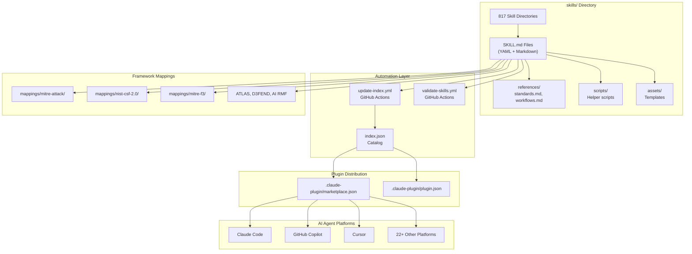
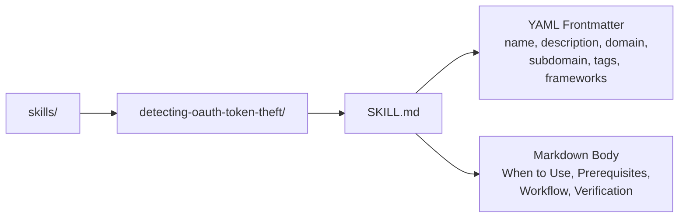
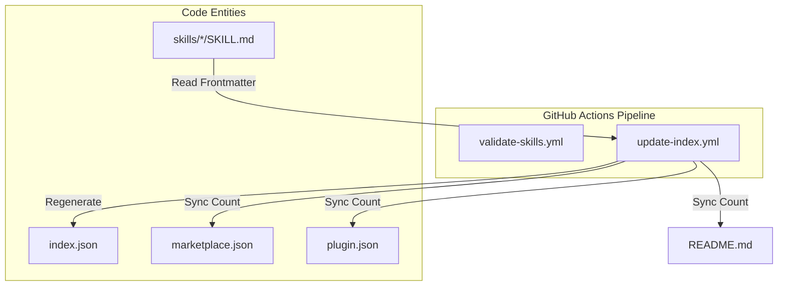

<!-- source: DeepWiki mcp.deepwiki.com · repo mukul975/Anthropic-Cybersecurity-Skills · page 1 Overview · fetched 2026-10-26 -->

# Overview

Relevant source files

The following files were used as context for generating this wiki page:

- [.claude-plugin/marketplace.json](.claude-plugin/marketplace.json)
- [.claude-plugin/plugin.json](.claude-plugin/plugin.json)
- [.github/workflows/sync-marketplace-version.yml](.github/workflows/sync-marketplace-version.yml)
- [.github/workflows/update-index.yml](.github/workflows/update-index.yml)
- [.github/workflows/validate-skills.yml](.github/workflows/validate-skills.yml)
- [.gitignore](.gitignore)
- [ATTACK_COVERAGE.md](ATTACK_COVERAGE.md)
- [CODE_OF_CONDUCT.md](CODE_OF_CONDUCT.md)
- [README.md](README.md)
- [index.json](index.json)
- [skills/analyzing-linux-audit-logs-for-intrusion/SKILL.md](skills/analyzing-linux-audit-logs-for-intrusion/SKILL.md)
- [skills/analyzing-windows-amcache-artifacts/SKILL.md](skills/analyzing-windows-amcache-artifacts/SKILL.md)
- [skills/detecting-oauth-token-theft/SKILL.md](skills/detecting-oauth-token-theft/SKILL.md)
- [skills/implementing-devsecops-security-scanning/SKILL.md](skills/implementing-devsecops-security-scanning/SKILL.md)
- [skills/implementing-privileged-session-monitoring/SKILL.md](skills/implementing-privileged-session-monitoring/SKILL.md)

## Purpose and Scope

The Anthropic Cybersecurity Skills repository is an open-source collection of **817 cybersecurity skills** designed for AI agents and security practitioners. The repository provides structured, machine-readable cybersecurity capabilities following the [agentskills.io](https://agentskills.io) open standard, enabling AI agents to discover and execute security workflows across **29 security domains** (updated from 24) spanning digital forensics, malware analysis, threat intelligence, cloud security, and more.

Every skill in the library is uniquely mapped to **six industry frameworks**: MITRE ATT&CK, NIST CSF 2.0, MITRE ATLAS, MITRE D3FEND, NIST AI RMF, and the MITRE Fight Fraud Framework (F3). This unified cross-framework coverage allows AI agents to provide expert-level guidance while maintaining compliance alignment.

**Sources:** [README.md:9-27](), [README.md:41-54](), [index.json:1-5]()

---

## Repository Architecture

The repository is organized around four primary architectural layers: a **Skills Repository** containing standardized skill definitions, a **Plugin Distribution** system for AI agent integration (supporting 26+ platforms), an **Automation Pipeline** for validation and indexing, and a **Framework Mapping** system.

### High-Level System Diagram

**Sources:** [README.md:105-124](), [index.json:1-56](), [.github/workflows/update-index.yml:1-62](), [.github/workflows/validate-skills.yml:1-30]()

---

## Core Components

### Skills Repository Structure

Each skill follows the agentskills.io specification, residing in a self-contained directory within `skills/`. The primary entity is `SKILL.md`, which contains YAML frontmatter for metadata and Markdown for execution workflows.

**Example Metadata Mapping:** The `detecting-oauth-token-theft` skill ([skills/detecting-oauth-token-theft/SKILL.md:1-65]()):
- **Subdomain:** `cloud-security` ([line 12]())
- **Frameworks:** Mapped to NIST CSF (`nist_csf`), MITRE ATT&CK (`mitre_attack`), and MITRE F3 (`mitre_f3`) ([lines 25-64]()).

**Sources:** [skills/detecting-oauth-token-theft/SKILL.md:1-65](), [index.json:43-47]()

### Central Catalog: index.json

The `index.json` file is the repository's authoritative catalog, automatically updated by GitHub Actions. It aggregates metadata from all 817 skills to facilitate rapid discovery.

**Key Fields in index.json:**
- `version`: Catalog schema version (1.1.0) ([index.json:1]())
- `generated_at`: ISO 8601 generation timestamp ([index.json:1]())
- `total_skills`: Current count of verified skills (817) ([index.json:1]())
- `skills[]`: Array containing `name`, `description`, `domain`, and `path` for every skill ([index.json:2-55]())

**Sources:** [index.json:1-56](), [.github/workflows/update-index.yml:49-59]()

---

## Skill Distribution Model

The repository utilizes a **Progressive Disclosure** pattern. AI agents first read the lightweight `index.json` or YAML frontmatter (30-50 tokens) to identify relevant capabilities before loading the full, context-heavy `SKILL.md` (300-800 tokens).

### Distribution Channels

| Method | Implementation | Primary Use Case |
|--------|----------------|------------------|
| **NPX** | `npx skills add mukul975/Anthropic-Cybersecurity-Skills` | CLI-based agents like Claude Code |
| **Plugin Marketplace** | `.claude-plugin/marketplace.json` | Marketplace-enabled platforms |
| **Git Clone** | `git clone ...` | Manual integration for Cursor, Copilot, etc. |

**Sources:** [README.md:97-103](), [.claude-plugin/marketplace.json:1-37]()

---

## Automation Pipeline

Two primary GitHub Actions workflows maintain the repository's integrity and state:

1.  **Skill Validation (`validate-skills.yml`)**: Triggered on pull requests to verify YAML syntax, required fields, and detect duplicate skill names.
2.  **Index Generation (`update-index.yml`)**: Triggered on pushes to `main`. It executes a Python script to scan the `skills/` directory, extract descriptions from `SKILL.md` frontmatter, and regenerate `index.json`. It also synchronizes the skill count across `README.md`, `marketplace.json`, and `plugin.json`.

**Sources:** [.github/workflows/update-index.yml:21-62](), [.github/workflows/update-index.yml:64-104]()

---

## Framework Mappings Overview

The repository is unique in its unified mapping of 817 skills across six frameworks.

| Framework | Scope in Repository | Purpose |
|-----------|-------------------|---------|
| **MITRE ATT&CK v19.1** | 15 tactics, 286 techniques | Adversary behaviors and TTPs |
| **MITRE F3 v1.1** | 8 tactics, 123 techniques | Cyber-enabled financial fraud |
| **NIST CSF 2.0** | 6 functions, 22 categories | Organizational security posture |
| **MITRE ATLAS v5.4** | 16 tactics, 84 techniques | AI/ML adversarial threats |
| **MITRE D3FEND v1.3** | 7 categories, 267 techniques | Defensive countermeasures |
| **NIST AI RMF 1.0** | 4 functions, 72 subcategories | AI risk management |

**New Addition: MITRE F3**
The repository now includes 94 fraud-relevant skills mapped to the **MITRE Fight Fraud Framework (F3)**, covering specific tactics like **Positioning** (`FA0001`) and **Monetization** (`FA0002`).

**Sources:** [README.md:43-62](), [README.md:63-74](), [README.md:75-95]()

---

