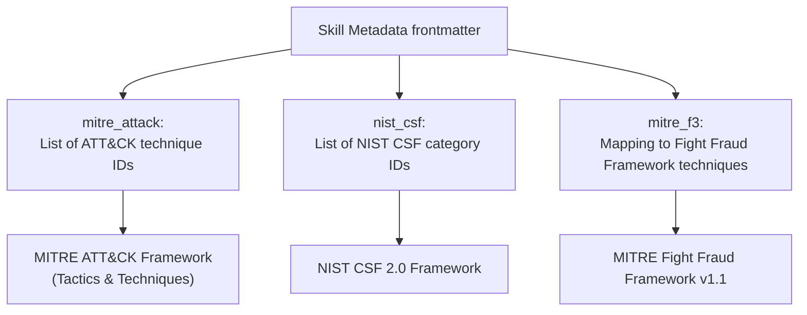

<!-- source: DeepWiki mcp.deepwiki.com · repo mukul975/Anthropic-Cybersecurity-Skills · page 10 Glossary · fetched 2026-10-26 -->

# Glossary

<details>
<summary>Relevant source files</summary>

The following files were used as context for generating this wiki page:

- [.claude-plugin/marketplace.json](.claude-plugin/marketplace.json)
- [.claude-plugin/plugin.json](.claude-plugin/plugin.json)
- [.github/workflows/sync-marketplace-version.yml](.github/workflows/sync-marketplace-version.yml)
- [.github/workflows/update-index.yml](.github/workflows/update-index.yml)
- [.github/workflows/validate-skills.yml](.github/workflows/validate-skills.yml)
- [.gitignore](.gitignore)
- [ATTACK_COVERAGE.md](ATTACK_COVERAGE.md)
- [CODE_OF_CONDUCT.md](CODE_OF_CONDUCT.md)
- [README.md](README.md)
- [index.json](index.json)
- [mappings/mitre-attack/coverage-summary.md](mappings/mitre-attack/coverage-summary.md)
- [mappings/nist-csf/README.md](mappings/nist-csf/README.md)
- [mappings/nist-csf/csf-alignment.md](mappings/nist-csf/csf-alignment.md)
- [mappings/owasp/README.md](mappings/owasp/README.md)
- [skills/analyzing-linux-audit-logs-for-intrusion/SKILL.md](skills/analyzing-linux-audit-logs-for-intrusion/SKILL.md)
- [skills/analyzing-windows-amcache-artifacts/SKILL.md](skills/analyzing-windows-amcache-artifacts/SKILL.md)
- [skills/detecting-oauth-token-theft/SKILL.md](skills/detecting-oauth-token-theft/SKILL.md)
- [skills/implementing-devsecops-security-scanning/SKILL.md](skills/implementing-devsecops-security-scanning/SKILL.md)
- [skills/implementing-gdpr-data-protection-controls/SKILL.md](skills/implementing-gdpr-data-protection-controls/SKILL.md)
- [skills/implementing-iso-27001-information-security-management/SKILL.md](skills/implementing-iso-27001-information-security-management/SKILL.md)
- [skills/implementing-pci-dss-compliance-controls/SKILL.md](skills/implementing-pci-dss-compliance-controls/SKILL.md)
- [skills/implementing-privileged-session-monitoring/SKILL.md](skills/implementing-privileged-session-monitoring/SKILL.md)
- [skills/performing-nist-csf-maturity-assessment/SKILL.md](skills/performing-nist-csf-maturity-assessment/SKILL.md)
- [skills/performing-soc2-type2-audit-preparation/SKILL.md](skills/performing-soc2-type2-audit-preparation/SKILL.md)
- [tools/README.md](tools/README.md)
- [tools/validate-skill.py](tools/validate-skill.py)

</details>


This page provides comprehensive definitions and explanations of codebase-specific terms, jargon, abbreviations, and domain concepts essential for onboarding engineers working with the Anthropic Cybersecurity Skills repository. It covers the standardized agentskills.io terminology, metadata fields used in skill definitions, cybersecurity domain vocabulary including MITRE framework concepts, and CI/CD automation components. The glossary bridges natural language concepts with related code entities for efficient knowledge transfer.

---

## 1. agentskills.io Standard Terminology

The Anthropic Cybersecurity Skills repository conforms to the [agentskills.io](https://agentskills.io) open standard, organizing AI agent capabilities as modular, structured "skills." Understanding these terms is critical to navigating and extending the codebase.

- **Skill**: A discrete cybersecurity capability defined by a directory containing a `SKILL.md` file with standardized YAML frontmatter metadata and detailed instructions, optionally supplemented by helper scripts and assets.

- **Skill Directory Structure**:  
  Each skill lives in `skills/{skill-name}/` and must contain at least:
  - `SKILL.md`: Markdown file with YAML frontmatter for metadata and comprehensive skill instructions.  
  - Optionally: `scripts/` for helper code, `references/` for citation materials, and `assets/` for images or other media.

- **Frontmatter Fields**: The YAML block at the top of every `SKILL.md` defines metadata fields such as:  
  - `name` (string): Unique kebab-case identifier for the skill (e.g., `detecting-oauth-token-theft`).  
  - `description` (string): A concise summary (usually 50+ characters).  
  - `domain` (string): Typically `cybersecurity`.  
  - `subdomain` (string): One of 29 allowed security domains (see Subdomains section).  
  - `tags` (list): Keywords indicating relevant topics or tools.  
  - `version` (string): Skill version, e.g., `"1.0.0"`.  
  - `author` (string): Username or contributor name.  
  - `license` (string): License identifier, e.g., `"Apache-2.0"`.  
  - `mitre_attack` (list): List of MITRE ATT&CK technique IDs (e.g., `T1078`).  
  - `nist_csf` (list): List of NIST CSF references (e.g., `PR.IR-01`).  
  - `mitre_f3` (mapping): Block mapping the skill to MITRE Fight Fraud Framework techniques including version, tactics, and technique details.
  
- **Subdomain Aliases and Canonicals**:  
  To maintain consistency, subdomains have canonical names with accepted aliases (e.g., canonical `"zero-trust-architecture"` accepts alias `"zero-trust"`). Validation accepts aliases but standardization prefers using canonical forms.  

- **Validation Tool**: The `tools/validate-skill.py` script verifies skill metadata correctness—checking YAML frontmatter, mandatory fields, kebab-case naming, description length, subdomain validity, and tags list. This ensures data consistency in the index.  

---

## 2. Cybersecurity Domain-Specific Vocabulary

- **Subdomains**: The repository organizes skills into 29 cybersecurity subdomains (previously 24), reflecting broad security disciplines. Examples include:  
  - `cloud-security`  
  - `digital-forensics`  
  - `malware-analysis`  
  - `penetration-testing`  
  - `threat-intelligence`  
  - `nist-csf` (compliance-governance)  
  - `phishing-defense`  

- These subdomains help categorize skills and map them to relevant frameworks and taxonomies.

---

## 3. MITRE Framework Concepts

The repository integrates six major cybersecurity frameworks in skill frontmatter metadata and mappings for cross-reference and compliance purposes:

- **MITRE ATT&CK**  
  - Catalog of adversary tactics and techniques for Enterprise, ICS, and Mobile.  
  - Skill metadata field: `mitre_attack` includes one or more technique IDs, e.g., `T1566.001`.  
  - Tactics represent high-level adversary goals (e.g., Initial Access `TA0001`), while techniques detail methods (e.g., Spearphishing Attachment `T1566.001`).  
  - The repository covers latest version v19.1.  

- **NIST Cybersecurity Framework (CSF) 2.0**  
  - Functions: Govern (GV), Identify (ID), Protect (PR), Detect (DE), Respond (RS), Recover (RC).  
  - Skill metadata uses `nist_csf` list with codes like `PR.IR-01` for specific categories/subcategories.  
  - Used for organizational cybersecurity posture assessment and maturity evaluations.  

- **MITRE Fight Fraud Framework (F3) v1.1**  
  - Specialized ATT&CK-compatible framework for cyber-enabled financial fraud.  
  - Unique tactics `FA0001` (Positioning) and `FA0002` (Monetization).  
  - Techniques use `F1XXX` IDs, distinct but interrelated with ATT&CK `T1XXX` IDs.  
  - Skill frontmatter block `mitre_f3` maps techniques with fields for version, tactics, and detailed techniques metadata.  

- **Other Frameworks Supported (Conceptual)**  
  - MITRE ATLAS (AI/ML adversarial threats)  
  - MITRE D3FEND (defensive countermeasures)  
  - NIST AI RMF (AI risk management)  

---

## 4. Skill Metadata Fields Explained

| Field         | Type         | Description                                                                                              |
|---------------|--------------|------------------------------------------------------------------------------------------------------|
| `name`        | string       | Unique kebab-case skill identifier (e.g., `analyzing-heap-spray-exploitation`). Validated by `validate-skill.py`. |
| `description` | string       | Text description, minimum 50 characters detailing skill purpose.                                     |
| `domain`      | string       | Fixed value `'cybersecurity'`.                                                                         |
| `subdomain`   | string       | One of 29 managed subdomains. Can use aliases accepted by validation.                                |
| `tags`        | list[string] | Keywords reflecting technology, tactics, or relevant areas (e.g., `oauth`, `azure-ad`, `incident-response`).|
| `version`     | string       | Optional semantic version string.                                                                     |
| `author`      | string       | Author or contributor name.                                                                            |
| `license`     | string       | Licensing info, e.g., `'Apache-2.0'`.                                                                 |
| `mitre_attack`| list[string] | MITRE ATT&CK technique IDs, e.g., `T1078.004`.                                                        |
| `nist_csf`    | list[string] | NIST CSF references, e.g., `PR.IR-01`.                                                                |
| `mitre_f3`    | mapping      | Latest Fight Fraud Framework mapping block with `version`, `tactics` (list), and `techniques` (list of technique mappings). |

Example snippet from skill frontmatter showing F3 mapping:
```yaml
mitre_f3:
  version: '1.1'
  tactics:
    - initial-access
    - positioning
  techniques:
    - id: F1004
      name: Access with Stolen Session Cookie
      tactic: initial-access
      source: f3
```

---

## 5. CI/CD Automation Concepts

GitHub Actions workflows automate validation, indexing, and version synchronization of skills metadata:

- **Skill Validation Workflow** (`.github/workflows/validate-skills.yml`)  
  - Runs `tools/validate-skill.py` on changed/new skill directories.  
  - Checks SKILL.md syntax, mandatory fields, schema conformity, and subdomain aliases.  
  - Reports errors or warnings for PR review.  

- **Index Generation Workflow** (`.github/workflows/update-index.yml`)  
  - Runs on pushes to main or manually.  
  - Scans all `skills/` directories, parses frontmatter from `SKILL.md`, and builds `index.json` catalog with all skills metadata (name, description, path, total count).  
  - Updates badges and metadata counts in `README.md` and plugin marketplace files.  
  - Commits updated `index.json` and related files back to main.  

- **Marketplace Version Sync Workflow** (`.github/workflows/sync-marketplace-version.yml`)  
  - On GitHub release event, parses release tag for version number.  
  - Updates `.claude-plugin/marketplace.json` and `.claude-plugin/plugin.json` version fields.  
  - Commits updated version metadata for marketplace and plugin consumers.

---

## 6. Mapping Natural Language Concepts to Code Entities

### Diagram: agentskills.io Skill to Code Entity Flow

```mermaid
flowchart LR
    NL[/"Natural Language\nCybersecurity Concepts"/] 
    SkillDir["\"skills/{skill-name}/\""]
    SKILLMD["\"SKILL.md\"\n[Metadata + Instructions]"]
    Frontmatter["\"YAML Frontmatter\n[metadata fields]\""]
    Validator["validate-skill.py\n(metadata validation)"]
    Indexer["update-index.yml\n(index.json generation)"]

    NL --> SkillDir
    SkillDir --> SKILLMD
    SKILLMD --> Frontmatter
    Frontmatter --> Validator
    Validator -->|Valid| Indexer
    Indexer -->|Produces| IndexJSON["index.json (catalog)"]
```

**Explanation:**  
In this flow, natural language cybersecurity skills are authored as directories containing `SKILL.md` files with YAML frontmatter metadata. The `validate-skill.py` tool ensures metadata quality, after which the CI/CD workflow `update-index.yml` scans these to build the aggregated `index.json` used by platforms and agents.

**Sources:** [tools/validate-skill.py:1-170](), [.github/workflows/update-index.yml:1-113](), [skills/detecting-oauth-token-theft/SKILL.md:1-80](), [index.json:1-60]()

---

### Diagram: Framework Mapping from Skill Metadata to External Standards



**Explanation:**  
Each skill declares framework mappings in its metadata, associating it with specific adversary tactics/techniques or control categories from prominent cybersecurity frameworks to enable cross-framework interoperability and coverage analysis.

**Sources:** [skills/detecting-oauth-token-theft/SKILL.md:1-80](), [README.md:66-74]()

---

## 7. Key Vocabulary and Abbreviations

| Term/Abbreviation | Meaning / Definition                                                                                  | Code Reference / Usage Example                            |
|-------------------|-----------------------------------------------------------------------------------------------------|-----------------------------------------------------------|
| **Skill**         | A modular cybersecurity capability for AI agents, standardized in `skills/{skill-name}/SKILL.md`   | Multiple files under `skills/`, e.g. `detecting-oauth-token-theft` |
| **Skill Metadata** | YAML frontmatter in `SKILL.md` defining fields like `name`, `description`, `domain`, `subdomain`    | See parsing and validation in `tools/validate-skill.py`  |
| **Subdomain**      | One of 29 cybersecurity domain categories organizing skills                                         | Defined aliases in `tools/validate-skill.py` lines 18-59 |
| **MITRE ATT&CK**  | Adversary behavior framework of tactics and techniques, e.g., `T1078`, included in `mitre_attack`    | Present in skill frontmatter under `mitre_attack`         |
| **NIST CSF 2.0**  | Framework for cybersecurity risk management using six core functions, referenced as `nist_csf` list | Included in skill metadata, e.g. `PR.IR-01`                |
| **MITRE F3**      | Framework for cyber-enabled financial fraud techniques, skill metadata uses `mitre_f3` mapping       | Structured YAML block in skill frontmatter                 |
| **Validation**    | Metadata correctness checking tool for skill frontmatter                                            | `tools/validate-skill.py` validates skill YAML metadata    |
| **Index Generation** | CI workflow aggregating all skill metadata into `index.json` catalog                             | `.github/workflows/update-index.yml` processes skills     |
| **Marketplace Plugin** | Plugin metadata for distributing skills via agentskills.io                                     | `.claude-plugin/marketplace.json`, `.claude-plugin/plugin.json` |
| **Kebab-case**    | Lowercase words joined by hyphens, used for skill `name` identifiers                                | Enforced during validation in `tools/validate-skill.py`   |
| **Folded Scalar** | YAML frontmatter style allowing multi-line strings with line breaks                                | Parsed in `tools/validate-skill.py:81-169`                 |
| **CI/CD**         | Continuous Integration and Continuous Deployment workflows automating validation and indexing      | GitHub Actions workflows in `.github/workflows/`           |

---

## 8. Coding and Data Flow Pointers

- **Skill Frontmatter Parsing**: Implemented by `parse_frontmatter(text)` function in `tools/validate-skill.py` lines 81-169. Parses `SKILL.md` YAML blocks handling scalar, list, and folded scalars.

- **Skill Validation**: `validate_skill(skill_dir)` in `tools/validate-skill.py` lines 171-352 leverages parsing and asserts mandatory fields, description length, naming, subdomain correctness, and tag lists.

- **Index JSON Generation**: The Python snippet in `.github/workflows/update-index.yml` lines 23-62 scans `skills/`, parses `SKILL.md` to extract `name`, `description`, and constructs an aggregated JSON index with metadata and skill counts.

- **Version Update Automation**: `.github/workflows/sync-marketplace-version.yml` lines 20-44 extract release tag version and update JSON files `.claude-plugin/marketplace.json` and `.claude-plugin/plugin.json` accordingly.

- **Skill Directory Naming**: Each skill directory is named using the kebab-case convention enforced by validation (e.g., `detecting-oauth-token-theft`).

---

# Summary Tables for Quick Reference

### Allowed Subdomains & Aliases (Excerpt)

| Canonical Subdomain             | Accepted Aliases                                   |
|--------------------------------|---------------------------------------------------|
| identity-access-management      | identity-access-management, identity-and-access-management, identity-security |
| zero-trust-architecture         | zero-trust-architecture, zero-trust               |
| ot-ics-security                | ot-ics-security, ot-security                       |
| soc-operations                | soc-operations, security-operations                 |
| red-teaming                  | red-teaming, red-team                               |
| web-application-security       | web-application-security, application-security     |
| cloud-security               | cloud-security                                    |
| penetration-testing           | penetration-testing, offensive-security           |
| malware-analysis              | malware-analysis                                  |

**Sources:** [tools/validate-skill.py:18-68]()

---

### Common Skill Metadata Fields Validation Requirements

| Field       | Requirement                                            |
|-------------|-------------------------------------------------------|
| `name`      | Kebab-case, 1-64 chars, unique                        |
| `description` | Min 50 chars, multi-line folded strings accepted    |
| `domain`    | Must be `"cybersecurity"`                             |
| `subdomain` | Must be from allowed set or alias (canonical used)   |
| `tags`      | List with at least two items                            |
| `version`   | Optional semantic version string                       |

**Sources:** [tools/validate-skill.py:13-73]()

---

# Conclusion

This glossary consolidates essential terms and definitions, linking domain knowledge, standardization, metadata schemas, CI/CD automation, and coding implementations. For any engineer onboarding on Anthropic Cybersecurity Skills, understanding these terms and their relationships to code entities such as `SKILL.md`, validation scripts, framework mappings, and workflows is foundational for effective contribution and usage.

---

*End of Glossary*

**Sources:**  
- [tools/validate-skill.py:1-352]()  
- [skills/detecting-oauth-token-theft/SKILL.md:1-80]()  
- [.github/workflows/update-index.yml:1-113]()  
- [.github/workflows/sync-marketplace-version.yml:1-44]()  
- [README.md:66-74]()  
- [index.json:1-60]()