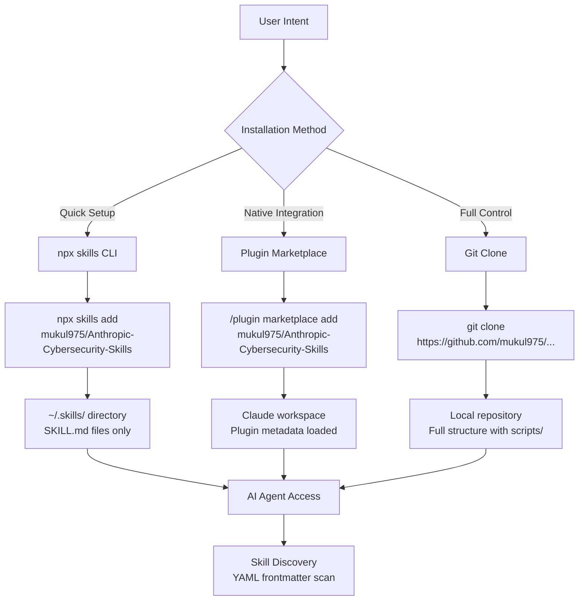
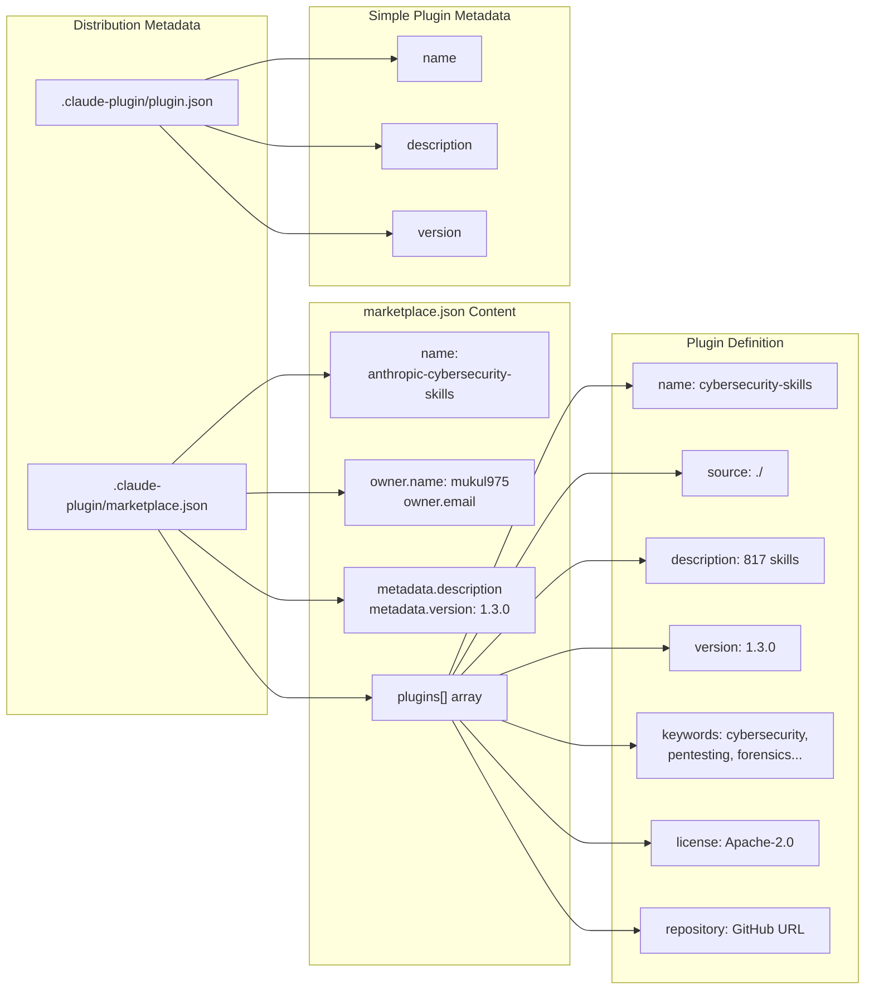
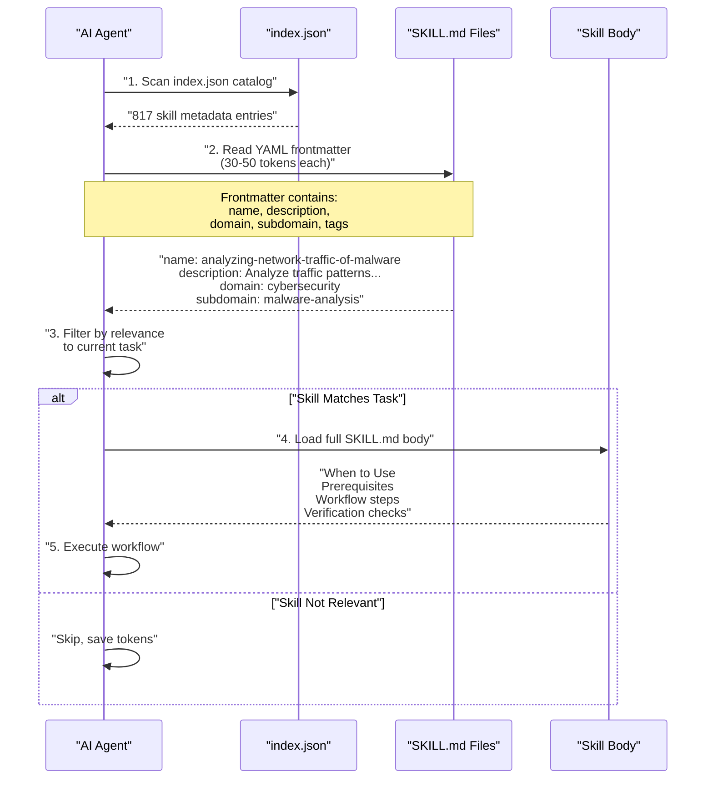

<!-- source: DeepWiki mcp.deepwiki.com · repo mukul975/Anthropic-Cybersecurity-Skills · page 2 Getting Started · fetched 2026-10-26 -->

# Getting Started

<details>
<summary>Relevant source files</summary>

The following files were used as context for generating this wiki page:

- [.claude-plugin/marketplace.json](.claude-plugin/marketplace.json)
- [.claude-plugin/plugin.json](.claude-plugin/plugin.json)
- [.github/workflows/sync-marketplace-version.yml](.github/workflows/sync-marketplace-version.yml)
- [.github/workflows/update-index.yml](.github/workflows/update-index.yml)
- [.github/workflows/validate-skills.yml](.github/workflows/validate-skills.yml)
- [CODE_OF_CONDUCT.md](CODE_OF_CONDUCT.md)
- [README.md](README.md)

</details>


This page guides users through installing and using the Anthropic Cybersecurity Skills collection. It covers the three primary installation methods, basic usage patterns, and how AI agents discover and load skills from the collection. For detailed platform-specific configuration, see [Platform Integration](#2.2). For technical details on the token-efficient discovery mechanism, see [Progressive Disclosure Pattern](#2.3).

## Overview

The Anthropic Cybersecurity Skills repository provides 817 security capabilities packaged as an agentskills.io-compliant plugin [[README.md:13-21](), [.claude-plugin/marketplace.json:2-15]()]. Users can install the collection through three pathways: the `npx skills` CLI (automated), Claude Code's `/plugin` marketplace command (native integration), or manual Git clone (full repository access) [[README.md:97-103]()]. Once installed, AI agents use a two-phase discovery process: they first scan YAML frontmatter (~30-50 tokens per skill) to identify relevant skills, then load complete `SKILL.md` files only when needed.

## Installation Methods Overview

The repository supports three installation methods, each optimized for different use cases:



**Installation Method Selection Flow**

Sources: [README.md:97-103]()

### Method 1: NPX Skills CLI

The `npx skills` command provides automated installation via the npm package ecosystem. This method installs skill definitions to a standard `~/.skills/` directory:

```bash
npx skills add mukul975/Anthropic-Cybersecurity-Skills
```

This command reads plugin metadata from `marketplace.json` [[.claude-plugin/marketplace.json:2-14]()] and creates a local skill repository. The installed skills include `SKILL.md` files with frontmatter but exclude helper scripts from the `scripts/` subdirectories. This method works across all platforms that support the agentskills.io standard [[README.md:21-24]()].

**Key characteristics:**
- **Installation location**: `~/.skills/` directory
- **Content**: `SKILL.md` files with YAML frontmatter and markdown bodies
- **Updates**: Re-run command to fetch latest skills
- **Platform support**: Universal (26+ platforms) [[README.md:17-27]()]

Sources: [README.md:97-101](), [.claude-plugin/marketplace.json:1-37]()

### Method 2: Claude Code Plugin Marketplace

Claude Code provides native plugin marketplace integration through the `/plugin` command. This method leverages Claude's internal plugin system:

```
/plugin marketplace add mukul975/Anthropic-Cybersecurity-Skills
```

The marketplace reads plugin metadata from `plugin.json` [[.claude-plugin/plugin.json:1-5]()] which contains the name, description, and version. The `marketplace.json` file [[.claude-plugin/marketplace.json:11-35]()] provides additional metadata including keywords, license (Apache-2.0), and repository URL.

**Key characteristics:**
- **Installation location**: Claude workspace context
- **Content**: Skills loaded on-demand from GitHub
- **Updates**: Automatic when plugin version changes in `marketplace.json` [[.claude-plugin/marketplace.json:9]()]
- **Platform support**: Claude Code native integration

Sources: [.claude-plugin/plugin.json:1-5](), [.claude-plugin/marketplace.json:8-17]()

### Method 3: Manual Git Clone

Direct repository cloning provides complete access to all repository contents including helper scripts, reference materials, and automation workflows:

```bash
git clone https://github.com/mukul975/Anthropic-Cybersecurity-Skills.git
cd Anthropic-Cybersecurity-Skills
```

This method installs the full repository structure:
- `skills/{skill-name}/SKILL.md` - Skill definitions [[.github/workflows/update-index.yml:31]()]
- `skills/{skill-name}/references/` - Standards and workflow documentation  
- `skills/{skill-name}/scripts/` - Helper scripts for practitioners
- `skills/{skill-name}/assets/` - Templates and checklists

**Key characteristics:**
- **Installation location**: User-specified directory
- **Content**: Complete repository including scripts, references, and GitHub Actions workflows [[.github/workflows/validate-skills.yml:1-129]()]
- **Updates**: `git pull` to sync latest changes
- **Platform support**: Any platform that can read local files

Sources: [README.md:103](), [.github/workflows/update-index.yml:30-33](), [.github/workflows/validate-skills.yml:29-32]()

## Plugin Metadata Structure

The plugin distribution system uses two JSON configuration files that define how the skills are packaged and discovered:



**Plugin Metadata File Structure**

The `marketplace.json` file [[.claude-plugin/marketplace.json:1-37]()] contains:
- **Package name**: `anthropic-cybersecurity-skills` [[line 2]()]
- **Owner information**: GitHub username and email [[lines 3-6]()]
- **Plugin array**: Single plugin definition with 817 cybersecurity skills description [[lines 11-35]()]
- **Keywords**: 9 security domain tags for discovery [[lines 21-30]()]

The simplified `plugin.json` [[.claude-plugin/plugin.json:1-5]()] provides minimal metadata for platforms that don't require the full marketplace schema.

Sources: [.claude-plugin/marketplace.json:1-37](), [.claude-plugin/plugin.json:1-5]()

## Skill Discovery and Loading

AI agents use a two-phase progressive disclosure pattern to efficiently navigate 817 skills without overwhelming context windows:



**Progressive Skill Discovery Sequence**

### Phase 1: Frontmatter Scanning

Each `SKILL.md` file begins with YAML frontmatter validated by the CI/CD pipeline [[.github/workflows/validate-skills.yml:25-58]()]. The frontmatter must include:
- **name**: Unique skill identifier in kebab-case [[.github/workflows/validate-skills.yml:51-57]()]
- **description**: One-sentence capability summary [[.github/workflows/update-index.yml:39-41]()]
- **domain**: Top-level category (`cybersecurity`)
- **subdomain**: Specific security domain (29 total subdomains) [[.github/workflows/validate-skills.yml:107-128]()]
- **tags**: Searchable keywords for filtering

### Phase 2: Full Skill Loading

If frontmatter matches task requirements, the agent loads the complete `SKILL.md` body. This two-phase approach allows agents to scan hundreds of skills efficiently, consuming full context only for relevant capabilities.

Sources: [.github/workflows/validate-skills.yml:1-129](), [.github/workflows/update-index.yml:21-62]()

## Basic Usage Patterns

After installation, agents access skills through platform-specific mechanisms:

| Platform | Access Method | Configuration |
|----------|--------------|---------------|
| Claude Code | `/plugin` command | Native marketplace integration via `.claude-plugin/marketplace.json` [[.claude-plugin/marketplace.json:1-37]()] |
| GitHub Copilot | `.skills/` directory | Copy `SKILL.md` files to workspace `.skills/` folder |
| Cursor | Project files | Add skills as project documentation in `.cursorrules` |
| Gemini CLI | Context files | Load `SKILL.md` files as context |

Sources: [README.md:17-24](), [.claude-plugin/marketplace.json:1-37]()

## Skill Categories

The collection organizes 817 production-grade skills across 29 cybersecurity subdomains [[README.md:13-27](), [.github/workflows/validate-skills.yml:122-128]()].

For details, see [Skill Categories and Taxonomy](#3.3).

Sources: [README.md:27-41](), [.github/workflows/validate-skills.yml:107-128]()

## Next Steps

For detailed information on installation procedures:
- **Platform-specific setup**: See [Installation Methods](#2.1) for detailed instructions per platform
- **Integration configuration**: See [Platform Integration](#2.2) for workspace setup across 26+ platforms
- **Discovery optimization**: See [Progressive Disclosure Pattern](#2.3) for technical details on token-efficient skill loading

To understand skill structure and organization:
- **Skill anatomy**: See [Skill Structure](#3.1) for directory layout and YAML requirements
- **Complete catalog**: See [Skills Index](#3.2) for `index.json` schema and metadata

To contribute new skills:
- **Contribution workflow**: See [Contributing](#7) for guidelines on adding or improving skills
- **Skill development**: See [Skill Development Workflow](#7.3) for end-to-end creation process

---

