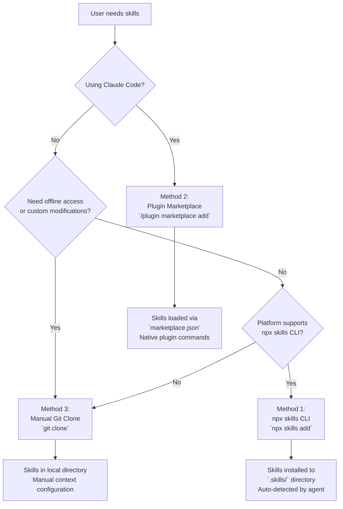
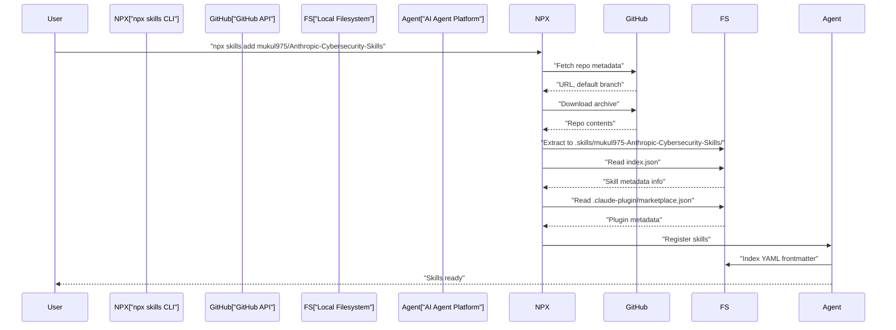
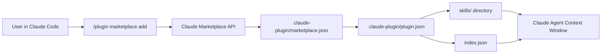
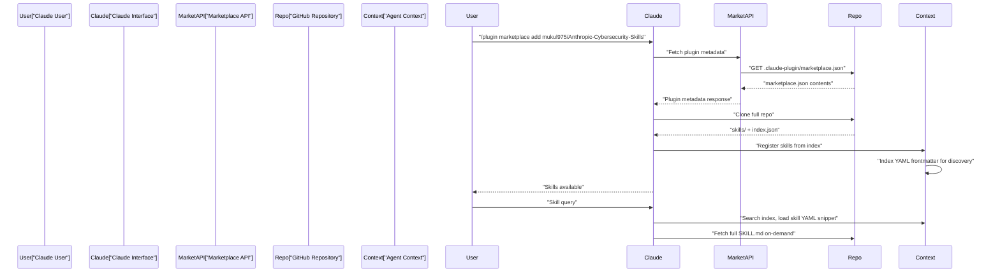
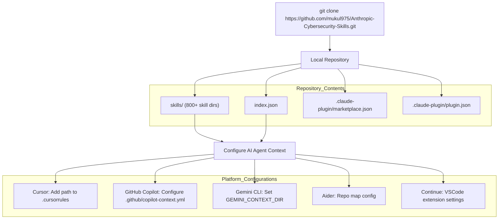
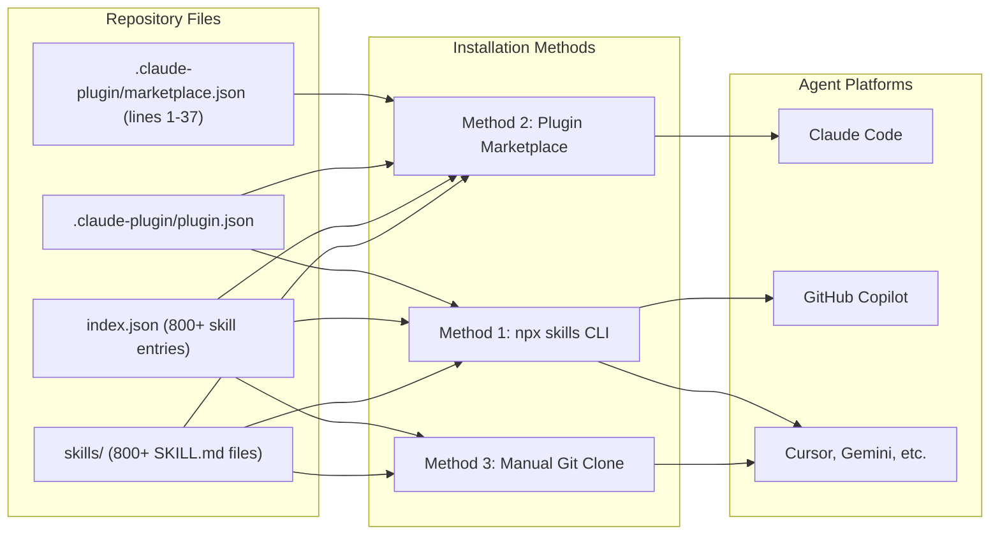

<!-- source: DeepWiki mcp.deepwiki.com · repo mukul975/Anthropic-Cybersecurity-Skills · page 2.1 Installation Methods · fetched 2026-10-26 -->

# Installation Methods

<details>
<summary>Relevant source files</summary>

The following files were used as context for generating this wiki page:

- [.claude-plugin/marketplace.json](.claude-plugin/marketplace.json)
- [.claude-plugin/plugin.json](.claude-plugin/plugin.json)
- [.github/workflows/sync-marketplace-version.yml](.github/workflows/sync-marketplace-version.yml)
- [.github/workflows/update-index.yml](.github/workflows/update-index.yml)
- [.github/workflows/validate-skills.yml](.github/workflows/validate-skills.yml)
- [CODE_OF_CONDUCT.md](CODE_OF_CONDUCT.md)
- [README.md](README.md)

</details>


## Purpose and Scope

This page details the three installation pathways for the **Anthropic Cybersecurity Skills** collection:

- **npx skills CLI**
- **Plugin marketplace integration**
- **Manual git clone**

Each method offers different advantages regarding automation, ease of use on supported platforms, and ability to customize or control upgrades. This page covers implementation details, data flow, directory layout post-installation, and platform-specific instructions.

For instructions on using the skills after installation, see [2.2 Platform Integration]. For insight into the token-efficient loading of skill metadata, see [2.3 Progressive Disclosure Pattern].

---

## Installation Method Overview

| Method                   | Best For                        | Automation | Update Management            | Platform Examples                        |
|--------------------------|--------------------------------|------------|-----------------------------|-----------------------------------------|
| **npx skills CLI**       | Quick automated install        | Full       | Automatic via CLI commands   | Claude Code, GitHub Copilot, Cursor     |
| **Plugin Marketplace**   | Native Claude Code integration  | Full       | Automatic via marketplace    | Claude Code (plugin marketplace)        |
| **Manual Git Clone**     | Offline use, custom workflows  | Manual     | Manual `git pull` or checkout | Any platform (universal)                |



**Sources:** [README.md:27-40]()

---

## Method 1: npx skills CLI

The `npx skills` CLI tool facilitates automated installation of the skills collection by resolving the GitHub repository, downloading its contents, and registering the skills with supported AI agents.

### Installation Command

```bash
npx skills add mukul975/Anthropic-Cybersecurity-Skills
```

### Implementation Details and Data Flow

- **Repository Resolution:** The CLI parses the input repository string and resolves it to a GitHub repository URL.
- **Repository Download:** The repository archive is fetched via GitHub API.
- **Extraction:** Contents extract into a platform-specific `.skills/` directory inside the current workspace, typically under `.skills/mukul975-Anthropic-Cybersecurity-Skills/`.
- **Skill Indexing:** Reads `index.json` to register metadata about all 800+ skills with the local agent environment.
- **Plugin Metadata:** Reads `.claude-plugin/marketplace.json` to extract version, description, author, and licensing for compatibility info.
- **Agent Registration:** The agent platform auto-detects the `.skills/` folder and incorporates the skills into its context window or environment.

### Directory Structure After Installation

```
.workspace/
└── .skills/
    └── mukul975-Anthropic-Cybersecurity-Skills/
        ├── skills/
        │   ├── acquiring-disk-image-with-dd-and-dcfldd/
        │   ├── analyzing-memory-dumps-with-volatility3/
        │   └── ... (800+ skill directories)
        ├── index.json
        ├── .claude-plugin/
        │   ├── marketplace.json
        │   └── plugin.json
        └── README.md
```

### Platform Support with npx CLI

| Platform        | Integration Mechanism                         | Skill Discovery                    |
|-----------------|----------------------------------------------|----------------------------------|
| GitHub Copilot  | Reads `.skills/` as workspace context       | Parses YAML frontmatter in skills |
| Cursor          | Loads `.skills/` folder into project context | File-system based enumeration   |
| Gemini CLI      | Scans `.skills/` as context directory       | Markdown skill file loading       |
| Amp             | Mounts `.skills/` directory volume          | Directory-based access            |
| Continue        | Uses `.skills/` as custom context provider  | Progressive disclosure pattern   |

### Installation Flow Diagram



**Sources:** [README.md:27-40](), [.claude-plugin/marketplace.json:1-37]()

---

## Method 2: Plugin Marketplace Integration

This method leverages Claude Code's native plugin system for installing and managing the skills collection entirely within the agent interface, providing seamless updates and discovery.

### Installation Command in Claude Code

```
/plugin marketplace add mukul975/Anthropic-Cybersecurity-Skills
```

### Marketplace Metadata (`marketplace.json`)

The `.claude-plugin/marketplace.json` defines metadata necessary for integrating the plugin into Claude Code's marketplace ecosystem:

| Field                | Example Value                              | Description                           |
|----------------------|-------------------------------------------|-------------------------------------|
| `name`               | `"anthropic-cybersecurity-skills"`       | Marketplace plugin identifier       |
| `owner.name`          | `"mukul975"`                              | Plugin owner (GitHub username)      |
| `owner.email`         | `"mukuljangra5@gmail.com"`                | Contact email                       |
| `metadata.version`    | `"1.3.0"`                                | Plugin version for update tracking  |
| `plugins[0].source`   | `"./"`                                   | Root directory for plugin code      |
| `plugins[0].license`  | `"Apache-2.0"`                           | License info                       |
| `plugins[0].category` | `"security"`                              | Marketplace category                 |
| `plugins[0].repository` | GitHub URL                              | Repository source URL                |

### Data and Control Flow



### Claude Code Integration Workflow



**Sources:** [.claude-plugin/marketplace.json:1-37](), [README.md:32-40]()

---

## Method 3: Manual Git Clone

This method involves manually cloning or downloading the repository, providing full control over versioning, directory placement, and updates. Ideal for offline environments, custom workflows, or development.

### Installation Command

```bash
git clone https://github.com/mukul975/Anthropic-Cybersecurity-Skills.git
cd Anthropic-Cybersecurity-Skills
```

### Use Case Scenarios

| Use Case            | Explanation                                  |
|---------------------|----------------------------------------------|
| Offline / air-gapped environments | No internet, no direct CLI or marketplace access |
| Custom modifications | Fork and modify skills or add extensions    |
| Development          | Testing and creating new skills locally      |
| Version pinning      | Checkout specific tags or commits            |
| CI/CD integration    | Automate build and test pipelines            |
| Custom directory     | Fit into non-standard workspace structures   |

### Manual Installation and Configuration Flow



### Example: GitHub Copilot Configuration (`.github/copilot-context.yml`)

```yaml
context:
  - path: path/to/Anthropic-Cybersecurity-Skills/skills
    type: skills
  - path: path/to/Anthropic-Cybersecurity-Skills/index.json
    type: catalog
```

### Example: Cursor Configuration (`.cursorrules`)

```
Skills directory: /path/to/Anthropic-Cybersecurity-Skills/skills
Index file: /path/to/Anthropic-Cybersecurity-Skills/index.json
```

### Example: Gemini CLI Configuration

```bash
export GEMINI_CONTEXT_DIR=/path/to/Anthropic-Cybersecurity-Skills/skills
```

### Updating Manual Clone Installation

To update the skills library, run:

```bash
cd Anthropic-Cybersecurity-Skills
git pull origin main
```

For pinning to a specific version:

```bash
# List available tags
git tag -l

# Checkout a specific version tag
git checkout v1.3.0

# Or checkout a specific commit
git checkout abc123def456
```

**Sources:** [README.md:38-40]()

---

## Platform-Specific Installation Considerations

### Default File System Locations by Platform

| Platform       | Expected Skills Location                           | Configuration File             |
|----------------|--------------------------------------------------|-------------------------------|
| Claude Code    | Managed automatically by plugin marketplace       | `.claude-plugin/marketplace.json` |
| GitHub Copilot | `.skills/` directory under workspace root         | `.github/copilot-context.yml` |
| Cursor         | Custom path configured in `.cursorrules`          | `.cursorrules` file           |
| Gemini CLI     | Environment variable or config defines skills dir   | `~/.geminirc` or environment  |
| Amp            | Mounted volume path for `.skills/`                 | Container volume mount config |
| Aider          | Repository root or customized repo map             | `.aider.conf.yml`              |
| Continue       | VSCode extension settings for context directory     | `.vscode/settings.json`       |
| Windsurf       | Workspace context directory                           | Windsurf config file          |
| Goose          | Plugin directory under user folder                   | `~/.goose/plugins/`           |

### Repository Files Usage per Installation Method



---

## Post-Installation Verification

### Verification Steps

1. **Confirm skill count:**

```bash
find skills -name "SKILL.md" | wc -l
# Expected output: 800+
```

2. **Validate `index.json`:**

```bash
cat index.json | jq '.skills | length'
# Expected output: 800+
```

3. **Test agent discovery with a sample query:**

- Query: `"How do I perform memory forensics with Volatility3?"`
- Expected: Agent references the `analyzing-memory-dumps-with-volatility3` skill

4. **Check YAML frontmatter parsing:**

```bash
head -n 10 skills/analyzing-memory-dumps-with-volatility3/SKILL.md
```

### Common Installation Issues and Solutions

| Issue                  | Symptom                | Solution                           |
|------------------------|------------------------|----------------------------------|
| Skills not discovered  | Agent cannot locate skills | Confirm platform config paths     |
| Outdated skill count    | Skill count < 800       | Reinstall or `git pull` updates   |
| File permission errors | Installation fails      | Check user permissions on folders |
| Network timeouts        | Cloning/downloading fails | Retry or use manual clone method  |
| Empty or missing `index.json` | No skills indexed  | Ensure `index.json` present and valid |

### Success Indicators

- ✅ 800+ skill directories under `skills/`
- ✅ Valid `index.json` reflecting all skills
- ✅ Up-to-date `.claude-plugin/marketplace.json` version (e.g. 1.3.0)
- ✅ Agent recognizes and indexes skill YAML frontmatter
- ✅ Skills load dynamically without overwhelming context windows

---

## Next Steps

Proceed to:

- **[2.2 Platform Integration]** for platform-specific usage and commands
- **[2.3 Progressive Disclosure Pattern]** to optimize skill discovery and token usage
- **[3.2 Skills Index]** to understand skill metadata and indexing details

**Sources:** [README.md:25-40](), [.claude-plugin/marketplace.json:1-37]()

---

