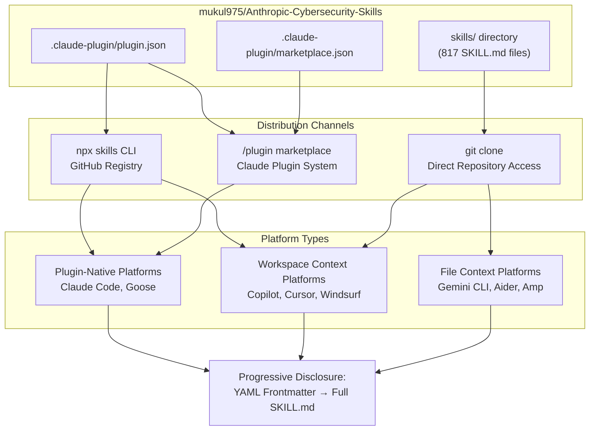
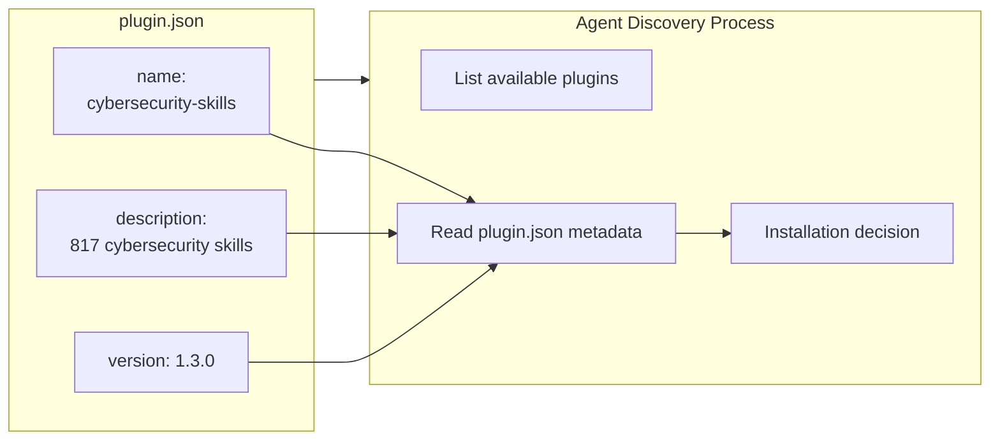
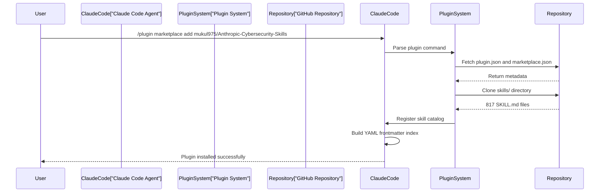
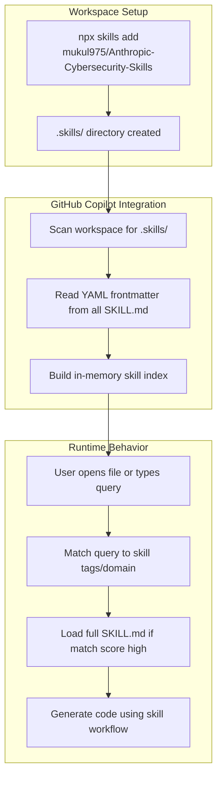
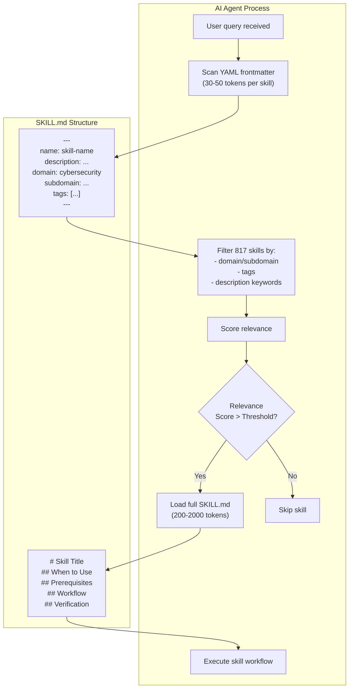

<!-- source: DeepWiki mcp.deepwiki.com · repo mukul975/Anthropic-Cybersecurity-Skills · page 2.2 Platform Integration · fetched 2026-10-26 -->

# Platform Integration

<details>
<summary>Relevant source files</summary>

The following files were used as context for generating this wiki page:

- [.claude-plugin/marketplace.json](.claude-plugin/marketplace.json)
- [.claude-plugin/plugin.json](.claude-plugin/plugin.json)
- [.github/workflows/sync-marketplace-version.yml](.github/workflows/sync-marketplace-version.yml)
- [.github/workflows/update-index.yml](.github/workflows/update-index.yml)
- [.github/workflows/validate-skills.yml](.github/workflows/validate-skills.yml)
- [CODE_OF_CONDUCT.md](CODE_OF_CONDUCT.md)
- [README.md](README.md)

</details>


This document explains how to integrate the Anthropic Cybersecurity Skills collection with 26+ AI agent platforms. It covers platform-specific installation methods, discovery mechanisms, and the technical details of how different agent types consume skills from the repository.

For installation commands and prerequisites, see [Installation Methods](2.1). For the token-efficient skill discovery mechanism used by agents, see [Progressive Disclosure Pattern](2.3).

## Overview of Platform Support

The skills repository supports three categories of AI agent platforms, each with different integration mechanisms:

| Platform Category | Integration Method | Platform Count | Example Platforms |
|------------------|-------------------|----------------|-------------------|
| **Plugin-Native** | Built-in `/plugin` command | 2 | Claude Code, Goose |
| **Workspace Context** | `.skills/` directory structure | 8 | GitHub Copilot, Cursor, Windsurf, Continue |
| **File Context** | Manual directory mounting | 16+ | Gemini CLI, Aider, Amp, OpenAI Codex CLI |

The agentskills.io standard enables vendor-neutral distribution across all platform types through a common YAML frontmatter + Markdown body structure in each `SKILL.md` file.

**Sources:** [README.md:17-21](), [README.md:97-101]()

## Platform Integration Architecture

### Distribution Channels



The repository publishes through three distinct channels that target different platform integration patterns. The `.claude-plugin/plugin.json` file defines core metadata for NPX and plugin marketplace distribution, while direct Git access provides maximum flexibility for platforms with custom context loading.

**Sources:** [.claude-plugin/plugin.json:1-5](), [README.md:97-103](), [.github/workflows/update-index.yml:64-104]()

### Plugin Metadata Structure



The `.claude-plugin/plugin.json` file contains three essential fields that enable plugin marketplace discovery:

| Field | Value | Purpose |
|-------|-------|---------|
| `name` | `"cybersecurity-skills"` | Unique plugin identifier for installation commands |
| `description` | `"817 cybersecurity skills..."` | Human-readable summary displayed in marketplace |
| `version` | `"1.3.0"` | Semantic versioning for compatibility tracking |

**Sources:** [.claude-plugin/plugin.json:1-5](), [.github/workflows/sync-marketplace-version.yml:27-36]()

## Platform-Specific Integration Methods

### Plugin-Native Platforms

These platforms have built-in plugin systems that directly consume the `.claude-plugin/` directory structure:

#### Claude Code



**Installation Command:**
```bash
/plugin marketplace add mukul975/Anthropic-Cybersecurity-Skills
```

Claude Code's native `/plugin` command reads the repository structure, indexes all YAML frontmatter from `SKILL.md` files, and enables on-demand skill loading during conversations.

**Sources:** [.claude-plugin/marketplace.json:1-37](), [README.md:100-101]()

### Workspace Context Platforms

These platforms detect skills through workspace-aware file system integration:

#### GitHub Copilot



**Installation:**
```bash
cd your-project
npx skills add mukul975/Anthropic-Cybersecurity-Skills
```

GitHub Copilot detects the `.skills/` directory in the workspace root and indexes all `SKILL.md` files for context-aware code generation. The agent reads YAML frontmatter during workspace initialization to build a lightweight index.

**Sources:** [README.md:99-101](), [.github/workflows/validate-skills.yml:25-58]()

## Skill Discovery Mechanism

All platforms implement progressive disclosure by reading YAML frontmatter before loading full skill definitions. This is automated via the `index.json` generation workflow.



**Frontmatter Fields for Discovery:**

| Field | Example | Agent Use |
|-------|---------|-----------|
| `name` | `analyzing-network-traffic-of-malware` | Unique skill identifier |
| `description` | `Analyze PCAP files for malicious C2...` | Primary matching text |
| `domain` | `cybersecurity` | High-level category filter |
| `subdomain` | `threat-intelligence` | Specific category filter |
| `tags` | `[malware, pcap, wireshark]` | Keyword-based matching |

This two-phase loading strategy prevents token exhaustion when navigating 817 skills. Agents spend 30-50 tokens per skill during discovery, loading full definitions (200-2000 tokens) only for relevant matches.

**Sources:** [.github/workflows/validate-skills.yml:25-58](), [.github/workflows/update-index.yml:27-56]()

## Platform Compatibility Matrix

The following table summarizes integration characteristics across all supported platforms:

| Platform | Integration Type | Install Method | Context Loading | Frontmatter Index |
|----------|-----------------|----------------|-----------------|-------------------|
| **Claude Code** | Plugin-Native | `/plugin marketplace add` | On-demand | Yes (automatic) |
| **GitHub Copilot** | Workspace Context | `npx skills add` | Workspace scan | Yes (automatic) |
| **Cursor** | Workspace Context | Git clone or npx | Project rules | Yes (automatic) |
| **Gemini CLI** | File Context | Git clone | Manual `--context` | No (manual selection) |
| **Windsurf** | Workspace Context | Git clone or npx | Project files | Yes (automatic) |
| **Aider** | Workspace Context | Git clone | Repository map | Yes (automatic) |
| **Goose** | Plugin-Native | Plugin system | Plugin loader | Yes (automatic) |

**Sources:** [README.md:17-24](), [README.md:97-103]()

## Configuration Files for Platform Integration

### plugin.json Structure

The `.claude-plugin/plugin.json` file enables NPX and plugin marketplace distribution:

```json
{
  "name": "cybersecurity-skills",
  "description": "817 cybersecurity skills covering web security, pentesting, DFIR, threat intelligence, cloud security, malware analysis, and more.",
  "version": "1.3.0"
}
```

**Sources:** [.claude-plugin/plugin.json:1-5]()

### marketplace.json Structure

The `.claude-plugin/marketplace.json` provides extended metadata for marketplace listings, including owner information and categorized keywords.

```json
{
  "name": "anthropic-cybersecurity-skills",
  "owner": {
    "name": "mukul975",
    "email": "mukuljangra5@gmail.com"
  },
  "metadata": {
    "description": "817 cybersecurity skills...",
    "version": "1.3.0"
  },
  "plugins": [
    {
      "name": "cybersecurity-skills",
      "source": "./",
      "category": "security"
    }
  ]
}
```

**Sources:** [.claude-plugin/marketplace.json:1-37]()

## Integration Best Practices

### Token Efficiency Recommendations

For optimal platform performance:

1. **Frontmatter Indexing:** Platforms should build in-memory frontmatter indexes during initialization. The `index.json` file is auto-generated by GitHub Actions for this purpose.
2. **Lazy Loading:** Load full `SKILL.md` bodies only when skill relevance score exceeds threshold.
3. **Subdomain Filtering:** Filter by `subdomain` field before scanning all 817 skills.
4. **Tag-Based Matching:** Use `tags` array for keyword-based skill discovery.

**Sources:** [.github/workflows/update-index.yml:27-56](), [.github/workflows/validate-skills.yml:107-128]()

---

