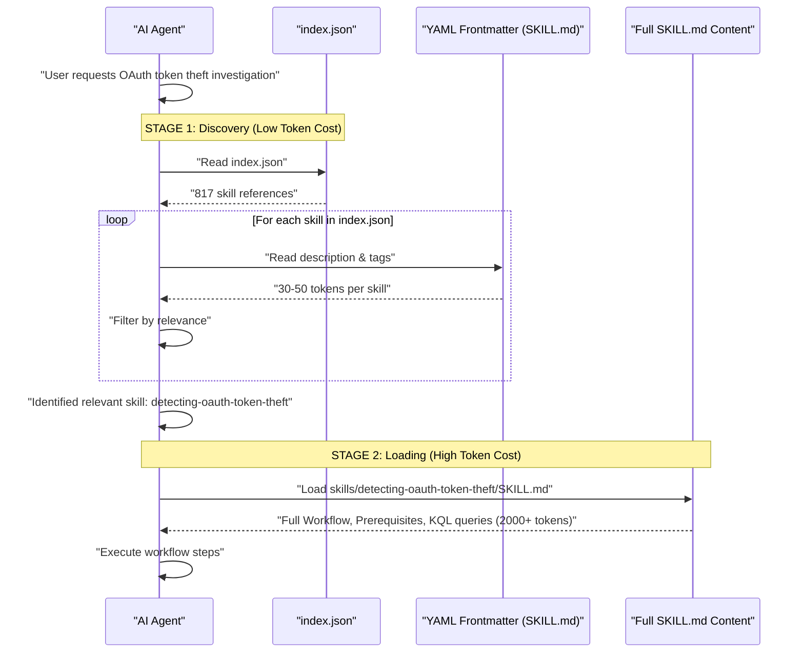
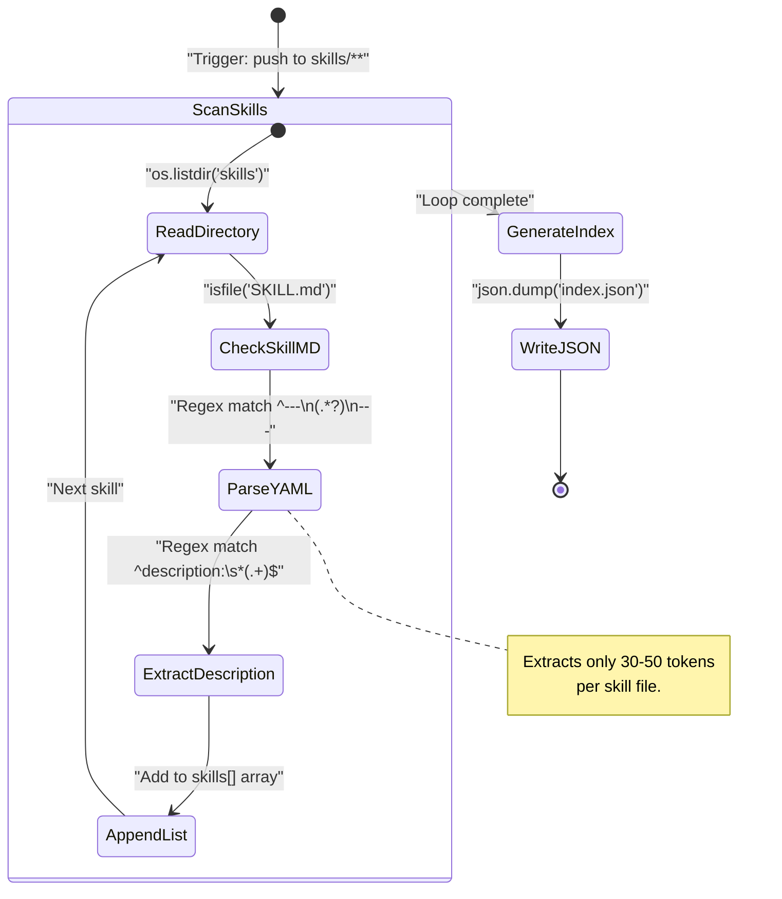
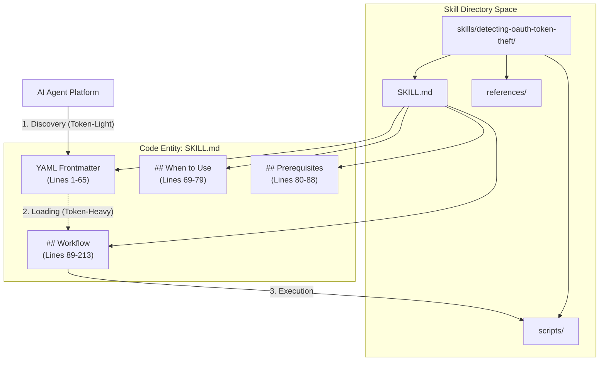

<!-- source: DeepWiki mcp.deepwiki.com · repo mukul975/Anthropic-Cybersecurity-Skills · page 2.3 Progressive Disclosure Pattern · fetched 2026-10-26 -->

# Progressive Disclosure Pattern

<details>
<summary>Relevant source files</summary>

The following files were used as context for generating this wiki page:

- [.claude-plugin/marketplace.json](.claude-plugin/marketplace.json)
- [.claude-plugin/plugin.json](.claude-plugin/plugin.json)
- [.github/workflows/sync-marketplace-version.yml](.github/workflows/sync-marketplace-version.yml)
- [.github/workflows/update-index.yml](.github/workflows/update-index.yml)
- [.github/workflows/validate-skills.yml](.github/workflows/validate-skills.yml)
- [CODE_OF_CONDUCT.md](CODE_OF_CONDUCT.md)
- [README.md](README.md)
- [index.json](index.json)
- [skills/analyzing-linux-audit-logs-for-intrusion/SKILL.md](skills/analyzing-linux-audit-logs-for-intrusion/SKILL.md)
- [skills/analyzing-windows-amcache-artifacts/SKILL.md](skills/analyzing-windows-amcache-artifacts/SKILL.md)
- [skills/detecting-oauth-token-theft/SKILL.md](skills/detecting-oauth-token-theft/SKILL.md)
- [skills/implementing-devsecops-security-scanning/SKILL.md](skills/implementing-devsecops-security-scanning/SKILL.md)
- [skills/implementing-privileged-session-monitoring/SKILL.md](skills/implementing-privileged-session-monitoring/SKILL.md)

</details>


This document explains the token-efficient skill discovery mechanism used by AI agents to navigate the **817** cybersecurity skills in this repository. The pattern enables agents to filter skills by reading lightweight YAML frontmatter (30-50 tokens) before loading full skill definitions, preventing context window exhaustion while maintaining fast skill selection.

For information about the plugin distribution system that delivers these skills to agents, see [Plugin Architecture](#5). For details on the skill file structure itself, see [Skill Structure](#3.1).

---

## Purpose and Problem Statement

The repository contains **817 structured cybersecurity skills**, each averaging 500-2000 tokens when fully loaded. If an AI agent attempted to load all skills simultaneously to determine relevance, it would consume approximately **400,000 to 1,600,000 tokens**—exceeding the context window of most AI models and leaving no room for actual task execution.

The progressive disclosure pattern solves this by implementing **two-stage loading**:
1. **Discovery Stage**: Agent reads only YAML frontmatter from all skills (~30-50 tokens each = ~24,000-40,000 total tokens).
2. **Loading Stage**: Agent loads full `SKILL.md` content only for relevant skills (500-2000 tokens each).

This design enables agents to efficiently search and filter the entire skill catalog before committing context budget to full skill content.

Sources: [README.md:41-42](), [README.md:100-101]()

---

## Two-Stage Loading Architecture

The following diagram illustrates the interaction between the AI agent and the repository entities defined in the codebase.

### Sequence of Skill Discovery and Execution


Sources: [index.json:1-1]() [skills/detecting-oauth-token-theft/SKILL.md:1-65]()

---

## YAML Frontmatter Schema

Every skill begins with YAML frontmatter delimited by triple dashes (`---`). This metadata block is designed for machine readability and token efficiency. The `update-index.yml` workflow specifically targets these lines to build the global index.

### Required Fields for Discovery

| Field | Type | Purpose | Example |
|-------|------|---------|---------|
| `name` | string | Kebab-case unique identifier | `detecting-oauth-token-theft` |
| `description` | string | Single-sentence capability summary | `Detects and responds to OAuth token theft...` |
| `domain` | string | Always `cybersecurity` | `cybersecurity` |
| `subdomain` | string | Category from 29 subdomains | `cloud-security` |
| `tags` | array | Searchable keywords for filtering | `[oauth, token-theft, entra-id]` |

### Mapping Fields (Progressive Detail)

| Field | Type | Framework Reference |
|-------|------|---------------------|
| `mitre_attack` | array | Enterprise Tactics/Techniques |
| `nist_csf` | array | CSF 2.0 Functions |
| `mitre_f3` | object | Fraud Framework TTPs |

### Frontmatter Implementation Example

```yaml
---
name: detecting-oauth-token-theft
description: Detects and responds to OAuth token theft and replay attacks in cloud environments...
domain: cybersecurity
subdomain: cloud-security
tags:
- oauth
- token-theft
- azure-ad
version: 1.0.0
author: mahipal
nist_csf:
- PR.IR-01
mitre_attack:
- T1078.004
mitre_f3:
  version: '1.1'
  tactics:
  - initial-access
---
```

Sources: [skills/detecting-oauth-token-theft/SKILL.md:1-65](), [.github/workflows/update-index.yml:36-47]()

---

## Discovery Flow State Machine

The logic used by the `update-index.yml` script mirrors how an agent parses the repository to maintain a token-efficient state.



Sources: [.github/workflows/update-index.yml:30-59]()

---

## Token Economics Comparison (817 Skills)

The transition from 607 to 817 skills has increased the importance of this pattern to prevent context overflow.

### Without Progressive Disclosure (Naive Approach)

| Stage | Token Cost | Result |
|-------|------------|--------|
| Load all skills | 817 × 1500 = **1,225,500 tokens** | **Context window exceeded** |
| Filter relevant | N/A | Failure |
| **Total** | **1,225,500+ tokens** | **System Failure** |

### With Progressive Disclosure (Current Pattern)

| Stage | Token Cost | Result |
|-------|------------|--------|
| Load `index.json` | 817 × 50 = **40,850 tokens** | Discovery complete |
| Filter relevant | 0 (Reasoning) | Matches identified |
| Load 3 full skills | 3 × 1500 = **4,500 tokens** | Workflows ready |
| **Total** | **45,350 tokens** | **Success (96.3% savings)** |

Sources: [index.json:1-1](), [README.md:41-42]()

---

## File Structure and Progressive Loading

The progressive disclosure pattern maps directly to the physical file structure. Agents first target the YAML block in `SKILL.md` before accessing the full file or associated scripts.



### Discovery Stage: Read Frontmatter Only
The agent parses `SKILL.md` lines 1-65. This contains the `description`, `tags`, and framework mappings (`mitre_attack`, `nist_csf`, `mitre_f3`).

### Loading Stage: Read Full File
If the frontmatter matches, the agent loads the remaining lines (e.g., 66-213), which contain the `## Workflow` and specific technical commands like KQL queries or `auditctl` rules.

Sources: [skills/detecting-oauth-token-theft/SKILL.md:1-213](), [skills/analyzing-linux-audit-logs-for-intrusion/SKILL.md:1-213]()

---

## Integration with Automation

The pattern is enforced by the CI/CD pipeline. `update-index.yml` ensures that the global `index.json` always reflects the latest frontmatter descriptions.

1. **Trigger**: Push to `skills/**` [.github/workflows/update-index.yml:7]().
2. **Action**: Python script iterates through all 817 directories [.github/workflows/update-index.yml:30]().
3. **Extraction**: Uses regex to pull `description` from the YAML block [.github/workflows/update-index.yml:36-41]().
4. **Aggregation**: Updates `total_skills` and the `skills` list in `index.json` [.github/workflows/update-index.yml:49-55]().
5. **Sync**: Patches the skill count in `README.md`, `marketplace.json`, and `plugin.json` [.github/workflows/update-index.yml:94-101]().

Sources: [.github/workflows/update-index.yml:1-113](), [.claude-plugin/marketplace.json:1-37]()

---

## Agent Implementation Pattern

AI agents implement progressive disclosure using this standardized approach:

1. **Query `index.json`**: Get a flat list of all skill names and descriptions.
2. **Semantic Filter**: Compare user prompt against `description` and `tags` fields.
3. **Targeted Fetch**: Request the specific `SKILL.md` file path provided in the index.
4. **Execute**: Follow the `## Workflow` section within the loaded file.

This allows the repository to support 26+ AI platforms while maintaining a consistent performance profile.

Sources: [README.md:17](), [index.json:1-1]()

---

