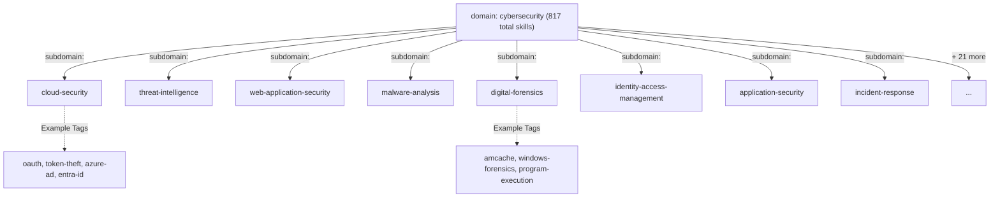
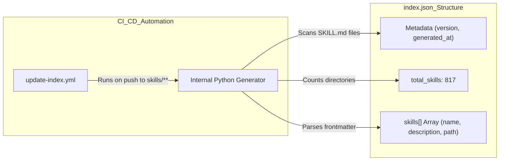
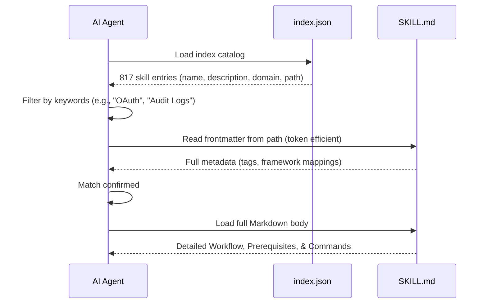

<!-- source: DeepWiki mcp.deepwiki.com · repo mukul975/Anthropic-Cybersecurity-Skills · page 3 Skills System · fetched 2026-10-26 -->

# Skills System

<details>
<summary>Relevant source files</summary>

The following files were used as context for generating this wiki page:

- [.claude-plugin/marketplace.json](.claude-plugin/marketplace.json)
- [.claude-plugin/plugin.json](.claude-plugin/plugin.json)
- [.github/workflows/sync-marketplace-version.yml](.github/workflows/sync-marketplace-version.yml)
- [.github/workflows/update-index.yml](.github/workflows/update-index.yml)
- [.github/workflows/validate-skills.yml](.github/workflows/validate-skills.yml)
- [CODE_OF_CONDUCT.md](CODE_OF_CONDUCT.md)
- [README.md](README.md)
- [index.json](index.json)
- [skills/analyzing-linux-audit-logs-for-intrusion/SKILL.md](skills/analyzing-linux-audit-logs-for-intrusion/SKILL.md)
- [skills/analyzing-windows-amcache-artifacts/SKILL.md](skills/analyzing-windows-amcache-artifacts/SKILL.md)
- [skills/detecting-oauth-token-theft/SKILL.md](skills/detecting-oauth-token-theft/SKILL.md)
- [skills/implementing-devsecops-security-scanning/SKILL.md](skills/implementing-devsecops-security-scanning/SKILL.md)
- [skills/implementing-privileged-session-monitoring/SKILL.md](skills/implementing-privileged-session-monitoring/SKILL.md)

</details>


The Skills System is the core content repository containing **817 cybersecurity capabilities** organized hierarchically across **29 subdomains** within the cybersecurity domain. Each skill follows the [agentskills.io](https://agentskills.io) standard with YAML frontmatter for metadata and a Markdown body for workflow definitions. The system provides a centralized index (`index.json`) that aggregates skill metadata for discovery, progressive disclosure, and plugin distribution.

For details on the standardized skill directory structure and YAML frontmatter schema, see [Skill Structure](#3.1). For information on how the `index.json` catalog is generated and its metadata fields, see [Skills Index](#3.2). For the complete taxonomy of 29 subdomain categories and tagging strategy, see [Skill Categories and Taxonomy](#3.3). For a practical walkthrough, see [Example: Disk Image Acquisition](#3.4).

## Repository Structure

The skills collection is organized as a flat directory of skill folders under the `skills/` directory, with each skill identified by its kebab-case name. A centralized index file provides aggregated metadata for efficient discovery without loading individual skill files.

```mermaid
graph TB
    subgraph "Repository_Root"
        [skills/] --> [index.json]
        [skills/] --> [.claude-plugin/]
    end
    
    subgraph "Individual_Skill_Directory"
        SKILL_MD["SKILL.md (YAML frontmatter + Markdown)"]
        ReferencesDir["references/"]
        ScriptsDir["scripts/"]
        AssetsDir["assets/"]
    end
    
    subgraph "Metadata_Aggregation"
        FrontmatterData["Frontmatter Fields: name, description, domain, subdomain, tags, version, nist_csf, mitre_attack, mitre_f3"]
        IndexEntry["Index Entry: + path field"]
    end
    
    [skills/] -->|"Contains 817 skill directories"| SKILL_MD
    SKILL_MD -->|"Extracted by update-index.yml"| FrontmatterData
    FrontmatterData -->|"Aggregated with path"| IndexEntry
    IndexEntry -->|"Written to"| [index.json]
    [index.json] -->|"Consumed by"| [.claude-plugin/]
    
    SKILL_MD -.->|"Supporting files (optional)"| ReferencesDir
    SKILL_MD -.->|"Supporting files (optional)"| ScriptsDir
    SKILL_MD -.->|"Supporting files (optional)"| AssetsDir
```

**Sources:** [index.json:1-55](), [README.md:37-43](), [.github/workflows/update-index.yml:27-55]()

## Domain and Subdomain Hierarchy

All skills belong to the single `cybersecurity` domain and are categorized into **29 subdomains** (updated from the previous 24/36). The `subdomain` field in each skill's frontmatter determines its primary categorization, while tags provide cross-cutting taxonomy.



**Sources:** [index.json:6-47](), [README.md:13-17](), [skills/detecting-oauth-token-theft/SKILL.md:11-20]()

## Metadata Schema and Index Catalog

Each skill's YAML frontmatter contains required fields that are extracted into `index.json`. The index provides O(1) lookup by skill name and aggregated statistics for filtering and discovery.

| Field | Type | Purpose | Example |
|-------|------|---------|---------|
| `name` | string | Unique kebab-case identifier | `detecting-oauth-token-theft` |
| `description` | string | Brief capability summary | `Detects and responds to OAuth token theft...` |
| `domain` | string | Top-level category | `cybersecurity` |
| `subdomain` | string | Primary skill category | `cloud-security` |
| `tags` | array | Cross-cutting taxonomy keywords | `[oauth, token-theft, azure-ad]` |
| `version` | string | Skill version for tracking updates | `1.0.0` |
| `nist_csf` | array | Mapping to NIST CSF 2.0 functions | `[PR.IR-01, ID.AM-08]` |
| `mitre_attack` | array | Mapping to ATT&CK Techniques | `[T1078.004, T1530]` |

**Sources:** [skills/detecting-oauth-token-theft/SKILL.md:1-35](), [index.json:1-48]()

## Index Generation and Automation

The `index.json` file is auto-generated by the `update-index.yml` workflow whenever changes are pushed to the `skills/` directory. This ensures the marketplace and AI agents always have an up-to-date view of the repository's 817 capabilities.



**Sources:** [.github/workflows/update-index.yml:1-62](), [index.json:1-55]()

## Skill Discovery Flow

AI agents use a two-phase discovery process enabled by the progressive disclosure pattern: first reading lightweight metadata from the index to filter relevance, then loading the full Markdown body only when a skill matches the task.



**Sources:** [README.md:37-43](), [index.json:1-55](), [skills/analyzing-linux-audit-logs-for-intrusion/SKILL.md:1-210]()

## Version and Marketplace Management

The system maintains consistency between the skills, the plugin marketplace, and the repository versioning. Releases trigger the `sync-marketplace-version.yml` workflow to update metadata in `.claude-plugin/`.

*   **Repository Version:** Managed via tags and synced to `marketplace.json` [ [.github/workflows/sync-marketplace-version.yml:20-35]() ].
*   **Skill Count:** Automatically synced into `README.md` and marketplace files [ [.github/workflows/update-index.yml:64-103]() ].
*   **Licensing:** Standardized Apache-2.0 across all skills and the repository [ [LICENSE]() , [.claude-plugin/marketplace.json:20]() ].

**Sources:** [.github/workflows/sync-marketplace-version.yml:1-44](), [.claude-plugin/marketplace.json:1-37](), [.claude-plugin/plugin.json:1-5]()

---

