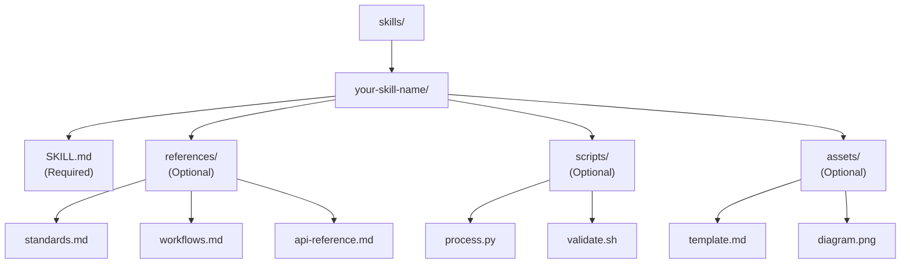
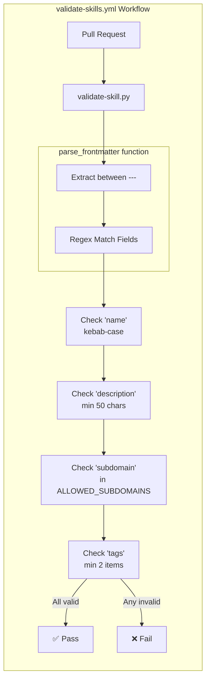
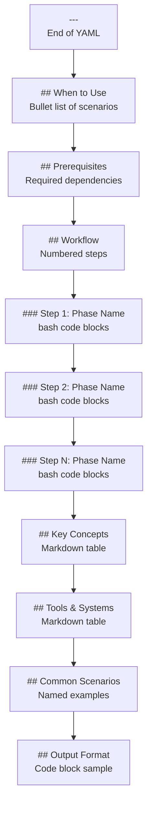
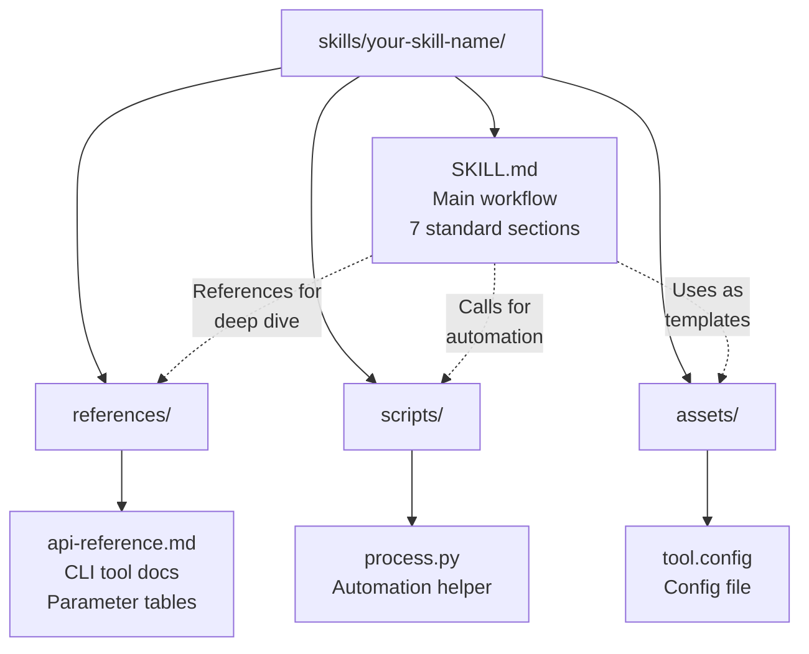
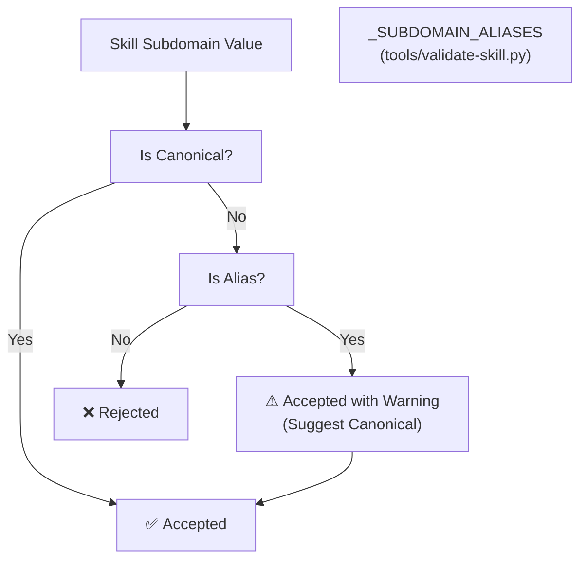

<!-- source: DeepWiki mcp.deepwiki.com · repo mukul975/Anthropic-Cybersecurity-Skills · page 3.1 Skill Structure · fetched 2026-10-26 -->

# Skill Structure

<details>
<summary>Relevant source files</summary>

The following files were used as context for generating this wiki page:

- [.claude-plugin/marketplace.json](.claude-plugin/marketplace.json)
- [.claude-plugin/plugin.json](.claude-plugin/plugin.json)
- [.github/workflows/sync-marketplace-version.yml](.github/workflows/sync-marketplace-version.yml)
- [.github/workflows/update-index.yml](.github/workflows/update-index.yml)
- [.github/workflows/validate-skills.yml](.github/workflows/validate-skills.yml)
- [CODE_OF_CONDUCT.md](CODE_OF_CONDUCT.md)
- [README.md](README.md)
- [tools/README.md](tools/README.md)
- [tools/validate-skill.py](tools/validate-skill.py)

</details>


This document defines the standardized file and directory structure for individual skills in the repository. Each skill follows a consistent template with required YAML frontmatter, Markdown body sections, and optional supporting files. This structure enables automated indexing, validation, and discovery by AI agents across 26+ platforms.

For information about the aggregated skills catalog, see [Skills Index](#3.2). For a complete walkthrough of an actual skill implementation, see [Example: Disk Image Acquisition](#3.4).

---

## Directory Layout

Each skill resides in its own directory under `skills/` with a standardized file organization. The directory name must be kebab-case and exactly match the `name` field in the `SKILL.md` frontmatter.

```
skills/
└── your-skill-name/
    ├── SKILL.md                    # Required: Main skill definition
    ├── references/                 # Optional: Supporting documentation
    │   ├── standards.md
    │   ├── workflows.md
    │   └── api-reference.md
    ├── scripts/                    # Optional: Helper automation
    │   ├── process.py
    │   └── validate.sh
    └── assets/                     # Optional: Templates and media
        ├── template.md
        └── diagram.png
```

**Directory Structure Diagram**



**Sources:** [.github/workflows/update-index.yml:27-33](), [tools/validate-skill.py:171-177]()

---

## YAML Frontmatter Requirements

Every `SKILL.md` file must begin with YAML frontmatter delimited by `---` markers. The frontmatter contains machine-readable metadata used by the `update-index.yml` workflow to generate `index.json` and by AI agents for token-efficient skill discovery.

### Required Fields

| Field | Type | Specification | Example |
|-------|------|---------------|---------|
| `name` | String | Kebab-case, 1-64 characters, must match directory name | `detecting-business-email-compromise` |
| `description` | String | Multi-line (at least 50 chars), includes agent-discovery keywords | `Detect BEC attempts by analyzing email headers for spoofing, checking for unusual sender patterns, and identifying fraudulent wire transfer requests.` |
| `domain` | String | Always `cybersecurity` | `cybersecurity` |
| `subdomain` | String | One of 29 predefined categories | `threat-detection` |
| `tags` | Array | Tools, techniques, frameworks (at least 2 items) | `[email-security, spoofing, incident-response]` |
| `version` | String | Semantic versioning format | `"1.3.0"` |
| `author` | String | GitHub username | `mukul975` |
| `license` | String | Always `Apache-2.0` | `Apache-2.0` |

### Frontmatter Example

```yaml
---
name: analyzing-network-traffic-of-malware
description: >-
  Identify malicious patterns in network captures by analyzing protocol headers,
  detecting C2 beacons, and correlating traffic with known malware signatures.
domain: cybersecurity
subdomain: malware-analysis
tags: [network-forensics, wireshark, malware, c2-detection]
version: "1.3.0"
author: mukul975
license: Apache-2.0
---
```

**YAML Frontmatter Validation Flow**



**Sources:** [tools/validate-skill.py:13-73](), [tools/validate-skill.py:81-168](), [.github/workflows/validate-skills.yml:25-58]()

---

## Markdown Body Sections

After the YAML frontmatter, the `SKILL.md` file contains structured Markdown sections. These sections provide the AI agent with actionable instructions and context.

### Standard Section Structure

| Section | Purpose | Content Guidelines |
|---------|---------|-------------------|
| `## When to Use` | Activation criteria | Bullet list of scenarios triggering this skill |
| `## Prerequisites` | Dependencies | Required tools, access, knowledge, or system state |
| `## Workflow` | Step-by-step procedure | Numbered steps with real commands, organized by `### Step N:` headings |
| `## Key Concepts` | Technical definitions | Markdown table mapping concepts to descriptions |
| `## Tools & Systems` | Technology reference | Markdown table listing tools and their purposes |
| `## Common Scenarios` | Real-world examples | Named scenarios with concrete implementations |
| `## Output Format` | Expected results | Code block showing typical command output or reports |

### Workflow Section Requirements

The `## Workflow` section contains the core executable instructions:

- Uses `### Step N:` subheadings for major phases.
- Includes real command examples in code blocks with syntax highlighting.
- Specifies exact tool names, flags, and file paths.
- Uses `bash` language identifier for shell commands.

**Skill Body Section Flow**



**Sources:** [.github/workflows/validate-skills.yml:31-35]()

---

## Supporting Files Structure

Skills may include optional subdirectories with supporting materials. These files extend the main skill definition without cluttering the primary `SKILL.md` file.

### references/ Subdirectory

Contains deep technical documentation, standards mappings, and external references:

- `standards.md` — NIST SP 800-61, ISO 27001, CVE references.
- `workflows.md` — Extended procedural documentation, decision trees.
- `api-reference.md` — Command-line tool API details, flag references.

### scripts/ Subdirectory

Contains executable helper scripts that automate portions of the skill workflow:

- Real working Python, Bash, or PowerShell scripts.
- Named descriptively (e.g., `process.py`, `validate.sh`).

### assets/ Subdirectory

Contains templates, checklists, configuration files, and diagrams:

- `template.md` — Pre-filled checklists or report templates.
- Configuration files for tools (`.config`, `.yml`, `.json`).
- Visual assets like `diagram.png`.

**Supporting Files Organization Diagram**



**Sources:** [.github/workflows/update-index.yml:30-33](), [tools/validate-skill.py:174-177]()

---

## Subdomain Categories

The `subdomain` field in YAML frontmatter must be one of 29 predefined categories. The `validate-skill.py` script maintains a mapping of canonical subdomains and accepted aliases.

| Subdomain | Example Mapping |
|-----------|-----------------|
| `web-application-security` | `application-security` |
| `penetration-testing` | `offensive-security` |
| `soc-operations` | `security-operations` |
| `phishing-defense` | `social-engineering-defense` |
| `firmware-analysis` | `firmware-security` |
| `compliance-governance` | `governance-risk-compliance` |

**Subdomain Validation Logic**



**Sources:** [tools/validate-skill.py:18-68]()

---

## File Naming Conventions

All skill directories and file names follow strict conventions to ensure consistency.

### Directory and Skill Name Requirements

| Rule | Specification | Example |
|------|---------------|---------|
| Format | Kebab-case (lowercase with hyphens) | `aws-s3-enumeration` |
| Length | 1-64 characters | `detecting-spoofed-emails` |
| Characters | Alphanumeric and hyphens only | `incident-response-plan` |
| Match | Must match `name` field in YAML frontmatter | Directory: `my-skill` / YAML: `name: my-skill` |

### Automated Validation Summary

The `validate-skills.yml` workflow performs the following checks:
1. **Frontmatter Existence**: Checks for `---` markers.
2. **Required Fields**: Ensures `name`, `description`, `domain`, `subdomain`, `tags`, `version`, `author`, and `license` are present.
3. **Format Validation**: Validates kebab-case for names and length constraints.
4. **Duplicate Detection**: Ensures no two skills share the same `name` metadata.

**Sources:** [.github/workflows/validate-skills.yml:38-95](), [tools/validate-skill.py:70-73]()

---

