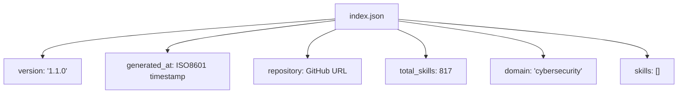
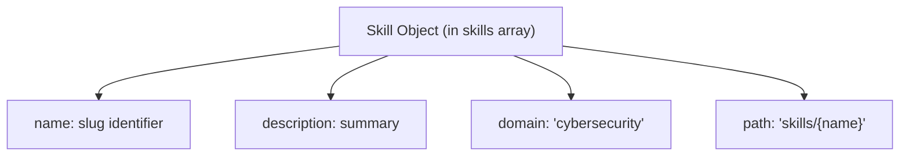
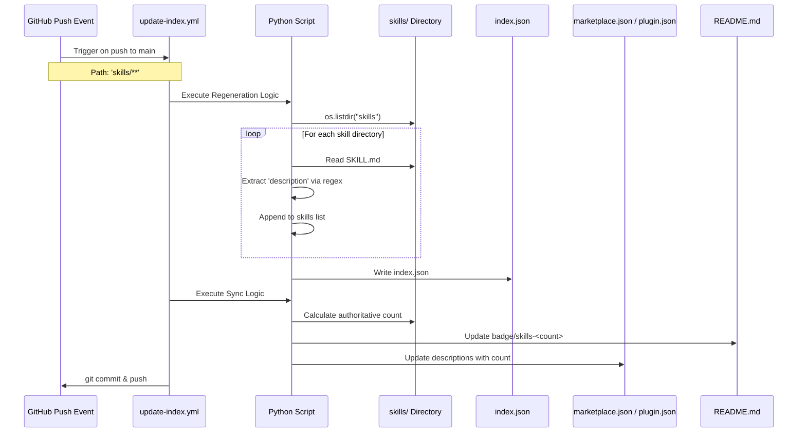
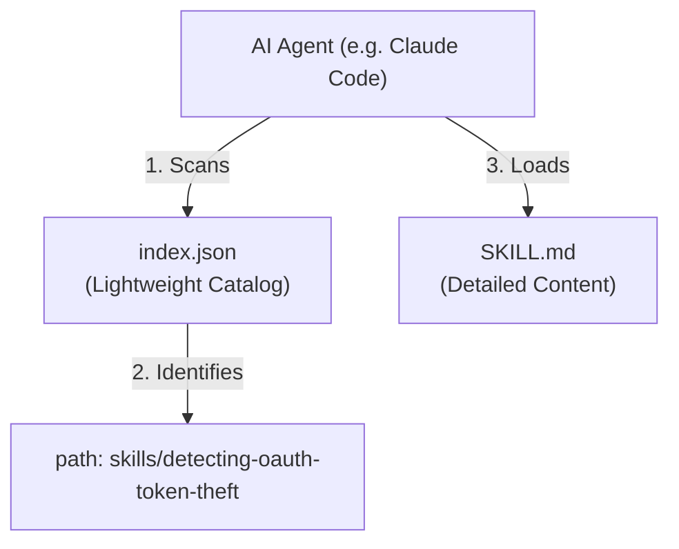

<!-- source: DeepWiki mcp.deepwiki.com · repo mukul975/Anthropic-Cybersecurity-Skills · page 3.2 Skills Index · fetched 2026-10-26 -->

# Skills Index

<details>
<summary>Relevant source files</summary>

The following files were used as context for generating this wiki page:

- [.claude-plugin/marketplace.json](.claude-plugin/marketplace.json)
- [.claude-plugin/plugin.json](.claude-plugin/plugin.json)
- [.github/workflows/sync-marketplace-version.yml](.github/workflows/sync-marketplace-version.yml)
- [.github/workflows/update-index.yml](.github/workflows/update-index.yml)
- [.github/workflows/validate-skills.yml](.github/workflows/validate-skills.yml)
- [CODE_OF_CONDUCT.md](CODE_OF_CONDUCT.md)
- [README.md](README.md)
- [index.json](index.json)
- [skills/analyzing-linux-audit-logs-for-intrusion/SKILL.md](skills/analyzing-linux-audit-logs-for-intrusion/SKILL.md)
- [skills/analyzing-windows-amcache-artifacts/SKILL.md](skills/analyzing-windows-amcache-artifacts/SKILL.md)
- [skills/detecting-oauth-token-theft/SKILL.md](skills/detecting-oauth-token-theft/SKILL.md)
- [skills/implementing-devsecops-security-scanning/SKILL.md](skills/implementing-devsecops-security-scanning/SKILL.md)
- [skills/implementing-privileged-session-monitoring/SKILL.md](skills/implementing-privileged-session-monitoring/SKILL.md)

</details>


The Skills Index is the central catalog that aggregates metadata from all 817 cybersecurity skills into a machine-readable JSON structure. This index enables efficient skill discovery, filtering, and integration with AI agent platforms without requiring agents to scan individual `SKILL.md` files across the entire repository.

For information about individual skill structure and frontmatter requirements, see [Skill Structure](#3.1). For the taxonomy of skill categories, see [Skill Categories and Taxonomy](#3.3). For the automated generation process, see [Index Generation Workflow](#6.2).

## Index File Structure

The `index.json` file serves as the single source of truth for skill metadata, exposing aggregate statistics and individual skill records through a standardized schema.

### Root-Level Metadata



**Sources:** [index.json:1-1](), [.github/workflows/update-index.yml:49-56]()

The root object contains version tracking, generation timestamps, repository metadata, and aggregated counts:

| Field | Type | Purpose |
|-------|------|---------|
| `version` | string | Index schema version (currently "1.1.0") |
| `generated_at` | string | UTC timestamp in ISO 8601 format |
| `repository` | string | GitHub repository URL |
| `total_skills` | integer | Total number of indexed skills (817) |
| `domain` | string | The primary domain of the library ("cybersecurity") |

**Sources:** [index.json:1-1](), [.github/workflows/update-index.yml:49-56]()

## Skill Entry Schema

Each skill in the `skills` array follows a standardized metadata structure extracted from `SKILL.md` frontmatter.

### Skill Object Structure



**Sources:** [index.json:1-1](), [.github/workflows/update-index.yml:42-47]()

### Field Specifications

| Field | Type | Source | Example |
|-------|------|--------|---------|
| `name` | string | Directory name in `skills/` | `"abusing-dpapi-for-credential-access"` |
| `description` | string | Frontmatter `description:` | `"Extract DPAPI-protected secrets..."` |
| `domain` | string | Hardcoded as `"cybersecurity"` | `"cybersecurity"` |
| `path` | string | Constructed as `skills/{skill_name}` | `"skills/abusing-dpapi-for-credential-access"` |

**Sources:** [.github/workflows/update-index.yml:30-47]()

### Example Skill Entry

```json
{
  "name": "abusing-dpapi-for-credential-access",
  "description": "Extract DPAPI-protected secrets such as credentials and browser data offline and online.",
  "domain": "cybersecurity",
  "path": "skills/abusing-dpapi-for-credential-access"
}
```

**Sources:** [index.json:1-1]()

## Index Generation Process

The index is automatically regenerated whenever skill files are modified through the `update-index.yml` GitHub Actions workflow. This workflow also synchronizes the skill count across the `README.md`, `marketplace.json`, and `plugin.json`.

### Workflow Architecture



**Sources:** [.github/workflows/update-index.yml:1-113]()

### Python Extraction Logic

The inline Python script performs metadata extraction by scanning the `skills/` directory and parsing the YAML frontmatter of each `SKILL.md` file using regular expressions.

```python
for skill_name in sorted(os.listdir(skills_dir)):
    skill_md = os.path.join(skills_dir, skill_name, "SKILL.md")
    if not os.path.isfile(skill_md):
        continue
    with open(skill_md, "r", encoding="utf-8") as f:
        content = f.read()
    fm_match = re.match(r"^---\n(.*?)\n---", content, re.DOTALL)
    description = ""
    if fm_match:
        m = re.search(r"^description:\s*(.+)$", fm_match.group(1), re.MULTILINE)
        if m:
            description = m.group(1).strip().strip('"')
```

**Sources:** [.github/workflows/update-index.yml:30-41]()

### Skill Count Synchronization

To maintain consistency across the repository, the workflow includes a secondary Python block that updates the "817" count in various files:

1.  **README.md**: Updates the shields.io badge (`badge/skills-817`) and multiple descriptive phrases like "817 production-grade cybersecurity skills".
2.  **marketplace.json**: Patches the `metadata.description` and `plugins[].description` fields.
3.  **plugin.json**: Patches the top-level `description`.

**Sources:** [.github/workflows/update-index.yml:66-104]()

## Usage in Plugin System

The `index.json` file serves as the primary data source for plugin distribution and AI agent integration.

### Progressive Disclosure Pattern

AI agents use the index for token-efficient skill discovery. Instead of loading 817 full markdown files, the agent reads the index to find relevant paths.



**Sources:** [README.md:21, 39-41](), [index.json:1-1]()

### Marketplace and Versioning

The `index.json` is complemented by marketplace configuration files which define the overall plugin version (currently `1.3.0`).

| File | Purpose | Version Field |
|------|---------|---------------|
| `index.json` | Skill catalog for agents | `1.1.0` |
| `.claude-plugin/marketplace.json` | Marketplace metadata | `1.3.0` |
| `.claude-plugin/plugin.json` | Plugin definition | `1.3.0` |

**Sources:** [index.json:1](), [.claude-plugin/marketplace.json:9, 16](), [.claude-plugin/plugin.json:4]()

The version numbers in `marketplace.json` and `plugin.json` are automatically synchronized with GitHub release tags via the `sync-marketplace-version.yml` workflow using `jq`.

**Sources:** [.github/workflows/sync-marketplace-version.yml:27-35]()

## Index Statistics Summary

Current index metrics (as of the 1.3.0 release):

| Metric | Value |
|--------|-------|
| Total Skills | 817 |
| Security Domains | 29 |
| Framework Mappings | 6 |
| Compatible Platforms | 26+ |

**Sources:** [README.md:13-17, 27](), [index.json:1]()

### Framework Coverage Analysis
The index supports skills mapped across six industry-standard frameworks:
*   **MITRE ATT&CK v19.1**: 15 tactics, 286 techniques.
*   **NIST CSF 2.0**: 6 functions, 22 categories.
*   **MITRE F3**: 8 tactics, 123 techniques (94 fraud-relevant skills).
*   **MITRE ATLAS v5.4**: 16 tactics, 84 techniques.
*   **MITRE D3FEND v1.3**: 7 categories, 267 techniques.
*   **NIST AI RMF 1.0**: 4 functions, 72 subcategories.

**Sources:** [README.md:43-54, 63, 75-77]()

---

