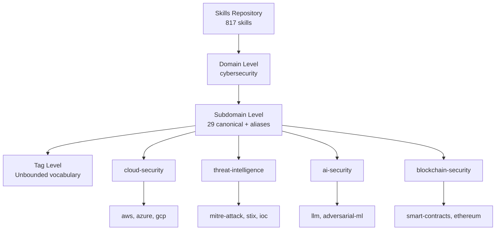
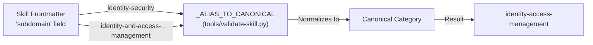
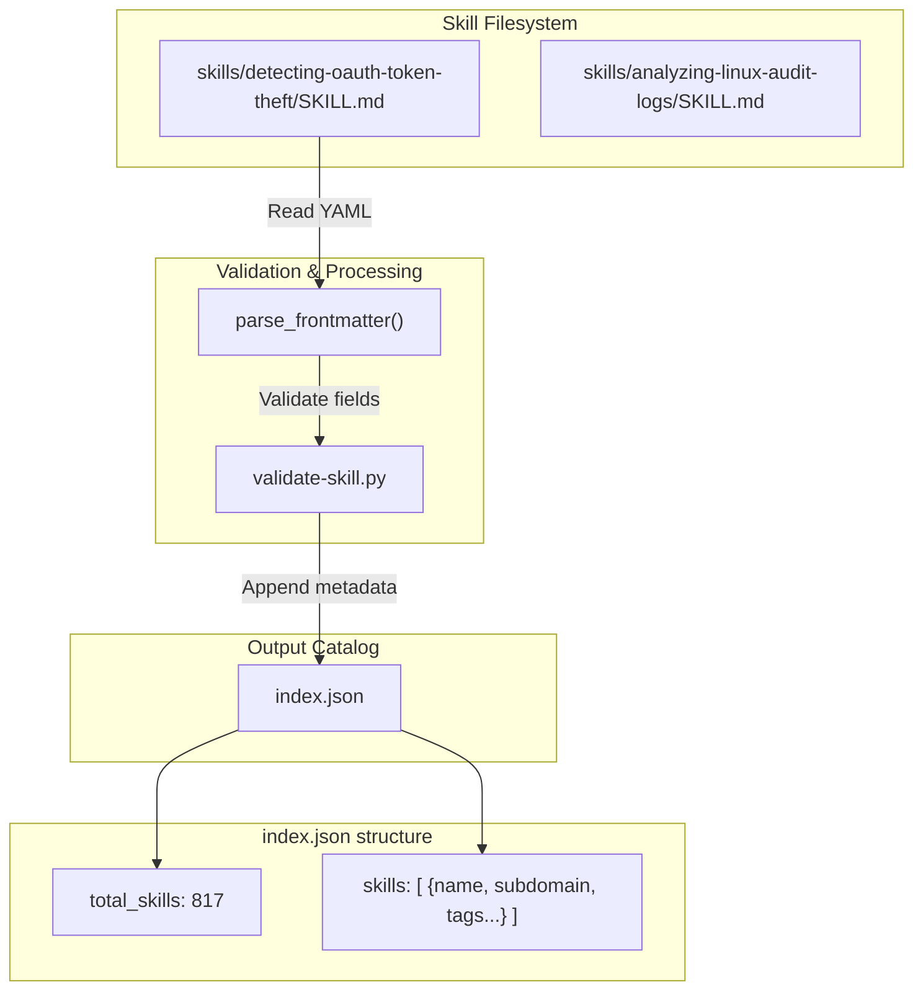

<!-- source: DeepWiki mcp.deepwiki.com · repo mukul975/Anthropic-Cybersecurity-Skills · page 3.3 Skill Categories and Taxonomy · fetched 2026-10-26 -->

# Skill Categories and Taxonomy

Relevant source files

The following files were used as context for generating this wiki page:

- [.gitignore](.gitignore)
- [ATTACK_COVERAGE.md](ATTACK_COVERAGE.md)
- [index.json](index.json)
- [skills/analyzing-linux-audit-logs-for-intrusion/SKILL.md](skills/analyzing-linux-audit-logs-for-intrusion/SKILL.md)
- [skills/analyzing-windows-amcache-artifacts/SKILL.md](skills/analyzing-windows-amcache-artifacts/SKILL.md)
- [skills/detecting-oauth-token-theft/SKILL.md](skills/detecting-oauth-token-theft/SKILL.md)
- [skills/implementing-devsecops-security-scanning/SKILL.md](skills/implementing-devsecops-security-scanning/SKILL.md)
- [skills/implementing-privileged-session-monitoring/SKILL.md](skills/implementing-privileged-session-monitoring/SKILL.md)
- [tools/README.md](tools/README.md)
- [tools/validate-skill.py](tools/validate-skill.py)

This page documents the taxonomic structure used to classify and organize the 817 cybersecurity skills in the repository. The taxonomy enables efficient skill discovery through a hierarchical domain → subdomain → tag classification system that supports progressive disclosure for AI agents.

The taxonomy has been expanded from 24 to 29 canonical subdomains to accommodate emerging fields such as AI security, blockchain security, and supply chain security.

## Taxonomy Architecture

The repository implements a three-level hierarchical taxonomy:

**Sources:** [index.json:1-10](), [tools/validate-skill.py:13-59]()

### Domain Level
All skills belong to a single root domain: `cybersecurity`. This provides namespace consistency and simplifies AI agent filtering.

**Sources:** [index.json:8-9](), [tools/validate-skill.py:24-24]()

### Subdomain Level
Subdomains provide functional categorization. The system now recognizes **29 canonical subdomains** and manages naming variants through an alias mapping system in the validator.

**Sources:** [tools/validate-skill.py:18-59]()

### Tag Level
Tags provide fine-grained classification using an unbounded vocabulary. These are stored as a list in the skill frontmatter and must contain at least 2 items.

**Sources:** [tools/validate-skill.py:26-26](), [tools/README.md:26-26]()

---

## Canonical Subdomain Categories

The following 29 subdomains are the primary taxonomic units. The `validate-skill.py` script enforces these categories while allowing for common aliases.

| Canonical Subdomain | Key Aliases Accepted | Purpose |
|---------------------|----------------------|---------|
| `cloud-security` | - | AWS, Azure, GCP, and Cloud Native security |
| `threat-intelligence` | - | CTI, IOCs, and Actor Tracking |
| `web-application-security` | `application-security` | Web vulnerabilities and OWASP Top 10 |
| `ai-security` | - | LLM security, prompt injection, and ML integrity |
| `blockchain-security` | - | Smart contract audits and DLT security |
| `supply-chain-security` | - | Software Bill of Materials (SBOM) and pipeline integrity |
| `ot-ics-security` | `ot-security` | Industrial Control Systems and SCADA |
| `identity-access-management`| `identity-security`, `iam` | Authentication, Authorization, and PAM |
| `soc-operations` | `security-operations` | SIEM, SOAR, and SOC workflows |
| `red-teaming` | `red-team` | Adversary emulation and offensive operations |
| `penetration-testing` | `offensive-security` | Targeted vulnerability assessment |
| `digital-forensics` | - | Evidence acquisition and artifact analysis |
| `malware-analysis` | - | Static, dynamic, and reverse engineering |
| `network-security` | - | Traffic analysis and network defense |
| `vulnerability-management` | - | Scanning, prioritization, and patching |
| `compliance-governance` | `governance-risk-compliance` | Regulatory frameworks (GDPR, PCI, etc.) |
| `devsecops` | - | CI/CD security and shift-left automation |
| `threat-hunting` | - | Proactive detection of hidden threats |
| `incident-response` | - | Containment, Eradication, and Recovery |
| `endpoint-security` | - | Host-based defense and EDR |
| `phishing-defense` | `social-engineering-defense` | Email security and user awareness |
| `api-security` | - | REST, GraphQL, and microservices security |
| `mobile-security` | - | iOS and Android security |
| `ransomware-defense` | - | Extortion prevention and recovery |
| `threat-detection` | - | Detection engineering and alerting |
| `cryptography` | - | Encryption, PKI, and secure protocols |
| `data-protection` | - | DLP and data privacy |
| `deception-technology` | - | Honeypots and active defense |
| `firmware-analysis` | `firmware-security` | Hardware and low-level code security |
| `privacy-compliance` | - | Data privacy regulations and controls |
| `purple-team` | - | Collaborative offensive/defensive exercises |
| `wireless-security` | - | Wi-Fi, Bluetooth, and RF security |
| `zero-trust-architecture` | `zero-trust` | Identity-centric perimeter-less security |

**Sources:** [tools/validate-skill.py:18-59]()

---

## Taxonomy Implementation in Code

The taxonomy is enforced via `tools/validate-skill.py` and aggregated into `index.json`.

### Subdomain Mapping Logic
The codebase uses a mapping dictionary to normalize various input strings into canonical subdomains.

**Sources:** [tools/validate-skill.py:18-68]()

### Validation Rules
The `validate_skill(skill_dir)` function ensures every skill adheres to the taxonomy:
1. **Required Fields**: `domain`, `subdomain`, and `tags` must exist [tools/validate-skill.py:13-13]().
2. **Domain**: Must be exactly `cybersecurity` [tools/validate-skill.py:24-24]().
3. **Subdomain**: Must exist within the `ALLOWED_SUBDOMAINS` set [tools/validate-skill.py:62-62]().
4. **Tags**: Must be a list with at least 2 items [tools/validate-skill.py:26-26]().

---

## Code Entity Space: Taxonomy Data Flow

This diagram illustrates how taxonomy data moves from the raw `SKILL.md` files into the system-wide `index.json`.

**Sources:** [index.json:1-10](), [tools/validate-skill.py:81-168](), [skills/detecting-oauth-token-theft/SKILL.md:1-22]()

---

## Example: Skill Categorization

A skill like `detecting-oauth-token-theft` demonstrates the multi-framework and taxonomic mapping:

*   **Domain**: `cybersecurity`
*   **Subdomain**: `cloud-security`
*   **Tags**: `[oauth, token-theft, azure-ad, entra-id, conditional-access, token-replay, identity-security, PRT]`
*   **Frameworks**:
    *   **NIST CSF**: `PR.IR-01`, `ID.AM-08`, `GV.SC-06`, `DE.CM-01`
    *   **MITRE ATT&CK**: `T1078.004`, `T1530`, `T1537`, `T1580`
    *   **MITRE F3**: `initial-access`, `positioning`

**Sources:** [skills/detecting-oauth-token-theft/SKILL.md:1-65]()

---

## Summary of Changes
The taxonomy was recently updated to increase granularity and coverage:
1.  **From 24 to 29 subdomains**: Added specialized categories like `ai-security`, `blockchain-security`, and `firmware-analysis`.
2.  **Alias Support**: The validator now supports 12+ aliases (e.g., `ot-security` maps to `ot-ics-security`) to maintain backward compatibility while enforcing a clean index.
3.  **Strict Validation**: Descriptions are now enforced at a minimum of 50 characters to ensure the taxonomy is supported by meaningful metadata.

**Sources:** [tools/validate-skill.py:18-73](), [index.json:1-10]()

---

