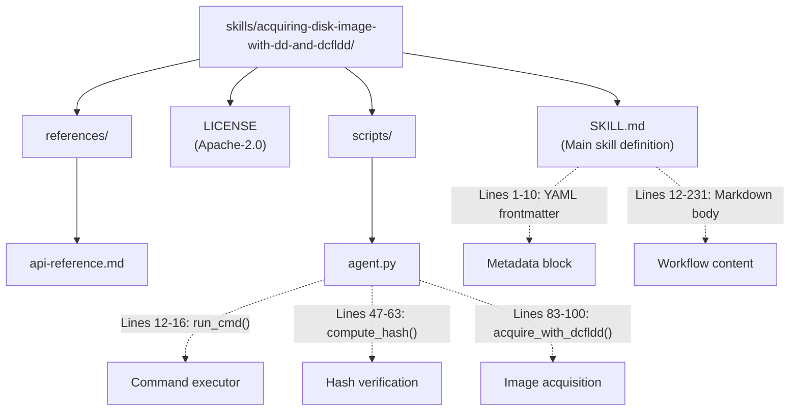
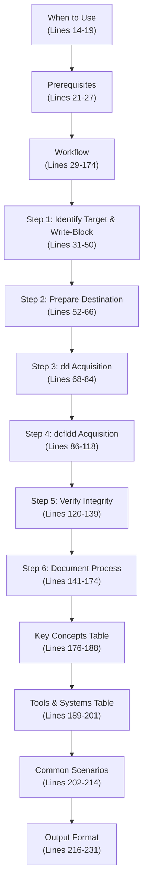
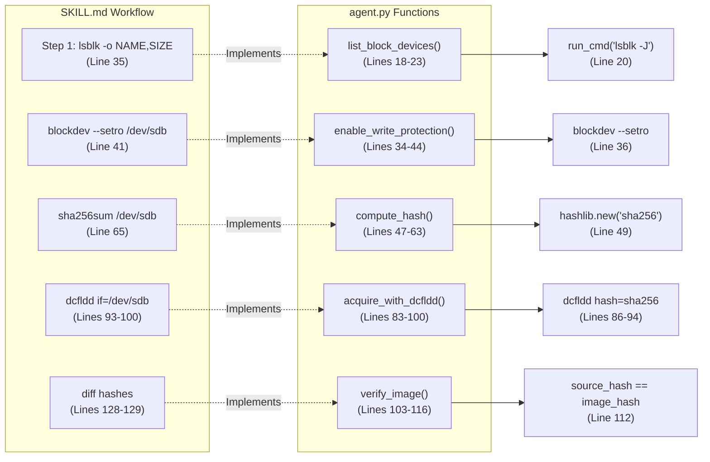
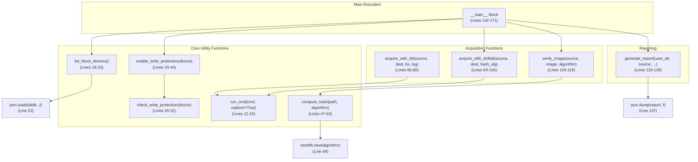
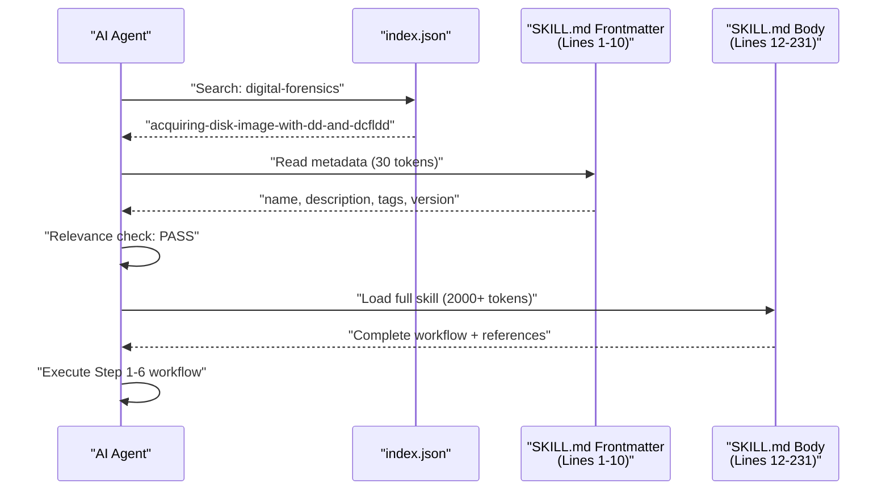

<!-- source: DeepWiki mcp.deepwiki.com · repo mukul975/Anthropic-Cybersecurity-Skills · page 3.4 Example: Disk Image Acquisition · fetched 2026-10-26 -->

# Example: Disk Image Acquisition

<details>
<summary>Relevant source files</summary>

The following files were used as context for generating this wiki page:

- [index.json](index.json)
- [skills/analyzing-api-gateway-access-logs/SKILL.md](skills/analyzing-api-gateway-access-logs/SKILL.md)
- [skills/analyzing-azure-activity-logs-for-threats/SKILL.md](skills/analyzing-azure-activity-logs-for-threats/SKILL.md)
- [skills/analyzing-cloud-storage-access-patterns/SKILL.md](skills/analyzing-cloud-storage-access-patterns/SKILL.md)
- [skills/analyzing-kubernetes-audit-logs/SKILL.md](skills/analyzing-kubernetes-audit-logs/SKILL.md)
- [skills/analyzing-linux-audit-logs-for-intrusion/SKILL.md](skills/analyzing-linux-audit-logs-for-intrusion/SKILL.md)
- [skills/analyzing-memory-forensics-with-lime-and-volatility/SKILL.md](skills/analyzing-memory-forensics-with-lime-and-volatility/SKILL.md)
- [skills/analyzing-network-flow-data-with-netflow/SKILL.md](skills/analyzing-network-flow-data-with-netflow/SKILL.md)
- [skills/analyzing-powershell-script-block-logging/SKILL.md](skills/analyzing-powershell-script-block-logging/SKILL.md)
- [skills/analyzing-threat-landscape-with-misp/SKILL.md](skills/analyzing-threat-landscape-with-misp/SKILL.md)
- [skills/analyzing-web-server-logs-for-intrusion/SKILL.md](skills/analyzing-web-server-logs-for-intrusion/SKILL.md)
- [skills/analyzing-windows-amcache-artifacts/SKILL.md](skills/analyzing-windows-amcache-artifacts/SKILL.md)
- [skills/configuring-microsegmentation-for-zero-trust/SKILL.md](skills/configuring-microsegmentation-for-zero-trust/SKILL.md)
- [skills/detecting-oauth-token-theft/SKILL.md](skills/detecting-oauth-token-theft/SKILL.md)
- [skills/implementing-devsecops-security-scanning/SKILL.md](skills/implementing-devsecops-security-scanning/SKILL.md)
- [skills/implementing-privileged-session-monitoring/SKILL.md](skills/implementing-privileged-session-monitoring/SKILL.md)

</details>


## Purpose and Scope

This page provides a detailed walkthrough of the **acquiring-disk-image-with-dd-and-dcfldd** skill as a concrete example of the standardized skill structure. It demonstrates how YAML frontmatter, workflow organization, verification procedures, and helper scripts combine to form a complete, AI-agent-consumable capability. This example illustrates the structure defined in [Skill Structure](#3.1) and shows how individual skills populate the catalog described in [Skills Index](#3.2).

For general skill structure requirements, see [Skill Structure](#3.1). For information about how skills are categorized, see [Skill Categories and Taxonomy](#3.3).

---

## Skill Directory Structure

The `acquiring-disk-image-with-dd-and-dcfldd` skill follows the standardized directory layout required by the repository's contribution guidelines.

Directory Structure for Disk Acquisition Skill:


**Sources:** [skills/acquiring-disk-image-with-dd-and-dcfldd/SKILL.md:1-231](), [skills/acquiring-disk-image-with-dd-and-dcfldd/scripts/agent.py:1-171](), [skills/acquiring-disk-image-with-dd-and-dcfldd/references/api-reference.md:1-100]()

---

## YAML Frontmatter Structure

The skill begins with YAML frontmatter that provides machine-readable metadata for AI agents and the indexing system.

| Field | Value | Purpose |
|-------|-------|---------|
| `name` | `acquiring-disk-image-with-dd-and-dcfldd` | Unique identifier matching directory name |
| `description` | `Create forensically sound bit-for-bit...` | Brief summary (appears in skill listings) |
| `domain` | `cybersecurity` | Top-level domain classification |
| `subdomain` | `digital-forensics` | Specific subdomain (maps to NIST CSF, MITRE ATT&CK) |
| `tags` | `[forensics, disk-imaging, ...]` | Search keywords and technique identifiers |
| `version` | `"1.0"` | Semantic version for tracking updates |
| `author` | `mahipal` | Contributor attribution |
| `license` | `Apache-2.0` | SPDX license identifier |

This frontmatter block is defined at [skills/acquiring-disk-image-with-dd-and-dcfldd/SKILL.md:1-10](). The `subdomain` field maps to the taxonomy described in [Skill Categories and Taxonomy](#3.3), and these metadata fields populate the `index.json` catalog as documented in [Skills Index](#3.2).

**Progressive Disclosure Pattern:** AI agents read this 30-50 token YAML block first to determine relevance before loading the full 2,000+ token skill body. This implements the token-efficient discovery mechanism described in [Progressive Disclosure Pattern](#2.3).

**Sources:** [skills/acquiring-disk-image-with-dd-and-dcfldd/SKILL.md:1-10]()

---

## Workflow Organization

The skill's main content is organized into standardized sections that guide AI agents through the complete forensic acquisition process.

Skill Content Workflow:


### Section Breakdown

**When to Use** ([skills/acquiring-disk-image-with-dd-and-dcfldd/SKILL.md:14-19]()): Defines five forensic contexts where this skill applies, such as incident response and legal proceedings.

**Prerequisites** ([skills/acquiring-disk-image-with-dd-and-dcfldd/SKILL.md:21-27]()): Lists required tools (`dd`, `dcfldd`, `sha256sum`), hardware (write-blocker), and permissions (root/sudo).

**Workflow Steps** ([skills/acquiring-disk-image-with-dd-and-dcfldd/SKILL.md:29-174]()): Six sequential steps with executable shell commands:

1. **Device Identification** uses `lsblk`, `fdisk`, `blockdev --setro` to locate and write-protect the target device
2. **Documentation** captures drive metadata with `hdparm -I` and `smartctl -i` before acquisition
3. **dd Acquisition** demonstrates basic imaging with `conv=noerror,sync` and `status=progress`
4. **dcfldd Acquisition** shows forensic-grade imaging with built-in `hash=sha256,md5` and `split=2G` options
5. **Integrity Verification** compares source and image hashes using `sha256sum` and `diff`
6. **Report Generation** creates chain-of-custody documentation with timestamps and hash values

**Sources:** [skills/acquiring-disk-image-with-dd-and-dcfldd/SKILL.md:14-174]()

---

## Code Entity Mapping: Workflow to Implementation

This diagram bridges the natural language workflow to actual code implementation in the helper script.

Workflow to Code Entity Mapping:


**Sources:** [skills/acquiring-disk-image-with-dd-and-dcfldd/SKILL.md:35-129](), [skills/acquiring-disk-image-with-dd-and-dcfldd/scripts/agent.py:18-116]()

---

## Hash Verification Process

The skill implements a three-phase hash verification strategy to ensure forensic integrity:

### Phase 1: Pre-Acquisition Hash
```bash
sha256sum /dev/sdb | tee /cases/case-2024-001/hashes/source_hash_before.txt
```
Defined at [skills/acquiring-disk-image-with-dd-and-dcfldd/SKILL.md:65](), this establishes the baseline hash of the source device before imaging begins.

### Phase 2: Acquisition with Built-in Hashing
```bash
dcfldd if=/dev/sdb of=evidence.dd \
  hash=sha256,md5 \
  hashlog=/cases/case-2024-001/hashes/acquisition_hashes.txt \
  hashwindow=1G
```
Defined at [skills/acquiring-disk-image-with-dd-and-dcfldd/SKILL.md:93-100](), `dcfldd` computes hashes incrementally every 1GB during the acquisition process, writing results to `hashlog`.

### Phase 3: Post-Acquisition Verification
```bash
sha256sum /cases/case-2024-001/images/evidence.dd | tee image_hash.txt
diff <(sha256sum /dev/sdb | awk '{print $1}') \
     <(sha256sum evidence.dd | awk '{print $1}')
```
Defined at [skills/acquiring-disk-image-with-dd-and-dcfldd/SKILL.md:124-129](), this compares the source and image hashes to cryptographically prove the acquisition created an exact bit-for-bit copy.

The Python implementation automates this process through the `verify_image()` function at [skills/acquiring-disk-image-with-dd-and-dcfldd/scripts/agent.py:103-116](), which returns `(match_bool, source_hash, image_hash)`.

**Sources:** [skills/acquiring-disk-image-with-dd-and-dcfldd/SKILL.md:65-139](), [skills/acquiring-disk-image-with-dd-and-dcfldd/scripts/agent.py:103-116]()

---

## Supporting Reference Files

The skill includes structured API documentation in the `references/` subdirectory.

### API Reference Structure

The file at [skills/acquiring-disk-image-with-dd-and-dcfldd/references/api-reference.md:1-100]() documents command-line interfaces for six tools:

| Tool | Documentation Sections | Example Options |
|------|----------------------|-----------------|
| `dd` | Syntax, Key Options, conv= Values, Output Format | `if=`, `of=`, `bs=`, `conv=noerror,sync` |
| `dcfldd` | Syntax, Extended Options, Output Format | `hash=`, `hashlog=`, `split=`, `vf=` |
| `sha256sum` | Syntax, Output Format | `-c` for checksum verification |
| `blockdev` | Write Protection Commands | `--setro`, `--getro`, `--getsize64` |
| `lsblk` | Block Device Enumeration | `-J` (JSON), `-o` (columns), `-p` (paths) |
| `hdparm` | Drive Identification | `-I` (detailed), `-i` (summary) |

Each tool's documentation includes:
- **Basic Syntax**: Command structure with placeholder arguments
- **Key Options Table**: Flag, description, and example value
- **Output Format**: Sample command output for verification

This reference material supplements the main workflow by providing detailed flag documentation that AI agents can consult when adapting commands to specific scenarios.

**Sources:** [skills/acquiring-disk-image-with-dd-and-dcfldd/references/api-reference.md:1-100]()

---

## Helper Script Architecture

The `agent.py` script at [skills/acquiring-disk-image-with-dd-and-dcfldd/scripts/agent.py:1-171]() provides programmatic automation of the manual workflow.

Helper Script Architecture:


### Function Responsibilities

**`run_cmd()`** ([skills/acquiring-disk-image-with-dd-and-dcfldd/scripts/agent.py:12-15]()): Executes shell commands via `subprocess.run()`, returning `(stdout, stderr, returncode)` tuple.

**`list_block_devices()`** ([skills/acquiring-disk-image-with-dd-and-dcfldd/scripts/agent.py:18-23]()): Wraps `lsblk -J` to enumerate devices as JSON, parsing with `json.loads()`.

**`enable_write_protection()`** ([skills/acquiring-disk-image-with-dd-and-dcfldd/scripts/agent.py:34-44]()): Calls `blockdev --setro`, then verifies with `check_write_protection()` to confirm read-only status.

**`compute_hash()`** ([skills/acquiring-disk-image-with-dd-and-dcfldd/scripts/agent.py:47-63]()): Opens a file/device in binary mode, reads 64KB blocks, updates `hashlib` object, returns hexdigest. Handles `PermissionError` and `FileNotFoundError`.

**`acquire_with_dcfldd()`** ([skills/acquiring-disk-image-with-dd-and-dcfldd/scripts/agent.py:83-100]()): Constructs `dcfldd` command with parameters for `hash_alg`, `hash_log`, `error_log`, `block_size`, and optional `split_size`. Tracks elapsed time in seconds.

**`verify_image()`** ([skills/acquiring-disk-image-with-dd-and-dcfldd/scripts/agent.py:103-116]()): Computes hashes of source and image, compares with `==`, returns `(bool, source_hash, image_hash)`.

**`generate_report()`** ([skills/acquiring-disk-image-with-dd-and-dcfldd/scripts/agent.py:119-139]()): Creates a JSON report with timestamp, hashes, verification status, and duration. Saves to `acquisition_report.json` in case directory.

**Main Execution** ([skills/acquiring-disk-image-with-dd-and-dcfldd/scripts/agent.py:142-171]()): Demonstrates the workflow by enumerating devices and printing a dry-run example showing the full acquisition sequence.

**Sources:** [skills/acquiring-disk-image-with-dd-and-dcfldd/scripts/agent.py:1-171]()

---

## Integration with Skills System

This skill integrates with the larger repository infrastructure through standardized interfaces.

### Metadata Extraction for index.json

The `update-index.yml` workflow (see [Index Generation Workflow](#6.2)) scans the YAML frontmatter at [skills/acquiring-disk-image-with-dd-and-dcfldd/SKILL.md:1-10]() and extracts:

```json
{
  "name": "acquiring-disk-image-with-dd-and-dcfldd",
  "description": "Create forensically sound bit-for-bit disk images...",
  "subdomain": "digital-forensics",
  "tags": ["forensics", "disk-imaging", "evidence-acquisition", "dd", "dcfldd", "hash-verification"],
  "version": "1.0",
  "author": "mahipal"
}
```

This data populates the central catalog at `index.json` (documented in [Skills Index](#3.2)).

### Framework Mappings

The skill maps to security frameworks through its metadata:

| Framework | Mapping Method | Value |
|-----------|---------------|-------|
| **NIST CSF 2.0** | `subdomain` field | `digital-forensics` → **Detect (DE)** / **Respond (RS)** categories |
| **MITRE ATT&CK** | `tags` field | `forensics` → Defensive techniques, Collection (TA0009) |
| **OWASP Top 10** | `tags` field | `evidence-acquisition` → Incident investigation workflows |

These mappings are detailed in [Framework Mappings](#4).

### Progressive Disclosure Flow

Progressive Disclosure Flow for Skill Selection:


This implements the token-efficient pattern where agents evaluate skills based on lightweight YAML before loading the full Markdown body, as described in [Progressive Disclosure Pattern](#2.3).

**Sources:** [skills/acquiring-disk-image-with-dd-and-dcfldd/SKILL.md:1-231]()

---

## Key Concepts Table Reference

The skill includes a standardized concepts table at [skills/acquiring-disk-image-with-dd-and-dcfldd/SKILL.md:176-188]() that defines eight forensic terms:

| Concept | Definition |
|---------|------------|
| Bit-for-bit copy | Exact replica including unallocated space and slack space |
| Write blocker | Hardware/software preventing writes to evidence media |
| Hash verification | Cryptographic proof that source and image are identical |
| Block size (`bs`) | Transfer chunk size (4096 or 64K typical) |
| `conv=noerror,sync` | Continue on errors and pad with zeros for offset alignment |
| Chain of custody | Documented trail proving evidence integrity |
| Split imaging | Breaking large images into smaller transportable files |
| Raw/dd format | Bit-for-bit format without metadata container overhead |

This table provides AI agents with domain-specific terminology required to understand and execute the workflow commands.

**Sources:** [skills/acquiring-disk-image-with-dd-and-dcfldd/SKILL.md:176-188]()

---

## Tools & Systems Table

The skill documents eight tools at [skills/acquiring-disk-image-with-dd-and-dcfldd/SKILL.md:189-201]():

| Tool | Purpose | Key Feature |
|------|---------|-------------|
| `dd` | Standard Unix disk duplication | Universal availability on all Linux systems |
| `dcfldd` | DoD Computer Forensics Laboratory enhanced dd | Built-in hashing and split output |
| `dc3dd` | DoD Cyber Crime Center forensic dd variant | Pattern wiping and verification |
| `sha256sum` | SHA-256 hash calculation | NIST-approved cryptographic verification |
| `blockdev` | Block device control | Software write-blocking capability |
| `hdparm` | Drive identification | Hardware parameter reporting |
| `smartctl` | S.M.A.R.T. data retrieval | Drive health and serial number |
| `lsblk` | Block device enumeration | JSON output for programmatic parsing |

Each tool listed here has corresponding commands in the workflow steps and detailed documentation in [skills/acquiring-disk-image-with-dd-and-dcfldd/references/api-reference.md:1-100]().

**Sources:** [skills/acquiring-disk-image-with-dd-and-dcfldd/SKILL.md:189-201]()

---

## Common Scenarios Section

The skill provides four real-world application scenarios at [skills/acquiring-disk-image-with-dd-and-dcfldd/SKILL.md:202-214]():

**Scenario 1: Suspect Laptop Hard Drive** - Demonstrates hardware write-blocker workflow (Tableau T35u), 4GB split for DVD archival, hash matching verification.

**Scenario 2: USB Flash Drive from Compromised Workstation** - Shows software write-blocking with `blockdev --setro`, dual hashing (MD5 + SHA-256), encrypted storage.

**Scenario 3: Remote Acquisition Over Network** - Illustrates `dd` piped through `ssh` or `netcat`, with independent hash verification on both ends.

**Scenario 4: Failing Drive** - Recommends `ddrescue` for initial recovery, then `dd` with `conv=noerror,sync` to document unreadable sectors.

These scenarios bridge abstract forensic principles to concrete operational contexts, helping AI agents adapt the workflow to specific investigation requirements.

**Sources:** [skills/acquiring-disk-image-with-dd-and-dcfldd/SKILL.md:202-214]()

---

## Output Format Specification

The skill defines an expected output format at [skills/acquiring-disk-image-with-dd-and-dcfldd/SKILL.md:216-231]():

```
Acquisition Summary:
  Source:       /dev/sdb (500GB Western Digital WD5000AAKX)
  Destination:  /cases/case-2024-001/images/evidence.dd
  Tool:         dcfldd 1.9.1
  Block Size:   4096 bytes
  Duration:     2h 15m 32s
  Bytes Copied: 500,107,862,016
  Errors:       0 bad sectors
  Source SHA-256:  a3f2b8c9d4e5f6a7b8c9d0e1f2a3b4c5d6e7f8a9b0c1d2e3f4a5b6c7d8e9f0a1
  Image SHA-256:   a3f2b8c9d4e5f6a7b8c9d0e1f2a3b4c5d6e7f8a9b0c1d2e3f4a5b6c7d8e9f0a1
  Verification:    PASSED - Hashes match
```

This format is implemented programmatically by the `generate_report()` function at [skills/acquiring-disk-image-with-dd-and-dcfldd/scripts/agent.py:119-139](), which outputs structured JSON with fields: `report_type`, `timestamp`, `source_device`, `image_file`, `acquisition_tool`, `source_hash_sha256`, `image_hash_sha256`, `hash_verified`, and `duration_seconds`.

**Sources:** [skills/acquiring-disk-image-with-dd-and-dcfldd/SKILL.md:216-231](), [skills/acquiring-disk-image-with-dd-and-dcfldd/scripts/agent.py:119-139]()

---

