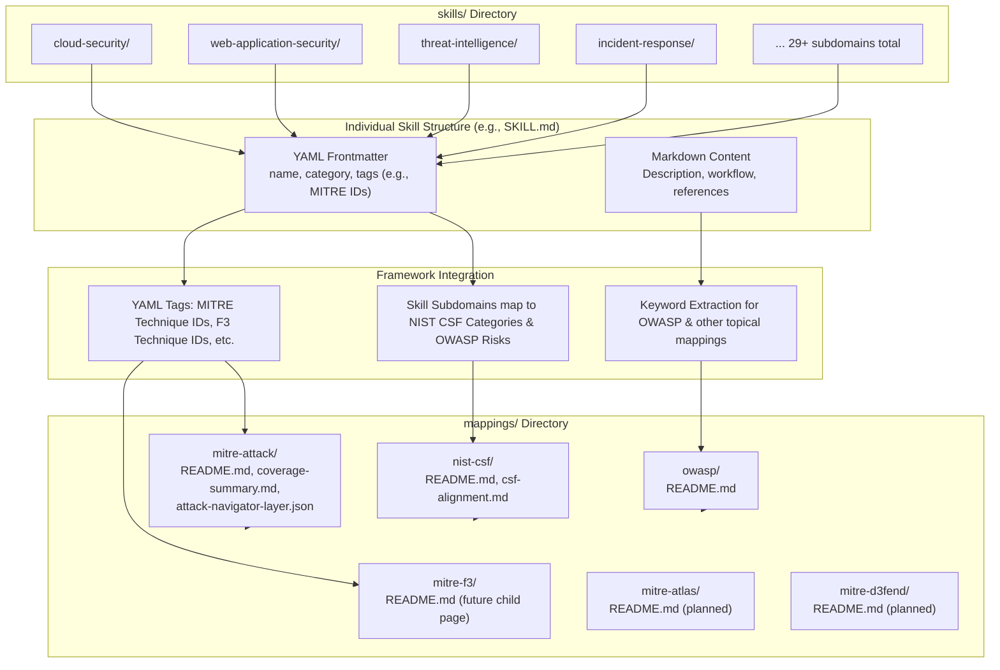
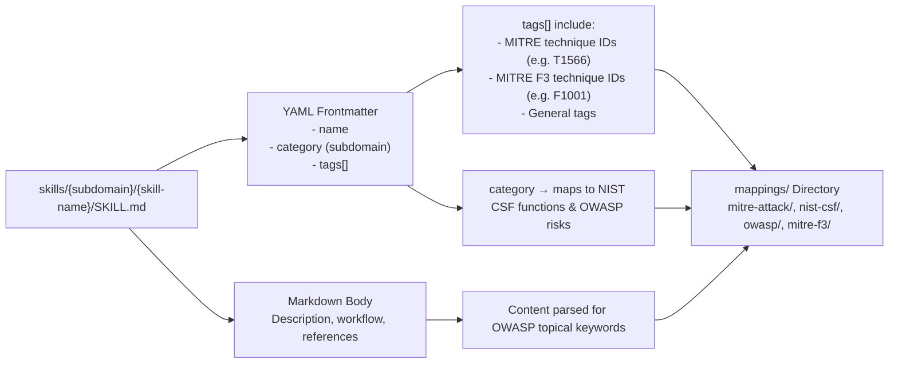
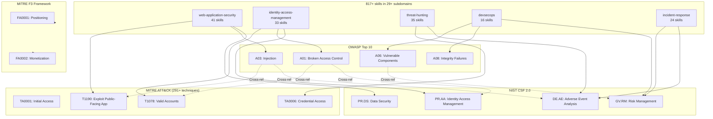

<!-- source: DeepWiki mcp.deepwiki.com · repo mukul975/Anthropic-Cybersecurity-Skills · page 4 Framework Mappings · fetched 2026-10-26 -->

# Framework Mappings

<details>
<summary>Relevant source files</summary>

The following files were used as context for generating this wiki page:

- [.gitignore](.gitignore)
- [ATTACK_COVERAGE.md](ATTACK_COVERAGE.md)
- [mappings/README.md](mappings/README.md)
- [mappings/attack-navigator-layer.json](mappings/attack-navigator-layer.json)
- [mappings/mitre-attack/coverage-summary.md](mappings/mitre-attack/coverage-summary.md)
- [mappings/nist-csf/README.md](mappings/nist-csf/README.md)
- [mappings/nist-csf/csf-alignment.md](mappings/nist-csf/csf-alignment.md)
- [mappings/owasp/README.md](mappings/owasp/README.md)

</details>


## Purpose and Scope

Framework Mappings establish the alignment between the 817+ cybersecurity skills in this repository and six major industry-recognized frameworks: MITRE ATT&CK, NIST Cybersecurity Framework (CSF) 2.0, OWASP Top 10 (2025), MITRE ATLAS, MITRE D3FEND, and the MITRE Fight Fraud Framework (F3) v1.1. This multi-framework approach enables organizations and AI agents to contextualize skills within familiar security standards, perform gap analysis, support compliance, and enable role- and scenario-based skill queries.

This parent page provides a high-level overview of how skills map to these frameworks and relates them to each other. Detailed coverage, methodological explanations, and implementation specifics are covered in the respective child pages:

- For MITRE ATT&CK Enterprise v16 mapping and Navigator layer integration, see [MITRE ATT&CK Mapping](#4.1).
- For alignment to the NIST CSF 2.0's six core functions, see [NIST CSF 2.0 Mapping](#4.2).
- For OWASP Top 10 (2025) web application security risk mapping, see [OWASP Top 10 Mapping](#4.3).
- For the Fight Fraud Framework (F3) v1.1 mappings addressing cyber-enabled financial fraud, see [MITRE F3 Mapping](#4.4).

The MITRE ATLAS and MITRE D3FEND frameworks are also tracked as referenced in the codebase but have less central coverage. Links to those mappings will be added as child pages in future versions.

---

## Framework Mapping Architecture Overview

The repository's framework mapping strategy combines multiple mechanisms tailored to the nature of each framework:

- **MITRE ATT&CK Mapping** relies on explicit technique ID tags (e.g., `T1566`) placed in the skill YAML frontmatter to connect skills to specific adversary tactics and techniques.
- **NIST CSF 2.0 Mapping** is realized through the taxonomy of 29+ skill subdomains that are aligned with the six NIST CSF core functions and categories.
- **OWASP Top 10 Mapping** uses security topic keywords extracted from skill content, linked to the 10 most critical web application risks.
- **MITRE F3 Mapping** utilizes special F3-specific technique IDs (F1XXX range) and tactic codes (FA0001, FA0002) mapped similarly via tags and subdomains.

**Diagram: Framework Mapping System Architecture**



**Sources:** [mappings/mitre-attack/README.md:1-103](), [mappings/nist-csf/README.md:1-134](), [mappings/owasp/README.md:1-178]()

---

## Overview of Each Framework Mapping

### MITRE ATT&CK: Enterprise Tactics and Techniques (Child: 4.1)

MITRE ATT&CK Enterprise v16 provides a comprehensive matrix of 14 tactics and hundreds of techniques describing adversary behaviors and attack methods. This repository maps 291 unique techniques referenced by 753+ skills across 29 subdomains. The mapping supports both offense (e.g., penetration-testing, red-teaming) and defense (e.g., threat-hunting, incident-response).

Coverage details, including a tactic-to-subdomain heatmap, key technique lists, and Navigator layer generation, are presented in [MITRE ATT&CK Mapping](#4.1). The `attack-navigator-layer.json` in the mappings directory enables visualizing coverage in the MITRE ATT&CK Navigator tool.

This mapping is primarily realized by adding official technique IDs (e.g. `T1566`) as tags in the skill frontmatter metadata.

**Sources:** [mappings/mitre-attack/coverage-summary.md:1-55](), [mappings/mitre-attack/README.md:20-88](), [mappings/mitre-attack/attack-navigator-layer.json:1-2500]()

---

### NIST Cybersecurity Framework (CSF) 2.0 (Child: 4.2)

The NIST CSF 2.0, published February 2024, organizes cybersecurity risk management into six core functions: Govern, Identify, Protect, Detect, Respond, and Recover. Each of the 29+ skill subdomains maps to one or more of these functions, linking skills to categories such as Asset Management, Risk Assessment, Incident Response, and Platform Security.

Unlike MITRE ATT&CK's technique-specific granularity, NIST CSF mapping uses the skill subdomain taxonomy as the primary alignment mechanism. This enables comprehensive lifecycle coverage and supports compliance and risk management initiatives.

For detailed tables of subdomain-to-category alignments, skill counts per function, and usage guidance, see [NIST CSF 2.0 Mapping](#4.2).

**Coverage distribution summary:**
```
Govern   (GV):  ~54 skills (e.g., compliance-governance, IAM, devsecops)
Identify (ID): ~115 skills (e.g., vulnerability-management, threat-intelligence, cloud-security)
Protect  (PR): ~160 skills (e.g., IAM, zero-trust-architecture, cryptography, devsecops)
Detect   (DE): ~102 skills (e.g., threat-hunting, SOC operations, malware-analysis)
Respond  (RS): ~111 skills (e.g., incident-response, digital-forensics, malware-analysis)
Recover  (RC):  ~29 skills (e.g., incident-response recovery, ransomware-defense)
```

**Sources:** [mappings/nist-csf/README.md:14-101](), [mappings/nist-csf/csf-alignment.md:1-92]()

---

### OWASP Top 10 (2025) Web Application Security Risks (Child: 4.3)

OWASP Top 10 enumerates the most significant web application security risks. This mapping links 200+ skills—primarily from `web-application-security`, `api-security`, `devsecops`, and `identity-access-management` subdomains—to these risk categories such as Broken Access Control, Injection, Security Misconfiguration, and Authentication Failures.

Unlike MITRE ATT&CK’s ID tag method, OWASP mapping uses security topic keywords embedded in skill content and categorizes subdomains by their applicability to each risk, allowing targeted AppSec training and secure development lifecycle adoption.

For detailed risk-to-skill tables and key topics for each risk, see [OWASP Top 10 Mapping](#4.3).

**Sources:** [mappings/owasp/README.md:1-178]()

---

### MITRE Fight Fraud Framework (F3) v1.1 (Child: 4.4)

The MITRE F3 Framework complements ATT&CK by focusing on cyber-enabled financial fraud. It defines two fraud-specific tactics — Positioning (FA0001) and Monetization (FA0002) — along with F1XXX technique IDs capturing fraud-related behaviors.

This repository maps relevant skills to these F3 tactics and techniques, enabling coverage of fraud attack methods not fully captured by ATT&CK. This is vital for financial sector use cases integrating adversary fraud techniques with traditional cybersecurity defenses.

Details including tactic definitions, technique mappings, and how F3 augments ATT&CK for fraud scenarios are provided in [MITRE F3 Mapping](#4.4).

**Sources:** (Mapping references from MITRE F3 are implied but not fully detailed in provided files; planned child page)

---

### MITRE ATLAS and MITRE D3FEND (Future Child Pages)

- **MITRE ATLAS** focuses on adversarial tactics for attack simulation.
- **MITRE D3FEND** catalogs defensive countermeasures and mitigations.

Currently, these frameworks are referenced but have less comprehensive skill mapping. Future child pages will provide detailed mappings and integrations as the repository evolves.

---

## Bridging Natural Language (Framework Concepts) to Code Entities

The mappings rely heavily on structured metadata in skill folders within `skills/{subdomain}/{skill-name}/SKILL.md`. Skills are tagged with framework-specific IDs and categorized by subdomain to enable automated indexing and querying.

**Diagram: Skill File to Framework Mapping Pipeline**



This clear separation allows AI agents and tools in the ecosystem to query skills based on exact technique IDs (for ATT&CK/F3) or broad subdomain categories (for NIST CSF and OWASP), aligning natural language frameworks with precise code-level skill entities.

**Sources:** [mappings/mitre-attack/README.md:79-86](), [mappings/nist-csf/README.md:104-130](), [mappings/owasp/README.md:9-50]()

---

## Cross-Framework Relationships and Complementarity

The frameworks offer different but complementary views on cybersecurity capabilities:

- **MITRE ATT&CK** offers technical adversary behavior granularity useful for adversary simulation, detection, and response.
- **NIST CSF 2.0** organizes capabilities around risk management lifecycle functions for governance and compliance.
- **OWASP Top 10** targets web application security risks crucial for secure development and testing.
- **MITRE F3** focuses on fraud-specific tactics extending ATT&CK for financial crime scenarios.

These frameworks interconnect via mappings such as subdomain alignments and cross-referenced technique-risk links.

**Diagram: Cross-Framework Mapping Relationships**



This layered integration allows stakeholders to adopt a unified skills framework that supports threat-intelligence, risk management, secure dev, fraud defense, and compliance simultaneously.

**Sources:** [mappings/owasp/README.md:141-170](), [mappings/nist-csf/README.md:14-101](), [mappings/mitre-attack/coverage-summary.md:1-55]()

---

## Summary and Next Steps

This parent page introduces how the Anthropic Cybersecurity Skills repository maps its extensive skillset to six leading cybersecurity frameworks, providing multifaceted alignment for diverse cybersecurity use cases. By linking skills to ATT&CK techniques, NIST CSF functions, OWASP risks, and MITRE F3 fraud tactics, the repository supports comprehensive security program design, training, and AI agent query capability.

For detailed framework-specific information, please consult the child pages below:  
- [MITRE ATT&CK Mapping](#4.1)  
- [NIST CSF 2.0 Mapping](#4.2)  
- [OWASP Top 10 Mapping](#4.3)  
- [MITRE F3 Mapping](#4.4)

---

**References**  
- See `mappings/mitre-attack/README.md` and `coverage-summary.md`  
- See `mappings/nist-csf/README.md` and `csf-alignment.md`  
- See `mappings/owasp/README.md`  
- See `mappings/mitre-attack/attack-navigator-layer.json`

**Sources:**  
[mappings/mitre-attack/README.md:1-103](),  
[mappings/mitre-attack/coverage-summary.md:1-55](),  
[mappings/mitre-attack/attack-navigator-layer.json:1-2500](),  
[mappings/nist-csf/README.md:1-134](),  
[mappings/nist-csf/csf-alignment.md:1-92](),  
[mappings/owasp/README.md:1-178]()

---

