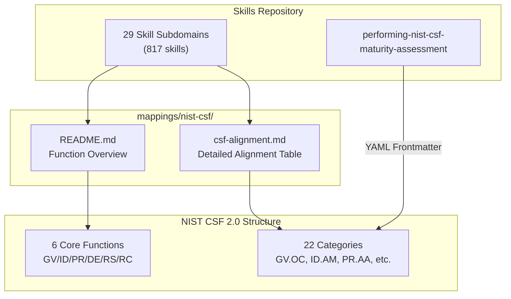
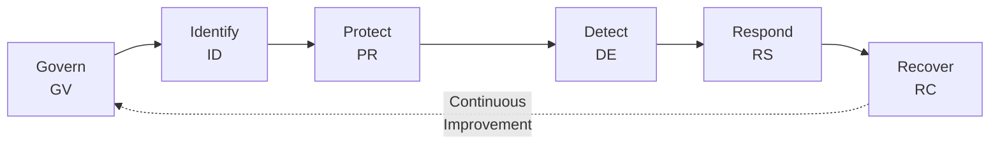

<!-- source: DeepWiki mcp.deepwiki.com · repo mukul975/Anthropic-Cybersecurity-Skills · page 4.2 NIST CSF 2.0 Mapping · fetched 2026-10-26 -->

# NIST CSF 2.0 Mapping

Relevant source files

The following files were used as context for generating this wiki page:

- [mappings/mitre-attack/coverage-summary.md](mappings/mitre-attack/coverage-summary.md)
- [mappings/nist-csf/README.md](mappings/nist-csf/README.md)
- [mappings/nist-csf/csf-alignment.md](mappings/nist-csf/csf-alignment.md)
- [mappings/owasp/README.md](mappings/owasp/README.md)
- [skills/implementing-gdpr-data-protection-controls/SKILL.md](skills/implementing-gdpr-data-protection-controls/SKILL.md)
- [skills/implementing-iso-27001-information-security-management/SKILL.md](skills/implementing-iso-27001-information-security-management/SKILL.md)
- [skills/implementing-pci-dss-compliance-controls/SKILL.md](skills/implementing-pci-dss-compliance-controls/SKILL.md)
- [skills/performing-nist-csf-maturity-assessment/SKILL.md](skills/performing-nist-csf-maturity-assessment/SKILL.md)
- [skills/performing-soc2-type2-audit-preparation/SKILL.md](skills/performing-soc2-type2-audit-preparation/SKILL.md)

## Purpose and Scope

This page documents the mapping of cybersecurity skills to the **NIST Cybersecurity Framework (CSF) 2.0**, published in February 2024. The NIST CSF provides a risk-based framework for managing cybersecurity through six core functions that represent the full lifecycle of cybersecurity risk management.

The mapping enables organizations to align skill development with CSF implementation tiers, identify training gaps across CSF functions, build role-based learning paths using CSF categories, and automate compliance mapping through AI agent queries.

For mapping to adversarial techniques, see [MITRE ATT&CK Mapping](#4.1). For mapping to web application security risks, see [OWASP Top 10 Mapping](#4.3).

For more granular data on subdomain-to-category relationships and gap identification, see [CSF Alignment Details](#4.2.1).

**Sources:** [mappings/nist-csf/README.md:1-13](), [skills/performing-nist-csf-maturity-assessment/SKILL.md:3-7]()

## Mapping Architecture

The NIST CSF 2.0 mapping system establishes bidirectional relationships between the 29 skill subdomains and CSF categories. Individual skills, such as `performing-nist-csf-maturity-assessment`, include explicit `nist_csf` metadata in their YAML frontmatter [skills/performing-nist-csf-maturity-assessment/SKILL.md:17-22]().

**Diagram: NIST CSF Mapping System Architecture**

The mapping establishes relationships at multiple levels:
- **Skill-level metadata:** Skills define specific category codes like `GV.OC-01` or `ID.RA-01` [skills/performing-nist-csf-maturity-assessment/SKILL.md:18-21]().
- **Function-level alignment:** `README.md` groups subdomains by the six CSF functions [mappings/nist-csf/README.md:14-15]().
- **Category-level alignment:** `csf-alignment.md` provides granular subdomain-to-category mappings with rationale [mappings/nist-csf/csf-alignment.md:13-38]().

**Sources:** [mappings/nist-csf/README.md:1-13](), [mappings/nist-csf/csf-alignment.md:1-11](), [skills/performing-nist-csf-maturity-assessment/SKILL.md:17-22]()

## Six Core Functions

NIST CSF 2.0 organizes cybersecurity activities into six functions. The **Govern (GV)** function is a major addition in version 2.0, emphasizing that cybersecurity is a primary source of enterprise risk [skills/performing-nist-csf-maturity-assessment/SKILL.md:63-69]().

**Diagram: NIST CSF 2.0 Function Lifecycle**

**Sources:** [mappings/nist-csf/README.md:14-18](), [skills/performing-nist-csf-maturity-assessment/SKILL.md:52-61]()

### Govern (GV) - Risk Management Strategy
Establishes the organization's cybersecurity risk management strategy and policy. This function covers Organizational Context (`GV.OC`), Risk Management Strategy (`GV.RM`), and Oversight (`GV.OV`) [skills/performing-nist-csf-maturity-assessment/SKILL.md:64-69]().
- **Primary subdomains:** `compliance-governance`, `identity-access-management`, `devsecops` [mappings/nist-csf/README.md:29]().

### Identify (ID) - Understanding Risk
Develops understanding of risks to systems, assets, and data.
- **Primary subdomains:** `vulnerability-management`, `threat-intelligence`, `cloud-security` [mappings/nist-csf/README.md:41]().

### Protect (PR) - Safeguarding Assets
Uses safeguards to prevent or reduce risk. Covers Data Security (`PR.DS`) and Identity Management (`PR.AA`) [skills/implementing-pci-dss-compliance-controls/SKILL.md:16-17]().
- **Primary subdomains:** `zero-trust-architecture`, `devsecops`, `identity-access-management`, `cryptography` [mappings/nist-csf/README.md:55]().

### Detect (DE) - Finding Events
Identifies cybersecurity events through Continuous Monitoring (`DE.CM`) [skills/implementing-pci-dss-compliance-controls/SKILL.md:18]().
- **Primary subdomains:** `threat-hunting`, `soc-operations`, `malware-analysis` [mappings/nist-csf/README.md:66]().

### Respond (RS) - Taking Action
Manages detected incidents through analysis and mitigation.
- **Primary subdomains:** `incident-response`, `digital-forensics`, `malware-analysis` [mappings/nist-csf/README.md:79]().

### Recover (RC) - Restoring Capabilities
Restores operations affected by an incident.
- **Primary subdomains:** `incident-response`, `ransomware-defense` [mappings/nist-csf/README.md:90]().

**Sources:** [mappings/nist-csf/README.md:16-90](), [skills/performing-nist-csf-maturity-assessment/SKILL.md:52-61]()

## CSF Alignment Details

The alignment of 29 subdomains to the 22 categories of CSF 2.0 is detailed in a separate child page. This includes the coverage analysis across all functions and the identification of gaps in the current skill repository.

For the full alignment table and gap analysis, see [CSF Alignment Details](#4.2.1).

**Sources:** [mappings/nist-csf/csf-alignment.md:1-102]()

## Implementation Tiers and Assessments

The repository includes specialized skills for conducting NIST CSF 2.0 assessments using the four **Implementation Tiers**:
1. **Tier 1 (Partial):** Ad hoc, reactive [skills/performing-nist-csf-maturity-assessment/SKILL.md:74]().
2. **Tier 2 (Risk-Informed):** Risk-aware but not organization-wide [skills/performing-nist-csf-maturity-assessment/SKILL.md:75]().
3. **Tier 3 (Repeatable):** Formal policies consistently implemented [skills/performing-nist-csf-maturity-assessment/SKILL.md:76]().
4. **Tier 4 (Adaptive):** Continuous improvement and real-time response [skills/performing-nist-csf-maturity-assessment/SKILL.md:77]().

The `performing-nist-csf-maturity-assessment` skill provides a 5-phase workflow for measuring maturity against these tiers [skills/performing-nist-csf-maturity-assessment/SKILL.md:79-125]().

**Sources:** [skills/performing-nist-csf-maturity-assessment/SKILL.md:71-125]()

## Integration with Other Frameworks

The NIST CSF 2.0 mapping is integrated with other compliance and technical frameworks:
- **Compliance:** Skills like `implementing-pci-dss-compliance-controls` and `performing-soc2-type2-audit-preparation` map directly to CSF categories such as `GV.PO-01` and `ID.RA-01` [skills/implementing-pci-dss-compliance-controls/SKILL.md:15-19](), [skills/performing-soc2-type2-audit-preparation/SKILL.md:24-28]().
- **Adversarial:** CSF functions map to MITRE ATT&CK tactics (e.g., Detect maps to continuous monitoring of techniques) [mappings/nist-csf/csf-alignment.md:75]().
- **Privacy:** GDPR controls map to CSF categories like `GV.OC-02` and `PR.DS-01` [skills/implementing-gdpr-data-protection-controls/SKILL.md:16-20]().

**Sources:** [skills/implementing-pci-dss-compliance-controls/SKILL.md:14-19](), [skills/performing-soc2-type2-audit-preparation/SKILL.md:24-28](), [skills/implementing-gdpr-data-protection-controls/SKILL.md:15-20]()

---

