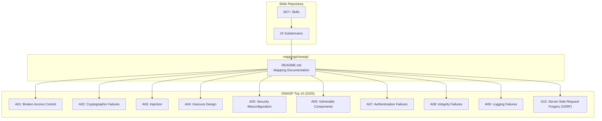
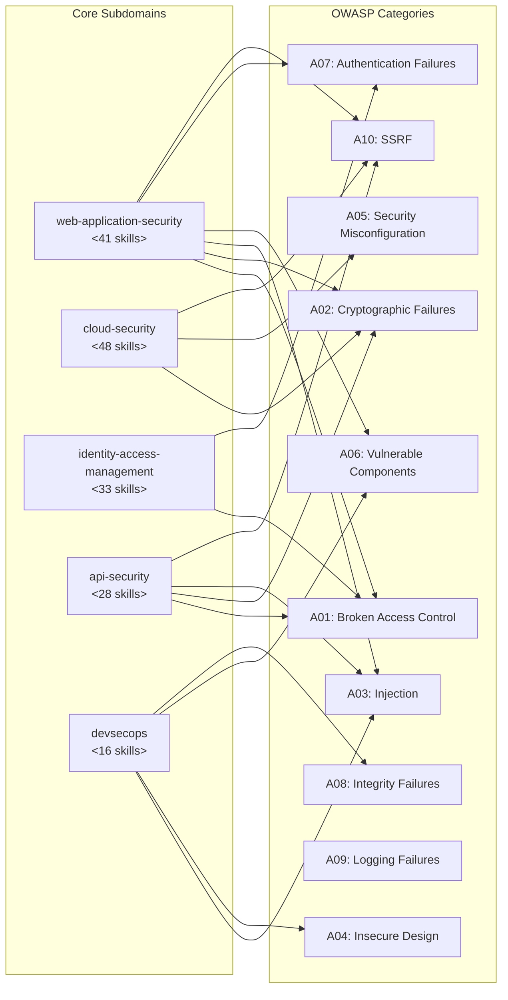
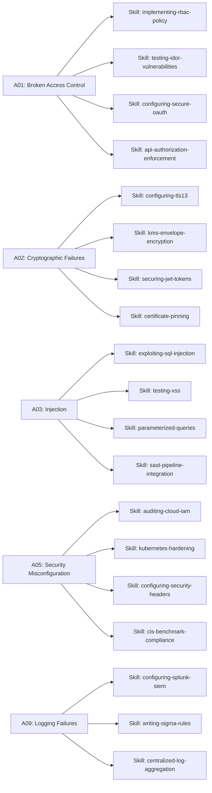
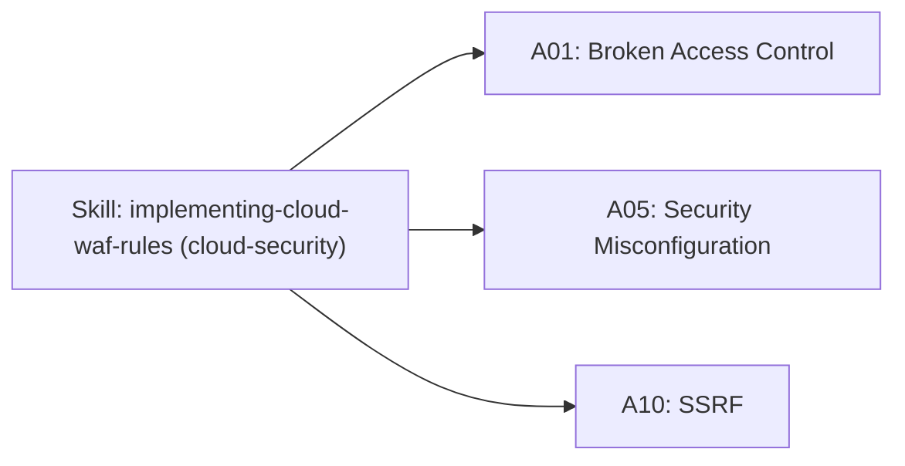

<!-- source: DeepWiki mcp.deepwiki.com · repo mukul975/Anthropic-Cybersecurity-Skills · page 4.3 OWASP Top 10 Mapping · fetched 2026-10-26 -->

# OWASP Top 10 Mapping

<details>
<summary>Relevant source files</summary>

The following files were used as context for generating this wiki page:

- [mappings/mitre-attack/coverage-summary.md](mappings/mitre-attack/coverage-summary.md)
- [mappings/nist-csf/README.md](mappings/nist-csf/README.md)
- [mappings/nist-csf/csf-alignment.md](mappings/nist-csf/csf-alignment.md)
- [mappings/owasp/README.md](mappings/owasp/README.md)
- [skills/building-incident-response-dashboard/SKILL.es.md](skills/building-incident-response-dashboard/SKILL.es.md)
- [skills/configuring-suricata-for-network-monitoring/SKILL.es.md](skills/configuring-suricata-for-network-monitoring/SKILL.es.md)
- [skills/detecting-credential-dumping-techniques/SKILL.es.md](skills/detecting-credential-dumping-techniques/SKILL.es.md)
- [skills/detecting-lateral-movement-with-zeek/assets/template.md](skills/detecting-lateral-movement-with-zeek/assets/template.md)
- [skills/implementing-cloud-security-posture-management/SKILL.es.md](skills/implementing-cloud-security-posture-management/SKILL.es.md)
- [skills/implementing-cloud-waf-rules/SKILL.md](skills/implementing-cloud-waf-rules/SKILL.md)
- [skills/implementing-zero-trust-network-access/SKILL.md](skills/implementing-zero-trust-network-access/SKILL.md)
- [skills/performing-memory-forensics-with-volatility3/SKILL.es.md](skills/performing-memory-forensics-with-volatility3/SKILL.es.md)
- [skills/performing-osint-with-spiderfoot/SKILL.es.md](skills/performing-osint-with-spiderfoot/SKILL.es.md)

</details>


This document explains how the 607+ cybersecurity skills in the Anthropic Cybersecurity Skills repository map to the OWASP Top 10 (2025) web application security risk categories. This mapping helps security teams and AI agents build targeted training programs focused on secure development, application security testing, and defensive controls.

For broader context on framework integrations, see the [Framework Mappings](#4). For related mappings, refer to [MITRE ATT&CK Mapping](#4.1) and [NIST CSF 2.0 Mapping](#4.2).

## Mapping Structure

The OWASP Top 10 mapping is maintained in the file `mappings/owasp/README.md` and connects skills primarily from 24 cybersecurity subdomains to the ten critical web app security risks defined by OWASP for 2025.



**Diagram: OWASP Mapping Architecture**

The above diagram illustrates the flow from the entire skills repository (with 607+ skills) through categorized subdomains, feeding into the OWASP Top 10 mapping documentation. Each OWASP category links to relevant skills organized by their primary subdomain and security topic.

Sources: [mappings/owasp/README.md:1-10]()


## OWASP Top 10 Categories and Skill Mappings

Below are technical details for each OWASP category, including relevant subdomains, the count of skills mapped, key security topics, and example skills for use cases.

---

### A01:2025 — Broken Access Control

**Description:**  
Failures in enforcing access restrictions, allowing users to perform unauthorized actions. This includes Insecure Direct Object References (IDOR), privilege escalation, path traversal, and CORS misconfigurations.

| Relevant Subdomains             | Skills | Key Topics                                   |
|--------------------------------|--------|----------------------------------------------|
| web-application-security        | 41     | IDOR, privilege escalation, path traversal, CORS misconfiguration |
| identity-access-management      | 33     | RBAC (Role-Based Access Control), ABAC, session management, OAuth/OIDC flaws |
| api-security                   | 28     | Broken Object Level Authorization (BOLA), function-level authorization |
| zero-trust-architecture        | 13     | Least privilege enforcement, microsegmentation |

**Example Skills:**  
- Implementing RBAC policies  
- Testing for IDOR vulnerabilities  
- Configuring OAuth 2.0 securely  
- Enforcing API authorization policies  

Sources: [mappings/owasp/README.md:11-22]()

---

### A02:2025 — Cryptographic Failures

**Description:**  
Failures relating to cryptography that expose sensitive data. Covers weak TLS settings, poor key management, improper hashing, and application misconfigurations causing insecure data transmission or storage.

| Relevant Subdomains       | Skills | Key Topics                                             |
|--------------------------|--------|--------------------------------------------------------|
| cryptography             | 13     | TLS configuration, key management, hashing, encryption at rest |
| web-application-security  | 41     | HTTPS enforcement, cookie security flags, certificate validation |
| cloud-security            | 48     | KMS configuration, secrets management, encryption in transit |
| api-security             | 28     | API transport security, token encryption               |

**Example Skills:**  
- Configuring TLS 1.3 securely  
- Implementing envelope encryption with cloud KMS  
- Securing JWT tokens and signing  
- Certificate pinning  

Sources: [mappings/owasp/README.md:24-35]()

---

### A03:2025 — Injection

**Description:**  
User input is interpreted as code or commands without proper sanitation leading to SQL injection, Cross-Site Scripting (XSS), OS command injection, LDAP injection, or NoSQL injection.

| Relevant Subdomains            | Skills | Key Topics                                      |
|-------------------------------|--------|-------------------------------------------------|
| web-application-security       | 41     | SQL injection, XSS, command injection, LDAP injection |
| api-security                  | 28     | GraphQL injection, NoSQL injection, header injection |
| devsecops                    | 16     | SAST/DAST scanning, input validation, parameterized queries |
| penetration-testing          | 23     | Injection testing, payload crafting, WAF bypass |

**Example Skills:**  
- Exploiting and remediating SQL injection vulnerabilities  
- Testing for reflected and stored XSS  
- Configuring parameterized queries in backend code  
- Integrating SAST tools into CI/CD pipelines  

Sources: [mappings/owasp/README.md:37-48]()

---

### A04:2025 — Insecure Design

**Description:**  
Security risks resulting from architectural or design flaws requiring threat modeling, secure SDLC processes, and design pattern improvements.

| Relevant Subdomains       | Skills | Key Topics                                  |
|--------------------------|--------|----------------------------------------------|
| devsecops               | 16     | Threat modeling, secure SDLC, security requirements |
| zero-trust-architecture  | 13     | Zero trust design principles, defense in depth |
| compliance-governance    | 5      | Security architecture review, risk assessment frameworks |
| web-application-security | 41     | Business logic flaws, trust boundary definition |

**Example Skills:**  
- Conducting STRIDE-based threat modeling workshops  
- Implementing defense-in-depth design patterns  
- Defining and reviewing trust boundary diagrams  
- Security architecture risk assessments  

Sources: [mappings/owasp/README.md:50-61]()

---

### A05:2025 — Security Misconfiguration

**Description:**  
Missing or incorrect security settings across the application stack including cloud, containers, networking, and endpoints.

| Relevant Subdomains       | Skills | Key Topics                                   |
|--------------------------|--------|-----------------------------------------------|
| cloud-security           | 48     | Cloud service misconfiguration, IAM policy errors, S3 bucket exposure |
| container-security       | 26     | Container hardening, Kubernetes RBAC, pod security policies |
| network-security         | 33     | Firewall rules, segmentation errors, default credentials |
| endpoint-security        | 16     | OS hardening, unnecessary services, default configurations |

**Example Skills:**  
- Auditing AWS S3 bucket permissions and policies  
- Hardening Kubernetes cluster security settings  
- Configuring security HTTP headers (CSP, HSTS)  
- Ensuring CIS benchmark compliance for OS and containers  

Sources: [mappings/owasp/README.md:63-74]()

---

### A06:2025 — Vulnerable and Outdated Components

**Description:**  
Usage of third-party components with known security vulnerabilities, or components no longer maintained or patched.

| Relevant Subdomains         | Skills | Key Topics                                    |
|----------------------------|--------|------------------------------------------------|
| vulnerability-management   | 24     | CVE tracking, vulnerability scanning, patch management |
| devsecops                  | 16     | Software Composition Analysis (SCA), dependency management, SBOM generation |
| container-security         | 26     | Image scanning, base image updates, registry security |
| web-application-security   | 41     | Third-party library vulnerabilities, framework updates |

**Example Skills:**  
- Running Trivy scans on container images  
- Integrating SCA tools in CI/CD pipelines  
- Generating and analyzing Software Bill of Materials (SBOM)  
- Prioritizing CVEs using CVSS and EPSS scoring  

Sources: [mappings/owasp/README.md:76-87]()

---

### A07:2025 — Identification and Authentication Failures

**Description:**  
Weaknesses in authentication and session management such as credential stuffing, brute force, and flawed password policies.

| Relevant Subdomains              | Skills | Key Topics                                           |
|---------------------------------|--------|-----------------------------------------------------|
| identity-access-management       | 33     | MFA, password policies, session fixation             |
| web-application-security         | 41     | Credential stuffing defense, brute force protection  |
| api-security                   | 28     | API key management, OAuth token handling, JWT validation |
| phishing-defense                | 16     | Credential phishing prevention, anti-phishing controls |

**Example Skills:**  
- Implementing FIDO2/WebAuthn authentication  
- Configuring adaptive Multi-Factor Authentication (MFA)  
- Securing API key and token lifecycles  
- Detecting credential stuffing attacks using analytics  

Sources: [mappings/owasp/README.md:89-100]()

---

### A08:2025 — Software and Data Integrity Failures

**Description:**  
Failures that impair code or infrastructure integrity, including unsigned code, supply chain attacks, and lack of artifact validation.

| Relevant Subdomains         | Skills | Key Topics                                                  |
|----------------------------|--------|--------------------------------------------------------------|
| devsecops                  | 16     | Secure CI/CD pipelines, code signing, artifact integrity      |
| container-security         | 26     | Image signing, admission control, supply chain verification   |
| cryptography               | 13     | Digital signatures, integrity hashes, code signing certificates |
| vulnerability-management   | 24     | Supply chain risk management, dependency integrity verification |

**Example Skills:**  
- Implementing Sigstore for container image signing  
- Securing CI/CD pipeline steps with artifact validation  
- Verifying digital signatures and hash integrity  
- Enforcing content trust in package repositories  

Sources: [mappings/owasp/README.md:102-113]()

---

### A09:2025 — Security Logging and Monitoring Failures

**Description:**  
Insufficient logging, detection capability, and active response to security events.

| Relevant Subdomains        | Skills | Key Topics                                       |
|---------------------------|--------|--------------------------------------------------|
| soc-operations            | 33     | SIEM configuration, log aggregation, alert tuning |
| threat-hunting            | 35     | Log analysis, detection engineering, hypothesis-driven hunting |
| incident-response         | 24     | Incident detection, log-based investigation, response automation |
| network-security          | 33     | Network monitoring, traffic flow analysis, IDS/IPS tuning |

**Example Skills:**  
- Analyzing security logs with Splunk and Elasticsearch  
- Writing Sigma detection rule queries  
- Configuring SIEM event correlation rules  
- Implementing centralized logging and alerting pipelines  

Sources: [mappings/owasp/README.md:115-126]()

---

### A10:2025 — Server-Side Request Forgery (SSRF)

**Description:**  
Vulnerabilities where the server is tricked into making HTTP requests to unauthorized internal or external services, often exploiting cloud metadata services.

| Relevant Subdomains            | Skills | Key Topics                                    |
|-------------------------------|--------|------------------------------------------------|
| web-application-security       | 41     | SSRF exploitation, input validation, allowlisting |
| cloud-security                | 48     | Instance Metadata Service (IMDS) exploitation, VPC endpoint security |
| api-security                 | 28     | API-to-API SSRF, webhook validation            |
| penetration-testing           | 23     | SSRF detection techniques, exploiting SSRF    |

**Example Skills:**  
- Testing for SSRF vulnerabilities in web application inputs  
- Securing cloud metadata endpoint access (IMDSv2 enforcement)  
- Validating and allowlisting within URL handlers  
- Detecting SSRF attempts in API integrations  

Sources: [mappings/owasp/README.md:128-139]()


## Subdomain to OWASP Top 10 Mapping Overview



**Diagram: Primary Subdomain Contributions to OWASP Top 10 Categories**

This diagram highlights how core cybersecurity subdomains correlate to OWASP risk categories, with `web-application-security` and `cloud-security` being top contributors across multiple categories. This aids targeted skill training and tooling investments.

Sources: [mappings/owasp/README.md:11-139]()

---

## Cross-Framework Mappings

### OWASP and MITRE ATT&CK Mapping

Security risks from OWASP categories align with specific adversary techniques described by MITRE ATT&CK, enabling threat-informed security testing and defense:

| OWASP Category                | Key MITRE ATT&CK Techniques                              |
|------------------------------|----------------------------------------------------------|
| A01: Broken Access Control    | T1078 (Valid Accounts), T1548 (Abuse Elevation Control)  |
| A02: Cryptographic Failures   | T1557 (Adversary-in-the-Middle), T1040 (Network Sniffing)|
| A03: Injection                | T1190 (Exploit Public-Facing App), T1059 (Command & Scripting)|
| A04: Insecure Design          | T1195 (Supply Chain Compromise), cross-cutting          |
| A05: Security Misconfiguration|T1574 (Hijack Execution Flow), T1190                      |
| A06: Vulnerable Components    | T1190, T1195                                             |
| A07: Authentication Failures | T1110 (Brute Force), T1539 (Steal Web Session Cookie)     |
| A08: Integrity Failures       | T1195 (Supply Chain Compromise), T1554 (Compromise Client Software) |
| A09: Logging Failures         | T1070 (Indicator Removal), T1562 (Impair Defenses)        |
| A10: SSRF                    | T1190                                                    |

This mapping facilitates convergence of secure development and adversary behavior analysis.

Sources: [mappings/owasp/README.md:141-154]()

---

### OWASP and NIST CSF 2.0 Mapping

Aligning OWASP categories to NIST CSF 2.0 functions and categories connects application security risk management with enterprise cybersecurity frameworks:

| OWASP Category               | CSF 2.0 Functions         | CSF Categories             |
|-----------------------------|--------------------------|----------------------------|
| A01: Broken Access Control   | Protect                  | PR.AA (Identity/Access)     |
| A02: Cryptographic Failures  | Protect                  | PR.DS (Data Security)       |
| A03: Injection               | Protect, Detect          | PR.DS, DE.AE (Adverse Event)|
| A04: Insecure Design         | Govern, Protect          | GV.RM (Risk Management), PR.PS (Platform Security)|
| A05: Security Misconfiguration|Protect                 | PR.PS, PR.IR (Infrastructure Resilience)         |
| A06: Vulnerable Components   | Identify, Govern         | ID.RA (Risk Assessment), GV.SC (Supply Chain Risk)|
| A07: Authentication Failures | Protect                  | PR.AA                       |
| A08: Integrity Failures      | Protect, Govern          | PR.DS, GV.SC                |
| A09: Logging Failures        | Detect                   | DE.CM (Continuous Monitoring), DE.AE             |
| A10: SSRF                   | Protect, Detect          | PR.DS, DE.AE                |

```mermaid
graph TB
    subgraph "OWASP Top 10"
        A01["A01: Broken Access Control"]
        A02["A02: Cryptographic Failures"]
        A03["A03: Injection"]
        A04["A04: Insecure Design"]
        A05["A05: Security Misconfiguration"]
        A06["A06: Vulnerable Components"]
        A07["A07: Authentication Failures"]
        A08["A08: Integrity Failures"]
        A09["A09: Logging Failures"]
        A10["A10: SSRF"]
    end
    
    subgraph "NIST CSF 2.0 Functions"
        GV["GV: Govern"]
        PR["PR: Protect"]
        DE["DE: Detect"]
        ID["ID: Identify"]
    end
    
    subgraph "NIST CSF Categories"
        PRAA["PR.AA<br/>Identity & Access"]
        PRDS["PR.DS<br/>Data Security"]
        PRPS["PR.PS<br/>Platform Security"]
        PRIR["PR.IR<br/>Infra. Resilience"]
        IDRA["ID.RA<br/>Risk Assessment"]
        GVSC["GV.SC<br/>Supply Chain Risk"]
        DECM["DE.CM<br/>Continuous Monitoring"]
        DEAE["DE.AE<br/>Adverse Events"]
        GVRM["GV.RM<br/>Risk Management"]
    end
    
    A01 --> PR
    PR --> PRAA
    
    A02 --> PR
    PR --> PRDS
    
    A03 --> PR
    A03 --> DE
    PR --> PRDS
    DE --> DEAE
    
    A04 --> GV
    A04 --> PR
    GV --> GVRM
    PR --> PRPS
    
    A05 --> PR
    PR --> PRPS
    PR --> PRIR
    
    A06 --> ID
    A06 --> GV
    ID --> IDRA
    GV --> GVSC
    
    A07 --> PR
    PR --> PRAA
    
    A08 --> PR
    A08 --> GV
    PR --> PRDS
    GV --> GVSC
    
    A09 --> DE
    DE --> DECM
    DE --> DEAE
    
    A10 --> PR
    A10 --> DE
    PR --> PRDS
    DE --> DEAE
```



**Diagram: OWASP to NIST CSF 2.0 Function and Category Mapping**

This mapping allows cybersecurity planners to integrate OWASP-based application security controls within governance, protection, detection, and identification functions outlined in NIST CSF 2.0.

Sources: [mappings/owasp/README.md:156-169]()

---

## Additional OWASP Resources

The repository also includes references to other OWASP projects that extend and complement the Top 10 mapping:

- **OWASP API Security Top 10** — relevant to `api-security` subdomain, covering API-specific vulnerabilities beyond the general Top 10  
- **OWASP Mobile Top 10** — relevant to `mobile-security` subdomain for mobile app security risks  
- **OWASP Web Security Testing Guide (WSTG)** — a comprehensive testing framework for web apps  
- **OWASP Application Security Verification Standard (ASVS)** — providing security control requirements for application design and evaluation  

These references support continued learning and specialized skill development.

Sources: [mappings/owasp/README.md:171-177]()

---

## File Structure and Implementation Notes

The OWASP Top 10 mapping implementation is maintained in a single readme file located at:

```
mappings/owasp/
└── README.md          # OWASP Top 10 (2025) mapping documentation
```

This file is structured with:

- Category descriptions matching OWASP's terminology  
- Skill count aggregations by subdomain mapped to OWASP risks  
- Key topics summarized for security testing and defensive focus  
- Cross-framework mappings facilitating integration with MITRE ATT&CK and NIST CSF 2.0  
- Additional resource references for broader OWASP context  

The mapping is leveraged by AI agents and security professionals to identify skill gaps related to web application risks and to plan training or automation workflows accordingly.

Sources: [mappings/owasp/README.md:1-177]()

---

# Summary

This OWASP Top 10 mapping ties 607+ cybersecurity skills to the most critical web application security risks for 2025, organized by subdomains such as web-application-security, cloud-security, identity-access-management, and others. It bridges development-focused vulnerabilities with operational detection and response frameworks like MITRE ATT&CK and NIST CSF 2.0. Practitioners can use this detailed mapping to build focused secure development and testing practices, automate compliance coverage assessments, and synchronize skill development across security domains.

---

# Additional Diagrams: Bridging Natural Language to Code Entities

## Diagram 1: Mapping OWASP Top 10 Risks to Example Skills by Code Entity



**Diagram: OWASP Risks Connected to Example Skills (by skill code names)**

This diagram maps OWASP categories to specific skill code names representing implementation or testing activities comprehensively covered in the repository.

Sources: [mappings/owasp/README.md:11-139]()

---

## Diagram 2: Example Skill ("implementing-cloud-waf-rules") and OWASP Integration



**Diagram: Skill "implementing-cloud-waf-rules" Mapped to OWASP Categories**

The `implementing-cloud-waf-rules` skill, defined in `skills/implementing-cloud-waf-rules/SKILL.md`, covers deploying WAF rule sets that mitigate OWASP risks such as Broken Access Control, Security Misconfiguration, and SSRF by blocking malicious requests, tuning attack protection, and application-layer filtering.

Sources: [skills/implementing-cloud-waf-rules/SKILL.md:2-60]()

---

This concludes the detailed OWASP Top 10 (2025) mapping documentation.

---

