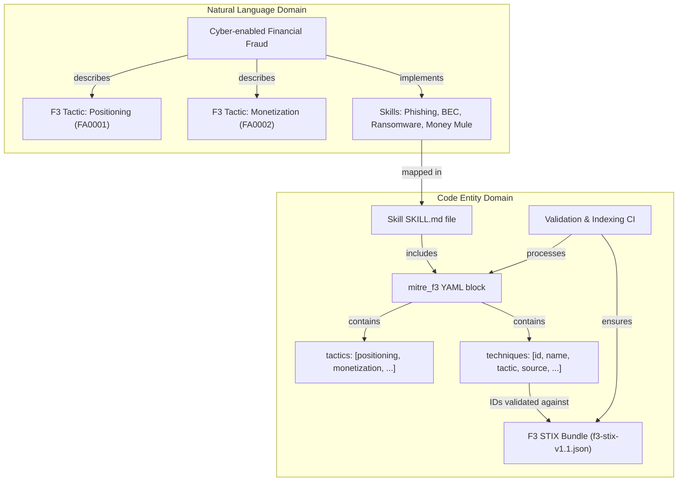
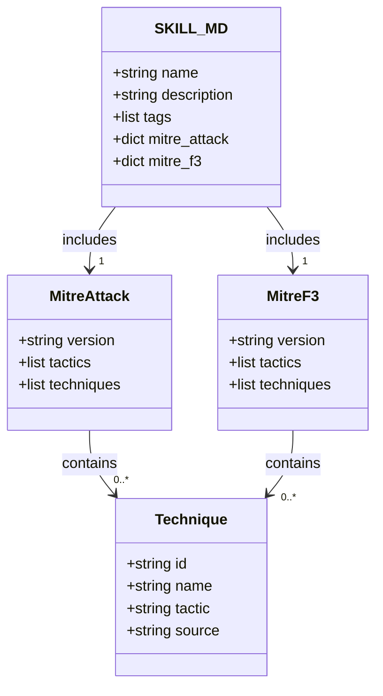

<!-- source: DeepWiki mcp.deepwiki.com · repo mukul975/Anthropic-Cybersecurity-Skills · page 4.4 MITRE F3 Mapping · fetched 2026-10-26 -->

# MITRE F3 Mapping

<details>
<summary>Relevant source files</summary>

The following files were used as context for generating this wiki page:

- [docs/mitre-f3-mapping.md](docs/mitre-f3-mapping.md)
- [mappings/mitre-attack/coverage-summary.md](mappings/mitre-attack/coverage-summary.md)
- [mappings/nist-csf/README.md](mappings/nist-csf/README.md)
- [mappings/nist-csf/csf-alignment.md](mappings/nist-csf/csf-alignment.md)
- [mappings/owasp/README.md](mappings/owasp/README.md)
- [skills/analyzing-certificate-transparency-for-phishing/SKILL.md](skills/analyzing-certificate-transparency-for-phishing/SKILL.md)
- [skills/analyzing-email-headers-for-phishing-investigation/SKILL.md](skills/analyzing-email-headers-for-phishing-investigation/SKILL.md)
- [skills/analyzing-indicators-of-compromise/SKILL.md](skills/analyzing-indicators-of-compromise/SKILL.md)
- [skills/analyzing-linux-elf-malware/SKILL.md](skills/analyzing-linux-elf-malware/SKILL.md)
- [skills/analyzing-ransomware-encryption-mechanisms/SKILL.md](skills/analyzing-ransomware-encryption-mechanisms/SKILL.md)
- [skills/analyzing-ransomware-leak-site-intelligence/SKILL.md](skills/analyzing-ransomware-leak-site-intelligence/SKILL.md)
- [skills/analyzing-ransomware-network-indicators/SKILL.md](skills/analyzing-ransomware-network-indicators/SKILL.md)
- [skills/analyzing-ransomware-payment-wallets/SKILL.md](skills/analyzing-ransomware-payment-wallets/SKILL.md)

</details>


## Purpose and Scope

This page details the integration and mapping of the **Anthropic Cybersecurity Skills collection** to the **MITRE Fight Fraud Framework (F3) v1.1**, a specialized TTP catalog focusing on cyber-enabled financial fraud. It explains the unique nature of the two F3-specific tactics, the technique ID conventions, and how this framework complements MITRE ATT&CK within the repository’s skill frontmatter metadata. The section also covers implementation details, data flow, and key code entities managing this mapping, supporting AI-driven and analyst workflows aimed at fraud scenarios.

---

## 1. Overview of MITRE Fight Fraud Framework (F3) v1.1

The **MITRE Fight Fraud Framework (F3)** is an extension of the ATT&CK paradigm tailored specifically for financial fraud enhanced by cyber intrusions. Unlike the existing ATT&CK Enterprise framework, which bundles financial theft under a single technique, F3 introduces dedicated tactics and a more granular set of techniques that describe how a cyber intrusion translates into monetary loss.

### Key Features of F3 v1.1 Mapping in This Repository:

- **Two New F3-Specific Tactics:**
  - **Positioning (FA0001)**: Techniques describing adversary activities post-compromise where fraud is prepared. This includes data collection and manipulation focused on enabling fraud.
  - **Monetization (FA0002)**: Techniques focused on how stolen assets are converted into usable money, such as wire transfers, cryptocurrency conversion, and cash-out methods.

- **Technique ID Conventions:**
  - Fraud-specific techniques have IDs formatted as `F1XXX` (e.g., `F1005.003` for Account Manipulation: Add Beneficiary).
  - ATT&CK techniques reused within F3 retain their original `T1XXX` style IDs (e.g., `T1566` Phishing).
  - Sub-techniques follow the dot notation, consistent with ATT&CK.

- **Mapping Context:**
  - The F3 tactics and techniques exist alongside ATT&CK mappings to complement cyber-attack lifecycle understanding with the financial fraud lifecycle.
  - Fraud-focused skills carry the `mitre_f3` frontmatter metadata block to capture these mappings distinctly.
  - Mappings are validated against the official STIX bundle of F3 (`f3-stix-v1.1.json`) to ensure accurate technique IDs and names.

---

## 2. Why MITRE F3 Complements ATT&CK

The ATT&CK framework primarily focuses on adversarial techniques related to gaining and maintaining access and executing technical operations inside a compromised network. However, cyber-enabled financial fraud involves additional unique phases that ATT&CK loosely captures or collapses under broad technique IDs.

- **ATT&CK answers:**  
  *How did the attacker technically compromise and compromise assets?*  
- **F3 answers:**  
  *After compromise, how was that access converted into fraud and monetary loss?*

> **F3 adds explicit visibility into fraud-enabling activities:**

| Attack Phase               | ATT&CK Focus                         | F3 Adds / Refines                     |
|----------------------------|------------------------------------|-------------------------------------|
| Initial access & operation  | Exploitation, Persistence          | Maintains same ATT&CK techniques    |
| Post-compromise preparation | Not explicitly detailed            | Positioning (FA0001) tactics        |
| Financial gain execution    | Collapsed into single technique    | Monetization (FA0002) tactics       |

Splitting fraud-specific tactics and techniques enables finer-grained skills mapping, contextual training, and AI-driven skill discovery focused on financial fraud behaviors.

---

## 3. Implementation in the Skills Repository

### 3.1 Frontmatter Schema

Within each skill’s `SKILL.md` file, the **`mitre_f3`** YAML block coexists alongside the existing `mitre_attack` block to represent the F3 mappings.

Example snippet:

```yaml
mitre_f3:
  version: '1.1'
  tactics:
    - positioning
    - monetization
  techniques:
    - id: F1005.003
      name: 'Account Manipulation: Add Beneficiary'
      tactic: positioning
      source: f3
    - id: T1566
      name: Phishing
      tactic: initial-access
      source: attack
```

- **`version`** indicates the F3 version.
- **`tactics`** lists the F3-relevant tactic slugs used by the skill.
- **`techniques`** lists technique dictionaries, each specifying:
  - `id`: The F3 technique ID (fraud-specific start with `F`, ATT&CK reuse `T`).
  - `name`: Official technique name from F3 catalog.
  - `tactic`: The tactic under which the technique falls.
  - `source`: `"f3"` for F3-only techniques, `"attack"` if technique is from ATT&CK.

This pattern allows skills to maintain dual-framework contextualization efficiently while enabling automated extraction or AI queries.

---

### 3.2 Data Flow and Validation

- Skills authors embed F3 mappings in skill metadata describing fraud-relevant content.
- On repository CI/CD workflow runs, skill validations parse these frontmatter blocks.
- IDs and names are verified by cross-referencing against the **official F3 STIX** data (`f3-stix-v1.1.json` from the MITRE Fight Fraud Framework repo).
- This process avoids stale or placeholder technique references, ensuring mappings reflect the authoritative MITRE catalog version.

---

### 3.3 Key Code Entities & Paths

- **Skill Files & Metadata**:  
  Mapping metadata resides in individual skill folders, e.g. `skills/analyzing-indicators-of-compromise/SKILL.md` and `skills/analyzing-ransomware-leak-site-intelligence/SKILL.md` include `mitre_f3` blocks specifying applicable F3 tactics and techniques [skills/analyzing-indicators-of-compromise/SKILL.md:2-60]() [skills/analyzing-ransomware-leak-site-intelligence/SKILL.md:1-52]().

- **Mapping Documentation**:  
  The master documentation of F3 mappings and schema is detailed in `docs/mitre-f3-mapping.md` [docs/mitre-f3-mapping.md:1-94]().

- **Validation & Indexing**:  
  CI workflows likely parse these `mitre_f3` blocks during skill validation (referenced in automation workflows under `6.1 Skill Validation` and `6.2 Index Generation` though not shown here).

---

## 4. The Two F3-Specific Tactics in Detail

MITRE F3 defines two new tactics unique to fraud:

| F3 Tactic Name    | F3 ID   | Description                                                            |
|-------------------|---------|------------------------------------------------------------------------|
| Positioning       | FA0001  | Activities after compromising access designed to prepare fraud. Includes collecting credentials, adding beneficiaries, creating fake materials, and other preparatory fraud measures. |
| Monetization      | FA0002  | The final phase where stolen assets are converted into usable money. Covers cryptocurrency conversions, wire transfers, cash withdrawals, and structured cash-outs. |

These tactics appear alongside redefined or reused ATT&CK tactics such as `resource-development`, `initial-access`, and `stealth`.

---

## 5. F3 Technique ID Conventions

- **F1XXX**: Fraud-specific techniques newly added in F3.  
  For example:  
  - `F1005.003` — Account Manipulation: Add Beneficiary  
  - `F1025.003` — Electronic Funds Transfer: Wire Transfer  
  - `F1018` — Convert to Cryptocurrency  

- **T1XXX**: ATT&CK techniques reused verbatim inside F3 for fraud-relevant phases.  
  Examples:  
  - `T1566` — Phishing  
  - `T1583.001` — Acquire Infrastructure: Domains  
  - `T1219` — Remote Access Tools  

- **Sub-techniques**: Use dot notation consistent with ATT&CK (e.g., `F1005.003` or `T1566.002`).

---

## 6. How F3 Complements ATT&CK in the Repository

- The repository maintains **distinct frontmatter blocks** for `mitre_attack` and `mitre_f3` to support dual-framework querying and learning paths.
- For cybersecurity skills involving fraud (e.g., ransomware extortion, BEC, financial fraud), the `mitre_f3` block captures post-compromise fraud behaviors more precisely.
- Skills related to purely technical intrusion tactics maintain only `mitre_attack` metadata.
- This design supports:
  - **AI agent skill discovery** by filtering on `mitre_f3` techniques and tactics in fraud contexts.
  - **Analyst training programs** targeting fraud lifecycle coverage.
  - **Framework-aligned automation** for fraud risk assessments and incident response.

---

## 7. Diagrams

### 7.1 Mapping Natural Language Domain Space to Code Entity (Skill Metadata) for F3



---

### 7.2 Frontmatter Structures Bridging ATT&CK and F3 Frameworks in Code



---

## 8. Summary

The **MITRE F3 mapping** in the Anthropic Cybersecurity Skills repository strengthens fraud-relevant skill classification and enables enhanced visibility into the fraud lifecycle stages beyond traditional ATT&CK coverage. By implementing a standardized `mitre_f3` frontmatter block with the two new F3 tactics (`positioning`, `monetization`) and adhering strictly to official F3 technique IDs, the repository facilitates:

- AI-driven skills discovery focusing on fraud techniques.
- Fine-grained training programs for fraud-specific defenses.
- Automated validation ensuring consistent and current F3 mapping.
- Coherent integration with ATT&CK for comprehensive cyber threat and fraud analysis.

---

## Sources

- `docs/mitre-f3-mapping.md:1-94`  
- `skills/analyzing-indicators-of-compromise/SKILL.md:1-60`  
- `skills/analyzing-ransomware-leak-site-intelligence/SKILL.md:1-52`  
- `skills/analyzing-ransomware-network-indicators/SKILL.md:1-54`  
- `skills/analyzing-ransomware-payment-wallets/SKILL.md:1-57`  
- `skills/analyzing-ransomware-encryption-mechanisms/SKILL.md:1-49`

---

