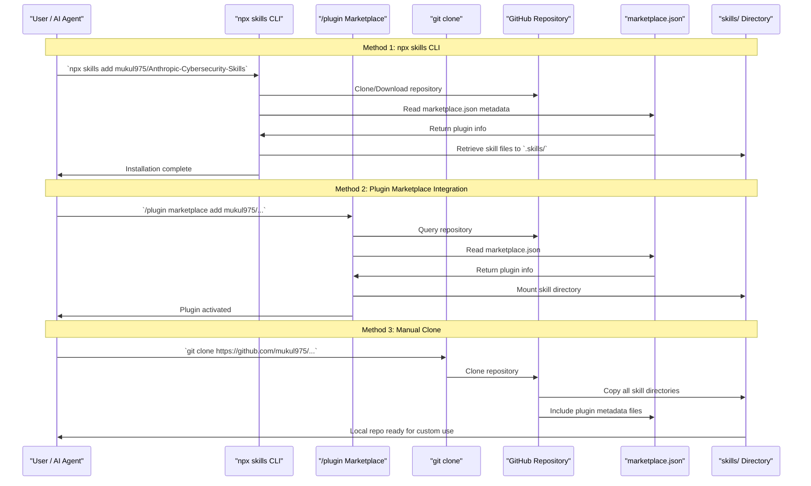

<!-- source: DeepWiki mcp.deepwiki.com · repo mukul975/Anthropic-Cybersecurity-Skills · page 5 Plugin Architecture · fetched 2026-10-26 -->

# Plugin Architecture

<details>
<summary>Relevant source files</summary>

The following files were used as context for generating this wiki page:

- [.claude-plugin/marketplace.json](.claude-plugin/marketplace.json)
- [.claude-plugin/plugin.json](.claude-plugin/plugin.json)
- [.github/workflows/sync-marketplace-version.yml](.github/workflows/sync-marketplace-version.yml)
- [.github/workflows/update-index.yml](.github/workflows/update-index.yml)
- [.github/workflows/validate-skills.yml](.github/workflows/validate-skills.yml)
- [CODE_OF_CONDUCT.md](CODE_OF_CONDUCT.md)
- [README.md](README.md)

</details>


This document explains the plugin system architecture for the **Anthropic Cybersecurity Skills** collection. It covers how the 817+ cybersecurity skills are packaged and distributed using the open `agentskills.io` standard. This enables seamless discovery, installation, and integration of the skills across 26+ AI agent platforms while maintaining metadata consistency, versioning, and licensing compliance.

For in-depth technical details on metadata structures, see the child pages [Marketplace Configuration](#5.1) and [Plugin Metadata](#5.2). For more on how agents efficiently load skills, see [Progressive Disclosure Pattern](#2.3).

---

## Plugin System Overview

The Anthropic Cybersecurity Skills repository implements the [agentskills.io](https://agentskills.io) open standard to package and distribute high-quality cybersecurity skills for AI agents. This plugin architecture is based on two core metadata files located in the `.claude-plugin/` directory:

- `marketplace.json` — The comprehensive package and marketplace descriptor
- `plugin.json` — A minimal plugin identifier metadata file used by select platforms

Together, they define how the skill collection is discovered, versioned, licensed, and integrated.

The core principles of the system include:
- **Standardized Skill Metadata:** Every skill markdown (`SKILL.md`) contains YAML frontmatter metadata providing essential descriptors in a concise format (30-50 tokens), enabling quick filtering and progressive disclosure.
- **Vendor-Neutral Distribution:** The plugin system supports multiple installation and integration mechanisms, allowing the same skills library to be used seamlessly across many AI agent platforms without platform-specific changes.
- **Version Synchronization:** Both metadata files maintain synchronized versioning to ensure consistent plugin identity and package management.
- **Comprehensive Discovery:** Keywords and categories within the metadata provide rich, multi-domain security searchability.

---

## Plugin Package Structure

```mermaid
graph TD
    subgraph ".claude-plugin Directory"
        marketplace["marketplace.json<br/>{name, owner, metadata, plugins[]}"]
        plugin["plugin.json<br/>{name, description, version}"]
    end

    subgraph "Root Repository"
        skills["skills/<br/>817+ SKILL.md files"]
        index["index.json<br/>Aggregated skill catalog"]
    end

    subgraph "marketplace.json Metadata"
        mp_name["name: 'anthropic-cybersecurity-skills'"]
        mp_owner["owner: mukul975 (email)"]
        mp_version["metadata.version: '1.3.0'"]
        mp_description["metadata.description: '817 cybersecurity skills for AI agents...'"]
    end

    subgraph "Plugin Entry in marketplace.json"
        p_name["plugins[0].name: 'cybersecurity-skills'"]
        p_source["plugins[0].source: './' (root)"]
        p_description["plugins[0].description: '817 skills covering all domains'"]
        p_version["plugins[0].version: '1.3.0'"]
        p_author["plugins[0].author.name: 'mukul975'"]
        p_license["plugins[0].license: 'Apache-2.0'"]
        p_keywords["plugins[0].keywords: [cybersecurity, pentesting, forensics, ...]"]
        p_category["plugins[0].category: 'security'"]
        p_homepage["plugins[0].homepage/repository: GitHub URL"]
    end

    marketplace --> mp_name
    marketplace --> mp_owner
    marketplace --> mp_version
    marketplace --> mp_description
    marketplace --> p_name
    marketplace --> p_source
    marketplace --> p_description
    marketplace --> p_version
    marketplace --> p_author
    marketplace --> p_license
    marketplace --> p_keywords
    marketplace --> p_category
    marketplace --> p_homepage

    plugin --> plugin_fields["plugin.json: {name, description, version} (minimal)"]

    p_source --> skills
    skills --> index
```



This structure ensures powerful metadata-driven discovery and indexing. The skills are stored in the `skills/` directory as self-contained skill folders, each with a `SKILL.md` file containing YAML metadata and detailed content.

Sources:  
- [.claude-plugin/marketplace.json:1-37]()  
- [.claude-plugin/plugin.json:1-5]()  
- [README.md:23-103]()

---

## Marketplace Configuration (`marketplace.json`)

The `.claude-plugin/marketplace.json` file serves as the primary registry and descriptor that defines the overall skill package. It contains ownership details, package-level metadata, and a list of individual plugins. This file is the key interface for marketplaces and installation clients.

### Key Fields Overview

| Field | Type | Description |
|-------|------|-------------|
| `name` | string | Unique package identifier (`"anthropic-cybersecurity-skills"`) |
| `owner` | object | Package owner info (name and email) |
| `metadata` | object | Package metadata including `description` and `version` (`"1.3.0"`) |
| `plugins` | array | Array of plugins with metadata about the contained skill sets |

### Plugin Entry Example

The single plugin entry describes this cybersecurity skills collection:

| Field | Value | Notes |
|-------|-------|-------|
| `name` | `"cybersecurity-skills"` | Plugin short identifier |
| `source` | `"./"` | Root directory containing skills |
| `description` | `"817 cybersecurity skills covering web security, pentesting, DFIR, threat intelligence, cloud security, malware analysis, and more. Mapped to 6 frameworks."` | Human-readable description |
| `version` | `"1.3.0"` | Plugin version |
| `author.name` | `"mukul975"` | Author of the plugin |
| `license` | `"Apache-2.0"` | SPDX license |
| `keywords` | Array of 9 security-related keywords | For discovery & search |
| `category` | `"security"` | Marketplace category |
| `homepage` | GitHub repo URL | Documentation & discovery link |
| `repository` | GitHub repo URL | Source repository |

This comprehensive metadata supports both human and automated discovery of the plugin in marketplaces and installs.

Sources:  
- [.claude-plugin/marketplace.json:1-37]()

---

## Plugin Metadata (`plugin.json`)

The `.claude-plugin/plugin.json` file provides a minimal metadata payload with just the essential plugin descriptors: `name`, `description`, and `version`. This minimal format is useful for certain platforms that require a lightweight manifest.

Example excerpt:

```json
{
  "name": "cybersecurity-skills",
  "description": "817 cybersecurity skills covering web security, pentesting, DFIR, threat intelligence, cloud security, malware analysis, and more.",
  "version": "1.3.0"
}
```

Both `plugin.json` and `marketplace.json` maintain synchronized versioning for consistency.

Sources:  
- [.claude-plugin/plugin.json:1-5]()

---

## Distribution Mechanisms

The plugin architecture enables three main installation and usage pathways, supported by the metadata:

| Method | Command or Integration | Description |
|--------|------------------------|-------------|
| **npx skills CLI** | `npx skills add mukul975/Anthropic-Cybersecurity-Skills` | Installs plugin CLI-side by fetching the repo and loading skills in `.skills/` folder - supports platforms like Copilot and Cursor. |
| **Plugin Marketplace** | `/plugin marketplace add mukul975/Anthropic-Cybersecurity-Skills` | Native marketplace loading in Claude Code and compatible environments, dynamically mounting the plugin via the marketplace metadata. |
| **Git Clone** | `git clone https://github.com/mukul975/Anthropic-Cybersecurity-Skills` | Manual or custom integration by direct repository access for development or non-standard platform usage. |

These methods enable flexible distribution matching platform capabilities and user preferences.

### Distribution Workflow Diagram



Sources:  
- [README.md:25-40]()

---

## Platform Integration Architecture

The plugin metadata files drive diverse integration models with AI agent platforms, supporting seamless interoperability.

```mermaid
graph TB
    subgraph "Plugin Metadata Layer"
        mp["marketplace.json (full metadata)"]
        pj["plugin.json (minimal metadata)"]
    end

    subgraph "Native Plugin Platforms"
        claude["Claude Code /plugin command"]
        goose["Goose plugin loader"]
    end

    subgraph "Directory Mount Platforms"
        copilot["GitHub Copilot (.skills/ directory)"]
        cursor["Cursor (project rules)"]
        amp["Amp (skill folder mount)"]
    end

    subgraph "Context File Platforms"
        gemini["Gemini CLI (context files)"]
        openai["OpenAI Codex CLI (file injection)"]
        aider["Aider (repo map)"]
        windsurf["Windsurf (project files)"]
        continue["Continue (context providers)"]
    end

    subgraph "Skill Content Layer"
        skills["skills/*/SKILL.md (YAML frontmatter + body)"]
        index["index.json (aggregated catalog)"]
    end

    mp --> claude
    mp --> goose
    pj --> claude

    mp --> copilot
    mp --> cursor
    mp --> amp

    skills --> copilot
    skills --> cursor
    skills --> amp
    skills --> gemini
    skills --> openai
    skills --> aider
    skills --> windsurf
    skills --> continue

    index --> claude
    index --> goose
```



Platforms either consume the full metadata in `marketplace.json` or the lightweight `plugin.json` to identify and mount these skills for AI agent use. The `plugins[0].source` field (`"./"`) indicates a root directory for locating skill files. This consistent repository layout allows wide compatibility.

Sources:  
- [README.md:88-103]()  
- [.claude-plugin/marketplace.json:1-37]()  
- [.claude-plugin/plugin.json:1-5]()

---

## Version Management

The plugin system carefully synchronizes versioning across metadata files:

| File | Version Field | Current Version |
|-------|---------------|-----------------|
| `.claude-plugin/marketplace.json` | `metadata.version` and `plugins[0].version` | `"1.3.0"` |
| `.claude-plugin/plugin.json` | `version` | `"1.3.0"` |

This dual versioning supports independent tracking of the package container version and the embedded plugin version while keeping both aligned to ensure consistent plugin identity and compatibility.

Version increments follow Semantic Versioning:  
- Major (x.0.0): Breaking API or structure changes  
- Minor (1.x.0): New skills or backward-compatible enhancements  
- Patch (1.0.x): Bug fixes or documentation updates  

Automated workflows keep these versions synchronized on release tags.

Sources:  
- [.claude-plugin/marketplace.json:9-16]()  
- [.claude-plugin/plugin.json:4]()  
- [.github/workflows/sync-marketplace-version.yml:1-44]()

---

## Keyword-Based Discovery

The `keywords` array in `marketplace.json` provides rich descriptors spanning nine primary cybersecurity subdomains:

```json
[
  "cybersecurity",
  "pentesting",
  "forensics",
  "threat-intelligence",
  "cloud-security",
  "malware-analysis",
  "incident-response",
  "zero-trust",
  "devsecops"
]
```

These keywords align closely with the repository's 29 subdomain categories and enable marketplace platforms and agents to efficiently discover, filter, and recommend relevant skills across multiple security disciplines.

Sources:  
- [.claude-plugin/marketplace.json:21-30]()

---

## Licensing and Ownership

The plugin is licensed under the permissive **Apache License 2.0**, specified in the `license` field:

- Supports commercial, modification, and redistribution rights  
- Grants explicit patent rights to contributors  
- Applies to all repository content: skill definitions, scripts, and documentation  

Ownership and contact information are declared to ensure proper attribution and community governance.

Sources:  
- [.claude-plugin/marketplace.json:20]()  
- [README.md:134-138]()

---

## Plugin Category Classification and Repository Linking

The `category` field (`"security"`) ensures marketplaces classify this plugin appropriately for security professionals. The `homepage` and `repository` URLs point to the canonical GitHub repo:

```
https://github.com/mukul975/Anthropic-Cybersecurity-Skills
```

These links enable documentation browsing, issue reporting, update checks, and source verification.

Sources:  
- [.claude-plugin/marketplace.json:32-34]()

---

# Summary

The **Anthropic Cybersecurity Skills** plugin architecture enables scalable, interoperable packaging and discovery of a massive, standardized library of cybersecurity capabilities:

- Complies fully with the `agentskills.io` open standard  
- Uses dual metadata files (`marketplace.json`, `plugin.json`) to describe package and plugin data  
- Packages 817+ skills modularly for vendor-neutral consumption  
- Supports multiple distribution pathways (npx CLI, plugin marketplaces, git clone)  
- Enables discovery via rich keywords, categories, and versioning  
- Integrates with 26+ AI agent platforms via consistent directory structure and metadata references  
- Uses Apache 2.0 licensing to support broad and commercial usage  

For detailed technical schemas and metadata field definitions, see the child pages:  
- [Marketplace Configuration](#5.1)  
- [Plugin Metadata](#5.2)  

This plugin system forms the foundation for enabling AI agents to leverage comprehensive cybersecurity skills in a modular, manageable fashion.

Sources:  
- [README.md:23-103]()  
- [.claude-plugin/marketplace.json:1-37]()  
- [.claude-plugin/plugin.json:1-5]()  
- [.github/workflows/update-index.yml:1-113]()  
- [.github/workflows/sync-marketplace-version.yml:1-44]()

---

