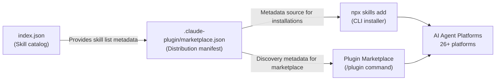
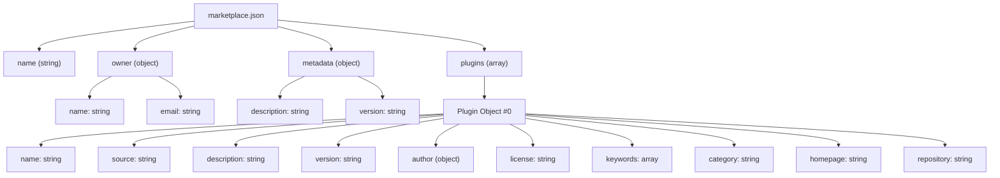
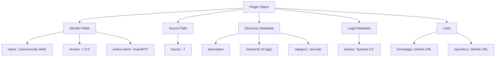
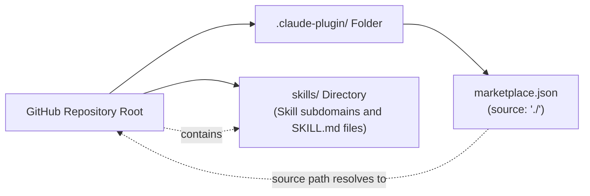
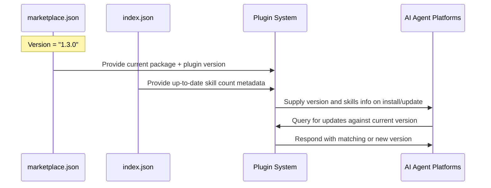
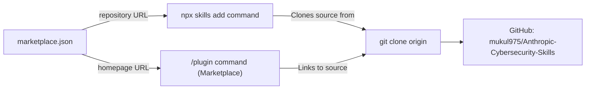
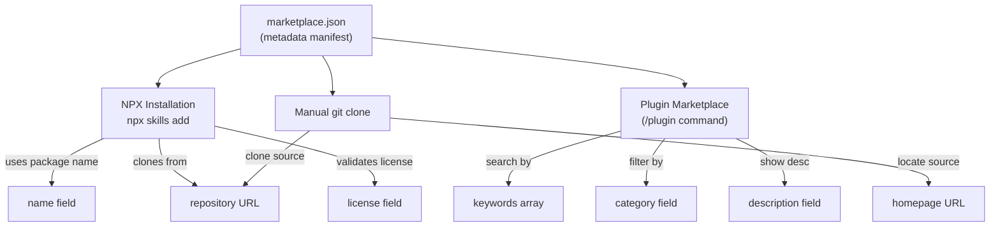
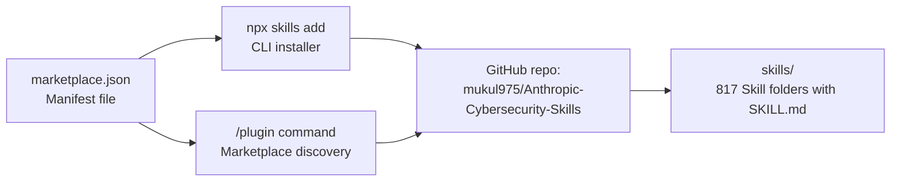
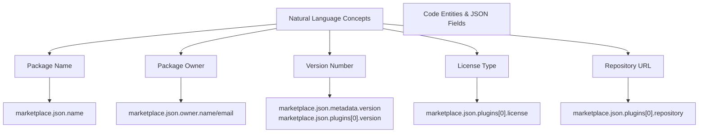

<!-- source: DeepWiki mcp.deepwiki.com · repo mukul975/Anthropic-Cybersecurity-Skills · page 5.1 Marketplace Configuration · fetched 2026-10-26 -->

# Marketplace Configuration

<details>
<summary>Relevant source files</summary>

The following files were used as context for generating this wiki page:

- [.claude-plugin/marketplace.json](.claude-plugin/marketplace.json)
- [.claude-plugin/plugin.json](.claude-plugin/plugin.json)
- [.github/workflows/sync-marketplace-version.yml](.github/workflows/sync-marketplace-version.yml)
- [.github/workflows/update-index.yml](.github/workflows/update-index.yml)
- [.github/workflows/validate-skills.yml](.github/workflows/validate-skills.yml)
- [CODE_OF_CONDUCT.md](CODE_OF_CONDUCT.md)
- [README.md](README.md)

</details>


## Purpose and Scope

This document provides a comprehensive overview of the `marketplace.json` metadata structure used for distributing the Anthropic Cybersecurity Skills package via the agentskills.io plugin marketplace. It outlines the schema, key data fields, and their roles in versioning, ownership, licensing, and repository linkage to enable discovery, installation, and update mechanisms across AI agent platforms.

The `marketplace.json` file serves as the primary manifest for marketplace listing and metadata exchange. Understanding its structure is essential for maintaining package integrity and ensuring smooth integration with multiple distribution channels.

For context on the overall plugin system architecture, refer to [Plugin Architecture](#5). For skill-level metadata details, see [Plugin Metadata](#5.2).

Sources: [.claude-plugin/marketplace.json:1-37]()

---

## File Location and Role

The marketplace configuration resides at:

```
.claude-plugin/marketplace.json
```

This JSON file acts as the central manifest consumed by:

- The agentskills.io plugin marketplace for listing and searching available plugins.
- AI agent platforms when using the `/plugin` command to discover skills.
- Package installation utilities like `npx skills add` for CLI-based installs.
- Automated version tracking and plugin update systems.

It abstracts and centralizes package metadata, enabling compatibility across 26+ AI agent platforms and various distribution methods.

**Marketplace Configuration in Distribution Flow**



Sources: [.claude-plugin/marketplace.json:1-37]()

---

## Top-Level Structure

The root of `marketplace.json` defines four primary keys that organize the package:

- `name`: Unique identifier for the marketplace package.
- `owner`: Metadata about the package maintainer.
- `metadata`: High-level descriptive and versioning information.
- `plugins`: An array of plugin objects defining distributable skill packages.

**Schema Overview**



Sources: [.claude-plugin/marketplace.json:1-37]()

---

## Package Identity and Ownership

| Field         | Type   | Example Value                     | Description                                  |
|---------------|--------|---------------------------------|----------------------------------------------|
| `name`        | string | `"anthropic-cybersecurity-skills"` | Unique marketplace package identifier        |
| `owner.name`  | string | `"mukul975"`                    | GitHub username of the package owner         |
| `owner.email` | string | `"mukuljangra5@gmail.com"`       | Contact email for maintainer                  |

- The `name` uniquely identifies the package in the marketplace and generally matches the repository name in kebab-case.
- The `owner` object holds essential maintainer contact info used for notifications and security responses.

Sources: [.claude-plugin/marketplace.json:2-6]()

---

## Package Metadata

This object provides descriptive and versioning data about the package.

| Field         | Value                                                                                                   | Description                                   |
|---------------|---------------------------------------------------------------------------------------------------------|-----------------------------------------------|
| `description` | `"817 cybersecurity skills for AI agents mapped to 6 frameworks: MITRE ATT&CK, NIST CSF 2.0, ..."` | Short human-readable description for discovery |
| `version`     | `"1.3.0"`                                                                                               | Semantic version of the overall package       |

The `description` highlights the package contents: 817 cybersecurity skills mapped to six prominent frameworks. The version marks the release iteration of the entire skill set package.

Sources: [.claude-plugin/marketplace.json:7-10]()

---

## Plugins Array

The marketplace package may contain multiple plugins. Here, it includes one primary plugin `"cybersecurity-skills"` bundling all 817 skills.

**Plugin Object Schema**



Sources: [.claude-plugin/marketplace.json:11-36]()

### Plugin Field Details

| Field            | Type          | Example Value                                  | Purpose                                             | Source line ref              |
|------------------|---------------|------------------------------------------------|-----------------------------------------------------|-----------------------------|
| `name`           | string        | `"cybersecurity-skills"`                        | Plugin identifier (distinct from package name)      | 13                          |
| `source`         | string        | `"./"`                                         | Path relative to `.claude-plugin/`, root of skills  | 14                          |
| `description`    | string        | Long plugin description including skill count  | Marketplace listing explanation                      | 15                          |
| `version`        | string        | `"1.3.0"`                                      | Plugin version aligned with package version          | 16                          |
| `author.name`    | string        | `"mukul975"`                                   | Plugin author name                                   | 18                          |
| `license`        | string        | `"Apache-2.0"`                                 | SPDX license identifier                              | 20                          |
| `keywords`       | array[string] | `["cybersecurity", "pentesting", ...]`        | Tags for search and filtering in marketplace        | 21-30                       |
| `category`       | string        | `"security"`                                   | Marketplace classification                           | 32                          |
| `homepage`       | string        | `"https://github.com/mukul975/Anthropic-Cybersecurity-Skills"` | Project homepage for links                          | 33                          |
| `repository`     | string        | Also GitHub URL matching homepage               | Source repository URL for cloning and issue tracking | 34                          |

Sources: [.claude-plugin/marketplace.json:11-36]()

---

## Source Path Configuration

The `source` field with value `"./"` specifies that the plugin's skill files are in the repository root relative to `.claude-plugin/`. Practically, this points to the `skills/` directory that contains subdomain folders and skill definitions.

**Source Path Resolution**



Sources: [.claude-plugin/marketplace.json:14]()

---

## Discovery Keywords and Categorization

The `keywords` array lists nine thematic tags to facilitate filtering and searchability in plugin marketplaces:

```json
[
  "cybersecurity",
  "pentesting",
  "forensics",
  "threat-intelligence",
  "cloud-security",
  "malware-analysis",
  "incident-response",
  "zero-trust",
  "devsecops"
]
```

These tags cover the major domains swept by the 29 security subdomains of the skills library, reflecting typical cybersecurity functional areas.

The `category` field `"security"` aligns the plugin under cybersecurity-related marketplace segments.

Sources: [.claude-plugin/marketplace.json:21-32]()

---

## Versioning Strategy

The `marketplace.json` uses semantic versioning at two levels to clearly identify release iterations:

| Level            | Field                    | Version    | Notes                                      |
|------------------|--------------------------|------------|--------------------------------------------|
| Package-level    | `metadata.version`       | `"1.3.0"`  | Overall package version identifier           |
| Plugin-level     | `plugins[0].version`     | `"1.3.0"`  | Synchronized with package version             |

Versioning follows MAJOR.MINOR.PATCH semantics:

- **MAJOR**: Breaking schema or structure changes in package or plugin.
- **MINOR**: Added skills or expanded content.
- **PATCH**: Fixes to metadata, documentation, or minor corrections.

**Version Propagation Flow**



Sources: [.claude-plugin/marketplace.json:9,16]()

---

## Licensing and Legal Configuration

The plugin declares `"Apache-2.0"` as its license, using the SPDX identifier. This choice provides:

- Permissions for commercial use, modification, and distribution.
- Requirements for attribution and preserving license notices.
- A patent grant from contributors.
- Disclaimer of warranties and limitation of liability.

This license applies to all skill files, scripts, references, and documentation within the repository.

Sources: [.claude-plugin/marketplace.json:20]()

---

## Repository and Homepage Links

The `homepage` and `repository` fields both point to the same GitHub repository URL:

```json
"https://github.com/mukul975/Anthropic-Cybersecurity-Skills"
```

These URLs offer multiple utilities:

- Marketplace listings link to documentation and issue trackers.
- Plugin installation processes can clone source code.
- Users can report bugs or contribute via GitHub.
- Automation tools verify package provenance and authenticity.

**Repository Link Utilization**



Sources: [.claude-plugin/marketplace.json:33-34]()

---

## Integration with Distribution Channels

The `marketplace.json` metadata supports three main distribution mechanisms:

### NPX CLI Installation

- The `npx skills add` command uses the package `name` to resolve the plugin.
- It clones the repository using the `repository` URL.
- Checks compliance via the `license` field.
- Installs the content into platform-specific `.skills/` directories for runtime use.

### Plugin Marketplace Discovery

- AI platforms leveraging the `/plugin` command consume `marketplace.json` metadata.
- Search and filter by `keywords`, `category`, and `description`.
- Show version info for update awareness.

### Manual Git Clone

- Users manually cloning the repository can find the URL in `homepage` or `repository`.
- This supports offline inspection or customized installation.

**Distribution Channel Overview**



Sources: [.claude-plugin/marketplace.json:1-37]()

---

## Configuration Maintenance and Automation

The marketplace configuration is maintained through:

- Manual edits to `.claude-plugin/marketplace.json` reflecting package updates.
- Version bumping synchronized across `metadata.version` and plugin's `version`.
- Periodic updates to the `description` fields to reflect accurate skill counts (currently 817 skills).
- Keyword adjustments to mirror changes in the skills taxonomy.

Notably, while `index.json` is automatically generated via the GitHub Actions workflow defined in `.github/workflows/update-index.yml` (which aggregates all skills metadata dynamically), the `marketplace.json` is manually managed but kept in sync via automated version bumping on release events (`.github/workflows/sync-marketplace-version.yml`).

This blend ensures metadata accuracy across installation and discovery flows.

Sources: [.claude-plugin/marketplace.json:1-37](), [.github/workflows/update-index.yml:1-113](), [.github/workflows/sync-marketplace-version.yml:1-44]()

---

# Bridging Natural Language Space to Code Entity Space

## Diagram 1: Marketplace Configuration and Distribution Entities



This diagram relates the natural language terms like "Marketplace configuration", "Installer", and "Discovery command" to their specific code artifacts and files within the repository.

---

## Diagram 2: Metadata Field Mapping



This diagram cross-references natural language metadata concepts to exact JSON fields and locations in `marketplace.json`, enabling precise understanding for developers.

---

# Summary

The `.claude-plugin/marketplace.json` file is the authoritative distribution manifest for the Anthropic Cybersecurity Skills plugin marketplace exposure. It encodes package identity, ownership, detailed metadata, licensing, versioning, and source repository information in a hierarchical JSON format.

This configuration enables a wide ecosystem of AI agent platforms and installers to discover, verify, and integrate the 817 cybersecurity skills, maintaining consistency with the agentskills.io marketplace protocol.

The versioning scheme and keywords ensure robust lifecycle management and discoverability in the growing ecosystem of AI-powered cybersecurity tools.

Sources:  
- [.claude-plugin/marketplace.json:1-37]()  
- [.github/workflows/update-index.yml:1-113]()  
- [.github/workflows/sync-marketplace-version.yml:1-44]()

---

